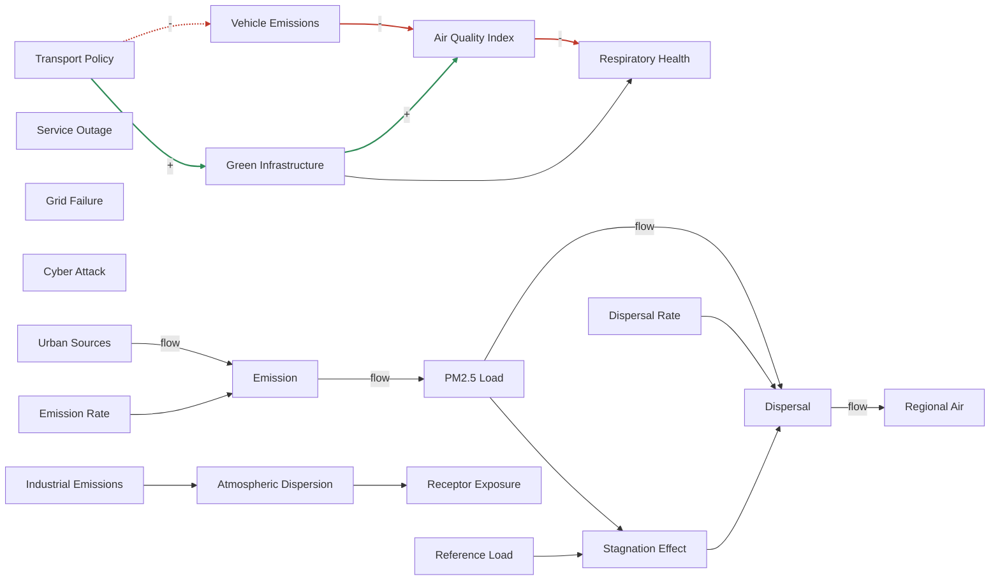

# Worked Example Transcript

Auto-generated by `worked_example/worked_example.py`. Do not edit by hand — rerun the script to regenerate.

This transcript demonstrates every CLI command in the current version of `latris`, exercised against a sample project.

## Capability Check

Before creating a project, an agent can check what Latris can actually do today — registry-only, no project needed.

### `latris capabilities`

```
Latris model-type capabilities                         
┌───────────────────┬───────────────────┬────────────────┬────────────────────┐
│ ID                │ Name              │ Status         │ Description        │
├───────────────────┼───────────────────┼────────────────┼────────────────────┤
│ bn                │ Bayesian Network  │ available      │ DAG with state     │
│                   │                   │                │ spaces and         │
│                   │                   │                │ conditional        │
│                   │                   │                │ probability        │
│                   │                   │                │ tables.            │
│ cld               │ Causal Loop       │ available      │ Directed graph     │
│                   │ Diagram           │                │ with polarity      │
│                   │                   │                │ (+/−) on edges;    │
│                   │                   │                │ cycles allowed.    │
│ dag               │ Directed Acyclic  │ available      │ Directed graph     │
│                   │ Graph             │                │ that must be       │
│                   │                   │                │ acyclic;           │
│                   │                   │                │ directionality     │
│                   │                   │                │ mandatory.         │
│ fcm               │ Fuzzy Cognitive   │ available      │ Weighted directed  │
│                   │ Map               │                │ graph with edge    │
│                   │                   │                │ strengths in [−1,  │
│                   │                   │                │ +1]; cycles        │
│                   │                   │                │ allowed.           │
│ sd                │ System Dynamics   │ available      │ Stocks, flows, and │
│                   │                   │                │ feedback loops     │
│                   │                   │                │ with unit-checked  │
│                   │                   │                │ equations,         │
│                   │                   │                │ simulated over     │
│                   │                   │                │ time, with         │
│                   │                   │                │ scenarios, Monte   │
│                   │                   │                │ Carlo uncertainty  │
│                   │                   │                │ bands,             │
│                   │                   │                │ sensitivity, and   │
│                   │                   │                │ loop dominance.    │
│ bow_tie           │ Bow-Tie Diagram   │ on the roadmap │ Threat–barrier–co… │
│                   │                   │                │ topology for risk  │
│                   │                   │                │ analysis.          │
│ event_tree        │ Event Tree        │ on the roadmap │ Forward-logic tree │
│                   │                   │                │ from initiating    │
│                   │                   │                │ event through      │
│                   │                   │                │ barriers to        │
│                   │                   │                │ outcomes for       │
│                   │                   │                │ safety analysis.   │
│ fault_tree        │ Fault Tree        │ on the roadmap │ Top-down failure   │
│                   │                   │                │ decomposition with │
│                   │                   │                │ AND/OR logic       │
│                   │                   │                │ gates.             │
│ gsn               │ Goal Structuring  │ on the roadmap │ Safety-case        │
│                   │ Notation          │                │ argumentation:     │
│                   │                   │                │ goals, strategies, │
│                   │                   │                │ solutions,         │
│                   │                   │                │ context.           │
│ theory_of_change  │ Theory of Change  │ on the roadmap │ Logic model        │
│                   │                   │                │ linking activities │
│                   │                   │                │ through outputs    │
│                   │                   │                │ and outcomes to    │
│                   │                   │                │ long-term goals.   │
│ decision_tree     │ Decision Tree     │ parked         │ Sequential         │
│                   │                   │                │ decision model     │
│                   │                   │                │ with chance and    │
│                   │                   │                │ decision nodes     │
│                   │                   │                │ branching to       │
│                   │                   │                │ outcomes.          │
│ influence_diagram │ Influence Diagram │ parked         │ Extension of       │
│                   │                   │                │ Bayesian network   │
│                   │                   │                │ with decision and  │
│                   │                   │                │ utility nodes for  │
│                   │                   │                │ decision analysis. │
│ markov            │ Markov Chain /    │ parked         │ State-transition   │
│                   │ MDP               │                │ graph with         │
│                   │                   │                │ transition         │
│                   │                   │                │ probabilities and  │
│                   │                   │                │ optional rewards.  │
│ argument_map      │ Argument Map      │ not planned    │ Toulmin/IBIS-style │
│                   │                   │                │ argumentation:     │
│                   │                   │                │ claims, warrants,  │
│                   │                   │                │ evidence,          │
│                   │                   │                │ rebuttals.         │
│ causal_dag        │ Causal DAG        │ not planned    │ DAG with           │
│                   │                   │                │ observed/unobserv… │
│                   │                   │                │ classification and │
│                   │                   │                │ adjustment sets.   │
│                   │                   │                │ Being folded into  │
│                   │                   │                │ the DAG view as    │
│                   │                   │                │ identification     │
│                   │                   │                │ analyses rather    │
│                   │                   │                │ than a separate    │
│                   │                   │                │ model type.        │
│ fishbone          │ Ishikawa /        │ not planned    │ Root cause         │
│                   │ Fishbone Diagram  │                │ analysis diagram   │
│                   │                   │                │ with categorised   │
│                   │                   │                │ cause branches     │
│                   │                   │                │ converging on an   │
│                   │                   │                │ effect.            │
│ flowchart         │ Process Map /     │ not planned    │ Activity-decision… │
│                   │ Flowchart         │                │ flow for process   │
│                   │                   │                │ modelling.         │
│ petri_net         │ Petri Net         │ not planned    │ Bipartite graph of │
│                   │                   │                │ places and         │
│                   │                   │                │ transitions for    │
│                   │                   │                │ concurrent         │
│                   │                   │                │ systems.           │
│ regression        │ Regression        │ not planned    │ DAG with           │
│                   │                   │                │ fitted/elicited    │
│                   │                   │                │ edge coefficients  │
│                   │                   │                │ —                  │
│                   │                   │                │ linear/logistic/G… │
│                   │                   │                │ Doubles as the     │
│                   │                   │                │ quantification of  │
│                   │                   │                │ causal/DAG edges.  │
│ state_machine     │ State Machine /   │ not planned    │ States and         │
│                   │ Statechart        │                │ transitions with   │
│                   │                   │                │ guards and actions │
│                   │                   │                │ for reactive       │
│                   │                   │                │ system modelling.  │
└───────────────────┴───────────────────┴────────────────┴────────────────────┘

Excluded by design (not planned — won't be added):
  - Black-box machine learning (random forests, gradient boosting, neural 
networks): Decision logic cannot be inspected cell-by-cell, evidenced, or 
challenged. Out of design intent, not merely 'not yet' — the inspectability 
test: decision logic must be inspectable cell-by-cell, evidenced, and 
challengeable.
  - Opaque structure learning (learning model structure from data without 
inspectable claims): Latris governs claims a human drew and can defend, not 
discovered structure. Fitting legible parameters (e.g. regression coefficients)
onto a structure a modeller drew is in scope; discovering the structure itself 
from data is not.
  - General-purpose simulation frameworks (SEM, ABM): Not registered as a model
type; no current plan to add.

Reports — `latris export md --pack <name> [--model-type <type>] -o
report.md`
  - client: for people outside the modelling work — a client, board or funder —
answer first: the interpretation, the diagram, results (simulations, 
uncertainty, queries), findings, contested links (sources for and against), 
then each link with its reasoning and evidence, and sources — without internal 
IDs or the change log.
  - audit: for an auditor or the modelling team — the complete record — every 
section, including decisions, sign-offs, sessions and data.
  - review: for a reviewer checking the model — the model with its evidence, 
open challenges and questions, and findings.
  - workshop: for a working session with stakeholders — structure, assumptions,
open questions and session notes.
  - publication: for a paper or public write-up — the model, evidence, 
findings, interpretation and full references, without internal IDs.
  Board-ready prose: The client and publication packs include an 
interpretation: the answer to the modelling question, implications, confidence 
and open questions, each written from claims Latris extracts from the model. 
`latris interpret initialise`, then for each section either `latris interpret 
generate-prose <section>` (needs an AI key) or read its claims with `latris 
interpret show <section>` and write the prose yourself with `latris interpret 
set-prose <section> "..." --by ai`.
  Link for a person: latris link — prints a link that opens this model in the 
Latris app. Making it needs no network (the model travels inside the link); 
opening it needs app.latris.app. It opens a hosted report with the full Latris 
figure (loops, polarity, evidence) that the person can share, and save to a 
free account for the editor and Word. The link itself never stops working; the 
short report address it opens lasts 30 days unless saved, and saving gives a 
short link that doesn't expire. `export md` also puts this link under the 
diagram, made fresh on every export. Give the person this link alongside (or 
instead of) the Markdown.
  Ready to hand over? latris check handover — lists what's left before a board 
sees it (links with no source, citations not checked against their source, 
findings waiting for approval, sections without prose, contradictions), each 
with how to fix it. Exits 1 until it's clear.
  In the Latris app (https://app.latris.app): Word report, HTML review pack 
(and importing completed reviews), scrollytelling story, hosted report link (no
sign-in to view).

Building
  - guide: latris docs — the guide for AI agents, from the installed package 
(no network needed).
  - whole model in one step: latris build --spec model.yaml (YAML or JSON; '-' 
reads stdin): factors, links with polarity and reasons, sources, citations, 
evidence against, assumptions, questions and the outcome, as one commit. The 
spec is checked in full first; a mistake changes nothing. `latris build --help`
lists every key and allowed value.
  - evidence for: latris evidence add "<from> -> <to>" polarity <bibkey> 
[--verified-by ai]
  - checking a source: latris evidence check "<from> -> <to>" polarity <bibkey>
supports|against|off-topic --rationale "..." [--by ai --quote "..."] — records 
whether the source actually supports the claim; until then reports count the 
citation as not yet checked. The quote is looked up in the text Latris holds 
for the source (save it with `latris ref snapshot` first); an AI's paraphrase 
is refused.
  - evidence against: latris evidence add <link> polarity <bibkey> 
--contradicts — a source that argues against the link; reports show the link's 
sources for and against under 'Contested links'. Still unchecked until someone 
reads it.
  - correcting sources: latris ref edit <key> --doi|--url|--title ... ("" 
clears), latris ref remove <key> [--with-citations], latris evidence remove 
<link> polarity <key> — recorded changes; never hand-edit the YAML. A source 
read in another: --cited-via <key>.
  - outcome: latris view role cld <factor> outcome — marks what the model 
explains so it isn't suggested as an intervention point.
```

_The documentation ships with the package, for sandboxes that can't reach GitHub: `latris docs` prints the guide for AI agents, `latris docs readme` the whole README, and `latris docs llms` the documentation map below._

### `latris docs llms`

```
# Latris

> Latris is an evidence-native modelling workbench — a Python CLI plus a
> FastAPI/WebSocket server backend — where every project is a git repo,
> evidence and provenance are first-class data, and AI assistance produces
> human-approved structured proposals. This file maps the documentation
> for AI agents; humans start at README.md.

## Project

- [README.md](README.md): what Latris is, install, quickstart, and an "For AI agents" quickstart section.
- (https://latris.app): the product website. The Latris app (app.latris.app — the GUI, hosted report links, Word / review-pack / story exports) is built on this open library.
- (docs/README.md): documentation index.
- [CONTRIBUTING.md](CONTRIBUTING.md): how to set up a dev environment and submit changes.
- [LICENSE](LICENSE): Apache-2.0.

## Engineering docs (source of truth for how the system works)

- (docs/engineering/ARCHITECTURE.md): three-layer architecture (substrate → conceptual → formal views), module layout, the five chokepoint files, CLI↔server boundary contract.
- (docs/engineering/SCHEMA_NOTES.md): pydantic models ↔ YAML mapping, provenance axes, the on-disk project format.
- (docs/engineering/GIT_INTEGRATION.md): auto-commit model, identity enforcement, semantic diffs, collaboration model.
- (docs/engineering/AI_LAYER.md): LLM wiring (litellm + instructor + keyring), the closed prompt library, call flow, mock mode (LATRIS_AI_MOCK), delegated invocation for external agents (`ai task emit`/`ai task apply` — no API key).
- (docs/engineering/CLI_REFERENCE.md): the full `latris` command catalogue.
- (docs/engineering/TESTING.md): test layers, hermetic test contract, coverage policy.

## The worked example (acceptance test, always current)

- (worked_example/worked_example_output.md): generated transcript of every CLI command, end to end — the fastest way to learn the tool's actual behaviour.
- (worked_example/worked_example.py): the generator; any new user-facing feature must extend it.

## Building a model with the CLI (start here)

- No network? `latris docs` prints the README's "For AI agents" section from the installed package (`latris docs readme`, `latris docs llms` for this file).

- The README's "For AI agents" section has a complete causal-loop-diagram session: git identity, nodes, links by label, polarity with a rationale (`latris view set cld <edge> polarity + --rationale "..."`), sources and evidence, coherence and loop checks, findings (`latris finding add`), and the client report with a Mermaid diagram (`latris export md --pack client --no-ai`).
- `latris --json <command>` gives machine-readable output for the core commands, analyses (loops, paths, adjustment sets), BN/SD/FCM parameters, inference and simulation.
- Ask before you build: unless the request already says, ask the person (one message, at most three short questions) for the background and the decision it informs, who will read it, and what they expect the answer to be. Record it with `context:` in a build spec (`background`, `audience`, `boundary`, `intuition`) or `latris project set background|audience|boundary|predictions "..."`; the report opens with it. If they'd rather you just build, record each unanswered point with `latris question add` or `latris assumption add`.
- Keep what you read: `extract:` on a source in a build spec (or `latris ref snapshot <key> --url ... --extract "..."`) stores the abstract or passage you read, so a check of that source is grounded in visible text.
- One model, several views: `latris project select-models cld fcm` (or `bn`, `dag`) adds a quantitative view of the same factors and links — set weights or probability tables on the diagram you have instead of starting again.
- As an AI agent, `export LATRIS_DEFAULT_ORIGIN=ai-proposed` first, so the nodes, links, evidence and findings you create are recorded as AI-proposed rather than as the person's own work.
- Build a whole model in one step: `latris build --spec model.yaml` (YAML or JSON; `-` reads stdin) adds factors, links with polarity and reasons, sources, citations, assumptions (with target and rationale), questions, proposed findings, challenges, interpretation prose and the outcome as one commit, after checking the whole spec — `latris build --help` lists every key. Mark the outcome with `outcome:` (or `latris view role cld "<factor>" outcome`) so it isn't suggested as an intervention point.
- Quantify and stress-test: system dynamics scenarios (`latris sd set-scenario NAME --set "Var=value"`, compared by `sd simulate --scenario NAME`), uncertainty ranges (`sd set-uncertainty <node> triangular --min --mode --max`) feeding `sd monte-carlo` (percentile bands, seeded) and `sd sensitivity <variable>` (tornado, unreviewed values flagged), and `sd loops` (which feedback loop dominates, when). Results — and `bn query` posteriors — are recorded; the client report shows the latest of each with charts in the hosted report, and they become interpretation claims. A `latris link` carries the parameters and analyses and recomputes them on opening; `latris build --spec` takes `sd:`, `bn:` and `analyses:` blocks.
- Bayesian networks: soft evidence `latris bn query -s "Node=state:0.8"` (afterwards the node is 80% that state; `--likelihood` for likelihood ratios), the most likely explanation `latris bn explain -e "Node=state"` (MPE; `--over` for MAP), and probabilistic sensitivity — `latris bn set-uncertainty <node> --n 20` ("worth 20 observations") then `latris bn monte-carlo <target>` (point estimate with 50%/95% intervals and which tables drive them). All recorded for the report and carried by `latris link`.
- Links true by definition or accounting (departures reduce active volunteers): `confidence: by-definition` in a build spec, or `latris attr set <link> confidence by-definition`. They need no source, don't count against coverage, and the figure draws them solid, not as unproven.
- Checking a source: `latris evidence check "<from> -> <to>" polarity <bibkey> supports|against|off-topic --rationale "..."` records whether the source supports the claim (a person by default; `--by ai` for an agent that read it). Until then reports say "not yet checked against the source".
- Quotes are looked up, not trusted: an agent's `supports` needs `--quote` copied from text Latris holds for the source (a saved `extract` / `ref snapshot`, `ref fetch`, or the abstract; whitespace, quote marks and case are forgiven, `...` marks a gap). A paraphrase is refused, so save the passage you read first. The report says what each check rests on (an extract of the full text, or the abstract or a summary).
- Before handing over: `latris check handover` lists what's left (unsourced links, unchecked citations, sources with nothing on file showing they were read, quotes not found in the stored text, unapproved findings, sections without prose or out of date, contradictions) with a fix for each; exits 1 until clear.
- Evidence against a link: `latris evidence add <link> polarity <bibkey> --contradicts` (or `contradicts: [<bibkey>]` on a link in a build spec). It stays on the same link as the supporting sources; reports show both sides under "Contested links" and it doesn't count toward coverage. It is still unchecked until someone reads it (`evidence check ... against`).
- Correct the record with commands, not by editing YAML: `latris ref edit <key> --doi|--url|--title ...` (`""` clears), `latris ref remove <key> [--with-citations]`, `latris evidence remove <link> <attribute> <key>`. Give only identifiers you have seen; a source read only as described in another takes `--cited-via <key>` (`cited_via:` in a spec) and the report says it was read second-hand.
- Prose goes out of date: when the model changes after a section was written, `interpret list`/`show`, `check handover` and the report flag it; `latris interpret refresh-claims`, then rewrite it.
- With the Latris connector available (mcp.latris.app chat tools: `create_model`, `get_report`, ...), use it instead of the CLI: its `report_url` is a short link to share. `latris link` is for when there is no connector.
- Giving the model to a person: `latris link` prints a link that opens it in the Latris app (app.latris.app) as a hosted report with the full figure, which they can share or save to a free account (editor, Word). Making it needs no network — the model travels inside the link — so it works from sandboxes with no network to latris.app; opening it needs app.latris.app. The link never stops working; the short report address it opens lasts 30 days unless the model is saved, and saving gives a short link that doesn't expire.
- Reports: five packs for different readers (client, publication, review, workshop, audit) — `latris capabilities` describes them. The board-ready version is the `client` pack (answer first, then the diagram, findings and evidence) with its interpretation sections written: `latris interpret initialise`, then `interpret show <section>` and `interpret set-prose <section> "..." --by ai` (no API key needed).

## Delegated AI invocation (no API key in this environment?)

- Any of the 46 closed prompts can be answered by you, the agent, instead of a vendor API: `latris ai task emit <PromptName> --inputs '<json>'` writes a self-contained task package (system + user context + response JSON schema). Answer with JSON matching `response_schema`, then have the human run `latris ai task apply --task task.json --from response.json`. Validation, approval gates, and provenance are identical to API calls; the interaction logs `model_id` as `external-agent[:name]`. See (docs/engineering/AI_LAYER.md) § "Delegated calls (bring your own agent)".

## Working rules for agents in this repo

- Read [CLAUDE.md](CLAUDE.md) and (src/latris/CLAUDE.md) before editing code.
- The per-project state directory is `.graph-tooling` — a frozen data-format constant; never rename it.
- Run tests with `python -m pytest` (parallel by default); regenerate the worked-example transcript with `pytest tests/test_worked_example.py --slow` after changing CLI behaviour.
```


## Project Setup

Initialise a new project with a modelling question.

### `latris init C:\Users\dainy\AppData\Local\Temp\latris-demo-owbew0z6\air-quality-model --question What factors drive urban air quality and how do they affect health outcomes?`

```
initialised project at 
C:/Users/dainy/AppData/Local/Temp/latris-demo-owbew0z6/air-quality-model
```

### `latris project set coverage_dimensions emission sources, atmospheric dispersion, exposure, health outcomes, policy levers`

```
set coverage_dimensions (96f5ab6a0f)
```

### `latris project set granularity_level each node a specific measurable variable a city air-quality team could track`

```
set granularity_level (d4cb553bcc)
```

### `latris project set audience a municipal air-quality and public-health team`

```
set audience (5abda4b93a)
```

### `latris project show`

```
project root: 
C:/Users/dainy/AppData/Local/Temp/latris-demo-owbew0z6/air-quality-model
modelling question: What factors drive urban air quality and how do they affect
health outcomes?
selected models: (none)
schema version: 6
created: 2026-11-09T12:30:26+11:00
updated: 2026-11-09T12:30:27+11:00
```


## Building the Model

Add entities (nodes) and causal relationships (edges).

### `latris node add Vehicle Emissions --kind variable`

```
added variable Vehicle Emissions (node_01M6YYV6FT07TD59NQQK37X7Q2) · commit 
eb183de840
```

### `latris node add Air Quality Index --kind variable`

```
added variable Air Quality Index (node_01M6YYV6QD2BCF4EC3HKVN24DA) · commit 
5f6fe3e743
```

### `latris node add Respiratory Health --kind variable`

```
added variable Respiratory Health (node_01M6YYV6YT5RBDC47Z6ETPEDFA) · commit 
a33edaa7ab
```

### `latris node add Green Infrastructure --kind concept`

```
added concept Green Infrastructure (node_01M6YYV756EG534G2Z7MGWYC8E) · commit 
095e2eb97b
```

### `latris node add Transport Policy --kind decision`

```
added decision Transport Policy (node_01M6YYV7C5YNQZJSDAY1T2Y1MJ) · commit 
17963af006
```

### `latris node list`

```
┌─────────────────────────────────┬──────────┬──────────────────────┐
│ ID                              │ Kind     │ Label                │
├─────────────────────────────────┼──────────┼──────────────────────┤
│ node_01M6YYV6FT07TD59NQQK37X7Q2 │ variable │ Vehicle Emissions    │
│ node_01M6YYV6QD2BCF4EC3HKVN24DA │ variable │ Air Quality Index    │
│ node_01M6YYV6YT5RBDC47Z6ETPEDFA │ variable │ Respiratory Health   │
│ node_01M6YYV756EG534G2Z7MGWYC8E │ concept  │ Green Infrastructure │
│ node_01M6YYV7C5YNQZJSDAY1T2Y1MJ │ decision │ Transport Policy     │
└─────────────────────────────────┴──────────┴──────────────────────┘
```

### `latris edge add node_01M6YYV6FT07TD59NQQK37X7Q2 node_01M6YYV6QD2BCF4EC3HKVN24DA --kind causal`

```
added edge edge_01M6YYV7PKWSGNBHM2PYKNZPA2 (causal) · commit dc9ff7c650
```

### `latris edge add node_01M6YYV6QD2BCF4EC3HKVN24DA node_01M6YYV6YT5RBDC47Z6ETPEDFA --kind causal`

```
added edge edge_01M6YYV7XJKRVC34GNSKC2MQ2P (causal) · commit 1dbf48b971
```

### `latris edge add node_01M6YYV756EG534G2Z7MGWYC8E node_01M6YYV6QD2BCF4EC3HKVN24DA --kind causal`

```
added edge edge_01M6YYV84YZSPS0Q8X48H9XXY8 (causal) · commit 8a4ec664e9
```

### `latris edge add node_01M6YYV7C5YNQZJSDAY1T2Y1MJ node_01M6YYV6FT07TD59NQQK37X7Q2 --kind causal`

```
added edge edge_01M6YYV8BZ8XR5A2ZAZB18AJEV (causal) · commit 632ff99e5e
```

### `latris edge add node_01M6YYV756EG534G2Z7MGWYC8E node_01M6YYV6YT5RBDC47Z6ETPEDFA --kind causal`

```
added edge edge_01M6YYV8JWAHDMKK5NWKWARX4H (causal) · commit 761c150ca3
```

### `latris edge list`

```
┌─────────────────────┬────────┬─────────────────────┬───┬────────────────────┐
│ ID                  │ Kind   │ From                │ → │ To                 │
├─────────────────────┼────────┼─────────────────────┼───┼────────────────────┤
│ edge_01M6YYV7PKWSG… │ causal │ Vehicle Emissions   │ → │ Air Quality Index  │
│                     │        │ (node_01M6YYV…)     │   │ (node_01M6YYV…)    │
│ edge_01M6YYV7XJKRV… │ causal │ Air Quality Index   │ → │ Respiratory Health │
│                     │        │ (node_01M6YYV…)     │   │ (node_01M6YYV…)    │
│ edge_01M6YYV84YZSP… │ causal │ Green               │ → │ Air Quality Index  │
│                     │        │ Infrastructure      │   │ (node_01M6YYV…)    │
│                     │        │ (node_01M6YYV…)     │   │                    │
│ edge_01M6YYV8BZ8XR… │ causal │ Transport Policy    │ → │ Vehicle Emissions  │
│                     │        │ (node_01M6YYV…)     │   │ (node_01M6YYV…)    │
│ edge_01M6YYV8JWAHD… │ causal │ Green               │ → │ Respiratory Health │
│                     │        │ Infrastructure      │   │ (node_01M6YYV…)    │
│                     │        │ (node_01M6YYV…)     │   │                    │
└─────────────────────┴────────┴─────────────────────┴───┴────────────────────┘
```

### `latris node show Vehicle Emissions`

```
id: node_01M6YYV6FT07TD59NQQK37X7Q2
kind: variable
label: Vehicle Emissions
created: 2026-11-09T01:30:27.706000+00:00
```


## Model Selection (Formalise)

With the causal structure in place, choose the formalisms to apply. This mirrors the GUI's Build -> Formalise spine: build the substrate first, then select model types (CLD and DAG here) and parameterise each. The model-specific attributes that follow — CLD polarity, FCM weights, BN CPTs — and the formal views all hang off this selection.

_Select target model types — CLD and DAG._

### `latris project select-models cld dag`

```
selected model types: cld, dag (954190264c)
```

### `latris project show`

```
project root: 
C:/Users/dainy/AppData/Local/Temp/latris-demo-owbew0z6/air-quality-model
modelling question: What factors drive urban air quality and how do they affect
health outcomes?
selected models: cld, dag
schema version: 6
created: 2026-11-09T12:30:26+11:00
updated: 2026-11-09T12:30:30+11:00
```


## Setting Attributes

Add descriptions, confidence levels, and polarity to edges.

### `latris attr set node_01M6YYV6FT07TD59NQQK37X7Q2 description Total pollutant output from road transport including PM2.5, NOx, and CO.`

```
set description on node_01M6YYV6FT07TD59NQQK37X7Q2 · commit 7c8207afc8
```

### `latris attr set node_01M6YYV6QD2BCF4EC3HKVN24DA description Composite measure of ambient air pollution concentration.`

```
set description on node_01M6YYV6QD2BCF4EC3HKVN24DA · commit 252593823f
```

### `latris attr set node_01M6YYV6YT5RBDC47Z6ETPEDFA description Population-level respiratory morbidity and mortality rates.`

```
set description on node_01M6YYV6YT5RBDC47Z6ETPEDFA · commit 633c058b04
```

### `latris view set cld edge_01M6YYV7PKWSGNBHM2PYKNZPA2 polarity - --rationale More vehicle emissions raise pollutant load, worsening the AQI.`

```
set cld polarity = - on edge_01M6YYV7PKWSGNBHM2PYKNZPA2 · commit 928878c56c
```

### `latris view set cld edge_01M6YYV7XJKRVC34GNSKC2MQ2P polarity -`

```
set cld polarity = - on edge_01M6YYV7XJKRVC34GNSKC2MQ2P · commit 9cb3837c6d
```

### `latris view set cld edge_01M6YYV84YZSPS0Q8X48H9XXY8 polarity +`

```
set cld polarity = + on edge_01M6YYV84YZSPS0Q8X48H9XXY8 · commit 6041ef8669
```

### `latris view set cld edge_01M6YYV8BZ8XR5A2ZAZB18AJEV polarity -`

```
set cld polarity = - on edge_01M6YYV8BZ8XR5A2ZAZB18AJEV · commit e2fe0be43a
```

_Any command that supports it can print JSON instead of text with the global --json flag — the form agents and the hosted MCP server use._

### `latris --json node show Air Quality Index`

```
{"result": {"id": "node_01M6YYV6QD2BCF4EC3HKVN24DA", "kind": "variable", "label": "Air Quality Index", "maturity": "proposed", "origin": "human-direct", "verification": "unverified", "source_id": null}}
```

### `latris attr set edge_01M6YYV7PKWSGNBHM2PYKNZPA2 confidence high`

```
set confidence on edge_01M6YYV7PKWSGNBHM2PYKNZPA2 · commit fbc109ddc7
```

### `latris mature review edge_01M6YYV7PKWSGNBHM2PYKNZPA2`

```
reviewed edge_01M6YYV7PKWSGNBHM2PYKNZPA2 · commit aadb5cd4cf
```

_Marked the Emissions→AQI edge as reviewed (entity-level maturity)._


## Research Base

Add references and attach evidence to attributes.

### `latris ref add who2021 --title WHO Global Air Quality Guidelines 2021 --author World Health Organization --year 2021 --doi 10.1186/978-92-4-003422-8`

```
added reference who2021 · commit 042e2470da
```

### `latris ref add defra2023 --title Air Quality Strategy for England --author DEFRA --year 2023`

```
added reference defra2023 · commit eeff5d521d
```

### `latris ref list`

```
┌───────────┬──────┬──────────────────────────────┬───────────────────────────┐
│ Key       │ Year │ Title                        │ Authors                   │
├───────────┼──────┼──────────────────────────────┼───────────────────────────┤
│ who2021   │ 2021 │ WHO Global Air Quality       │ World Health Organization │
│           │      │ Guidelines 2021              │                           │
│ defra2023 │ 2023 │ Air Quality Strategy for     │ DEFRA                     │
│           │      │ England                      │                           │
└───────────┴──────┴──────────────────────────────┴───────────────────────────┘
```

### `latris ref snapshot who2021 --url https://www.who.int/publications/i/item/9789240034228 --extract WHO global air quality guidelines (2021) tighten recommended PM2.5 and NO2 limits based on 2010-2020 evidence linking long-term exposure to cardiovascular and respiratory mortality. --kind abstract`

```
snapshot set for who2021 (abstract) · commit 5628521f05
```

### `latris evidence add node_01M6YYV6FT07TD59NQQK37X7Q2 description who2021 --notes WHO identifies transport as primary urban PM2.5 source.`

```
attached who2021 → node_01M6YYV6FT…/description · commit 5e76528720
```

### `latris evidence add edge_01M6YYV7PKWSGNBHM2PYKNZPA2 polarity who2021 --notes Dose-response relationship established in WHO guidelines.`

```
attached who2021 → edge_01M6YYV7PK…/polarity · commit 8d4950b452
```

_A source that argues against a link goes on the same link with `--contradicts`; reports list it as evidence against and show the link under 'Contested links'._

### `latris ref add dispersal2024 --title Wind dispersal and local air quality (illustrative source) --year 2024`

```
added reference dispersal2024 · commit fde16c22a0
```

### `latris evidence add edge_01M6YYV7PKWSGNBHM2PYKNZPA2 polarity dispersal2024 --contradicts --notes Strong winds can decouple local emissions from local AQI.`

```
attached dispersal2024 → edge_01M6YYV7PK…/polarity · commit cbe1af0a9f
```


## Provenance

Record assumptions, decisions, exclusions, questions, predictions, and sessions.

### `latris assumption add Linear dose-response between emissions and AQI --rationale Simplification appropriate for policy-level modelling.`

```
logged assumption assumption_01M6YYVD7DXF9SR6SVPVN1JE97 · commit c7aaf71b51
```

### `latris assumption add Indoor air quality is out of scope`

```
logged assumption assumption_01M6YYVDEQ0KF7Z8CTT515883D · commit 43d70bb141
```

### `latris decision log Exclude industrial emissions from initial scope --rationale Focus on transport for Phase 1; industrial sources added in Phase 2.`

```
logged decision decision_01M6YYVDNFBZZF9YP8QY1N6C7D · commit 3ede396a03
```

### `latris exclusion add Indoor air quality and workplace exposure --rationale Separate regulatory domain; different exposure pathways.`

```
logged exclusion exclusion_01M6YYVDWE8QQ79JYSZS7EP0FC · commit c6885ee887
```

### `latris question add Should we model seasonal variation in AQI?`

```
logged question question_01M6YYVE397CT0AVCTVM6DCWAT · commit 28055f2693
```

### `latris question add Is green infrastructure effect direct or mediated?`

```
logged question question_01M6YYVEAXEPV1YFRE0BP63XYC · commit 7085184623
```

_Per-target provenance — assumptions, questions, and decisions about specific elements._

### `latris assumption add Polarity is uniformly negative at city-annual scale --rationale Simplification; spatial heterogeneity noted as caveat. --target edge_01M6YYV7PKWSGNBHM2PYKNZPA2`

```
logged assumption assumption_01M6YYVEJ4CE9WEGD4GGSWNYR9 · commit 3c835641fc
```

### `latris question add Should we model non-linear dose-response for this pathway? --target edge_01M6YYV7XJKRVC34GNSKC2MQ2P`

```
logged question question_01M6YYVESFGZ6YR57X2540P0W9 · commit 233876e649
```

### `latris decision log Keep as single composite index rather than per-pollutant --rationale Per-pollutant split deferred to Phase 2. --target node_01M6YYV6QD2BCF4EC3HKVN24DA`

```
logged decision decision_01M6YYVF1EFPBGF68CKACN4K47 · commit ffd1e04afb
```

### `latris prediction add AQI will improve 15% in areas with new green corridors --horizon 3 years`

```
logged prediction prediction_01M6YYVF8EFN4PYHGA0YRFM3N4 · commit 1f97d5268f
```

### `latris session record --date 2026-04-15 --attendee Alice --attendee Bob --notes Kickoff workshop: identified core causal pathways.`

```
recorded session session_01M6YYVFFB0TRFSDRN8MM80CNQ · commit db32c90c65
```


## Building from a Spec

Add many factors, links, sources and citations at once from a YAML or JSON spec — checked in full first, applied as one commit. Links name factors by label; shown here on a second, small project so the main model is unchanged.

### `latris init C:\Users\dainy\AppData\Local\Temp\latris-demo-owbew0z6\volunteers --question Why are volunteers leaving?`

```
initialised project at 
C:/Users/dainy/AppData/Local/Temp/latris-demo-owbew0z6/volunteers
```

### `latris project select-models cld`

```
selected model types: cld (bada67a893)
```

```yaml
context:   # asked of the person before building; the report opens with it
  background: The program lost a third of its volunteers since 2023; the board is deciding on a paid coordinator.
  audience: The program's board
  intuition: Rostering changes after the merger pushed people out.
outcome: Volunteer departures
factors:
  - label: Workload per volunteer
    description: Hours each active volunteer covers.
  - label: Volunteer burnout
  - label: Volunteer departures
links:
  - from: Workload per volunteer
    to: Volunteer burnout
    polarity: "+"
    reason: More hours per person, more exhaustion.
    confidence: medium
    sources: [smith2021]
  - from: Volunteer burnout
    to: Volunteer departures
    polarity: "+"
    reason: Exhausted volunteers leave.
  - from: Volunteer departures
    to: Workload per volunteer
    polarity: "+"
    reason: Fewer people share the same work.
    confidence: by-definition   # accounting: needs no source
sources:
  - key: smith2021
    title: Volunteer burnout
    authors: ["Smith, J"]
    year: 2021
    url: https://example.org/smith2021
    extract: "Abstract: hours per volunteer predicted emotional exhaustion (r = 0.41)."   # what was read
assumptions:
  - Service demand stays steady as numbers fall.
decisions:
  - statement: Left out paid staff.
    rationale: The program has none.
```

### `latris build --spec -`

```
built 3 factors, 3 links, 1 sources, 1 citations, 1 assumptions, 0 questions · 
commit b832d24329
```

### `latris analyse loops`

```
┌───┬──────┬────────┬─────────────────────────────────────────────────────────┐
│ # │ Type │ Length │ Variables                                               │
├───┼──────┼────────┼─────────────────────────────────────────────────────────┤
│ 1 │ R    │ 3      │ Workload per volunteer → Volunteer burnout → Volunteer  │
│   │      │        │ departures                                              │
└───┴──────┴────────┴─────────────────────────────────────────────────────────┘

1 loop(s) found.
```

### `latris --json analyse loops`

```
{"result": [{"type": "R", "length": 3, "variables": ["Workload per volunteer", "Volunteer burnout", "Volunteer departures"], "ids": ["node_01M6YYVGD4JPXQYV0N697XTZ41", "node_01M6YYVGDRSNKGRV90944SAGDZ", "node_01M6YYVGE4P9T82TGEFZ9S6YRS"]}]}
```

_Attaching a citation says only that it was attached. Reading the source and recording what it says is a separate step; links can be named "From -> To"._

### `latris evidence check Workload per volunteer -> Volunteer burnout polarity smith2021 supports --rationale Hours per volunteer predict exhaustion.`

```
checked smith2021 on edge_01M6YYVGEJ…/polarity: supports · commit 71457a02f4
```

_An agent's check needs a quote copied from the text Latris holds for the source (here the extract saved by the spec). A paraphrase is refused; the copied passage is found, and the check is recorded as resting on the abstract._

### `latris evidence check Workload per volunteer -> Volunteer burnout polarity smith2021 supports --by ai --rationale Hours per volunteer predict exhaustion. --quote Volunteers who work long hours burn out.`

```
error: the quote isn't in the text Latris holds for 'smith2021' (the text it 
holds doesn't contain it). A quote must be copied from the source, not 
paraphrased (at least 20 characters; '...' may mark a gap). Save the passage 
you read first — `latris ref snapshot smith2021 --url <where you read it> 
--kind abstract|full_text_excerpt --extract "..."` — then check again. A 
verdict other than supports can be recorded without --quote.
```

### `latris evidence check Workload per volunteer -> Volunteer burnout polarity smith2021 supports --by ai --rationale Hours per volunteer predict exhaustion. --quote hours per volunteer predicted emotional exhaustion`

```
checked smith2021 on edge_01M6YYVGEJ…/polarity: supports · commit 92931ac531
```

_A study read only as described in another source is cited via that source; the report says it was read second-hand. Sources and citations are corrected with commands, so each correction is in the history._

### `latris ref add jones2018 --title Rostering and retention (illustrative) --year 2018 --cited-via smith2021`

```
added reference jones2018 · commit ac80f4b8c4
```

### `latris ref edit jones2018 --doi https://doi.org/10.5555/rostering.2018`

```
updated reference jones2018 · commit 40f3fc92bb
```

### `latris evidence add Volunteer burnout -> Volunteer departures polarity jones2018 --verified-by ai`

```
attached jones2018 → edge_01M6YYVGG7…/polarity · commit a99e6a4d4d
```

### `latris evidence remove Volunteer burnout -> Volunteer departures polarity jones2018 --rationale Only read second-hand; not enough on its own.`

```
removed jones2018 from edge_01M6YYVGG7…/polarity · commit 092889f784
```

### `latris ref remove jones2018 --rationale No longer cited.`

```
removed reference jones2018 · commit ead8212a0e
```

_Prose written before the model changes is flagged as out of date._

### `latris interpret initialise`

```
initialised 10 section(s) · commit a066b7b9dd
  · interpret-section_01  structural_summary (cld)  state=claims_only
  · interpret-section_01  key_findings (cld)  state=claims_only
  · interpret-section_01  sensitivity (cld)  state=claims_only
  · interpret-section_01  assumptions_limitations (cld)  state=claims_only
  · interpret-section_01  evidence_gaps (cld)  state=claims_only
  · interpret-section_01  evidence_coverage (cld)  state=claims_only
  · interpret-section_01  answer_to_question (cld)  state=claims_only
  · interpret-section_01  implications (cld)  state=claims_only
  · interpret-section_01  confidence_assessment (cld)  state=claims_only
  · interpret-section_01  open_questions (cld)  state=claims_only
```

### `latris interpret set-prose structural_summary Three factors form one reinforcing loop. --by ai`

```
wrote structural_summary (cld) · commit 25c39d267d
```

### `latris node add Recognition`

```
added concept Recognition (node_01M6YYVM03T777YDVKHPGF1EWQ) · commit 38182c0801
```

### `latris edge add Recognition Volunteer departures`

```
added edge edge_01M6YYVM7BSM6WH7ZNSJTXDH8P (causal) · commit 2aeef700bf
```

### `latris interpret refresh-claims`

```
refreshed 10 section(s) · commit 2cc486562b
out of date (rewrite the prose): structural_summary
```

_Before handing the model to a board: what's left, and how to fix each (exits 1 until clear)._

### `latris check handover`

```
Ready to hand over: no — 3 things to do

1. 2 of 3 links have no source
     · Volunteer burnout → Volunteer departures
     · Recognition → Volunteer departures
   fix: cite one (`latris evidence add <link> polarity <key>`), mark a link 
true by definition (`latris attr set <link> confidence by-definition`), or 
record it as an assumption

2. 9 of 10 report sections have no prose (readers see raw claims)
     · Key Findings
     · Sensitivity & Robustness
     · Assumptions & Limitations
     · Evidence Gaps
     · Evidence Coverage
     · … and 4 more
   fix: `latris interpret show <section>`, then `latris interpret set-prose 
<section> "..." --by ai`

3. 1 report section was written before the model last changed, and the claims 
behind it have changed
     · Structural Summary
   fix: `latris interpret refresh-claims`, then `latris interpret show 
<section>` and rewrite it with `latris interpret set-prose`
```

_The context opens the report — who it's for, the situation, and the person's own expectation to compare with the answer:_

### `latris --json project show`

```
{"result": {"name": "volunteers", "statement": "Why are volunteers leaving?", "background": "The program lost a third of its volunteers since 2023; the board is deciding on a paid coordinator.", "boundary": "", "exclusions": "", "predictions": "Rostering changes after the merger pushed people out.", "coverage_dimensions": "", "granularity_level": "", "audience": "The program's board", "selected_model_types": ["cld"], "schema_version": 6}}
```


## Challenges

Open, discuss, and resolve challenges against model elements.

### `latris challenge open edge_01M6YYV7PKWSGNBHM2PYKNZPA2 Polarity may not be uniformly negative — wind dispersal can decouple local emissions from local AQI. --attribute polarity`

```
opened challenge challenge_01M6YYVNCB966A6A3VVHTJ300C · commit 031b410dc1
```

### `latris challenge turn challenge_01M6YYVNCB966A6A3VVHTJ300C Valid point. However, for annual averages at city scale, the negative relationship holds strongly.`

```
added turn to challenge_01M6YYVNCB966A6A3VVHTJ300C (now 1 turn(s)) · commit 
5bb6652482
```

### `latris challenge resolve challenge_01M6YYVNCB966A6A3VVHTJ300C --state retained-with-caveat --rationale Negative polarity retained for city-annual scale; spatial heterogeneity noted as caveat.`

```
resolved challenge_01M6YYVNCB966A6A3VVHTJ300C → retained-with-caveat · commit 
c604737663
```

### `latris challenge list`

```
┌────────────────┬───────────────┬────────────────┬───────────┬───────────────┐
│ ID             │ State         │ Target         │ Attribute │ Argument      │
├────────────────┼───────────────┼────────────────┼───────────┼───────────────┤
│ challenge_01M… │ retained-wit… │ edge_01M6YYV7… │ polarity  │ Polarity may  │
│                │               │                │           │ not be        │
│                │               │                │           │ uniformly     │
│                │               │                │           │ negative —    │
│                │               │                │           │ wind          │
│                │               │                │           │ dispersal can │
│                │               │                │           │ …             │
└────────────────┴───────────────┴────────────────┴───────────┴───────────────┘
```


## Sign-off

Record a formal review sign-off.

### `latris signoff record --role Lead modeller --scope Substrate v0.1: core causal structure --notes Structure approved for stakeholder review.`

```
recorded sign-off signoff_01M6YYVP3A2SABM93179MVXW8D · commit 7f7057087a
```


## Bayesian Network

Quantify the validated causal core as a discrete Bayesian Network: declare each node's state space, fill in conditional probability tables (CPTs) with per-cell provenance, then run exact inference. BN reads the `causal` substrate directly — no view projection or model selection required.

_The readiness gate first. `bn check` derives the node set from the causal edges and reports what's missing — every node needs a state space and a complete, normalised CPT before inference can run._

### `latris bn check`

```
┌──────────────────────┬─────────────────────┬────────────────────────────────┐
│ Node                 │ Gap                 │ Detail                         │
├──────────────────────┼─────────────────────┼────────────────────────────────┤
│ Vehicle Emissions    │ missing_state_space │ Node has no state space.       │
│                      │                     │ Define its discrete states     │
│                      │                     │ (e.g. 'low,high').             │
│ Air Quality Index    │ missing_state_space │ Node has no state space.       │
│                      │                     │ Define its discrete states     │
│                      │                     │ (e.g. 'low,high').             │
│ Respiratory Health   │ missing_state_space │ Node has no state space.       │
│                      │                     │ Define its discrete states     │
│                      │                     │ (e.g. 'low,high').             │
│ Green Infrastructure │ missing_state_space │ Node has no state space.       │
│                      │                     │ Define its discrete states     │
│                      │                     │ (e.g. 'low,high').             │
│ Transport Policy     │ missing_state_space │ Node has no state space.       │
│                      │                     │ Define its discrete states     │
│                      │                     │ (e.g. 'low,high').             │
│ Vehicle Emissions    │ missing_cpt         │ Node has no conditional        │
│                      │                     │ probability table.             │
│ Air Quality Index    │ missing_cpt         │ Node has no conditional        │
│                      │                     │ probability table.             │
│ Respiratory Health   │ missing_cpt         │ Node has no conditional        │
│                      │                     │ probability table.             │
│ Green Infrastructure │ missing_cpt         │ Node has no conditional        │
│                      │                     │ probability table.             │
│ Transport Policy     │ missing_cpt         │ Node has no conditional        │
│                      │                     │ probability table.             │
└──────────────────────┴─────────────────────┴────────────────────────────────┘
```

_Declare discrete state spaces (ordinal ranges are marked --ordered)._

### `latris bn set-state-space Transport Policy lax,strict`

```
set state space on node_01M6YYV7C5… = lax, strict · commit ecbc057c97
```

### `latris bn set-state-space Green Infrastructure low,high --ordered`

```
set state space on node_01M6YYV756… = low, high · commit daf0324a95
```

### `latris bn set-state-space Vehicle Emissions low,high --ordered`

```
set state space on node_01M6YYV6FT… = low, high · commit 4443a1da2c
```

### `latris bn set-state-space Air Quality Index good,moderate,poor --ordered`

```
set state space on node_01M6YYV6QD… = good, moderate, poor · commit a632d93f00
```

### `latris bn set-state-space Respiratory Health good,poor`

```
set state space on node_01M6YYV6YT… = good, poor · commit bd1ad3a1d0
```

_Fill in the CPTs. Probabilities are row-major with the first parent varying slowest; each conditional distribution sums to 1. --origin and --source stamp provenance on every row of that node's table — note how different nodes draw on different sources (a city policy baseline, WHO guidelines, monitoring data, expert judgement). Finer per-row provenance lives in views/parameters/bn-cpt.yaml._

### `latris bn set-cpt Transport Policy --probs 0.6,0.4 --origin human-direct --source defra2023`

```
set CPT on node_01M6YYV7C5… (1 row(s), parents: —) · commit 2e3372fcd9
```

### `latris bn set-cpt Green Infrastructure --probs 0.5,0.5 --origin human-direct`

```
set CPT on node_01M6YYV756… (1 row(s), parents: —) · commit d2d0088ec0
```

### `latris bn set-cpt Vehicle Emissions --parents Transport Policy --probs 0.3,0.7,0.8,0.2 --origin human-elicited --source who2021`

```
set CPT on node_01M6YYV6FT… (2 row(s), parents: node_01M6YYV) · commit 
d35560aab1
```

### `latris bn set-cpt Air Quality Index --parents Vehicle Emissions,Green Infrastructure --probs 0.5,0.35,0.15,0.7,0.25,0.05,0.1,0.3,0.6,0.25,0.4,0.35 --origin data-derived --source who2021`

```
set CPT on node_01M6YYV6QD… (4 row(s), parents: node_01M6YYV, node_01M6YYV) · 
commit f74a836805
```

### `latris bn set-cpt Respiratory Health --parents Air Quality Index,Green Infrastructure --probs 0.9,0.1,0.93,0.07,0.75,0.25,0.8,0.2,0.45,0.55,0.55,0.45 --origin human-elicited`

```
set CPT on node_01M6YYV6YT… (6 row(s), parents: node_01M6YYV, node_01M6YYV) · 
commit f82243a41f
```

_The model is now fully quantified — the gate passes._

### `latris bn check`

```
✓ BN is fully quantified and ready to compute.
```

### `latris bn state-spaces`

```
┌──────────────────────┬──────────────────────┬─────────┐
│ Node                 │ States               │ Ordered │
├──────────────────────┼──────────────────────┼─────────┤
│ Transport Policy     │ lax, strict          │         │
│ Green Infrastructure │ low, high            │ ✓       │
│ Vehicle Emissions    │ low, high            │ ✓       │
│ Air Quality Index    │ good, moderate, poor │ ✓       │
│ Respiratory Health   │ good, poor           │         │
└──────────────────────┴──────────────────────┴─────────┘
```

### `latris bn cpts`

```
┌─────────────────┬───────┬────────────────┬─────────────────┬────────────────┐
│ Node            │ Kind  │ Parent states  │ P(node)         │ Origin         │
├─────────────────┼───────┼────────────────┼─────────────────┼────────────────┤
│ Transport       │ table │ —              │ lax:0.600,      │ human-direct   │
│ Policy          │       │                │ strict:0.400    │                │
│ Green           │ table │ —              │ low:0.500,      │ human-direct   │
│ Infrastructure  │       │                │ high:0.500      │                │
│ Vehicle         │ table │ Transport      │ low:0.300,      │ human-elicited │
│ Emissions       │       │ Policy=lax     │ high:0.700      │                │
│ Vehicle         │ table │ Transport      │ low:0.800,      │ human-elicited │
│ Emissions       │       │ Policy=strict  │ high:0.200      │                │
│ Air Quality     │ table │ Vehicle        │ good:0.500,     │ data-derived   │
│ Index           │       │ Emissions=low, │ moderate:0.350, │                │
│                 │       │ Green          │ poor:0.150      │                │
│                 │       │ Infrastructur… │                 │                │
│ Air Quality     │ table │ Vehicle        │ good:0.700,     │ data-derived   │
│ Index           │       │ Emissions=low, │ moderate:0.250, │                │
│                 │       │ Green          │ poor:0.050      │                │
│                 │       │ Infrastructur… │                 │                │
│ Air Quality     │ table │ Vehicle        │ good:0.100,     │ data-derived   │
│ Index           │       │ Emissions=hig… │ moderate:0.300, │                │
│                 │       │ Green          │ poor:0.600      │                │
│                 │       │ Infrastructur… │                 │                │
│ Air Quality     │ table │ Vehicle        │ good:0.250,     │ data-derived   │
│ Index           │       │ Emissions=hig… │ moderate:0.400, │                │
│                 │       │ Green          │ poor:0.350      │                │
│                 │       │ Infrastructur… │                 │                │
│ Respiratory     │ table │ Air Quality    │ good:0.900,     │ human-elicited │
│ Health          │       │ Index=good,    │ poor:0.100      │                │
│                 │       │ Green          │                 │                │
│                 │       │ Infrastructur… │                 │                │
│ Respiratory     │ table │ Air Quality    │ good:0.930,     │ human-elicited │
│ Health          │       │ Index=good,    │ poor:0.070      │                │
│                 │       │ Green          │                 │                │
│                 │       │ Infrastructur… │                 │                │
│ Respiratory     │ table │ Air Quality    │ good:0.750,     │ human-elicited │
│ Health          │       │ Index=moderat… │ poor:0.250      │                │
│                 │       │ Green          │                 │                │
│                 │       │ Infrastructur… │                 │                │
│ Respiratory     │ table │ Air Quality    │ good:0.800,     │ human-elicited │
│ Health          │       │ Index=moderat… │ poor:0.200      │                │
│                 │       │ Green          │                 │                │
│                 │       │ Infrastructur… │                 │                │
│ Respiratory     │ table │ Air Quality    │ good:0.450,     │ human-elicited │
│ Health          │       │ Index=poor,    │ poor:0.550      │                │
│                 │       │ Green          │                 │                │
│                 │       │ Infrastructur… │                 │                │
│ Respiratory     │ table │ Air Quality    │ good:0.550,     │ human-elicited │
│ Health          │       │ Index=poor,    │ poor:0.450      │                │
│                 │       │ Green          │                 │                │
│                 │       │ Infrastructur… │                 │                │
└─────────────────┴───────┴────────────────┴─────────────────┴────────────────┘
```

_Prior marginals — the network's beliefs before any evidence._

### `latris bn marginals`

```
Prior marginals

┌──────────────────────┬──────────────────────────────────────────┐
│ Node                 │ Distribution                             │
├──────────────────────┼──────────────────────────────────────────┤
│ Transport Policy     │ lax 0.600   strict 0.400                 │
│ Green Infrastructure │ low 0.500   high 0.500                   │
│ Vehicle Emissions    │ low 0.500   high 0.500                   │
│ Air Quality Index    │ good 0.388   moderate 0.325   poor 0.288 │
│ Respiratory Health   │ good 0.747   poor 0.253                  │
└──────────────────────┴──────────────────────────────────────────┘

recorded · run analysis-run_01M6Y… · commit 0122b99b2a
```

_Predictive inference: condition on a strict transport policy and propagate forward. Air Quality Index and Respiratory Health shift toward their better states._

### `latris bn query --evidence Transport Policy=strict --query Air Quality Index --query Respiratory Health`

```
Posterior marginals  (given Transport Policy=strict)

┌────────────────────┬──────────────────────────────────────────┐
│ Node               │ Distribution                             │
├────────────────────┼──────────────────────────────────────────┤
│ Air Quality Index  │ good 0.515   moderate 0.310   poor 0.175 │
│ Respiratory Health │ good 0.796   poor 0.204                  │
└────────────────────┴──────────────────────────────────────────┘

recorded · run analysis-run_01M6Y… · commit 3472bdf88c
```

_Diagnostic inference: condition on poor respiratory health and reason backwards. The posteriors for a lax policy and high emissions rise above their priors — BN reasoning runs in both directions along the causal edges._

### `latris bn query --evidence Respiratory Health=poor --query Transport Policy --query Vehicle Emissions`

```
Posterior marginals  (given Respiratory Health=poor)

┌───────────────────┬──────────────────────────┐
│ Node              │ Distribution             │
├───────────────────┼──────────────────────────┤
│ Transport Policy  │ lax 0.678   strict 0.322 │
│ Vehicle Emissions │ low 0.338   high 0.662   │
└───────────────────┴──────────────────────────┘

recorded · run analysis-run_01M6Y… · commit c86ab71d0c
```

_Analyses also speak --json — one object an agent can read instead of a table. The hosted MCP server's named tools (query_bn, find_loops, simulate_sd, run_fcm, ...) are built on it._

### `latris --json bn query --evidence Transport Policy=strict --query Respiratory Health`

```
{"result": {"given": {"Transport Policy": "strict"}, "soft": {}, "likelihood": {}, "marginals": {"Respiratory Health": {"good": 0.7964, "poor": 0.2036}}, "run_id": "analysis-run_01M6YYVYK4YEEZMW7G0CEDSR6M"}, "commit_sha": "ccdb684255697d565ca52ee1fd8b904e0c40d970"}
```


## Bayesian Network — Sensitivity

Rank the CPT parameters by how much they move a target posterior, annotated with each parameter's provenance. Nothing here is human-verified yet, so every influential parameter is flagged weak — the ranking tells you which to verify first. Read-only on the CPTs.

### `latris bn sensitivity Respiratory Health --state poor --top 8 --no-record`

```
Sensitivity of P(Respiratory Health=poor) = 0.253

┌──────────────────────────────┬──────┬───────────┬────────────────┬──────────┐
│ Parameter                    │ Cell │ Influence │ Origin         │ Verified │
├──────────────────────────────┼──────┼───────────┼────────────────┼──────────┤
│ Respiratory Health | Air     │ good │     0.238 │ human-elicited │ ⚠ weak   │
│ Quality Index=good, Green    │      │           │                │          │
│ Infrastructure=high          │      │           │                │          │
│ Respiratory Health | Air     │ good │     0.188 │ human-elicited │ ⚠ weak   │
│ Quality Index=poor, Green    │      │           │                │          │
│ Infrastructure=low           │      │           │                │          │
│ Respiratory Health | Air     │ good │     0.163 │ human-elicited │ ⚠ weak   │
│ Quality Index=moderate,      │      │           │                │          │
│ Green Infrastructure=low     │      │           │                │          │
│ Respiratory Health | Air     │ good │     0.163 │ human-elicited │ ⚠ weak   │
│ Quality Index=moderate,      │      │           │                │          │
│ Green Infrastructure=high    │      │           │                │          │
│ Respiratory Health | Air     │ good │     0.150 │ human-elicited │ ⚠ weak   │
│ Quality Index=good, Green    │      │           │                │          │
│ Infrastructure=low           │      │           │                │          │
│ Green Infrastructure |       │ low  │     0.129 │ human-direct   │ ⚠ weak   │
│ (prior)                      │      │           │                │          │
│ Respiratory Health | Air     │ good │     0.100 │ human-elicited │ ⚠ weak   │
│ Quality Index=poor, Green    │      │           │                │          │
│ Infrastructure=high          │      │           │                │          │
│ Vehicle Emissions |          │ low  │     0.099 │ human-elicited │ ⚠ weak   │
│ Transport Policy=lax         │      │           │                │          │
└──────────────────────────────┴──────┴───────────┴────────────────┴──────────┘
```


## Bayesian Network — Parameter Learning

Fit CPTs from a dataset, provenance-first: rows a human elicited are protected; data fills only the gaps and low-provenance defaults. The preview shows what's kept vs learned; the run is logged as an AnalysisRun and learned rows are stamped data-derived.

_A monitoring dataset whose columns match the node labels is registered (180 rows). Vehicle Emissions and Respiratory Health were elicited from experts above, so learning preserves them and fills the rest from data._

### `latris bn learn monitoring --estimator mle --yes`

```
Parameter learning preview — dataset dataset_01M6YYVZ2P…, 180 row(s) used, 0 
dropped (NA)

┌──────────────────────┬──────────────┬─────────┬──────┬──────────────┐
│ Node                 │ Action       │ Learned │ Kept │ Zero-support │
├──────────────────────┼──────────────┼─────────┼──────┼──────────────┤
│ Vehicle Emissions    │ data-derived │ 0       │ 2    │              │
│ Air Quality Index    │ data-derived │ 4       │ 0    │              │
│ Respiratory Health   │ data-derived │ 0       │ 6    │              │
│ Green Infrastructure │ data-derived │ 1       │ 0    │              │
│ Transport Policy     │ data-derived │ 1       │ 0    │              │
└──────────────────────┴──────────────┴─────────┴──────┴──────────────┘
applied · run analysis-run_01M6Y… · commit eb93b08ff1
```


## Bayesian Network — Canonical Models

For a high-fan-in binary node, a Noisy-OR avoids CPT explosion: each cause contributes independently, so k causes need k probabilities + a leak instead of 2^k rows. Stored as a compact spec (the provenance-bearing object) and expanded to a full CPT at compute time. Shown on a small self-contained fault sub-model.

### `latris node add Service Outage --kind variable`

```
added variable Service Outage (node_01M6YYVZZFHD343YC0AV2SP5TG) · commit 
7b5ee56149
```

### `latris node add Grid Failure --kind variable`

```
added variable Grid Failure (node_01M6YYW07B905F9JKY9TTJ7TRJ) · commit 
0ff3a12d22
```

### `latris node add Cyber Attack --kind variable`

```
added variable Cyber Attack (node_01M6YYW0FWKC43C0CFJXQEMTTY) · commit 
a7e60a10e4
```

### `latris bn set-state-space Service Outage yes,no`

```
set state space on node_01M6YYVZZF… = yes, no · commit 0969f13d7d
```

### `latris bn set-state-space Grid Failure yes,no`

```
set state space on node_01M6YYW07B… = yes, no · commit 80de8b30f3
```

### `latris bn set-state-space Cyber Attack yes,no`

```
set state space on node_01M6YYW0FW… = yes, no · commit d70c41ab5d
```

### `latris bn set-cpt Grid Failure --probs 0.05,0.95`

```
set CPT on node_01M6YYW07B… (1 row(s), parents: —) · commit 7f32e2a875
```

### `latris bn set-cpt Cyber Attack --probs 0.02,0.98`

```
set CPT on node_01M6YYW0FW… (1 row(s), parents: —) · commit 84b82b3a63
```

_Two independent causes + a leak — five numbers instead of a full 2-parent table._

### `latris bn set-noisy-or Service Outage -c Grid Failure=yes:0.8 -c Cyber Attack=yes:0.6 --leak 0.01`

```
set Noisy-OR on node_01M6YYVZZF… (2 cause(s), leak 0.01) · commit 3ca503dcd9
```

### `latris bn cpts`

```
┌────────────────┬──────────┬────────────────┬────────────────┬───────────────┐
│ Node           │ Kind     │ Parent states  │ P(node)        │ Origin        │
├────────────────┼──────────┼────────────────┼────────────────┼───────────────┤
│ Transport      │ table    │ —              │ lax:0.500,     │ data-derived  │
│ Policy         │          │                │ strict:0.500   │               │
│ Green          │ table    │ —              │ low:0.500,     │ data-derived  │
│ Infrastructure │          │                │ high:0.500     │               │
│ Vehicle        │ table    │ Transport      │ low:0.300,     │ human-elicit… │
│ Emissions      │          │ Policy=lax     │ high:0.700     │               │
│ Vehicle        │ table    │ Transport      │ low:0.800,     │ human-elicit… │
│ Emissions      │          │ Policy=strict  │ high:0.200     │               │
│ Air Quality    │ table    │ Vehicle        │ good:0.333,    │ data-derived  │
│ Index          │          │ Emissions=low, │ moderate:0.33… │               │
│                │          │ Green          │ poor:0.333     │               │
│                │          │ Infrastructur… │                │               │
│ Air Quality    │ table    │ Vehicle        │ good:0.333,    │ data-derived  │
│ Index          │          │ Emissions=low, │ moderate:0.33… │               │
│                │          │ Green          │ poor:0.333     │               │
│                │          │ Infrastructur… │                │               │
│ Air Quality    │ table    │ Vehicle        │ good:0.333,    │ data-derived  │
│ Index          │          │ Emissions=hig… │ moderate:0.33… │               │
│                │          │ Green          │ poor:0.333     │               │
│                │          │ Infrastructur… │                │               │
│ Air Quality    │ table    │ Vehicle        │ good:0.333,    │ data-derived  │
│ Index          │          │ Emissions=hig… │ moderate:0.33… │               │
│                │          │ Green          │ poor:0.333     │               │
│                │          │ Infrastructur… │                │               │
│ Respiratory    │ table    │ Air Quality    │ good:0.900,    │ human-elicit… │
│ Health         │          │ Index=good,    │ poor:0.100     │               │
│                │          │ Green          │                │               │
│                │          │ Infrastructur… │                │               │
│ Respiratory    │ table    │ Air Quality    │ good:0.930,    │ human-elicit… │
│ Health         │          │ Index=good,    │ poor:0.070     │               │
│                │          │ Green          │                │               │
│                │          │ Infrastructur… │                │               │
│ Respiratory    │ table    │ Air Quality    │ good:0.750,    │ human-elicit… │
│ Health         │          │ Index=moderat… │ poor:0.250     │               │
│                │          │ Green          │                │               │
│                │          │ Infrastructur… │                │               │
│ Respiratory    │ table    │ Air Quality    │ good:0.800,    │ human-elicit… │
│ Health         │          │ Index=moderat… │ poor:0.200     │               │
│                │          │ Green          │                │               │
│                │          │ Infrastructur… │                │               │
│ Respiratory    │ table    │ Air Quality    │ good:0.450,    │ human-elicit… │
│ Health         │          │ Index=poor,    │ poor:0.550     │               │
│                │          │ Green          │                │               │
│                │          │ Infrastructur… │                │               │
│ Respiratory    │ table    │ Air Quality    │ good:0.550,    │ human-elicit… │
│ Health         │          │ Index=poor,    │ poor:0.450     │               │
│                │          │ Green          │                │               │
│                │          │ Infrastructur… │                │               │
│ Grid Failure   │ table    │ —              │ yes:0.050,     │ human-direct  │
│                │          │                │ no:0.950       │               │
│ Cyber Attack   │ table    │ —              │ yes:0.020,     │ human-direct  │
│                │          │                │ no:0.980       │               │
│ Service Outage │ Noisy-OR │ Grid           │ yes:0.921,     │ human-elicit… │
│                │          │ Failure=yes,   │ no:0.079       │               │
│                │          │ Cyber          │                │               │
│                │          │ Attack=yes     │                │               │
│ Service Outage │ Noisy-OR │ Grid           │ yes:0.802,     │ human-elicit… │
│                │          │ Failure=yes,   │ no:0.198       │               │
│                │          │ Cyber          │                │               │
│                │          │ Attack=no      │                │               │
│ Service Outage │ Noisy-OR │ Grid           │ yes:0.604,     │ human-elicit… │
│                │          │ Failure=no,    │ no:0.396       │               │
│                │          │ Cyber          │                │               │
│                │          │ Attack=yes     │                │               │
│ Service Outage │ Noisy-OR │ Grid           │ yes:0.010,     │ human-elicit… │
│                │          │ Failure=no,    │ no:0.990       │               │
│                │          │ Cyber          │                │               │
│                │          │ Attack=no      │                │               │
└────────────────┴──────────┴────────────────┴────────────────┴───────────────┘
```


## Bayesian Network — Soft Evidence, Explanation, Uncertainty

Three questions beyond a plain query. Soft evidence: a low-cost sensor suggests poor air, but it isn't certain. The most likely explanation: given poor respiratory health, which combination of causes is likeliest? And how sure is a probability when the tables behind it are estimates?

_Soft evidence sets how sure we are: afterwards P(Air Quality Index = poor) is 70%, and the other states share the rest in proportion to their prior._

### `latris bn query --soft Air Quality Index=poor:0.7 --query Respiratory Health --query Air Quality Index`

```
Posterior marginals

┌────────────────────┬──────────────────────────────────────────┐
│ Node               │ Distribution                             │
├────────────────────┼──────────────────────────────────────────┤
│ Respiratory Health │ good 0.604   poor 0.397                  │
│ Air Quality Index  │ good 0.150   moderate 0.150   poor 0.700 │
└────────────────────┴──────────────────────────────────────────┘

recorded · run analysis-run_01M6Y… · commit 333401b046
```

_The single most likely combination of states given poor respiratory health — with how decisive each part is, and where a factor's own favourite differs._

### `latris bn explain --evidence Respiratory Health=poor`

```
Given Respiratory Health = poor, the most likely explanation is Transport 
Policy = strict, Green Infrastructure = low, Vehicle Emissions = low, Air 
Quality Index = poor, Grid Failure = no, Cyber Attack = no, Service Outage = no
(P = 13%)

┌────────────────────┬─────────────┬─────────────────────┬────────────────────┐
│ Node               │ Most likely │ Its own probability │ vs runner-up       │
├────────────────────┼─────────────┼─────────────────────┼────────────────────┤
│ Transport Policy   │ strict      │ 50.0%               │ 2.67× likelier     │
│                    │             │                     │ than lax           │
│ Green              │ low         │ 55.6%               │ 1.22× likelier     │
│ Infrastructure     │             │                     │ than high          │
│ Vehicle Emissions  │ low         │ 55.0%               │ 4× likelier than   │
│                    │             │                     │ high               │
│ Air Quality Index  │ poor        │ 61.7%               │ 2.2× likelier than │
│                    │             │                     │ moderate           │
│ Grid Failure       │ no          │ 95.0%               │ 95× likelier than  │
│                    │             │                     │ yes                │
│ Cyber Attack       │ no          │ 98.0%               │ 122× likelier than │
│                    │             │                     │ yes                │
│ Service Outage     │ no          │ 93.9%               │ 99× likelier than  │
│                    │             │                     │ yes                │
└────────────────────┴─────────────┴─────────────────────┴────────────────────┘

recorded · run analysis-run_01M6Y… · commit 00e8b94513
```

_Say how well each table is known: the respiratory table was elicited from one clinician (worth about 10 observations); the air-quality table was learned from 180 monitoring rows. The other tables stay fixed._

### `latris bn set-uncertainty Respiratory Health --n 10 --reason Elicited from one clinician`

```
uncertainty Respiratory Health: worth 10 observations · commit ec99fd8ce2
```

### `latris bn set-uncertainty Air Quality Index --n 180 --reason Learned from 180 monitoring rows`

```
uncertainty Air Quality Index: worth 180 observations · commit ee21ae080d
```

### `latris bn monte-carlo Respiratory Health --state poor --evidence Transport Policy=strict --runs 300`

```
P(Respiratory Health = poor | Transport Policy = strict): 27% (95% of 300 draws
19%–37%)

┌───────┬───────┬────────┬──────────────┬──────────────┐
│ State │ Point │ Median │ 50% of draws │ 95% of draws │
├───────┼───────┼────────┼──────────────┼──────────────┤
│ good  │ 73.0% │  72.9% │  69.1%–76.6% │  62.7%–81.2% │
│ poor  │ 27.0% │  27.1% │  23.4%–30.9% │  18.8%–37.3% │
└───────┴───────┴────────┴──────────────┴──────────────┘
  Air Quality Index: worth 180 (human-direct, unverified) — Learned from 180 
monitoring rows
  Respiratory Health: worth 10 (human-direct, unverified) — Elicited from one 
clinician
  held fixed: Cyber Attack, Green Infrastructure, Grid Failure, Service Outage,
Transport Policy, Vehicle Emissions
  driven by: Respiratory Health (ρ=-0.49), Air Quality Index (ρ=-0.15)

recorded · run analysis-run_01M6Y… · commit 60939c9931
```


## System Dynamics

A stock-and-flow model of the urban PM2.5 load: emissions fill it, dispersal drains it in proportion to its size. SD lives on the same substrate as the CLD above — stocks, flows and constants are ordinary variables with an SD role; `flow` edges carry material, `causal` edges are information links. The rest of the CLD is outside the SD model's boundary and doesn't need classifying.

### `latris sd check`

```
┌─────────┬───────────┬───────────────────────────────────────────────────────┐
│ Element │ Gap       │ Detail                                                │
├─────────┼───────────┼───────────────────────────────────────────────────────┤
│ (model) │ no_stocks │ The SD model has no stocks yet. Classify at least one │
│         │           │ with `sd set-role <node> stock`.                      │
└─────────┴───────────┴───────────────────────────────────────────────────────┘
```

### `latris node add PM2.5 Load --kind variable`

```
added variable PM2.5 Load (node_01M6YYW5MZJ9K43J0RJP3JVQM5) · commit 071c2c3816
```

### `latris node add Emission --kind variable`

```
added variable Emission (node_01M6YYW5X3XFHP2097FK7WSVPV) · commit 37f4e65aaa
```

### `latris node add Dispersal --kind variable`

```
added variable Dispersal (node_01M6YYW64SR6B5CJJHEGDY5D1A) · commit 9f0b72eb8f
```

### `latris node add Emission Rate --kind variable`

```
added variable Emission Rate (node_01M6YYW6CCFAP4P168P98R6HVP) · commit 
a3817af790
```

### `latris node add Dispersal Rate --kind variable`

```
added variable Dispersal Rate (node_01M6YYW6KSDCKVZP7Y2JQM8E5H) · commit 
d4e1472f03
```

### `latris node add Urban Sources --kind variable`

```
added variable Urban Sources (node_01M6YYW6VX8C57WKZ32ANR9B7F) · commit 
ed2ce56f8b
```

### `latris node add Regional Air --kind variable`

```
added variable Regional Air (node_01M6YYW73MTMBBG8JAQZA1C8JG) · commit 
6a841fd9bc
```

### `latris edge add Urban Sources Emission --kind flow`

```
added edge edge_01M6YYW7BDYP2T2E6891CVEC7N (flow) · commit 2d5ada70ea
```

### `latris edge add Emission PM2.5 Load --kind flow`

```
added edge edge_01M6YYW7NW9CNTQBJE7PHT2TBT (flow) · commit 7425f3d4c9
```

### `latris edge add PM2.5 Load Dispersal --kind flow`

```
added edge edge_01M6YYW7Y1JWV13052T9PHYXF0 (flow) · commit 35f0457c1b
```

### `latris edge add Dispersal Regional Air --kind flow`

```
added edge edge_01M6YYW86D0BYSGC1CKF5122H3 (flow) · commit ad96ae311b
```

### `latris edge add Emission Rate Emission --kind causal`

```
added edge edge_01M6YYW8ED421HBYMWYE5XQH3Q (causal) · commit d1e044c436
```

### `latris edge add Dispersal Rate Dispersal --kind causal`

```
added edge edge_01M6YYW8PTXB96FQ2V56XCP86J (causal) · commit 6dce371df1
```

_The diagram exists, but nothing is classified yet — the check names every gap._

### `latris sd check`

```
┌────────────────┬──────────────┬─────────────────────────────────────────────┐
│ Element        │ Gap          │ Detail                                      │
├────────────────┼──────────────┼─────────────────────────────────────────────┤
│ Dispersal      │ unclassified │ Not classified for System Dynamics. Set its │
│                │              │ role: stock, flow, auxiliary, constant, or  │
│                │              │ source_sink.                                │
│ Dispersal Rate │ unclassified │ Not classified for System Dynamics. Set its │
│                │              │ role: stock, flow, auxiliary, constant, or  │
│                │              │ source_sink.                                │
│ Emission       │ unclassified │ Not classified for System Dynamics. Set its │
│                │              │ role: stock, flow, auxiliary, constant, or  │
│                │              │ source_sink.                                │
│ Emission Rate  │ unclassified │ Not classified for System Dynamics. Set its │
│                │              │ role: stock, flow, auxiliary, constant, or  │
│                │              │ source_sink.                                │
│ PM2.5 Load     │ unclassified │ Not classified for System Dynamics. Set its │
│                │              │ role: stock, flow, auxiliary, constant, or  │
│                │              │ source_sink.                                │
│ Regional Air   │ unclassified │ Not classified for System Dynamics. Set its │
│                │              │ role: stock, flow, auxiliary, constant, or  │
│                │              │ source_sink.                                │
│ Urban Sources  │ unclassified │ Not classified for System Dynamics. Set its │
│                │              │ role: stock, flow, auxiliary, constant, or  │
│                │              │ source_sink.                                │
│ (model)        │ no_stocks    │ The SD model has no stocks yet. Classify at │
│                │              │ least one with `sd set-role <node> stock`.  │
└────────────────┴──────────────┴─────────────────────────────────────────────┘
```

### `latris sd set-role PM2.5 Load stock`

```
set PM2.5 Load → stock · commit a4b3ef1686
```

### `latris sd set-role Emission flow`

```
set Emission → flow · commit 35a8cd5069
```

### `latris sd set-role Dispersal flow`

```
set Dispersal → flow · commit 0273bdcf34
```

### `latris sd set-role Emission Rate constant`

```
set Emission Rate → constant · commit 01d225219b
```

### `latris sd set-role Dispersal Rate constant`

```
set Dispersal Rate → constant · commit dd4135ddd7
```

### `latris sd set-role Urban Sources source_sink`

```
set Urban Sources → source_sink · commit ce8f9d8c1f
```

### `latris sd set-role Regional Air source_sink`

```
set Regional Air → source_sink · commit 4868116201
```

### `latris sd set-initial-value PM2.5 Load 20 --units tonne --non-negative --origin data-derived`

```
set PM2.5 Load(0) = 20 tonne · commit 892dd65445
```

### `latris sd set-constant Emission Rate 120 --units tonne/year --origin data-derived`

```
set Emission Rate = 120 tonne/year · commit 429e293d4a
```

### `latris sd set-constant Dispersal Rate 2 --units 1/year --origin human-elicited`

```
set Dispersal Rate = 2 1/year · commit 587486bed3
```

### `latris sd set-equation Emission emission_rate --units tonne/year`

```
set Emission = emission_rate  · commit 6231b228bd
```

_Equations name variables by slugified label (PM2.5 Load → pm2_5_load). A deliberate slip: adding a load to a rate. It parses, but every value is a unit-bearing quantity, so the check catches the dimensional error._

### `latris sd set-equation Dispersal pm2_5_load + dispersal_rate --units tonne/year`

```
set Dispersal = pm2_5_load + dispersal_rate  · commit dbf944a5e0
```

### `latris sd check`

```
┌───────────┬──────────────────┬──────────────────────────────────────────────┐
│ Element   │ Gap              │ Detail                                       │
├───────────┼──────────────────┼──────────────────────────────────────────────┤
│ Dispersal │ evaluation_error │ Dispersal: units don't match in 'pm2_5_load  │
│           │                  │ + dispersal_rate': cannot combine metric_ton │
│           │                  │ with 1 / year                                │
└───────────┴──────────────────┴──────────────────────────────────────────────┘
```

### `latris sd set-equation Dispersal pm2_5_load * dispersal_rate --units tonne/year`

```
set Dispersal = pm2_5_load * dispersal_rate  · commit 1b6c3b5134
```

### `latris sd check`

```
✓ SD model is complete, dimensionally consistent, and ready to simulate.
```

### `latris sd roles`

```
┌────────────────┬─────────────┐
│ Node           │ Role        │
├────────────────┼─────────────┤
│ PM2.5 Load     │ stock       │
│ Dispersal      │ flow        │
│ Emission       │ flow        │
│ Dispersal Rate │ constant    │
│ Emission Rate  │ constant    │
│ Regional Air   │ source_sink │
│ Urban Sources  │ source_sink │
└────────────────┴─────────────┘
```

### `latris sd equations`

```
┌───────────┬──────┬─────────────────────────────┬────────────┬──────────────┐
│ Variable  │ Role │ Equation                    │ Units      │ Origin       │
├───────────┼──────┼─────────────────────────────┼────────────┼──────────────┤
│ Emission  │ flow │ emission_rate               │ tonne/year │ human-direct │
│ Dispersal │ flow │ pm2_5_load * dispersal_rate │ tonne/year │ human-direct │
└───────────┴──────┴─────────────────────────────┴────────────┴──────────────┘
```

_The load approaches equilibrium = emission rate / dispersal rate = 60 tonnes. The run's full series is saved and logged as an AnalysisRun._

### `latris sd simulate --final-time 3 --dt 0.05 --saveper 0.5`

```
Simulation 0–3 years · scipy.integrate.solve_ivp[RK45,max_step=0.05] · 7 report
point(s)

┌────────────┬───────┬───────┬─────────┬─────┬─────────┬────────────┐
│ Variable   │ Role  │ Start │     End │ Min │     Max │ Units      │
├────────────┼───────┼───────┼─────────┼─────┼─────────┼────────────┤
│ PM2.5 Load │ stock │    20 │ 59.9008 │  20 │ 59.9008 │ tonne      │
│ Dispersal  │ flow  │    40 │ 119.802 │  40 │ 119.802 │ tonne/year │
│ Emission   │ flow  │   120 │     120 │ 120 │     120 │ tonne/year │
└────────────┴───────┴───────┴─────────┴─────┴─────────┴────────────┘

recorded · run analysis-run_01M6Y… · commit 1b6565bf8b
```


## System Dynamics — Table Functions

Heavy pollution tends to coincide with stagnant air, which slows dispersal. That nonlinearity is elicited from experts as a curve (a table function) rather than an equation: the Stagnation Effect auxiliary looks it up with TABLE() from the load relative to a reference load.

### `latris node add Stagnation Effect --kind variable`

```
added variable Stagnation Effect (node_01M6YYWDQF96FYYVYVAAKTJ8HY) · commit 
5ae38103e8
```

### `latris node add Reference Load --kind variable`

```
added variable Reference Load (node_01M6YYWDZYYT6TNJG7Y6GP4F6Z) · commit 
49b804684b
```

### `latris edge add PM2.5 Load Stagnation Effect --kind causal`

```
added edge edge_01M6YYWE8CCP7YMPCMQ6ZBPGT2 (causal) · commit 7f69020ecd
```

### `latris edge add Reference Load Stagnation Effect --kind causal`

```
added edge edge_01M6YYWEH4K4EYTTQ3B7G0VTGX (causal) · commit 75b551362d
```

### `latris edge add Stagnation Effect Dispersal --kind causal`

```
added edge edge_01M6YYWESJ730DPDMHA5Q5939S (causal) · commit cf30aadf03
```

### `latris sd set-role Stagnation Effect auxiliary`

```
set Stagnation Effect → auxiliary · commit 8b68a20d0a
```

### `latris sd set-role Reference Load constant`

```
set Reference Load → constant · commit 6759f7d083
```

### `latris sd set-constant Reference Load 50 --units tonne`

```
set Reference Load = 50 tonne · commit d2a2b2f15d
```

### `latris sd set-equation Stagnation Effect TABLE(pm2_5_load / reference_load) --units dimensionless`

```
set Stagnation Effect = TABLE(pm2_5_load / reference_load)  · commit 3e1dfe03f8
```

### `latris sd set-table Stagnation Effect -p 0:1 -p 1:0.8 -p 2:0.5 --x-units dimensionless --y-units dimensionless --origin human-elicited`

```
set table on Stagnation Effect (3 point(s), dimensionless → dimensionless) · 
commit 8880380608
```

### `latris sd set-equation Dispersal pm2_5_load * dispersal_rate * stagnation_effect --units tonne/year`

```
set Dispersal = pm2_5_load * dispersal_rate * stagnation_effect  · commit 
c498e24f75
```

### `latris sd tables`

```
┌───────────────┬───────────────┬──────────────┬───────────────┬──────────────┐
│               │               │              │               │ Outside      │
│ Variable      │ Points        │ x units      │ y units       │ range        │
├───────────────┼───────────────┼──────────────┼───────────────┼──────────────┤
│ Stagnation    │ (0, 1), (1,   │ dimensionle… │ dimensionless │ clamp        │
│ Effect        │ 0.8), (2,     │              │               │              │
│               │ 0.5)          │              │               │              │
└───────────────┴───────────────┴──────────────┴───────────────┴──────────────┘
```

### `latris sd check`

```
✓ SD model is complete, dimensionally consistent, and ready to simulate.
```

_A tipping point: on the stagnant part of the curve dispersal can never exceed about 101 t/yr, below the 120 t/yr emitted, so the load no longer settles at 60 t — it climbs until the curve flattens out, settling near 120 t._

### `latris sd simulate --final-time 10 --dt 0.05 --saveper 1 --no-record`

```
Simulation 0–10 years · scipy.integrate.solve_ivp[RK45,max_step=0.05] · 11 
report point(s)

┌───────────────┬───────────┬───────┬─────────┬──────┬─────────┬──────────────┐
│ Variable      │ Role      │ Start │     End │  Min │     Max │ Units        │
├───────────────┼───────────┼───────┼─────────┼──────┼─────────┼──────────────┤
│ PM2.5 Load    │ stock     │    20 │ 119.987 │   20 │ 119.987 │ tonne        │
│ Dispersal     │ flow      │  36.8 │ 119.987 │ 36.8 │ 119.987 │ tonne/year   │
│ Emission      │ flow      │   120 │     120 │  120 │     120 │ tonne/year   │
│ Stagnation    │ auxiliary │  0.92 │     0.5 │  0.5 │    0.92 │ dimensionle… │
│ Effect        │           │       │         │      │         │              │
└───────────────┴───────────┴───────┴─────────┴──────┴─────────┴──────────────┘
```


## System Dynamics — Scenarios

A scenario is the baseline with some values changed, saved with the model and its reason. Values are unit-checked against what they replace: a clean-transport policy can set the emission rate in tonnes per month, but not in people.

### `latris sd set-scenario Clean transport --set Emission Rate=6.5 tonne/month --description Electrified buses and freight --reason Policy target: one-third cut`

```
scenario Clean transport: Emission Rate = 6.5 tonne/month · commit 96ce53a161
```

### `latris sd set-scenario Wrong units --set Emission Rate=80 person`

```
error: Emission Rate is in tonne/year; a scenario value in person can't replace
it (give it in tonne/year or a compatible unit)
```

_Simulating with the scenario compares it with the baseline. Cutting emissions keeps the load below the stagnation tipping point, so it settles near 48 t instead of climbing to 120 t. The result is recorded: reports show it._

### `latris sd simulate --scenario Clean transport --final-time 10 --dt 0.05 --method euler --saveper 1`

```
Simulation 0–10 years · forward-euler · 11 report point(s)

┌────────────────┬───────────┬───────┬────────┬──────┬────────┬───────────────┐
│ Variable       │ Role      │ Start │    End │  Min │    Max │ Units         │
├────────────────┼───────────┼───────┼────────┼──────┼────────┼───────────────┤
│ PM2.5 Load     │ stock     │    20 │ 119.99 │   20 │ 119.99 │ tonne         │
│ Dispersal      │ flow      │  36.8 │ 119.99 │ 36.8 │ 119.99 │ tonne/year    │
│ Emission       │ flow      │   120 │    120 │  120 │    120 │ tonne/year    │
│ Stagnation     │ auxiliary │  0.92 │    0.5 │  0.5 │   0.92 │ dimensionless │
│ Effect         │           │       │        │      │        │               │
└────────────────┴───────────┴───────┴────────┴──────┴────────┴───────────────┘

Scenario Clean transport — Electrified buses and freight
  Emission Rate: 120 tonne/year → 6.5 tonne/month
┌───────────────┬──────────────┬──────────────┬───────────────┬───────────────┐
│ Variable      │ Baseline end │ Scenario end │        Change │ Units         │
├───────────────┼──────────────┼──────────────┼───────────────┼───────────────┤
│ PM2.5 Load    │       119.99 │      48.3514 │      -71.6386 │ tonne         │
│               │              │              │      (-59.7%) │               │
│ Dispersal     │       119.99 │      77.9999 │      -41.9901 │ tonne/year    │
│               │              │              │        (-35%) │               │
│ Emission      │          120 │           78 │    -42 (-35%) │ tonne/year    │
│ Stagnation    │          0.5 │     0.806594 │     +0.306594 │ dimensionless │
│ Effect        │              │              │      (+61.3%) │               │
└───────────────┴──────────────┴──────────────┴───────────────┴───────────────┘

recorded · run analysis-run_01M6Y… · commit 83415ff528
```


## System Dynamics — Uncertainty

Each uncertain value gets a distribution in its own units, with the reason for its range. Monte Carlo samples them (Latin hypercube, seeded, so the run repeats exactly) and reports the spread of outcomes and what drives it.

### `latris sd set-uncertainty Emission Rate triangular --min 90 --mode 120 --max 140 --reason Inventory reports 90–140 t/yr`

```
uncertainty Emission Rate ~ triangular(min=90, mode=120, max=140) · commit 
37cf9706ea
```

### `latris sd set-uncertainty Dispersal Rate lognormal --mean 2 --sd 0.4 --reason Wind-speed variability across years`

```
uncertainty Dispersal Rate ~ lognormal(mean=2, sd=0.4) · commit b6ec3bee80
```

### `latris sd uncertainty`

```
┌────────────────────┬────────────────────┬──────────────┬────────────────────┐
│ Variable           │ Distribution       │ Origin       │ Reason             │
├────────────────────┼────────────────────┼──────────────┼────────────────────┤
│ Respiratory Health │ dirichlet(n=10)    │ human-direct │ Elicited from one  │
│                    │                    │              │ clinician          │
│ Air Quality Index  │ dirichlet(n=180)   │ human-direct │ Learned from 180   │
│                    │                    │              │ monitoring rows    │
│ Emission Rate      │ triangular(min=90, │ human-direct │ Inventory reports  │
│                    │ mode=120, max=140) │              │ 90–140 t/yr        │
│ Dispersal Rate     │ lognormal(mean=2,  │ human-direct │ Wind-speed         │
│                    │ sd=0.4)            │              │ variability across │
│                    │                    │              │ years              │
└────────────────────┴────────────────────┴──────────────┴────────────────────┘
```

### `latris sd monte-carlo --runs 100 --final-time 10 --dt 0.05 --method euler --saveper 0.5`

```
Monte Carlo 100/100 runs · lhs · seed 1234
  Dispersal Rate ~ lognormal(mean=2, sd=0.4) 1/year (human-direct, unverified)
  Emission Rate ~ triangular(min=90, mode=120, max=140) tonne/year 
(human-direct, unverified)

PM2.5 Load at 10 years: median 118.1, 95% of runs 48.5–174.2 tonne
  50% of runs 104.3–139.1; baseline 120
  driven by: Dispersal Rate (ρ=-0.90), Emission Rate (ρ=+0.33)

recorded · run analysis-run_01M6Y… · commit 4691e9f51b
```


## System Dynamics — Sensitivity

One value at a time, swung across its range (5th–95th percentile, or ±10% without one), ranked by how far it moves a result. Values nobody has reviewed are flagged: here every one of them.

### `latris sd sensitivity PM2.5 Load --metric final --final-time 10 --dt 0.05 --method euler`

```
Sensitivity of PM2.5 Load — final value, baseline 119.99 tonne

┌────────────┬────────────┬────────────┬─────────────┬───────────┬────────────┐
│            │            │            │      Result │           │            │
│ Value      │      Range │ From       │       range │     Swing │ Grounding  │
├────────────┼────────────┼────────────┼─────────────┼───────────┼────────────┤
│ Dispersal  │    1.416 – │ lognormal  │     169.4 – │     109.9 │ human-eli… │
│ Rate       │      2.716 │ 5th–95th   │       59.42 │           │ unverified │
│            │     1/year │ percentile │             │           │            │
│ Emission   │    98.66 – │ triangular │      77.5 – │     55.42 │ data-deri… │
│ Rate       │      132.9 │ 5th–95th   │       132.9 │           │ unverified │
│            │ tonne/year │ percentile │             │           │            │
│ Reference  │    45 – 55 │ ±10%       │   120 – 120 │   0.04226 │ human-dir… │
│ Load       │      tonne │            │             │           │ unverified │
│ PM2.5 Load │    18 – 22 │ ±10%       │   120 – 120 │ 0.0004727 │ data-deri… │
│            │      tonne │            │             │           │ unverified │
└────────────┴────────────┴────────────┴─────────────┴───────────┴────────────┘

recorded · run analysis-run_01M6Y… · commit dd4924706a
```


## System Dynamics — Loop Dominance

Which feedback loop drives the load, and when (Loops That Matter). The balancing dispersal loop dominates until the stagnation loop briefly takes over at the tipping point — the reinforcing push that carries the load past 60 t.

### `latris sd loops --final-time 10 --dt 0.05 --method euler`

```
Loop dominance 0–10 years

┌──────┬─────────────────────────────┬───────────┬────────────────────────────┐
│ Loop │ Path                        │ Avg share │ Weak links                 │
├──────┼─────────────────────────────┼───────────┼────────────────────────────┤
│ B1   │ PM2.5 Load → Dispersal →    │       90% │ PM2.5 Load → Dispersal (no │
│      │ PM2.5 Load                  │           │ source)                    │
│ R1   │ PM2.5 Load → Stagnation     │       10% │ PM2.5 Load → Stagnation    │
│      │ Effect → Dispersal → PM2.5  │           │ Effect (no source);        │
│      │ Load                        │           │ Stagnation Effect →        │
│      │                             │           │ Dispersal (no source)      │
└──────┴─────────────────────────────┴───────────┴────────────────────────────┘

B1 (PM2.5 Load → Dispersal) dominates 0–2.2 years (66%); then R1 (PM2.5 Load → 
Stagnation Effect → Dispersal) dominates 2.2–2.6 years (52%); then B1 (PM2.5 
Load → Dispersal) dominates 2.6–10 years (100%)

recorded · run analysis-run_01M6Y… · commit cd4edc661d
```

_Reports show the latest result of each analysis; `results hide` leaves one out._

### `latris results list`

```
┌────────────┬───────────────┬───────────────┬────────────────┬───────────────┐
│ Run        │ Kind          │ Date          │ Status         │ Summary       │
├────────────┼───────────────┼───────────────┼────────────────┼───────────────┤
│ 01M6YYWKVY │ sd-loops      │ 2026-11-09T0… │ in reports     │ Loop          │
│            │               │               │                │ dominance: B1 │
│            │               │               │                │ (PM2.5 Load → │
│            │               │               │                │ Dispersal)    │
│            │               │               │                │ dominates     │
│            │               │               │                │ 0–2.2 years   │
│            │               │               │                │ (66%); then   │
│            │               │               │                │ R1 (PM2.5     │
│            │               │               │                │ Load →        │
│            │               │               │                │ Stagnation    │
│            │               │               │                │ Effect →      │
│            │               │               │                │ Dispersal)    │
│            │               │               │                │ dominates     │
│            │               │               │                │ 2.2–          │
│ 01M6YYWKE4 │ sd-sensitivi… │ 2026-11-09T0… │ in reports     │ Sensitivity   │
│            │               │               │                │ of PM2.5 Load │
│            │               │               │                │ (final value, │
│            │               │               │                │ baseline      │
│            │               │               │                │ 120):         │
│            │               │               │                │ Dispersal     │
│            │               │               │                │ Rate swing    │
│            │               │               │                │ 109.9 (weak); │
│            │               │               │                │ Emission Rate │
│            │               │               │                │ swing 55.42   │
│            │               │               │                │ (weak);       │
│            │               │               │                │ Reference     │
│            │               │               │                │ Load s        │
│ 01M6YYWK2E │ sd-monte-car… │ 2026-11-09T0… │ in reports     │ Monte Carlo,  │
│            │               │               │                │ 100/100 runs  │
│            │               │               │                │ (lhs, seed    │
│            │               │               │                │ 1234): PM2.5  │
│            │               │               │                │ Load at 10    │
│            │               │               │                │ years: median │
│            │               │               │                │ 118.1, 95% of │
│            │               │               │                │ runs          │
│            │               │               │                │ 48.5–174.2    │
│            │               │               │                │ tonne         │
│ 01M6YYWHPM │ sd-simulation │ 2026-11-09T0… │ in reports     │ Simulated     │
│            │               │               │                │ 0–10 years.   │
│            │               │               │                │ baseline:     │
│            │               │               │                │ PM2.5 Load 20 │
│            │               │               │                │ → 119.99      │
│            │               │               │                │ tonne | Clean │
│            │               │               │                │ transport:    │
│            │               │               │                │ PM2.5 Load 20 │
│            │               │               │                │ → 48.3514     │
│            │               │               │                │ tonne         │
│ 01M6YYW4S6 │ bn-monte-car… │ 2026-11-09T0… │ in reports,    │ P(Respiratory │
│            │               │               │ out of date    │ Health = poor │
│            │               │               │                │ | Transport   │
│            │               │               │                │ Policy =      │
│            │               │               │                │ strict): 27%  │
│            │               │               │                │ (95% of 300   │
│            │               │               │                │ draws         │
│            │               │               │                │ 19%–37%)      │
│ 01M6YYW34Q │ bn-explanati… │ 2026-11-09T0… │ in reports,    │ Given         │
│            │               │               │ out of date    │ Respiratory   │
│            │               │               │                │ Health =      │
│            │               │               │                │ poor, the     │
│            │               │               │                │ most likely   │
│            │               │               │                │ explanation   │
│            │               │               │                │ is Transport  │
│            │               │               │                │ Policy =      │
│            │               │               │                │ strict, Green │
│            │               │               │                │ Infrastructu… │
│            │               │               │                │ = low,        │
│            │               │               │                │ Vehicle       │
│            │               │               │                │ Emissions = l │
│ 01M6YYW2S4 │ bn-query      │ 2026-11-09T0… │ in reports,    │ P(· | Air     │
│            │               │               │ out of date    │ Quality Index │
│            │               │               │                │ = poor (70%   │
│            │               │               │                │ sure)): Air   │
│            │               │               │                │ Quality       │
│            │               │               │                │ Index: poor   │
│            │               │               │                │ 70%;          │
│            │               │               │                │ Respiratory   │
│            │               │               │                │ Health: good  │
│            │               │               │                │ 60%           │
│ 01M6YYVYK4 │ bn-query      │ 2026-11-09T0… │ in reports,    │ P(· |         │
│            │               │               │ out of date    │ Transport     │
│            │               │               │                │ Policy =      │
│            │               │               │                │ strict):      │
│            │               │               │                │ Respiratory   │
│            │               │               │                │ Health: good  │
│            │               │               │                │ 80%           │
│ 01M6YYVY6F │ bn-query      │ 2026-11-09T0… │ in reports,    │ P(· |         │
│            │               │               │ out of date    │ Respiratory   │
│            │               │               │                │ Health =      │
│            │               │               │                │ poor):        │
│            │               │               │                │ Vehicle       │
│            │               │               │                │ Emissions:    │
│            │               │               │                │ high 66%;     │
│            │               │               │                │ Transport     │
│            │               │               │                │ Policy: lax   │
│            │               │               │                │ 68%           │
│ 01M6YYVXSS │ bn-query      │ 2026-11-09T0… │ in reports,    │ P(· |         │
│            │               │               │ out of date    │ Transport     │
│            │               │               │                │ Policy =      │
│            │               │               │                │ strict): Air  │
│            │               │               │                │ Quality       │
│            │               │               │                │ Index: good   │
│            │               │               │                │ 52%;          │
│            │               │               │                │ Respiratory   │
│            │               │               │                │ Health: good  │
│            │               │               │                │ 80%           │
│ 01M6YYVXD3 │ bn-query      │ 2026-11-09T0… │ in reports,    │ P(· | no      │
│            │               │               │ out of date    │ evidence):    │
│            │               │               │                │ Vehicle       │
│            │               │               │                │ Emissions:    │
│            │               │               │                │ low 50%; Air  │
│            │               │               │                │ Quality       │
│            │               │               │                │ Index: good   │
│            │               │               │                │ 39%;          │
│            │               │               │                │ Respiratory   │
│            │               │               │                │ Health: good  │
│            │               │               │                │ 75%; Green    │
│            │               │               │                │ Infrastructu… │
│            │               │               │                │ low 50%; Tr   │
└────────────┴───────────────┴───────────────┴────────────────┴───────────────┘
```


## AI-Assisted Modelling (mock mode)

Demonstrate all AI prompts. In production these call a real LLM; here they use canned mock responses.

### `latris ai call explain node_01M6YYV6FT07TD59NQQK37X7Q2 --yes`

```
Vehicle Emissions is a key driver in the air quality model. It represents the 
total pollutant output from road transport, which directly impacts PM2.5 and 
NO2 concentrations. The causal chain runs: Emissions -> Air Quality -> Health 
Outcomes.

Referenced: node_01M6YYV6FT07TD59NQQK37X7Q2, node_01M6YYV6QD2BCF4EC3HKVN24DA, 
node_01M6YYV6YT5RBDC47Z6ETPEDFA

approved · interaction interaction_01M6YYWN… · model mock-model · cost $0.0020 
· tokens {'input_tokens': 120, 'output_tokens': 80}
```

### `latris ai call challenge edge_01M6YYV7PKWSGNBHM2PYKNZPA2 -a polarity --yes`

```
approved · interaction interaction_01M6YYWP… · model mock-model · cost —
applied: challenge_01M6YYWNXE8BY032NP4S4Q5YPH
```

### `latris ai call suggest-citations node_01M6YYV6FT07TD59NQQK37X7Q2 description --yes`

```
approved · interaction interaction_01M6YYWQ… · model mock-model · cost —
applied: chen2022, node_01M6YYV6FT07TD59NQQK37X7Q2/description@chen2022
```

### `latris ai call draft urban air quality factors --yes`

```
approved · interaction interaction_01M6YYWR… · model mock-model · cost —
applied: node_01M6YYWQN3TK7FSZ519CRM1V1C, node_01M6YYWQR197XGKT2WYWCY5Q9B, 
node_01M6YYWQVEVT9D7QAS0ZR57X3D, edge_01M6YYWQYM6RGG1Q82TP37CDFA, 
edge_01M6YYWR2B2C3KNS5PP20KQXAC, assumption_01M6YYWR50A20DJW4RGYKXFMMY
```

### `latris ai call attack --yes`

```
Weakest assumption: Linear dose-response relationship

Argument: The model assumes a linear relationship between emission volumes and 
health outcomes. Epidemiological evidence suggests threshold effects and 
non-linear exposure-response curves, particularly for PM2.5 at low 
concentrations.

Affected nodes: node_01M6YYV6FT07TD59NQQK37X7Q2, 
node_01M6YYV6QD2BCF4EC3HKVN24DA

Recommended action: Add a non-linearity node or caveat the assumption.

Proposed records:
  - record assumption: Linear dose-response relationship

approved · interaction interaction_01M6YYWS… · model mock-model · cost —
applied: assumption_01M6YYWRTTTXQPTNY62EQMSZ4Q
```

### `latris ai call scope-check --yes`

```
Verdict: too-narrow

Reasoning: The current model focuses on vehicle emissions and direct health 
effects but omits indoor sources, which contribute ~40% of personal PM2.5 
exposure in urban settings.

Suggestions:
  - Consider indoor air quality sources (cooking, heating).
  - Add meteorological factors (wind, temperature inversions).

approved · interaction interaction_01M6YYWS… · model mock-model · cost —
```

### `latris ai call peer-review --yes`

```
Reviewer role: domain expert

Scope: The model adequately covers the primary emission-health pathway but 
lacks indoor air quality and meteorological confounders.

Rigor: Causal claims are directionally sound but would benefit from explicit 
mediation mechanisms (e.g. atmospheric chemistry).

Evidence: Evidence base is nascent — only one reference attached. Key claims 
about dose-response are currently unsupported.

Major risks:
  - Single-source dependency for the emission-AQ link.
  - No threshold or non-linearity represented.

Questions for the modeller:
  ? What confounders have been explicitly excluded and why?
  ? Is the linear dose-response assumption justified for PM2.5?

approved · interaction interaction_01M6YYWT… · model mock-model · cost —
```

### `latris ai call research-gaps --yes`

```
Research gaps:
   No evidence for the emission-to-AQ mechanism.
    affects: node_01M6YYV6FT07TD59NQQK37X7Q2, node_01M6YYV6QD2BCF4EC3HKVN24DA
    action: Attach epidemiological study on PM2.5 pathways.
   Green Infrastructure effectiveness is assumed, not cited.
    action: Add urban ecology reference.

approved · interaction interaction_01M6YYWT… · model mock-model · cost —
applied: question_01M6YYWTJZSY99S31KQBWA0G6Z, 
question_01M6YYWTSBQ75D3AP2YJPX6D0G
```

### `latris ai call steelman node_01M6YYV6FT07TD59NQQK37X7Q2 --yes`

```
approved · interaction interaction_01M6YYWV… · model mock-model · cost —
applied: node_01M6YYV6FT07TD59NQQK37X7Q2
```

### `latris ai call project-view cld --yes`

```
View: cld

Rationale: The substrate maps well to a CLD but polarity must be assigned to 
all edges before the projection is valid.

Recommended mappings:
  - entity: Vehicle Emissions; action: include; role: driver
  - entity: Air Quality Index; action: include; role: outcome

Conflicts:
  ! Several edges lack polarity attributes required for CLD.

approved · interaction interaction_01M6YYWW… · model mock-model · cost —
```

### `latris ai call find-connections --yes`

```
approved · interaction interaction_01M6YYWX… · model mock-model · cost —
applied: edge_01M6YYWWNYEANPJK336WVQK0RS, assumption_01M6YYWWTDP23ZGJDH5BWHGR8T
```

_`ai call run <PromptName>` is the generic dispatcher for any prompt in the library — useful for prompts without a dedicated subcommand and for scripted workflows._

### `latris ai call run SuggestVariables --inputs {"focus": "transport interventions"} --yes`

```
{
  "variables": [
    {
      "label": "Public Transport Frequency",
      "kind": "variable",
      "description": "Service frequency on bus and rail networks.",
      "rationale": "Modal shift away from private vehicles is a primary lever 
on emissions."
    }
  ]
}

approved · interaction interaction_01M6YYWX… · model mock-model · cost —
```


## Adversarial Mutation + Source Verification (Phase 3 / 4)

Phase 3 prompts produce typed edit proposals that demote or remove prior-approved state; Phase 4 verifies evidence against the actual source text with an apply()-time verbatim check. All commands run hermetically via mocked LLM responses; the apply path is the same as production.

_EdgeReclassify is a model-scope adversarial pass — it scans every edge and proposes retags or removals (policy/decision-rule edges currently typed as `causal` were the inflation-bug pattern in the original capability run)._

### `latris ai call run EdgeReclassify --inputs {"model_type": "cld"} --yes`

```
(mock reclassification) One policy-lever edge currently mistyped as causal. 
Retag to decision_rule keeps it on the canvas but out of loop counts.

 edge_01M6YYV8BZ8XR5A2ZAZB18AJEV: retag → decision_rule — Transport 
policy → vehicle emissions is a policy lever, not a physical mechanism — 
counting it as causal would inflate the feedback-loop story.

approved · interaction interaction_01M6YYWY… · model mock-model · cost —
applied: edge_01M6YYV8BZ8XR5A2ZAZB18AJEV
```

_ChallengeEdge is element-scope. Given one edge, the AI returns the strongest counter-mechanism plus a single repair action (evidence search, polarity flip, or removal). Here the mock picks evidence_search — recording an OpenQuestion for the human to discharge._

### `latris ai call run ChallengeEdge --inputs {"edge_id": "edge_01M6YYV7PKWSGNBHM2PYKNZPA2", "model_type": "cld"} --yes`

```
(mock challenge) Counter-mechanism: dispersion / atmospheric mixing decouples 
local emissions from local AQI in well-ventilated corridors. Verifying the 
dose-response slope under varying ventilation would settle whether the edge 
holds at the local scale assumed by the model.

 action: evidence_search → query: 'urban air quality emissions 
dispersion ventilation dose-response meta-analysis'
rationale: Need empirical control for ventilation regimes.

approved · interaction interaction_01M6YYWY… · model mock-model · cost —
applied: question_01M6YYWYR4EMVKHD67M94HGQBX
```

_EvidenceDemote is element-scope on one (target, attribute, bibkey) link. The AI judges whether the source actually supports the specific claim or only topically overlaps; the verdict flips via the new set_evidence_support_verdict op._

### `latris ai call run EvidenceDemote --inputs {"target_id": "node_01M6YYV6FT07TD59NQQK37X7Q2", "attribute": "description", "bibkey": "who2021"} --yes`

```
(mock demote) WHO guidelines establish health limits and acknowledge transport 
as a source, but do not specifically validate the description of Vehicle 
Emissions as a model variable — orthogonal to the claim attached here.

 action: change_verdict → verdict: orthogonal
rationale: Topical overlap, not load-bearing support.

approved · interaction interaction_01M6YYWZ… · model mock-model · cost —
applied: who2021:node_01M6YYV6FT07TD59NQQK37X7Q2/description
```

_Phase 4a: VerifyClaimAgainstSource. The AI reads the Reference's source_snapshot extract and (on supports) must return a verbatim quote — the apply()-time validator checks the quote appears character-for-character in the stored extract before promoting support_verdict to `supports`. The model cannot self-attest._

### `latris ai call run VerifyClaimAgainstSource --inputs {"target_id": "edge_01M6YYV7PKWSGNBHM2PYKNZPA2", "attribute": "polarity", "bibkey": "who2021", "claim": "Vehicle emissions raise PM2.5 and NO2, which correlate with respiratory and cardiovascular mortality."} --yes`

```
verdict: supports
quote: "linking long-term exposure to cardiovascular and respiratory mortality"
rationale: The cited WHO guideline directly links long-term exposure to the 
mortality outcomes the polarity claim asserts.

(mock verify) WHO guidelines' verbatim language on long-term exposure → 
mortality supports the polarity claim attached to the Vehicle Emissions → AQI 
edge.

approved · interaction interaction_01M6YYX0… · model mock-model · cost —
applied: who2021:edge_01M6YYV7PKWSGNBHM2PYKNZPA2/polarity
```

_Tier-1 retrieval (`ref fetch`) hits the network, so the worked example uses `ref snapshot` instead. The fetcher is covered hermetically by tests/operations/test_fetch_reference.py via an http_get injection seam._


## Delegated AI Calls (bring your own agent)

An external terminal agent (Claude Code, Kimi, …) can answer any prompt WITHOUT an API key: `ai task emit` writes a self-contained task package (prompt metadata, assembled context, output JSON schema); the agent answers with schema-matching JSON; `ai task apply` ingests the answer through the same validate → approve → apply → interaction-log pipeline as `ai call` — same human approval gates, interaction attributed to `external-agent`.

_Emit the task package. Nothing is written to the project and no credentials are needed, so this step works in a clean checkout._

### `latris ai task emit ExplainThisElement --inputs {"target_id": "node_01M6YYV6FT07TD59NQQK37X7Q2"} --output delegated-task.json`

```
task written → delegated-task.json
```

_The external agent answers with JSON matching the task package's response_schema. SIMULATED here — the worked example runs with mock AI, so this hand-written file stands in for the agent's reply. The apply path below is the real production pipeline._

### `latris ai task apply --task delegated-task.json --from agent-response.json --actor demo-agent`

```
(simulated external-agent answer) Vehicle Emissions is the primary driver node:
it is the upstream source of the two pollution-mediated pathways and is itself 
directly levered by Transport Policy.

Referenced: node_01M6YYV6FT07TD59NQQK37X7Q2

approved · interaction interaction_01M6YYX1… · model external-agent:demo-agent 
· cost —
```

_Remove the task/response scratch files._

### `latris ai interactions list`

```
┌─────────────┬────────────┬────────────┬─────────────┬──────────┬────────────┐
│ ID          │ When       │ Prompt     │ Model       │ Adoption │ Summary    │
├─────────────┼────────────┼────────────┼─────────────┼──────────┼────────────┤
│ interactio… │ 2026-11-09 │ ExplainTh… │ external-a… │ approved │ (simulated │
│             │            │            │             │          │ external-… │
│             │            │            │             │          │ answer)    │
│             │            │            │             │          │ Vehicle    │
│             │            │            │             │          │ Emiss…     │
│ interactio… │ 2026-11-09 │ VerifyCla… │ mock-model  │ approved │  verdict:  │
│             │            │            │             │          │ supports   │
│ interactio… │ 2026-11-09 │ EvidenceD… │ mock-model  │ approved │ (mock      │
│             │            │            │             │          │ demote)    │
│             │            │            │             │          │ WHO        │
│             │            │            │             │          │ guidelines │
│             │            │            │             │          │ establish  │
│             │            │            │             │          │ health l…  │
│ interactio… │ 2026-11-09 │ Challenge… │ mock-model  │ approved │ (mock      │
│             │            │            │             │          │ challenge) │
│             │            │            │             │          │ Counter-m… │
│             │            │            │             │          │ dispersion │
│             │            │            │             │          │ …          │
│ interactio… │ 2026-11-09 │ EdgeRecla… │ mock-model  │ approved │ (mock      │
│             │            │            │             │          │ reclassif… │
│             │            │            │             │          │ One        │
│             │            │            │             │          │ policy-le… │
│             │            │            │             │          │ edge c…    │
│ interactio… │ 2026-11-09 │ SuggestVa… │ mock-model  │ approved │ {          │
│ interactio… │ 2026-11-09 │ FindNewCo… │ mock-model  │ approved │ Proposed   │
│             │            │            │             │          │ new        │
│             │            │            │             │          │ connectio… │
│ interactio… │ 2026-11-09 │ ProjectTo… │ mock-model  │ approved │ View: cld  │
│ interactio… │ 2026-11-09 │ SteelmanO… │ mock-model  │ approved │ Steelman   │
│             │            │            │             │          │ opposing   │
│             │            │            │             │          │ view for:  │
│             │            │            │             │          │ node_01M6… │
│ interactio… │ 2026-11-09 │ IdentifyR… │ mock-model  │ approved │ Research   │
│             │            │            │             │          │ gaps:      │
│ interactio… │ 2026-11-09 │ Synthetic… │ mock-model  │ approved │ Reviewer   │
│             │            │            │             │          │ role:      │
│             │            │            │             │          │ domain     │
│             │            │            │             │          │ expert     │
│ interactio… │ 2026-11-09 │ ScopeCheck │ mock-model  │ approved │ Verdict:   │
│             │            │            │             │          │ too-narrow │
│ interactio… │ 2026-11-09 │ AttackThi… │ mock-model  │ approved │ The model  │
│             │            │            │             │          │ assumes a  │
│             │            │            │             │          │ linear     │
│             │            │            │             │          │ relations… │
│             │            │            │             │          │ between…   │
│ interactio… │ 2026-11-09 │ DraftConc… │ mock-model  │ approved │            │
│ interactio… │ 2026-11-09 │ SuggestCi… │ mock-model  │ approved │ New        │
│             │            │            │             │          │ references │
│             │            │            │             │          │ to add:    │
│ interactio… │ 2026-11-09 │ Challenge… │ mock-model  │ approved │ The        │
│             │            │            │             │          │ assumed    │
│             │            │            │             │          │ negative   │
│             │            │            │             │          │ polarity   │
│             │            │            │             │          │ (more      │
│             │            │            │             │          │ emissions  │
│             │            │            │             │          │ -…         │
│ interactio… │ 2026-11-09 │ ExplainTh… │ mock-model  │ approved │ Vehicle    │
│             │            │            │             │          │ Emissions  │
│             │            │            │             │          │ is a key   │
│             │            │            │             │          │ driver in  │
│             │            │            │             │          │ the air    │
│             │            │            │             │          │ qu…        │
└─────────────┴────────────┴────────────┴─────────────┴──────────┴────────────┘
```


## Views and Mappings

Map substrate elements to formal views and project them.

### `latris view auto-project cld`

```
Auto-projected cld view: 37 new mappings created
```

### `latris view auto-project dag`

```
Auto-projected dag view: 37 new mappings created
```

### `latris mapping list --view cld`

```
┌──────────────────────┬──────┬─────────────────────┬──────────────┬──────────┐
│ L2 ID                │ View │ L3 ID               │ Origin       │ Maturity │
├──────────────────────┼──────┼─────────────────────┼──────────────┼──────────┤
│ node_01M6YYV6FT07TD… │ cld  │ node_01M6YYV6FT07T… │ human-direct │ approved │
│ node_01M6YYV6QD2BCF… │ cld  │ node_01M6YYV6QD2BC… │ human-direct │ approved │
│ node_01M6YYV6YT5RBD… │ cld  │ node_01M6YYV6YT5RB… │ human-direct │ approved │
│ node_01M6YYV756EG53… │ cld  │ node_01M6YYV756EG5… │ human-direct │ approved │
│ node_01M6YYV7C5YNQZ… │ cld  │ node_01M6YYV7C5YNQ… │ human-direct │ approved │
│ node_01M6YYVZZFHD34… │ cld  │ node_01M6YYVZZFHD3… │ human-direct │ approved │
│ node_01M6YYW07B905F… │ cld  │ node_01M6YYW07B905… │ human-direct │ approved │
│ node_01M6YYW0FWKC43… │ cld  │ node_01M6YYW0FWKC4… │ human-direct │ approved │
│ node_01M6YYW5MZJ9K4… │ cld  │ node_01M6YYW5MZJ9K… │ human-direct │ approved │
│ node_01M6YYW5X3XFHP… │ cld  │ node_01M6YYW5X3XFH… │ human-direct │ approved │
│ node_01M6YYW64SR6B5… │ cld  │ node_01M6YYW64SR6B… │ human-direct │ approved │
│ node_01M6YYW6CCFAP4… │ cld  │ node_01M6YYW6CCFAP… │ human-direct │ approved │
│ node_01M6YYW6KSDCKV… │ cld  │ node_01M6YYW6KSDCK… │ human-direct │ approved │
│ node_01M6YYW6VX8C57… │ cld  │ node_01M6YYW6VX8C5… │ human-direct │ approved │
│ node_01M6YYW73MTMBB… │ cld  │ node_01M6YYW73MTMB… │ human-direct │ approved │
│ node_01M6YYWDQF96FY… │ cld  │ node_01M6YYWDQF96F… │ human-direct │ approved │
│ node_01M6YYWDZYYT6T… │ cld  │ node_01M6YYWDZYYT6… │ human-direct │ approved │
│ node_01M6YYWQN3TK7F… │ cld  │ node_01M6YYWQN3TK7… │ human-direct │ approved │
│ node_01M6YYWQR197XG… │ cld  │ node_01M6YYWQR197X… │ human-direct │ approved │
│ node_01M6YYWQVEVT9D… │ cld  │ node_01M6YYWQVEVT9… │ human-direct │ approved │
│ edge_01M6YYV7PKWSGN… │ cld  │ edge_01M6YYV7PKWSG… │ human-direct │ approved │
│ edge_01M6YYV7XJKRVC… │ cld  │ edge_01M6YYV7XJKRV… │ human-direct │ approved │
│ edge_01M6YYV84YZSPS… │ cld  │ edge_01M6YYV84YZSP… │ human-direct │ approved │
│ edge_01M6YYV8BZ8XR5… │ cld  │ edge_01M6YYV8BZ8XR… │ human-direct │ approved │
│ edge_01M6YYV8JWAHDM… │ cld  │ edge_01M6YYV8JWAHD… │ human-direct │ approved │
│ edge_01M6YYW7BDYP2T… │ cld  │ edge_01M6YYW7BDYP2… │ human-direct │ approved │
│ edge_01M6YYW7NW9CNT… │ cld  │ edge_01M6YYW7NW9CN… │ human-direct │ approved │
│ edge_01M6YYW7Y1JWV1… │ cld  │ edge_01M6YYW7Y1JWV… │ human-direct │ approved │
│ edge_01M6YYW86D0BYS… │ cld  │ edge_01M6YYW86D0BY… │ human-direct │ approved │
│ edge_01M6YYW8ED421H… │ cld  │ edge_01M6YYW8ED421… │ human-direct │ approved │
│ edge_01M6YYW8PTXB96… │ cld  │ edge_01M6YYW8PTXB9… │ human-direct │ approved │
│ edge_01M6YYWE8CCP7Y… │ cld  │ edge_01M6YYWE8CCP7… │ human-direct │ approved │
│ edge_01M6YYWEH4K4EY… │ cld  │ edge_01M6YYWEH4K4E… │ human-direct │ approved │
│ edge_01M6YYWESJ730D… │ cld  │ edge_01M6YYWESJ730… │ human-direct │ approved │
│ edge_01M6YYWQYM6RGG… │ cld  │ edge_01M6YYWQYM6RG… │ human-direct │ approved │
│ edge_01M6YYWR2B2C3K… │ cld  │ edge_01M6YYWR2B2C3… │ human-direct │ approved │
│ edge_01M6YYWWNYEANP… │ cld  │ edge_01M6YYWWNYEAN… │ human-direct │ approved │
└──────────────────────┴──────┴─────────────────────┴──────────────┴──────────┘
```


## Graph Analysis

CLD loop analysis and DAG structural analysis — qualitative computation on the existing stable views.

### `latris analyse loops`

```
(no feedback loops found)
```

### `latris analyse propagate Vehicle Emissions`

```
Qualitative effects from Vehicle Emissions ↑    
┌────────────────────┬────────┬─────────┬─────────┐
│ Variable           │ Effect │ + paths │ − paths │
├────────────────────┼────────┼─────────┼─────────┤
│ Air Quality Index  │ −      │ 0       │ 1       │
│ Respiratory Health │ +      │ 1       │ 0       │
└────────────────────┴────────┴─────────┴─────────┘
```

### `latris analyse blanket Air Quality Index`

```
Markov blanket of Air Quality Index:
  • Vehicle Emissions
  • Respiratory Health
  • Green Infrastructure
```

### `latris analyse d-sep Vehicle Emissions Respiratory Health`

```
NOT d-separated: Vehicle Emissions ⫫̸ Respiratory Health | {(nothing)}
There is an active path between these variables given the conditioning set.
```

### `latris analyse d-sep Vehicle Emissions Respiratory Health --given Air Quality Index`

```
NOT d-separated: Vehicle Emissions ⫫̸ Respiratory Health | {Air Quality Index}
There is an active path between these variables given the conditioning set.
```

### `latris analyse paths Vehicle Emissions Respiratory Health`

```
Paths from Vehicle Emissions to Respiratory Health:

  1. Vehicle Emissions → Air Quality Index (chain) → Respiratory Health 
(directed)
  2. Vehicle Emissions → Air Quality Index (collider) → Green Infrastructure 
(fork) → Respiratory Health

2 path(s) found.
```

_Record what an analysis showed as a finding, so it reaches the report._

### `latris finding add Transport policy reaches respiratory health only through emissions and air quality. --category structure --target Transport Policy --detail From `latris analyse paths`: every path runs via Vehicle Emissions.`

```
recorded structure finding finding_01M6YYXNN3QBAPP98YZMJTT97B · commit 
995d0b5530
```


## Fuzzy Cognitive Map

FCM extends CLD with continuous edge weights and matrix-based inference to steady state.

### `latris view set fcm edge_01M6YYV7PKWSGNBHM2PYKNZPA2 weight -- -0.7`

```
set fcm weight = -0.7 on edge_01M6YYV7PKWSGNBHM2PYKNZPA2 · commit d0bb301fe9
```

### `latris view set fcm edge_01M6YYV7XJKRVC34GNSKC2MQ2P weight -- -0.6`

```
set fcm weight = -0.6 on edge_01M6YYV7XJKRVC34GNSKC2MQ2P · commit 3b0bc352a3
```

### `latris view set fcm edge_01M6YYV84YZSPS0Q8X48H9XXY8 weight -- 0.5`

```
set fcm weight = 0.5 on edge_01M6YYV84YZSPS0Q8X48H9XXY8 · commit ea5a9722d0
```

### `latris view set fcm edge_01M6YYV8BZ8XR5A2ZAZB18AJEV weight -- -0.8`

```
set fcm weight = -0.8 on edge_01M6YYV8BZ8XR5A2ZAZB18AJEV · commit a857674738
```

### `latris fcm weights`

```
┌───────────────────────────────────────────────┬────────┬───────────────┐
│ Edge                                          │ Weight │ Edge maturity │
├───────────────────────────────────────────────┼────────┼───────────────┤
│ Vehicle Emissions → Air Quality Index         │ -0.70  │ reviewed      │
│ Air Quality Index → Respiratory Health        │ -0.60  │ proposed      │
│ Green Infrastructure → Air Quality Index      │ +0.50  │ proposed      │
│ Transport Policy → Vehicle Emissions          │ -0.80  │ proposed      │
│ Green Infrastructure → Respiratory Health     │ —      │ proposed      │
│ Urban Sources → Emission                      │ —      │ proposed      │
│ Emission → PM2.5 Load                         │ —      │ proposed      │
│ PM2.5 Load → Dispersal                        │ —      │ proposed      │
│ Dispersal → Regional Air                      │ —      │ proposed      │
│ Emission Rate → Emission                      │ —      │ proposed      │
│ Dispersal Rate → Dispersal                    │ —      │ proposed      │
│ PM2.5 Load → Stagnation Effect                │ —      │ proposed      │
│ Reference Load → Stagnation Effect            │ —      │ proposed      │
│ Stagnation Effect → Dispersal                 │ —      │ proposed      │
│ Industrial Emissions → Atmospheric Dispersion │ —      │ proposed      │
│ Atmospheric Dispersion → Receptor Exposure    │ —      │ proposed      │
│ Transport Policy → Green Infrastructure       │ —      │ proposed      │
└───────────────────────────────────────────────┴────────┴───────────────┘
```

### `latris fcm infer`

```
FCM inference: converged in 4 iteration(s)

┌────────────────────────┬────────────┬────────┐
│ Variable               │ Activation │ Status │
├────────────────────────┼────────────┼────────┤
│ Vehicle Emissions      │      0.401 │        │
│ Air Quality Index      │      0.492 │        │
│ Respiratory Health     │      0.427 │        │
│ Green Infrastructure   │      0.500 │        │
│ Transport Policy       │      0.500 │        │
│ Service Outage         │      0.500 │        │
│ Grid Failure           │      0.500 │        │
│ Cyber Attack           │      0.500 │        │
│ PM2.5 Load             │      0.500 │        │
│ Emission               │      0.500 │        │
│ Dispersal              │      0.500 │        │
│ Emission Rate          │      0.500 │        │
│ Dispersal Rate         │      0.500 │        │
│ Urban Sources          │      0.500 │        │
│ Regional Air           │      0.500 │        │
│ Stagnation Effect      │      0.500 │        │
│ Reference Load         │      0.500 │        │
│ Industrial Emissions   │      0.500 │        │
│ Atmospheric Dispersion │      0.500 │        │
│ Receptor Exposure      │      0.500 │        │
└────────────────────────┴────────────┴────────┘
```

### `latris fcm infer --clamp Transport Policy=1.0`

```
FCM inference: converged in 4 iteration(s)

┌────────────────────────┬────────────┬─────────┐
│ Variable               │ Activation │ Status  │
├────────────────────────┼────────────┼─────────┤
│ Vehicle Emissions      │      0.310 │         │
│ Air Quality Index      │      0.508 │         │
│ Respiratory Health     │      0.424 │         │
│ Green Infrastructure   │      0.500 │         │
│ Transport Policy       │      1.000 │ clamped │
│ Service Outage         │      0.500 │         │
│ Grid Failure           │      0.500 │         │
│ Cyber Attack           │      0.500 │         │
│ PM2.5 Load             │      0.500 │         │
│ Emission               │      0.500 │         │
│ Dispersal              │      0.500 │         │
│ Emission Rate          │      0.500 │         │
│ Dispersal Rate         │      0.500 │         │
│ Urban Sources          │      0.500 │         │
│ Regional Air           │      0.500 │         │
│ Stagnation Effect      │      0.500 │         │
│ Reference Load         │      0.500 │         │
│ Industrial Emissions   │      0.500 │         │
│ Atmospheric Dispersion │      0.500 │         │
│ Receptor Exposure      │      0.500 │         │
└────────────────────────┴────────────┴─────────┘
```


## Interpret

Initialise interpretation sections for the selected model types, refresh template claims from analysis state, then have the AI generate prose for one section. The prose persists into interpretation.yaml and is rendered by the report exporter.

_Run the completeness gate to surface variables required by the modelling question that are missing from the substrate. The demo overrides one entry to show the Exclusion link, then lists remaining open entries._

### `latris completeness check cld`

```
┌─────────────────┬──────────────────┬─────────────┬────────────┬─────────────┐
│ ID              │ Name             │ Severity    │ Confidence │ Disposition │
├─────────────────┼──────────────────┼─────────────┼────────────┼─────────────┤
│ missing-var_01… │ Meteorological   │ recommended │ medium     │ open        │
│                 │ exposure         │             │            │             │
└─────────────────┴──────────────────┴─────────────┴────────────┴─────────────┘
coverage_ratio=0.06 · 1 entry
```

### `latris completeness override cld missing-var_01M6YYXQHMCZG9Z87H9TJEJ1B0 --rationale Out of scope for Phase 1: weather variables tracked separately.`

```
overrode Meteorological exposure (linked Exclusion 
exclusion_01M6YYXR3S5N8W8ASZW3P53YM9) · commit 51c13b6f0b
```

### `latris completeness list cld --disposition open`

```
(no records match)
```

_Mark the outcome the model explains, so the interpretation doesn't suggest it as an intervention point._

### `latris view role cld Respiratory Health outcome`

```
set cld role = outcome on node_01M6YYV6YT5RBDC47Z6ETPEDFA · commit 1fc5b55196
```

### `latris interpret initialise`

```
initialised 10 section(s) · commit f8da643b52
  · interpret-section_01  structural_summary (dag)  state=claims_only
  · interpret-section_01  key_findings (dag)  state=claims_only
  · interpret-section_01  sensitivity (dag)  state=claims_only
  · interpret-section_01  assumptions_limitations (dag)  state=claims_only
  · interpret-section_01  evidence_gaps (dag)  state=claims_only
  · interpret-section_01  evidence_coverage (dag)  state=claims_only
  · interpret-section_01  answer_to_question (dag)  state=claims_only
  · interpret-section_01  implications (dag)  state=claims_only
  · interpret-section_01  confidence_assessment (dag)  state=claims_only
  · interpret-section_01  open_questions (dag)  state=claims_only
skipped CLD: CLD has no feedback loops. Loops are the defining
feature of CLDs — propose at least one reinforcing or balancing loop, or 
reconsider whether DAG is the appropriate model type.
```

### `latris interpret refresh-claims`

```
refreshed 10 section(s) · commit 97871c597e
```

### `latris interpret list`

```
interpret-section_01  structural_summary (dag)  state=claims_only  claims=2  
prose=0c
interpret-section_01  key_findings (dag)  state=claims_only  claims=2  prose=0c
interpret-section_01  sensitivity (dag)  state=claims_only  claims=5  prose=0c
interpret-section_01  assumptions_limitations (dag)  state=claims_only  
claims=6  prose=0c
interpret-section_01  evidence_gaps (dag)  state=claims_only  claims=2  
prose=0c
interpret-section_01  evidence_coverage (dag)  state=claims_only  claims=5  
prose=0c
interpret-section_01  answer_to_question (dag)  state=claims_only  claims=2  
prose=0c
interpret-section_01  implications (dag)  state=claims_only  claims=4  prose=0c
interpret-section_01  confidence_assessment (dag)  state=claims_only  claims=5 
prose=0c
interpret-section_01  open_questions (dag)  state=claims_only  claims=8  
prose=0c
```

### `latris interpret generate-prose interpret-section_01M6YYXRY05R42T2Q97GQCD5BW --yes`

```
generated structural_summary · interaction interaction_01M6YYXV… · cost —
```

_No AI key? An agent (or a person) can write a section from its claims: `interpret show` lists what the model supports, `interpret set-prose` saves the text._

### `latris interpret show answer_to_question --model-type dag`

```
answer_to_question (dag) · interpret-section_01M6YYXSAZBVPJZYEJEFHWTCSG · 
state=claims_only

Claims
  1. Modelling question: What factors drive urban air quality and how do they 
affect health outcomes?
  2. Key factors in the system: Green Infrastructure, Stagnation Effect, Air 
Quality Index.

Prose
(empty)
```

### `latris interpret set-prose answer_to_question Vehicle emissions are the main lever: policy reaches air quality, and through it respiratory health, mainly by changing emissions. --model-type dag --by ai`

```
wrote answer_to_question (dag) · commit 42a77c5c2c
```


## Expert Elicitation

Run a structured expert elicitation session.

### `latris elicit start --protocol delphi --facilitator Alice --expert Dr. Smith --expert Dr. Jones --target node_01M6YYV6QD2BCF4EC3HKVN24DA/confidence --date 2026-04-20`

```
Started session elicitation_01M6YYXW… (delphi)
```

### `latris elicit round elicitation_01M6YYXW6MJVBJ8YP0BJA4DGJY --expert Dr. Smith --input high confidence based on WHO data --rationale 15 years of field monitoring --round 1`

```
Added round 1 from Dr. Smith
```

### `latris elicit round elicitation_01M6YYXW6MJVBJ8YP0BJA4DGJY --expert Dr. Jones --input medium — uncertain about rural transferability --round 1`

```
Added round 1 from Dr. Jones
```

### `latris elicit aggregate elicitation_01M6YYXW6MJVBJ8YP0BJA4DGJY --result {"confidence": "high"} --confidence Agreement: both experts support medium-to-high.`

```
Aggregated session elicitation_01M6YYXW…
```

### `latris elicit finalise elicitation_01M6YYXW6MJVBJ8YP0BJA4DGJY`

```
Finalised session elicitation_01M6YYXW…
```

### `latris elicit list`

```
┌────────────────────────────┬────────────────────────────────────────────────┐
│ ID                         │ File                                           │
├────────────────────────────┼────────────────────────────────────────────────┤
│ elicitation_01M6YYXW6MJVB… │ provenance/elicitations/2026-04-20-delphi-con… │
└────────────────────────────┴────────────────────────────────────────────────┘
```

### `latris elicit show elicitation_01M6YYXW6MJVBJ8YP0BJA4DGJY`

```
id: elicitation_01M6YYXW6MJVBJ8YP0BJA4DGJY
phase: finalised
held_at: 2026-04-20
facilitator: Alice
protocol: delphi
experts: Dr. Smith, Dr. Jones
targets:
  • node_01M6YYV6QD2BCF4EC3HKVN24DA/confidence
responses: 2
aggregated: {'confidence': 'high'}
confidence: Agreement: both experts support medium-to-high.
```


## Export

Export the project as Markdown and Graphviz DOT. Reports can be scoped to a single formalism with --model-type (substrate, findings, and interpretation are filtered to that formalism's view). The Markdown report opens with a Mermaid sketch of the model, which renders on GitHub and in most chat UIs. Word, review-pack and story HTML exports are part of the Latris app.

### `latris export md --output reports/report.md`

```
wrote 
C:/Users/dainy/AppData/Local/Temp/latris-demo-owbew0z6/air-quality-model/report
s/report.md
For the person: under the diagram, the report links to this model in the Latris
app — the full figure (loops, evidence), a report they can share, and Word once
they save it. The link is made fresh on every export (no network needed); 
`latris link` prints it on its own.
```

### `latris export md --model-type cld --output reports/report-cld.md`

```
wrote 
C:/Users/dainy/AppData/Local/Temp/latris-demo-owbew0z6/air-quality-model/report
s/report-cld.md
For the person: under the diagram, the report links to this model in the Latris
app — the full figure (loops, evidence), a report they can share, and Word once
they save it. The link is made fresh on every export (no network needed); 
`latris link` prints it on its own.
```

_To hand the model to a person, `latris link` prints a link that opens it in the Latris app (hosted report, full figure, save to an account). It works offline: the model is inside the link._

### `latris --json link --model-type cld`

```
{"result": {"url": "https://app.latris.app/open#3Vrrchu3FX4VDH8lLUlTtOxIyrQd1ZEdN75GTjyJo1HAXZCLenexAbCiWI9m8g7tE-ZJ-h0Ay8UulzbTaf_UM5LJBXDu5zvnYPVhVPJCjM5GXOrJLzXPpd1MCpWKfDQe_VILY6Uqsfw245YteWKVNizV8kawWi94yXCOhXOMlynL1JqlitlM4PtyKRLLMsFzmzFV20QVwvwFlE0lktHZh5HjdG03FYmQ5CmWElVacWtpldepFGXixGNFXcpEVjxnkaiOZVUvcplMAhsreDG6G48CO5z9VphKag7RN-xrtwlsgi6js3cfRjlfQN-z0fcik0ku2EUhjYHeBvtSYRItq2CGN8pCgErleW15aUmnqoZhtCqYVjxlVvPSVEpbJsskh_zlir16Pp8-GLMXL2_HTt5HL6dkAlXrRJAAo3Wm5rP5ESmfiRIf56Oru3Er1zls_Doo_LRMxe2OXI9UUSkjrWCF4KbWgqkl48UC5rPORV5kbGawb4KnsAe-TUcxn0FDdRm9UlWdu6OTXNyInOnoTKH0QqaNW_DNepmxLEyX1RMtRAlllpobq-vEQmYwey_LlCKBZKxs58SbrWVfKbh70-5ORSLJXZ3tl0LfyESwl3DUSvR4y5Q95jInnvHCo81CaHZuLU_edxacB9kzOLjzuImTzsOvJIJbG54PbmXfwhbD-3eXvnMZdhkCpeupFYjhDEKjqza0LZ1_2IXLvt6xpdCUUbu6IK5qeEKC5v7wfzUY-LI9WimJxRDaUQr4bJN45hJWrWHnKgehXlic20KZKhNaJiwYhjjvBMZOXmaCVVqBqWGLDVsjj7M2TQ0zlRaUnZlW9SojdGK8YSXYjeRsDQZjhjBc1DlZyKcq8rGQCacwhwZkk37GkDhKs4tb5J-P4V3JOilHmRlJJm6hpEO5lCTP6gIur7ZZBoNZtoLUEMYlHPhfjUe5LN977CIP7IEuq_ZgB9hzjQdYnuArdDNO1ueKjBEoiYYS0lcaEYFejtgZszXQU5TkXLLm-eunBGprIVcZsHsym37hoHwp04DgGVaGYe_Kg77mqUysW0mbnMD6scfCoOeQOk7PQezqKRpJ9zCiuQeLDjHfHyOqs-mDiOgAXDmCQ47q4di1Rgh-VPqTA6UfMEp0sgsv4cgW07ZiLXO1jo9FO9yJCBz3nunscadamNx7KN4S1IlQ75PyeTztqzVEv7Ozi9975R8G2rC9h7OHHNld_Jg8e9Dah-w-DO0CU0TCUMGLEh5YBXzugSTBIVBI6JVi6ZYsW6kboUsPXoWwQmmVq5XDTCQ1moEWNJsU3idf8PGnELU9wypuISkkTsFZF7IUAStDc9IBXgeluiGfq4TvyrYva_ckWQ8JukBq6oooUavcdoWVI0uVkTajHq6I8kR2KGP5Bp13AdGnO-r7rO1RpMq61AINe2lzOALOQkh74rCCRsdDjTv50OKZr72E3TxX-F3wv8Mk1MAaZhUr4LUVnW-7RhG84ctPC-IfRu8Fqd-2sFbanPD-7dcv2ZNcLXy6bkH0SY2KgPIFgcMBXtvMd-Kjt0rnaUAq9lKveCn_4bxENWIjuB6d0SGYREmwOJpNj45OHt47_eJkcjqfHE9ms_vH8_nkxLnUC5YKWBaH7keixfJcUnSI1YYtKebKFQyTdoX66uLxt-cdAe5H5DuVKtIe2MS2i87wFHF5Z176TMK8xoUngsQb9fNRxOi4ZbSdDFoe3-0MYG6cysmvWtxIse4q8ggkxuwZhdRbXq7G7HLaUWtOruXG1IWLNe9eP4uNnsFjXGOyM2JCLT-WBVsIu6YAa5GD9EQrQLng_MadoJeyqHK5lD7jGK_QqlVAHkQYWd3nREjZrQo-LwN7gJXCzlhXaagJpW7KJKoS8e5XIS1pD6ZG8CiQFKVYeUMDBhIac3lZ1oR-CXfl1nK9EnaoRLPJn9lQI7Bfxy_RceIDqGeETGolSkEnS2UBldywhN8Ibjs6xrgYAewSOajWhj3hNaSh5jCvC7J9xm8kQmYai74XWzuiWoIHTXI0vgbiIGRW1HRSrzAYUx1hB-NBi9C0ZrL6qEH7AtUaA4KvIX76epNJ85wYnzFqoJ0MXlwaIVjuucf8doKR3ajcb6dbie4VxJRdVIChQm5rFdLFNapA7dUK2GtoVhAmU8Aj4eqxJ1TS4Ou5N5DY6p_UGrg9RlkC7Ccwps49rvj2gVPrvO4VpWkvcKk6BPgGR9SCJRVd9NsIHRRYqAz3-K7O2a_j_n75osDdU7pi-39XeiYtY80dI-RpWidUjzrlCcal5sCXWl8RmqsiBzSXmapht3XjOOPqIqx8wynrQ7wBJ-gq6GmogX0m3urIBE3_wYiFSAkyUjrU5xC5pRuSZH2LYKJWIVvzDR1-R6PIFXuhWq_7be3QM7Fqcv4aLJMMNcgUU_bbr_9ilz42RHrmwzRjohdGxtbphuzjPR6YGnLSO5K_Lq4GHRK0BTqVNMJCXh_swe-AK5HuypCm4RJOJCTBBgkR-k5iuHs_1-J0hC9gaaXPo57t0M5xgCTPN0aan8qfyrfZ5oy9EAgUUSACmybPouVzFoxJAU0kZRpVmCWKIQDEFxQ0m1ZQa9OJ19AX0ZidUfxFg0uTuyUCshnguxUn0tH3S5ZLms4f0-3EzxBIk0GdIsL5xPx8Bt8LEKdvTNcgRJcAO0DVZpcL7J328IpiHzGS56JchYYI2-tGP2qhvSPb8tM0jeyzgtpEEVcZN1TH-nyOnNwA29CWKWZcjUGeJVPmGoxt_-usEGF_IW-pC0gQAJgqVV1BKd9_tOzc3Y1_2Iek318MyQ7N_Lrr54tbuggS8U1RTw5ZSlcufS3vwtNjldTGgc7W_A5UMzTQ7OjLmGpz88RTgjOAjN809ygbi_SNEBUVYgM75XRF01ygStKHriwzNwNRwRV6sr396Mn2Kl5D0YdJYHFkoQZ_tNJb_nGRHrSeSenKG6kUwqgEsPUnT1rFM2NVuKAMm6KRPGzZDsVhRzxL79nSn5vDNsSGcYoPUTtgb_-WodHBPbiG-Tua9Eb8j28empnDCV7fylxyvekS743lO2KTH8i43gVKy5WkmQtFkU8w-iJ96diQa254Xgtqo6czQC-iGSQwO5alcAfK6yb_R2cAfXHnL70c24OY9b0T-B0NMLznOnrSe0vTXStOBE2KNqa648hGjZjo0V6Cvji35HYMHMg9GLAKWQADK29HjU8Qj4IcrRcqhPEDcYMk19qrcJgt-tSHYqnD5s35X59dfFYV8-sH13QDyu615dY9-DzinaL2lXQQ2WwOYR_nZ4dtxPAP7UDpdMUDs5X6WjRSD-l_RfCzaKDlk2ExZAx3tU_n35Ezj6azq_E7_B7Ppif4NHefHlyB0e31sBUwae5ZIfFqmFGjbpd0m3J4MDRxC8ugAizqcElC1aCkcYZABO04L4x73UgUT10wFo5OSJ-C3-LzMT7fRbc4T0tqaKgF0YKqjmGns99-_Sf2MXtvo3-XW_fIia6txHTq3B6JKXgZcpCqwmx6HItFlX8Csigwrp9eSP8mNNEKrSP521vUoKRjXYVy4l_zPspFfHtEF_JUk951DfqnhwA2Hz8F-rtsdNW_hbrIoafGvEtTW23CmLXU_o46kjYMIr74naGKiwn6cQyfSU37hu13dwWFFyXZwtXsTkUcuKPbbhrl_NZ9RxNk_YuDcGrPGBSdVHRd4t5SXJFcQGCkhAfrlszQKPt7aQxdJbQ0VkpRJlJ8BkCrlNIfozf46mOHoKcSV8_uG9L4yMZV6lL1LBi9Nv3k7s671D2796BSrwD64k81PYwiE_Tr17Oj5w9_-OH7H1_Mvvnxbxf3T94-OXn-_cXrR2--brNvIFIw0S58xkjHFpjlcKuTy_81AfZdGx8ixA42b8Vo71o_EpRAE1Hum1qGRLg_pnd2QHP8zP9H9hh8m9YKOqTHoAmHFej9G_-_Pbo6qKUbfhHaGnnIB4cb-RRyHeHnlAScUbx8QbE7f9BEDn6OXTRvfx0PBna_UvbQZZfzjGidHkSrhz0DtEjM0xOHQKWSZnMNbDysM-qDZsKp-rnD3si7unB3sXPtIBCrHgBboTZU4d0b3S2BngKHEHjo_ixA8Pf0ZXb0H7RUg4GD7UeuRdoW9ItgEz-3o56zJJf0p1m8PKQjGgo_YnLS5fIMbUzZMMEiQx8i6U9I6N2GWlOHc3d3928", "chars": 4223, "factors": 20, "links": 17, "long": false}}
```

### `latris export dot --view cld --output reports/cld-view.dot`

```
wrote 
C:/Users/dainy/AppData/Local/Temp/latris-demo-owbew0z6/air-quality-model/report
s/cld-view.dot
```


## Story (public-facing)

Draft a story that walks a non-technical reader through the model: a plain-language beat skeleton with AI-drafted prose, produced downstream of the report. The Latris app publishes it as a scrollable HTML page.

### `latris story draft --model cld`

```
drafted story for cld · 6 beats · commit 4b5373f741
  · story-beat_01M6YYY1Z  hook  “Why this matters”
  · story-beat_01M6YYY1Z  system_tour  “How the system works”
  · story-beat_01M6YYY1Z  answer  “What we found”
  · story-beat_01M6YYY20  uncertainty  “What we're less sure about”
  · story-beat_01M6YYY20  implication  “What this means for you”
  · story-beat_01M6YYY20  closing  “Where to next”
```

### `latris story generate-all --model cld`

```
· hook: ok (157c)
  · system_tour: ok (157c)
  · answer: ok (157c)
  · uncertainty: ok (157c)
  · implication: ok (157c)
  · closing: ok (157c)
done
```

### `latris story show --model cld`

```
air-quality-model — What factors drive urban air quality and how do they affect
health outcomes?
  · story-beat_01M6YYY1Z hook “Why this matters” prose=157c emphasis=0n/0e
  · story-beat_01M6YYY1Z system_tour “How the system works” prose=157c 
emphasis=0n/0e
  · story-beat_01M6YYY1Z answer “What we found” prose=157c emphasis=0n/0e
  · story-beat_01M6YYY20 uncertainty “What we're less sure about” prose=157c 
emphasis=0n/0e
  · story-beat_01M6YYY20 implication “What this means for you” prose=157c 
emphasis=0n/0e
  · story-beat_01M6YYY20 closing “Where to next” prose=157c emphasis=0n/0e
```


## Methods and Foundations

The report's Methods and foundations section, the capability manifest's foundations block, and `latris foundations` itself are all generated from one registry — so a report can only cite methods Latris actually implements, with their sources and stated limits. `latris docs foundations` prints the prose companion.

### `latris foundations`

```
Methods and foundations                            
┌───────────────────────┬──────────────────────────┬──────────────────────────┐
│ ID                    │ Method                   │ Citation                 │
├───────────────────────┼──────────────────────────┼──────────────────────────┤
│ cld-loop-analysis     │ Qualitative loop         │ Sterman (2000),          │
│                       │ analysis (causal loop    │ *Business Dynamics*, ch. │
│                       │ diagrams)                │ 4; Meadows (2008),       │
│                       │                          │ *Thinking in Systems*    │
│ dag-identification    │ Causal identification on │ Pearl (2009),            │
│                       │ a DAG                    │ *Causality*; Hernán &    │
│                       │                          │ Robins (2020), *Causal   │
│                       │                          │ Inference: What If*;     │
│                       │                          │ d-separation after       │
│                       │                          │ Shachter (1998)          │
│ bn-exact-inference    │ Exact inference in       │ Pearl (1988),            │
│                       │ discrete Bayesian        │ *Probabilistic Reasoning │
│                       │ networks                 │ in Intelligent Systems*; │
│                       │                          │ Fenton & Neil (2018),    │
│                       │                          │ *Risk Assessment and     │
│                       │                          │ Decision Analysis with   │
│                       │                          │ Bayesian Networks* (2nd  │
│                       │                          │ ed.)                     │
│ bn-parameter-learning │ CPT parameter learning   │ Fenton & Neil (2018),    │
│                       │ from data                │ *Risk Assessment and     │
│                       │                          │ Decision Analysis with   │
│                       │                          │ Bayesian Networks* (2nd  │
│                       │                          │ ed.)                     │
│ fcm-steady-state      │ Fuzzy cognitive map      │ Kosko (1986), "Fuzzy     │
│                       │ inference                │ Cognitive Maps", *Int.   │
│                       │                          │ J. Man-Machine Studies*  │
│                       │                          │ 24(1)                    │
│ sd-simulation         │ Stock-and-flow           │ Forrester (1961),        │
│                       │ simulation with          │ *Industrial Dynamics*;   │
│                       │ dimensional analysis     │ Sterman (2000),          │
│                       │                          │ *Business Dynamics*      │
│ sd-uncertainty        │ Uncertainty by           │ McKay, Beckman & Conover │
│                       │ Latin-hypercube sampling │ (1979), *Technometrics*  │
│                       │                          │ 21(2)                    │
│ sd-sensitivity        │ One-at-a-time            │ Sterman (2000),          │
│                       │ sensitivity              │ *Business Dynamics*      │
│ sd-loop-dominance     │ Loop dominance over a    │ Schoenberg, Davidsen &   │
│                       │ run (Loops That Matter)  │ Eberlein (2020), *System │
│                       │                          │ Dynamics Review*;        │
│                       │                          │ revised score            │
│                       │                          │ Schoenberg, Hayward &    │
│                       │                          │ Eberlein (2023)          │
│ evidence-source-check │ Source-vs-claim checking │ practice after Bradford  │
│                       │ with a verification      │ Hill (1965) and GRADE    │
│                       │ audit trail              │ (Guyatt et al. 2008);    │
│                       │                          │ argumentation vocabulary │
│                       │                          │ from Toulmin (1958) —    │
│                       │                          │ inspiration, not         │
│                       │                          │ implemented criteria     │
└───────────────────────┴──────────────────────────┴──────────────────────────┘

The report's Methods and foundations section and `latris capabilities` are 
generated from this same registry.
```

### `latris docs foundations`

```
# Methods and foundations

Latris implements established methods and cites them. It does not invent a new
causal calculus, a new simulation algorithm, or a new theory of evidence — it
implements well-known ones, records which were used in each project, and states
their limits next to their results. This page is the map: for each formalism,
the literature it stands on, what Latris actually implements (with the command
or module that implements it), and what it deliberately does not do.

**The citation rule.** A work is cited only where Latris implements the method
it describes — not the whole book, and never a method that is only planned.
Where Latris borrows an idea as inspiration rather than implementation, the
text says so. If you find a citation here that overclaims, that is a bug:
please report it.

**One substrate, several formalisms.** Every model type in Latris shares the
same evidentiary substrate: links are claims, claims carry sources, sources
are checked against what they are claimed to support, and disagreement is
recorded rather than resolved silently. The formalisms below differ in what
kind of reasoning they support; the evidence discipline does not.

**Choosing between them.** The guide by question — "how does this work?"
(CLD), "can it be estimated?" (DAG), "how likely?" (BN), "which forces
dominate?" (FCM), "how does it behave over time?" (SD) — lives at
<https://latris.app/formalisms/>, mirrored for agents in the repo's
[`llms.txt`](../llms.txt) and the server help topic `model-types-overview`.

## Causal loop diagrams (qualitative)

- **Lineage.** Sterman (2000), *Business Dynamics*, ch. 4 — the canonical
  treatment of causal loop diagrams and loop polarity. Meadows (2008),
  *Thinking in Systems* — the accessible statement of the same tradition.
- **Implemented.** Loop detection by Johnson's (1975) elementary-circuits
  algorithm (`latris analyse loops`); polarity classification (an odd count of
  `−` edges makes a balancing loop); qualitative effect propagation along
  paths (`operations/graph_analysis.py`).
- **Limits.** A polarity of `~` (ambiguous) is reported as "unknown", not
  guessed. Loop enumeration is capped; beyond the cap Latris raises
  `TooManyLoops` rather than silently sampling. Decision-rule, governance and
  definitional edges are excluded from loop and centrality analysis — they
  are policy or identity links, not feedback mechanisms.

## Causal DAGs — identification, not estimation

- **Lineage.** Pearl (2009), *Causality*; Pearl & Mackenzie (2018), *The Book
  of Why*; Hernán & Robins (2020), *Causal Inference: What If*. The
  d-separation test follows Shachter (1998), "Bayes-Ball".
- **Implemented.** d-separation queries, Markov blankets, path enumeration
  (with chain/fork/collider classification), and backdoor adjustment sets by
  graph surgery — the exposure's outgoing edges removed, then testing which
  sets d-separate exposure from outcome (`latris analyse`, DAG-scoped).
- **Limits — read this before citing Pearl.** Latris answers the
  *identification* question only: what would have to be measured (conditioned
  on) for an effect to be estimable. There is no do-operator estimation, no
  g-computation, and no counterfactual computation anywhere in the package.
  Adjustment sets are enumerated only up to size 3; if no valid set of three
  or fewer exists, Latris says so instead of searching further. Analyses run
  on the causal-edge subgraph only.

## Bayesian networks

- **Lineage.** Pearl (1988), *Probabilistic Reasoning in Intelligent Systems*
  — the founding text. Fenton & Neil (2018), *Risk Assessment and Decision
  Analysis with Bayesian Networks* (2nd ed.) — the closest in spirit to
  Latris: expert-elicited structure, defensible numbers, argued cases.
- **Implemented.** Exact inference by variable elimination (pgmpy), per-node
  posterior marginals; Noisy-OR canonical models (binary nodes); CPT parameter
  learning from data (MLE / Bayesian-Dirichlet estimators) with
  human-elicited rows protected from overwrite and learned rows marked
  `data-derived`; one-way (tornado) sensitivity of a target node over CPT
  cells, with a provenance overlay (`latris bn …`).
- **Limits.** Variable elimination only — no junction tree or belief
  propagation. Marginals, not joints. Noisy-OR requires binary nodes and
  parents. Sensitivity is one-way; there is no multi-way or derivative-based
  analysis, and no PSA/EVPI (deferred). Structure learning is excluded by
  design — see `latris capabilities`, `excluded_by_design`.

## Fuzzy cognitive maps

- **Lineage.** Kosko (1986), "Fuzzy Cognitive Maps", *International Journal
  of Man-Machine Studies* 24(1) — weighted matrix iteration to a steady state.
- **Implemented.** `A ← f(A·W)` iterated to convergence with sigmoid (default),
  tanh-rescaled, or step transfer functions; clamped scenario nodes; weights
  validated to [−1, +1] (`latris fcm …`).
- **Limits.** Fixed-point analysis only. A run that does not converge is
  flagged `converged=False`; limit cycles are not detected or classified.

## System dynamics

- **Lineage.** Forrester (1961), *Industrial Dynamics*; Sterman (2000),
  *Business Dynamics*; Meadows (2008). Loop dominance follows the Loops That
  Matter method — Schoenberg, Davidsen & Eberlein (2020), *System Dynamics
  Review* — with the revised flow-to-stock link score of Schoenberg, Hayward &
  Eberlein (2023), the approach Stella and pysimlin ship.
- **Implemented.** Stock-and-flow simulation with dimensional analysis (pint;
  custom base dimensions for person, dollar, item): fixed-step forward Euler,
  or adaptive RK23/RK45; STEP, RAMP, PULSE, TABLE and arithmetic builtins;
  unit-checked scenario overrides with provenance (`latris sd …`); uncertainty
  by seeded Latin-hypercube sampling (McKay, Beckman & Conover 1979) with
  percentile bands and Spearman rank correlations; one-at-a-time sensitivity;
  per-step loop dominance scores with dominant loops flagged
  (`latris sd loops`).
- **Limits.** The adaptive RK option is `solve_ivp` RK45 with a step cap — not
  the classical fixed-step RK4 of Vensim/Stella. Loop dominance enumerates
  loops exhaustively (Johnson's algorithm) up to a cap of 500; larger models
  would need the strongest-path search, which is not implemented. Scores are
  zero whenever stocks stop changing — the method explains change, not
  equilibrium. Monte Carlo is capped at 1000 runs and reports rank
  correlations only.

## The evidence discipline

- **Lineage.** The substrate's vocabulary — claims, warrants, rebuttals — is
  Toulmin's (1958), *The Uses of Argument*. The wider tradition of marshalling
  evidence for and against a claim includes Wigmore (1937) and Schum (1994).
  The practice of recording *which part of a source was read* and *whether it
  supports the claim* follows the evidence-assessment tradition of Bradford
  Hill (1965) and the grading of evidence quality in GRADE (Guyatt et al.
  2008). These are inspirations for the audit trail, not implemented
  criteria: Latris does not score a link against the Bradford Hill checklist,
  and it does not assign GRADE ratings.
- **Implemented.** Source-vs-claim checks with verdicts
  (`latris evidence check`: supports / contradicts / orthogonal /
  insufficient extract); an AI's check must quote the source and the quote is
  looked up in the text Latris holds (`latris ref snapshot`) — a paraphrase
  is refused; every check records who made it and the source's access tier
  (title, abstract, extract, full text). Contested links keep sources for and
  against on the same link and report both. Challenges are an adversarial
  review log with a conversation and a terminal state.
- **Limits.** A Toulmin/IBIS argument-map model type is registered
  (`latris capabilities` lists it) but not planned; the substrate borrows the
  vocabulary, it does not implement the formalism. Checks are only as good as
  the stored source text — a check against an abstract cannot speak for the
  full text.

## Where each formalism sits on the ladder of causation

Pearl & Mackenzie (2018) order causal questions as association → intervention
→ counterfactual. Honest placement:

| Formalism | Position |
|---|---|
| CLD | Mechanism claims — qualitative structure only; arrows are argued, not estimated |
| FCM | Semi-quantitative simulation of the claimed mechanism |
| SD | Quantitative mechanism simulation; scenario analysis intervenes *on the model* |
| DAG / BN | Observational queries and identification — what to measure; no interventional estimation |

A CLD arrow is not a structural equation and carries no do-semantics; a
successful scenario run says what the model does under an assumed change, not
what the world would do. Reports should be quoted with that in mind — and
Latris reports say it themselves in the Methods section.

## Deliberately not implemented

Black-box machine learning and opaque structure learning (they fail the
inspectability test — `latris capabilities`, `excluded_by_design`);
interventional and counterfactual estimation on DAGs; XMILE/Vensim import
(off the roadmap). See the capability manifest for the living list.

## Machine-readable source of truth

The report's **Methods and foundations** section and the capability manifest's
`foundations` block are generated from the same registry,
`latris.operations.foundations` (`latris foundations --json` for the raw
list). This page is the prose companion; if the two disagree, the registry and
the code it describes win, and this page is wrong.

## References

- Bradford Hill, A. (1965). "The Environment and Disease: Association or
  Causation?" *Proceedings of the Royal Society of Medicine*, 58(5), 295–300.
- Fenton, N., & Neil, M. (2018). *Risk Assessment and Decision Analysis with
  Bayesian Networks* (2nd ed.). CRC Press.
- Forrester, J. W. (1961). *Industrial Dynamics*. MIT Press.
- Guyatt, G., et al. (2008). "GRADE: an emerging consensus on rating quality
  of evidence and strength of recommendations." *BMJ*, 336, 924–926.
- Hernán, M., & Robins, J. (2020). *Causal Inference: What If*. Chapman &
  Hall/CRC. <https://hsph.harvard.edu/causalinference/>
- Johnson, D. B. (1975). "Finding all the elementary circuits of a directed
  graph." *SIAM Journal on Computing*, 4(1), 77–84.
- Kosko, B. (1986). "Fuzzy Cognitive Maps." *International Journal of
  Man-Machine Studies*, 24(1), 65–75.
- McKay, M. D., Beckman, R. J., & Conover, W. J. (1979). "A Comparison of
  Three Methods for Selecting Values of Input Variables in the Analysis of
  Output from a Computer Code." *Technometrics*, 21(2), 239–245.
- Meadows, D. H. (2008). *Thinking in Systems: A Primer*. Chelsea Green.
- Pearl, J. (1988). *Probabilistic Reasoning in Intelligent Systems: Networks
  of Plausible Inference*. Morgan Kaufmann.
- Pearl, J. (2009). *Causality: Models, Reasoning and Inference* (2nd ed.).
  Cambridge University Press.
- Pearl, J., & Mackenzie, D. (2018). *The Book of Why: The New Science of
  Cause and Effect*. Basic Books.
- Schum, D. A. (1994). *Evidential Foundations of Probabilistic Reasoning*.
  Wiley.
- Schoenberg, S., Davidsen, P., & Eberlein, R. (2020). "Loops That Matter."
  *System Dynamics Review*.
- Schoenberg, S., Hayward, J., & Eberlein, R. (2023). Revised flow-to-stock
  link score for Loops That Matter. *System Dynamics Review*.
- Shachter, R. D. (1998). "Bayes-Ball: The Rational Pastime." *Proceedings of
  the 14th Conference on Uncertainty in Artificial Intelligence (UAI)*.
- Sterman, J. D. (2000). *Business Dynamics: Systems Thinking and Modeling
  for a Complex World*. Irwin/McGraw-Hill.
- Toulmin, S. E. (1958). *The Uses of Argument*. Cambridge University Press.
- Wigmore, J. H. (1937). *The Science of Judicial Proof* (3rd ed.). Little,
  Brown.
```

_The section this registry generates, as a reader sees it in a report. `export md` prints the whole report to stdout (above it was written to files); the Methods and foundations section cites only the formalisms this project selected, with their sources and limits._

### `latris export md --pack client --no-ai --no-link`

```
# air-quality-model

This model addresses the modelling question: "What factors drive urban air quality and how do they affect health outcomes?"

**Prepared for:** a municipal air-quality and public-health team

_Last updated 9 Nov 2026, 01:32 UTC_

## Answer to Modelling Question

Vehicle emissions are the main lever: policy reaches air quality, and through it respiratory health, mainly by changing emissions.

_State: AI-generated · last updated 2026-11-09_

## Diagram



## Results

The latest run of each analysis on this model. Every value a run changed or sampled is listed with where it came from.

### Simulation

> **Out of date** — the model changed after this was computed.

Simulated 0–10 years (euler).

- **Clean transport** — Electrified buses and freight: Emission Rate 120 tonne/year → 6.5 tonne/month. _Policy target: one-third cut_ (entered, not yet reviewed)

| Variable | Start → end | Peak (at) | Clean transport: end (change) |
|---|---|---|---|
| PM2.5 Load (tonne) | 20 → 120 | 120 (t=10) | 48.35 (-71.64, -59.7%) |
| Dispersal (tonne/year) | 36.8 → 120 | 120 (t=10) | 78 (-41.99, -35%) |
| Emission (tonne/year) | 120 → 120 | 120 (t=0) | 78 (-42, -35%) |
| Stagnation Effect (dimensionless) | 0.92 → 0.5 | 0.92 (t=0) | 0.8066 (+0.3066, +61.3%) |

### Uncertainty (Monte Carlo)

> **Out of date** — the model changed after this was computed.

100 of 100 runs succeeded (Latin hypercube sampling, seed 1234). Values at 10 years:

| Variable | Baseline | Median | 50% of runs | 95% of runs |
|---|---|---|---|---|
| PM2.5 Load (tonne) | 120 | 118.1 | 104.3–139.1 | 48.5–174.2 |

Uncertain values sampled:

- Dispersal Rate ~ lognormal(mean 2, sd 0.4) 1/year — Wind-speed variability across years (entered, not yet reviewed)
- Emission Rate ~ triangular(min 90, mode 120, max 140) tonne/year — Inventory reports 90–140 t/yr (entered, not yet reviewed)

What drives the spread in PM2.5 Load: Dispersal Rate (rank correlation -0.90), Emission Rate (rank correlation +0.33).

### Sensitivity of PM2.5 Load

> **Out of date** — the model changed after this was computed.

How far each value moves PM2.5 Load's final value (baseline 120 tonne), swinging it across its uncertainty range where one is recorded, else ±10%.

| Value | Range tested | Range from | PM2.5 Load range | Swing | Grounding |
|---|---|---|---|---|---|
| Dispersal Rate | 1.416–2.716 1/year | lognormal 5th–95th percentile | 169.4 → 59.42 | 109.9 | elicited, not yet reviewed |
| Emission Rate | 98.66–132.9 tonne/year | triangular 5th–95th percentile | 77.5 → 132.9 | 55.42 | from data, not yet reviewed |
| Reference Load | 45–55 tonne | ±10% | 120 → 120 | 0.04226 | entered, not yet reviewed |
| PM2.5 Load | 18–22 tonne | ±10% | 120 → 120 | 0.0004727 | from data, not yet reviewed |

The result is most sensitive to Dispersal Rate, which has not been reviewed.

### Feedback loop dominance

> **Out of date** — the model changed after this was computed.

Which feedback loop drives the behaviour, 0–10 years (Loops That Matter):

B1 (PM2.5 Load → Dispersal) dominates 0–2.2 years (66%); then R1 (PM2.5 Load → Stagnation Effect → Dispersal) dominates 2.2–2.6 years (52%); then B1 (PM2.5 Load → Dispersal) dominates 2.6–10 years (100%).

| Loop | Type | Path | Average share | Weak links |
|---|---|---|---|---|
| B1 | balancing | PM2.5 Load → Dispersal → PM2.5 Load | 90% | PM2.5 Load → Dispersal (no source) |
| R1 | reinforcing | PM2.5 Load → Stagnation Effect → Dispersal → PM2.5 Load | 10% | PM2.5 Load → Stagnation Effect (no source); Stagnation Effect → Dispersal (no source) |

### Probabilities

> **Out of date** — the model changed after this was computed.

Given Air Quality Index = poor (70% sure):

| Node | State | Prior | Posterior |
|---|---|---|---|
| Air Quality Index | good | 33.3% | 15.0% |
| Air Quality Index | moderate | 33.3% | 15.0% |
| Air Quality Index | poor | 33.3% | 70.0% |
| Respiratory Health | good | 73.0% | 60.4% |
| Respiratory Health | poor | 27.0% | 39.6% |

### Probabilities

> **Out of date** — the model changed after this was computed.

Given Transport Policy = strict:

| Node | State | Prior | Posterior |
|---|---|---|---|
| Respiratory Health | good | 74.7% | 79.6% |
| Respiratory Health | poor | 25.3% | 20.4% |

### Probabilities

> **Out of date** — the model changed after this was computed.

Given Respiratory Health = poor:

| Node | State | Prior | Posterior |
|---|---|---|---|
| Transport Policy | lax | 60.0% | 67.8% |
| Transport Policy | strict | 40.0% | 32.2% |
| Vehicle Emissions | low | 50.0% | 33.8% |
| Vehicle Emissions | high | 50.0% | 66.2% |

### Probabilities

> **Out of date** — the model changed after this was computed.

Given Transport Policy = strict:

| Node | State | Prior | Posterior |
|---|---|---|---|
| Air Quality Index | good | 38.8% | 51.5% |
| Air Quality Index | moderate | 32.5% | 31.0% |
| Air Quality Index | poor | 28.8% | 17.5% |
| Respiratory Health | good | 74.7% | 79.6% |
| Respiratory Health | poor | 25.3% | 20.4% |

### Probabilities

> **Out of date** — the model changed after this was computed.

With no evidence (prior probabilities):

| Node | State |  | Probability |
|---|---|---|---|
| Air Quality Index | good |  | 38.8% |
| Air Quality Index | moderate |  | 32.5% |
| Air Quality Index | poor |  | 28.8% |
| Green Infrastructure | low |  | 50.0% |
| Green Infrastructure | high |  | 50.0% |
| Respiratory Health | good |  | 74.7% |
| Respiratory Health | poor |  | 25.3% |
| Transport Policy | lax |  | 60.0% |
| Transport Policy | strict |  | 40.0% |
| Vehicle Emissions | low |  | 50.0% |
| Vehicle Emissions | high |  | 50.0% |

### Most likely explanation

> **Out of date** — the model changed after this was computed.

The single most likely combination of states of every unobserved factor, given Respiratory Health = poor. Its probability given the evidence: 12.5%.

| Factor | Most likely | Its own probability | Against its runner-up |
|---|---|---|---|
| Transport Policy | strict | 50.0% | 2.67× likelier than lax |
| Green Infrastructure | low | 55.6% | 1.22× likelier than high |
| Vehicle Emissions | low | 55.0% | 4× likelier than high |
| Air Quality Index | poor | 61.7% | 2.2× likelier than moderate |
| Grid Failure | no | 95.0% | 95× likelier than yes |
| Cyber Attack | no | 98.0% | 122× likelier than yes |
| Service Outage | no | 93.9% | 99× likelier than yes |

### How sure the probability is (Monte Carlo)

> **Out of date** — the model changed after this was computed.

P(Respiratory Health = poor | Transport Policy = strict): 27% (95% of 300 draws 19%–37%).

300 draws of the uncertain probability tables (seed 1234); the point estimate uses the tables as they stand.

| State | Point estimate | Median | 50% of draws | 95% of draws |
|---|---|---|---|---|
| good | 73.0% | 72.9% | 69.1%–76.6% | 62.7%–81.2% |
| poor | 27.0% | 27.1% | 23.4%–30.9% | 18.8%–37.3% |

Tables sampled:

- Air Quality Index: worth about 180 observations — Learned from 180 monitoring rows (entered, not yet reviewed)
- Respiratory Health: worth about 10 observations — Elicited from one clinician (entered, not yet reviewed)
- Held fixed: Cyber Attack, Green Infrastructure, Grid Failure, Service Outage, Transport Policy, Vehicle Emissions

What drives the spread: Respiratory Health (rank correlation -0.49), Air Quality Index (rank correlation -0.15).

## Interpretation

### Implications & Interventions

_AI prose not generated yet — claims only:_

**Claims (from analysis):**

- Candidate intervention points — factors many causal paths run through (betweenness; outcomes excluded):
  - Green Infrastructure
  - Stagnation Effect
  - Air Quality Index

_State: claims only · last updated 2026-11-09_

### Confidence Assessment

_AI prose not generated yet — claims only:_

**Claims (from analysis):**

- Evidence coverage: 5% of links have a source (5% verified as supporting; 0% unverified or proposed).
- Finding maturity: 0/0 findings approved (0%).
- Low verified-support coverage — interpretation rests largely on unverified proposed links and should be treated as preliminary.
- Contested — sources disagree on 1 link:
  - Vehicle Emissions → Air Quality Index: 1 source for, 1 against (dispersal2024)

_State: claims only · last updated 2026-11-09_

### Structural Summary

(mock interpretation prose) The structural analysis shows three feedback loops, all reinforcing pollutant accumulation in the absence of policy intervention.

_State: AI-generated · last updated 2026-11-09_

### Key Findings

_AI prose not generated yet — claims only:_

**Claims (from analysis):**

- Factors the most causal paths run through (outcomes excluded): Green Infrastructure (betweenness: 0.01), Stagnation Effect (betweenness: 0.01), Air Quality Index (betweenness: 0.00).
- Highest connectivity: Air Quality Index (3 connections).

_State: claims only · last updated 2026-11-09_

### Sensitivity & Robustness

_AI prose not generated yet — claims only:_

**Claims (from analysis):**

- Top structural mediators (by betweenness centrality; graph is acyclic, so this primarily reflects topology):
  - Green Infrastructure: 0.006
  - Stagnation Effect: 0.006
  - Air Quality Index: 0.003
- Structural bottleneck: Air Quality Index has 3 connections (avg: 1.2).

_State: claims only · last updated 2026-11-09_

### Assumptions & Limitations

_AI prose not generated yet — claims only:_

**Claims (from analysis):**

- Linear dose-response between emissions and AQI
- Indoor air quality is out of scope
- Polarity is uniformly negative at city-annual scale
- Atmospheric dispersion follows Gaussian plume behaviour.
- Linear dose-response relationship
- Policy mandates are funded, not merely aspirational.

_State: claims only · last updated 2026-11-09_

### Evidence Gaps

_AI prose not generated yet — claims only:_

**Claims (from analysis):**

- Evidence coverage: 1/17 links have at least one source (1/17 verified as supporting).
- Links without a source: Air Quality Index → Respiratory Health, Green Infrastructure → Air Quality Index, Transport Policy → Vehicle Emissions, Green Infrastructure → Respiratory Health, Urban Sources → Emission (+11 more)

_State: claims only · last updated 2026-11-09_

### Evidence Coverage

_AI prose not generated yet — claims only:_

**Claims (from analysis):**

- Coverage: 1/17 links have a source (1 verified as supporting; 0 unverified).
- Uncited links: Air Quality Index → Respiratory Health, Green Infrastructure → Air Quality Index, Transport Policy → Vehicle Emissions, Green Infrastructure → Respiratory Health, Urban Sources → Emission (+11 more)
- Contested (1): Vehicle Emissions → Air Quality Index: 1 source for, 1 against (dispersal2024)
- Reference usage: 3/4 references linked to model elements.
- Unused references: Air Quality Strategy for England

_State: claims only · last updated 2026-11-09_

### Open Questions & Next Steps

_AI prose not generated yet — claims only:_

**Claims (from analysis):**

- Open question: Should we model seasonal variation in AQI?
- Open question: Is green infrastructure effect direct or mediated?
- Open question: Should we model non-linear dose-response for this pathway?
- Open question:  No evidence for the emission-to-AQ mechanism. — Suggested: Attach epidemiological study on PM2.5 pathways.
- Open question:  Green Infrastructure effectiveness is assumed, not cited. — Suggested: Add urban ecology reference.
- Open question: urban air quality emissions dispersion ventilation dose-response meta-analysis  Why: Need empirical control for ventilation regimes.
- Open challenge (Vehicle Emissions → Air Quality Index): The assumed negative polarity (more emissions -> worse air quality) may be too simplistic. Wind patterns and atmospheric mixing can decouple local emissions from local concentrations.
- Sources disagree — Vehicle Emissions → Air Quality Index: 1 source for, 1 against (dispersal2024)

_State: claims only · last updated 2026-11-09_

## Model Structure

The model comprises 20 entities and 17 relationships (2 concepts, 1 decision, 17 variables). It is supported by 4 evidence links and 4 references. The model rests on 6 stated assumptions. Challenges raised: 1 open, 1 resolved.

## Findings

_1 draft finding is not shown here until a person approves it._

## Contested links

_Where sources disagree, or someone has challenged the link and it isn't resolved._

- **Vehicle Emissions → Air Quality Index**
  - For: World Health Organization (2021), *WHO Global Air Quality Guidelines 2021*
  - Against: 2024, *Wind dispersal and local air quality (illustrative source)*
  - Open challenge: The assumed negative polarity (more emissions -> worse air quality) may be too simplistic. Wind patterns and atmospheric mixing can decouple local emissions from local concentrations.

## Edges

### Causal substrate

| From → To | Polarity | Why | Confidence | Description |
|---|---|---|---|---|
| Vehicle Emissions → Air Quality Index | - | More vehicle emissions raise pollutant load, worsening the AQI. | high |  |
| Air Quality Index → Respiratory Health | - |  |  |  |
| Green Infrastructure → Air Quality Index | + |  |  |  |
| Green Infrastructure → Respiratory Health |  |  |  |  |
| Emission Rate → Emission |  |  |  |  |
| Dispersal Rate → Dispersal |  |  |  |  |
| PM2.5 Load → Stagnation Effect |  |  |  |  |
| Reference Load → Stagnation Effect |  |  |  |  |
| Stagnation Effect → Dispersal |  |  |  |  |
| Industrial Emissions → Atmospheric Dispersion |  |  |  | Industrial stack emissions enter the atmosphere and undergo dispersion governed by meteorological conditions. |
| Atmospheric Dispersion → Receptor Exposure |  |  |  | Dispersion patterns determine ground-level concentrations at receptor locations. |
| Transport Policy → Green Infrastructure | + | More supportive transport policy increases green-infrastructure investment. |  | Urban transport policies frequently mandate green corridors and tree planting along major roads to mitigate pollution exposure. |

### Policy regime

_Decision-rule, governance, and definitional edges. These describe how the firm responds to outcomes or how variables are identity-related; they are **excluded from loop and centrality analysis** because they are not feedback-bearing mechanisms._

| From → To | Polarity |
|---|---|
| Transport Policy → Vehicle Emissions | - |

### Other

| From → To |
|---|
| Urban Sources → Emission |
| Emission → PM2.5 Load |
| PM2.5 Load → Dispersal |
| Dispersal → Regional Air |

## Nodes

| Kind | Label | Description |
|---|---|---|
| variable | Vehicle Emissions | Total pollutant output from road transport including PM2.5, NOx, and CO. |
| variable | Air Quality Index | Composite measure of ambient air pollution concentration. |
| variable | Respiratory Health | Population-level respiratory morbidity and mortality rates. |
| concept | Green Infrastructure |  |
| decision | Transport Policy |  |
| variable | Service Outage |  |
| variable | Grid Failure |  |
| variable | Cyber Attack |  |
| variable | PM2.5 Load |  |
| variable | Emission |  |
| variable | Dispersal |  |
| variable | Emission Rate |  |
| variable | Dispersal Rate |  |
| variable | Urban Sources |  |
| variable | Regional Air |  |
| variable | Stagnation Effect |  |
| variable | Reference Load |  |
| variable | Industrial Emissions | Pollutant output from industrial point sources including factories and power plants. |
| concept | Atmospheric Dispersion | The process by which pollutants spread through the atmosphere via wind, turbulence, and chemical reactions. |
| variable | Receptor Exposure | The concentration of pollutants experienced by human populations at ground level. |

## Evidence

_Every citation below: quote found in the stored text._

### Chen & Wang (2022), *Urban air quality modelling review*

- Vehicle Emissions / **description** (attached by an AI · from the source's title · not yet checked against the source) — _Comprehensive review of emission-AQ causal pathways._

### 2024, *Wind dispersal and local air quality (illustrative source)*

- Vehicle Emissions → Air Quality Index / **polarity** — **against** (attached by a person · from the source's title · not yet checked against the source) — _Strong winds can decouple local emissions from local AQI._

### World Health Organization (2021), *WHO Global Air Quality Guidelines 2021*

- Vehicle Emissions / **description** (attached by a person · from the abstract · checked: on topic but doesn't address it) — _WHO identifies transport as primary urban PM2.5 source.
verdict unverified → orthogonal: Topical overlap, not load-bearing support._
- Vehicle Emissions → Air Quality Index / **polarity** (attached by a person · from the abstract · checked: the source supports it) — _Dose-response relationship established in WHO guidelines.
verdict unverified → supports (checked by an AI): The cited WHO guideline directly links long-term exposure to the mortality outcomes the polarity claim asserts._
  > linking long-term exposure to cardiovascular and respiratory mortality

## Assumptions

- **Linear dose-response between emissions and AQI** — _Simplification appropriate for policy-level modelling._  _by Demo Runner, 2026-11-09_
- **Indoor air quality is out of scope**  _by Demo Runner, 2026-11-09_
- **Polarity is uniformly negative at city-annual scale** — _Simplification; spatial heterogeneity noted as caveat._  _by Demo Runner, 2026-11-09_
- **Atmospheric dispersion follows Gaussian plume behaviour.** — _Standard assumption in regulatory air quality modelling._  _by Demo Runner, 2026-11-09_
- **Linear dose-response relationship** — _Surfaced by AttackThisModel: The model assumes a linear relationship between emission volumes and health outcomes. Epidemiological evidence suggests threshold effects and non-linear exposure-response curves, particularly for PM2.5 at low concentrations._  _by Demo Runner, 2026-11-09_
- **Policy mandates are funded, not merely aspirational.** — _Unfunded mandates rarely produce infrastructure on the ground._  _by Demo Runner, 2026-11-09_

## Exclusions

- **Indoor air quality and workplace exposure** — _Separate regulatory domain; different exposure pathways._  _by Demo Runner, 2026-11-09_
- **Variable 'Meteorological exposure' deliberately excluded from model scope** — _Out of scope for Phase 1: weather variables tracked separately._  _by Demo Runner, 2026-11-09_

## Decisions

- **Exclude industrial emissions from initial scope** — _Focus on transport for Phase 1; industrial sources added in Phase 2._  _by Demo Runner, 2026-11-09_
- **Keep as single composite index rather than per-pollutant** — _Per-pollutant split deferred to Phase 2._  _by Demo Runner, 2026-11-09_

## Methods and foundations

_Established methods this model relies on, with their sources and stated limits. Latris cites a method only where it implements it — see the foundations reference for the full account._

- **Qualitative loop analysis (causal loop diagrams)** — detecting feedback loops, classifying them balancing or reinforcing by polarity, and propagating qualitative effects along paths (Sterman (2000), *Business Dynamics*, ch. 4; Meadows (2008), *Thinking in Systems*). Limit: Ambiguous polarity (~) is reported as unknown, not guessed; loop enumeration is capped and raises beyond it.
- **Causal identification on a DAG** — d-separation queries, Markov blankets, path enumeration, and backdoor adjustment sets by graph surgery (Pearl (2009), *Causality*; Hernán & Robins (2020), *Causal Inference: What If*; d-separation after Shachter (1998)). Limit: Identification only — no do-operator estimation and no counterfactuals; adjustment sets are enumerated only up to size 3.
- **Exact inference in discrete Bayesian networks** — per-node posterior marginals by variable elimination (Pearl (1988), *Probabilistic Reasoning in Intelligent Systems*; Fenton & Neil (2018), *Risk Assessment and Decision Analysis with Bayesian Networks* (2nd ed.)). Limit: Variable elimination only — no junction tree or belief propagation; marginals, not joints.
- **CPT parameter learning from data** — MLE and Bayesian-Dirichlet estimators with human-elicited CPT rows protected from overwrite (Fenton & Neil (2018), *Risk Assessment and Decision Analysis with Bayesian Networks* (2nd ed.)). Limit: CPT parameters only — structure learning is excluded by design.
- **Fuzzy cognitive map inference** — weighted matrix iteration to a steady state with sigmoid, tanh, or step transfer functions and clamped scenario nodes (Kosko (1986), "Fuzzy Cognitive Maps", *Int. J. Man-Machine Studies* 24(1)). Limit: Fixed-point only — non-convergence is flagged; limit cycles are not analysed.
- **Stock-and-flow simulation with dimensional analysis** — unit-checked stock-flow integration (fixed-step Euler or adaptive RK23/RK45) with STEP, RAMP, PULSE and TABLE functions and provenance-carrying scenarios (Forrester (1961), *Industrial Dynamics*; Sterman (2000), *Business Dynamics*). Limit: The adaptive RK option is RK45 under a step cap, not the classical fixed-step RK4 of Vensim/Stella.
- **Uncertainty by Latin-hypercube sampling** — seeded sampling of uncertain constants with percentile bands and Spearman rank correlations (McKay, Beckman & Conover (1979), *Technometrics* 21(2)). Limit: Capped at 1000 runs; rank correlations only, no variance decomposition.
- **One-at-a-time sensitivity** — tornado-style swings of each parameter's effect on a chosen metric, with a provenance overlay (Sterman (2000), *Business Dynamics*). Limit: One-at-a-time only — no multi-way or derivative-based analysis.
- **Loop dominance over a run (Loops That Matter)** — scoring every feedback loop at each step and flagging the loop (or fewest loops) holding half the score (Schoenberg, Davidsen & Eberlein (2020), *System Dynamics Review*; revised score Schoenberg, Hayward & Eberlein (2023)). Limit: Enumerated exhaustively up to 500 loops — no strongest-path fallback; scores are zero whenever stocks stop changing, so the method explains change, not equilibrium.
- **Source-vs-claim checking with a verification audit trail** — recording whether a cited source supports the claim, who checked, which part of the source was read, and keeping sources for and against together on contested links (practice after Bradford Hill (1965) and GRADE (Guyatt et al. 2008); argumentation vocabulary from Toulmin (1958) — inspiration, not implemented criteria). Limit: Does not score claims against the Bradford Hill criteria and does not assign GRADE ratings; a check is only as good as the stored source text.

## References

- Chen, L.; Wang, S. (2022). *Urban air quality modelling review*.
- DEFRA. (2023). *Air Quality Strategy for England*.
- (2024). *Wind dispersal and local air quality (illustrative source)*.
- World Health Organization. (2021). *WHO Global Air Quality Guidelines 2021*. DOI: 10.1186/978-92-4-003422-8

---

*Made with Latris — https://latris.app/?utm_source=latris-export&utm_medium=badge*
```


## History

View semantic commit history, status, and diffs.

### `latris log --limit 10`

```
44cfa93313 2026-11-09 Demo Runner · Story: update beat prose (closing)
2bdbcb1de1 2026-11-09 Demo Runner · AI interaction interaction_01M6YYY5…: 
approved
71fe09dcd5 2026-11-09 Demo Runner · AI interaction: StoryBeatProse (pending)
a2ba3ae78d 2026-11-09 Demo Runner · Story: update beat prose (implication)
393ed9da01 2026-11-09 Demo Runner · AI interaction interaction_01M6YYY4…: 
approved
90d30890dd 2026-11-09 Demo Runner · AI interaction: StoryBeatProse (pending)
9f4b96f72a 2026-11-09 Demo Runner · Story: update beat prose (uncertainty)
266d2d0be4 2026-11-09 Demo Runner · AI interaction interaction_01M6YYY3…: 
approved
15c6c52d39 2026-11-09 Demo Runner · AI interaction: StoryBeatProse (pending)
70f254bc6f 2026-11-09 Demo Runner · Story: update beat prose (answer)
```

### `latris status`

```
uncommitted changes:
  • ?? reports/cld-view.dot
  • ?? reports/report-cld.md
  • ?? reports/report.md
```


## Versioning and Lineage

Create milestones, explore alternatives, switch between versions, and view the lineage tree. Git branches are used for isolation but never exposed to the user.

_Mark the current state as a milestone before exploring alternatives._

### `latris version milestone Baseline CLD --notes Core structure complete, pre-workshop.`

```
milestone milestone_01M6YYY8168X6VVFCD0DYBV7WB 'Baseline CLD' (proposed) · 
commit fec88dbacb
```

_Show the version tree — one root version with a milestone._

### `latris version tree`

```
air-quality-model (original, proposed) ← current
    ◆ Baseline CLD (proposed)
```

_Create an alternative to explore a what-if scenario._

### `latris version alternative What-if: add meteorology --notes Exploring weather factors on air quality.`

```
created alternative version_01M6YYY8QSCQ5PJQ4FNB59178G 'What-if: add 
meteorology' on branch lineage/01M6YYY8QSCQ5PJQ4FNB59178G
```

_We're now on the alternative version. Add a node that only exists here._

### `latris node add Wind Patterns --kind variable`

```
added variable Wind Patterns (node_01M6YYY92RRBDQDAAZ45MW333E) · commit 
709da82b7d
```

### `latris version milestone With wind patterns`

```
milestone milestone_01M6YYY9C10YNW60R3G0CWZJGR 'With wind patterns' (proposed) 
· commit 7aade51507
```

_Show the tree from the alternative — it knows about its parent._

### `latris version tree`

```
air-quality-model (original, proposed)
  ├─ What-if: add meteorology (alternative, proposed) ← current
      ◆ With wind patterns (proposed)
```

_Switch back to the original (root) version._

### `latris version switch main`

```
switched to 'air-quality-model'
```

_Create a second alternative from the original baseline milestone._

### `latris version alternative What-if: remove green infra --from Baseline CLD --notes Testing model without green infrastructure.`

```
created alternative version_01M6YYYBD6P07WE9349P6SEYZJ 'What-if: remove green 
infra' on branch lineage/01M6YYYBD6P07WE9349P6SEYZJ
```

_Show the full tree — root with two alternative branches._

### `latris version tree`

```
air-quality-model (original, proposed)
  ├─ What-if: add meteorology (alternative, proposed)
    ├─ What-if: remove green infra (alternative, proposed) ← current
```

_Switch back to the original and update the version metadata._

### `latris version switch main`

```
switched to 'air-quality-model'
```

### `latris version update --name Air Quality CLD v1 --maturity approved`

```
updated version 'Air Quality CLD v1' (approved) · commit db1365f6e0
```

_Tag the original as the preferred (canonical) model._

### `latris version preferred main`

```
preferred → version_01M6YYY7TWNNP0WCWXKNVVJ4HM · commit 6b0753512f
```

### `latris version tree`

```
Air Quality CLD v1 (original, approved) ← current
    ◆ Baseline CLD (proposed)
  ├─ What-if: add meteorology (alternative, proposed)
    ├─ What-if: remove green infra (alternative, proposed)
```


## Collaboration (Sync)

Latris projects are git repositories, so sharing is an ordinary push/pull to a remote you control. Here a local bare repository stands in for the hosted Latris sync server.

_Point the project at the remote, then push the current version._

### `latris sync remote C:\Users\dainy\AppData\Local\Temp\latris-demo-owbew0z6\remote.git`

```
remote origin → 
C:\Users\dainy\AppData\Local\Temp\latris-demo-owbew0z6\remote.git
```

### `latris sync status`

```
remote origin: 
C:\Users\dainy\AppData\Local\Temp\latris-demo-owbew0z6\remote.git
branch: main
no upstream tracking yet — push to establish it
```

### `latris sync push`

```
pushed to origin · HEAD 6b0753512f
```

_After pushing, the branch is up to date with the remote._

### `latris sync status`

```
remote origin: 
C:\Users\dainy\AppData\Local\Temp\latris-demo-owbew0z6\remote.git
branch: main
ahead 0 · behind 0 (since last fetch)
```

_Two more `sync` commands exist — `login` and `share` — that bridge a local project to the hosted Latris control plane: `sync login --email you@x.com` emails a one-time code (run again with --code to finish), then `sync share "name"` creates a remote project and pushes it, printing a link to open the project in the hosted app. Not exercised live here: unlike the bare-repo stand-in above, these need a real control-plane server and a real emailed code — neither is something this hermetic transcript can fake deterministically. See tests/cli/test_sync_cmd.py for coverage with a mocked SyncClient._

_Sync state is also tracked per version. Once the project is shared, you publish a single version so collaborators can see it — explorations stay on your machine until you choose to publish them._

### `latris version publish main`

```
published 'main' · commit 6b0753512f
```

_Per-version status: the published version is in sync, while the what-if alternatives remain local until you publish them too._

### `latris version sync-status`

```
Air Quality CLD v1 — in sync
  What-if: add meteorology — local only
  What-if: remove green infra — local only
```

_Publish one of the alternatives, then check status again._

### `latris version publish What-if: add meteorology`

```
published 'lineage/01M6YYY8QSCQ5PJQ4FNB59178G' · commit c24d25b337
```

### `latris version sync-status`

```
Air Quality CLD v1 — in sync
  What-if: add meteorology — in sync
  What-if: remove green infra — local only
```

_'Get latest' brings a published version up to date with the shared copy (here it is already current)._

### `latris version get-latest main`

```
up to date on 'main'
```

_If two people change the same version at once, the two lines diverge. Latris shows the difference and lets you keep one line while archiving the other — nothing is lost._

_Meanwhile we make a different change to the same version; the app fetches and detects that 'main' has diverged from the shared copy._

### `latris node add Our local change`

```
added concept Our local change (node_01M6YYYWN3SR1S3HVM5S83FH43) · commit 
52925ff770
```

### `latris version sync-status`

```
Air Quality CLD v1 — diverged — reconcile
  What-if: add meteorology — in sync
  What-if: remove green infra — local only
```

### `latris version reconcile-preview main`

```
Added node "Shared-side change" (concept)
  Removed node "Our local change"
```

_Keep our line; the shared copy is archived (kept, not deleted)._

### `latris version reconcile main --keep mine`

```
reconciled 'main' (kept mine); the other line is archived as 
version_01M6YYZ2CPQ15J7KZ9M76ASVVM
```

### `latris version sync-status`

```
Air Quality CLD v1 — in sync
  What-if: add meteorology — in sync
  What-if: remove green infra — local only
```

