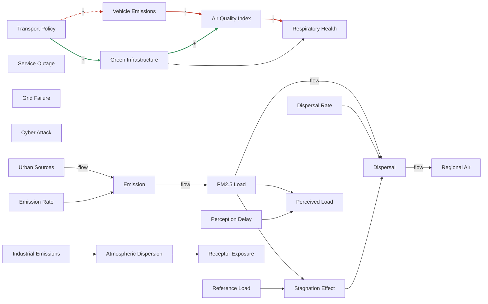

# Worked Example Transcript

Auto-generated by `worked_example/worked_example.py`. Do not edit by hand — rerun the script to regenerate.

This transcript demonstrates every CLI command in the current version of `latris`, exercised against a sample project.

## Capability Check

Before creating a project, an agent can check what Latris can actually do today — registry-only, no project needed.

### `latris capabilities`

```
Latris model-type capabilities                         
┏━━━━━━━━━━━━━━━━━━━┳━━━━━━━━━━━━━━━━━━━━┳━━━━━━━━━━━━━━━━┳━━━━━━━━━━━━━━━━━━━━┓
┃ ID                ┃ Name               ┃ Status         ┃ Description        ┃
┡━━━━━━━━━━━━━━━━━━━╇━━━━━━━━━━━━━━━━━━━━╇━━━━━━━━━━━━━━━━╇━━━━━━━━━━━━━━━━━━━━┩
│ bn                │ Bayesian Network   │ available      │ DAG with state     │
│                   │                    │                │ spaces and         │
│                   │                    │                │ conditional        │
│                   │                    │                │ probability        │
│                   │                    │                │ tables.            │
│ cld               │ Causal Loop        │ available      │ Directed graph     │
│                   │ Diagram            │                │ with polarity      │
│                   │                    │                │ (+/−) on edges;    │
│                   │                    │                │ cycles allowed.    │
│ dag               │ Directed Acyclic   │ available      │ Directed graph     │
│                   │ Graph              │                │ that must be       │
│                   │                    │                │ acyclic;           │
│                   │                    │                │ directionality     │
│                   │                    │                │ mandatory.         │
│ fcm               │ Fuzzy Cognitive    │ available      │ Weighted directed  │
│                   │ Map                │                │ graph with edge    │
│                   │                    │                │ strengths in [−1,  │
│                   │                    │                │ +1]; cycles        │
│                   │                    │                │ allowed.           │
│ sd                │ System Dynamics    │ available      │ Stocks, flows, and │
│                   │                    │                │ feedback loops     │
│                   │                    │                │ with unit-checked  │
│                   │                    │                │ equations,         │
│                   │                    │                │ simulated over     │
│                   │                    │                │ time, with         │
│                   │                    │                │ scenarios, Monte   │
│                   │                    │                │ Carlo uncertainty  │
│                   │                    │                │ bands,             │
│                   │                    │                │ sensitivity, and   │
│                   │                    │                │ loop dominance.    │
│ bow_tie           │ Bow-Tie Diagram    │ on the roadmap │ Threat–barrier–co… │
│                   │                    │                │ topology for risk  │
│                   │                    │                │ analysis.          │
│ event_tree        │ Event Tree         │ on the roadmap │ Forward-logic tree │
│                   │                    │                │ from initiating    │
│                   │                    │                │ event through      │
│                   │                    │                │ barriers to        │
│                   │                    │                │ outcomes for       │
│                   │                    │                │ safety analysis.   │
│ fault_tree        │ Fault Tree         │ on the roadmap │ Top-down failure   │
│                   │                    │                │ decomposition with │
│                   │                    │                │ AND/OR logic       │
│                   │                    │                │ gates.             │
│ gsn               │ Goal Structuring   │ on the roadmap │ Safety-case        │
│                   │ Notation           │                │ argumentation:     │
│                   │                    │                │ goals, strategies, │
│                   │                    │                │ solutions,         │
│                   │                    │                │ context.           │
│ theory_of_change  │ Theory of Change   │ on the roadmap │ Logic model        │
│                   │                    │                │ linking activities │
│                   │                    │                │ through outputs    │
│                   │                    │                │ and outcomes to    │
│                   │                    │                │ long-term goals.   │
│ decision_tree     │ Decision Tree      │ parked         │ Sequential         │
│                   │                    │                │ decision model     │
│                   │                    │                │ with chance and    │
│                   │                    │                │ decision nodes     │
│                   │                    │                │ branching to       │
│                   │                    │                │ outcomes.          │
│ influence_diagram │ Influence Diagram  │ parked         │ Extension of       │
│                   │                    │                │ Bayesian network   │
│                   │                    │                │ with decision and  │
│                   │                    │                │ utility nodes for  │
│                   │                    │                │ decision analysis. │
│ markov            │ Markov Chain / MDP │ parked         │ State-transition   │
│                   │                    │                │ graph with         │
│                   │                    │                │ transition         │
│                   │                    │                │ probabilities and  │
│                   │                    │                │ optional rewards.  │
│ argument_map      │ Argument Map       │ not planned    │ Toulmin/IBIS-style │
│                   │                    │                │ argumentation:     │
│                   │                    │                │ claims, warrants,  │
│                   │                    │                │ evidence,          │
│                   │                    │                │ rebuttals.         │
│ causal_dag        │ Causal DAG         │ not planned    │ DAG with           │
│                   │                    │                │ observed/unobserv… │
│                   │                    │                │ classification and │
│                   │                    │                │ adjustment sets.   │
│                   │                    │                │ Being folded into  │
│                   │                    │                │ the DAG view as    │
│                   │                    │                │ identification     │
│                   │                    │                │ analyses rather    │
│                   │                    │                │ than a separate    │
│                   │                    │                │ model type.        │
│ fishbone          │ Ishikawa /         │ not planned    │ Root cause         │
│                   │ Fishbone Diagram   │                │ analysis diagram   │
│                   │                    │                │ with categorised   │
│                   │                    │                │ cause branches     │
│                   │                    │                │ converging on an   │
│                   │                    │                │ effect.            │
│ flowchart         │ Process Map /      │ not planned    │ Activity-decision… │
│                   │ Flowchart          │                │ flow for process   │
│                   │                    │                │ modelling.         │
│ petri_net         │ Petri Net          │ not planned    │ Bipartite graph of │
│                   │                    │                │ places and         │
│                   │                    │                │ transitions for    │
│                   │                    │                │ concurrent         │
│                   │                    │                │ systems.           │
│ regression        │ Regression         │ not planned    │ DAG with           │
│                   │                    │                │ fitted/elicited    │
│                   │                    │                │ edge coefficients  │
│                   │                    │                │ —                  │
│                   │                    │                │ linear/logistic/G… │
│                   │                    │                │ Doubles as the     │
│                   │                    │                │ quantification of  │
│                   │                    │                │ causal/DAG edges.  │
│ state_machine     │ State Machine /    │ not planned    │ States and         │
│                   │ Statechart         │                │ transitions with   │
│                   │                    │                │ guards and actions │
│                   │                    │                │ for reactive       │
│                   │                    │                │ system modelling.  │
└───────────────────┴────────────────────┴────────────────┴────────────────────┘

Excluded by design (not planned — won't be added):
  - Black-box machine learning (random forests, gradient boosting, neural 
networks): Decision logic cannot be inspected cell-by-cell, evidenced, or 
challenged. Out of design intent, not merely 'not yet' — the inspectability 
test: decision logic must be inspectable cell-by-cell, evidenced, and 
challengeable.
  - Opaque structure learning (learning model structure from data without 
inspectable claims): Latris governs claims a human drew and can defend, not 
discovered structure. Fitting legible parameters (e.g. regression coefficients) 
onto a structure a modeller drew is in scope; discovering the structure itself 
from data is not.
  - General-purpose simulation frameworks (SEM, ABM): Not registered as a model 
type; no current plan to add.

Reports — `latris export md --pack <name> [--model-type <type>] -o 
report.md`
  - client: for people outside the modelling work — a client, board or funder — 
answer first: the interpretation, the diagram, results (simulations, 
uncertainty, queries), findings, contested links (sources for and against), then
each link with its reasoning and evidence, and sources — without internal IDs or
the change log.
  - audit: for an auditor or the modelling team — the complete record — every 
section, including decisions, sign-offs, sessions and data.
  - review: for a reviewer checking the model — the model with its evidence, 
open challenges and questions, and findings.
  - workshop: for a working session with stakeholders — structure, assumptions, 
open questions and session notes.
  - publication: for a paper or public write-up — the model, evidence, findings,
interpretation and full references, without internal IDs.
  Board-ready prose: The client and publication packs include an interpretation:
the answer to the modelling question, implications, confidence and open 
questions, each written from claims Latris extracts from the model. `latris 
interpret initialise`, then for each section either `latris interpret 
generate-prose <section>` (needs an AI key) or read its claims with `latris 
interpret show <section>` and write the prose yourself with `latris interpret 
set-prose <section> "..." --by ai`.
  Link for a person: A `latris link` link IS the shareable report: send it as it
is — no wrapper page or separate document needed. Opening it shows the 
interactive report with charts; saving it to a free account gives a short link 
and the editor, Word, review pack and story. latris link — prints a link that 
opens this model in the Latris app. Making it needs no network (the model 
travels inside the link); opening it needs app.latris.app. It opens a hosted 
report with the full Latris figure (loops, polarity, evidence) that the person 
can share, and save to a free account for the editor and Word. The link itself 
never stops working; the short report address it opens lasts 30 days unless 
saved, and saving gives a short link that doesn't expire. `export md` also puts 
this link under the diagram, made fresh on every export. Give the person this 
link alongside (or instead of) the Markdown.
  Ready to hand over? latris check handover — lists what's left before a board 
sees it (links with no source, citations not checked against their source, 
findings waiting for approval, sections without prose, contradictions), each 
with how to fix it. Exits 1 until it's clear.
  In the Latris app (https://app.latris.app): Word report, HTML review pack (and
importing completed reviews), scrollytelling story, hosted report link (no 
sign-in to view).

Building
  - guide: latris docs — the guide for AI agents, from the installed package (no
network needed).
  - whole model in one step: latris build --spec model.yaml (YAML or JSON; '-' 
reads stdin): factors, links with polarity and reasons, sources, citations, 
evidence against, assumptions, questions and the outcome, as one commit. The 
spec is checked in full first; a mistake changes nothing. `latris build --help` 
lists every key and allowed value.
  - evidence for: latris evidence add "<from> -> <to>" polarity <bibkey> 
[--verified-by ai]
  - checking a source: latris evidence check "<from> -> <to>" polarity <bibkey> 
supports|against|off-topic --rationale "..." [--by ai --quote "..."] — records 
whether the source actually supports the claim; until then reports count the 
citation as not yet checked. The quote is looked up in the text Latris holds for
the source (save it with `latris ref snapshot` first); an AI's paraphrase is 
refused.
  - evidence against: latris evidence add <link> polarity <bibkey> --contradicts
— a source that argues against the link; reports show the link's sources for and
against under 'Contested links'. Still unchecked until someone reads it.
  - correcting sources: latris ref edit <key> --doi|--url|--title ... ("" 
clears), latris ref remove <key> [--with-citations], latris evidence remove 
<link> polarity <key> — recorded changes; never hand-edit the YAML. A source 
read in another: --cited-via <key>.
  - outcome: latris view role cld <factor> outcome — marks what the model 
explains so it isn't suggested as an intervention point.
```

_The documentation ships with the package, for sandboxes that can't reach GitHub: `latris docs` prints the guide for AI agents, `latris docs readme` the whole README, and `latris docs llms` the documentation map below._

### `latris docs llms`

```
# Latris

> Latris is an evidence-native modelling workbench — a Python CLI plus a
> FastAPI/WebSocket server backend — where every project is a git repo,
> evidence and provenance are first-class data, and AI assistance produces
> human-approved structured proposals. This file maps the documentation
> for AI agents; humans start at README.md.

Install: `pip install "latris"` (Python 3.11+, git; the extras add SD integration and Bayesian inference). The guide for AI agents ships with the package — `latris docs` prints it with no network — and `latris capabilities` lists what Latris can do. Source: https://github.com/Shannon-Bengtson/latris (Apache-2.0).

Working in a chat app (Claude, ChatGPT) rather than a shell? Use the Latris connector at https://mcp.latris.app/mcp instead of the CLI — see https://latris.app/ai/.

## Project

- [README.md](README.md): what Latris is, install, quickstart, and an "For AI agents" quickstart section.
- (https://latris.app): the product website. The Latris app (app.latris.app — the GUI, hosted report links, Word / review-pack / story exports) is built on this open library.
- (docs/README.md): documentation index.
- (docs/FOUNDATIONS.md): the methods Latris implements and the literature behind each — a work is cited only where Latris implements it, with limits stated. The report's "Methods and foundations" section, `latris foundations`, and the capability manifest's `foundations` block are generated from the same registry (`src/latris/operations/foundations.py`).
- [CONTRIBUTING.md](CONTRIBUTING.md): how to set up a dev environment and submit changes.
- [LICENSE](LICENSE): Apache-2.0.

## Engineering docs (source of truth for how the system works)

- (docs/engineering/ARCHITECTURE.md): three-layer architecture (substrate → conceptual → formal views), module layout, the five chokepoint files, CLI↔server boundary contract.
- (docs/engineering/SCHEMA_NOTES.md): pydantic models ↔ YAML mapping, provenance axes, the on-disk project format.
- (docs/engineering/GIT_INTEGRATION.md): auto-commit model, identity enforcement, semantic diffs, collaboration model.
- (docs/engineering/AI_LAYER.md): LLM wiring (litellm + instructor + keyring), the closed prompt library, call flow, mock mode (LATRIS_AI_MOCK), delegated invocation for external agents (`ai task emit`/`ai task apply` — no API key).
- (docs/engineering/CLI_REFERENCE.md): the full `latris` command catalogue.
- (docs/engineering/TESTING.md): test layers, hermetic test contract, coverage policy.

## The worked example (acceptance test, always current)

- (worked_example/worked_example_output.md): generated transcript of every CLI command, end to end — the fastest way to learn the tool's actual behaviour.
- (worked_example/worked_example.py): the generator; any new user-facing feature must extend it.

## Building a model with the CLI (start here)

- No network? `latris docs` prints the README's "For AI agents" section from the installed package (`latris docs readme`, `latris docs llms` for this file).

- The README's "For AI agents" section has a complete causal-loop-diagram session: git identity, nodes, links by label, polarity with a rationale (`latris view set cld <edge> polarity + --rationale "..."`), sources and evidence, coherence and loop checks, findings (`latris finding add`), and the client report with a Mermaid diagram (`latris export md --pack client --no-ai`).
- `latris --json <command>` gives machine-readable output for the core commands, analyses (loops, paths, adjustment sets), BN/SD/FCM parameters, inference and simulation.
- Ask before you build: unless the request already says, ask the person (one message, at most three short questions) for the background and the decision it informs, who will read it, and what they expect the answer to be. Record it with `context:` in a build spec (`background`, `audience`, `boundary`, `intuition`) or `latris project set background|audience|boundary|predictions "..."`; the report opens with it. If they'd rather you just build, record each unanswered point with `latris question add` or `latris assumption add`.
- Keep what you read: `extract:` on a source in a build spec (or `latris ref snapshot <key> --url ... --extract "..."`) stores the abstract or passage you read, so a check of that source is grounded in visible text.
- One model, several views: `latris project select-models cld fcm` (or `bn`, `dag`) adds a quantitative view of the same factors and links — set weights or probability tables on the diagram you have instead of starting again.
- Who did what: Latris recognises an AI agent from its shell (Claude Code sets `CLAUDECODE`; other agents set `AI_AGENT`). Then the nodes, links, evidence and findings you create are recorded as AI-proposed, `--by` / `--verified-by` default to `ai`, and every commit carries a `Recorded-by-agent:` line. Commits stay in the person's git name — they're responsible for the project. If your shell doesn't say you're an agent, `export LATRIS_AGENT=<your name>` first.
- Approvals are the person's. `mature approve`, `mature review`, `signoff record`, `mapping approve`, `challenge resolve`, and a check or prose `--by human`, ask an agent for `--confirmed-by-person`. Pass it only when the person has looked at the thing themselves and asked you to record their decision — e.g. they read the model in the chat and said "approve the Workload → Burnout link", or "I checked smith2021 — it supports that". The commit then says you recorded it on their instruction. Don't pass it to approve your own work or to clear `check handover`; tell the person what's waiting for their review instead.
- Build a whole model in one step: `latris build --spec model.yaml` (YAML or JSON; `-` reads stdin) adds factors, links with polarity and reasons, sources, citations, assumptions (with target and rationale), questions, proposed findings, challenges, interpretation prose and the outcome as one commit, after checking the whole spec — `latris build --help` lists every key. Mark the outcome with `outcome:` (or `latris view role cld "<factor>" outcome`) so it isn't suggested as an intervention point.
- Quantify and stress-test: system dynamics scenarios (`latris sd set-scenario NAME --set "Var=value"`, compared by `sd simulate --scenario NAME`), uncertainty ranges (`sd set-uncertainty <node> triangular --min --mode --max`) feeding `sd monte-carlo` (percentile bands, seeded) and `sd sensitivity <variable>` (tornado, unreviewed values flagged), and `sd loops` (which feedback loop dominates, when). Results — and `bn query` posteriors — are recorded; the client report shows the latest of each with charts in the hosted report, and they become interpretation claims. A `latris link` carries the parameters and analyses and recomputes them on opening; `latris build --spec` takes `sd:`, `bn:` and `analyses:` blocks.
- Bayesian networks: soft evidence `latris bn query -s "Node=state:0.8"` (afterwards the node is 80% that state; `--likelihood` for likelihood ratios), the most likely explanation `latris bn explain -e "Node=state"` (MPE; `--over` for MAP), and probabilistic sensitivity — `latris bn set-uncertainty <node> --n 20` ("worth 20 observations") then `latris bn monte-carlo <target>` (point estimate with 50%/95% intervals and which tables drive them). All recorded for the report and carried by `latris link`.
- Links true by definition or accounting (departures reduce active volunteers): `confidence: by-definition` in a build spec, or `latris attr set <link> confidence by-definition`. They need no source, don't count against coverage, and the figure draws them solid, not as unproven.
- Checking a source: `latris evidence check "<from> -> <to>" polarity <bibkey> supports|against|off-topic --rationale "..."` records whether the source supports the claim (`--by ai` when an agent runs it; `--by human --confirmed-by-person` when the person read it and told you what it says). Until then reports say "not yet checked against the source".
- Quotes are looked up, not trusted: an agent's `supports` needs `--quote` copied from text Latris holds for the source (a saved `extract` / `ref snapshot`, `ref fetch`, or the abstract; whitespace, quote marks and case are forgiven, `...` marks a gap). A paraphrase is refused, so save the passage you read first. The report says what each check rests on (an extract of the full text, or the abstract or a summary).
- Before handing over: `latris check handover` lists what's left (unsourced links, unchecked citations, sources with nothing on file showing they were read, quotes not found in the stored text, unapproved findings, sections without prose or out of date, contradictions, broken references between files) with a fix for each; exits 1 until clear. `latris check integrity` lists broken references (a link or citation pointing at something that isn't there, duplicate labels or links); `--fix` removes rows left by deleted nodes and links.
- Evidence against a link: `latris evidence add <link> polarity <bibkey> --contradicts` (or `contradicts: [<bibkey>]` on a link in a build spec). It stays on the same link as the supporting sources; reports show both sides under "Contested links" and it doesn't count toward coverage. It is still unchecked until someone reads it (`evidence check ... against`).
- Correct the record with commands, not by editing YAML: `latris ref edit <key> --doi|--url|--title ...` (`""` clears), `latris ref remove <key> [--with-citations]`, `latris evidence remove <link> <attribute> <key>`. Give only identifiers you have seen; a source read only as described in another takes `--cited-via <key>` (`cited_via:` in a spec) and the report says it was read second-hand.
- Prose goes out of date: when the model changes after a section was written, `interpret list`/`show`, `check handover` and the report flag it; `latris interpret refresh-claims`, then rewrite it.
- With the Latris connector available (mcp.latris.app chat tools: `create_model`, `get_report`, ...), use it instead of the CLI: its `report_url` is a short link to share. `latris link` is for when there is no connector.
- What you get where: the open-source library (`pip install "latris"`) is the engine and CLI — every analysis, a Markdown report with a Mermaid sketch, and `latris link`. The Latris app (app.latris.app — free account, nothing to install) adds the hosted interactive report (typeset figure, result charts, interpretation — what a board reads), the visual editor, Word reports, review packs reviewers fill in, the scrollytelling story, and saved models with short links. A `latris link` link IS the shareable report: send it as it is — don't build a wrapper page or a separate document around it.
- Giving the model to a person: `latris link` prints a link that opens it in the Latris app (app.latris.app) as a hosted report with the full figure, which they can share or save to a free account (editor, Word). Making it needs no network — the model travels inside the link — so it works from sandboxes with no network to latris.app; opening it needs app.latris.app. The link never stops working; the short report address it opens lasts 30 days unless the model is saved, and saving gives a short link that doesn't expire. Known issue: the copy keeps interpretation prose but drops source checks, quotes, extracts and approvals, so don't send a link whose prose says sources were checked or findings approved; see (docs/engineering/SHARE_LINK.md).
- Reports: five packs for different readers (client, publication, review, workshop, audit) — `latris capabilities` describes them. The board-ready version is the `client` pack (answer first, then the diagram, findings and evidence) with its interpretation sections written: `latris interpret initialise`, then `interpret show <section>` and `interpret set-prose <section> "..." --by ai` (no API key needed).

## Choosing a model type (for the person you're helping)

People rarely know which formalism fits their question. Guide the choice by the kind of answer needed, not the drawing:

- "How does this work — what feeds back on what?" → CLD. Start here by default: cheapest honest answer, and every other formalism builds on it.
- "Can this effect actually be estimated, and from what data?" → DAG. Identification only — adjustment sets, no effect sizes, no counterfactuals.
- "How likely is each outcome, and what would change my mind?" → BN. Discrete states and probabilities; CPTs elicited, learned, or mixed.
- "Which forces dominate, roughly?" → FCM. Signed, weighted links; steady-state tendencies.
- "How will it behave over time if we intervene?" → SD. Stocks, flows, units, scenarios — the most commitment; build the CLD first.

Same substrate throughout: factors and links stay, evidence and challenges stay, and quantifying a CLD as FCM/BN/SD later never means redrawing (`project select-models` records the choice + rationale). Triangulating (CLD + DAG on one substrate) is a strength, not a mistake. Human-facing guide: https://latris.app/formalisms/.

## Delegated AI invocation (no API key in this environment?)

- Any of the 46 closed prompts can be answered by you, the agent, instead of a vendor API: `latris ai task emit <PromptName> --inputs '<json>'` writes a self-contained task package (system + user context + response JSON schema). Answer with JSON matching `response_schema`, then have the human run `latris ai task apply --task task.json --from response.json`. Validation, approval gates, and provenance are identical to API calls; the interaction logs `model_id` as `external-agent[:name]`. See (docs/engineering/AI_LAYER.md) § "Delegated calls (bring your own agent)".

## Working rules for agents in this repo

- Read [CLAUDE.md](CLAUDE.md) and (src/latris/CLAUDE.md) before editing code.
- The per-project state directory is `.graph-tooling` — a frozen data-format constant; never rename it.
- Run tests with `python -m pytest` (parallel by default); regenerate the worked-example transcript with `pytest tests/test_worked_example.py --slow` after changing CLI behaviour.
```


## Project Setup

Initialise a new project with a modelling question.

### `latris init /tmp/latris-demo-e2syxkvd/air-quality-model --question What factors drive urban air quality and how do they affect health outcomes?`

```
initialised project at /tmp/latris-demo-e2syxkvd/air-quality-model
```

### `latris project set coverage_dimensions emission sources, atmospheric dispersion, exposure, health outcomes, policy levers`

```
set coverage_dimensions (4c56a2a8ef)
```

### `latris project set granularity_level each node a specific measurable variable a city air-quality team could track`

```
set granularity_level (bb5b2b81af)
```

### `latris project set audience a municipal air-quality and public-health team`

```
set audience (3b719486ff)
```

### `latris project show`

```
project root: /tmp/latris-demo-e2syxkvd/air-quality-model
modelling question: What factors drive urban air quality and how do they affect 
health outcomes?
selected models: (none)
schema version: 6
created: 2026-11-16T21:48:17+00:00
updated: 2026-11-16T21:48:17+00:00
```


## Building the Model

Add entities (nodes) and causal relationships (edges).

### `latris node add Vehicle Emissions --kind variable`

```
added variable Vehicle Emissions (node_01M7K5A4WGPK1ZJN8RKSRKV87G) · commit 
d574d3665c
```

### `latris node add Air Quality Index --kind variable`

```
added variable Air Quality Index (node_01M7K5A50WATSJP3ZD9J7PRC68) · commit 
407f903454
```

### `latris node add Respiratory Health --kind variable`

```
added variable Respiratory Health (node_01M7K5A552B3FVYKBMV52FKQZA) · commit 
abfbb99040
```

### `latris node add Green Infrastructure --kind concept`

```
added concept Green Infrastructure (node_01M7K5A59CZEPF0T5QWVE68FW3) · commit 
f525dfd7e6
```

### `latris node add Transport Policy --kind decision`

```
added decision Transport Policy (node_01M7K5A5FN9JZHA5R1SM884ZW3) · commit 
70a776d3be
```

### `latris node list`

```
┏━━━━━━━━━━━━━━━━━━━━━━━━━━━━━━━━━┳━━━━━━━━━━┳━━━━━━━━━━━━━━━━━━━━━━┓
┃ ID                              ┃ Kind     ┃ Label                ┃
┡━━━━━━━━━━━━━━━━━━━━━━━━━━━━━━━━━╇━━━━━━━━━━╇━━━━━━━━━━━━━━━━━━━━━━┩
│ node_01M7K5A4WGPK1ZJN8RKSRKV87G │ variable │ Vehicle Emissions    │
│ node_01M7K5A50WATSJP3ZD9J7PRC68 │ variable │ Air Quality Index    │
│ node_01M7K5A552B3FVYKBMV52FKQZA │ variable │ Respiratory Health   │
│ node_01M7K5A59CZEPF0T5QWVE68FW3 │ concept  │ Green Infrastructure │
│ node_01M7K5A5FN9JZHA5R1SM884ZW3 │ decision │ Transport Policy     │
└─────────────────────────────────┴──────────┴──────────────────────┘
```

### `latris edge add node_01M7K5A4WGPK1ZJN8RKSRKV87G node_01M7K5A50WATSJP3ZD9J7PRC68 --kind causal`

```
added edge edge_01M7K5A5NQVCPREP61Z8AVQJW8 (causal) · commit 013d83f79a
```

### `latris edge add node_01M7K5A50WATSJP3ZD9J7PRC68 node_01M7K5A552B3FVYKBMV52FKQZA --kind causal`

```
added edge edge_01M7K5A5TGC1XF9C7MW991CP0F (causal) · commit 3c6abcba18
```

### `latris edge add node_01M7K5A59CZEPF0T5QWVE68FW3 node_01M7K5A50WATSJP3ZD9J7PRC68 --kind causal`

```
added edge edge_01M7K5A5ZFVP3PFDZWCQG9V305 (causal) · commit 47323d3b67
```

### `latris edge add node_01M7K5A5FN9JZHA5R1SM884ZW3 node_01M7K5A4WGPK1ZJN8RKSRKV87G --kind causal`

```
added edge edge_01M7K5A64VE73YHF9A7HVFSRZ1 (causal) · commit 4a8466664f
```

### `latris edge add node_01M7K5A59CZEPF0T5QWVE68FW3 node_01M7K5A552B3FVYKBMV52FKQZA --kind causal`

```
added edge edge_01M7K5A6AJT9WH127BWKQ49W28 (causal) · commit e2c2261ff4
```

### `latris edge list`

```
┏━━━━━━━━━━━━━━━━━━━━━┳━━━━━━━━┳━━━━━━━━━━━━━━━━━━━━━┳━━━┳━━━━━━━━━━━━━━━━━━━━━┓
┃ ID                  ┃ Kind   ┃ From                ┃ → ┃ To                  ┃
┡━━━━━━━━━━━━━━━━━━━━━╇━━━━━━━━╇━━━━━━━━━━━━━━━━━━━━━╇━━━╇━━━━━━━━━━━━━━━━━━━━━┩
│ edge_01M7K5A5NQVCP… │ causal │ Vehicle Emissions   │ → │ Air Quality Index   │
│                     │        │ (node_01M7K5A…)     │   │ (node_01M7K5A…)     │
│ edge_01M7K5A5TGC1X… │ causal │ Air Quality Index   │ → │ Respiratory Health  │
│                     │        │ (node_01M7K5A…)     │   │ (node_01M7K5A…)     │
│ edge_01M7K5A5ZFVP3… │ causal │ Green               │ → │ Air Quality Index   │
│                     │        │ Infrastructure      │   │ (node_01M7K5A…)     │
│                     │        │ (node_01M7K5A…)     │   │                     │
│ edge_01M7K5A64VE73… │ causal │ Transport Policy    │ → │ Vehicle Emissions   │
│                     │        │ (node_01M7K5A…)     │   │ (node_01M7K5A…)     │
│ edge_01M7K5A6AJT9W… │ causal │ Green               │ → │ Respiratory Health  │
│                     │        │ Infrastructure      │   │ (node_01M7K5A…)     │
│                     │        │ (node_01M7K5A…)     │   │                     │
└─────────────────────┴────────┴─────────────────────┴───┴─────────────────────┘
```

### `latris node show Vehicle Emissions`

```
id: node_01M7K5A4WGPK1ZJN8RKSRKV87G
kind: variable
label: Vehicle Emissions
created: 2026-11-16T21:48:17.680000+00:00
```

_Labels address nodes, so each is unique (ignoring case and spacing), and two nodes are joined by at most one link of each kind. Both are refused rather than silently duplicated._

### `latris node add vehicle  emissions`

```
error: a node is already called "Vehicle Emissions" 
(node_01M7K5A4WGPK1ZJN8RKSRKV87G); labels must be unique
```

### `latris edge add Vehicle Emissions Air Quality Index`

```
error: a causal link "Vehicle Emissions" → "Air Quality Index" already exists 
(edge_01M7K5A5NQVCPREP61Z8AVQJW8); edit that one instead of adding a second
```


## Model Selection (Formalise)

With the causal structure in place, choose the formalisms to apply. This mirrors the GUI's Build -> Formalise spine: build the substrate first, then select model types (CLD and DAG here) and parameterise each. The model-specific attributes that follow — CLD polarity, FCM weights, BN CPTs — and the formal views all hang off this selection.

_Select target model types — CLD and DAG._

### `latris project select-models cld dag`

```
selected model types: cld, dag (4d9635baf3)
```

### `latris project show`

```
project root: /tmp/latris-demo-e2syxkvd/air-quality-model
modelling question: What factors drive urban air quality and how do they affect 
health outcomes?
selected models: cld, dag
schema version: 6
created: 2026-11-16T21:48:17+00:00
updated: 2026-11-16T21:48:19+00:00
```


## Setting Attributes

Add descriptions, confidence levels, and polarity to edges.

### `latris attr set node_01M7K5A4WGPK1ZJN8RKSRKV87G description Total pollutant output from road transport including PM2.5, NOx, and CO.`

```
set description on node_01M7K5A4WGPK1ZJN8RKSRKV87G · commit 988a8af579
```

### `latris attr set node_01M7K5A50WATSJP3ZD9J7PRC68 description Composite measure of ambient air pollution concentration.`

```
set description on node_01M7K5A50WATSJP3ZD9J7PRC68 · commit 40bbc32c8b
```

### `latris attr set node_01M7K5A552B3FVYKBMV52FKQZA description Population-level respiratory morbidity and mortality rates.`

```
set description on node_01M7K5A552B3FVYKBMV52FKQZA · commit 88394ab432
```

### `latris view set cld edge_01M7K5A5NQVCPREP61Z8AVQJW8 polarity - --rationale More vehicle emissions raise pollutant load, worsening the AQI.`

```
set cld polarity = - on edge_01M7K5A5NQVCPREP61Z8AVQJW8 · commit 434bea0df2
```

### `latris view set cld edge_01M7K5A5TGC1XF9C7MW991CP0F polarity -`

```
set cld polarity = - on edge_01M7K5A5TGC1XF9C7MW991CP0F · commit 98f0caeb66
```

### `latris view set cld edge_01M7K5A5ZFVP3PFDZWCQG9V305 polarity +`

```
set cld polarity = + on edge_01M7K5A5ZFVP3PFDZWCQG9V305 · commit a2fc16751e
```

### `latris view set cld edge_01M7K5A64VE73YHF9A7HVFSRZ1 polarity -`

```
set cld polarity = - on edge_01M7K5A64VE73YHF9A7HVFSRZ1 · commit 9ad5072ba6
```

_Any command that supports it can print JSON instead of text with the global --json flag — the form agents and the hosted MCP server use._

### `latris --json node show Air Quality Index`

```
{"result": {"id": "node_01M7K5A50WATSJP3ZD9J7PRC68", "kind": "variable", "label": "Air Quality Index", "maturity": "proposed", "origin": "human-direct", "verification": "unverified", "source_id": null}}
```

### `latris attr set edge_01M7K5A5NQVCPREP61Z8AVQJW8 confidence high`

```
set confidence on edge_01M7K5A5NQVCPREP61Z8AVQJW8 · commit d322430c10
```

### `latris mature review edge_01M7K5A5NQVCPREP61Z8AVQJW8`

```
reviewed edge_01M7K5A5NQVCPREP61Z8AVQJW8 · commit 8bd18dfd84
```

_Marked the Emissions→AQI edge as reviewed (entity-level maturity)._


## Research Base

Add references and attach evidence to attributes.

### `latris ref add who2021 --title WHO Global Air Quality Guidelines 2021 --author World Health Organization --year 2021 --doi 10.1186/978-92-4-003422-8`

```
added reference who2021 · commit 8eff8ea99a
```

### `latris ref add defra2023 --title Air Quality Strategy for England --author DEFRA --year 2023`

```
added reference defra2023 · commit 1513d72e91
```

### `latris ref list`

```
┏━━━━━━━━━━━┳━━━━━━┳━━━━━━━━━━━━━━━━━━━━━━━━━━━━━━━┳━━━━━━━━━━━━━━━━━━━━━━━━━━━┓
┃ Key       ┃ Year ┃ Title                         ┃ Authors                   ┃
┡━━━━━━━━━━━╇━━━━━━╇━━━━━━━━━━━━━━━━━━━━━━━━━━━━━━━╇━━━━━━━━━━━━━━━━━━━━━━━━━━━┩
│ who2021   │ 2021 │ WHO Global Air Quality        │ World Health Organization │
│           │      │ Guidelines 2021               │                           │
│ defra2023 │ 2023 │ Air Quality Strategy for      │ DEFRA                     │
│           │      │ England                       │                           │
└───────────┴──────┴───────────────────────────────┴───────────────────────────┘
```

### `latris ref snapshot who2021 --url https://www.who.int/publications/i/item/9789240034228 --extract WHO global air quality guidelines (2021) tighten recommended PM2.5 and NO2 limits based on 2010-2020 evidence linking long-term exposure to cardiovascular and respiratory mortality. --kind abstract`

```
snapshot set for who2021 (abstract) · commit 679efb7639
```

### `latris evidence add node_01M7K5A4WGPK1ZJN8RKSRKV87G description who2021 --notes WHO identifies transport as primary urban PM2.5 source.`

```
attached who2021 → node_01M7K5A4WG…/description · commit 243e436bac
```

### `latris evidence add edge_01M7K5A5NQVCPREP61Z8AVQJW8 polarity who2021 --notes Dose-response relationship established in WHO guidelines.`

```
attached who2021 → edge_01M7K5A5NQ…/polarity · commit 790503f890
```

_A source that argues against a link goes on the same link with `--contradicts`; reports list it as evidence against and show the link under 'Contested links'._

### `latris ref add dispersal2024 --title Wind dispersal and local air quality (illustrative source) --year 2024`

```
added reference dispersal2024 · commit 9de6e95e58
```

### `latris evidence add edge_01M7K5A5NQVCPREP61Z8AVQJW8 polarity dispersal2024 --contradicts --notes Strong winds can decouple local emissions from local AQI.`

```
attached dispersal2024 → edge_01M7K5A5NQ…/polarity · commit 5868cfacd5
```


## Provenance

Record assumptions, decisions, exclusions, questions, predictions, and sessions.

### `latris assumption add Linear dose-response between emissions and AQI --rationale Simplification appropriate for policy-level modelling.`

```
logged assumption assumption_01M7K5A9AGHTQWDW9EYQZ5EKD2 · commit 3b3037c27a
```

### `latris assumption add Indoor air quality is out of scope`

```
logged assumption assumption_01M7K5A9GPK20C7KMPD2DC2274 · commit c86e89e854
```

### `latris decision log Exclude industrial emissions from initial scope --rationale Focus on transport for Phase 1; industrial sources added in Phase 2.`

```
logged decision decision_01M7K5A9MZ617Y8NZ41EF29QXP · commit 745a0df16f
```

### `latris exclusion add Indoor air quality and workplace exposure --rationale Separate regulatory domain; different exposure pathways.`

```
logged exclusion exclusion_01M7K5A9RH3FPE5D9VD4B26AZ9 · commit 4fc92a35aa
```

### `latris question add Should we model seasonal variation in AQI?`

```
logged question question_01M7K5A9XEZ3XVEQN8HNKC8KPV · commit cc2e3b15c0
```

### `latris question add Is green infrastructure effect direct or mediated?`

```
logged question question_01M7K5AA187R70GC6ZCQPMWPZW · commit bdcbef1e95
```

_Per-target provenance — assumptions, questions, and decisions about specific elements._

### `latris assumption add Polarity is uniformly negative at city-annual scale --rationale Simplification; spatial heterogeneity noted as caveat. --target edge_01M7K5A5NQVCPREP61Z8AVQJW8`

```
logged assumption assumption_01M7K5AA501C4BR7YY6V4H6X6S · commit 7353803375
```

### `latris question add Should we model non-linear dose-response for this pathway? --target edge_01M7K5A5TGC1XF9C7MW991CP0F`

```
logged question question_01M7K5AA8SW8884E0KKQSG6KZD · commit 6aac2020f8
```

### `latris decision log Keep as single composite index rather than per-pollutant --rationale Per-pollutant split deferred to Phase 2. --target node_01M7K5A50WATSJP3ZD9J7PRC68`

```
logged decision decision_01M7K5AADETAJ649346G7YFFP5 · commit 97d0078a76
```

### `latris prediction add AQI will improve 15% in areas with new green corridors --horizon 3 years`

```
logged prediction prediction_01M7K5AAH1642KPEM15VFP5N46 · commit adbef1892e
```

### `latris session record --date 2026-04-15 --attendee Alice --attendee Bob --notes Kickoff workshop: identified core causal pathways.`

```
recorded session session_01M7K5AANAJA7N1039DJJN2B0J · commit 40d95d73a3
```


## Building from a Spec

Add many factors, links, sources and citations at once from a YAML or JSON spec — checked in full first, applied as one commit. Links name factors by label; shown here on a second, small project so the main model is unchanged.

### `latris init /tmp/latris-demo-e2syxkvd/volunteers --question Why are volunteers leaving?`

```
initialised project at /tmp/latris-demo-e2syxkvd/volunteers
```

### `latris project select-models cld`

```
selected model types: cld (e1f015824b)
```

```yaml
context:   # asked of the person before building; the report opens with it
  background: The program lost a third of its volunteers since 2023; the board is deciding on a paid coordinator.
  audience: The program's board
  intuition: Rostering changes after the merger pushed people out.
outcome: Volunteer departures
factors:
  - label: Workload per volunteer
    description: Hours each active volunteer covers.
  - label: Volunteer burnout
  - label: Volunteer departures
links:
  - from: Workload per volunteer
    to: Volunteer burnout
    polarity: "+"
    reason: More hours per person, more exhaustion.
    confidence: medium
    sources: [smith2021]
  - from: Volunteer burnout
    to: Volunteer departures
    polarity: "+"
    reason: Exhausted volunteers leave.
  - from: Volunteer departures
    to: Workload per volunteer
    polarity: "+"
    reason: Fewer people share the same work.
    confidence: by-definition   # accounting: needs no source
sources:
  - key: smith2021
    title: Volunteer burnout
    authors: ["Smith, J"]
    year: 2021
    url: https://example.org/smith2021
    extract: "Abstract: hours per volunteer predicted emotional exhaustion (r = 0.41)."   # what was read
assumptions:
  - Service demand stays steady as numbers fall.
decisions:
  - statement: Left out paid staff.
    rationale: The program has none.
```

### `latris build --spec -`

```
built 3 factors, 3 links, 1 sources, 1 citations, 1 assumptions, 0 questions · 
commit a8f8546ebd
```

### `latris analyse loops`

```
┏━━━┳━━━━━━┳━━━━━━━━┳━━━━━━━━━━━━━━━━━━━━━━━━━━━━━━━━━━━━━━━━━━━━━━━━━━━━━━━━━━┓
┃ # ┃ Type ┃ Length ┃ Variables                                                ┃
┡━━━╇━━━━━━╇━━━━━━━━╇━━━━━━━━━━━━━━━━━━━━━━━━━━━━━━━━━━━━━━━━━━━━━━━━━━━━━━━━━━┩
│ 1 │ R    │ 3      │ Workload per volunteer → Volunteer burnout → Volunteer   │
│   │      │        │ departures                                               │
└───┴──────┴────────┴──────────────────────────────────────────────────────────┘

1 loop(s) found.
```

### `latris --json analyse loops`

```
{"result": [{"type": "R", "length": 3, "variables": ["Workload per volunteer", "Volunteer burnout", "Volunteer departures"], "ids": ["node_01M7K5AB2DN6KN52CP6X9WCJV4", "node_01M7K5AB2KBE3TKBP4QX3E87CZ", "node_01M7K5AB2Q1M9Q9J665QYZ6NNF"]}]}
```

_Attaching a citation says only that it was attached. Reading the source and recording what it says is a separate step; links can be named "From -> To"._

### `latris evidence check Workload per volunteer -> Volunteer burnout polarity smith2021 supports --rationale Hours per volunteer predict exhaustion.`

```
checked smith2021 on edge_01M7K5AB2X…/polarity: supports · commit 278c9bb2f5
```

_An agent's check needs a quote copied from the text Latris holds for the source (here the extract saved by the spec). A paraphrase is refused; the copied passage is found, and the check is recorded as resting on the abstract._

### `latris evidence check Workload per volunteer -> Volunteer burnout polarity smith2021 supports --by ai --rationale Hours per volunteer predict exhaustion. --quote Volunteers who work long hours burn out.`

```
error: the quote isn't in the text Latris holds for 'smith2021' (the text it 
holds doesn't contain it). A quote must be copied from the source, not 
paraphrased (at least 20 characters; '...' may mark a gap). Save the passage you
read first — `latris ref snapshot smith2021 --url <where you read it> --kind 
abstract|full_text_excerpt --extract "..."` — then check again. A verdict other 
than supports can be recorded without --quote.
```

### `latris evidence check Workload per volunteer -> Volunteer burnout polarity smith2021 supports --by ai --rationale Hours per volunteer predict exhaustion. --quote hours per volunteer predicted emotional exhaustion`

```
checked smith2021 on edge_01M7K5AB2X…/polarity: supports · commit e4bcfcbdce
```

_A study read only as described in another source is cited via that source; the report says it was read second-hand. Sources and citations are corrected with commands, so each correction is in the history._

### `latris ref add jones2018 --title Rostering and retention (illustrative) --year 2018 --cited-via smith2021`

```
added reference jones2018 · commit c2dd8c924b
```

### `latris ref edit jones2018 --doi https://doi.org/10.5555/rostering.2018`

```
updated reference jones2018 · commit 9b36d4bee8
```

### `latris evidence add Volunteer burnout -> Volunteer departures polarity jones2018 --verified-by ai`

```
attached jones2018 → edge_01M7K5AB3R…/polarity · commit a57791d5c8
```

### `latris evidence remove Volunteer burnout -> Volunteer departures polarity jones2018 --rationale Only read second-hand; not enough on its own.`

```
removed jones2018 from edge_01M7K5AB3R…/polarity · commit 8198214af4
```

### `latris ref remove jones2018 --rationale No longer cited.`

```
removed reference jones2018 · commit 7ee40227d9
```

_Prose written before the model changes is flagged as out of date._

### `latris interpret initialise`

```
initialised 10 section(s) · commit 158e4f2b19
  · interpret-section_01  structural_summary (cld)  state=claims_only
  · interpret-section_01  key_findings (cld)  state=claims_only
  · interpret-section_01  sensitivity (cld)  state=claims_only
  · interpret-section_01  assumptions_limitations (cld)  state=claims_only
  · interpret-section_01  evidence_gaps (cld)  state=claims_only
  · interpret-section_01  evidence_coverage (cld)  state=claims_only
  · interpret-section_01  answer_to_question (cld)  state=claims_only
  · interpret-section_01  implications (cld)  state=claims_only
  · interpret-section_01  confidence_assessment (cld)  state=claims_only
  · interpret-section_01  open_questions (cld)  state=claims_only
```

### `latris interpret set-prose structural_summary Three factors form one reinforcing loop. --by ai`

```
wrote structural_summary (cld) · commit 55243fe1a1
```

### `latris node add Recognition`

```
added concept Recognition (node_01M7K5ACRP35QDJBY845ZVJS5D) · commit ccc6db1417
```

### `latris edge add Recognition Volunteer departures`

```
added edge edge_01M7K5ACX4077QKM1W130TK5JQ (causal) · commit f32477daa5
```

### `latris interpret refresh-claims`

```
refreshed 10 section(s) · commit df3e286b94
out of date (rewrite the prose): structural_summary
```

_Removing a factor removes its links and everything describing them — description, confidence, polarity, citations, parameters, mappings — in one commit. Challenges, findings and sign-offs about it stay as history._

### `latris node add Seasonal events`

```
added concept Seasonal events (node_01M7K5AD9JMGN9HERDN29NVD6X) · commit 
e7cbda9cbb
```

### `latris edge add Seasonal events Volunteer burnout`

```
added edge edge_01M7K5ADDR5RQ5FH03XRMRD611 (causal) · commit 6e7edcac81
```

### `latris attr set Seasonal events description Festivals and emergencies that spike demand.`

```
set description on node_01M7K5AD9JMGN9HERDN29NVD6X · commit 3edba611c4
```

### `latris node remove Seasonal events`

```
removed Seasonal events (node_01M7K5AD9JMGN9HERDN29NVD6X) + 1 edge(s) · commit 
7225285d79
```

_Every reference between the project's files should resolve — no link to a missing factor, no citation of a source that isn't in the library, no duplicate labels or links. The handover check includes this; `--fix` clears rows left by older removals or hand edits._

### `latris check integrity`

```
Every reference resolves.
```

_Before handing the model to a board: what's left, and how to fix each (exits 1 until clear)._

### `latris check handover`

```
Ready to hand over: no — 3 things to do

1. 2 of 3 links have no source
     · Volunteer burnout → Volunteer departures
     · Recognition → Volunteer departures
   fix: cite one (`latris evidence add <link> polarity <key>`), mark a link true
by definition (`latris attr set <link> confidence by-definition`), or record it 
as an assumption

2. 9 of 10 report sections have no prose (readers see raw claims)
     · Key Findings
     · Sensitivity & Robustness
     · Assumptions & Limitations
     · Evidence Gaps
     · Evidence Coverage
     · … and 4 more
   fix: `latris interpret show <section>`, then `latris interpret set-prose 
<section> "..." --by ai`

3. 1 report section was written before the model last changed, and the claims 
behind it have changed
     · Structural Summary
   fix: `latris interpret refresh-claims`, then `latris interpret show 
<section>` and rewrite it with `latris interpret set-prose`
```

_The context opens the report — who it's for, the situation, and the person's own expectation to compare with the answer:_

### `latris --json project show`

```
{"result": {"name": "volunteers", "statement": "Why are volunteers leaving?", "background": "The program lost a third of its volunteers since 2023; the board is deciding on a paid coordinator.", "boundary": "", "exclusions": "", "predictions": "Rostering changes after the merger pushed people out.", "coverage_dimensions": "", "granularity_level": "", "audience": "The program's board", "selected_model_types": ["cld"], "schema_version": 6}}
```


## Challenges

Open, discuss, and resolve challenges against model elements.

### `latris challenge open edge_01M7K5A5NQVCPREP61Z8AVQJW8 Polarity may not be uniformly negative — wind dispersal can decouple local emissions from local AQI. --attribute polarity`

```
opened challenge challenge_01M7K5AE5RZT3MA2AH19XSZRAB · commit 96f02c129b
```

### `latris challenge turn challenge_01M7K5AE5RZT3MA2AH19XSZRAB Valid point. However, for annual averages at city scale, the negative relationship holds strongly.`

```
added turn to challenge_01M7K5AE5RZT3MA2AH19XSZRAB (now 1 turn(s)) · commit 
41504c3343
```

### `latris challenge resolve challenge_01M7K5AE5RZT3MA2AH19XSZRAB --state retained-with-caveat --rationale Negative polarity retained for city-annual scale; spatial heterogeneity noted as caveat.`

```
resolved challenge_01M7K5AE5RZT3MA2AH19XSZRAB → retained-with-caveat · commit 
2fe7d18a3b
```

### `latris challenge list`

```
┏━━━━━━━━━━━━━━━━┳━━━━━━━━━━━━━━━━┳━━━━━━━━━━━━━━━━┳━━━━━━━━━━━┳━━━━━━━━━━━━━━━┓
┃ ID             ┃ State          ┃ Target         ┃ Attribute ┃ Argument      ┃
┡━━━━━━━━━━━━━━━━╇━━━━━━━━━━━━━━━━╇━━━━━━━━━━━━━━━━╇━━━━━━━━━━━╇━━━━━━━━━━━━━━━┩
│ challenge_01M… │ retained-with… │ edge_01M7K5A5… │ polarity  │ Polarity may  │
│                │                │                │           │ not be        │
│                │                │                │           │ uniformly     │
│                │                │                │           │ negative —    │
│                │                │                │           │ wind          │
│                │                │                │           │ dispersal can │
│                │                │                │           │ …             │
└────────────────┴────────────────┴────────────────┴───────────┴───────────────┘
```


## Sign-off

Record a formal review sign-off.

### `latris signoff record --role Lead modeller --scope Substrate v0.1: core causal structure --notes Structure approved for stakeholder review.`

```
recorded sign-off signoff_01M7K5AEJPMDYNPAKXCWW1NHPS · commit d58cc26edc
```


## Bayesian Network

Quantify the validated causal core as a discrete Bayesian Network: declare each node's state space, fill in conditional probability tables (CPTs) with per-cell provenance, then run exact inference. BN reads the `causal` substrate directly — no view projection or model selection required.

_The readiness gate first. `bn check` derives the node set from the causal edges and reports what's missing — every node needs a state space and a complete, normalised CPT before inference can run._

### `latris bn check`

```
┏━━━━━━━━━━━━━━━━━━━━━━┳━━━━━━━━━━━━━━━━━━━━━┳━━━━━━━━━━━━━━━━━━━━━━━━━━━━━━━━━┓
┃ Node                 ┃ Gap                 ┃ Detail                          ┃
┡━━━━━━━━━━━━━━━━━━━━━━╇━━━━━━━━━━━━━━━━━━━━━╇━━━━━━━━━━━━━━━━━━━━━━━━━━━━━━━━━┩
│ Vehicle Emissions    │ missing_state_space │ Node has no state space. Define │
│                      │                     │ its discrete states (e.g.       │
│                      │                     │ 'low,high').                    │
│ Air Quality Index    │ missing_state_space │ Node has no state space. Define │
│                      │                     │ its discrete states (e.g.       │
│                      │                     │ 'low,high').                    │
│ Respiratory Health   │ missing_state_space │ Node has no state space. Define │
│                      │                     │ its discrete states (e.g.       │
│                      │                     │ 'low,high').                    │
│ Green Infrastructure │ missing_state_space │ Node has no state space. Define │
│                      │                     │ its discrete states (e.g.       │
│                      │                     │ 'low,high').                    │
│ Transport Policy     │ missing_state_space │ Node has no state space. Define │
│                      │                     │ its discrete states (e.g.       │
│                      │                     │ 'low,high').                    │
│ Vehicle Emissions    │ missing_cpt         │ Node has no conditional         │
│                      │                     │ probability table.              │
│ Air Quality Index    │ missing_cpt         │ Node has no conditional         │
│                      │                     │ probability table.              │
│ Respiratory Health   │ missing_cpt         │ Node has no conditional         │
│                      │                     │ probability table.              │
│ Green Infrastructure │ missing_cpt         │ Node has no conditional         │
│                      │                     │ probability table.              │
│ Transport Policy     │ missing_cpt         │ Node has no conditional         │
│                      │                     │ probability table.              │
└──────────────────────┴─────────────────────┴─────────────────────────────────┘
```

_Declare discrete state spaces (ordinal ranges are marked --ordered)._

### `latris bn set-state-space Transport Policy lax,strict`

```
set state space on node_01M7K5A5FN… = lax, strict · commit d4644f40dc
```

### `latris bn set-state-space Green Infrastructure low,high --ordered`

```
set state space on node_01M7K5A59C… = low, high · commit 9bfd1921fe
```

### `latris bn set-state-space Vehicle Emissions low,high --ordered`

```
set state space on node_01M7K5A4WG… = low, high · commit 43d97a0807
```

### `latris bn set-state-space Air Quality Index good,moderate,poor --ordered`

```
set state space on node_01M7K5A50W… = good, moderate, poor · commit 76a36cc7ef
```

### `latris bn set-state-space Respiratory Health good,poor`

```
set state space on node_01M7K5A552… = good, poor · commit e21b2b3ea4
```

_Fill in the CPTs. Probabilities are row-major with the first parent varying slowest; each conditional distribution sums to 1. --origin and --source stamp provenance on every row of that node's table — note how different nodes draw on different sources (a city policy baseline, WHO guidelines, monitoring data, expert judgement). Finer per-row provenance lives in views/parameters/bn-cpt.yaml._

### `latris bn set-cpt Transport Policy --probs 0.6,0.4 --origin human-direct --source defra2023`

```
set CPT on node_01M7K5A5FN… (1 row(s), parents: —) · commit d0503bc49b
```

### `latris bn set-cpt Green Infrastructure --probs 0.5,0.5 --origin human-direct`

```
set CPT on node_01M7K5A59C… (1 row(s), parents: —) · commit f867d15432
```

### `latris bn set-cpt Vehicle Emissions --parents Transport Policy --probs 0.3,0.7,0.8,0.2 --origin human-elicited --source who2021`

```
set CPT on node_01M7K5A4WG… (2 row(s), parents: node_01M7K5A) · commit 
7a48494d4b
```

### `latris bn set-cpt Air Quality Index --parents Vehicle Emissions,Green Infrastructure --probs 0.5,0.35,0.15,0.7,0.25,0.05,0.1,0.3,0.6,0.25,0.4,0.35 --origin data-derived --source who2021`

```
set CPT on node_01M7K5A50W… (4 row(s), parents: node_01M7K5A, node_01M7K5A) · 
commit 85bd628c76
```

### `latris bn set-cpt Respiratory Health --parents Air Quality Index,Green Infrastructure --probs 0.9,0.1,0.93,0.07,0.75,0.25,0.8,0.2,0.45,0.55,0.55,0.45 --origin human-elicited`

```
set CPT on node_01M7K5A552… (6 row(s), parents: node_01M7K5A, node_01M7K5A) · 
commit f73dd8981e
```

_The model is now fully quantified — the gate passes._

### `latris bn check`

```
✓ BN is fully quantified and ready to compute.
```

### `latris bn state-spaces`

```
┏━━━━━━━━━━━━━━━━━━━━━━┳━━━━━━━━━━━━━━━━━━━━━━┳━━━━━━━━━┓
┃ Node                 ┃ States               ┃ Ordered ┃
┡━━━━━━━━━━━━━━━━━━━━━━╇━━━━━━━━━━━━━━━━━━━━━━╇━━━━━━━━━┩
│ Transport Policy     │ lax, strict          │         │
│ Green Infrastructure │ low, high            │ ✓       │
│ Vehicle Emissions    │ low, high            │ ✓       │
│ Air Quality Index    │ good, moderate, poor │ ✓       │
│ Respiratory Health   │ good, poor           │         │
└──────────────────────┴──────────────────────┴─────────┘
```

### `latris bn cpts`

```
┏━━━━━━━━━━━━━━━━━┳━━━━━━━┳━━━━━━━━━━━━━━━━━┳━━━━━━━━━━━━━━━━━┳━━━━━━━━━━━━━━━━┓
┃ Node            ┃ Kind  ┃ Parent states   ┃ P(node)         ┃ Origin         ┃
┡━━━━━━━━━━━━━━━━━╇━━━━━━━╇━━━━━━━━━━━━━━━━━╇━━━━━━━━━━━━━━━━━╇━━━━━━━━━━━━━━━━┩
│ Transport       │ table │ —               │ lax:0.600,      │ human-direct   │
│ Policy          │       │                 │ strict:0.400    │                │
│ Green           │ table │ —               │ low:0.500,      │ human-direct   │
│ Infrastructure  │       │                 │ high:0.500      │                │
│ Vehicle         │ table │ Transport       │ low:0.300,      │ human-elicited │
│ Emissions       │       │ Policy=lax      │ high:0.700      │                │
│ Vehicle         │ table │ Transport       │ low:0.800,      │ human-elicited │
│ Emissions       │       │ Policy=strict   │ high:0.200      │                │
│ Air Quality     │ table │ Vehicle         │ good:0.500,     │ data-derived   │
│ Index           │       │ Emissions=low,  │ moderate:0.350, │                │
│                 │       │ Green           │ poor:0.150      │                │
│                 │       │ Infrastructure… │                 │                │
│ Air Quality     │ table │ Vehicle         │ good:0.700,     │ data-derived   │
│ Index           │       │ Emissions=low,  │ moderate:0.250, │                │
│                 │       │ Green           │ poor:0.050      │                │
│                 │       │ Infrastructure… │                 │                │
│ Air Quality     │ table │ Vehicle         │ good:0.100,     │ data-derived   │
│ Index           │       │ Emissions=high, │ moderate:0.300, │                │
│                 │       │ Green           │ poor:0.600      │                │
│                 │       │ Infrastructure… │                 │                │
│ Air Quality     │ table │ Vehicle         │ good:0.250,     │ data-derived   │
│ Index           │       │ Emissions=high, │ moderate:0.400, │                │
│                 │       │ Green           │ poor:0.350      │                │
│                 │       │ Infrastructure… │                 │                │
│ Respiratory     │ table │ Air Quality     │ good:0.900,     │ human-elicited │
│ Health          │       │ Index=good,     │ poor:0.100      │                │
│                 │       │ Green           │                 │                │
│                 │       │ Infrastructure… │                 │                │
│ Respiratory     │ table │ Air Quality     │ good:0.930,     │ human-elicited │
│ Health          │       │ Index=good,     │ poor:0.070      │                │
│                 │       │ Green           │                 │                │
│                 │       │ Infrastructure… │                 │                │
│ Respiratory     │ table │ Air Quality     │ good:0.750,     │ human-elicited │
│ Health          │       │ Index=moderate, │ poor:0.250      │                │
│                 │       │ Green           │                 │                │
│                 │       │ Infrastructure… │                 │                │
│ Respiratory     │ table │ Air Quality     │ good:0.800,     │ human-elicited │
│ Health          │       │ Index=moderate, │ poor:0.200      │                │
│                 │       │ Green           │                 │                │
│                 │       │ Infrastructure… │                 │                │
│ Respiratory     │ table │ Air Quality     │ good:0.450,     │ human-elicited │
│ Health          │       │ Index=poor,     │ poor:0.550      │                │
│                 │       │ Green           │                 │                │
│                 │       │ Infrastructure… │                 │                │
│ Respiratory     │ table │ Air Quality     │ good:0.550,     │ human-elicited │
│ Health          │       │ Index=poor,     │ poor:0.450      │                │
│                 │       │ Green           │                 │                │
│                 │       │ Infrastructure… │                 │                │
└─────────────────┴───────┴─────────────────┴─────────────────┴────────────────┘
```

_Prior marginals — the network's beliefs before any evidence._

### `latris bn marginals`

```
Prior marginals

┏━━━━━━━━━━━━━━━━━━━━━━┳━━━━━━━━━━━━━━━━━━━━━━━━━━━━━━━━━━━━━━━━━━┓
┃ Node                 ┃ Distribution                             ┃
┡━━━━━━━━━━━━━━━━━━━━━━╇━━━━━━━━━━━━━━━━━━━━━━━━━━━━━━━━━━━━━━━━━━┩
│ Transport Policy     │ lax 0.600   strict 0.400                 │
│ Green Infrastructure │ low 0.500   high 0.500                   │
│ Vehicle Emissions    │ low 0.500   high 0.500                   │
│ Air Quality Index    │ good 0.388   moderate 0.325   poor 0.288 │
│ Respiratory Health   │ good 0.747   poor 0.253                  │
└──────────────────────┴──────────────────────────────────────────┘

recorded · run analysis-run_01M7K… · commit 3e3e767907
```

_Predictive inference: condition on a strict transport policy and propagate forward. Air Quality Index and Respiratory Health shift toward their better states._

### `latris bn query --evidence Transport Policy=strict --query Air Quality Index --query Respiratory Health`

```
Posterior marginals  (given Transport Policy=strict)

┏━━━━━━━━━━━━━━━━━━━━┳━━━━━━━━━━━━━━━━━━━━━━━━━━━━━━━━━━━━━━━━━━┓
┃ Node               ┃ Distribution                             ┃
┡━━━━━━━━━━━━━━━━━━━━╇━━━━━━━━━━━━━━━━━━━━━━━━━━━━━━━━━━━━━━━━━━┩
│ Air Quality Index  │ good 0.515   moderate 0.310   poor 0.175 │
│ Respiratory Health │ good 0.796   poor 0.204                  │
└────────────────────┴──────────────────────────────────────────┘

recorded · run analysis-run_01M7K… · commit d9fd039275
```

_Diagnostic inference: condition on poor respiratory health and reason backwards. The posteriors for a lax policy and high emissions rise above their priors — BN reasoning runs in both directions along the causal edges._

### `latris bn query --evidence Respiratory Health=poor --query Transport Policy --query Vehicle Emissions`

```
Posterior marginals  (given Respiratory Health=poor)

┏━━━━━━━━━━━━━━━━━━━┳━━━━━━━━━━━━━━━━━━━━━━━━━━┓
┃ Node              ┃ Distribution             ┃
┡━━━━━━━━━━━━━━━━━━━╇━━━━━━━━━━━━━━━━━━━━━━━━━━┩
│ Transport Policy  │ lax 0.678   strict 0.322 │
│ Vehicle Emissions │ low 0.338   high 0.662   │
└───────────────────┴──────────────────────────┘

recorded · run analysis-run_01M7K… · commit 08af57e37a
```

_Analyses also speak --json — one object an agent can read instead of a table. The hosted MCP server's named tools (query_bn, find_loops, simulate_sd, run_fcm, ...) are built on it._

### `latris --json bn query --evidence Transport Policy=strict --query Respiratory Health`

```
{"result": {"given": {"Transport Policy": "strict"}, "soft": {}, "likelihood": {}, "marginals": {"Respiratory Health": {"good": 0.7964, "poor": 0.2036}}, "run_id": "analysis-run_01M7K5AH3N94MK8CYBTDAV8X23"}, "commit_sha": "52aa6694abcc3f906dbc67d0617803db83092f61"}
```


## Bayesian Network — Sensitivity

Rank the CPT parameters by how much they move a target posterior, annotated with each parameter's provenance. Nothing here is human-verified yet, so every influential parameter is flagged weak — the ranking tells you which to verify first. Read-only on the CPTs.

### `latris bn sensitivity Respiratory Health --state poor --top 8 --no-record`

```
Sensitivity of P(Respiratory Health=poor) = 0.253

┏━━━━━━━━━━━━━━━━━━━━━━━━━━━━━━━┳━━━━━━┳━━━━━━━━━━━┳━━━━━━━━━━━━━━━━┳━━━━━━━━━━┓
┃ Parameter                     ┃ Cell ┃ Influence ┃ Origin         ┃ Verified ┃
┡━━━━━━━━━━━━━━━━━━━━━━━━━━━━━━━╇━━━━━━╇━━━━━━━━━━━╇━━━━━━━━━━━━━━━━╇━━━━━━━━━━┩
│ Respiratory Health | Air      │ good │     0.238 │ human-elicited │ ⚠ weak   │
│ Quality Index=good, Green     │      │           │                │          │
│ Infrastructure=high           │      │           │                │          │
│ Respiratory Health | Air      │ good │     0.188 │ human-elicited │ ⚠ weak   │
│ Quality Index=poor, Green     │      │           │                │          │
│ Infrastructure=low            │      │           │                │          │
│ Respiratory Health | Air      │ good │     0.163 │ human-elicited │ ⚠ weak   │
│ Quality Index=moderate, Green │      │           │                │          │
│ Infrastructure=low            │      │           │                │          │
│ Respiratory Health | Air      │ good │     0.163 │ human-elicited │ ⚠ weak   │
│ Quality Index=moderate, Green │      │           │                │          │
│ Infrastructure=high           │      │           │                │          │
│ Respiratory Health | Air      │ good │     0.150 │ human-elicited │ ⚠ weak   │
│ Quality Index=good, Green     │      │           │                │          │
│ Infrastructure=low            │      │           │                │          │
│ Green Infrastructure |        │ low  │     0.129 │ human-direct   │ ⚠ weak   │
│ (prior)                       │      │           │                │          │
│ Respiratory Health | Air      │ good │     0.100 │ human-elicited │ ⚠ weak   │
│ Quality Index=poor, Green     │      │           │                │          │
│ Infrastructure=high           │      │           │                │          │
│ Vehicle Emissions | Transport │ low  │     0.099 │ human-elicited │ ⚠ weak   │
│ Policy=lax                    │      │           │                │          │
└───────────────────────────────┴──────┴───────────┴────────────────┴──────────┘
```


## Bayesian Network — Parameter Learning

Fit CPTs from a dataset, provenance-first: rows a human elicited are protected; data fills only the gaps and low-provenance defaults. The preview shows what's kept vs learned; the run is logged as an AnalysisRun and learned rows are stamped data-derived.

_A monitoring dataset whose columns match the node labels is registered (180 rows). Vehicle Emissions and Respiratory Health were elicited from experts above, so learning preserves them and fills the rest from data._

### `latris bn learn monitoring --estimator mle --yes`

```
Parameter learning preview — dataset dataset_01M7K5AHD2…, 180 row(s) used, 0 
dropped (NA)

┏━━━━━━━━━━━━━━━━━━━━━━┳━━━━━━━━━━━━━━┳━━━━━━━━━┳━━━━━━┳━━━━━━━━━━━━━━┓
┃ Node                 ┃ Action       ┃ Learned ┃ Kept ┃ Zero-support ┃
┡━━━━━━━━━━━━━━━━━━━━━━╇━━━━━━━━━━━━━━╇━━━━━━━━━╇━━━━━━╇━━━━━━━━━━━━━━┩
│ Vehicle Emissions    │ data-derived │ 0       │ 2    │              │
│ Air Quality Index    │ data-derived │ 4       │ 0    │              │
│ Respiratory Health   │ data-derived │ 0       │ 6    │              │
│ Green Infrastructure │ data-derived │ 1       │ 0    │              │
│ Transport Policy     │ data-derived │ 1       │ 0    │              │
└──────────────────────┴──────────────┴─────────┴──────┴──────────────┘
applied · run analysis-run_01M7K… · commit ad11611a95
```


## Bayesian Network — Canonical Models

For a high-fan-in binary node, a Noisy-OR avoids CPT explosion: each cause contributes independently, so k causes need k probabilities + a leak instead of 2^k rows. Stored as a compact spec (the provenance-bearing object) and expanded to a full CPT at compute time. Shown on a small self-contained fault sub-model.

### `latris node add Service Outage --kind variable`

```
added variable Service Outage (node_01M7K5AHVKXWVNXSS0H8MSDPBY) · commit 
e45a026b27
```

### `latris node add Grid Failure --kind variable`

```
added variable Grid Failure (node_01M7K5AHZT7C862DZK18J0J7DR) · commit 
38947db6d0
```

### `latris node add Cyber Attack --kind variable`

```
added variable Cyber Attack (node_01M7K5AJ4EBPJAFBTRJZ0GW6BX) · commit 
0c34777dcf
```

### `latris bn set-state-space Service Outage yes,no`

```
set state space on node_01M7K5AHVK… = yes, no · commit 5b9dc5088f
```

### `latris bn set-state-space Grid Failure yes,no`

```
set state space on node_01M7K5AHZT… = yes, no · commit 86ca2ea3f7
```

### `latris bn set-state-space Cyber Attack yes,no`

```
set state space on node_01M7K5AJ4E… = yes, no · commit eeeeae4bfe
```

### `latris bn set-cpt Grid Failure --probs 0.05,0.95`

```
set CPT on node_01M7K5AHZT… (1 row(s), parents: —) · commit 04a8e0bb0e
```

### `latris bn set-cpt Cyber Attack --probs 0.02,0.98`

```
set CPT on node_01M7K5AJ4E… (1 row(s), parents: —) · commit 5315154483
```

_Two independent causes + a leak — five numbers instead of a full 2-parent table._

### `latris bn set-noisy-or Service Outage -c Grid Failure=yes:0.8 -c Cyber Attack=yes:0.6 --leak 0.01 --active yes`

```
set Noisy-OR on node_01M7K5AHVK… (2 cause(s), leak 0.01, effect = yes) · commit 
97342ef8e6
```

### `latris bn cpts`

```
┏━━━━━━━━━━━━━━━━┳━━━━━━━━━━┳━━━━━━━━━━━━━━━━┳━━━━━━━━━━━━━━━━┳━━━━━━━━━━━━━━━━┓
┃ Node           ┃ Kind     ┃ Parent states  ┃ P(node)        ┃ Origin         ┃
┡━━━━━━━━━━━━━━━━╇━━━━━━━━━━╇━━━━━━━━━━━━━━━━╇━━━━━━━━━━━━━━━━╇━━━━━━━━━━━━━━━━┩
│ Transport      │ table    │ —              │ lax:0.500,     │ data-derived   │
│ Policy         │          │                │ strict:0.500   │                │
│ Green          │ table    │ —              │ low:0.500,     │ data-derived   │
│ Infrastructure │          │                │ high:0.500     │                │
│ Vehicle        │ table    │ Transport      │ low:0.300,     │ human-elicited │
│ Emissions      │          │ Policy=lax     │ high:0.700     │                │
│ Vehicle        │ table    │ Transport      │ low:0.800,     │ human-elicited │
│ Emissions      │          │ Policy=strict  │ high:0.200     │                │
│ Air Quality    │ table    │ Vehicle        │ good:0.333,    │ data-derived   │
│ Index          │          │ Emissions=low, │ moderate:0.33… │                │
│                │          │ Green          │ poor:0.333     │                │
│                │          │ Infrastructur… │                │                │
│ Air Quality    │ table    │ Vehicle        │ good:0.333,    │ data-derived   │
│ Index          │          │ Emissions=low, │ moderate:0.33… │                │
│                │          │ Green          │ poor:0.333     │                │
│                │          │ Infrastructur… │                │                │
│ Air Quality    │ table    │ Vehicle        │ good:0.333,    │ data-derived   │
│ Index          │          │ Emissions=hig… │ moderate:0.33… │                │
│                │          │ Green          │ poor:0.333     │                │
│                │          │ Infrastructur… │                │                │
│ Air Quality    │ table    │ Vehicle        │ good:0.333,    │ data-derived   │
│ Index          │          │ Emissions=hig… │ moderate:0.33… │                │
│                │          │ Green          │ poor:0.333     │                │
│                │          │ Infrastructur… │                │                │
│ Respiratory    │ table    │ Air Quality    │ good:0.900,    │ human-elicited │
│ Health         │          │ Index=good,    │ poor:0.100     │                │
│                │          │ Green          │                │                │
│                │          │ Infrastructur… │                │                │
│ Respiratory    │ table    │ Air Quality    │ good:0.930,    │ human-elicited │
│ Health         │          │ Index=good,    │ poor:0.070     │                │
│                │          │ Green          │                │                │
│                │          │ Infrastructur… │                │                │
│ Respiratory    │ table    │ Air Quality    │ good:0.750,    │ human-elicited │
│ Health         │          │ Index=moderat… │ poor:0.250     │                │
│                │          │ Green          │                │                │
│                │          │ Infrastructur… │                │                │
│ Respiratory    │ table    │ Air Quality    │ good:0.800,    │ human-elicited │
│ Health         │          │ Index=moderat… │ poor:0.200     │                │
│                │          │ Green          │                │                │
│                │          │ Infrastructur… │                │                │
│ Respiratory    │ table    │ Air Quality    │ good:0.450,    │ human-elicited │
│ Health         │          │ Index=poor,    │ poor:0.550     │                │
│                │          │ Green          │                │                │
│                │          │ Infrastructur… │                │                │
│ Respiratory    │ table    │ Air Quality    │ good:0.550,    │ human-elicited │
│ Health         │          │ Index=poor,    │ poor:0.450     │                │
│                │          │ Green          │                │                │
│                │          │ Infrastructur… │                │                │
│ Grid Failure   │ table    │ —              │ yes:0.050,     │ human-direct   │
│                │          │                │ no:0.950       │                │
│ Cyber Attack   │ table    │ —              │ yes:0.020,     │ human-direct   │
│                │          │                │ no:0.980       │                │
│ Service Outage │ Noisy-OR │ Grid           │ yes:0.921,     │ human-elicited │
│                │          │ Failure=yes,   │ no:0.079       │                │
│                │          │ Cyber          │                │                │
│                │          │ Attack=yes     │                │                │
│ Service Outage │ Noisy-OR │ Grid           │ yes:0.802,     │ human-elicited │
│                │          │ Failure=yes,   │ no:0.198       │                │
│                │          │ Cyber          │                │                │
│                │          │ Attack=no      │                │                │
│ Service Outage │ Noisy-OR │ Grid           │ yes:0.604,     │ human-elicited │
│                │          │ Failure=no,    │ no:0.396       │                │
│                │          │ Cyber          │                │                │
│                │          │ Attack=yes     │                │                │
│ Service Outage │ Noisy-OR │ Grid           │ yes:0.010,     │ human-elicited │
│                │          │ Failure=no,    │ no:0.990       │                │
│                │          │ Cyber          │                │                │
│                │          │ Attack=no      │                │                │
└────────────────┴──────────┴────────────────┴────────────────┴────────────────┘
```


## Bayesian Network — Soft Evidence, Explanation, Uncertainty

Three questions beyond a plain query. Soft evidence: a low-cost sensor suggests poor air, but it isn't certain. The most likely explanation: given poor respiratory health, which combination of causes is likeliest? And how sure is a probability when the tables behind it are estimates?

_Soft evidence sets how sure we are: afterwards P(Air Quality Index = poor) is 70%, and the other states share the rest in proportion to their prior._

### `latris bn query --soft Air Quality Index=poor:0.7 --query Respiratory Health --query Air Quality Index`

```
Posterior marginals

┏━━━━━━━━━━━━━━━━━━━━┳━━━━━━━━━━━━━━━━━━━━━━━━━━━━━━━━━━━━━━━━━━┓
┃ Node               ┃ Distribution                             ┃
┡━━━━━━━━━━━━━━━━━━━━╇━━━━━━━━━━━━━━━━━━━━━━━━━━━━━━━━━━━━━━━━━━┩
│ Respiratory Health │ good 0.604   poor 0.397                  │
│ Air Quality Index  │ good 0.150   moderate 0.150   poor 0.700 │
└────────────────────┴──────────────────────────────────────────┘

recorded · run analysis-run_01M7K… · commit 2e241c70dc
```

_The single most likely combination of states given poor respiratory health — with how decisive each part is, and where a factor's own favourite differs._

### `latris bn explain --evidence Respiratory Health=poor`

```
Given Respiratory Health = poor, the most likely explanation is Transport Policy
= strict, Green Infrastructure = low, Vehicle Emissions = low, Air Quality Index
= poor, Grid Failure = no, Cyber Attack = no, Service Outage = no (P = 13%)

┏━━━━━━━━━━━━━━━━━━━━━┳━━━━━━━━━━━━━┳━━━━━━━━━━━━━━━━━━━━━┳━━━━━━━━━━━━━━━━━━━━┓
┃ Node                ┃ Most likely ┃ Its own probability ┃ vs runner-up       ┃
┡━━━━━━━━━━━━━━━━━━━━━╇━━━━━━━━━━━━━╇━━━━━━━━━━━━━━━━━━━━━╇━━━━━━━━━━━━━━━━━━━━┩
│ Transport Policy    │ strict      │ 50.0%               │ 2.67× likelier     │
│                     │             │                     │ than lax           │
│ Green               │ low         │ 55.6%               │ 1.22× likelier     │
│ Infrastructure      │             │                     │ than high          │
│ Vehicle Emissions   │ low         │ 55.0%               │ 4× likelier than   │
│                     │             │                     │ high               │
│ Air Quality Index   │ poor        │ 61.7%               │ 2.2× likelier than │
│                     │             │                     │ moderate           │
│ Grid Failure        │ no          │ 95.0%               │ 95× likelier than  │
│                     │             │                     │ yes                │
│ Cyber Attack        │ no          │ 98.0%               │ 122× likelier than │
│                     │             │                     │ yes                │
│ Service Outage      │ no          │ 93.9%               │ 99× likelier than  │
│                     │             │                     │ yes                │
└─────────────────────┴─────────────┴─────────────────────┴────────────────────┘

recorded · run analysis-run_01M7K… · commit bb44e21bc4
```

_Say how well each table is known: the respiratory table was elicited from one clinician (worth about 10 observations); the air-quality table was learned from 180 monitoring rows. The other tables stay fixed._

### `latris bn set-uncertainty Respiratory Health --n 10 --reason Elicited from one clinician`

```
uncertainty Respiratory Health: worth 10 observations · commit 07b13846a7
```

### `latris bn set-uncertainty Air Quality Index --n 180 --reason Learned from 180 monitoring rows`

```
uncertainty Air Quality Index: worth 180 observations · commit 8929add9b9
```

### `latris bn monte-carlo Respiratory Health --state poor --evidence Transport Policy=strict --runs 300`

```
P(Respiratory Health = poor | Transport Policy = strict): 27% (95% of 300 draws 
19%–37%)

┏━━━━━━━┳━━━━━━━┳━━━━━━━━┳━━━━━━━━━━━━━━┳━━━━━━━━━━━━━━┓
┃ State ┃ Point ┃ Median ┃ 50% of draws ┃ 95% of draws ┃
┡━━━━━━━╇━━━━━━━╇━━━━━━━━╇━━━━━━━━━━━━━━╇━━━━━━━━━━━━━━┩
│ good  │ 73.0% │  72.9% │  69.1%–76.6% │  62.7%–81.2% │
│ poor  │ 27.0% │  27.1% │  23.4%–30.9% │  18.8%–37.3% │
└───────┴───────┴────────┴──────────────┴──────────────┘
  Air Quality Index: worth 180 (human-direct, unverified) — Learned from 180 
monitoring rows
  Respiratory Health: worth 10 (human-direct, unverified) — Elicited from one 
clinician
  held fixed: Cyber Attack, Green Infrastructure, Grid Failure, Service Outage, 
Transport Policy, Vehicle Emissions
  driven by: Respiratory Health (ρ=-0.49), Air Quality Index (ρ=-0.15)

recorded · run analysis-run_01M7K… · commit 18ad100138
```


## System Dynamics

A stock-and-flow model of the urban PM2.5 load: emissions fill it, dispersal drains it in proportion to its size. SD lives on the same substrate as the CLD above — stocks, flows and constants are ordinary variables with an SD role; `flow` edges carry material, `causal` edges are information links. The rest of the CLD is outside the SD model's boundary and doesn't need classifying.

### `latris sd check`

```
┏━━━━━━━━━┳━━━━━━━━━━━┳━━━━━━━━━━━━━━━━━━━━━━━━━━━━━━━━━━━━━━━━━━━━━━━━━━━━━━━━┓
┃ Element ┃ Gap       ┃ Detail                                                 ┃
┡━━━━━━━━━╇━━━━━━━━━━━╇━━━━━━━━━━━━━━━━━━━━━━━━━━━━━━━━━━━━━━━━━━━━━━━━━━━━━━━━┩
│ (model) │ no_stocks │ The SD model has no stocks yet. Classify at least one  │
│         │           │ with `sd set-role <node> stock`.                       │
└─────────┴───────────┴────────────────────────────────────────────────────────┘
```

### `latris node add PM2.5 Load --kind variable`

```
added variable PM2.5 Load (node_01M7K5AN4AVEEQ4FAV40YV1VTE) · commit f6ed19328e
```

### `latris node add Emission --kind variable`

```
added variable Emission (node_01M7K5AN8JNWQW9FWH95SXK5RJ) · commit ce7bbbd5f1
```

### `latris node add Dispersal --kind variable`

```
added variable Dispersal (node_01M7K5AND4HQ3P90NTZTSH4DPQ) · commit d668a9924a
```

### `latris node add Emission Rate --kind variable`

```
added variable Emission Rate (node_01M7K5ANHK5X9EVZD0ATE0RVFC) · commit 
5618812ff4
```

### `latris node add Dispersal Rate --kind variable`

```
added variable Dispersal Rate (node_01M7K5ANP45HPKWV691G19VHWH) · commit 
67b105f3ae
```

### `latris node add Urban Sources --kind variable`

```
added variable Urban Sources (node_01M7K5ANTZFBCEG76KJXA8589C) · commit 
b34b750ddd
```

### `latris node add Regional Air --kind variable`

```
added variable Regional Air (node_01M7K5AP0M6B105ZQT1Y16PV5T) · commit 
8dec9beb41
```

### `latris edge add Urban Sources Emission --kind flow`

```
added edge edge_01M7K5AP5ATNB321BCRK6ATR8J (flow) · commit 8881c49891
```

### `latris edge add Emission PM2.5 Load --kind flow`

```
added edge edge_01M7K5APAXA4KSXA8KJAMM7SB8 (flow) · commit d34e4dbd7d
```

### `latris edge add PM2.5 Load Dispersal --kind flow`

```
added edge edge_01M7K5APG0JRY8PTG3CG3VEEZ2 (flow) · commit c734482e2c
```

### `latris edge add Dispersal Regional Air --kind flow`

```
added edge edge_01M7K5APNY8HBV69AKZJC4CXEC (flow) · commit 3413c1b5bc
```

### `latris edge add Emission Rate Emission --kind causal`

```
added edge edge_01M7K5APTHY8RBNVFYJY32PFS6 (causal) · commit 9af15acd97
```

### `latris edge add Dispersal Rate Dispersal --kind causal`

```
added edge edge_01M7K5APZHVSA28KKYDGSWN3Y4 (causal) · commit b238874c72
```

_The diagram exists, but nothing is classified yet — the check names every gap._

### `latris sd check`

```
┏━━━━━━━━━━━━━━━━┳━━━━━━━━━━━━━━┳━━━━━━━━━━━━━━━━━━━━━━━━━━━━━━━━━━━━━━━━━━━━━━┓
┃ Element        ┃ Gap          ┃ Detail                                       ┃
┡━━━━━━━━━━━━━━━━╇━━━━━━━━━━━━━━╇━━━━━━━━━━━━━━━━━━━━━━━━━━━━━━━━━━━━━━━━━━━━━━┩
│ Dispersal      │ unclassified │ Not classified for System Dynamics. Set its  │
│                │              │ role: stock, flow, auxiliary, constant, or   │
│                │              │ source_sink.                                 │
│ Dispersal Rate │ unclassified │ Not classified for System Dynamics. Set its  │
│                │              │ role: stock, flow, auxiliary, constant, or   │
│                │              │ source_sink.                                 │
│ Emission       │ unclassified │ Not classified for System Dynamics. Set its  │
│                │              │ role: stock, flow, auxiliary, constant, or   │
│                │              │ source_sink.                                 │
│ Emission Rate  │ unclassified │ Not classified for System Dynamics. Set its  │
│                │              │ role: stock, flow, auxiliary, constant, or   │
│                │              │ source_sink.                                 │
│ PM2.5 Load     │ unclassified │ Not classified for System Dynamics. Set its  │
│                │              │ role: stock, flow, auxiliary, constant, or   │
│                │              │ source_sink.                                 │
│ Regional Air   │ unclassified │ Not classified for System Dynamics. Set its  │
│                │              │ role: stock, flow, auxiliary, constant, or   │
│                │              │ source_sink.                                 │
│ Urban Sources  │ unclassified │ Not classified for System Dynamics. Set its  │
│                │              │ role: stock, flow, auxiliary, constant, or   │
│                │              │ source_sink.                                 │
│ (model)        │ no_stocks    │ The SD model has no stocks yet. Classify at  │
│                │              │ least one with `sd set-role <node> stock`.   │
└────────────────┴──────────────┴──────────────────────────────────────────────┘
```

### `latris sd set-role PM2.5 Load stock`

```
set PM2.5 Load → stock · commit 1a8b3e04fd
```

### `latris sd set-role Emission flow`

```
set Emission → flow · commit 88db86881c
```

### `latris sd set-role Dispersal flow`

```
set Dispersal → flow · commit 715278ba40
```

### `latris sd set-role Emission Rate constant`

```
set Emission Rate → constant · commit 825f9f005a
```

### `latris sd set-role Dispersal Rate constant`

```
set Dispersal Rate → constant · commit 1eccb1633d
```

### `latris sd set-role Urban Sources source_sink`

```
set Urban Sources → source_sink · commit 2191980335
```

### `latris sd set-role Regional Air source_sink`

```
set Regional Air → source_sink · commit cb40e9f6f6
```

### `latris sd set-initial-value PM2.5 Load 20 --units tonne --non-negative --origin data-derived`

```
set PM2.5 Load(0) = 20 tonne · commit 5734162592
```

### `latris sd set-constant Emission Rate 120 --units tonne/year --origin data-derived`

```
set Emission Rate = 120 tonne/year · commit dd85327155
```

### `latris sd set-constant Dispersal Rate 2 --units 1/year --origin human-elicited`

```
set Dispersal Rate = 2 1/year · commit 129c7670a0
```

### `latris sd set-equation Emission emission_rate --units tonne/year`

```
set Emission = emission_rate  · commit 6637ff1724
```

_Equations name variables by slugified label (PM2.5 Load → pm2_5_load). A deliberate slip: adding a load to a rate. It parses, but every value is a unit-bearing quantity, so the check catches the dimensional error._

### `latris sd set-equation Dispersal pm2_5_load + dispersal_rate --units tonne/year`

```
set Dispersal = pm2_5_load + dispersal_rate  · commit 4eb361dfd0
```

### `latris sd check`

```
┏━━━━━━━━━━━┳━━━━━━━━━━━━━━━━━━┳━━━━━━━━━━━━━━━━━━━━━━━━━━━━━━━━━━━━━━━━━━━━━━━┓
┃ Element   ┃ Gap              ┃ Detail                                        ┃
┡━━━━━━━━━━━╇━━━━━━━━━━━━━━━━━━╇━━━━━━━━━━━━━━━━━━━━━━━━━━━━━━━━━━━━━━━━━━━━━━━┩
│ Dispersal │ evaluation_error │ Dispersal: units don't match in 'pm2_5_load + │
│           │                  │ dispersal_rate': cannot combine metric_ton    │
│           │                  │ with 1 / year                                 │
└───────────┴──────────────────┴───────────────────────────────────────────────┘
```

### `latris sd set-equation Dispersal pm2_5_load * dispersal_rate --units tonne/year`

```
set Dispersal = pm2_5_load * dispersal_rate  · commit df3761b811
```

### `latris sd check`

```
✓ SD model is complete, dimensionally consistent, and ready to simulate.
```

### `latris sd roles`

```
┏━━━━━━━━━━━━━━━━┳━━━━━━━━━━━━━┓
┃ Node           ┃ Role        ┃
┡━━━━━━━━━━━━━━━━╇━━━━━━━━━━━━━┩
│ PM2.5 Load     │ stock       │
│ Dispersal      │ flow        │
│ Emission       │ flow        │
│ Dispersal Rate │ constant    │
│ Emission Rate  │ constant    │
│ Regional Air   │ source_sink │
│ Urban Sources  │ source_sink │
└────────────────┴─────────────┘
```

### `latris sd equations`

```
┏━━━━━━━━━━━┳━━━━━━┳━━━━━━━━━━━━━━━━━━━━━━━━━━━━━┳━━━━━━━━━━━━┳━━━━━━━━━━━━━━┓
┃ Variable  ┃ Role ┃ Equation                    ┃ Units      ┃ Origin       ┃
┡━━━━━━━━━━━╇━━━━━━╇━━━━━━━━━━━━━━━━━━━━━━━━━━━━━╇━━━━━━━━━━━━╇━━━━━━━━━━━━━━┩
│ Emission  │ flow │ emission_rate               │ tonne/year │ human-direct │
│ Dispersal │ flow │ pm2_5_load * dispersal_rate │ tonne/year │ human-direct │
└───────────┴──────┴─────────────────────────────┴────────────┴──────────────┘
```

_The load approaches equilibrium = emission rate / dispersal rate = 60 tonnes. The run's full series is saved and logged as an AnalysisRun._

### `latris sd simulate --final-time 3 --dt 0.05 --saveper 0.5`

```
Simulation 0–3 years · scipy.integrate.solve_ivp[RK45,max_step=0.05] · 7 report 
point(s)

┏━━━━━━━━━━━━┳━━━━━━━┳━━━━━━━┳━━━━━━━━━┳━━━━━┳━━━━━━━━━┳━━━━━━━━━━━━┓
┃ Variable   ┃ Role  ┃ Start ┃     End ┃ Min ┃     Max ┃ Units      ┃
┡━━━━━━━━━━━━╇━━━━━━━╇━━━━━━━╇━━━━━━━━━╇━━━━━╇━━━━━━━━━╇━━━━━━━━━━━━┩
│ PM2.5 Load │ stock │    20 │ 59.9008 │  20 │ 59.9008 │ tonne      │
│ Dispersal  │ flow  │    40 │ 119.802 │  40 │ 119.802 │ tonne/year │
│ Emission   │ flow  │   120 │     120 │ 120 │     120 │ tonne/year │
└────────────┴───────┴───────┴─────────┴─────┴─────────┴────────────┘

recorded · run analysis-run_01M7K… · commit 8d0c52792e
```


## System Dynamics — Table Functions

Heavy pollution tends to coincide with stagnant air, which slows dispersal. That nonlinearity is elicited from experts as a curve (a table function) rather than an equation: the Stagnation Effect auxiliary looks it up with TABLE() from the load relative to a reference load.

### `latris node add Stagnation Effect --kind variable`

```
added variable Stagnation Effect (node_01M7K5AT1SF9HAH3C98GTZ48C0) · commit 
37d28e98bd
```

### `latris node add Reference Load --kind variable`

```
added variable Reference Load (node_01M7K5AT6HDFE9096PX941JPDR) · commit 
ce0693c8e9
```

### `latris edge add PM2.5 Load Stagnation Effect --kind causal`

```
added edge edge_01M7K5ATB7WCZDXSTH42TG9AW3 (causal) · commit 780427135b
```

### `latris edge add Reference Load Stagnation Effect --kind causal`

```
added edge edge_01M7K5ATFYFR4SYTHMH56B84ZN (causal) · commit be729fafd9
```

### `latris edge add Stagnation Effect Dispersal --kind causal`

```
added edge edge_01M7K5ATMSHZ8EFFE6XJYHKTHR (causal) · commit 065775a89d
```

### `latris sd set-role Stagnation Effect auxiliary`

```
set Stagnation Effect → auxiliary · commit 148eb68f82
```

### `latris sd set-role Reference Load constant`

```
set Reference Load → constant · commit 9d0b61090f
```

### `latris sd set-constant Reference Load 50 --units tonne`

```
set Reference Load = 50 tonne · commit 0606ef92c7
```

### `latris sd set-equation Stagnation Effect TABLE(pm2_5_load / reference_load) --units dimensionless`

```
set Stagnation Effect = TABLE(pm2_5_load / reference_load)  · commit 1dd318693b
```

### `latris sd set-table Stagnation Effect -p 0:1 -p 1:0.8 -p 2:0.5 --x-units dimensionless --y-units dimensionless --origin human-elicited`

```
set table on Stagnation Effect (3 point(s), dimensionless → dimensionless) · 
commit 7a94b3d667
```

### `latris sd set-equation Dispersal pm2_5_load * dispersal_rate * stagnation_effect --units tonne/year`

```
set Dispersal = pm2_5_load * dispersal_rate * stagnation_effect  · commit 
0d7abb8349
```

### `latris sd tables`

```
┏━━━━━━━━━━━━━━━┳━━━━━━━━━━━━━━━┳━━━━━━━━━━━━━━━┳━━━━━━━━━━━━━━━┳━━━━━━━━━━━━━━┓
┃               ┃               ┃               ┃               ┃ Outside      ┃
┃ Variable      ┃ Points        ┃ x units       ┃ y units       ┃ range        ┃
┡━━━━━━━━━━━━━━━╇━━━━━━━━━━━━━━━╇━━━━━━━━━━━━━━━╇━━━━━━━━━━━━━━━╇━━━━━━━━━━━━━━┩
│ Stagnation    │ (0, 1), (1,   │ dimensionless │ dimensionless │ clamp        │
│ Effect        │ 0.8), (2,     │               │               │              │
│               │ 0.5)          │               │               │              │
└───────────────┴───────────────┴───────────────┴───────────────┴──────────────┘
```

### `latris sd check`

```
✓ SD model is complete, dimensionally consistent, and ready to simulate.
```

_A tipping point: on the stagnant part of the curve dispersal can never exceed about 101 t/yr, below the 120 t/yr emitted, so the load no longer settles at 60 t — it climbs until the curve flattens out, settling near 120 t._

### `latris sd simulate --final-time 10 --dt 0.05 --saveper 1 --no-record`

```
Simulation 0–10 years · scipy.integrate.solve_ivp[RK45,max_step=0.05] · 11 
report point(s)

┏━━━━━━━━━━━━━━━┳━━━━━━━━━━━┳━━━━━━━┳━━━━━━━━━┳━━━━━━┳━━━━━━━━━┳━━━━━━━━━━━━━━━┓
┃ Variable      ┃ Role      ┃ Start ┃     End ┃  Min ┃     Max ┃ Units         ┃
┡━━━━━━━━━━━━━━━╇━━━━━━━━━━━╇━━━━━━━╇━━━━━━━━━╇━━━━━━╇━━━━━━━━━╇━━━━━━━━━━━━━━━┩
│ PM2.5 Load    │ stock     │    20 │ 119.987 │   20 │ 119.987 │ tonne         │
│ Dispersal     │ flow      │  36.8 │ 119.987 │ 36.8 │ 119.987 │ tonne/year    │
│ Emission      │ flow      │   120 │     120 │  120 │     120 │ tonne/year    │
│ Stagnation    │ auxiliary │  0.92 │     0.5 │  0.5 │    0.92 │ dimensionless │
│ Effect        │           │       │         │      │         │               │
└───────────────┴───────────┴───────┴─────────┴──────┴─────────┴───────────────┘
```


## System Dynamics — Scenarios

A scenario is the baseline with some values changed, saved with the model and its reason. Values are unit-checked against what they replace: a clean-transport policy can set the emission rate in tonnes per month, but not in people.

### `latris sd set-scenario Clean transport --set Emission Rate=6.5 tonne/month --description Electrified buses and freight --reason Policy target: one-third cut`

```
scenario Clean transport: Emission Rate = 6.5 tonne/month · commit 419355aa47
```

### `latris sd set-scenario Wrong units --set Emission Rate=80 person`

```
error: Emission Rate is in tonne/year; a scenario value in person can't replace 
it (give it in tonne/year or a compatible unit)
```

_Simulating with the scenario compares it with the baseline. Cutting emissions keeps the load below the stagnation tipping point, so it settles near 48 t instead of climbing to 120 t. The result is recorded: reports show it._

### `latris sd simulate --scenario Clean transport --final-time 10 --dt 0.05 --method euler --saveper 1`

```
Simulation 0–10 years · forward-euler · 11 report point(s)

┏━━━━━━━━━━━━━━━━━┳━━━━━━━━━━━┳━━━━━━━┳━━━━━━━━┳━━━━━━┳━━━━━━━━┳━━━━━━━━━━━━━━━┓
┃ Variable        ┃ Role      ┃ Start ┃    End ┃  Min ┃    Max ┃ Units         ┃
┡━━━━━━━━━━━━━━━━━╇━━━━━━━━━━━╇━━━━━━━╇━━━━━━━━╇━━━━━━╇━━━━━━━━╇━━━━━━━━━━━━━━━┩
│ PM2.5 Load      │ stock     │    20 │ 119.99 │   20 │ 119.99 │ tonne         │
│ Dispersal       │ flow      │  36.8 │ 119.99 │ 36.8 │ 119.99 │ tonne/year    │
│ Emission        │ flow      │   120 │    120 │  120 │    120 │ tonne/year    │
│ Stagnation      │ auxiliary │  0.92 │    0.5 │  0.5 │   0.92 │ dimensionless │
│ Effect          │           │       │        │      │        │               │
└─────────────────┴───────────┴───────┴────────┴──────┴────────┴───────────────┘

Scenario Clean transport — Electrified buses and freight
  Emission Rate: 120 tonne/year → 6.5 tonne/month
┏━━━━━━━━━━━━━━━┳━━━━━━━━━━━━━━┳━━━━━━━━━━━━━━┳━━━━━━━━━━━━━━━━┳━━━━━━━━━━━━━━━┓
┃ Variable      ┃ Baseline end ┃ Scenario end ┃         Change ┃ Units         ┃
┡━━━━━━━━━━━━━━━╇━━━━━━━━━━━━━━╇━━━━━━━━━━━━━━╇━━━━━━━━━━━━━━━━╇━━━━━━━━━━━━━━━┩
│ PM2.5 Load    │       119.99 │      48.3514 │       -71.6386 │ tonne         │
│               │              │              │       (-59.7%) │               │
│ Dispersal     │       119.99 │      77.9999 │       -41.9901 │ tonne/year    │
│               │              │              │         (-35%) │               │
│ Emission      │          120 │           78 │     -42 (-35%) │ tonne/year    │
│ Stagnation    │          0.5 │     0.806594 │      +0.306594 │ dimensionless │
│ Effect        │              │              │       (+61.3%) │               │
└───────────────┴──────────────┴──────────────┴────────────────┴───────────────┘

recorded · run analysis-run_01M7K… · commit 6fdc4f534e
```


## System Dynamics — Uncertainty

Each uncertain value gets a distribution in its own units, with the reason for its range. Monte Carlo samples them (Latin hypercube, seeded, so the run repeats exactly) and reports the spread of outcomes and what drives it.

### `latris sd set-uncertainty Emission Rate triangular --min 90 --mode 120 --max 140 --reason Inventory reports 90–140 t/yr`

```
uncertainty Emission Rate ~ triangular(min=90, mode=120, max=140) · commit 
2a2d9e8e25
```

### `latris sd set-uncertainty Dispersal Rate lognormal --mean 2 --sd 0.4 --reason Wind-speed variability across years`

```
uncertainty Dispersal Rate ~ lognormal(mean=2, sd=0.4) · commit f470daadaa
```

### `latris sd uncertainty`

```
┏━━━━━━━━━━━━━━━━━━━━┳━━━━━━━━━━━━━━━━━━━━━┳━━━━━━━━━━━━━━┳━━━━━━━━━━━━━━━━━━━━┓
┃ Variable           ┃ Distribution        ┃ Origin       ┃ Reason             ┃
┡━━━━━━━━━━━━━━━━━━━━╇━━━━━━━━━━━━━━━━━━━━━╇━━━━━━━━━━━━━━╇━━━━━━━━━━━━━━━━━━━━┩
│ Respiratory Health │ dirichlet(n=10)     │ human-direct │ Elicited from one  │
│                    │                     │              │ clinician          │
│ Air Quality Index  │ dirichlet(n=180)    │ human-direct │ Learned from 180   │
│                    │                     │              │ monitoring rows    │
│ Emission Rate      │ triangular(min=90,  │ human-direct │ Inventory reports  │
│                    │ mode=120, max=140)  │              │ 90–140 t/yr        │
│ Dispersal Rate     │ lognormal(mean=2,   │ human-direct │ Wind-speed         │
│                    │ sd=0.4)             │              │ variability across │
│                    │                     │              │ years              │
└────────────────────┴─────────────────────┴──────────────┴────────────────────┘
```

### `latris sd monte-carlo --runs 100 --final-time 10 --dt 0.05 --method euler --saveper 0.5`

```
Monte Carlo 100/100 runs · lhs · seed 1234
  Dispersal Rate ~ lognormal(mean=2, sd=0.4) 1/year (human-direct, unverified)
  Emission Rate ~ triangular(min=90, mode=120, max=140) tonne/year 
(human-direct, unverified)

PM2.5 Load at 10 years: median 118.1, 95% of runs 48.5–174.2 tonne
  50% of runs 104.3–139.1; baseline 120
  driven by: Dispersal Rate (ρ=-0.90), Emission Rate (ρ=+0.33)

recorded · run analysis-run_01M7K… · commit df8ed6b2e9
```


## System Dynamics — Sensitivity

One value at a time, swung across its range (5th–95th percentile, or ±10% without one), ranked by how far it moves a result. Values nobody has reviewed are flagged: here every one of them.

### `latris sd sensitivity PM2.5 Load --metric final --final-time 10 --dt 0.05 --method euler`

```
Sensitivity of PM2.5 Load — final value, baseline 119.99 tonne

┏━━━━━━━━━━━━┳━━━━━━━━━━━━━┳━━━━━━━━━━━━┳━━━━━━━━━━━━━┳━━━━━━━━━━━┳━━━━━━━━━━━━┓
┃            ┃             ┃            ┃      Result ┃           ┃            ┃
┃ Value      ┃       Range ┃ From       ┃       range ┃     Swing ┃ Grounding  ┃
┡━━━━━━━━━━━━╇━━━━━━━━━━━━━╇━━━━━━━━━━━━╇━━━━━━━━━━━━━╇━━━━━━━━━━━╇━━━━━━━━━━━━┩
│ Dispersal  │     1.416 – │ lognormal  │     169.4 – │     109.9 │ human-eli… │
│ Rate       │       2.716 │ 5th–95th   │       59.42 │           │ unverified │
│            │      1/year │ percentile │             │           │            │
│ Emission   │     98.66 – │ triangular │      77.5 – │     55.42 │ data-deri… │
│ Rate       │       132.9 │ 5th–95th   │       132.9 │           │ unverified │
│            │  tonne/year │ percentile │             │           │            │
│ Reference  │     45 – 55 │ ±10%       │   120 – 120 │   0.04226 │ human-dir… │
│ Load       │       tonne │            │             │           │ unverified │
│ PM2.5 Load │     18 – 22 │ ±10%       │   120 – 120 │ 0.0004727 │ data-deri… │
│            │       tonne │            │             │           │ unverified │
└────────────┴─────────────┴────────────┴─────────────┴───────────┴────────────┘

recorded · run analysis-run_01M7K… · commit 75285e2970
```


## System Dynamics — Loop Dominance

Which feedback loop drives the load, and when (Loops That Matter). The balancing dispersal loop dominates until the stagnation loop briefly takes over at the tipping point — the reinforcing push that carries the load past 60 t.

### `latris sd loops --final-time 10 --dt 0.05 --method euler`

```
Loop dominance 0–10 years

┏━━━━━━┳━━━━━━━━━━━━━━━━━━━━━━━━━━━━━┳━━━━━━━━━━━┳━━━━━━━━━━━━━━━━━━━━━━━━━━━━━┓
┃ Loop ┃ Path                        ┃ Avg share ┃ Weak links                  ┃
┡━━━━━━╇━━━━━━━━━━━━━━━━━━━━━━━━━━━━━╇━━━━━━━━━━━╇━━━━━━━━━━━━━━━━━━━━━━━━━━━━━┩
│ B1   │ PM2.5 Load → Dispersal →    │       90% │ PM2.5 Load → Dispersal (no  │
│      │ PM2.5 Load                  │           │ source)                     │
│ R1   │ PM2.5 Load → Stagnation     │       10% │ PM2.5 Load → Stagnation     │
│      │ Effect → Dispersal → PM2.5  │           │ Effect (no source);         │
│      │ Load                        │           │ Stagnation Effect →         │
│      │                             │           │ Dispersal (no source)       │
└──────┴─────────────────────────────┴───────────┴─────────────────────────────┘

B1 (PM2.5 Load → Dispersal) dominates 0–2.2 years (66%); then R1 (PM2.5 Load → 
Stagnation Effect → Dispersal) dominates 2.2–2.6 years (52%); then B1 (PM2.5 
Load → Dispersal) dominates 2.6–10 years (100%)

recorded · run analysis-run_01M7K… · commit 536f4a0a5d
```

_Reports show the latest result of each analysis; `results hide` leaves one out._

### `latris results list`

```
┏━━━━━━━━━━━━┳━━━━━━━━━━━━━━━━┳━━━━━━━━━━━━━━━┳━━━━━━━━━━━━━━━━┳━━━━━━━━━━━━━━━┓
┃ Run        ┃ Kind           ┃ Date          ┃ Status         ┃ Summary       ┃
┡━━━━━━━━━━━━╇━━━━━━━━━━━━━━━━╇━━━━━━━━━━━━━━━╇━━━━━━━━━━━━━━━━╇━━━━━━━━━━━━━━━┩
│ 01M7K5AXHV │ sd-loops       │ 2026-11-16T2… │ in reports     │ Loop          │
│            │                │               │                │ dominance: B1 │
│            │                │               │                │ (PM2.5 Load → │
│            │                │               │                │ Dispersal)    │
│            │                │               │                │ dominates     │
│            │                │               │                │ 0–2.2 years   │
│            │                │               │                │ (66%); then   │
│            │                │               │                │ R1 (PM2.5     │
│            │                │               │                │ Load →        │
│            │                │               │                │ Stagnation    │
│            │                │               │                │ Effect →      │
│            │                │               │                │ Dispersal)    │
│            │                │               │                │ dominates     │
│            │                │               │                │ 2.2–          │
│ 01M7K5AXB3 │ sd-sensitivity │ 2026-11-16T2… │ in reports     │ Sensitivity   │
│            │                │               │                │ of PM2.5 Load │
│            │                │               │                │ (final value, │
│            │                │               │                │ baseline      │
│            │                │               │                │ 120):         │
│            │                │               │                │ Dispersal     │
│            │                │               │                │ Rate swing    │
│            │                │               │                │ 109.9 (weak); │
│            │                │               │                │ Emission Rate │
│            │                │               │                │ swing 55.42   │
│            │                │               │                │ (weak);       │
│            │                │               │                │ Reference     │
│            │                │               │                │ Load s        │
│ 01M7K5AX4E │ sd-monte-carlo │ 2026-11-16T2… │ in reports     │ Monte Carlo,  │
│            │                │               │                │ 100/100 runs  │
│            │                │               │                │ (lhs, seed    │
│            │                │               │                │ 1234): PM2.5  │
│            │                │               │                │ Load at 10    │
│            │                │               │                │ years: median │
│            │                │               │                │ 118.1, 95% of │
│            │                │               │                │ runs          │
│            │                │               │                │ 48.5–174.2    │
│            │                │               │                │ tonne         │
│ 01M7K5AWE6 │ sd-simulation  │ 2026-11-16T2… │ in reports     │ Simulated     │
│            │                │               │                │ 0–10 years.   │
│            │                │               │                │ baseline:     │
│            │                │               │                │ PM2.5 Load 20 │
│            │                │               │                │ → 119.99      │
│            │                │               │                │ tonne | Clean │
│            │                │               │                │ transport:    │
│            │                │               │                │ PM2.5 Load 20 │
│            │                │               │                │ → 48.3514     │
│            │                │               │                │ tonne         │
│ 01M7K5AMX2 │ bn-monte-carlo │ 2026-11-16T2… │ in reports,    │ P(Respiratory │
│            │                │               │ out of date    │ Health = poor │
│            │                │               │                │ | Transport   │
│            │                │               │                │ Policy =      │
│            │                │               │                │ strict): 27%  │
│            │                │               │                │ (95% of 300   │
│            │                │               │                │ draws         │
│            │                │               │                │ 19%–37%)      │
│ 01M7K5AKQM │ bn-explanation │ 2026-11-16T2… │ in reports,    │ Given         │
│            │                │               │ out of date    │ Respiratory   │
│            │                │               │                │ Health =      │
│            │                │               │                │ poor, the     │
│            │                │               │                │ most likely   │
│            │                │               │                │ explanation   │
│            │                │               │                │ is Transport  │
│            │                │               │                │ Policy =      │
│            │                │               │                │ strict, Green │
│            │                │               │                │ Infrastructu… │
│            │                │               │                │ = low,        │
│            │                │               │                │ Vehicle       │
│            │                │               │                │ Emissions = l │
│ 01M7K5AKH6 │ bn-query       │ 2026-11-16T2… │ in reports,    │ P(· | Air     │
│            │                │               │ out of date    │ Quality Index │
│            │                │               │                │ = poor (70%   │
│            │                │               │                │ sure)): Air   │
│            │                │               │                │ Quality       │
│            │                │               │                │ Index: poor   │
│            │                │               │                │ 70%;          │
│            │                │               │                │ Respiratory   │
│            │                │               │                │ Health: good  │
│            │                │               │                │ 60%           │
│ 01M7K5AH3N │ bn-query       │ 2026-11-16T2… │ in reports,    │ P(· |         │
│            │                │               │ out of date    │ Transport     │
│            │                │               │                │ Policy =      │
│            │                │               │                │ strict):      │
│            │                │               │                │ Respiratory   │
│            │                │               │                │ Health: good  │
│            │                │               │                │ 80%           │
│ 01M7K5AGWH │ bn-query       │ 2026-11-16T2… │ in reports,    │ P(· |         │
│            │                │               │ out of date    │ Respiratory   │
│            │                │               │                │ Health =      │
│            │                │               │                │ poor):        │
│            │                │               │                │ Vehicle       │
│            │                │               │                │ Emissions:    │
│            │                │               │                │ high 66%;     │
│            │                │               │                │ Transport     │
│            │                │               │                │ Policy: lax   │
│            │                │               │                │ 68%           │
│ 01M7K5AGNM │ bn-query       │ 2026-11-16T2… │ in reports,    │ P(· |         │
│            │                │               │ out of date    │ Transport     │
│            │                │               │                │ Policy =      │
│            │                │               │                │ strict): Air  │
│            │                │               │                │ Quality       │
│            │                │               │                │ Index: good   │
│            │                │               │                │ 52%;          │
│            │                │               │                │ Respiratory   │
│            │                │               │                │ Health: good  │
│            │                │               │                │ 80%           │
│ 01M7K5AGEM │ bn-query       │ 2026-11-16T2… │ in reports,    │ P(· | no      │
│            │                │               │ out of date    │ evidence):    │
│            │                │               │                │ Vehicle       │
│            │                │               │                │ Emissions:    │
│            │                │               │                │ low 50%; Air  │
│            │                │               │                │ Quality       │
│            │                │               │                │ Index: good   │
│            │                │               │                │ 39%;          │
│            │                │               │                │ Respiratory   │
│            │                │               │                │ Health: good  │
│            │                │               │                │ 75%; Green    │
│            │                │               │                │ Infrastructu… │
│            │                │               │                │ low 50%; Tr   │
└────────────┴────────────────┴───────────────┴────────────────┴───────────────┘
```


## System Dynamics — The Clock and Delays

The clock is part of the model: stored once, used by every run and by anyone opening a link. And most real SD models need delays: here, people react to perceived pollution, a smoothed version of the real load.

### `latris sd set-settings --time-units year --final-time 10 --dt 0.05`

```
settings time_units=year, final_time=10.0, dt=0.05 · commit df929d3b82
```

### `latris sd settings`

```
Clock: 0–10 year, dt 0.05, rk4
```

### `latris node add Perceived Load --kind variable`

```
added variable Perceived Load (node_01M7K5AYTDGNN8DF1TDJ2PBHSZ) · commit 
325f7fb0e8
```

### `latris node add Perception Delay --kind variable`

```
added variable Perception Delay (node_01M7K5AYZF87WT22E5Y4HJHJTD) · commit 
bf057e4651
```

### `latris edge add PM2.5 Load Perceived Load --kind causal`

```
added edge edge_01M7K5AZ4M42PAS8XJZSSTDB8S (causal) · commit f0a43dcff5
```

### `latris edge add Perception Delay Perceived Load --kind causal`

```
added edge edge_01M7K5AZ9T19TJ05KEP6BVHQH3 (causal) · commit 07606a97cf
```

### `latris sd set-role Perceived Load auxiliary`

```
set Perceived Load → auxiliary · commit 7e0450a068
```

### `latris sd set-role Perception Delay constant`

```
set Perception Delay → constant · commit 5c9ff8dc7f
```

### `latris sd set-constant Perception Delay 18 --units month`

```
set Perception Delay = 18 month · commit 5c3fe649cf
```

_SMOOTH becomes a hidden stock, so the units are checked: an 18-month delay on a years clock is fine._

### `latris sd set-equation Perceived Load SMOOTH(pm2_5_load, perception_delay) --units tonne`

```
set Perceived Load = SMOOTH(pm2_5_load, perception_delay)  · commit 2024db345f
```

### `latris sd check`

```
✓ SD model is complete, dimensionally consistent, and ready to simulate.
```

### `latris sd simulate --saveper 1 --no-record`

```
Simulation 0–10 year · scipy.integrate.solve_ivp[RK45,max_step=0.05] · 11 report
point(s)

┏━━━━━━━━━━━━━━━┳━━━━━━━━━━━┳━━━━━━━┳━━━━━━━━━┳━━━━━━┳━━━━━━━━━┳━━━━━━━━━━━━━━━┓
┃ Variable      ┃ Role      ┃ Start ┃     End ┃  Min ┃     Max ┃ Units         ┃
┡━━━━━━━━━━━━━━━╇━━━━━━━━━━━╇━━━━━━━╇━━━━━━━━━╇━━━━━━╇━━━━━━━━━╇━━━━━━━━━━━━━━━┩
│ PM2.5 Load    │ stock     │    20 │ 119.987 │   20 │ 119.987 │ tonne         │
│ Dispersal     │ flow      │  36.8 │ 119.987 │ 36.8 │ 119.987 │ tonne/year    │
│ Emission      │ flow      │   120 │     120 │  120 │     120 │ tonne/year    │
│ Perceived     │ auxiliary │    20 │ 119.357 │   20 │ 119.357 │ tonne         │
│ Load          │           │       │         │      │         │               │
│ Stagnation    │ auxiliary │  0.92 │     0.5 │  0.5 │    0.92 │ dimensionless │
│ Effect        │           │       │         │      │         │               │
└───────────────┴───────────┴───────┴─────────┴──────┴─────────┴───────────────┘
```

_The diagram's own loop list now includes feedback through the stock._

### `latris analyse loops`

```
┏━━━┳━━━━━━┳━━━━━━━━┳━━━━━━━━━━━━━━━━━━━━━━━━━━━━━━━━━━━━━━━━━━━━┓
┃ # ┃ Type ┃ Length ┃ Variables                                  ┃
┡━━━╇━━━━━━╇━━━━━━━━╇━━━━━━━━━━━━━━━━━━━━━━━━━━━━━━━━━━━━━━━━━━━━┩
│ 1 │ R    │ 3      │ PM2.5 Load → Stagnation Effect → Dispersal │
│ 2 │ B    │ 2      │ PM2.5 Load → Dispersal                     │
└───┴──────┴────────┴────────────────────────────────────────────┘

2 loop(s) found.
```


## AI-Assisted Modelling (mock mode)

Demonstrate all AI prompts. In production these call a real LLM; here they use canned mock responses.

### `latris ai call explain node_01M7K5A4WGPK1ZJN8RKSRKV87G --yes`

```
Vehicle Emissions is a key driver in the air quality model. It represents the 
total pollutant output from road transport, which directly impacts PM2.5 and NO2
concentrations. The causal chain runs: Emissions -> Air Quality -> Health 
Outcomes.

Referenced: node_01M7K5A4WGPK1ZJN8RKSRKV87G, node_01M7K5A50WATSJP3ZD9J7PRC68, 
node_01M7K5A552B3FVYKBMV52FKQZA

approved · interaction interaction_01M7K5B0… · model mock-model · cost $0.0020 ·
tokens {'input_tokens': 120, 'output_tokens': 80}
```

### `latris ai call challenge edge_01M7K5A5NQVCPREP61Z8AVQJW8 -a polarity --yes`

```
approved · interaction interaction_01M7K5B1… · model mock-model · cost —
applied: challenge_01M7K5B1060GAZBGV2AZZ2FFWX
```

### `latris ai call suggest-citations node_01M7K5A4WGPK1ZJN8RKSRKV87G description --yes`

```
approved · interaction interaction_01M7K5B1… · model mock-model · cost —
applied: chen2022, node_01M7K5A4WGPK1ZJN8RKSRKV87G/description@chen2022
```

### `latris ai call draft urban air quality factors --yes`

```
approved · interaction interaction_01M7K5B2… · model mock-model · cost —
applied: node_01M7K5B1TQZDGFBG12CMDDE2SG, node_01M7K5B1WNVTE3ZZES9TNGYSXJ, 
node_01M7K5B1YMEZX94PWSF8P5N3JG, edge_01M7K5B20RQSXDCMSGHHMD1F9W, 
edge_01M7K5B23EE6CPDEW2NVQWV68V, assumption_01M7K5B25JAMTX1FZ28NVSVZFA
```

### `latris ai call attack --yes`

```
Weakest assumption: Linear dose-response relationship

Argument: The model assumes a linear relationship between emission volumes and 
health outcomes. Epidemiological evidence suggests threshold effects and 
non-linear exposure-response curves, particularly for PM2.5 at low 
concentrations.

Affected nodes: node_01M7K5A4WGPK1ZJN8RKSRKV87G, node_01M7K5A50WATSJP3ZD9J7PRC68

Recommended action: Add a non-linearity node or caveat the assumption.

Proposed records:
  - record assumption: Linear dose-response relationship

approved · interaction interaction_01M7K5B2… · model mock-model · cost —
applied: assumption_01M7K5B2EY2MZSFCBGJE0BRYAS
```

### `latris ai call scope-check --yes`

```
Verdict: too-narrow

Reasoning: The current model focuses on vehicle emissions and direct health 
effects but omits indoor sources, which contribute ~40% of personal PM2.5 
exposure in urban settings.

Suggestions:
  - Consider indoor air quality sources (cooking, heating).
  - Add meteorological factors (wind, temperature inversions).

approved · interaction interaction_01M7K5B2… · model mock-model · cost —
```

### `latris ai call peer-review --yes`

```
Reviewer role: domain expert

Scope: The model adequately covers the primary emission-health pathway but lacks
indoor air quality and meteorological confounders.

Rigor: Causal claims are directionally sound but would benefit from explicit 
mediation mechanisms (e.g. atmospheric chemistry).

Evidence: Evidence base is nascent — only one reference attached. Key claims 
about dose-response are currently unsupported.

Major risks:
  - Single-source dependency for the emission-AQ link.
  - No threshold or non-linearity represented.

Questions for the modeller:
  ? What confounders have been explicitly excluded and why?
  ? Is the linear dose-response assumption justified for PM2.5?

approved · interaction interaction_01M7K5B3… · model mock-model · cost —
```

### `latris ai call research-gaps --yes`

```
Research gaps:
   No evidence for the emission-to-AQ mechanism.
    affects: node_01M7K5A4WGPK1ZJN8RKSRKV87G, node_01M7K5A50WATSJP3ZD9J7PRC68
    action: Attach epidemiological study on PM2.5 pathways.
   Green Infrastructure effectiveness is assumed, not cited.
    action: Add urban ecology reference.

approved · interaction interaction_01M7K5B3… · model mock-model · cost —
applied: question_01M7K5B37JJ6F53P565HPF71A3, 
question_01M7K5B3A381CGM5M6808JH8AE
```

### `latris ai call steelman node_01M7K5A4WGPK1ZJN8RKSRKV87G --yes`

```
approved · interaction interaction_01M7K5B3… · model mock-model · cost —
applied: node_01M7K5A4WGPK1ZJN8RKSRKV87G
```

### `latris ai call project-view cld --yes`

```
View: cld

Rationale: The substrate maps well to a CLD but polarity must be assigned to all
edges before the projection is valid.

Recommended mappings:
  - entity: Vehicle Emissions; action: include; role: driver
  - entity: Air Quality Index; action: include; role: outcome

Conflicts:
  ! Several edges lack polarity attributes required for CLD.

approved · interaction interaction_01M7K5B4… · model mock-model · cost —
```

### `latris ai call find-connections --yes`

```
approved · interaction interaction_01M7K5B4… · model mock-model · cost —
applied: edge_01M7K5B48PK5M13DN2FGH9E5KK, assumption_01M7K5B4BH4GZTNVKHW4TS4AV9
```

_`ai call run <PromptName>` is the generic dispatcher for any prompt in the library — useful for prompts without a dedicated subcommand and for scripted workflows._

### `latris ai call run SuggestVariables --inputs {"focus": "transport interventions"} --yes`

```
{
  "variables": [
    {
      "label": "Public Transport Frequency",
      "kind": "variable",
      "description": "Service frequency on bus and rail networks.",
      "rationale": "Modal shift away from private vehicles is a primary lever on
emissions."
    }
  ]
}

approved · interaction interaction_01M7K5B4… · model mock-model · cost —
```


## Adversarial Mutation + Source Verification (Phase 3 / 4)

Phase 3 prompts produce typed edit proposals that demote or remove prior-approved state; Phase 4 verifies evidence against the actual source text with an apply()-time verbatim check. All commands run hermetically via mocked LLM responses; the apply path is the same as production.

_EdgeReclassify is a model-scope adversarial pass — it scans every edge and proposes retags or removals (policy/decision-rule edges currently typed as `causal` were the inflation-bug pattern in the original capability run)._

### `latris ai call run EdgeReclassify --inputs {"model_type": "cld"} --yes`

```
(mock reclassification) One policy-lever edge currently mistyped as causal. 
Retag to decision_rule keeps it on the canvas but out of loop counts.

 edge_01M7K5A64VE73YHF9A7HVFSRZ1: retag → decision_rule — Transport policy
→ vehicle emissions is a policy lever, not a physical mechanism — counting it as
causal would inflate the feedback-loop story.

approved · interaction interaction_01M7K5B5… · model mock-model · cost —
applied: edge_01M7K5A64VE73YHF9A7HVFSRZ1
```

_ChallengeEdge is element-scope. Given one edge, the AI returns the strongest counter-mechanism plus a single repair action (evidence search, polarity flip, or removal). Here the mock picks evidence_search — recording an OpenQuestion for the human to discharge._

### `latris ai call run ChallengeEdge --inputs {"edge_id": "edge_01M7K5A5NQVCPREP61Z8AVQJW8", "model_type": "cld"} --yes`

```
(mock challenge) Counter-mechanism: dispersion / atmospheric mixing decouples 
local emissions from local AQI in well-ventilated corridors. Verifying the 
dose-response slope under varying ventilation would settle whether the edge 
holds at the local scale assumed by the model.

 action: evidence_search → query: 'urban air quality emissions 
dispersion ventilation dose-response meta-analysis'
rationale: Need empirical control for ventilation regimes.

approved · interaction interaction_01M7K5B5… · model mock-model · cost —
applied: question_01M7K5B5CG6XAD36SG6P4XVNAH
```

_EvidenceDemote is element-scope on one (target, attribute, bibkey) link. The AI judges whether the source actually supports the specific claim or only topically overlaps; the verdict flips via the new set_evidence_support_verdict op._

### `latris ai call run EvidenceDemote --inputs {"target_id": "node_01M7K5A4WGPK1ZJN8RKSRKV87G", "attribute": "description", "bibkey": "who2021"} --yes`

```
(mock demote) WHO guidelines establish health limits and acknowledge transport 
as a source, but do not specifically validate the description of Vehicle 
Emissions as a model variable — orthogonal to the claim attached here.

 action: change_verdict → verdict: orthogonal
rationale: Topical overlap, not load-bearing support.

approved · interaction interaction_01M7K5B5… · model mock-model · cost —
applied: who2021:node_01M7K5A4WGPK1ZJN8RKSRKV87G/description
```

_Phase 4a: VerifyClaimAgainstSource. The AI reads the Reference's source_snapshot extract and (on supports) must return a verbatim quote — the apply()-time validator checks the quote appears character-for-character in the stored extract before promoting support_verdict to `supports`. The model cannot self-attest._

### `latris ai call run VerifyClaimAgainstSource --inputs {"target_id": "edge_01M7K5A5NQVCPREP61Z8AVQJW8", "attribute": "polarity", "bibkey": "who2021", "claim": "Vehicle emissions raise PM2.5 and NO2, which correlate with respiratory and cardiovascular mortality."} --yes`

```
verdict: supports
quote: "linking long-term exposure to cardiovascular and respiratory mortality"
rationale: The cited WHO guideline directly links long-term exposure to the 
mortality outcomes the polarity claim asserts.

(mock verify) WHO guidelines' verbatim language on long-term exposure → 
mortality supports the polarity claim attached to the Vehicle Emissions → AQI 
edge.

approved · interaction interaction_01M7K5B6… · model mock-model · cost —
applied: who2021:edge_01M7K5A5NQVCPREP61Z8AVQJW8/polarity
```

_Tier-1 retrieval (`ref fetch`) hits the network, so the worked example uses `ref snapshot` instead. The fetcher is covered hermetically by tests/operations/test_fetch_reference.py via an http_get injection seam._


## Delegated AI Calls (bring your own agent)

An external terminal agent (Claude Code, Kimi, …) can answer any prompt WITHOUT an API key: `ai task emit` writes a self-contained task package (prompt metadata, assembled context, output JSON schema); the agent answers with schema-matching JSON; `ai task apply` ingests the answer through the same validate → approve → apply → interaction-log pipeline as `ai call` — same human approval gates, interaction attributed to `external-agent`.

_Emit the task package. Nothing is written to the project and no credentials are needed, so this step works in a clean checkout._

### `latris ai task emit ExplainThisElement --inputs {"target_id": "node_01M7K5A4WGPK1ZJN8RKSRKV87G"} --output delegated-task.json`

```
task written → delegated-task.json
```

_The external agent answers with JSON matching the task package's response_schema. SIMULATED here — the worked example runs with mock AI, so this hand-written file stands in for the agent's reply. The apply path below is the real production pipeline._

### `latris ai task apply --task delegated-task.json --from agent-response.json --actor demo-agent`

```
(simulated external-agent answer) Vehicle Emissions is the primary driver node: 
it is the upstream source of the two pollution-mediated pathways and is itself 
directly levered by Transport Policy.

Referenced: node_01M7K5A4WGPK1ZJN8RKSRKV87G

approved · interaction interaction_01M7K5B6… · model external-agent:demo-agent ·
cost —
```

_Remove the task/response scratch files._

### `latris ai interactions list`

```
┏━━━━━━━━━━━━━┳━━━━━━━━━━━━┳━━━━━━━━━━━━━┳━━━━━━━━━━━━━┳━━━━━━━━━━┳━━━━━━━━━━━━┓
┃ ID          ┃ When       ┃ Prompt      ┃ Model       ┃ Adoption ┃ Summary    ┃
┡━━━━━━━━━━━━━╇━━━━━━━━━━━━╇━━━━━━━━━━━━━╇━━━━━━━━━━━━━╇━━━━━━━━━━╇━━━━━━━━━━━━┩
│ interactio… │ 2026-11-16 │ ExplainThi… │ external-a… │ approved │ (simulated │
│             │            │             │             │          │ external-… │
│             │            │             │             │          │ answer)    │
│             │            │             │             │          │ Vehicle    │
│             │            │             │             │          │ Emiss…     │
│ interactio… │ 2026-11-16 │ VerifyClai… │ mock-model  │ approved │  verdict:  │
│             │            │             │             │          │ supports   │
│ interactio… │ 2026-11-16 │ EvidenceDe… │ mock-model  │ approved │ (mock      │
│             │            │             │             │          │ demote)    │
│             │            │             │             │          │ WHO        │
│             │            │             │             │          │ guidelines │
│             │            │             │             │          │ establish  │
│             │            │             │             │          │ health l…  │
│ interactio… │ 2026-11-16 │ ChallengeE… │ mock-model  │ approved │ (mock      │
│             │            │             │             │          │ challenge) │
│             │            │             │             │          │ Counter-m… │
│             │            │             │             │          │ dispersion │
│             │            │             │             │          │ …          │
│ interactio… │ 2026-11-16 │ EdgeReclas… │ mock-model  │ approved │ (mock      │
│             │            │             │             │          │ reclassif… │
│             │            │             │             │          │ One        │
│             │            │             │             │          │ policy-le… │
│             │            │             │             │          │ edge c…    │
│ interactio… │ 2026-11-16 │ SuggestVar… │ mock-model  │ approved │ {          │
│ interactio… │ 2026-11-16 │ FindNewCon… │ mock-model  │ approved │ Proposed   │
│             │            │             │             │          │ new        │
│             │            │             │             │          │ connectio… │
│ interactio… │ 2026-11-16 │ ProjectToF… │ mock-model  │ approved │ View: cld  │
│ interactio… │ 2026-11-16 │ SteelmanOp… │ mock-model  │ approved │ Steelman   │
│             │            │             │             │          │ opposing   │
│             │            │             │             │          │ view for:  │
│             │            │             │             │          │ node_01M7… │
│ interactio… │ 2026-11-16 │ IdentifyRe… │ mock-model  │ approved │ Research   │
│             │            │             │             │          │ gaps:      │
│ interactio… │ 2026-11-16 │ SyntheticP… │ mock-model  │ approved │ Reviewer   │
│             │            │             │             │          │ role:      │
│             │            │             │             │          │ domain     │
│             │            │             │             │          │ expert     │
│ interactio… │ 2026-11-16 │ ScopeCheck  │ mock-model  │ approved │ Verdict:   │
│             │            │             │             │          │ too-narrow │
│ interactio… │ 2026-11-16 │ AttackThis… │ mock-model  │ approved │ The model  │
│             │            │             │             │          │ assumes a  │
│             │            │             │             │          │ linear     │
│             │            │             │             │          │ relations… │
│             │            │             │             │          │ between…   │
│ interactio… │ 2026-11-16 │ DraftConce… │ mock-model  │ approved │            │
│ interactio… │ 2026-11-16 │ SuggestCit… │ mock-model  │ approved │ New        │
│             │            │             │             │          │ references │
│             │            │             │             │          │ to add:    │
│ interactio… │ 2026-11-16 │ ChallengeT… │ mock-model  │ approved │ The        │
│             │            │             │             │          │ assumed    │
│             │            │             │             │          │ negative   │
│             │            │             │             │          │ polarity   │
│             │            │             │             │          │ (more      │
│             │            │             │             │          │ emissions  │
│             │            │             │             │          │ -…         │
│ interactio… │ 2026-11-16 │ ExplainThi… │ mock-model  │ approved │ Vehicle    │
│             │            │             │             │          │ Emissions  │
│             │            │             │             │          │ is a key   │
│             │            │             │             │          │ driver in  │
│             │            │             │             │          │ the air    │
│             │            │             │             │          │ qu…        │
└─────────────┴────────────┴─────────────┴─────────────┴──────────┴────────────┘
```


## Views and Mappings

Map substrate elements to formal views and project them.

### `latris view auto-project cld`

```
Auto-projected cld view: 41 new mappings created
```

### `latris view auto-project dag`

```
Auto-projected dag view: 41 new mappings created
```

### `latris mapping list --view cld`

```
┏━━━━━━━━━━━━━━━━━━━━━━┳━━━━━━┳━━━━━━━━━━━━━━━━━━━━━━┳━━━━━━━━━━━━━━┳━━━━━━━━━━┓
┃ L2 ID                ┃ View ┃ L3 ID                ┃ Origin       ┃ Maturity ┃
┡━━━━━━━━━━━━━━━━━━━━━━╇━━━━━━╇━━━━━━━━━━━━━━━━━━━━━━╇━━━━━━━━━━━━━━╇━━━━━━━━━━┩
│ node_01M7K5A4WGPK1Z… │ cld  │ node_01M7K5A4WGPK1Z… │ human-direct │ approved │
│ node_01M7K5A50WATSJ… │ cld  │ node_01M7K5A50WATSJ… │ human-direct │ approved │
│ node_01M7K5A552B3FV… │ cld  │ node_01M7K5A552B3FV… │ human-direct │ approved │
│ node_01M7K5A59CZEPF… │ cld  │ node_01M7K5A59CZEPF… │ human-direct │ approved │
│ node_01M7K5A5FN9JZH… │ cld  │ node_01M7K5A5FN9JZH… │ human-direct │ approved │
│ node_01M7K5AHVKXWVN… │ cld  │ node_01M7K5AHVKXWVN… │ human-direct │ approved │
│ node_01M7K5AHZT7C86… │ cld  │ node_01M7K5AHZT7C86… │ human-direct │ approved │
│ node_01M7K5AJ4EBPJA… │ cld  │ node_01M7K5AJ4EBPJA… │ human-direct │ approved │
│ node_01M7K5AN4AVEEQ… │ cld  │ node_01M7K5AN4AVEEQ… │ human-direct │ approved │
│ node_01M7K5AN8JNWQW… │ cld  │ node_01M7K5AN8JNWQW… │ human-direct │ approved │
│ node_01M7K5AND4HQ3P… │ cld  │ node_01M7K5AND4HQ3P… │ human-direct │ approved │
│ node_01M7K5ANHK5X9E… │ cld  │ node_01M7K5ANHK5X9E… │ human-direct │ approved │
│ node_01M7K5ANP45HPK… │ cld  │ node_01M7K5ANP45HPK… │ human-direct │ approved │
│ node_01M7K5ANTZFBCE… │ cld  │ node_01M7K5ANTZFBCE… │ human-direct │ approved │
│ node_01M7K5AP0M6B10… │ cld  │ node_01M7K5AP0M6B10… │ human-direct │ approved │
│ node_01M7K5AT1SF9HA… │ cld  │ node_01M7K5AT1SF9HA… │ human-direct │ approved │
│ node_01M7K5AT6HDFE9… │ cld  │ node_01M7K5AT6HDFE9… │ human-direct │ approved │
│ node_01M7K5AYTDGNN8… │ cld  │ node_01M7K5AYTDGNN8… │ human-direct │ approved │
│ node_01M7K5AYZF87WT… │ cld  │ node_01M7K5AYZF87WT… │ human-direct │ approved │
│ node_01M7K5B1TQZDGF… │ cld  │ node_01M7K5B1TQZDGF… │ human-direct │ approved │
│ node_01M7K5B1WNVTE3… │ cld  │ node_01M7K5B1WNVTE3… │ human-direct │ approved │
│ node_01M7K5B1YMEZX9… │ cld  │ node_01M7K5B1YMEZX9… │ human-direct │ approved │
│ edge_01M7K5A5NQVCPR… │ cld  │ edge_01M7K5A5NQVCPR… │ human-direct │ approved │
│ edge_01M7K5A5TGC1XF… │ cld  │ edge_01M7K5A5TGC1XF… │ human-direct │ approved │
│ edge_01M7K5A5ZFVP3P… │ cld  │ edge_01M7K5A5ZFVP3P… │ human-direct │ approved │
│ edge_01M7K5A64VE73Y… │ cld  │ edge_01M7K5A64VE73Y… │ human-direct │ approved │
│ edge_01M7K5A6AJT9WH… │ cld  │ edge_01M7K5A6AJT9WH… │ human-direct │ approved │
│ edge_01M7K5AP5ATNB3… │ cld  │ edge_01M7K5AP5ATNB3… │ human-direct │ approved │
│ edge_01M7K5APAXA4KS… │ cld  │ edge_01M7K5APAXA4KS… │ human-direct │ approved │
│ edge_01M7K5APG0JRY8… │ cld  │ edge_01M7K5APG0JRY8… │ human-direct │ approved │
│ edge_01M7K5APNY8HBV… │ cld  │ edge_01M7K5APNY8HBV… │ human-direct │ approved │
│ edge_01M7K5APTHY8RB… │ cld  │ edge_01M7K5APTHY8RB… │ human-direct │ approved │
│ edge_01M7K5APZHVSA2… │ cld  │ edge_01M7K5APZHVSA2… │ human-direct │ approved │
│ edge_01M7K5ATB7WCZD… │ cld  │ edge_01M7K5ATB7WCZD… │ human-direct │ approved │
│ edge_01M7K5ATFYFR4S… │ cld  │ edge_01M7K5ATFYFR4S… │ human-direct │ approved │
│ edge_01M7K5ATMSHZ8E… │ cld  │ edge_01M7K5ATMSHZ8E… │ human-direct │ approved │
│ edge_01M7K5AZ4M42PA… │ cld  │ edge_01M7K5AZ4M42PA… │ human-direct │ approved │
│ edge_01M7K5AZ9T19TJ… │ cld  │ edge_01M7K5AZ9T19TJ… │ human-direct │ approved │
│ edge_01M7K5B20RQSXD… │ cld  │ edge_01M7K5B20RQSXD… │ human-direct │ approved │
│ edge_01M7K5B23EE6CP… │ cld  │ edge_01M7K5B23EE6CP… │ human-direct │ approved │
│ edge_01M7K5B48PK5M1… │ cld  │ edge_01M7K5B48PK5M1… │ human-direct │ approved │
└──────────────────────┴──────┴──────────────────────┴──────────────┴──────────┘
```


## Graph Analysis

CLD loop analysis and DAG structural analysis — qualitative computation on the existing stable views.

### `latris analyse loops`

```
┏━━━┳━━━━━━┳━━━━━━━━┳━━━━━━━━━━━━━━━━━━━━━━━━━━━━━━━━━━━━━━━━━━━━┓
┃ # ┃ Type ┃ Length ┃ Variables                                  ┃
┡━━━╇━━━━━━╇━━━━━━━━╇━━━━━━━━━━━━━━━━━━━━━━━━━━━━━━━━━━━━━━━━━━━━┩
│ 1 │ R    │ 3      │ PM2.5 Load → Stagnation Effect → Dispersal │
│ 2 │ B    │ 2      │ PM2.5 Load → Dispersal                     │
└───┴──────┴────────┴────────────────────────────────────────────┘

2 loop(s) found.
```

### `latris analyse propagate Vehicle Emissions`

```
Qualitative effects from Vehicle Emissions ↑    
┏━━━━━━━━━━━━━━━━━━━━┳━━━━━━━━┳━━━━━━━━━┳━━━━━━━━━┓
┃ Variable           ┃ Effect ┃ + paths ┃ − paths ┃
┡━━━━━━━━━━━━━━━━━━━━╇━━━━━━━━╇━━━━━━━━━╇━━━━━━━━━┩
│ Air Quality Index  │ −      │ 0       │ 1       │
│ Respiratory Health │ +      │ 1       │ 0       │
└────────────────────┴────────┴─────────┴─────────┘
```

### `latris analyse blanket Air Quality Index`

```
Markov blanket of Air Quality Index:
  • Vehicle Emissions
  • Respiratory Health
  • Green Infrastructure
```

### `latris analyse d-sep Vehicle Emissions Respiratory Health`

```
NOT d-separated: Vehicle Emissions ⫫̸ Respiratory Health | {(nothing)}
There is an active path between these variables given the conditioning set.
```

### `latris analyse d-sep Vehicle Emissions Respiratory Health --given Air Quality Index`

```
NOT d-separated: Vehicle Emissions ⫫̸ Respiratory Health | {Air Quality Index}
There is an active path between these variables given the conditioning set.
```

### `latris analyse paths Vehicle Emissions Respiratory Health`

```
Paths from Vehicle Emissions to Respiratory Health:

  1. Vehicle Emissions → Air Quality Index (chain) → Respiratory Health 
(directed)
  2. Vehicle Emissions → Air Quality Index (collider) → Green Infrastructure 
(fork) → Respiratory Health

2 path(s) found.
```

_Record what an analysis showed as a finding, so it reaches the report._

### `latris finding add Transport policy reaches respiratory health only through emissions and air quality. --category structure --target Transport Policy --detail From `latris analyse paths`: every path runs via Vehicle Emissions.`

```
recorded structure finding finding_01M7K5BKYQBX1THMJY6W69R2XZ · commit 
506ab7f5eb
```


## Fuzzy Cognitive Map

FCM extends CLD with continuous edge weights and matrix-based inference to steady state.

### `latris view set fcm edge_01M7K5A5NQVCPREP61Z8AVQJW8 weight -- -0.7`

```
set fcm weight = -0.7 on edge_01M7K5A5NQVCPREP61Z8AVQJW8 · commit 89c691b5aa
```

### `latris view set fcm edge_01M7K5A5TGC1XF9C7MW991CP0F weight -- -0.6`

```
set fcm weight = -0.6 on edge_01M7K5A5TGC1XF9C7MW991CP0F · commit 0e80010f13
```

### `latris view set fcm edge_01M7K5A5ZFVP3PFDZWCQG9V305 weight -- 0.5`

```
set fcm weight = 0.5 on edge_01M7K5A5ZFVP3PFDZWCQG9V305 · commit 2cb8cdc8ec
```

### `latris view set fcm edge_01M7K5A64VE73YHF9A7HVFSRZ1 weight -- -0.8`

```
set fcm weight = -0.8 on edge_01M7K5A64VE73YHF9A7HVFSRZ1 · commit 76aba865e6
```

### `latris fcm weights`

```
┏━━━━━━━━━━━━━━━━━━━━━━━━━━━━━━━━━━━━━━━━━━━━━━━┳━━━━━━━━┳━━━━━━━━━━━━━━━┓
┃ Edge                                          ┃ Weight ┃ Edge maturity ┃
┡━━━━━━━━━━━━━━━━━━━━━━━━━━━━━━━━━━━━━━━━━━━━━━━╇━━━━━━━━╇━━━━━━━━━━━━━━━┩
│ Vehicle Emissions → Air Quality Index         │ -0.70  │ reviewed      │
│ Air Quality Index → Respiratory Health        │ -0.60  │ proposed      │
│ Green Infrastructure → Air Quality Index      │ +0.50  │ proposed      │
│ Transport Policy → Vehicle Emissions          │ -0.80  │ proposed      │
│ Green Infrastructure → Respiratory Health     │ —      │ proposed      │
│ Urban Sources → Emission                      │ —      │ proposed      │
│ Emission → PM2.5 Load                         │ —      │ proposed      │
│ PM2.5 Load → Dispersal                        │ —      │ proposed      │
│ Dispersal → Regional Air                      │ —      │ proposed      │
│ Emission Rate → Emission                      │ —      │ proposed      │
│ Dispersal Rate → Dispersal                    │ —      │ proposed      │
│ PM2.5 Load → Stagnation Effect                │ —      │ proposed      │
│ Reference Load → Stagnation Effect            │ —      │ proposed      │
│ Stagnation Effect → Dispersal                 │ —      │ proposed      │
│ PM2.5 Load → Perceived Load                   │ —      │ proposed      │
│ Perception Delay → Perceived Load             │ —      │ proposed      │
│ Industrial Emissions → Atmospheric Dispersion │ —      │ proposed      │
│ Atmospheric Dispersion → Receptor Exposure    │ —      │ proposed      │
│ Transport Policy → Green Infrastructure       │ —      │ proposed      │
└───────────────────────────────────────────────┴────────┴───────────────┘
```

### `latris fcm infer`

```
FCM inference: converged in 4 iteration(s)

┏━━━━━━━━━━━━━━━━━━━━━━━━┳━━━━━━━━━━━━┳━━━━━━━━┓
┃ Variable               ┃ Activation ┃ Status ┃
┡━━━━━━━━━━━━━━━━━━━━━━━━╇━━━━━━━━━━━━╇━━━━━━━━┩
│ Vehicle Emissions      │      0.401 │        │
│ Air Quality Index      │      0.492 │        │
│ Respiratory Health     │      0.427 │        │
│ Green Infrastructure   │      0.500 │        │
│ Transport Policy       │      0.500 │        │
│ Service Outage         │      0.500 │        │
│ Grid Failure           │      0.500 │        │
│ Cyber Attack           │      0.500 │        │
│ PM2.5 Load             │      0.500 │        │
│ Emission               │      0.500 │        │
│ Dispersal              │      0.500 │        │
│ Emission Rate          │      0.500 │        │
│ Dispersal Rate         │      0.500 │        │
│ Urban Sources          │      0.500 │        │
│ Regional Air           │      0.500 │        │
│ Stagnation Effect      │      0.500 │        │
│ Reference Load         │      0.500 │        │
│ Perceived Load         │      0.500 │        │
│ Perception Delay       │      0.500 │        │
│ Industrial Emissions   │      0.500 │        │
│ Atmospheric Dispersion │      0.500 │        │
│ Receptor Exposure      │      0.500 │        │
└────────────────────────┴────────────┴────────┘
```

### `latris fcm infer --clamp Transport Policy=1.0`

```
FCM inference: converged in 4 iteration(s)

┏━━━━━━━━━━━━━━━━━━━━━━━━┳━━━━━━━━━━━━┳━━━━━━━━━┓
┃ Variable               ┃ Activation ┃ Status  ┃
┡━━━━━━━━━━━━━━━━━━━━━━━━╇━━━━━━━━━━━━╇━━━━━━━━━┩
│ Vehicle Emissions      │      0.310 │         │
│ Air Quality Index      │      0.508 │         │
│ Respiratory Health     │      0.424 │         │
│ Green Infrastructure   │      0.500 │         │
│ Transport Policy       │      1.000 │ clamped │
│ Service Outage         │      0.500 │         │
│ Grid Failure           │      0.500 │         │
│ Cyber Attack           │      0.500 │         │
│ PM2.5 Load             │      0.500 │         │
│ Emission               │      0.500 │         │
│ Dispersal              │      0.500 │         │
│ Emission Rate          │      0.500 │         │
│ Dispersal Rate         │      0.500 │         │
│ Urban Sources          │      0.500 │         │
│ Regional Air           │      0.500 │         │
│ Stagnation Effect      │      0.500 │         │
│ Reference Load         │      0.500 │         │
│ Perceived Load         │      0.500 │         │
│ Perception Delay       │      0.500 │         │
│ Industrial Emissions   │      0.500 │         │
│ Atmospheric Dispersion │      0.500 │         │
│ Receptor Exposure      │      0.500 │         │
└────────────────────────┴────────────┴─────────┘
```


## Interpret

Initialise interpretation sections for the selected model types, refresh template claims from analysis state, then have the AI generate prose for one section. The prose persists into interpretation.yaml and is rendered by the report exporter.

_Run the completeness gate to surface variables required by the modelling question that are missing from the substrate. The demo overrides one entry to show the Exclusion link, then lists remaining open entries._

### `latris completeness check cld`

```
┏━━━━━━━━━━━━━━━━━━┳━━━━━━━━━━━━━━━━━━┳━━━━━━━━━━━━━┳━━━━━━━━━━━━┳━━━━━━━━━━━━━┓
┃ ID               ┃ Name             ┃ Severity    ┃ Confidence ┃ Disposition ┃
┡━━━━━━━━━━━━━━━━━━╇━━━━━━━━━━━━━━━━━━╇━━━━━━━━━━━━━╇━━━━━━━━━━━━╇━━━━━━━━━━━━━┩
│ missing-var_01M… │ Meteorological   │ recommended │ medium     │ open        │
│                  │ exposure         │             │            │             │
└──────────────────┴──────────────────┴─────────────┴────────────┴─────────────┘
coverage_ratio=0.05 · 1 entry
```

### `latris completeness override cld missing-var_01M7K5BN7CT5AJDSMMCJ6WAW7V --rationale Out of scope for Phase 1: weather variables tracked separately.`

```
overrode Meteorological exposure (linked Exclusion 
exclusion_01M7K5BNG0SDT766EJMW6WK55Q) · commit 57720cdf16
```

### `latris completeness list cld --disposition open`

```
(no records match)
```

_Mark the outcome the model explains, so the interpretation doesn't suggest it as an intervention point._

### `latris view role cld Respiratory Health outcome`

```
set cld role = outcome on node_01M7K5A552B3FVYKBMV52FKQZA · commit 5cdd313bf0
```

### `latris interpret initialise`

```
initialised 20 section(s) · commit 559779b618
  · interpret-section_01  structural_summary (cld)  state=claims_only
  · interpret-section_01  structural_summary (dag)  state=claims_only
  · interpret-section_01  key_findings (cld)  state=claims_only
  · interpret-section_01  key_findings (dag)  state=claims_only
  · interpret-section_01  sensitivity (cld)  state=claims_only
  · interpret-section_01  sensitivity (dag)  state=claims_only
  · interpret-section_01  assumptions_limitations (cld)  state=claims_only
  · interpret-section_01  assumptions_limitations (dag)  state=claims_only
  · interpret-section_01  evidence_gaps (cld)  state=claims_only
  · interpret-section_01  evidence_gaps (dag)  state=claims_only
  · interpret-section_01  evidence_coverage (cld)  state=claims_only
  · interpret-section_01  evidence_coverage (dag)  state=claims_only
  · interpret-section_01  answer_to_question (cld)  state=claims_only
  · interpret-section_01  answer_to_question (dag)  state=claims_only
  · interpret-section_01  implications (cld)  state=claims_only
  · interpret-section_01  implications (dag)  state=claims_only
  · interpret-section_01  confidence_assessment (cld)  state=claims_only
  · interpret-section_01  confidence_assessment (dag)  state=claims_only
  · interpret-section_01  open_questions (cld)  state=claims_only
  · interpret-section_01  open_questions (dag)  state=claims_only
```

### `latris interpret refresh-claims`

```
refreshed 20 section(s) · commit 4cf6184162
```

### `latris interpret list`

```
interpret-section_01  structural_summary (cld)  state=claims_only  claims=4  
prose=0c
interpret-section_01  structural_summary (dag)  state=claims_only  claims=2  
prose=0c
interpret-section_01  key_findings (cld)  state=claims_only  claims=4  prose=0c
interpret-section_01  key_findings (dag)  state=claims_only  claims=2  prose=0c
interpret-section_01  sensitivity (cld)  state=claims_only  claims=5  prose=0c
interpret-section_01  sensitivity (dag)  state=claims_only  claims=5  prose=0c
interpret-section_01  assumptions_limitations (cld)  state=claims_only  claims=6
prose=0c
interpret-section_01  assumptions_limitations (dag)  state=claims_only  claims=6
prose=0c
interpret-section_01  evidence_gaps (cld)  state=claims_only  claims=2  prose=0c
interpret-section_01  evidence_gaps (dag)  state=claims_only  claims=2  prose=0c
interpret-section_01  evidence_coverage (cld)  state=claims_only  claims=5  
prose=0c
interpret-section_01  evidence_coverage (dag)  state=claims_only  claims=5  
prose=0c
interpret-section_01  answer_to_question (cld)  state=claims_only  claims=4  
prose=0c
interpret-section_01  answer_to_question (dag)  state=claims_only  claims=2  
prose=0c
interpret-section_01  implications (cld)  state=claims_only  claims=4  prose=0c
interpret-section_01  implications (dag)  state=claims_only  claims=4  prose=0c
interpret-section_01  confidence_assessment (cld)  state=claims_only  claims=6  
prose=0c
interpret-section_01  confidence_assessment (dag)  state=claims_only  claims=5  
prose=0c
interpret-section_01  open_questions (cld)  state=claims_only  claims=8  
prose=0c
interpret-section_01  open_questions (dag)  state=claims_only  claims=8  
prose=0c
```

### `latris interpret generate-prose interpret-section_01M7K5BNYWY5867ZDNS70WBMC8 --yes`

```
generated structural_summary · interaction interaction_01M7K5BQ… · cost —
```

_No AI key? An agent (or a person) can write a section from its claims: `interpret show` lists what the model supports, `interpret set-prose` saves the text._

### `latris interpret show answer_to_question --model-type cld`

```
answer_to_question (cld) · interpret-section_01M7K5BPCEGG64HPPY2M1TKZAX · 
state=claims_only

Claims
  1. Modelling question: What factors drive urban air quality and how do they 
affect health outcomes?
  2. 1 reinforcing feedback mechanism(s) may drive escalation or growth.
  3. 1 balancing feedback mechanism(s) provide natural stabilisation.
  4. Key factors in the system: Green Infrastructure, Stagnation Effect, Air 
Quality Index.

Prose
(empty)
```

### `latris interpret set-prose answer_to_question Vehicle emissions are the main lever: policy reaches air quality, and through it respiratory health, mainly by changing emissions. --model-type cld --by ai`

```
wrote answer_to_question (cld) · commit a3899701b8
```


## Expert Elicitation

Run a structured expert elicitation session.

### `latris elicit start --protocol delphi --facilitator Alice --expert Dr. Smith --expert Dr. Jones --target node_01M7K5A50WATSJP3ZD9J7PRC68/confidence --date 2026-04-20`

```
Started session elicitation_01M7K5BR… (delphi)
```

### `latris elicit round elicitation_01M7K5BRQBYA69CCGDP59GWDJH --expert Dr. Smith --input high confidence based on WHO data --rationale 15 years of field monitoring --round 1`

```
Added round 1 from Dr. Smith
```

### `latris elicit round elicitation_01M7K5BRQBYA69CCGDP59GWDJH --expert Dr. Jones --input medium — uncertain about rural transferability --round 1`

```
Added round 1 from Dr. Jones
```

### `latris elicit aggregate elicitation_01M7K5BRQBYA69CCGDP59GWDJH --result {"confidence": "high"} --confidence Agreement: both experts support medium-to-high.`

```
Aggregated session elicitation_01M7K5BR…
```

### `latris elicit finalise elicitation_01M7K5BRQBYA69CCGDP59GWDJH`

```
Finalised session elicitation_01M7K5BR…
```

### `latris elicit list`

```
┏━━━━━━━━━━━━━━━━━━━━━━━━━━━━┳━━━━━━━━━━━━━━━━━━━━━━━━━━━━━━━━━━━━━━━━━━━━━━━━━┓
┃ ID                         ┃ File                                            ┃
┡━━━━━━━━━━━━━━━━━━━━━━━━━━━━╇━━━━━━━━━━━━━━━━━━━━━━━━━━━━━━━━━━━━━━━━━━━━━━━━━┩
│ elicitation_01M7K5BRQBYA6… │ provenance/elicitations/2026-04-20-delphi-conf… │
└────────────────────────────┴─────────────────────────────────────────────────┘
```

### `latris elicit show elicitation_01M7K5BRQBYA69CCGDP59GWDJH`

```
id: elicitation_01M7K5BRQBYA69CCGDP59GWDJH
phase: finalised
held_at: 2026-04-20
facilitator: Alice
protocol: delphi
experts: Dr. Smith, Dr. Jones
targets:
  • node_01M7K5A50WATSJP3ZD9J7PRC68/confidence
responses: 2
aggregated: {'confidence': 'high'}
confidence: Agreement: both experts support medium-to-high.
```


## Export

Export the project as Markdown and Graphviz DOT. Reports can be scoped to a single formalism with --model-type (substrate, findings, and interpretation are filtered to that formalism's view). The Markdown report opens with a Mermaid sketch of the model, which renders on GitHub and in most chat UIs. Word, review-pack and story HTML exports are part of the Latris app.

### `latris export md --output reports/report.md`

```
wrote /tmp/latris-demo-e2syxkvd/air-quality-model/reports/report.md
For the person: under the diagram, the report links to this model in the Latris 
app — the full figure (loops, evidence), a report they can share, and Word once 
they save it. The link is made fresh on every export (no network needed); 
`latris link` prints it on its own.
```

### `latris export md --model-type cld --output reports/report-cld.md`

```
wrote /tmp/latris-demo-e2syxkvd/air-quality-model/reports/report-cld.md
For the person: under the diagram, the report links to this model in the Latris 
app — the full figure (loops, evidence), a report they can share, and Word once 
they save it. The link is made fresh on every export (no network needed); 
`latris link` prints it on its own.
```

_To hand the model to a person, `latris link` prints a link that opens it in the Latris app (hosted report, full figure, save to an account). It works offline: the model is inside the link._

### `latris --json link --model-type cld`

```
{"result": {"url": "https://app.latris.app/open#3Vrrctu4FX4VjH5tWkmRHTuxvdN23MS5TC524mTTNuvRQiQkYkMSXAC0rGY8s-_QPuE-Sb8DkCJIUY6y0_7pzjhri8C5n-9cqC-DnGdicDLgUo9-KXkq7WqUqVikg-Hgl1IYK1WOxx8TbtmcR1Zpw2ItrwUr9YznDPdYdY_xPGaJWrJYMZsI_D2fi8iyRPDUJkyVNlKZMH8BZVOIaHDyZeA4Te2qIBGiNMajSOVW3Fh6ystYijxy4rGszGUkC56yQFTHsihnqYxGFRsreDa4HQ4qdrj7TphCag7RV-y5OwQ2lS6Dk09fBimfQd-TwQ8ikVEq2FkmjYHeBudiYSIti8oM75WFAIVK09Ly3JJORQnDaJUxrXjMrOa5KZS2TOZRCvnzBbt4vT8-HLI35zdDJ-_j8zGZQJU6EiTAYJmo_cn-HimfiBy_7g-uboeNXKew8dtK4Rd5LG425HqsskIZaQXLBDelFkzNGc9mMJ91LvIi4zCDfSN8Cnvgr_Eg5NNrqDajC1WUqbs6SsW1SJkO7mRKz2RcuwV_WS8zHgvTZvVMC5FDmbnmxuoyspAZzD7LPKZIIBkL27rxfm3ZCwV3r5rTsYgkuat1_FLoaxkJdg5HLUSHt4zZUy5T4hk-eLyaCc1OreXR59YD50H2Cg5ufVzHSevDJxLBrQ1Pe4-yd7BF__nNRx9chl1WgdL21ALEcAeh0VYb2ubOP-zMZV_n2lxoyqhNXS4EmCCt4y2PXACwJyLlq9ZDxGMJD0rIsj1tLnoTRjZXCyXxsEqJIHV8lkp85hJdLeGfIgWhTjid2kyZIhFaRqwyKHHeCKiNfE4EK7QCU8NmK7ZE_idNehtmCi0oqxOtykVCqMZ4zUqwa8nZEgyGDOE7K1OyrE9x5HEmI07pAQ3IJt1MI3GUZmc3yFsf-5uStVKVMjqQTNxASYeOMUmelBlCpVhnJwxm2QJSQxiXqOB_NRykMv_sMY88sAXyrNqCOWDPNT7A4xH-hG7GyfpakTEqSqKmhLSXRgRgmSKwhmwJ1BU5OZesefr2BYHhUshFAswfTcaPXAmYy7hC_gRP-uHyyhcLzWMZWfckrnMJzw88hlZ69qnj9OzFvI6igXQPA5pbMGwX8_0xoDoZHwZEe2DOEexzVAf_phoheKf0RztK32OU4GYblqorayxcizVP1TK8FpxwNwJQ3XqndcbdauB166XwSKVOgJZflc_jcFetPvqtk23c3yp_P0BXxzv4vMuVzYffJk8P7tdnu7D_1RtbaoFPiG0I3Ya9gIShMhzACZAQ6N-BYAJbYJzQC8XiNVm2UNdC5x4aM2GF0ipVC4fIgAy0KA0k1wCxTb4qgr6G180dVnALSSFxDM46k7mokLhqmVqw7oBa1-RTFfFN2bZhwpYU7uBMG6ZNWRAlauCbXrVwZKnu0mFU2wVRHskWZTy-xjyQQfTxhvoeEzoUqW7PtcAYkdsUjoCzkDCeOKyg0YfROEE-tPjMV3aqDDxV-DfjP8Mk1FYbZhXL4LUF3W96WVF5wxe3pkR8GXwWpH7TWFtpU6omH5-fs2epmnkwWEP0sxL1BsURAlcXeGkTPx8MPiqdxhUOsnO94Ln8p_MSVaCV4HpwQpdgEiXBYm8y3ts7enj_-NHR6Hh_dDCaTB4c7O-PjpxLvWCxgGVx6UEgWijPJUWHWKzYnGIuX8AwcVuoJ2dP3522BHgQkG_VwUB7IB9bP3SGp4hLW1PcdxLmNS48ESTeqPcGAaODhtF6Xml4fNgYC92Ql5JftbiWYtlW5DFIDNkrCqmPPF8M2eW4pdY-uZYbU2Yu1rx7_YQ4eAWPcY1504gRDSJ4LNhM2CUFWIMcpCcaDcoF5zfuBL2UWZHKufQZx3iBRrAA8iDCyOo-J6qUXavg87JiD7BSOBnqKg21uNSrmUgVIjx9UaUlncEsCx4ZkiIXC29owEBEwzfP85LQL-KumFuuF8L2NQBs9GfW12Zs1_F79LP4BdQTQia1ELmgm7mygEpuWMSvBbctHUNcDAB2jhxUS8Oe8RLSUOuZlhnZPuHXEiEzDkXfiq0tUS3BgyY5al8DcRAyC2ppqRPpjamWsL3xoEXVEieyuNOgXYFKjfHD1xA_E75PpHlNjE8YtedOBi8uDSgs9dxDfhvByK5V6o_TrqS9GBmzswIwlMl1rUK6uDYYqL1YAHsNTSLCJAp4JFy194RyGsc99xoSG_2jUgO3hyhLgP0IxtSpxxXfDHBqzJedojTuBC5Vhwq-wRG1YE5FF908QgcFFirDPb5ndPZrub9bvihwt5Su0P4fcs-kYay5Y4Q8jcuI6lGrPMG41Bz4UusrQr3AckBzmagSdlvWjjOuLsLK15yyvoo34AQtqF5UNbDLxFsdmaDpfzBiJmKCjJgudTkEbmmHJFnfIpioVUiWfEWXP9Ggc8XeqMbr_lgzUo2sGp2-BcsoQQ0y2Zj99uu_2aWPDRGf-DBNmOiEkbFlvCL7eI9XTA056RPJX2ZXvQ6ptAU65TQgQ14f7JXfAVci3pQhjqvVoIhIghUSoupqieHm1rDB6QBfwNJKn0cd26Gd4wBJnq6MND_mP-Yfk9UJeyMQKCJDBNZNnkXL5ywYkgKaSMo0qjBzFEMAiC8oaDatoNamFa9VX0RDfELxF4xFde7mCMh6PdCuOIGOvl-yXNLs_5R2Hz9BIE0GdYoI5xPz0wl8L0Cc_mK6BCFaMWwAVZNdLrA32sMrin3ESJqKfFE1RDhe1vpRC-0d2ZSfumlk32XUJoqwyriRPdTnHnJyBWxDW6aYcTUGeRaNmWsw1v2vs0KA_Zm8oS4gQgBgZlVlAaV8_9Gwc5sh_2EXkr69GJId6ul4089nN7RmEuEeqiOHzKUrl76Wt-HpqYpK40BnbX4HqgkaaLb3fUi13mvxmOAMIOMP7XuUDUV6KURBhdjATiktgOq1riR9aJGauBmICq7Qo_VupSPbRfgMRR8mgcWRhRr80Uqv-YdFutd6koauQiN2faNPJhRR1fTXQMHTKaIp45omE6CzIRkQRxjf2veZe3jPVc_mMquzmaGyLX2NA_gho2c0AaZKFShfiGYkIOBY6YiiqNGPR1GZVXsvsq4bEWfGQahfmvnhBpI4LKjX3o0icOBS6KlV0_Urj0aRHzYWW1QAiUnGwY0aRH3ShYogWfxGsMYIaXtgZOhIAUnQahC2L0hB0aS7m25ieiVihLUetFCeAWVTdJKEAr5fdqAGb9CTwQkGkQni362YJoe3CBGVVmiQoz511wH01DlVVdvv6lCwt6mOrDcn1Ylw4bLlSHe5Uh1DihsXv33UdjjbXUXVOrgPpsiiliadPdDdh_sWK9UNXt7IVFK4t4h3djd3iN1ZodxNuGcPs0Ga4oP85r2rtEQE0RzIUStjQa_riEuf1695WgoatChW6mCyKs-Fu5BP6woxOEHCilu_dHVsd2LWdXzFb6-H4X0Xw6T5mqZba48E7RJsSHUjRmo1QqJ7Wwn69q0ht-G7itxhj1V2INfjsVrto5Bghi4lcc4TwIpmuv0K-SAh0e0DTYxHsRowptrbZDfjdqn3xX2LzfvTv746-67I9qeHU1rps_tNh-c-uBfwjoFEOV0E8phd2IdY0mIbMPxDs8NwuuIDs5Z6Kmqpf5_-G7nZkuLy9fn5--eB9kMqxJW3pzF5-95gI2SuqM7OavD9anT3ucC9IaP7nygm98aTq-En_DucjI_w27777fAKjG6m_bYfDlZbnpB4JZyn0aDmtDbcPQTr9IM_0OrMyqqeUtuT09xOMIu5k2euYGVE8djlVOboVCiQ8Rv8foDfb4N15YucqjUVSS2ovTLsePLbr__COWbvr_Q3BdMWOTGe5EpnLtgCMQXPKyihojsZH4RiUYs7AlkEiBscZ9J_ESFCu2AYRZm3qEHviueqKrj-WxaPUxGuSem9FjVfn9oG_dND4LOPWg8RV91161kKPbWcS1pPlKbaJ8y1f9UTSFtN3L7LO0G7KkYYPHXMopLO9dvv9goKz3LXb1Bz2uoZepbR60ODlN-4v9HtW__-rbq1Zd4PbiraC7qXfVckFwoJUsLXnIZM387mW2n07cwaGgulKBMpPisYLZTSd9HrfYO4QdBTCfuL9hcUwisr18vkqmPB4FsLXz3d-irDltNbUKlTx3175Jpk36WPMJhOJ3uvH708PH1-cXb68e2bv7189_j1k78f_uPl5KjJvp5IQU898xkjHVtglsOtVi7_1wTY9n5kFyE2sHktRvNS4Y6gBJqIfNt43ifCgyG9-gaa42f_f2SP3pfSjaB9evSasF-Bzn_D_7ePrnbqTPu_T9AYuc8Huxv5GHLt4eeYBJxQvDyi2N0_rCMHPwcumtf_HPQGdrdSdtBlk_OEaB3vRKuDPT20SMzjI4dAuZJmNQU27tYZdUEz4lT93GVv5E1duNtgTh0EukHZtIRaUYV3X4xYE-gosAuBh-7bNYJ_dsP2Xn2pOv47OqzeOMrroX5d388qE_l9Fco7i1JJX5Tk-S4NUl80EpOjNpdX6GrymgkeMrQlkr6YRe_01JIUvL29_Q8", "chars": 4587, "factors": 22, "links": 19, "long": false, "note": "A `latris link` link IS the shareable report: send it as it is — no wrapper page or separate document needed. Opening it shows the interactive report with charts; saving it to a free account gives a short link and the editor, Word, review pack and story."}}
```

### `latris export dot --view cld --output reports/cld-view.dot`

```
wrote /tmp/latris-demo-e2syxkvd/air-quality-model/reports/cld-view.dot
```


## Story (public-facing)

Draft a story that walks a non-technical reader through the model: a plain-language beat skeleton with AI-drafted prose, produced downstream of the report. The Latris app publishes it as a scrollable HTML page.

### `latris story draft --model cld`

```
drafted story for cld · 6 beats · commit da0b221587
  · story-beat_01M7K5BXB  hook  “Why this matters”
  · story-beat_01M7K5BXB  system_tour  “How the system works”
  · story-beat_01M7K5BXB  answer  “What we found”
  · story-beat_01M7K5BXB  uncertainty  “What we're less sure about”
  · story-beat_01M7K5BXB  implication  “What this means for you”
  · story-beat_01M7K5BXB  closing  “Where to next”
```

### `latris story generate-all --model cld`

```
· hook: ok (157c)
  · system_tour: ok (157c)
  · answer: ok (157c)
  · uncertainty: ok (157c)
  · implication: ok (157c)
  · closing: ok (157c)
done
```

### `latris story show --model cld`

```
air-quality-model — What factors drive urban air quality and how do they affect 
health outcomes?
  · story-beat_01M7K5BXB hook “Why this matters” prose=157c emphasis=0n/0e
  · story-beat_01M7K5BXB system_tour “How the system works” prose=157c 
emphasis=0n/0e
  · story-beat_01M7K5BXB answer “What we found” prose=157c emphasis=0n/0e
  · story-beat_01M7K5BXB uncertainty “What we're less sure about” prose=157c 
emphasis=0n/0e
  · story-beat_01M7K5BXB implication “What this means for you” prose=157c 
emphasis=0n/0e
  · story-beat_01M7K5BXB closing “Where to next” prose=157c emphasis=0n/0e
```


## Methods and Foundations

The report's Methods and foundations section, the capability manifest's foundations block, and `latris foundations` itself are all generated from one registry — so a report can only cite methods Latris actually implements, with their sources and stated limits. `latris docs foundations` prints the prose companion.

### `latris foundations`

```
Methods and foundations                             
┏━━━━━━━━━━━━━━━━━━━━━━━┳━━━━━━━━━━━━━━━━━━━━━━━━━━┳━━━━━━━━━━━━━━━━━━━━━━━━━━━┓
┃ ID                    ┃ Method                   ┃ Citation                  ┃
┡━━━━━━━━━━━━━━━━━━━━━━━╇━━━━━━━━━━━━━━━━━━━━━━━━━━╇━━━━━━━━━━━━━━━━━━━━━━━━━━━┩
│ cld-loop-analysis     │ Qualitative loop         │ Sterman (2000), *Business │
│                       │ analysis (causal loop    │ Dynamics*, ch. 4; Meadows │
│                       │ diagrams)                │ (2008), *Thinking in      │
│                       │                          │ Systems*                  │
│ dag-identification    │ Causal identification on │ Pearl (2009),             │
│                       │ a DAG                    │ *Causality*; Hernán &     │
│                       │                          │ Robins (2020), *Causal    │
│                       │                          │ Inference: What If*;      │
│                       │                          │ d-separation after        │
│                       │                          │ Shachter (1998)           │
│ bn-exact-inference    │ Exact inference in       │ Pearl (1988),             │
│                       │ discrete Bayesian        │ *Probabilistic Reasoning  │
│                       │ networks                 │ in Intelligent Systems*;  │
│                       │                          │ Fenton & Neil (2018),     │
│                       │                          │ *Risk Assessment and      │
│                       │                          │ Decision Analysis with    │
│                       │                          │ Bayesian Networks* (2nd   │
│                       │                          │ ed.); Jeffrey (1965),     │
│                       │                          │ *The Logic of Decision*   │
│                       │                          │ (soft evidence)           │
│ bn-parameter-learning │ CPT parameter learning   │ Fenton & Neil (2018),     │
│                       │ from data                │ *Risk Assessment and      │
│                       │                          │ Decision Analysis with    │
│                       │                          │ Bayesian Networks* (2nd   │
│                       │                          │ ed.)                      │
│ fcm-steady-state      │ Fuzzy cognitive map      │ Kosko (1986), "Fuzzy      │
│                       │ inference                │ Cognitive Maps", *Int. J. │
│                       │                          │ Man-Machine Studies*      │
│                       │                          │ 24(1)                     │
│ sd-simulation         │ Stock-and-flow           │ Forrester (1961),         │
│                       │ simulation with          │ *Industrial Dynamics*;    │
│                       │ dimensional analysis     │ Sterman (2000), *Business │
│                       │                          │ Dynamics*, ch. 11         │
│                       │                          │ (delays)                  │
│ sd-uncertainty        │ Uncertainty by           │ McKay, Beckman & Conover  │
│                       │ Latin-hypercube sampling │ (1979), *Technometrics*   │
│                       │                          │ 21(2)                     │
│ sd-sensitivity        │ One-at-a-time            │ Sterman (2000), *Business │
│                       │ sensitivity              │ Dynamics*                 │
│ sd-loop-dominance     │ Loop dominance over a    │ Schoenberg, Davidsen &    │
│                       │ run (Loops That Matter)  │ Eberlein (2020), *System  │
│                       │                          │ Dynamics Review*; revised │
│                       │                          │ score Schoenberg, Hayward │
│                       │                          │ & Eberlein (2023)         │
│ bn-psa                │ Probabilistic            │ sampling practice after   │
│                       │ sensitivity analysis by  │ McKay, Beckman & Conover  │
│                       │ Monte Carlo              │ (1979), *Technometrics*   │
│                       │                          │ 21(2)                     │
│ evidence-source-check │ Source-vs-claim checking │ practice after Bradford   │
│                       │ with a verification      │ Hill (1965) and GRADE     │
│                       │ audit trail              │ (Guyatt et al. 2008);     │
│                       │                          │ argumentation vocabulary  │
│                       │                          │ from Toulmin (1958) —     │
│                       │                          │ inspiration, not          │
│                       │                          │ implemented criteria      │
└───────────────────────┴──────────────────────────┴───────────────────────────┘

The report's Methods and foundations section and `latris capabilities` are 
generated from this same registry.
```

### `latris docs foundations`

```
# Methods and foundations

Latris implements established methods and cites them. It does not invent a new
causal calculus, a new simulation algorithm, or a new theory of evidence — it
implements well-known ones, records which were used in each project, and states
their limits next to their results. This page is the map: for each formalism,
the literature it stands on, what Latris actually implements (with the command
or module that implements it), and what it deliberately does not do.

**The citation rule.** A work is cited only where Latris implements the method
it describes — not the whole book, and never a method that is only planned.
Where Latris borrows an idea as inspiration rather than implementation, the
text says so. If you find a citation here that overclaims, that is a bug:
please report it.

**One substrate, several formalisms.** Every model type in Latris shares the
same evidentiary substrate: links are claims, claims carry sources, sources
are checked against what they are claimed to support, and disagreement is
recorded rather than resolved silently. The formalisms below differ in what
kind of reasoning they support; the evidence discipline does not.

**Choosing between them.** The guide by question — "how does this work?"
(CLD), "can it be estimated?" (DAG), "how likely?" (BN), "which forces
dominate?" (FCM), "how does it behave over time?" (SD) — lives at
<https://latris.app/formalisms/>, mirrored for agents in the repo's
[`llms.txt`](../llms.txt) and the server help topic `model-types-overview`.

## Causal loop diagrams (qualitative)

- **Lineage.** Sterman (2000), *Business Dynamics*, ch. 4 — the canonical
  treatment of causal loop diagrams and loop polarity. Meadows (2008),
  *Thinking in Systems* — the accessible statement of the same tradition.
- **Implemented.** Loop detection by Johnson's (1975) elementary-circuits
  algorithm (`latris analyse loops`); polarity classification (an odd count of
  `−` edges makes a balancing loop); qualitative effect propagation along
  paths (`operations/graph_analysis.py`).
- **Limits.** A polarity of `~` (ambiguous) is reported as "unknown", not
  guessed. Loop enumeration is capped; beyond the cap Latris raises
  `TooManyLoops` rather than silently sampling. Decision-rule, governance and
  definitional edges are excluded from loop and centrality analysis — they
  are policy or identity links, not feedback mechanisms.

## Causal DAGs — identification, not estimation

- **Lineage.** Pearl (2009), *Causality*; Pearl & Mackenzie (2018), *The Book
  of Why*; Hernán & Robins (2020), *Causal Inference: What If*. The
  d-separation test follows Shachter (1998), "Bayes-Ball".
- **Implemented.** d-separation queries, Markov blankets, path enumeration
  (with chain/fork/collider classification), and backdoor adjustment sets by
  graph surgery — the exposure's outgoing edges removed, then testing which
  sets d-separate exposure from outcome (`latris analyse`, DAG-scoped).
- **Limits — read this before citing Pearl.** Latris answers the
  *identification* question only: what would have to be measured (conditioned
  on) for an effect to be estimable. There is no do-operator estimation, no
  g-computation, and no counterfactual computation anywhere in the package.
  Adjustment sets are enumerated only up to size 3; if no valid set of three
  or fewer exists, Latris says so instead of searching further. Analyses run
  on the causal-edge subgraph only.

## Bayesian networks

- **Lineage.** Pearl (1988), *Probabilistic Reasoning in Intelligent Systems*
  — the founding text. Fenton & Neil (2018), *Risk Assessment and Decision
  Analysis with Bayesian Networks* (2nd ed.) — the closest in spirit to
  Latris: expert-elicited structure, defensible numbers, argued cases. Soft
  (likelihood) evidence follows Jeffrey (1965), *The Logic of Decision*.
- **Implemented.** Exact inference by variable elimination (pgmpy), per-node
  posterior marginals; soft (likelihood) evidence per node — weights need not
  sum to one (`--likelihood`); `bn explain` for the most probable joint
  states (MAP, or MPE when all variables are queried) with margins; Noisy-OR
  canonical models (binary nodes); CPT parameter
  learning from data (MLE / Bayesian-Dirichlet estimators) with
  human-elicited rows protected from overwrite and learned rows marked
  `data-derived`; one-way (tornado) sensitivity of a target node over CPT
  cells, with a provenance overlay; probabilistic sensitivity analysis by
  Monte Carlo over uncertain CPT rows (`bn set-uncertainty --n` with
  `bn monte-carlo`) (`latris bn …`).
- **Limits.** Variable elimination only — no junction tree or belief
  propagation. Marginals, not joints. Noisy-OR requires binary nodes and
  parents. Tornado sensitivity is one-way; probabilistic sensitivity analysis
  ships separately by Monte Carlo, as above; EVPI is deferred. Structure
  learning is excluded by design — see `latris capabilities`,
  `excluded_by_design`.

## Fuzzy cognitive maps

- **Lineage.** Kosko (1986), "Fuzzy Cognitive Maps", *International Journal
  of Man-Machine Studies* 24(1) — weighted matrix iteration to a steady state.
- **Implemented.** `A ← f(A·W)` iterated to convergence with sigmoid (default),
  tanh-rescaled, or step transfer functions; clamped scenario nodes; weights
  validated to [−1, +1] (`latris fcm …`).
- **Limits.** Fixed-point analysis only. A run that does not converge is
  flagged `converged=False`; limit cycles are not detected or classified.

## System dynamics

- **Lineage.** Forrester (1961), *Industrial Dynamics*; Sterman (2000),
  *Business Dynamics*; Meadows (2008). Loop dominance follows the Loops That
  Matter method — Schoenberg, Davidsen & Eberlein (2020), *System Dynamics
  Review* — with the revised flow-to-stock link score of Schoenberg, Hayward &
  Eberlein (2023), the approach Stella and pysimlin ship.
- **Implemented.** Stock-and-flow simulation with dimensional analysis (pint;
  custom base dimensions for person, dollar, item): fixed-step forward Euler,
  or adaptive RK23/RK45; STEP, RAMP, PULSE, TABLE and arithmetic builtins;
  SMOOTH/SMOOTH3 information smoothing and DELAY1/DELAY3 material delays,
  expanded into stock-and-flow structure (Sterman 2000, ch. 11);
  unit-checked scenario overrides with provenance (`latris sd …`); uncertainty
  by seeded Latin-hypercube sampling (McKay, Beckman & Conover 1979) with
  percentile bands and Spearman rank correlations; one-at-a-time sensitivity;
  per-step loop dominance scores with dominant loops flagged
  (`latris sd loops`).
- **Limits.** The adaptive RK option is `solve_ivp` RK45 with a step cap — not
  the classical fixed-step RK4 of Vensim/Stella. Loop dominance enumerates
  loops exhaustively (Johnson's algorithm) up to a cap of 500; larger models
  would need the strongest-path search, which is not implemented. Scores are
  zero whenever stocks stop changing — the method explains change, not
  equilibrium. Monte Carlo is capped at 1000 runs and reports rank
  correlations only.

## The evidence discipline

- **Lineage.** The substrate's vocabulary — claims, warrants, rebuttals — is
  Toulmin's (1958), *The Uses of Argument*. The wider tradition of marshalling
  evidence for and against a claim includes Wigmore (1937) and Schum (1994).
  The practice of recording *which part of a source was read* and *whether it
  supports the claim* follows the evidence-assessment tradition of Bradford
  Hill (1965) and the grading of evidence quality in GRADE (Guyatt et al.
  2008). These are inspirations for the audit trail, not implemented
  criteria: Latris does not score a link against the Bradford Hill checklist,
  and it does not assign GRADE ratings.
- **Implemented.** Source-vs-claim checks with verdicts
  (`latris evidence check`: supports / contradicts / orthogonal /
  insufficient extract); an AI's check must quote the source and the quote is
  looked up in the text Latris holds (`latris ref snapshot`) — a paraphrase
  is refused; every check records who made it and the source's access tier
  (title, abstract, extract, full text). Contested links keep sources for and
  against on the same link and report both. Challenges are an adversarial
  review log with a conversation and a terminal state.
- **Limits.** A Toulmin/IBIS argument-map model type is registered
  (`latris capabilities` lists it) but not planned; the substrate borrows the
  vocabulary, it does not implement the formalism. Checks are only as good as
  the stored source text — a check against an abstract cannot speak for the
  full text.

## Where each formalism sits on the ladder of causation

Pearl & Mackenzie (2018) order causal questions as association → intervention
→ counterfactual. Honest placement:

| Formalism | Position |
|---|---|
| CLD | Mechanism claims — qualitative structure only; arrows are argued, not estimated |
| FCM | Semi-quantitative simulation of the claimed mechanism |
| SD | Quantitative mechanism simulation; scenario analysis intervenes *on the model* |
| DAG / BN | Observational queries and identification — what to measure; no interventional estimation |

A CLD arrow is not a structural equation and carries no do-semantics; a
successful scenario run says what the model does under an assumed change, not
what the world would do. Reports should be quoted with that in mind — and
Latris reports say it themselves in the Methods section.

## Deliberately not implemented

Black-box machine learning and opaque structure learning (they fail the
inspectability test — `latris capabilities`, `excluded_by_design`);
interventional and counterfactual estimation on DAGs; XMILE/Vensim import
(off the roadmap). See the capability manifest for the living list.

## Machine-readable source of truth

The report's **Methods and foundations** section and the capability manifest's
`foundations` block are generated from the same registry,
`latris.operations.foundations` (`latris foundations --json` for the raw
list). This page is the prose companion; if the two disagree, the registry and
the code it describes win, and this page is wrong.

## References

- Bradford Hill, A. (1965). "The Environment and Disease: Association or
  Causation?" *Proceedings of the Royal Society of Medicine*, 58(5), 295–300.
- Fenton, N., & Neil, M. (2018). *Risk Assessment and Decision Analysis with
  Bayesian Networks* (2nd ed.). CRC Press.
- Forrester, J. W. (1961). *Industrial Dynamics*. MIT Press.
- Guyatt, G., et al. (2008). "GRADE: an emerging consensus on rating quality
  of evidence and strength of recommendations." *BMJ*, 336, 924–926.
- Hernán, M., & Robins, J. (2020). *Causal Inference: What If*. Chapman &
  Hall/CRC. <https://hsph.harvard.edu/causalinference/>
- Jeffrey, R. (1965). *The Logic of Decision*. McGraw-Hill.
- Johnson, D. B. (1975). "Finding all the elementary circuits of a directed
  graph." *SIAM Journal on Computing*, 4(1), 77–84.
- Kosko, B. (1986). "Fuzzy Cognitive Maps." *International Journal of
  Man-Machine Studies*, 24(1), 65–75.
- McKay, M. D., Beckman, R. J., & Conover, W. J. (1979). "A Comparison of
  Three Methods for Selecting Values of Input Variables in the Analysis of
  Output from a Computer Code." *Technometrics*, 21(2), 239–245.
- Meadows, D. H. (2008). *Thinking in Systems: A Primer*. Chelsea Green.
- Pearl, J. (1988). *Probabilistic Reasoning in Intelligent Systems: Networks
  of Plausible Inference*. Morgan Kaufmann.
- Pearl, J. (2009). *Causality: Models, Reasoning and Inference* (2nd ed.).
  Cambridge University Press.
- Pearl, J., & Mackenzie, D. (2018). *The Book of Why: The New Science of
  Cause and Effect*. Basic Books.
- Schum, D. A. (1994). *Evidential Foundations of Probabilistic Reasoning*.
  Wiley.
- Schoenberg, S., Davidsen, P., & Eberlein, R. (2020). "Loops That Matter."
  *System Dynamics Review*.
- Schoenberg, S., Hayward, J., & Eberlein, R. (2023). Revised flow-to-stock
  link score for Loops That Matter. *System Dynamics Review*.
- Shachter, R. D. (1998). "Bayes-Ball: The Rational Pastime." *Proceedings of
  the 14th Conference on Uncertainty in Artificial Intelligence (UAI)*.
- Sterman, J. D. (2000). *Business Dynamics: Systems Thinking and Modeling
  for a Complex World*. Irwin/McGraw-Hill.
- Toulmin, S. E. (1958). *The Uses of Argument*. Cambridge University Press.
- Wigmore, J. H. (1937). *The Science of Judicial Proof* (3rd ed.). Little,
  Brown.
```

_The section this registry generates, as a reader sees it in a report. `export md` prints the whole report to stdout (above it was written to files); the Methods and foundations section cites only the formalisms this project selected, with their sources and limits._

### `latris export md --pack client --no-ai --no-link`

```
# air-quality-model

This model addresses the modelling question: "What factors drive urban air quality and how do they affect health outcomes?"

**Prepared for:** a municipal air-quality and public-health team

_Last updated 16 Nov 2026, 21:49 UTC_

## Answer to Modelling Question (CLD)

Vehicle emissions are the main lever: policy reaches air quality, and through it respiratory health, mainly by changing emissions.

_State: AI-generated · last updated 2026-11-16_

## Answer to Modelling Question (DAG)

_AI prose not generated yet — claims only:_

**Claims (from analysis):**

- Modelling question: What factors drive urban air quality and how do they affect health outcomes?
- Key factors in the system: Green Infrastructure, Stagnation Effect, Air Quality Index.

_State: claims only · last updated 2026-11-16_

## Diagram



Feedback loops:

- **R1** (reinforcing): PM2.5 Load → Stagnation Effect → Dispersal → PM2.5 Load
- **B1** (balancing): PM2.5 Load → Dispersal → PM2.5 Load

## Results

The latest run of each analysis on this model. Every value a run changed or sampled is listed with where it came from.

### Simulation

> **Out of date** — the model changed after this was computed.

Simulated 0–10 years (euler).

- **Clean transport** — Electrified buses and freight: Emission Rate 120 tonne/year → 6.5 tonne/month. _Policy target: one-third cut_ (entered, not yet reviewed)

| Variable | Start → end | Peak (at) | Clean transport: end (change) |
|---|---|---|---|
| PM2.5 Load (tonne) | 20 → 120 | 120 (t=10) | 48.35 (-71.64, -59.7%) |
| Dispersal (tonne/year) | 36.8 → 120 | 120 (t=10) | 78 (-41.99, -35%) |
| Emission (tonne/year) | 120 → 120 | 120 (t=0) | 78 (-42, -35%) |
| Stagnation Effect (dimensionless) | 0.92 → 0.5 | 0.92 (t=0) | 0.8066 (+0.3066, +61.3%) |

### Uncertainty (Monte Carlo)

> **Out of date** — the model changed after this was computed.

100 of 100 runs succeeded (Latin hypercube sampling, seed 1234). Values at 10 years:

| Variable | Baseline | Median | 50% of runs | 95% of runs |
|---|---|---|---|---|
| PM2.5 Load (tonne) | 120 | 118.1 | 104.3–139.1 | 48.5–174.2 |

Uncertain values sampled:

- Dispersal Rate ~ lognormal(mean 2, sd 0.4) 1/year — Wind-speed variability across years (entered, not yet reviewed)
- Emission Rate ~ triangular(min 90, mode 120, max 140) tonne/year — Inventory reports 90–140 t/yr (entered, not yet reviewed)

What drives the spread in PM2.5 Load: Dispersal Rate (rank correlation -0.90), Emission Rate (rank correlation +0.33).

### Sensitivity of PM2.5 Load

> **Out of date** — the model changed after this was computed.

How far each value moves PM2.5 Load's final value (baseline 120 tonne), swinging it across its uncertainty range where one is recorded, else ±10%.

| Value | Range tested | Range from | PM2.5 Load range | Swing | Grounding |
|---|---|---|---|---|---|
| Dispersal Rate | 1.416–2.716 1/year | lognormal 5th–95th percentile | 169.4 → 59.42 | 109.9 | elicited, not yet reviewed |
| Emission Rate | 98.66–132.9 tonne/year | triangular 5th–95th percentile | 77.5 → 132.9 | 55.42 | from data, not yet reviewed |
| Reference Load | 45–55 tonne | ±10% | 120 → 120 | 0.04226 | entered, not yet reviewed |
| PM2.5 Load | 18–22 tonne | ±10% | 120 → 120 | 0.0004727 | from data, not yet reviewed |

The result is most sensitive to Dispersal Rate, which has not been reviewed.

### Feedback loop dominance

> **Out of date** — the model changed after this was computed.

Which feedback loop drives the behaviour, 0–10 years (Loops That Matter):

B1 (PM2.5 Load → Dispersal) dominates 0–2.2 years (66%); then R1 (PM2.5 Load → Stagnation Effect → Dispersal) dominates 2.2–2.6 years (52%); then B1 (PM2.5 Load → Dispersal) dominates 2.6–10 years (100%).

| Loop | Type | Path | Average share | Weak links |
|---|---|---|---|---|
| B1 | balancing | PM2.5 Load → Dispersal → PM2.5 Load | 90% | PM2.5 Load → Dispersal (no source) |
| R1 | reinforcing | PM2.5 Load → Stagnation Effect → Dispersal → PM2.5 Load | 10% | PM2.5 Load → Stagnation Effect (no source); Stagnation Effect → Dispersal (no source) |

### Probabilities

> **Out of date** — the model changed after this was computed.

Given Air Quality Index = poor (70% sure):

| Node | State | Prior | Posterior |
|---|---|---|---|
| Air Quality Index | good | 33.3% | 15.0% |
| Air Quality Index | moderate | 33.3% | 15.0% |
| Air Quality Index | poor | 33.3% | 70.0% |
| Respiratory Health | good | 73.0% | 60.4% |
| Respiratory Health | poor | 27.0% | 39.6% |

### Probabilities

> **Out of date** — the model changed after this was computed.

Given Transport Policy = strict:

| Node | State | Prior | Posterior |
|---|---|---|---|
| Respiratory Health | good | 74.7% | 79.6% |
| Respiratory Health | poor | 25.3% | 20.4% |

### Probabilities

> **Out of date** — the model changed after this was computed.

Given Respiratory Health = poor:

| Node | State | Prior | Posterior |
|---|---|---|---|
| Transport Policy | lax | 60.0% | 67.8% |
| Transport Policy | strict | 40.0% | 32.2% |
| Vehicle Emissions | low | 50.0% | 33.8% |
| Vehicle Emissions | high | 50.0% | 66.2% |

### Probabilities

> **Out of date** — the model changed after this was computed.

Given Transport Policy = strict:

| Node | State | Prior | Posterior |
|---|---|---|---|
| Air Quality Index | good | 38.8% | 51.5% |
| Air Quality Index | moderate | 32.5% | 31.0% |
| Air Quality Index | poor | 28.8% | 17.5% |
| Respiratory Health | good | 74.7% | 79.6% |
| Respiratory Health | poor | 25.3% | 20.4% |

### Probabilities

> **Out of date** — the model changed after this was computed.

With no evidence (prior probabilities):

| Node | State |  | Probability |
|---|---|---|---|
| Air Quality Index | good |  | 38.8% |
| Air Quality Index | moderate |  | 32.5% |
| Air Quality Index | poor |  | 28.8% |
| Green Infrastructure | low |  | 50.0% |
| Green Infrastructure | high |  | 50.0% |
| Respiratory Health | good |  | 74.7% |
| Respiratory Health | poor |  | 25.3% |
| Transport Policy | lax |  | 60.0% |
| Transport Policy | strict |  | 40.0% |
| Vehicle Emissions | low |  | 50.0% |
| Vehicle Emissions | high |  | 50.0% |

### Most likely explanation

> **Out of date** — the model changed after this was computed.

The single most likely combination of states of every unobserved factor, given Respiratory Health = poor. Its probability given the evidence: 12.5%.

| Factor | Most likely | Its own probability | Against its runner-up |
|---|---|---|---|
| Transport Policy | strict | 50.0% | 2.67× likelier than lax |
| Green Infrastructure | low | 55.6% | 1.22× likelier than high |
| Vehicle Emissions | low | 55.0% | 4× likelier than high |
| Air Quality Index | poor | 61.7% | 2.2× likelier than moderate |
| Grid Failure | no | 95.0% | 95× likelier than yes |
| Cyber Attack | no | 98.0% | 122× likelier than yes |
| Service Outage | no | 93.9% | 99× likelier than yes |

### How sure the probability is (Monte Carlo)

> **Out of date** — the model changed after this was computed.

P(Respiratory Health = poor | Transport Policy = strict): 27% (95% of 300 draws 19%–37%).

300 draws of the uncertain probability tables (seed 1234); the point estimate uses the tables as they stand.

| State | Point estimate | Median | 50% of draws | 95% of draws |
|---|---|---|---|---|
| good | 73.0% | 72.9% | 69.1%–76.6% | 62.7%–81.2% |
| poor | 27.0% | 27.1% | 23.4%–30.9% | 18.8%–37.3% |

Tables sampled:

- Air Quality Index: worth about 180 observations — Learned from 180 monitoring rows (entered, not yet reviewed)
- Respiratory Health: worth about 10 observations — Elicited from one clinician (entered, not yet reviewed)
- Held fixed: Cyber Attack, Green Infrastructure, Grid Failure, Service Outage, Transport Policy, Vehicle Emissions

What drives the spread: Respiratory Health (rank correlation -0.49), Air Quality Index (rank correlation -0.15).

## Interpretation

### Implications & Interventions (CLD)

_AI prose not generated yet — claims only:_

**Claims (from analysis):**

- Candidate intervention points — factors many causal paths run through (betweenness; outcomes excluded):
  - Green Infrastructure
  - Stagnation Effect
  - Air Quality Index

_State: claims only · last updated 2026-11-16_

### Implications & Interventions (DAG)

_AI prose not generated yet — claims only:_

**Claims (from analysis):**

- Candidate intervention points — factors many causal paths run through (betweenness; outcomes excluded):
  - Green Infrastructure
  - Stagnation Effect
  - Air Quality Index

_State: claims only · last updated 2026-11-16_

### Confidence Assessment (CLD)

_AI prose not generated yet — claims only:_

**Claims (from analysis):**

- Evidence coverage: 5% of links have a source (5% verified as supporting; 0% unverified or proposed).
- Finding maturity: 0/1 findings approved (0%).
- Low verified-support coverage — interpretation rests largely on unverified proposed links and should be treated as preliminary.
- Most findings are still in draft — peer review recommended before reporting.
- Contested — sources disagree on 1 link:
  - Vehicle Emissions → Air Quality Index: 1 source for, 1 against (dispersal2024)

_State: claims only · last updated 2026-11-16_

### Confidence Assessment (DAG)

_AI prose not generated yet — claims only:_

**Claims (from analysis):**

- Evidence coverage: 5% of links have a source (5% verified as supporting; 0% unverified or proposed).
- Finding maturity: 0/0 findings approved (0%).
- Low verified-support coverage — interpretation rests largely on unverified proposed links and should be treated as preliminary.
- Contested — sources disagree on 1 link:
  - Vehicle Emissions → Air Quality Index: 1 source for, 1 against (dispersal2024)

_State: claims only · last updated 2026-11-16_

### Structural Summary (CLD)

(mock interpretation prose) The structural analysis shows three feedback loops, all reinforcing pollutant accumulation in the absence of policy intervention.

_State: AI-generated · last updated 2026-11-16_

### Structural Summary (DAG)

_AI prose not generated yet — claims only:_

**Claims (from analysis):**

- Model contains 22 entities and 19 relationships.
- DAG structure confirmed (acyclic by readiness gate).

_State: claims only · last updated 2026-11-16_

### Key Findings (CLD)

_AI prose not generated yet — claims only:_

**Claims (from analysis):**

- Factors the most causal paths run through (outcomes excluded): Green Infrastructure (betweenness: 0.00), Stagnation Effect (betweenness: 0.00), Air Quality Index (betweenness: 0.00).
- Highest connectivity: Air Quality Index (3 connections).
- Nodes in multiple loops: PM2.5 Load (2 loops), Dispersal (2 loops).
- Transport policy reaches respiratory health only through emissions and air quality.

_State: claims only · last updated 2026-11-16_

### Key Findings (DAG)

_AI prose not generated yet — claims only:_

**Claims (from analysis):**

- Factors the most causal paths run through (outcomes excluded): Green Infrastructure (betweenness: 0.00), Stagnation Effect (betweenness: 0.00), Air Quality Index (betweenness: 0.00).
- Highest connectivity: Air Quality Index (3 connections).

_State: claims only · last updated 2026-11-16_

### Sensitivity & Robustness (CLD)

_AI prose not generated yet — claims only:_

**Claims (from analysis):**

- Factors the most causal paths run through (betweenness centrality; structural, not a measured effect size; outcomes excluded):
  - Green Infrastructure: 0.005
  - Stagnation Effect: 0.005
  - Air Quality Index: 0.002
- Structural bottleneck: Air Quality Index has 3 connections (avg: 1.3).

_State: claims only · last updated 2026-11-16_

### Sensitivity & Robustness (DAG)

_AI prose not generated yet — claims only:_

**Claims (from analysis):**

- Factors the most causal paths run through (betweenness centrality; structural, not a measured effect size; outcomes excluded):
  - Green Infrastructure: 0.005
  - Stagnation Effect: 0.005
  - Air Quality Index: 0.002
- Structural bottleneck: Air Quality Index has 3 connections (avg: 1.3).

_State: claims only · last updated 2026-11-16_

### Assumptions & Limitations (CLD)

_AI prose not generated yet — claims only:_

**Claims (from analysis):**

- Linear dose-response between emissions and AQI
- Indoor air quality is out of scope
- Polarity is uniformly negative at city-annual scale
- Atmospheric dispersion follows Gaussian plume behaviour.
- Linear dose-response relationship
- Policy mandates are funded, not merely aspirational.

_State: claims only · last updated 2026-11-16_

### Assumptions & Limitations (DAG)

_AI prose not generated yet — claims only:_

**Claims (from analysis):**

- Linear dose-response between emissions and AQI
- Indoor air quality is out of scope
- Polarity is uniformly negative at city-annual scale
- Atmospheric dispersion follows Gaussian plume behaviour.
- Linear dose-response relationship
- Policy mandates are funded, not merely aspirational.

_State: claims only · last updated 2026-11-16_

### Evidence Gaps (CLD)

_AI prose not generated yet — claims only:_

**Claims (from analysis):**

- Evidence coverage: 1/19 links have at least one source (1/19 verified as supporting).
- Links without a source: Air Quality Index → Respiratory Health, Green Infrastructure → Air Quality Index, Transport Policy → Vehicle Emissions, Green Infrastructure → Respiratory Health, Urban Sources → Emission (+13 more)

_State: claims only · last updated 2026-11-16_

### Evidence Gaps (DAG)

_AI prose not generated yet — claims only:_

**Claims (from analysis):**

- Evidence coverage: 1/19 links have at least one source (1/19 verified as supporting).
- Links without a source: Air Quality Index → Respiratory Health, Green Infrastructure → Air Quality Index, Transport Policy → Vehicle Emissions, Green Infrastructure → Respiratory Health, Urban Sources → Emission (+13 more)

_State: claims only · last updated 2026-11-16_

### Evidence Coverage (CLD)

_AI prose not generated yet — claims only:_

**Claims (from analysis):**

- Coverage: 1/19 links have a source (1 verified as supporting; 0 unverified).
- Uncited links: Air Quality Index → Respiratory Health, Green Infrastructure → Air Quality Index, Transport Policy → Vehicle Emissions, Green Infrastructure → Respiratory Health, Urban Sources → Emission (+13 more)
- Contested (1): Vehicle Emissions → Air Quality Index: 1 source for, 1 against (dispersal2024)
- Reference usage: 3/4 references linked to model elements.
- Unused references: Air Quality Strategy for England

_State: claims only · last updated 2026-11-16_

### Evidence Coverage (DAG)

_AI prose not generated yet — claims only:_

**Claims (from analysis):**

- Coverage: 1/19 links have a source (1 verified as supporting; 0 unverified).
- Uncited links: Air Quality Index → Respiratory Health, Green Infrastructure → Air Quality Index, Transport Policy → Vehicle Emissions, Green Infrastructure → Respiratory Health, Urban Sources → Emission (+13 more)
- Contested (1): Vehicle Emissions → Air Quality Index: 1 source for, 1 against (dispersal2024)
- Reference usage: 3/4 references linked to model elements.
- Unused references: Air Quality Strategy for England

_State: claims only · last updated 2026-11-16_

### Open Questions & Next Steps (CLD)

_AI prose not generated yet — claims only:_

**Claims (from analysis):**

- Open question: Should we model seasonal variation in AQI?
- Open question: Is green infrastructure effect direct or mediated?
- Open question: Should we model non-linear dose-response for this pathway?
- Open question:  No evidence for the emission-to-AQ mechanism. — Suggested: Attach epidemiological study on PM2.5 pathways.
- Open question:  Green Infrastructure effectiveness is assumed, not cited. — Suggested: Add urban ecology reference.
- Open question: urban air quality emissions dispersion ventilation dose-response meta-analysis  Why: Need empirical control for ventilation regimes.
- Open challenge (Vehicle Emissions → Air Quality Index): The assumed negative polarity (more emissions -> worse air quality) may be too simplistic. Wind patterns and atmospheric mixing can decouple local emissions from local concentrations.
- Sources disagree — Vehicle Emissions → Air Quality Index: 1 source for, 1 against (dispersal2024)

_State: claims only · last updated 2026-11-16_

### Open Questions & Next Steps (DAG)

_AI prose not generated yet — claims only:_

**Claims (from analysis):**

- Open question: Should we model seasonal variation in AQI?
- Open question: Is green infrastructure effect direct or mediated?
- Open question: Should we model non-linear dose-response for this pathway?
- Open question:  No evidence for the emission-to-AQ mechanism. — Suggested: Attach epidemiological study on PM2.5 pathways.
- Open question:  Green Infrastructure effectiveness is assumed, not cited. — Suggested: Add urban ecology reference.
- Open question: urban air quality emissions dispersion ventilation dose-response meta-analysis  Why: Need empirical control for ventilation regimes.
- Open challenge (Vehicle Emissions → Air Quality Index): The assumed negative polarity (more emissions -> worse air quality) may be too simplistic. Wind patterns and atmospheric mixing can decouple local emissions from local concentrations.
- Sources disagree — Vehicle Emissions → Air Quality Index: 1 source for, 1 against (dispersal2024)

_State: claims only · last updated 2026-11-16_

## Model Structure

The model comprises 22 entities and 19 relationships (2 concepts, 1 decision, 19 variables). It is supported by 4 evidence links and 4 references. The model rests on 6 stated assumptions. Challenges raised: 1 open, 1 resolved.

## Findings

_1 draft finding is not shown here until a person approves it._

## Contested links

_Where sources disagree, or someone has challenged the link and it isn't resolved._

- **Vehicle Emissions → Air Quality Index**
  - For: World Health Organization (2021), *WHO Global Air Quality Guidelines 2021*
  - Against: 2024, *Wind dispersal and local air quality (illustrative source)*
  - Open challenge: The assumed negative polarity (more emissions -> worse air quality) may be too simplistic. Wind patterns and atmospheric mixing can decouple local emissions from local concentrations.

## Edges

### Causal substrate

| From → To | Polarity | Why | Confidence | Description |
|---|---|---|---|---|
| Vehicle Emissions → Air Quality Index | - | More vehicle emissions raise pollutant load, worsening the AQI. | high |  |
| Air Quality Index → Respiratory Health | - |  |  |  |
| Green Infrastructure → Air Quality Index | + |  |  |  |
| Green Infrastructure → Respiratory Health |  |  |  |  |
| Emission Rate → Emission |  |  |  |  |
| Dispersal Rate → Dispersal |  |  |  |  |
| PM2.5 Load → Stagnation Effect |  |  |  |  |
| Reference Load → Stagnation Effect |  |  |  |  |
| Stagnation Effect → Dispersal |  |  |  |  |
| PM2.5 Load → Perceived Load |  |  |  |  |
| Perception Delay → Perceived Load |  |  |  |  |
| Industrial Emissions → Atmospheric Dispersion |  |  |  | Industrial stack emissions enter the atmosphere and undergo dispersion governed by meteorological conditions. |
| Atmospheric Dispersion → Receptor Exposure |  |  |  | Dispersion patterns determine ground-level concentrations at receptor locations. |
| Transport Policy → Green Infrastructure | + | More supportive transport policy increases green-infrastructure investment. |  | Urban transport policies frequently mandate green corridors and tree planting along major roads to mitigate pollution exposure. |

### Policy regime

_Decision-rule, governance, and definitional edges. These describe how the firm responds to outcomes or how variables are identity-related; they are **excluded from loop and centrality analysis** because they are not feedback-bearing mechanisms._

| From → To | Polarity |
|---|---|
| Transport Policy → Vehicle Emissions | - |

### Other

| From → To |
|---|
| Urban Sources → Emission |
| Emission → PM2.5 Load |
| PM2.5 Load → Dispersal |
| Dispersal → Regional Air |

## Nodes

| Kind | Label | Description |
|---|---|---|
| variable | Vehicle Emissions | Total pollutant output from road transport including PM2.5, NOx, and CO. |
| variable | Air Quality Index | Composite measure of ambient air pollution concentration. |
| variable | Respiratory Health | Population-level respiratory morbidity and mortality rates. |
| concept | Green Infrastructure |  |
| decision | Transport Policy |  |
| variable | Service Outage |  |
| variable | Grid Failure |  |
| variable | Cyber Attack |  |
| variable | PM2.5 Load |  |
| variable | Emission |  |
| variable | Dispersal |  |
| variable | Emission Rate |  |
| variable | Dispersal Rate |  |
| variable | Urban Sources |  |
| variable | Regional Air |  |
| variable | Stagnation Effect |  |
| variable | Reference Load |  |
| variable | Perceived Load |  |
| variable | Perception Delay |  |
| variable | Industrial Emissions | Pollutant output from industrial point sources including factories and power plants. |
| concept | Atmospheric Dispersion | The process by which pollutants spread through the atmosphere via wind, turbulence, and chemical reactions. |
| variable | Receptor Exposure | The concentration of pollutants experienced by human populations at ground level. |

## Evidence

_Every citation below: quote found in the stored text._

### Chen & Wang (2022), *Urban air quality modelling review*

- Vehicle Emissions / **description** (attached by an AI · from the source's title · not yet checked against the source) — _Comprehensive review of emission-AQ causal pathways._

### 2024, *Wind dispersal and local air quality (illustrative source)*

- Vehicle Emissions → Air Quality Index / **polarity** — **against** (attached by a person · from the source's title · not yet checked against the source) — _Strong winds can decouple local emissions from local AQI._

### World Health Organization (2021), *WHO Global Air Quality Guidelines 2021*

- Vehicle Emissions / **description** (attached by a person · from the abstract · checked: on topic but doesn't address it) — _WHO identifies transport as primary urban PM2.5 source.
verdict unverified → orthogonal: Topical overlap, not load-bearing support._
- Vehicle Emissions → Air Quality Index / **polarity** (attached by a person · from the abstract · checked: the source supports it) — _Dose-response relationship established in WHO guidelines.
verdict unverified → supports (checked by an AI): The cited WHO guideline directly links long-term exposure to the mortality outcomes the polarity claim asserts._
  > linking long-term exposure to cardiovascular and respiratory mortality

## Assumptions

- **Linear dose-response between emissions and AQI** — _Simplification appropriate for policy-level modelling._  _by Demo Runner, 2026-11-16_
- **Indoor air quality is out of scope**  _by Demo Runner, 2026-11-16_
- **Polarity is uniformly negative at city-annual scale** — _Simplification; spatial heterogeneity noted as caveat._  _by Demo Runner, 2026-11-16_
- **Atmospheric dispersion follows Gaussian plume behaviour.** — _Standard assumption in regulatory air quality modelling._  _by Demo Runner, 2026-11-16_
- **Linear dose-response relationship** — _Surfaced by AttackThisModel: The model assumes a linear relationship between emission volumes and health outcomes. Epidemiological evidence suggests threshold effects and non-linear exposure-response curves, particularly for PM2.5 at low concentrations._  _by Demo Runner, 2026-11-16_
- **Policy mandates are funded, not merely aspirational.** — _Unfunded mandates rarely produce infrastructure on the ground._  _by Demo Runner, 2026-11-16_

## Exclusions

- **Indoor air quality and workplace exposure** — _Separate regulatory domain; different exposure pathways._  _by Demo Runner, 2026-11-16_
- **Variable 'Meteorological exposure' deliberately excluded from model scope** — _Out of scope for Phase 1: weather variables tracked separately._  _by Demo Runner, 2026-11-16_

## Decisions

- **Exclude industrial emissions from initial scope** — _Focus on transport for Phase 1; industrial sources added in Phase 2._  _by Demo Runner, 2026-11-16_
- **Keep as single composite index rather than per-pollutant** — _Per-pollutant split deferred to Phase 2._  _by Demo Runner, 2026-11-16_

## Methods and foundations

_Established methods this model relies on, with their sources and stated limits. Latris cites a method only where it implements it — see the foundations reference for the full account._

- **Qualitative loop analysis (causal loop diagrams)** — detecting feedback loops, classifying them balancing or reinforcing by polarity, and propagating qualitative effects along paths (Sterman (2000), *Business Dynamics*, ch. 4; Meadows (2008), *Thinking in Systems*). Limit: Ambiguous polarity (~) is reported as unknown, not guessed; loop enumeration is capped and raises beyond it.
- **Causal identification on a DAG** — d-separation queries, Markov blankets, path enumeration, and backdoor adjustment sets by graph surgery (Pearl (2009), *Causality*; Hernán & Robins (2020), *Causal Inference: What If*; d-separation after Shachter (1998)). Limit: Identification only — no do-operator estimation and no counterfactuals; adjustment sets are enumerated only up to size 3.
- **Exact inference in discrete Bayesian networks** — per-node posterior marginals by variable elimination, soft (likelihood) evidence per node, and MAP/MPE explanations (Pearl (1988), *Probabilistic Reasoning in Intelligent Systems*; Fenton & Neil (2018), *Risk Assessment and Decision Analysis with Bayesian Networks* (2nd ed.); Jeffrey (1965), *The Logic of Decision* (soft evidence)). Limit: Variable elimination only — no junction tree or belief propagation; marginals, not joints.
- **CPT parameter learning from data** — MLE and Bayesian-Dirichlet estimators with human-elicited CPT rows protected from overwrite (Fenton & Neil (2018), *Risk Assessment and Decision Analysis with Bayesian Networks* (2nd ed.)). Limit: CPT parameters only — structure learning is excluded by design.
- **Fuzzy cognitive map inference** — weighted matrix iteration to a steady state with sigmoid, tanh, or step transfer functions and clamped scenario nodes (Kosko (1986), "Fuzzy Cognitive Maps", *Int. J. Man-Machine Studies* 24(1)). Limit: Fixed-point only — non-convergence is flagged; limit cycles are not analysed.
- **Stock-and-flow simulation with dimensional analysis** — unit-checked stock-flow integration (fixed-step Euler or adaptive RK23/RK45) with STEP, RAMP, PULSE and TABLE functions, SMOOTH/SMOOTH3 and DELAY1/DELAY3 delay structures, and provenance-carrying scenarios (Forrester (1961), *Industrial Dynamics*; Sterman (2000), *Business Dynamics*, ch. 11 (delays)). Limit: The adaptive RK option is RK45 under a step cap, not the classical fixed-step RK4 of Vensim/Stella.
- **Uncertainty by Latin-hypercube sampling** — seeded sampling of uncertain constants with percentile bands and Spearman rank correlations (McKay, Beckman & Conover (1979), *Technometrics* 21(2)). Limit: Capped at 1000 runs; rank correlations only, no variance decomposition.
- **One-at-a-time sensitivity** — tornado-style swings of each parameter's effect on a chosen metric, with a provenance overlay (Sterman (2000), *Business Dynamics*). Limit: One-at-a-time only — no multi-way or derivative-based analysis.
- **Loop dominance over a run (Loops That Matter)** — scoring every feedback loop at each step and flagging the loop (or fewest loops) holding half the score (Schoenberg, Davidsen & Eberlein (2020), *System Dynamics Review*; revised score Schoenberg, Hayward & Eberlein (2023)). Limit: Enumerated exhaustively up to 500 loops — no strongest-path fallback; scores are zero whenever stocks stop changing, so the method explains change, not equilibrium.
- **Probabilistic sensitivity analysis by Monte Carlo** — propagating uncertainty in CPT rows to the target's posterior — `bn set-uncertainty --n` marks uncertain rows, `bn monte-carlo` samples them (sampling practice after McKay, Beckman & Conover (1979), *Technometrics* 21(2)). Limit: Monte Carlo over declared uncertain rows only; EVPI deferred.
- **Source-vs-claim checking with a verification audit trail** — recording whether a cited source supports the claim, who checked, which part of the source was read, and keeping sources for and against together on contested links (practice after Bradford Hill (1965) and GRADE (Guyatt et al. 2008); argumentation vocabulary from Toulmin (1958) — inspiration, not implemented criteria). Limit: Does not score claims against the Bradford Hill criteria and does not assign GRADE ratings; a check is only as good as the stored source text.

## References

- Chen, L.; Wang, S. (2022). *Urban air quality modelling review*.
- DEFRA. (2023). *Air Quality Strategy for England*.
- (2024). *Wind dispersal and local air quality (illustrative source)*.
- World Health Organization. (2021). *WHO Global Air Quality Guidelines 2021*. DOI: 10.1186/978-92-4-003422-8

---

*Made with Latris — https://latris.app/?utm_source=latris-export&utm_medium=badge*
```


## History

View semantic commit history, status, and diffs.

### `latris log --limit 10`

```
06db852412 2026-11-16 Demo Runner · Story: update beat prose (closing)
601eaf252e 2026-11-16 Demo Runner · AI interaction interaction_01M7K5BZ…: 
approved
069ec64c89 2026-11-16 Demo Runner · AI interaction: StoryBeatProse (pending)
ac92e0a9cd 2026-11-16 Demo Runner · Story: update beat prose (implication)
2499139d9b 2026-11-16 Demo Runner · AI interaction interaction_01M7K5BY…: 
approved
dd979eaa3c 2026-11-16 Demo Runner · AI interaction: StoryBeatProse (pending)
f854073896 2026-11-16 Demo Runner · Story: update beat prose (uncertainty)
917aade5b1 2026-11-16 Demo Runner · AI interaction interaction_01M7K5BY…: 
approved
08f1148bbc 2026-11-16 Demo Runner · AI interaction: StoryBeatProse (pending)
ef3690ace2 2026-11-16 Demo Runner · Story: update beat prose (answer)
```

### `latris status`

```
uncommitted changes:
  • ?? reports/cld-view.dot
  • ?? reports/report-cld.md
  • ?? reports/report.md
```


## AI Agents at the Command Line

Commits are always in the person's git name — they are responsible for the project. When an AI agent runs the commands (Latris sees `CLAUDECODE`, `AI_AGENT` or `LATRIS_AGENT` in its shell), what it adds is recorded as AI-proposed and each commit names the agent. Approvals, reviews, sign-offs and resolved challenges are a person's judgement: the agent records one only with `--confirmed-by-person`, meaning the person reviewed it and asked for it to be recorded — the usual path for someone building in a chat. This catches the ordinary case, not an agent hiding itself.

### `latris node add Peer support`

```
added concept Peer support (node_01M7K5C15TH876ACPEGVAC75YT) · commit 030a78304d
```

### `latris mature approve Peer support`

```
error: Approving records a person's judgement, and this command is being run by 
an AI agent (demo-agent). If the person reviewed it themselves and asked you to 
record it, re-run with --confirmed-by-person (the commit notes that you recorded
it for them). Otherwise leave it for them to do.
```

_The person looks at it and says "approve Peer support":_

### `latris mature approve Peer support --confirmed-by-person`

```
approved Peer support · commit 43cf84dfc1
```

The commit message ends:

```
Provenance: human-authored
Recorded-by-agent: demo-agent (on the person's instruction)
```


## Versioning and Lineage

Create milestones, explore alternatives, switch between versions, and view the lineage tree. Git branches are used for isolation but never exposed to the user.

_Mark the current state as a milestone before exploring alternatives._

### `latris version milestone Baseline CLD --notes Core structure complete, pre-workshop.`

```
milestone milestone_01M7K5C22SGADECDWA9DKGDXHY 'Baseline CLD' (proposed) · 
commit 5f7f95791e
```

_Show the version tree — one root version with a milestone._

### `latris version tree`

```
air-quality-model (original, proposed) ← current
    ◆ Baseline CLD (proposed)
```

_Create an alternative to explore a what-if scenario._

### `latris version alternative What-if: add meteorology --notes Exploring weather factors on air quality.`

```
created alternative version_01M7K5C2ACVNADMQV0YQF2THE7 'What-if: add 
meteorology' on branch lineage/01M7K5C2ACVNADMQV0YQF2THE7
```

_We're now on the alternative version. Add a node that only exists here._

### `latris node add Wind Patterns --kind variable`

```
added variable Wind Patterns (node_01M7K5C2G0VF9VCMQCAG2W7ME3) · commit 
4694099094
```

### `latris version milestone With wind patterns`

```
milestone milestone_01M7K5C2MPCM2F261125287ZK5 'With wind patterns' (proposed) ·
commit fd388768b7
```

_Show the tree from the alternative — it knows about its parent._

### `latris version tree`

```
air-quality-model (original, proposed)
  ├─ What-if: add meteorology (alternative, proposed) ← current
      ◆ With wind patterns (proposed)
```

_Switch back to the original (root) version._

### `latris version switch main`

```
switched to 'air-quality-model'
```

_Create a second alternative from the original baseline milestone._

### `latris version alternative What-if: remove green infra --from Baseline CLD --notes Testing model without green infrastructure.`

```
created alternative version_01M7K5C3ASBW1WTQM9WKCVMAV8 'What-if: remove green 
infra' on branch lineage/01M7K5C3ASBW1WTQM9WKCVMAV8
```

_Show the full tree — root with two alternative branches._

### `latris version tree`

```
air-quality-model (original, proposed)
  ├─ What-if: add meteorology (alternative, proposed)
    ├─ What-if: remove green infra (alternative, proposed) ← current
```

_Switch back to the original and update the version metadata._

### `latris version switch main`

```
switched to 'air-quality-model'
```

### `latris version update --name Air Quality CLD v1 --maturity approved`

```
updated version 'Air Quality CLD v1' (approved) · commit 58d16282c0
```

_Tag the original as the preferred (canonical) model._

### `latris version preferred main`

```
preferred → version_01M7K5C20AF489FYARC25E5E5Z · commit 3356d5f82e
```

### `latris version tree`

```
Air Quality CLD v1 (original, approved) ← current
    ◆ Baseline CLD (proposed)
  ├─ What-if: add meteorology (alternative, proposed)
    ├─ What-if: remove green infra (alternative, proposed)
```


## Collaboration (Sync)

Latris projects are git repositories, so sharing is an ordinary push/pull to a remote you control. Here a local bare repository stands in for the hosted Latris sync server.

_Point the project at the remote, then push the current version._

### `latris sync remote /tmp/latris-demo-e2syxkvd/remote.git`

```
remote origin → /tmp/latris-demo-e2syxkvd/remote.git
```

### `latris sync status`

```
remote origin: /tmp/latris-demo-e2syxkvd/remote.git
branch: main
no upstream tracking yet — push to establish it
```

### `latris sync push`

```
pushed to origin · HEAD 3356d5f82e
```

_After pushing, the branch is up to date with the remote._

### `latris sync status`

```
remote origin: /tmp/latris-demo-e2syxkvd/remote.git
branch: main
ahead 0 · behind 0 (since last fetch)
```

_Two more `sync` commands exist — `login` and `share` — that bridge a local project to the hosted Latris control plane: `sync login --email you@x.com` emails a one-time code (run again with --code to finish), then `sync share "name"` creates a remote project and pushes it, printing a link to open the project in the hosted app. Not exercised live here: unlike the bare-repo stand-in above, these need a real control-plane server and a real emailed code — neither is something this hermetic transcript can fake deterministically. See tests/cli/test_sync_cmd.py for coverage with a mocked SyncClient._

_Sync state is also tracked per version. Once the project is shared, you publish a single version so collaborators can see it — explorations stay on your machine until you choose to publish them._

### `latris version publish main`

```
published 'main' · commit 3356d5f82e
```

_Per-version status: the published version is in sync, while the what-if alternatives remain local until you publish them too._

### `latris version sync-status`

```
Air Quality CLD v1 — in sync
  What-if: add meteorology — local only
  What-if: remove green infra — local only
```

_Publish one of the alternatives, then check status again._

### `latris version publish What-if: add meteorology`

```
published 'lineage/01M7K5C2ACVNADMQV0YQF2THE7' · commit a89ddbfe7b
```

### `latris version sync-status`

```
Air Quality CLD v1 — in sync
  What-if: add meteorology — in sync
  What-if: remove green infra — local only
```

_'Get latest' brings a published version up to date with the shared copy (here it is already current)._

### `latris version get-latest main`

```
up to date on 'main'
```

_If two people change the same version at once, the two lines diverge. Latris shows the difference and lets you keep one line while archiving the other — nothing is lost._

_Meanwhile we make a different change to the same version; the app fetches and detects that 'main' has diverged from the shared copy._

### `latris node add Our local change`

```
added concept Our local change (node_01M7K5C6WXN6749MMJDE85WG4A) · commit 
f75666de39
```

### `latris version sync-status`

```
Air Quality CLD v1 — diverged — reconcile
  What-if: add meteorology — in sync
  What-if: remove green infra — local only
```

### `latris version reconcile-preview main`

```
Added node "Shared-side change" (concept)
  Removed node "Our local change"
```

_Keep our line; the shared copy is archived (kept, not deleted)._

### `latris version reconcile main --keep mine`

```
reconciled 'main' (kept mine); the other line is archived as 
version_01M7K5C80KNMZ7NVFADWF7NGHJ
```

### `latris version sync-status`

```
Air Quality CLD v1 — in sync
  What-if: add meteorology — in sync
  What-if: remove green infra — local only
```

