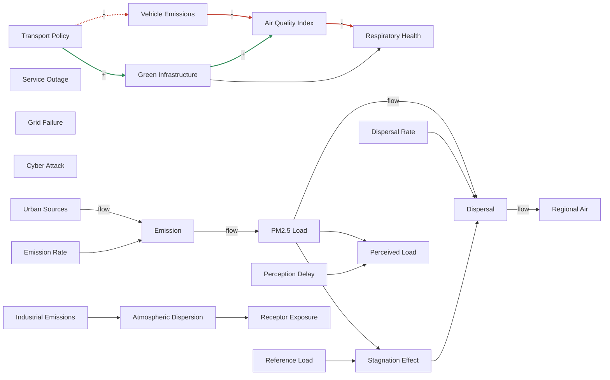

# Worked Example Transcript

Auto-generated by `worked_example/worked_example.py`. Do not edit by hand — rerun the script to regenerate.

This transcript demonstrates every CLI command in the current version of `latris`, exercised against a sample project.

## Capability Check

Before creating a project, an agent can check what Latris can actually do today — registry-only, no project needed.

### `latris capabilities`

```
Latris model-type capabilities                         
┏━━━━━━━━━━━━━━━━━━━┳━━━━━━━━━━━━━━━━━━━━┳━━━━━━━━━━━━━━━━┳━━━━━━━━━━━━━━━━━━━━┓
┃ ID                ┃ Name               ┃ Status         ┃ Description        ┃
┡━━━━━━━━━━━━━━━━━━━╇━━━━━━━━━━━━━━━━━━━━╇━━━━━━━━━━━━━━━━╇━━━━━━━━━━━━━━━━━━━━┩
│ bn                │ Bayesian Network   │ available      │ DAG with state     │
│                   │                    │                │ spaces and         │
│                   │                    │                │ conditional        │
│                   │                    │                │ probability        │
│                   │                    │                │ tables.            │
│ bow_tie           │ Bow-Tie Diagram    │ available      │ Threats and        │
│                   │                    │                │ consequences of    │
│                   │                    │                │ one top event and  │
│                   │                    │                │ the barriers       │
│                   │                    │                │ between them:      │
│                   │                    │                │ lines that rest on │
│                   │                    │                │ one barrier or     │
│                   │                    │                │ none, shared       │
│                   │                    │                │ barriers,          │
│                   │                    │                │ uncontrolled       │
│                   │                    │                │ escalation         │
│                   │                    │                │ factors, and       │
│                   │                    │                │ layer-of-protecti… │
│                   │                    │                │ frequencies with   │
│                   │                    │                │ each value's       │
│                   │                    │                │ provenance.        │
│ cld               │ Causal Loop        │ available      │ Directed graph     │
│                   │ Diagram            │                │ with polarity      │
│                   │                    │                │ (+/−) on edges;    │
│                   │                    │                │ cycles allowed.    │
│ dag               │ Directed Acyclic   │ available      │ Directed graph     │
│                   │ Graph              │                │ that must be       │
│                   │                    │                │ acyclic;           │
│                   │                    │                │ directionality     │
│                   │                    │                │ mandatory.         │
│ event_tree        │ Event Tree         │ available      │ Forward from one   │
│                   │                    │                │ initiating event   │
│                   │                    │                │ through yes/no     │
│                   │                    │                │ headings to end    │
│                   │                    │                │ states: a          │
│                   │                    │                │ complete-tree      │
│                   │                    │                │ check, sequence    │
│                   │                    │                │ and end-state      │
│                   │                    │                │ probabilities and  │
│                   │                    │                │ frequencies, with  │
│                   │                    │                │ each value's       │
│                   │                    │                │ provenance.        │
│ fault_tree        │ Fault Tree         │ available      │ Top-down failure   │
│                   │                    │                │ decomposition with │
│                   │                    │                │ AND, OR and        │
│                   │                    │                │ k-out-of-n gates:  │
│                   │                    │                │ minimal cut sets,  │
│                   │                    │                │ single points of   │
│                   │                    │                │ failure, exact     │
│                   │                    │                │ top-event          │
│                   │                    │                │ probability and    │
│                   │                    │                │ importance, with   │
│                   │                    │                │ each probability's │
│                   │                    │                │ provenance.        │
│ fcm               │ Fuzzy Cognitive    │ available      │ Weighted directed  │
│                   │ Map                │                │ graph with edge    │
│                   │                    │                │ strengths in [−1,  │
│                   │                    │                │ +1]; cycles        │
│                   │                    │                │ allowed.           │
│ sd                │ System Dynamics    │ available      │ Stocks, flows, and │
│                   │                    │                │ feedback loops     │
│                   │                    │                │ with unit-checked  │
│                   │                    │                │ equations,         │
│                   │                    │                │ simulated over     │
│                   │                    │                │ time, with         │
│                   │                    │                │ scenarios, Monte   │
│                   │                    │                │ Carlo uncertainty  │
│                   │                    │                │ bands,             │
│                   │                    │                │ sensitivity, and   │
│                   │                    │                │ loop dominance.    │
│ theory_of_change  │ Theory of Change   │ available      │ Results chain from │
│                   │                    │                │ activities through │
│                   │                    │                │ outputs and        │
│                   │                    │                │ outcomes to        │
│                   │                    │                │ impact, with the   │
│                   │                    │                │ evidence and       │
│                   │                    │                │ assumptions behind │
│                   │                    │                │ each step laid out │
│                   │                    │                │ pathway by         │
│                   │                    │                │ pathway.           │
│ argument_map      │ Argument Map       │ on the roadmap │ Toulmin/IBIS-style │
│                   │                    │                │ argumentation:     │
│                   │                    │                │ claims, warrants,  │
│                   │                    │                │ evidence,          │
│                   │                    │                │ rebuttals.         │
│ decision_tree     │ Decision Tree      │ on the roadmap │ Sequential         │
│                   │                    │                │ decision model     │
│                   │                    │                │ with chance and    │
│                   │                    │                │ decision nodes     │
│                   │                    │                │ branching to       │
│                   │                    │                │ outcomes.          │
│ gsn               │ Goal Structuring   │ on the roadmap │ Safety-case        │
│                   │ Notation           │                │ argumentation:     │
│                   │                    │                │ goals, strategies, │
│                   │                    │                │ solutions,         │
│                   │                    │                │ context.           │
│ influence_diagram │ Influence Diagram  │ on the roadmap │ Extension of       │
│                   │                    │                │ Bayesian network   │
│                   │                    │                │ with decision and  │
│                   │                    │                │ utility nodes for  │
│                   │                    │                │ decision analysis. │
│ markov            │ Markov Chain / MDP │ on the roadmap │ State-transition   │
│                   │                    │                │ graph with         │
│                   │                    │                │ transition         │
│                   │                    │                │ probabilities and  │
│                   │                    │                │ optional rewards.  │
│ causal_dag        │ Causal DAG         │ not planned    │ DAG with           │
│                   │                    │                │ observed/unobserv… │
│                   │                    │                │ classification and │
│                   │                    │                │ adjustment sets.   │
│                   │                    │                │ Being folded into  │
│                   │                    │                │ the DAG view as    │
│                   │                    │                │ identification     │
│                   │                    │                │ analyses rather    │
│                   │                    │                │ than a separate    │
│                   │                    │                │ model type.        │
│ fishbone          │ Ishikawa /         │ not planned    │ Root cause         │
│                   │ Fishbone Diagram   │                │ analysis diagram   │
│                   │                    │                │ with categorised   │
│                   │                    │                │ cause branches     │
│                   │                    │                │ converging on an   │
│                   │                    │                │ effect.            │
│ flowchart         │ Process Map /      │ not planned    │ Activity-decision… │
│                   │ Flowchart          │                │ flow for process   │
│                   │                    │                │ modelling.         │
│ petri_net         │ Petri Net          │ not planned    │ Bipartite graph of │
│                   │                    │                │ places and         │
│                   │                    │                │ transitions for    │
│                   │                    │                │ concurrent         │
│                   │                    │                │ systems.           │
│ regression        │ Regression         │ not planned    │ DAG with           │
│                   │                    │                │ fitted/elicited    │
│                   │                    │                │ edge coefficients  │
│                   │                    │                │ —                  │
│                   │                    │                │ linear/logistic/G… │
│                   │                    │                │ Doubles as the     │
│                   │                    │                │ quantification of  │
│                   │                    │                │ causal/DAG edges.  │
│ state_machine     │ State Machine /    │ not planned    │ States and         │
│                   │ Statechart         │                │ transitions with   │
│                   │                    │                │ guards and actions │
│                   │                    │                │ for reactive       │
│                   │                    │                │ system modelling.  │
└───────────────────┴────────────────────┴────────────────┴────────────────────┘

Excluded by design (not planned — won't be added):
  - Black-box machine learning (random forests, gradient boosting, neural 
networks): Decision logic cannot be inspected cell-by-cell, evidenced, or 
challenged. Out of design intent, not merely 'not yet' — the inspectability 
test: decision logic must be inspectable cell-by-cell, evidenced, and 
challengeable.
  - Opaque structure learning (learning model structure from data without 
inspectable claims): Latris governs claims a human drew and can defend, not 
discovered structure. Fitting legible parameters (e.g. regression coefficients) 
onto a structure a modeller drew is in scope; discovering the structure itself 
from data is not.
  - General-purpose simulation frameworks (SEM, ABM): Not registered as a model 
type; no current plan to add.

Reports — `latris export md --pack <name> [--model-type <type>] -o 
report.md`
  - client: for people outside the modelling work — a client, board or funder — 
answer first: the interpretation, the diagram, results (simulations, 
uncertainty, queries), findings, contested links (sources for and against), then
each link with its reasoning and evidence, and sources — without internal IDs or
the change log.
  - audit: for an auditor or the modelling team — the complete record — every 
section, including decisions, sign-offs, sessions and data.
  - review: for a reviewer checking the model — the model with its evidence, 
open challenges and questions, and findings.
  - workshop: for a working session with stakeholders — structure, assumptions, 
open questions and session notes.
  - publication: for a paper or public write-up — the model, evidence, findings,
interpretation and full references, without internal IDs.
  Board-ready prose: The client and publication packs include an interpretation:
the answer to the modelling question, implications, confidence and open 
questions, each written from claims Latris extracts from the model. `latris 
interpret initialise`, then for each section either `latris interpret 
generate-prose <section>` (needs an AI key) or read its claims with `latris 
interpret show <section>` and write the prose yourself with `latris interpret 
set-prose <section> "..." --by ai`.
  Link for a person: A `latris link` link IS the shareable report: send it as it
is — no wrapper page or separate document needed. Opening it shows the 
interactive report with charts; saving it to a free account gives a short link 
and the editor, Word, review pack and story. latris link — prints a link that 
opens this model in the Latris app. Making it needs no network (the model 
travels inside the link); opening it needs app.latris.app. It opens a hosted 
report with the full Latris figure (loops, polarity, evidence) that the person 
can share, and save to a free account for the editor and Word. The link itself 
never stops working; the short report address it opens lasts 30 days unless 
saved, and saving gives a short link that doesn't expire. `export md` also puts 
this link under the diagram, made fresh on every export. Give the person this 
link alongside (or instead of) the Markdown.
  Ready to hand over? latris check handover — lists what's left before a board 
sees it (links with no source, citations not checked against their source, 
findings waiting for approval, sections without prose, contradictions), each 
with how to fix it. Exits 1 until it's clear.
  In the Latris app (https://app.latris.app): Word report, HTML review pack (and
importing completed reviews), scrollytelling story, hosted report link (no 
sign-in to view).

Building
  - guide: latris docs — the guide for AI agents, from the installed package (no
network needed).
  - whole model in one step: latris build --spec model.yaml (YAML or JSON; '-' 
reads stdin): factors, links with polarity and reasons, sources, citations, 
evidence against, assumptions, questions and the outcome, as one commit. The 
spec is checked in full first; a mistake changes nothing. `latris build --help` 
lists every key and allowed value.
  - evidence for: latris evidence add "<from> -> <to>" polarity <bibkey> 
[--verified-by ai]
  - checking a source: latris evidence check "<from> -> <to>" polarity <bibkey> 
supports|against|off-topic --rationale "..." [--by ai --quote "..."] — records 
whether the source actually supports the claim; until then reports count the 
citation as not yet checked. The quote is looked up in the text Latris holds for
the source (save it with `latris ref snapshot` first); an AI's paraphrase is 
refused.
  - evidence against: latris evidence add <link> polarity <bibkey> --contradicts
— a source that argues against the link; reports show the link's sources for and
against under 'Contested links'. Still unchecked until someone reads it.
  - correcting sources: latris ref edit <key> --doi|--url|--title ... ("" 
clears), latris ref remove <key> [--with-citations], latris evidence remove 
<link> polarity <key> — recorded changes; never hand-edit the YAML. A source 
read in another: --cited-via <key>.
  - outcome: latris view role cld <factor> outcome — marks what the model 
explains so it isn't suggested as an intervention point.
```

_The documentation ships with the package, for sandboxes that can't reach GitHub: `latris docs` prints the guide for AI agents, `latris docs readme` the whole README, and `latris docs llms` the documentation map below._

### `latris docs llms`

```
# Latris

> Latris is an evidence-native modelling workbench — a Python CLI plus a
> FastAPI/WebSocket server backend — where every project is a git repo,
> evidence and provenance are first-class data, and AI assistance produces
> human-approved structured proposals. This file maps the documentation
> for AI agents; humans start at README.md.

Install: `pip install "latris"` (Python 3.11+, git; the extras add SD integration and Bayesian inference). The guide for AI agents ships with the package — `latris docs` prints it with no network — and `latris capabilities` lists what Latris can do. Source: https://github.com/Shannon-Bengtson/latris (Apache-2.0).

Working in a chat app (Claude, ChatGPT) rather than a shell? Use the Latris connector at https://mcp.latris.app/mcp instead of the CLI — see https://latris.app/ai/.

## Project

- [README.md](README.md): what Latris is, install, quickstart, and an "For AI agents" quickstart section.
- (https://latris.app): the product website. The Latris app (app.latris.app — the GUI, hosted report links, Word / review-pack / story exports) is built on this open library.
- (docs/README.md): documentation index.
- (docs/FOUNDATIONS.md): the methods Latris implements and the literature behind each — a work is cited only where Latris implements it, with limits stated. The report's "Methods and foundations" section, `latris foundations`, and the capability manifest's `foundations` block are generated from the same registry (`src/latris/operations/foundations.py`).
- [CONTRIBUTING.md](CONTRIBUTING.md): how to set up a dev environment and submit changes.
- [LICENSE](LICENSE): Apache-2.0.

## Engineering docs (source of truth for how the system works)

- (docs/engineering/ARCHITECTURE.md): three-layer architecture (substrate → conceptual → formal views), module layout, the five chokepoint files, CLI↔server boundary contract.
- (docs/engineering/SCHEMA_NOTES.md): pydantic models ↔ YAML mapping, provenance axes, the on-disk project format.
- (docs/engineering/GIT_INTEGRATION.md): auto-commit model, identity enforcement, semantic diffs, collaboration model.
- (docs/engineering/AI_LAYER.md): LLM wiring (litellm + instructor + keyring), the closed prompt library, call flow, mock mode (LATRIS_AI_MOCK), delegated invocation for external agents (`ai task emit`/`ai task apply` — no API key).
- (docs/engineering/CLI_REFERENCE.md): the full `latris` command catalogue.
- (docs/engineering/TESTING.md): test layers, hermetic test contract, coverage policy.

## The worked example (acceptance test, always current)

- (worked_example/worked_example_output.md): generated transcript of every CLI command, end to end — the fastest way to learn the tool's actual behaviour.
- (worked_example/worked_example.py): the generator; any new user-facing feature must extend it.

## Building a model with the CLI (start here)

- No network? `latris docs` prints the README's "For AI agents" section from the installed package (`latris docs readme`, `latris docs llms` for this file).

- The README's "For AI agents" section has a complete causal-loop-diagram session: git identity, nodes, links by label, polarity with a rationale (`latris view set cld <edge> polarity + --rationale "..."`), sources and evidence, coherence and loop checks, findings (`latris finding add`), and the client report with a Mermaid diagram (`latris export md --pack client --no-ai`).
- `latris --json <command>` gives machine-readable output for the core commands, analyses (loops, paths, adjustment sets), BN/SD/FCM parameters, inference and simulation.
- Ask before you build: unless the request already says, ask the person (one message, at most three short questions) for the background and the decision it informs, who will read it, and what they expect the answer to be. Record it with `context:` in a build spec (`background`, `audience`, `boundary`, `intuition`) or `latris project set background|audience|boundary|predictions "..."`; the report opens with it. If they'd rather you just build, record each unanswered point with `latris question add` or `latris assumption add`.
- Keep what you read: `extract:` on a source in a build spec (or `latris ref snapshot <key> --url ... --extract "..."`) stores the abstract or passage you read, so a check of that source is grounded in visible text.
- One model, several views: `latris project select-models cld fcm` (or `bn`, `dag`) adds a quantitative view of the same factors and links — set weights or probability tables on the diagram you have instead of starting again.
- As an AI agent, `export LATRIS_DEFAULT_ORIGIN=ai-proposed` first, so the nodes, links, evidence and findings you create are recorded as AI-proposed rather than as the person's own work.
- Build a whole model in one step: `latris build --spec model.yaml` (YAML or JSON; `-` reads stdin) adds factors, links with polarity and reasons, sources, citations, assumptions (with target and rationale), questions, proposed findings, challenges, interpretation prose and the outcome as one commit, after checking the whole spec — `latris build --help` lists every key. Mark the outcome with `outcome:` (or `latris view role cld "<factor>" outcome`) so it isn't suggested as an intervention point.
- Quantify and stress-test: system dynamics scenarios (`latris sd set-scenario NAME --set "Var=value"`, compared by `sd simulate --scenario NAME`), uncertainty ranges (`sd set-uncertainty <node> triangular --min --mode --max`) feeding `sd monte-carlo` (percentile bands, seeded) and `sd sensitivity <variable>` (tornado, unreviewed values flagged), and `sd loops` (which feedback loop dominates, when). Results — and `bn query` posteriors — are recorded; the client report shows the latest of each with charts in the hosted report, and they become interpretation claims. A `latris link` carries the parameters and analyses and recomputes them on opening; `latris build --spec` takes `sd:`, `bn:` and `analyses:` blocks.
- Bayesian networks: soft evidence `latris bn query -s "Node=state:0.8"` (afterwards the node is 80% that state; `--likelihood` for likelihood ratios), the most likely explanation `latris bn explain -e "Node=state"` (MPE; `--over` for MAP), and probabilistic sensitivity — `latris bn set-uncertainty <node> --n 20` ("worth 20 observations") then `latris bn monte-carlo <target>` (point estimate with 50%/95% intervals and which tables drive them). All recorded for the report and carried by `latris link`.
- Links true by definition or accounting (departures reduce active volunteers): `confidence: by-definition` in a build spec, or `latris attr set <link> confidence by-definition`. They need no source, don't count against coverage, and the figure draws them solid, not as unproven.
- Checking a source: `latris evidence check "<from> -> <to>" polarity <bibkey> supports|against|off-topic --rationale "..."` records whether the source supports the claim (a person by default; `--by ai` for an agent that read it). Until then reports say "not yet checked against the source".
- Quotes are looked up, not trusted: an agent's `supports` needs `--quote` copied from text Latris holds for the source (a saved `extract` / `ref snapshot`, `ref fetch`, or the abstract; whitespace, quote marks and case are forgiven, `...` marks a gap). A paraphrase is refused, so save the passage you read first. The report says what each check rests on (an extract of the full text, or the abstract or a summary).
- Before handing over: `latris check handover` lists what's left (unsourced links, unchecked citations, sources with nothing on file showing they were read, quotes not found in the stored text, unapproved findings, sections without prose or out of date, contradictions) with a fix for each; exits 1 until clear.
- Evidence against a link: `latris evidence add <link> polarity <bibkey> --contradicts` (or `contradicts: [<bibkey>]` on a link in a build spec). It stays on the same link as the supporting sources; reports show both sides under "Contested links" and it doesn't count toward coverage. It is still unchecked until someone reads it (`evidence check ... against`).
- Correct the record with commands, not by editing YAML: `latris ref edit <key> --doi|--url|--title ...` (`""` clears), `latris ref remove <key> [--with-citations]`, `latris evidence remove <link> <attribute> <key>`. Give only identifiers you have seen; a source read only as described in another takes `--cited-via <key>` (`cited_via:` in a spec) and the report says it was read second-hand.
- Prose goes out of date: when the model changes after a section was written, `interpret list`/`show`, `check handover` and the report flag it; `latris interpret refresh-claims`, then rewrite it.
- With the Latris connector available (mcp.latris.app chat tools: `create_model`, `get_report`, ...), use it instead of the CLI: its `report_url` is a short link to share. `latris link` is for when there is no connector.
- What you get where: the open-source library (`pip install "latris"`) is the engine and CLI — every analysis, a Markdown report with a Mermaid sketch, and `latris link`. The Latris app (app.latris.app — free account, nothing to install) adds the hosted interactive report (typeset figure, result charts, interpretation — what a board reads), the visual editor, Word reports, review packs reviewers fill in, the scrollytelling story, and saved models with short links. A `latris link` link IS the shareable report: send it as it is — don't build a wrapper page or a separate document around it.
- Giving the model to a person: `latris link` prints a link that opens it in the Latris app (app.latris.app) as a hosted report with the full figure, which they can share or save to a free account (editor, Word). Making it needs no network — the model travels inside the link — so it works from sandboxes with no network to latris.app; opening it needs app.latris.app. The link never stops working; the short report address it opens lasts 30 days unless the model is saved, and saving gives a short link that doesn't expire. Known issue: the copy keeps interpretation prose but drops source checks, quotes, extracts and approvals, so don't send a link whose prose says sources were checked or findings approved; see (docs/engineering/SHARE_LINK.md).
- Reports: five packs for different readers (client, publication, review, workshop, audit) — `latris capabilities` describes them. The board-ready version is the `client` pack (answer first, then the diagram, findings and evidence) with its interpretation sections written: `latris interpret initialise`, then `interpret show <section>` and `interpret set-prose <section> "..." --by ai` (no API key needed).

## Choosing a model type (for the person you're helping)

People rarely know which formalism fits their question. Guide the choice by the kind of answer needed, not the drawing:

- "How does this work — what feeds back on what?" → CLD. Start here by default: cheapest honest answer, and every other formalism builds on it.
- "Can this effect actually be estimated, and from what data?" → DAG. Identification only — adjustment sets, no effect sizes, no counterfactuals.
- "How likely is each outcome, and what would change my mind?" → BN. Discrete states and probabilities; CPTs elicited, learned, or mixed.
- "Which forces dominate, roughly?" → FCM. Signed, weighted links; steady-state tendencies.
- "How will it behave over time if we intervene?" → SD. Stocks, flows, units, scenarios — the most commitment; build the CLD first.
- "How is this programme supposed to work, and which steps are we taking on trust?" → Theory of Change. Levels from activity to impact (`latris toc level <factor> <level>`); `latris toc check` lays out every pathway from an activity to an impact and, link by link, whether it is checked, cited, untested or contested, with its stated assumptions. Structural and evidential — no effect sizes.
- "What combinations of failures cause this, and how likely is it?" → Fault Tree. `latris ft event <factor> top_event|intermediate_event|basic_event|undeveloped_event`, link inputs to the event they feed (`edge add <input> <event> --kind logical`), `ft gate <event> and|or|vote --k K`, `ft probability <event> <p> --source <where>`; `ft analyse` gives minimal cut sets, single points of failure, the exact top-event probability and importance (Fussell–Vesely, Birnbaum, RAW), flagging important values nobody has verified. Assumes independent basic events.
- "What stands between this hazard and harm, and where is it thin?" → Bow-Tie. `latris bowtie element <factor> hazard|top_event|threat|consequence|barrier|escalation_factor`; draw lines with ordinary links (threat → barrier → … → top event → barrier → … → consequence; escalation factor → control → barrier it degrades); `bowtie barrier <b> --type --status --owner --pfd --source`, `bowtie frequency <threat> <per year>`; `bowtie analyse` flags lines with no or one effective barrier, shared barriers, uncontrolled escalation and unowned barriers, and with the numbers gives LOPA frequencies.
- "Once this happens, how does it play out, and how often does it end badly?" → Event Tree. `latris et element <factor> initiating_event|functional_event|end_state`, `et order <heading> …`, `et sequence <end state> "Heading=yes" "Heading=no" …` for each path (the tree must be complete; `et check`), `et probability <heading> <p_yes> [--given "Heading=no"]`, `et frequency <initiator> <per year>`; `et analyse` gives each sequence's probability and frequency, end-state totals and the dominant sequences.

Same substrate throughout: factors and links stay, evidence and challenges stay, and quantifying a CLD as FCM/BN/SD later never means redrawing (`project select-models` records the choice + rationale). Triangulating (CLD + DAG on one substrate) is a strength, not a mistake. Human-facing guide: https://latris.app/formalisms/.

## Delegated AI invocation (no API key in this environment?)

- Any of the 46 closed prompts can be answered by you, the agent, instead of a vendor API: `latris ai task emit <PromptName> --inputs '<json>'` writes a self-contained task package (system + user context + response JSON schema). Answer with JSON matching `response_schema`, then have the human run `latris ai task apply --task task.json --from response.json`. Validation, approval gates, and provenance are identical to API calls; the interaction logs `model_id` as `external-agent[:name]`. See (docs/engineering/AI_LAYER.md) § "Delegated calls (bring your own agent)".

## Working rules for agents in this repo

- Read [CLAUDE.md](CLAUDE.md) and (src/latris/CLAUDE.md) before editing code.
- The per-project state directory is `.graph-tooling` — a frozen data-format constant; never rename it.
- Run tests with `python -m pytest` (parallel by default); regenerate the worked-example transcript with `pytest tests/test_worked_example.py --slow` after changing CLI behaviour.
```


## Project Setup

Initialise a new project with a modelling question.

### `latris init /tmp/latris-demo-lgmnf1dw/air-quality-model --question What factors drive urban air quality and how do they affect health outcomes?`

```
initialised project at /tmp/latris-demo-lgmnf1dw/air-quality-model
```

### `latris project set coverage_dimensions emission sources, atmospheric dispersion, exposure, health outcomes, policy levers`

```
set coverage_dimensions (e1eb8cf39a)
```

### `latris project set granularity_level each node a specific measurable variable a city air-quality team could track`

```
set granularity_level (fd06ad9fd0)
```

### `latris project set audience a municipal air-quality and public-health team`

```
set audience (ae71441449)
```

### `latris project show`

```
project root: /tmp/latris-demo-lgmnf1dw/air-quality-model
modelling question: What factors drive urban air quality and how do they affect 
health outcomes?
selected models: (none)
schema version: 6
created: 2026-11-16T06:27:48+00:00
updated: 2026-11-16T06:27:49+00:00
```


## Building the Model

Add entities (nodes) and causal relationships (edges).

### `latris node add Vehicle Emissions --kind variable`

```
added variable Vehicle Emissions (node_01M7HGMPYVWS7KVA8KDBBVR7K2) · commit 
7a44305ce0
```

### `latris node add Air Quality Index --kind variable`

```
added variable Air Quality Index (node_01M7HGMQ13EVCGA8SBDM60Z0FJ) · commit 
abeff79b03
```

### `latris node add Respiratory Health --kind variable`

```
added variable Respiratory Health (node_01M7HGMQ3QEHJ2K5YBFX39H4WC) · commit 
ca11d973ab
```

### `latris node add Green Infrastructure --kind concept`

```
added concept Green Infrastructure (node_01M7HGMQ7C6NK18726F7JNYBPZ) · commit 
db7ac686d3
```

### `latris node add Transport Policy --kind decision`

```
added decision Transport Policy (node_01M7HGMQAMXXFKWF8TBWE1R69S) · commit 
54e2ba8f59
```

### `latris node list`

```
┏━━━━━━━━━━━━━━━━━━━━━━━━━━━━━━━━━┳━━━━━━━━━━┳━━━━━━━━━━━━━━━━━━━━━━┓
┃ ID                              ┃ Kind     ┃ Label                ┃
┡━━━━━━━━━━━━━━━━━━━━━━━━━━━━━━━━━╇━━━━━━━━━━╇━━━━━━━━━━━━━━━━━━━━━━┩
│ node_01M7HGMPYVWS7KVA8KDBBVR7K2 │ variable │ Vehicle Emissions    │
│ node_01M7HGMQ13EVCGA8SBDM60Z0FJ │ variable │ Air Quality Index    │
│ node_01M7HGMQ3QEHJ2K5YBFX39H4WC │ variable │ Respiratory Health   │
│ node_01M7HGMQ7C6NK18726F7JNYBPZ │ concept  │ Green Infrastructure │
│ node_01M7HGMQAMXXFKWF8TBWE1R69S │ decision │ Transport Policy     │
└─────────────────────────────────┴──────────┴──────────────────────┘
```

### `latris edge add node_01M7HGMPYVWS7KVA8KDBBVR7K2 node_01M7HGMQ13EVCGA8SBDM60Z0FJ --kind causal`

```
added edge edge_01M7HGMQGR08D96GQF7E7HSNS1 (causal) · commit 258764d537
```

### `latris edge add node_01M7HGMQ13EVCGA8SBDM60Z0FJ node_01M7HGMQ3QEHJ2K5YBFX39H4WC --kind causal`

```
added edge edge_01M7HGMQKYEWXA9GXB56T6B374 (causal) · commit 06f1064a22
```

### `latris edge add node_01M7HGMQ7C6NK18726F7JNYBPZ node_01M7HGMQ13EVCGA8SBDM60Z0FJ --kind causal`

```
added edge edge_01M7HGMQRAEXDHMNKHCQ57GFKZ (causal) · commit f1597b4e54
```

### `latris edge add node_01M7HGMQAMXXFKWF8TBWE1R69S node_01M7HGMPYVWS7KVA8KDBBVR7K2 --kind causal`

```
added edge edge_01M7HGMQV0RC28FF3G0KCE7BRQ (causal) · commit b700589d7a
```

### `latris edge add node_01M7HGMQ7C6NK18726F7JNYBPZ node_01M7HGMQ3QEHJ2K5YBFX39H4WC --kind causal`

```
added edge edge_01M7HGMQYTRH7BDHQZKWQX32KP (causal) · commit ff264f1477
```

### `latris edge list`

```
┏━━━━━━━━━━━━━━━━━━━━━┳━━━━━━━━┳━━━━━━━━━━━━━━━━━━━━━┳━━━┳━━━━━━━━━━━━━━━━━━━━━┓
┃ ID                  ┃ Kind   ┃ From                ┃ → ┃ To                  ┃
┡━━━━━━━━━━━━━━━━━━━━━╇━━━━━━━━╇━━━━━━━━━━━━━━━━━━━━━╇━━━╇━━━━━━━━━━━━━━━━━━━━━┩
│ edge_01M7HGMQGR08D… │ causal │ Vehicle Emissions   │ → │ Air Quality Index   │
│                     │        │ (node_01M7HGM…)     │   │ (node_01M7HGM…)     │
│ edge_01M7HGMQKYEWX… │ causal │ Air Quality Index   │ → │ Respiratory Health  │
│                     │        │ (node_01M7HGM…)     │   │ (node_01M7HGM…)     │
│ edge_01M7HGMQRAEXD… │ causal │ Green               │ → │ Air Quality Index   │
│                     │        │ Infrastructure      │   │ (node_01M7HGM…)     │
│                     │        │ (node_01M7HGM…)     │   │                     │
│ edge_01M7HGMQV0RC2… │ causal │ Transport Policy    │ → │ Vehicle Emissions   │
│                     │        │ (node_01M7HGM…)     │   │ (node_01M7HGM…)     │
│ edge_01M7HGMQYTRH7… │ causal │ Green               │ → │ Respiratory Health  │
│                     │        │ Infrastructure      │   │ (node_01M7HGM…)     │
│                     │        │ (node_01M7HGM…)     │   │                     │
└─────────────────────┴────────┴─────────────────────┴───┴─────────────────────┘
```

### `latris node show Vehicle Emissions`

```
id: node_01M7HGMPYVWS7KVA8KDBBVR7K2
kind: variable
label: Vehicle Emissions
created: 2026-11-16T06:27:49.339000+00:00
```


## Model Selection (Formalise)

With the causal structure in place, choose the formalisms to apply. This mirrors the GUI's Build -> Formalise spine: build the substrate first, then select model types (CLD and DAG here) and parameterise each. The model-specific attributes that follow — CLD polarity, FCM weights, BN CPTs — and the formal views all hang off this selection.

_Select target model types — CLD and DAG._

### `latris project select-models cld dag`

```
selected model types: cld, dag (e5f41269c0)
```

### `latris project show`

```
project root: /tmp/latris-demo-lgmnf1dw/air-quality-model
modelling question: What factors drive urban air quality and how do they affect 
health outcomes?
selected models: cld, dag
schema version: 6
created: 2026-11-16T06:27:48+00:00
updated: 2026-11-16T06:27:50+00:00
```


## Setting Attributes

Add descriptions, confidence levels, and polarity to edges.

### `latris attr set node_01M7HGMPYVWS7KVA8KDBBVR7K2 description Total pollutant output from road transport including PM2.5, NOx, and CO.`

```
set description on node_01M7HGMPYVWS7KVA8KDBBVR7K2 · commit 97741fe773
```

### `latris attr set node_01M7HGMQ13EVCGA8SBDM60Z0FJ description Composite measure of ambient air pollution concentration.`

```
set description on node_01M7HGMQ13EVCGA8SBDM60Z0FJ · commit bbe253749f
```

### `latris attr set node_01M7HGMQ3QEHJ2K5YBFX39H4WC description Population-level respiratory morbidity and mortality rates.`

```
set description on node_01M7HGMQ3QEHJ2K5YBFX39H4WC · commit 8f530422a5
```

### `latris view set cld edge_01M7HGMQGR08D96GQF7E7HSNS1 polarity - --rationale More vehicle emissions raise pollutant load, worsening the AQI.`

```
set cld polarity = - on edge_01M7HGMQGR08D96GQF7E7HSNS1 · commit 8429840d25
```

### `latris view set cld edge_01M7HGMQKYEWXA9GXB56T6B374 polarity -`

```
set cld polarity = - on edge_01M7HGMQKYEWXA9GXB56T6B374 · commit c7bf7ba20c
```

### `latris view set cld edge_01M7HGMQRAEXDHMNKHCQ57GFKZ polarity +`

```
set cld polarity = + on edge_01M7HGMQRAEXDHMNKHCQ57GFKZ · commit 8c6ee172c7
```

### `latris view set cld edge_01M7HGMQV0RC28FF3G0KCE7BRQ polarity -`

```
set cld polarity = - on edge_01M7HGMQV0RC28FF3G0KCE7BRQ · commit 2511cd3166
```

_Any command that supports it can print JSON instead of text with the global --json flag — the form agents and the hosted MCP server use._

### `latris --json node show Air Quality Index`

```
{"result": {"id": "node_01M7HGMQ13EVCGA8SBDM60Z0FJ", "kind": "variable", "label": "Air Quality Index", "maturity": "proposed", "origin": "human-direct", "verification": "unverified", "source_id": null}}
```

### `latris attr set edge_01M7HGMQGR08D96GQF7E7HSNS1 confidence high`

```
set confidence on edge_01M7HGMQGR08D96GQF7E7HSNS1 · commit 635ca22b6c
```

### `latris mature review edge_01M7HGMQGR08D96GQF7E7HSNS1`

```
reviewed edge_01M7HGMQGR08D96GQF7E7HSNS1 · commit 94a62eff56
```

_Marked the Emissions→AQI edge as reviewed (entity-level maturity)._


## Research Base

Add references and attach evidence to attributes.

### `latris ref add who2021 --title WHO Global Air Quality Guidelines 2021 --author World Health Organization --year 2021 --doi 10.1186/978-92-4-003422-8`

```
added reference who2021 · commit 2629fab3a6
```

### `latris ref add defra2023 --title Air Quality Strategy for England --author DEFRA --year 2023`

```
added reference defra2023 · commit 85a2b1597f
```

### `latris ref list`

```
┏━━━━━━━━━━━┳━━━━━━┳━━━━━━━━━━━━━━━━━━━━━━━━━━━━━━━┳━━━━━━━━━━━━━━━━━━━━━━━━━━━┓
┃ Key       ┃ Year ┃ Title                         ┃ Authors                   ┃
┡━━━━━━━━━━━╇━━━━━━╇━━━━━━━━━━━━━━━━━━━━━━━━━━━━━━━╇━━━━━━━━━━━━━━━━━━━━━━━━━━━┩
│ who2021   │ 2021 │ WHO Global Air Quality        │ World Health Organization │
│           │      │ Guidelines 2021               │                           │
│ defra2023 │ 2023 │ Air Quality Strategy for      │ DEFRA                     │
│           │      │ England                       │                           │
└───────────┴──────┴───────────────────────────────┴───────────────────────────┘
```

### `latris ref snapshot who2021 --url https://www.who.int/publications/i/item/9789240034228 --extract WHO global air quality guidelines (2021) tighten recommended PM2.5 and NO2 limits based on 2010-2020 evidence linking long-term exposure to cardiovascular and respiratory mortality. --kind abstract`

```
snapshot set for who2021 (abstract) · commit a2620a986f
```

### `latris evidence add node_01M7HGMPYVWS7KVA8KDBBVR7K2 description who2021 --notes WHO identifies transport as primary urban PM2.5 source.`

```
attached who2021 → node_01M7HGMPYV…/description · commit 4d904cbad4
```

### `latris evidence add edge_01M7HGMQGR08D96GQF7E7HSNS1 polarity who2021 --notes Dose-response relationship established in WHO guidelines.`

```
attached who2021 → edge_01M7HGMQGR…/polarity · commit 96bccd659a
```

_A source that argues against a link goes on the same link with `--contradicts`; reports list it as evidence against and show the link under 'Contested links'._

### `latris ref add dispersal2024 --title Wind dispersal and local air quality (illustrative source) --year 2024`

```
added reference dispersal2024 · commit fc390f08d5
```

### `latris evidence add edge_01M7HGMQGR08D96GQF7E7HSNS1 polarity dispersal2024 --contradicts --notes Strong winds can decouple local emissions from local AQI.`

```
attached dispersal2024 → edge_01M7HGMQGR…/polarity · commit 6b861f1267
```


## Provenance

Record assumptions, decisions, exclusions, questions, predictions, and sessions.

### `latris assumption add Linear dose-response between emissions and AQI --rationale Simplification appropriate for policy-level modelling.`

```
logged assumption assumption_01M7HGMT2DRBNJPC7P8FB036N7 · commit 72e85bcadf
```

### `latris assumption add Indoor air quality is out of scope`

```
logged assumption assumption_01M7HGMT4TX8FY9Q8VWRJGT65N · commit ef8e55801b
```

### `latris decision log Exclude industrial emissions from initial scope --rationale Focus on transport for Phase 1; industrial sources added in Phase 2.`

```
logged decision decision_01M7HGMT730S8G5B2ZNYSP44V1 · commit 72502f3709
```

### `latris exclusion add Indoor air quality and workplace exposure --rationale Separate regulatory domain; different exposure pathways.`

```
logged exclusion exclusion_01M7HGMT9ASV72CYKP1XMC4QK1 · commit 8d57fc8e2a
```

### `latris question add Should we model seasonal variation in AQI?`

```
logged question question_01M7HGMTBPV2C19TMCZ1ENS1SY · commit d37e4be10d
```

### `latris question add Is green infrastructure effect direct or mediated?`

```
logged question question_01M7HGMTE36G3G76RF4QRXQEXV · commit d5832be692
```

_Per-target provenance — assumptions, questions, and decisions about specific elements._

### `latris assumption add Polarity is uniformly negative at city-annual scale --rationale Simplification; spatial heterogeneity noted as caveat. --target edge_01M7HGMQGR08D96GQF7E7HSNS1`

```
logged assumption assumption_01M7HGMTH877KQMX09CGRCPG5G · commit a4708c935f
```

### `latris question add Should we model non-linear dose-response for this pathway? --target edge_01M7HGMQKYEWXA9GXB56T6B374`

```
logged question question_01M7HGMTKSAMB71DZ55H0Y6K2J · commit 9662eeadce
```

### `latris decision log Keep as single composite index rather than per-pollutant --rationale Per-pollutant split deferred to Phase 2. --target node_01M7HGMQ13EVCGA8SBDM60Z0FJ`

```
logged decision decision_01M7HGMTP77AD0N1S9NED87E0J · commit ae6805b907
```

### `latris prediction add AQI will improve 15% in areas with new green corridors --horizon 3 years`

```
logged prediction prediction_01M7HGMTRGM5H5B1FHWE1AFP4M · commit 43031a3d87
```

### `latris session record --date 2026-04-15 --attendee Alice --attendee Bob --notes Kickoff workshop: identified core causal pathways.`

```
recorded session session_01M7HGMTTVCDH770ZD18D7WXQ6 · commit 6f42b3887d
```


## Building from a Spec

Add many factors, links, sources and citations at once from a YAML or JSON spec — checked in full first, applied as one commit. Links name factors by label; shown here on a second, small project so the main model is unchanged.

### `latris init /tmp/latris-demo-lgmnf1dw/volunteers --question Why are volunteers leaving?`

```
initialised project at /tmp/latris-demo-lgmnf1dw/volunteers
```

### `latris project select-models cld`

```
selected model types: cld (492beeea13)
```

```yaml
context:   # asked of the person before building; the report opens with it
  background: The program lost a third of its volunteers since 2023; the board is deciding on a paid coordinator.
  audience: The program's board
  intuition: Rostering changes after the merger pushed people out.
outcome: Volunteer departures
factors:
  - label: Workload per volunteer
    description: Hours each active volunteer covers.
  - label: Volunteer burnout
  - label: Volunteer departures
links:
  - from: Workload per volunteer
    to: Volunteer burnout
    polarity: "+"
    reason: More hours per person, more exhaustion.
    confidence: medium
    sources: [smith2021]
  - from: Volunteer burnout
    to: Volunteer departures
    polarity: "+"
    reason: Exhausted volunteers leave.
  - from: Volunteer departures
    to: Workload per volunteer
    polarity: "+"
    reason: Fewer people share the same work.
    confidence: by-definition   # accounting: needs no source
sources:
  - key: smith2021
    title: Volunteer burnout
    authors: ["Smith, J"]
    year: 2021
    url: https://example.org/smith2021
    extract: "Abstract: hours per volunteer predicted emotional exhaustion (r = 0.41)."   # what was read
assumptions:
  - Service demand stays steady as numbers fall.
decisions:
  - statement: Left out paid staff.
    rationale: The program has none.
```

### `latris build --spec -`

```
built 3 factors, 3 links, 1 sources, 1 citations, 1 assumptions, 0 questions · 
commit 70fa3064fa
```

### `latris analyse loops`

```
┏━━━┳━━━━━━┳━━━━━━━━┳━━━━━━━━━━━━━━━━━━━━━━━━━━━━━━━━━━━━━━━━━━━━━━━━━━━━━━━━━━┓
┃ # ┃ Type ┃ Length ┃ Variables                                                ┃
┡━━━╇━━━━━━╇━━━━━━━━╇━━━━━━━━━━━━━━━━━━━━━━━━━━━━━━━━━━━━━━━━━━━━━━━━━━━━━━━━━━┩
│ 1 │ R    │ 3      │ Workload per volunteer → Volunteer burnout → Volunteer   │
│   │      │        │ departures                                               │
└───┴──────┴────────┴──────────────────────────────────────────────────────────┘

1 loop(s) found.
```

### `latris --json analyse loops`

```
{"result": [{"type": "R", "length": 3, "variables": ["Workload per volunteer", "Volunteer burnout", "Volunteer departures"], "ids": ["node_01M7HGMV417D5G9V7FHANNMC4V", "node_01M7HGMV481TEWZ7VZSZERG6X5", "node_01M7HGMV4D1833WJ1J2HWKHWG2"]}]}
```

_Attaching a citation says only that it was attached. Reading the source and recording what it says is a separate step; links can be named "From -> To"._

### `latris evidence check Workload per volunteer -> Volunteer burnout polarity smith2021 supports --rationale Hours per volunteer predict exhaustion.`

```
checked smith2021 on edge_01M7HGMV4M…/polarity: supports · commit 367f942f12
```

_An agent's check needs a quote copied from the text Latris holds for the source (here the extract saved by the spec). A paraphrase is refused; the copied passage is found, and the check is recorded as resting on the abstract._

### `latris evidence check Workload per volunteer -> Volunteer burnout polarity smith2021 supports --by ai --rationale Hours per volunteer predict exhaustion. --quote Volunteers who work long hours burn out.`

```
error: the quote isn't in the text Latris holds for 'smith2021' (the text it 
holds doesn't contain it). A quote must be copied from the source, not 
paraphrased (at least 20 characters; '...' may mark a gap). Save the passage you
read first — `latris ref snapshot smith2021 --url <where you read it> --kind 
abstract|full_text_excerpt --extract "..."` — then check again. A verdict other 
than supports can be recorded without --quote.
```

### `latris evidence check Workload per volunteer -> Volunteer burnout polarity smith2021 supports --by ai --rationale Hours per volunteer predict exhaustion. --quote hours per volunteer predicted emotional exhaustion`

```
checked smith2021 on edge_01M7HGMV4M…/polarity: supports · commit 60dc6465d6
```

_A study read only as described in another source is cited via that source; the report says it was read second-hand. Sources and citations are corrected with commands, so each correction is in the history._

### `latris ref add jones2018 --title Rostering and retention (illustrative) --year 2018 --cited-via smith2021`

```
added reference jones2018 · commit b95209e758
```

### `latris ref edit jones2018 --doi https://doi.org/10.5555/rostering.2018`

```
updated reference jones2018 · commit 9f7039d250
```

### `latris evidence add Volunteer burnout -> Volunteer departures polarity jones2018 --verified-by ai`

```
attached jones2018 → edge_01M7HGMV5K…/polarity · commit bc878d2286
```

### `latris evidence remove Volunteer burnout -> Volunteer departures polarity jones2018 --rationale Only read second-hand; not enough on its own.`

```
removed jones2018 from edge_01M7HGMV5K…/polarity · commit 4e56ea0d5d
```

### `latris ref remove jones2018 --rationale No longer cited.`

```
removed reference jones2018 · commit fdee758372
```

_Prose written before the model changes is flagged as out of date._

### `latris interpret initialise`

```
initialised 10 section(s) · commit 0d617957fe
  · interpret-section_01  structural_summary (cld)  state=claims_only
  · interpret-section_01  key_findings (cld)  state=claims_only
  · interpret-section_01  sensitivity (cld)  state=claims_only
  · interpret-section_01  assumptions_limitations (cld)  state=claims_only
  · interpret-section_01  evidence_gaps (cld)  state=claims_only
  · interpret-section_01  evidence_coverage (cld)  state=claims_only
  · interpret-section_01  answer_to_question (cld)  state=claims_only
  · interpret-section_01  implications (cld)  state=claims_only
  · interpret-section_01  confidence_assessment (cld)  state=claims_only
  · interpret-section_01  open_questions (cld)  state=claims_only
```

### `latris interpret set-prose structural_summary Three factors form one reinforcing loop. --by ai`

```
wrote structural_summary (cld) · commit a09e9867c8
```

### `latris node add Recognition`

```
added concept Recognition (node_01M7HGMWH9RHZQPA1AKPEHK973) · commit 150c6f2521
```

### `latris edge add Recognition Volunteer departures`

```
added edge edge_01M7HGMWKRAJK68GMQ0PWM9EZP (causal) · commit bd3d91090f
```

### `latris interpret refresh-claims`

```
refreshed 10 section(s) · commit c97812343a
out of date (rewrite the prose): structural_summary
```

_Before handing the model to a board: what's left, and how to fix each (exits 1 until clear)._

### `latris check handover`

```
Ready to hand over: no — 3 things to do

1. 2 of 3 links have no source
     · Volunteer burnout → Volunteer departures
     · Recognition → Volunteer departures
   fix: cite one (`latris evidence add <link> polarity <key>`), mark a link true
by definition (`latris attr set <link> confidence by-definition`), or record it 
as an assumption

2. 9 of 10 report sections have no prose (readers see raw claims)
     · Key Findings
     · Sensitivity & Robustness
     · Assumptions & Limitations
     · Evidence Gaps
     · Evidence Coverage
     · … and 4 more
   fix: `latris interpret show <section>`, then `latris interpret set-prose 
<section> "..." --by ai`

3. 1 report section was written before the model last changed, and the claims 
behind it have changed
     · Structural Summary
   fix: `latris interpret refresh-claims`, then `latris interpret show 
<section>` and rewrite it with `latris interpret set-prose`
```

_The context opens the report — who it's for, the situation, and the person's own expectation to compare with the answer:_

### `latris --json project show`

```
{"result": {"name": "volunteers", "statement": "Why are volunteers leaving?", "background": "The program lost a third of its volunteers since 2023; the board is deciding on a paid coordinator.", "boundary": "", "exclusions": "", "predictions": "Rostering changes after the merger pushed people out.", "coverage_dimensions": "", "granularity_level": "", "audience": "The program's board", "selected_model_types": ["cld"], "schema_version": 6}}
```


## Challenges

Open, discuss, and resolve challenges against model elements.

### `latris challenge open edge_01M7HGMQGR08D96GQF7E7HSNS1 Polarity may not be uniformly negative — wind dispersal can decouple local emissions from local AQI. --attribute polarity`

```
opened challenge challenge_01M7HGMX8W4052H6RYP63GZD75 · commit 57d0ed6b6e
```

### `latris challenge turn challenge_01M7HGMX8W4052H6RYP63GZD75 Valid point. However, for annual averages at city scale, the negative relationship holds strongly.`

```
added turn to challenge_01M7HGMX8W4052H6RYP63GZD75 (now 1 turn(s)) · commit 
1ca192649d
```

### `latris challenge resolve challenge_01M7HGMX8W4052H6RYP63GZD75 --state retained-with-caveat --rationale Negative polarity retained for city-annual scale; spatial heterogeneity noted as caveat.`

```
resolved challenge_01M7HGMX8W4052H6RYP63GZD75 → retained-with-caveat · commit 
e56134cb69
```

### `latris challenge list`

```
┏━━━━━━━━━━━━━━━━┳━━━━━━━━━━━━━━━━┳━━━━━━━━━━━━━━━━┳━━━━━━━━━━━┳━━━━━━━━━━━━━━━┓
┃ ID             ┃ State          ┃ Target         ┃ Attribute ┃ Argument      ┃
┡━━━━━━━━━━━━━━━━╇━━━━━━━━━━━━━━━━╇━━━━━━━━━━━━━━━━╇━━━━━━━━━━━╇━━━━━━━━━━━━━━━┩
│ challenge_01M… │ retained-with… │ edge_01M7HGMQ… │ polarity  │ Polarity may  │
│                │                │                │           │ not be        │
│                │                │                │           │ uniformly     │
│                │                │                │           │ negative —    │
│                │                │                │           │ wind          │
│                │                │                │           │ dispersal can │
│                │                │                │           │ …             │
└────────────────┴────────────────┴────────────────┴───────────┴───────────────┘
```


## Sign-off

Record a formal review sign-off.

### `latris signoff record --role Lead modeller --scope Substrate v0.1: core causal structure --notes Structure approved for stakeholder review.`

```
recorded sign-off signoff_01M7HGMXK0DVXHR6DVMKV3BY9A · commit 48c0e37e4c
```


## Bayesian Network

Quantify the validated causal core as a discrete Bayesian Network: declare each node's state space, fill in conditional probability tables (CPTs) with per-cell provenance, then run exact inference. BN reads the `causal` substrate directly — no view projection or model selection required.

_The readiness gate first. `bn check` derives the node set from the causal edges and reports what's missing — every node needs a state space and a complete, normalised CPT before inference can run._

### `latris bn check`

```
┏━━━━━━━━━━━━━━━━━━━━━━┳━━━━━━━━━━━━━━━━━━━━━┳━━━━━━━━━━━━━━━━━━━━━━━━━━━━━━━━━┓
┃ Node                 ┃ Gap                 ┃ Detail                          ┃
┡━━━━━━━━━━━━━━━━━━━━━━╇━━━━━━━━━━━━━━━━━━━━━╇━━━━━━━━━━━━━━━━━━━━━━━━━━━━━━━━━┩
│ Vehicle Emissions    │ missing_state_space │ Node has no state space. Define │
│                      │                     │ its discrete states (e.g.       │
│                      │                     │ 'low,high').                    │
│ Air Quality Index    │ missing_state_space │ Node has no state space. Define │
│                      │                     │ its discrete states (e.g.       │
│                      │                     │ 'low,high').                    │
│ Respiratory Health   │ missing_state_space │ Node has no state space. Define │
│                      │                     │ its discrete states (e.g.       │
│                      │                     │ 'low,high').                    │
│ Green Infrastructure │ missing_state_space │ Node has no state space. Define │
│                      │                     │ its discrete states (e.g.       │
│                      │                     │ 'low,high').                    │
│ Transport Policy     │ missing_state_space │ Node has no state space. Define │
│                      │                     │ its discrete states (e.g.       │
│                      │                     │ 'low,high').                    │
│ Vehicle Emissions    │ missing_cpt         │ Node has no conditional         │
│                      │                     │ probability table.              │
│ Air Quality Index    │ missing_cpt         │ Node has no conditional         │
│                      │                     │ probability table.              │
│ Respiratory Health   │ missing_cpt         │ Node has no conditional         │
│                      │                     │ probability table.              │
│ Green Infrastructure │ missing_cpt         │ Node has no conditional         │
│                      │                     │ probability table.              │
│ Transport Policy     │ missing_cpt         │ Node has no conditional         │
│                      │                     │ probability table.              │
└──────────────────────┴─────────────────────┴─────────────────────────────────┘
```

_Declare discrete state spaces (ordinal ranges are marked --ordered)._

### `latris bn set-state-space Transport Policy lax,strict`

```
set state space on node_01M7HGMQAM… = lax, strict · commit bb7873b3c9
```

### `latris bn set-state-space Green Infrastructure low,high --ordered`

```
set state space on node_01M7HGMQ7C… = low, high · commit 1313e8def1
```

### `latris bn set-state-space Vehicle Emissions low,high --ordered`

```
set state space on node_01M7HGMPYV… = low, high · commit 52dcbd3899
```

### `latris bn set-state-space Air Quality Index good,moderate,poor --ordered`

```
set state space on node_01M7HGMQ13… = good, moderate, poor · commit 68df7f62a2
```

### `latris bn set-state-space Respiratory Health good,poor`

```
set state space on node_01M7HGMQ3Q… = good, poor · commit edb3abaa5d
```

_Fill in the CPTs. Probabilities are row-major with the first parent varying slowest; each conditional distribution sums to 1. --origin and --source stamp provenance on every row of that node's table — note how different nodes draw on different sources (a city policy baseline, WHO guidelines, monitoring data, expert judgement). Finer per-row provenance lives in views/parameters/bn-cpt.yaml._

### `latris bn set-cpt Transport Policy --probs 0.6,0.4 --origin human-direct --source defra2023`

```
set CPT on node_01M7HGMQAM… (1 row(s), parents: —) · commit 5c597079d8
```

### `latris bn set-cpt Green Infrastructure --probs 0.5,0.5 --origin human-direct`

```
set CPT on node_01M7HGMQ7C… (1 row(s), parents: —) · commit 23b63dea61
```

### `latris bn set-cpt Vehicle Emissions --parents Transport Policy --probs 0.3,0.7,0.8,0.2 --origin human-elicited --source who2021`

```
set CPT on node_01M7HGMPYV… (2 row(s), parents: node_01M7HGM) · commit 
bcd90e46df
```

### `latris bn set-cpt Air Quality Index --parents Vehicle Emissions,Green Infrastructure --probs 0.5,0.35,0.15,0.7,0.25,0.05,0.1,0.3,0.6,0.25,0.4,0.35 --origin data-derived --source who2021`

```
set CPT on node_01M7HGMQ13… (4 row(s), parents: node_01M7HGM, node_01M7HGM) · 
commit 498590780c
```

### `latris bn set-cpt Respiratory Health --parents Air Quality Index,Green Infrastructure --probs 0.9,0.1,0.93,0.07,0.75,0.25,0.8,0.2,0.45,0.55,0.55,0.45 --origin human-elicited`

```
set CPT on node_01M7HGMQ3Q… (6 row(s), parents: node_01M7HGM, node_01M7HGM) · 
commit b6770d3e4d
```

_The model is now fully quantified — the gate passes._

### `latris bn check`

```
✓ BN is fully quantified and ready to compute.
```

### `latris bn state-spaces`

```
┏━━━━━━━━━━━━━━━━━━━━━━┳━━━━━━━━━━━━━━━━━━━━━━┳━━━━━━━━━┓
┃ Node                 ┃ States               ┃ Ordered ┃
┡━━━━━━━━━━━━━━━━━━━━━━╇━━━━━━━━━━━━━━━━━━━━━━╇━━━━━━━━━┩
│ Transport Policy     │ lax, strict          │         │
│ Green Infrastructure │ low, high            │ ✓       │
│ Vehicle Emissions    │ low, high            │ ✓       │
│ Air Quality Index    │ good, moderate, poor │ ✓       │
│ Respiratory Health   │ good, poor           │         │
└──────────────────────┴──────────────────────┴─────────┘
```

### `latris bn cpts`

```
┏━━━━━━━━━━━━━━━━━┳━━━━━━━┳━━━━━━━━━━━━━━━━━┳━━━━━━━━━━━━━━━━━┳━━━━━━━━━━━━━━━━┓
┃ Node            ┃ Kind  ┃ Parent states   ┃ P(node)         ┃ Origin         ┃
┡━━━━━━━━━━━━━━━━━╇━━━━━━━╇━━━━━━━━━━━━━━━━━╇━━━━━━━━━━━━━━━━━╇━━━━━━━━━━━━━━━━┩
│ Transport       │ table │ —               │ lax:0.600,      │ human-direct   │
│ Policy          │       │                 │ strict:0.400    │                │
│ Green           │ table │ —               │ low:0.500,      │ human-direct   │
│ Infrastructure  │       │                 │ high:0.500      │                │
│ Vehicle         │ table │ Transport       │ low:0.300,      │ human-elicited │
│ Emissions       │       │ Policy=lax      │ high:0.700      │                │
│ Vehicle         │ table │ Transport       │ low:0.800,      │ human-elicited │
│ Emissions       │       │ Policy=strict   │ high:0.200      │                │
│ Air Quality     │ table │ Vehicle         │ good:0.500,     │ data-derived   │
│ Index           │       │ Emissions=low,  │ moderate:0.350, │                │
│                 │       │ Green           │ poor:0.150      │                │
│                 │       │ Infrastructure… │                 │                │
│ Air Quality     │ table │ Vehicle         │ good:0.700,     │ data-derived   │
│ Index           │       │ Emissions=low,  │ moderate:0.250, │                │
│                 │       │ Green           │ poor:0.050      │                │
│                 │       │ Infrastructure… │                 │                │
│ Air Quality     │ table │ Vehicle         │ good:0.100,     │ data-derived   │
│ Index           │       │ Emissions=high, │ moderate:0.300, │                │
│                 │       │ Green           │ poor:0.600      │                │
│                 │       │ Infrastructure… │                 │                │
│ Air Quality     │ table │ Vehicle         │ good:0.250,     │ data-derived   │
│ Index           │       │ Emissions=high, │ moderate:0.400, │                │
│                 │       │ Green           │ poor:0.350      │                │
│                 │       │ Infrastructure… │                 │                │
│ Respiratory     │ table │ Air Quality     │ good:0.900,     │ human-elicited │
│ Health          │       │ Index=good,     │ poor:0.100      │                │
│                 │       │ Green           │                 │                │
│                 │       │ Infrastructure… │                 │                │
│ Respiratory     │ table │ Air Quality     │ good:0.930,     │ human-elicited │
│ Health          │       │ Index=good,     │ poor:0.070      │                │
│                 │       │ Green           │                 │                │
│                 │       │ Infrastructure… │                 │                │
│ Respiratory     │ table │ Air Quality     │ good:0.750,     │ human-elicited │
│ Health          │       │ Index=moderate, │ poor:0.250      │                │
│                 │       │ Green           │                 │                │
│                 │       │ Infrastructure… │                 │                │
│ Respiratory     │ table │ Air Quality     │ good:0.800,     │ human-elicited │
│ Health          │       │ Index=moderate, │ poor:0.200      │                │
│                 │       │ Green           │                 │                │
│                 │       │ Infrastructure… │                 │                │
│ Respiratory     │ table │ Air Quality     │ good:0.450,     │ human-elicited │
│ Health          │       │ Index=poor,     │ poor:0.550      │                │
│                 │       │ Green           │                 │                │
│                 │       │ Infrastructure… │                 │                │
│ Respiratory     │ table │ Air Quality     │ good:0.550,     │ human-elicited │
│ Health          │       │ Index=poor,     │ poor:0.450      │                │
│                 │       │ Green           │                 │                │
│                 │       │ Infrastructure… │                 │                │
└─────────────────┴───────┴─────────────────┴─────────────────┴────────────────┘
```

_Prior marginals — the network's beliefs before any evidence._

### `latris bn marginals`

```
Prior marginals

┏━━━━━━━━━━━━━━━━━━━━━━┳━━━━━━━━━━━━━━━━━━━━━━━━━━━━━━━━━━━━━━━━━━┓
┃ Node                 ┃ Distribution                             ┃
┡━━━━━━━━━━━━━━━━━━━━━━╇━━━━━━━━━━━━━━━━━━━━━━━━━━━━━━━━━━━━━━━━━━┩
│ Transport Policy     │ lax 0.600   strict 0.400                 │
│ Green Infrastructure │ low 0.500   high 0.500                   │
│ Vehicle Emissions    │ low 0.500   high 0.500                   │
│ Air Quality Index    │ good 0.388   moderate 0.325   poor 0.288 │
│ Respiratory Health   │ good 0.747   poor 0.253                  │
└──────────────────────┴──────────────────────────────────────────┘

recorded · run analysis-run_01M7H… · commit 9eb14ecdf5
```

_Predictive inference: condition on a strict transport policy and propagate forward. Air Quality Index and Respiratory Health shift toward their better states._

### `latris bn query --evidence Transport Policy=strict --query Air Quality Index --query Respiratory Health`

```
Posterior marginals  (given Transport Policy=strict)

┏━━━━━━━━━━━━━━━━━━━━┳━━━━━━━━━━━━━━━━━━━━━━━━━━━━━━━━━━━━━━━━━━┓
┃ Node               ┃ Distribution                             ┃
┡━━━━━━━━━━━━━━━━━━━━╇━━━━━━━━━━━━━━━━━━━━━━━━━━━━━━━━━━━━━━━━━━┩
│ Air Quality Index  │ good 0.515   moderate 0.310   poor 0.175 │
│ Respiratory Health │ good 0.796   poor 0.204                  │
└────────────────────┴──────────────────────────────────────────┘

recorded · run analysis-run_01M7H… · commit ae06602c91
```

_Diagnostic inference: condition on poor respiratory health and reason backwards. The posteriors for a lax policy and high emissions rise above their priors — BN reasoning runs in both directions along the causal edges._

### `latris bn query --evidence Respiratory Health=poor --query Transport Policy --query Vehicle Emissions`

```
Posterior marginals  (given Respiratory Health=poor)

┏━━━━━━━━━━━━━━━━━━━┳━━━━━━━━━━━━━━━━━━━━━━━━━━┓
┃ Node              ┃ Distribution             ┃
┡━━━━━━━━━━━━━━━━━━━╇━━━━━━━━━━━━━━━━━━━━━━━━━━┩
│ Transport Policy  │ lax 0.678   strict 0.322 │
│ Vehicle Emissions │ low 0.338   high 0.662   │
└───────────────────┴──────────────────────────┘

recorded · run analysis-run_01M7H… · commit 8e4d8bddb0
```

_Analyses also speak --json — one object an agent can read instead of a table. The hosted MCP server's named tools (query_bn, find_loops, simulate_sd, run_fcm, ...) are built on it._

### `latris --json bn query --evidence Transport Policy=strict --query Respiratory Health`

```
{"result": {"given": {"Transport Policy": "strict"}, "soft": {}, "likelihood": {}, "marginals": {"Respiratory Health": {"good": 0.7964, "poor": 0.2036}}, "run_id": "analysis-run_01M7HGN1EJGN5RN9GMHX1V2A2Z"}, "commit_sha": "fdcbfe57a094a922591575d30be7d38c0f2f2fc7"}
```


## Bayesian Network — Sensitivity

Rank the CPT parameters by how much they move a target posterior, annotated with each parameter's provenance. Nothing here is human-verified yet, so every influential parameter is flagged weak — the ranking tells you which to verify first. Read-only on the CPTs.

### `latris bn sensitivity Respiratory Health --state poor --top 8 --no-record`

```
Sensitivity of P(Respiratory Health=poor) = 0.253

┏━━━━━━━━━━━━━━━━━━━━━━━━━━━━━━━┳━━━━━━┳━━━━━━━━━━━┳━━━━━━━━━━━━━━━━┳━━━━━━━━━━┓
┃ Parameter                     ┃ Cell ┃ Influence ┃ Origin         ┃ Verified ┃
┡━━━━━━━━━━━━━━━━━━━━━━━━━━━━━━━╇━━━━━━╇━━━━━━━━━━━╇━━━━━━━━━━━━━━━━╇━━━━━━━━━━┩
│ Respiratory Health | Air      │ good │     0.238 │ human-elicited │ ⚠ weak   │
│ Quality Index=good, Green     │      │           │                │          │
│ Infrastructure=high           │      │           │                │          │
│ Respiratory Health | Air      │ good │     0.188 │ human-elicited │ ⚠ weak   │
│ Quality Index=poor, Green     │      │           │                │          │
│ Infrastructure=low            │      │           │                │          │
│ Respiratory Health | Air      │ good │     0.163 │ human-elicited │ ⚠ weak   │
│ Quality Index=moderate, Green │      │           │                │          │
│ Infrastructure=low            │      │           │                │          │
│ Respiratory Health | Air      │ good │     0.163 │ human-elicited │ ⚠ weak   │
│ Quality Index=moderate, Green │      │           │                │          │
│ Infrastructure=high           │      │           │                │          │
│ Respiratory Health | Air      │ good │     0.150 │ human-elicited │ ⚠ weak   │
│ Quality Index=good, Green     │      │           │                │          │
│ Infrastructure=low            │      │           │                │          │
│ Green Infrastructure |        │ low  │     0.129 │ human-direct   │ ⚠ weak   │
│ (prior)                       │      │           │                │          │
│ Respiratory Health | Air      │ good │     0.100 │ human-elicited │ ⚠ weak   │
│ Quality Index=poor, Green     │      │           │                │          │
│ Infrastructure=high           │      │           │                │          │
│ Vehicle Emissions | Transport │ low  │     0.099 │ human-elicited │ ⚠ weak   │
│ Policy=lax                    │      │           │                │          │
└───────────────────────────────┴──────┴───────────┴────────────────┴──────────┘
```


## Bayesian Network — Parameter Learning

Fit CPTs from a dataset, provenance-first: rows a human elicited are protected; data fills only the gaps and low-provenance defaults. The preview shows what's kept vs learned; the run is logged as an AnalysisRun and learned rows are stamped data-derived.

_A monitoring dataset whose columns match the node labels is registered (180 rows). Vehicle Emissions and Respiratory Health were elicited from experts above, so learning preserves them and fills the rest from data._

### `latris bn learn monitoring --estimator mle --yes`

```
Parameter learning preview — dataset dataset_01M7HGN1QP…, 180 row(s) used, 0 
dropped (NA)

┏━━━━━━━━━━━━━━━━━━━━━━┳━━━━━━━━━━━━━━┳━━━━━━━━━┳━━━━━━┳━━━━━━━━━━━━━━┓
┃ Node                 ┃ Action       ┃ Learned ┃ Kept ┃ Zero-support ┃
┡━━━━━━━━━━━━━━━━━━━━━━╇━━━━━━━━━━━━━━╇━━━━━━━━━╇━━━━━━╇━━━━━━━━━━━━━━┩
│ Vehicle Emissions    │ data-derived │ 0       │ 2    │              │
│ Air Quality Index    │ data-derived │ 4       │ 0    │              │
│ Respiratory Health   │ data-derived │ 0       │ 6    │              │
│ Green Infrastructure │ data-derived │ 1       │ 0    │              │
│ Transport Policy     │ data-derived │ 1       │ 0    │              │
└──────────────────────┴──────────────┴─────────┴──────┴──────────────┘
applied · run analysis-run_01M7H… · commit 205cc362fb
```


## Bayesian Network — Canonical Models

For a high-fan-in binary node, a Noisy-OR avoids CPT explosion: each cause contributes independently, so k causes need k probabilities + a leak instead of 2^k rows. Stored as a compact spec (the provenance-bearing object) and expanded to a full CPT at compute time. Shown on a small self-contained fault sub-model.

### `latris node add Service Outage --kind variable`

```
added variable Service Outage (node_01M7HGN27V2ZZY9KG1PYQ48WKB) · commit 
62176b1048
```

### `latris node add Grid Failure --kind variable`

```
added variable Grid Failure (node_01M7HGN2BKWHDN0V57Y1VG5ENC) · commit 
70ecec9a9c
```

### `latris node add Cyber Attack --kind variable`

```
added variable Cyber Attack (node_01M7HGN2ED7VQZE8BPPH12Z384) · commit 
3f5d537453
```

### `latris bn set-state-space Service Outage yes,no`

```
set state space on node_01M7HGN27V… = yes, no · commit 270a40fcff
```

### `latris bn set-state-space Grid Failure yes,no`

```
set state space on node_01M7HGN2BK… = yes, no · commit 55720b6916
```

### `latris bn set-state-space Cyber Attack yes,no`

```
set state space on node_01M7HGN2ED… = yes, no · commit fb43668f92
```

### `latris bn set-cpt Grid Failure --probs 0.05,0.95`

```
set CPT on node_01M7HGN2BK… (1 row(s), parents: —) · commit 61bf36fac8
```

### `latris bn set-cpt Cyber Attack --probs 0.02,0.98`

```
set CPT on node_01M7HGN2ED… (1 row(s), parents: —) · commit b28a4847ae
```

_Two independent causes + a leak — five numbers instead of a full 2-parent table._

### `latris bn set-noisy-or Service Outage -c Grid Failure=yes:0.8 -c Cyber Attack=yes:0.6 --leak 0.01 --active yes`

```
set Noisy-OR on node_01M7HGN27V… (2 cause(s), leak 0.01, effect = yes) · commit 
b686441c5d
```

### `latris bn cpts`

```
┏━━━━━━━━━━━━━━━━┳━━━━━━━━━━┳━━━━━━━━━━━━━━━━┳━━━━━━━━━━━━━━━━┳━━━━━━━━━━━━━━━━┓
┃ Node           ┃ Kind     ┃ Parent states  ┃ P(node)        ┃ Origin         ┃
┡━━━━━━━━━━━━━━━━╇━━━━━━━━━━╇━━━━━━━━━━━━━━━━╇━━━━━━━━━━━━━━━━╇━━━━━━━━━━━━━━━━┩
│ Transport      │ table    │ —              │ lax:0.500,     │ data-derived   │
│ Policy         │          │                │ strict:0.500   │                │
│ Green          │ table    │ —              │ low:0.500,     │ data-derived   │
│ Infrastructure │          │                │ high:0.500     │                │
│ Vehicle        │ table    │ Transport      │ low:0.300,     │ human-elicited │
│ Emissions      │          │ Policy=lax     │ high:0.700     │                │
│ Vehicle        │ table    │ Transport      │ low:0.800,     │ human-elicited │
│ Emissions      │          │ Policy=strict  │ high:0.200     │                │
│ Air Quality    │ table    │ Vehicle        │ good:0.333,    │ data-derived   │
│ Index          │          │ Emissions=low, │ moderate:0.33… │                │
│                │          │ Green          │ poor:0.333     │                │
│                │          │ Infrastructur… │                │                │
│ Air Quality    │ table    │ Vehicle        │ good:0.333,    │ data-derived   │
│ Index          │          │ Emissions=low, │ moderate:0.33… │                │
│                │          │ Green          │ poor:0.333     │                │
│                │          │ Infrastructur… │                │                │
│ Air Quality    │ table    │ Vehicle        │ good:0.333,    │ data-derived   │
│ Index          │          │ Emissions=hig… │ moderate:0.33… │                │
│                │          │ Green          │ poor:0.333     │                │
│                │          │ Infrastructur… │                │                │
│ Air Quality    │ table    │ Vehicle        │ good:0.333,    │ data-derived   │
│ Index          │          │ Emissions=hig… │ moderate:0.33… │                │
│                │          │ Green          │ poor:0.333     │                │
│                │          │ Infrastructur… │                │                │
│ Respiratory    │ table    │ Air Quality    │ good:0.900,    │ human-elicited │
│ Health         │          │ Index=good,    │ poor:0.100     │                │
│                │          │ Green          │                │                │
│                │          │ Infrastructur… │                │                │
│ Respiratory    │ table    │ Air Quality    │ good:0.930,    │ human-elicited │
│ Health         │          │ Index=good,    │ poor:0.070     │                │
│                │          │ Green          │                │                │
│                │          │ Infrastructur… │                │                │
│ Respiratory    │ table    │ Air Quality    │ good:0.750,    │ human-elicited │
│ Health         │          │ Index=moderat… │ poor:0.250     │                │
│                │          │ Green          │                │                │
│                │          │ Infrastructur… │                │                │
│ Respiratory    │ table    │ Air Quality    │ good:0.800,    │ human-elicited │
│ Health         │          │ Index=moderat… │ poor:0.200     │                │
│                │          │ Green          │                │                │
│                │          │ Infrastructur… │                │                │
│ Respiratory    │ table    │ Air Quality    │ good:0.450,    │ human-elicited │
│ Health         │          │ Index=poor,    │ poor:0.550     │                │
│                │          │ Green          │                │                │
│                │          │ Infrastructur… │                │                │
│ Respiratory    │ table    │ Air Quality    │ good:0.550,    │ human-elicited │
│ Health         │          │ Index=poor,    │ poor:0.450     │                │
│                │          │ Green          │                │                │
│                │          │ Infrastructur… │                │                │
│ Grid Failure   │ table    │ —              │ yes:0.050,     │ human-direct   │
│                │          │                │ no:0.950       │                │
│ Cyber Attack   │ table    │ —              │ yes:0.020,     │ human-direct   │
│                │          │                │ no:0.980       │                │
│ Service Outage │ Noisy-OR │ Grid           │ yes:0.921,     │ human-elicited │
│                │          │ Failure=yes,   │ no:0.079       │                │
│                │          │ Cyber          │                │                │
│                │          │ Attack=yes     │                │                │
│ Service Outage │ Noisy-OR │ Grid           │ yes:0.802,     │ human-elicited │
│                │          │ Failure=yes,   │ no:0.198       │                │
│                │          │ Cyber          │                │                │
│                │          │ Attack=no      │                │                │
│ Service Outage │ Noisy-OR │ Grid           │ yes:0.604,     │ human-elicited │
│                │          │ Failure=no,    │ no:0.396       │                │
│                │          │ Cyber          │                │                │
│                │          │ Attack=yes     │                │                │
│ Service Outage │ Noisy-OR │ Grid           │ yes:0.010,     │ human-elicited │
│                │          │ Failure=no,    │ no:0.990       │                │
│                │          │ Cyber          │                │                │
│                │          │ Attack=no      │                │                │
└────────────────┴──────────┴────────────────┴────────────────┴────────────────┘
```


## Bayesian Network — Soft Evidence, Explanation, Uncertainty

Three questions beyond a plain query. Soft evidence: a low-cost sensor suggests poor air, but it isn't certain. The most likely explanation: given poor respiratory health, which combination of causes is likeliest? And how sure is a probability when the tables behind it are estimates?

_Soft evidence sets how sure we are: afterwards P(Air Quality Index = poor) is 70%, and the other states share the rest in proportion to their prior._

### `latris bn query --soft Air Quality Index=poor:0.7 --query Respiratory Health --query Air Quality Index`

```
Posterior marginals

┏━━━━━━━━━━━━━━━━━━━━┳━━━━━━━━━━━━━━━━━━━━━━━━━━━━━━━━━━━━━━━━━━┓
┃ Node               ┃ Distribution                             ┃
┡━━━━━━━━━━━━━━━━━━━━╇━━━━━━━━━━━━━━━━━━━━━━━━━━━━━━━━━━━━━━━━━━┩
│ Respiratory Health │ good 0.604   poor 0.397                  │
│ Air Quality Index  │ good 0.150   moderate 0.150   poor 0.700 │
└────────────────────┴──────────────────────────────────────────┘

recorded · run analysis-run_01M7H… · commit 1ade575ebc
```

_The single most likely combination of states given poor respiratory health — with how decisive each part is, and where a factor's own favourite differs._

### `latris bn explain --evidence Respiratory Health=poor`

```
Given Respiratory Health = poor, the most likely explanation is Transport Policy
= strict, Green Infrastructure = low, Vehicle Emissions = low, Air Quality Index
= poor, Grid Failure = no, Cyber Attack = no, Service Outage = no (P = 13%)

┏━━━━━━━━━━━━━━━━━━━━━┳━━━━━━━━━━━━━┳━━━━━━━━━━━━━━━━━━━━━┳━━━━━━━━━━━━━━━━━━━━┓
┃ Node                ┃ Most likely ┃ Its own probability ┃ vs runner-up       ┃
┡━━━━━━━━━━━━━━━━━━━━━╇━━━━━━━━━━━━━╇━━━━━━━━━━━━━━━━━━━━━╇━━━━━━━━━━━━━━━━━━━━┩
│ Transport Policy    │ strict      │ 50.0%               │ 2.67× likelier     │
│                     │             │                     │ than lax           │
│ Green               │ low         │ 55.6%               │ 1.22× likelier     │
│ Infrastructure      │             │                     │ than high          │
│ Vehicle Emissions   │ low         │ 55.0%               │ 4× likelier than   │
│                     │             │                     │ high               │
│ Air Quality Index   │ poor        │ 61.7%               │ 2.2× likelier than │
│                     │             │                     │ moderate           │
│ Grid Failure        │ no          │ 95.0%               │ 95× likelier than  │
│                     │             │                     │ yes                │
│ Cyber Attack        │ no          │ 98.0%               │ 122× likelier than │
│                     │             │                     │ yes                │
│ Service Outage      │ no          │ 93.9%               │ 99× likelier than  │
│                     │             │                     │ yes                │
└─────────────────────┴─────────────┴─────────────────────┴────────────────────┘

recorded · run analysis-run_01M7H… · commit acb7d104a4
```

_Say how well each table is known: the respiratory table was elicited from one clinician (worth about 10 observations); the air-quality table was learned from 180 monitoring rows. The other tables stay fixed._

### `latris bn set-uncertainty Respiratory Health --n 10 --reason Elicited from one clinician`

```
uncertainty Respiratory Health: worth 10 observations · commit 970cfee082
```

### `latris bn set-uncertainty Air Quality Index --n 180 --reason Learned from 180 monitoring rows`

```
uncertainty Air Quality Index: worth 180 observations · commit 12fae07bc5
```

### `latris bn monte-carlo Respiratory Health --state poor --evidence Transport Policy=strict --runs 300`

```
P(Respiratory Health = poor | Transport Policy = strict): 27% (95% of 300 draws 
19%–37%)

┏━━━━━━━┳━━━━━━━┳━━━━━━━━┳━━━━━━━━━━━━━━┳━━━━━━━━━━━━━━┓
┃ State ┃ Point ┃ Median ┃ 50% of draws ┃ 95% of draws ┃
┡━━━━━━━╇━━━━━━━╇━━━━━━━━╇━━━━━━━━━━━━━━╇━━━━━━━━━━━━━━┩
│ good  │ 73.0% │  72.9% │  69.1%–76.6% │  62.7%–81.2% │
│ poor  │ 27.0% │  27.1% │  23.4%–30.9% │  18.8%–37.3% │
└───────┴───────┴────────┴──────────────┴──────────────┘
  Air Quality Index: worth 180 (human-direct, unverified) — Learned from 180 
monitoring rows
  Respiratory Health: worth 10 (human-direct, unverified) — Elicited from one 
clinician
  held fixed: Cyber Attack, Green Infrastructure, Grid Failure, Service Outage, 
Transport Policy, Vehicle Emissions
  driven by: Respiratory Health (ρ=-0.49), Air Quality Index (ρ=-0.15)

recorded · run analysis-run_01M7H… · commit bf8f83c7d3
```


## System Dynamics

A stock-and-flow model of the urban PM2.5 load: emissions fill it, dispersal drains it in proportion to its size. SD lives on the same substrate as the CLD above — stocks, flows and constants are ordinary variables with an SD role; `flow` edges carry material, `causal` edges are information links. The rest of the CLD is outside the SD model's boundary and doesn't need classifying.

### `latris sd check`

```
┏━━━━━━━━━┳━━━━━━━━━━━┳━━━━━━━━━━━━━━━━━━━━━━━━━━━━━━━━━━━━━━━━━━━━━━━━━━━━━━━━┓
┃ Element ┃ Gap       ┃ Detail                                                 ┃
┡━━━━━━━━━╇━━━━━━━━━━━╇━━━━━━━━━━━━━━━━━━━━━━━━━━━━━━━━━━━━━━━━━━━━━━━━━━━━━━━━┩
│ (model) │ no_stocks │ The SD model has no stocks yet. Classify at least one  │
│         │           │ with `sd set-role <node> stock`.                       │
└─────────┴───────────┴────────────────────────────────────────────────────────┘
```

### `latris node add PM2.5 Load --kind variable`

```
added variable PM2.5 Load (node_01M7HGN55290QR326JP0WA8M2Y) · commit 8570f1ff4d
```

### `latris node add Emission --kind variable`

```
added variable Emission (node_01M7HGN58PH55APF9FFP092GYE) · commit 3b0fb3949a
```

### `latris node add Dispersal --kind variable`

```
added variable Dispersal (node_01M7HGN5BPKGN2EQJ58KGBHAJ4) · commit 61563a9673
```

### `latris node add Emission Rate --kind variable`

```
added variable Emission Rate (node_01M7HGN5EEFCQY7QXBAEA9RKX1) · commit 
01a49c8b4e
```

### `latris node add Dispersal Rate --kind variable`

```
added variable Dispersal Rate (node_01M7HGN5HDBY9XF08W9ZF6S8EN) · commit 
96409f0363
```

### `latris node add Urban Sources --kind variable`

```
added variable Urban Sources (node_01M7HGN5M65DZWBEZGCHQJSVE0) · commit 
b4adbcba0f
```

### `latris node add Regional Air --kind variable`

```
added variable Regional Air (node_01M7HGN5Q51772GJKHVE8V1S4Q) · commit 
161179d9e9
```

### `latris edge add Urban Sources Emission --kind flow`

```
added edge edge_01M7HGN5T3DFTRW6641JA56FKD (flow) · commit e2a44fbb15
```

### `latris edge add Emission PM2.5 Load --kind flow`

```
added edge edge_01M7HGN61F63QDZGJY3M8C5XG0 (flow) · commit 7aba7f2991
```

### `latris edge add PM2.5 Load Dispersal --kind flow`

```
added edge edge_01M7HGN64EY4REVDZ276JYHDJJ (flow) · commit cadb5e7cfb
```

### `latris edge add Dispersal Regional Air --kind flow`

```
added edge edge_01M7HGN67D6YM03ESP3BAYCTQZ (flow) · commit a698994f14
```

### `latris edge add Emission Rate Emission --kind causal`

```
added edge edge_01M7HGN6B39HF1H03EE751P4VW (causal) · commit 67eed7c7e1
```

### `latris edge add Dispersal Rate Dispersal --kind causal`

```
added edge edge_01M7HGN6EWY6ZW4FFV1T0NRY3S (causal) · commit 6675e78b7b
```

_The diagram exists, but nothing is classified yet — the check names every gap._

### `latris sd check`

```
┏━━━━━━━━━━━━━━━━┳━━━━━━━━━━━━━━┳━━━━━━━━━━━━━━━━━━━━━━━━━━━━━━━━━━━━━━━━━━━━━━┓
┃ Element        ┃ Gap          ┃ Detail                                       ┃
┡━━━━━━━━━━━━━━━━╇━━━━━━━━━━━━━━╇━━━━━━━━━━━━━━━━━━━━━━━━━━━━━━━━━━━━━━━━━━━━━━┩
│ Dispersal      │ unclassified │ Not classified for System Dynamics. Set its  │
│                │              │ role: stock, flow, auxiliary, constant, or   │
│                │              │ source_sink.                                 │
│ Dispersal Rate │ unclassified │ Not classified for System Dynamics. Set its  │
│                │              │ role: stock, flow, auxiliary, constant, or   │
│                │              │ source_sink.                                 │
│ Emission       │ unclassified │ Not classified for System Dynamics. Set its  │
│                │              │ role: stock, flow, auxiliary, constant, or   │
│                │              │ source_sink.                                 │
│ Emission Rate  │ unclassified │ Not classified for System Dynamics. Set its  │
│                │              │ role: stock, flow, auxiliary, constant, or   │
│                │              │ source_sink.                                 │
│ PM2.5 Load     │ unclassified │ Not classified for System Dynamics. Set its  │
│                │              │ role: stock, flow, auxiliary, constant, or   │
│                │              │ source_sink.                                 │
│ Regional Air   │ unclassified │ Not classified for System Dynamics. Set its  │
│                │              │ role: stock, flow, auxiliary, constant, or   │
│                │              │ source_sink.                                 │
│ Urban Sources  │ unclassified │ Not classified for System Dynamics. Set its  │
│                │              │ role: stock, flow, auxiliary, constant, or   │
│                │              │ source_sink.                                 │
│ (model)        │ no_stocks    │ The SD model has no stocks yet. Classify at  │
│                │              │ least one with `sd set-role <node> stock`.   │
└────────────────┴──────────────┴──────────────────────────────────────────────┘
```

### `latris sd set-role PM2.5 Load stock`

```
set PM2.5 Load → stock · commit 2fa2652fce
```

### `latris sd set-role Emission flow`

```
set Emission → flow · commit aaddcff006
```

### `latris sd set-role Dispersal flow`

```
set Dispersal → flow · commit 6a84d19c4f
```

### `latris sd set-role Emission Rate constant`

```
set Emission Rate → constant · commit 77b8b5284e
```

### `latris sd set-role Dispersal Rate constant`

```
set Dispersal Rate → constant · commit 3a0af79d3b
```

### `latris sd set-role Urban Sources source_sink`

```
set Urban Sources → source_sink · commit a7fa43509e
```

### `latris sd set-role Regional Air source_sink`

```
set Regional Air → source_sink · commit 44e893d65c
```

### `latris sd set-initial-value PM2.5 Load 20 --units tonne --non-negative --origin data-derived`

```
set PM2.5 Load(0) = 20 tonne · commit dca70b084f
```

### `latris sd set-constant Emission Rate 120 --units tonne/year --origin data-derived`

```
set Emission Rate = 120 tonne/year · commit a4cb43e822
```

### `latris sd set-constant Dispersal Rate 2 --units 1/year --origin human-elicited`

```
set Dispersal Rate = 2 1/year · commit 19676f6103
```

### `latris sd set-equation Emission emission_rate --units tonne/year`

```
set Emission = emission_rate  · commit 64ffd83edf
```

_Equations name variables by slugified label (PM2.5 Load → pm2_5_load). A deliberate slip: adding a load to a rate. It parses, but every value is a unit-bearing quantity, so the check catches the dimensional error._

### `latris sd set-equation Dispersal pm2_5_load + dispersal_rate --units tonne/year`

```
set Dispersal = pm2_5_load + dispersal_rate  · commit c11e53258d
```

### `latris sd check`

```
┏━━━━━━━━━━━┳━━━━━━━━━━━━━━━━━━┳━━━━━━━━━━━━━━━━━━━━━━━━━━━━━━━━━━━━━━━━━━━━━━━┓
┃ Element   ┃ Gap              ┃ Detail                                        ┃
┡━━━━━━━━━━━╇━━━━━━━━━━━━━━━━━━╇━━━━━━━━━━━━━━━━━━━━━━━━━━━━━━━━━━━━━━━━━━━━━━━┩
│ Dispersal │ evaluation_error │ Dispersal: units don't match in 'pm2_5_load + │
│           │                  │ dispersal_rate': cannot combine metric_ton    │
│           │                  │ with 1 / year                                 │
└───────────┴──────────────────┴───────────────────────────────────────────────┘
```

### `latris sd set-equation Dispersal pm2_5_load * dispersal_rate --units tonne/year`

```
set Dispersal = pm2_5_load * dispersal_rate  · commit b41aec17ef
```

### `latris sd check`

```
✓ SD model is complete, dimensionally consistent, and ready to simulate.
```

### `latris sd roles`

```
┏━━━━━━━━━━━━━━━━┳━━━━━━━━━━━━━┓
┃ Node           ┃ Role        ┃
┡━━━━━━━━━━━━━━━━╇━━━━━━━━━━━━━┩
│ PM2.5 Load     │ stock       │
│ Dispersal      │ flow        │
│ Emission       │ flow        │
│ Dispersal Rate │ constant    │
│ Emission Rate  │ constant    │
│ Regional Air   │ source_sink │
│ Urban Sources  │ source_sink │
└────────────────┴─────────────┘
```

### `latris sd equations`

```
┏━━━━━━━━━━━┳━━━━━━┳━━━━━━━━━━━━━━━━━━━━━━━━━━━━━┳━━━━━━━━━━━━┳━━━━━━━━━━━━━━┓
┃ Variable  ┃ Role ┃ Equation                    ┃ Units      ┃ Origin       ┃
┡━━━━━━━━━━━╇━━━━━━╇━━━━━━━━━━━━━━━━━━━━━━━━━━━━━╇━━━━━━━━━━━━╇━━━━━━━━━━━━━━┩
│ Emission  │ flow │ emission_rate               │ tonne/year │ human-direct │
│ Dispersal │ flow │ pm2_5_load * dispersal_rate │ tonne/year │ human-direct │
└───────────┴──────┴─────────────────────────────┴────────────┴──────────────┘
```

_The load approaches equilibrium = emission rate / dispersal rate = 60 tonnes. The run's full series is saved and logged as an AnalysisRun._

### `latris sd simulate --final-time 3 --dt 0.05 --saveper 0.5`

```
Simulation 0–3 years · scipy.integrate.solve_ivp[RK45,max_step=0.05] · 7 report 
point(s)

┏━━━━━━━━━━━━┳━━━━━━━┳━━━━━━━┳━━━━━━━━━┳━━━━━┳━━━━━━━━━┳━━━━━━━━━━━━┓
┃ Variable   ┃ Role  ┃ Start ┃     End ┃ Min ┃     Max ┃ Units      ┃
┡━━━━━━━━━━━━╇━━━━━━━╇━━━━━━━╇━━━━━━━━━╇━━━━━╇━━━━━━━━━╇━━━━━━━━━━━━┩
│ PM2.5 Load │ stock │    20 │ 59.9008 │  20 │ 59.9008 │ tonne      │
│ Dispersal  │ flow  │    40 │ 119.802 │  40 │ 119.802 │ tonne/year │
│ Emission   │ flow  │   120 │     120 │ 120 │     120 │ tonne/year │
└────────────┴───────┴───────┴─────────┴─────┴─────────┴────────────┘

recorded · run analysis-run_01M7H… · commit 4ba25e1050
```


## System Dynamics — Table Functions

Heavy pollution tends to coincide with stagnant air, which slows dispersal. That nonlinearity is elicited from experts as a curve (a table function) rather than an equation: the Stagnation Effect auxiliary looks it up with TABLE() from the load relative to a reference load.

### `latris node add Stagnation Effect --kind variable`

```
added variable Stagnation Effect (node_01M7HGN905V7CY2SV8ZJ5VT9HE) · commit 
153e0044d4
```

### `latris node add Reference Load --kind variable`

```
added variable Reference Load (node_01M7HGN93TC3ARAQ47ZVQ1F552) · commit 
2def6d8777
```

### `latris edge add PM2.5 Load Stagnation Effect --kind causal`

```
added edge edge_01M7HGN974D41CYNVDG8HDHSFS (causal) · commit 9391560bdb
```

### `latris edge add Reference Load Stagnation Effect --kind causal`

```
added edge edge_01M7HGN9AEZS6T77KD0EXEM00K (causal) · commit eaf8dbea20
```

### `latris edge add Stagnation Effect Dispersal --kind causal`

```
added edge edge_01M7HGN9E2VF007PB039T6ZXC8 (causal) · commit 3ab304acf2
```

### `latris sd set-role Stagnation Effect auxiliary`

```
set Stagnation Effect → auxiliary · commit 386502d1b3
```

### `latris sd set-role Reference Load constant`

```
set Reference Load → constant · commit bbb7502ade
```

### `latris sd set-constant Reference Load 50 --units tonne`

```
set Reference Load = 50 tonne · commit a448945197
```

### `latris sd set-equation Stagnation Effect TABLE(pm2_5_load / reference_load) --units dimensionless`

```
set Stagnation Effect = TABLE(pm2_5_load / reference_load)  · commit 34285d524d
```

### `latris sd set-table Stagnation Effect -p 0:1 -p 1:0.8 -p 2:0.5 --x-units dimensionless --y-units dimensionless --origin human-elicited`

```
set table on Stagnation Effect (3 point(s), dimensionless → dimensionless) · 
commit d716565c70
```

### `latris sd set-equation Dispersal pm2_5_load * dispersal_rate * stagnation_effect --units tonne/year`

```
set Dispersal = pm2_5_load * dispersal_rate * stagnation_effect  · commit 
dd32dc1c6a
```

### `latris sd tables`

```
┏━━━━━━━━━━━━━━━┳━━━━━━━━━━━━━━━┳━━━━━━━━━━━━━━━┳━━━━━━━━━━━━━━━┳━━━━━━━━━━━━━━┓
┃               ┃               ┃               ┃               ┃ Outside      ┃
┃ Variable      ┃ Points        ┃ x units       ┃ y units       ┃ range        ┃
┡━━━━━━━━━━━━━━━╇━━━━━━━━━━━━━━━╇━━━━━━━━━━━━━━━╇━━━━━━━━━━━━━━━╇━━━━━━━━━━━━━━┩
│ Stagnation    │ (0, 1), (1,   │ dimensionless │ dimensionless │ clamp        │
│ Effect        │ 0.8), (2,     │               │               │              │
│               │ 0.5)          │               │               │              │
└───────────────┴───────────────┴───────────────┴───────────────┴──────────────┘
```

### `latris sd check`

```
✓ SD model is complete, dimensionally consistent, and ready to simulate.
```

_A tipping point: on the stagnant part of the curve dispersal can never exceed about 101 t/yr, below the 120 t/yr emitted, so the load no longer settles at 60 t — it climbs until the curve flattens out, settling near 120 t._

### `latris sd simulate --final-time 10 --dt 0.05 --saveper 1 --no-record`

```
Simulation 0–10 years · scipy.integrate.solve_ivp[RK45,max_step=0.05] · 11 
report point(s)

┏━━━━━━━━━━━━━━━┳━━━━━━━━━━━┳━━━━━━━┳━━━━━━━━━┳━━━━━━┳━━━━━━━━━┳━━━━━━━━━━━━━━━┓
┃ Variable      ┃ Role      ┃ Start ┃     End ┃  Min ┃     Max ┃ Units         ┃
┡━━━━━━━━━━━━━━━╇━━━━━━━━━━━╇━━━━━━━╇━━━━━━━━━╇━━━━━━╇━━━━━━━━━╇━━━━━━━━━━━━━━━┩
│ PM2.5 Load    │ stock     │    20 │ 119.987 │   20 │ 119.987 │ tonne         │
│ Dispersal     │ flow      │  36.8 │ 119.987 │ 36.8 │ 119.987 │ tonne/year    │
│ Emission      │ flow      │   120 │     120 │  120 │     120 │ tonne/year    │
│ Stagnation    │ auxiliary │  0.92 │     0.5 │  0.5 │    0.92 │ dimensionless │
│ Effect        │           │       │         │      │         │               │
└───────────────┴───────────┴───────┴─────────┴──────┴─────────┴───────────────┘
```


## System Dynamics — Scenarios

A scenario is the baseline with some values changed, saved with the model and its reason. Values are unit-checked against what they replace: a clean-transport policy can set the emission rate in tonnes per month, but not in people.

### `latris sd set-scenario Clean transport --set Emission Rate=6.5 tonne/month --description Electrified buses and freight --reason Policy target: one-third cut`

```
scenario Clean transport: Emission Rate = 6.5 tonne/month · commit 76806e7244
```

### `latris sd set-scenario Wrong units --set Emission Rate=80 person`

```
error: Emission Rate is in tonne/year; a scenario value in person can't replace 
it (give it in tonne/year or a compatible unit)
```

_Simulating with the scenario compares it with the baseline. Cutting emissions keeps the load below the stagnation tipping point, so it settles near 48 t instead of climbing to 120 t. The result is recorded: reports show it._

### `latris sd simulate --scenario Clean transport --final-time 10 --dt 0.05 --method euler --saveper 1`

```
Simulation 0–10 years · forward-euler · 11 report point(s)

┏━━━━━━━━━━━━━━━━━┳━━━━━━━━━━━┳━━━━━━━┳━━━━━━━━┳━━━━━━┳━━━━━━━━┳━━━━━━━━━━━━━━━┓
┃ Variable        ┃ Role      ┃ Start ┃    End ┃  Min ┃    Max ┃ Units         ┃
┡━━━━━━━━━━━━━━━━━╇━━━━━━━━━━━╇━━━━━━━╇━━━━━━━━╇━━━━━━╇━━━━━━━━╇━━━━━━━━━━━━━━━┩
│ PM2.5 Load      │ stock     │    20 │ 119.99 │   20 │ 119.99 │ tonne         │
│ Dispersal       │ flow      │  36.8 │ 119.99 │ 36.8 │ 119.99 │ tonne/year    │
│ Emission        │ flow      │   120 │    120 │  120 │    120 │ tonne/year    │
│ Stagnation      │ auxiliary │  0.92 │    0.5 │  0.5 │   0.92 │ dimensionless │
│ Effect          │           │       │        │      │        │               │
└─────────────────┴───────────┴───────┴────────┴──────┴────────┴───────────────┘

Scenario Clean transport — Electrified buses and freight
  Emission Rate: 120 tonne/year → 6.5 tonne/month
┏━━━━━━━━━━━━━━━┳━━━━━━━━━━━━━━┳━━━━━━━━━━━━━━┳━━━━━━━━━━━━━━━━┳━━━━━━━━━━━━━━━┓
┃ Variable      ┃ Baseline end ┃ Scenario end ┃         Change ┃ Units         ┃
┡━━━━━━━━━━━━━━━╇━━━━━━━━━━━━━━╇━━━━━━━━━━━━━━╇━━━━━━━━━━━━━━━━╇━━━━━━━━━━━━━━━┩
│ PM2.5 Load    │       119.99 │      48.3514 │       -71.6386 │ tonne         │
│               │              │              │       (-59.7%) │               │
│ Dispersal     │       119.99 │      77.9999 │       -41.9901 │ tonne/year    │
│               │              │              │         (-35%) │               │
│ Emission      │          120 │           78 │     -42 (-35%) │ tonne/year    │
│ Stagnation    │          0.5 │     0.806594 │      +0.306594 │ dimensionless │
│ Effect        │              │              │       (+61.3%) │               │
└───────────────┴──────────────┴──────────────┴────────────────┴───────────────┘

recorded · run analysis-run_01M7H… · commit 15adbbffba
```


## System Dynamics — Uncertainty

Each uncertain value gets a distribution in its own units, with the reason for its range. Monte Carlo samples them (Latin hypercube, seeded, so the run repeats exactly) and reports the spread of outcomes and what drives it.

### `latris sd set-uncertainty Emission Rate triangular --min 90 --mode 120 --max 140 --reason Inventory reports 90–140 t/yr`

```
uncertainty Emission Rate ~ triangular(min=90, mode=120, max=140) · commit 
e23ab9e955
```

### `latris sd set-uncertainty Dispersal Rate lognormal --mean 2 --sd 0.4 --reason Wind-speed variability across years`

```
uncertainty Dispersal Rate ~ lognormal(mean=2, sd=0.4) · commit 05e7266e41
```

### `latris sd uncertainty`

```
┏━━━━━━━━━━━━━━━━━━━━┳━━━━━━━━━━━━━━━━━━━━━┳━━━━━━━━━━━━━━┳━━━━━━━━━━━━━━━━━━━━┓
┃ Variable           ┃ Distribution        ┃ Origin       ┃ Reason             ┃
┡━━━━━━━━━━━━━━━━━━━━╇━━━━━━━━━━━━━━━━━━━━━╇━━━━━━━━━━━━━━╇━━━━━━━━━━━━━━━━━━━━┩
│ Respiratory Health │ dirichlet(n=10)     │ human-direct │ Elicited from one  │
│                    │                     │              │ clinician          │
│ Air Quality Index  │ dirichlet(n=180)    │ human-direct │ Learned from 180   │
│                    │                     │              │ monitoring rows    │
│ Emission Rate      │ triangular(min=90,  │ human-direct │ Inventory reports  │
│                    │ mode=120, max=140)  │              │ 90–140 t/yr        │
│ Dispersal Rate     │ lognormal(mean=2,   │ human-direct │ Wind-speed         │
│                    │ sd=0.4)             │              │ variability across │
│                    │                     │              │ years              │
└────────────────────┴─────────────────────┴──────────────┴────────────────────┘
```

### `latris sd monte-carlo --runs 100 --final-time 10 --dt 0.05 --method euler --saveper 0.5`

```
Monte Carlo 100/100 runs · lhs · seed 1234
  Dispersal Rate ~ lognormal(mean=2, sd=0.4) 1/year (human-direct, unverified)
  Emission Rate ~ triangular(min=90, mode=120, max=140) tonne/year 
(human-direct, unverified)

PM2.5 Load at 10 years: median 118.1, 95% of runs 48.5–174.2 tonne
  50% of runs 104.3–139.1; baseline 120
  driven by: Dispersal Rate (ρ=-0.90), Emission Rate (ρ=+0.33)

recorded · run analysis-run_01M7H… · commit 34c977b565
```


## System Dynamics — Sensitivity

One value at a time, swung across its range (5th–95th percentile, or ±10% without one), ranked by how far it moves a result. Values nobody has reviewed are flagged: here every one of them.

### `latris sd sensitivity PM2.5 Load --metric final --final-time 10 --dt 0.05 --method euler`

```
Sensitivity of PM2.5 Load — final value, baseline 119.99 tonne

┏━━━━━━━━━━━━┳━━━━━━━━━━━━━┳━━━━━━━━━━━━┳━━━━━━━━━━━━━┳━━━━━━━━━━━┳━━━━━━━━━━━━┓
┃            ┃             ┃            ┃      Result ┃           ┃            ┃
┃ Value      ┃       Range ┃ From       ┃       range ┃     Swing ┃ Grounding  ┃
┡━━━━━━━━━━━━╇━━━━━━━━━━━━━╇━━━━━━━━━━━━╇━━━━━━━━━━━━━╇━━━━━━━━━━━╇━━━━━━━━━━━━┩
│ Dispersal  │     1.416 – │ lognormal  │     169.4 – │     109.9 │ human-eli… │
│ Rate       │       2.716 │ 5th–95th   │       59.42 │           │ unverified │
│            │      1/year │ percentile │             │           │            │
│ Emission   │     98.66 – │ triangular │      77.5 – │     55.42 │ data-deri… │
│ Rate       │       132.9 │ 5th–95th   │       132.9 │           │ unverified │
│            │  tonne/year │ percentile │             │           │            │
│ Reference  │     45 – 55 │ ±10%       │   120 – 120 │   0.04226 │ human-dir… │
│ Load       │       tonne │            │             │           │ unverified │
│ PM2.5 Load │     18 – 22 │ ±10%       │   120 – 120 │ 0.0004727 │ data-deri… │
│            │       tonne │            │             │           │ unverified │
└────────────┴─────────────┴────────────┴─────────────┴───────────┴────────────┘

recorded · run analysis-run_01M7H… · commit 23567bfa97
```


## System Dynamics — Loop Dominance

Which feedback loop drives the load, and when (Loops That Matter). The balancing dispersal loop dominates until the stagnation loop briefly takes over at the tipping point — the reinforcing push that carries the load past 60 t.

### `latris sd loops --final-time 10 --dt 0.05 --method euler`

```
Loop dominance 0–10 years

┏━━━━━━┳━━━━━━━━━━━━━━━━━━━━━━━━━━━━━┳━━━━━━━━━━━┳━━━━━━━━━━━━━━━━━━━━━━━━━━━━━┓
┃ Loop ┃ Path                        ┃ Avg share ┃ Weak links                  ┃
┡━━━━━━╇━━━━━━━━━━━━━━━━━━━━━━━━━━━━━╇━━━━━━━━━━━╇━━━━━━━━━━━━━━━━━━━━━━━━━━━━━┩
│ B1   │ PM2.5 Load → Dispersal →    │       90% │ PM2.5 Load → Dispersal (no  │
│      │ PM2.5 Load                  │           │ source)                     │
│ R1   │ PM2.5 Load → Stagnation     │       10% │ PM2.5 Load → Stagnation     │
│      │ Effect → Dispersal → PM2.5  │           │ Effect (no source);         │
│      │ Load                        │           │ Stagnation Effect →         │
│      │                             │           │ Dispersal (no source)       │
└──────┴─────────────────────────────┴───────────┴─────────────────────────────┘

B1 (PM2.5 Load → Dispersal) dominates 0–2.2 years (66%); then R1 (PM2.5 Load → 
Stagnation Effect → Dispersal) dominates 2.2–2.6 years (52%); then B1 (PM2.5 
Load → Dispersal) dominates 2.6–10 years (100%)

recorded · run analysis-run_01M7H… · commit e2ddae3c2e
```

_Reports show the latest result of each analysis; `results hide` leaves one out._

### `latris results list`

```
┏━━━━━━━━━━━━┳━━━━━━━━━━━━━━━━┳━━━━━━━━━━━━━━━┳━━━━━━━━━━━━━━━━┳━━━━━━━━━━━━━━━┓
┃ Run        ┃ Kind           ┃ Date          ┃ Status         ┃ Summary       ┃
┡━━━━━━━━━━━━╇━━━━━━━━━━━━━━━━╇━━━━━━━━━━━━━━━╇━━━━━━━━━━━━━━━━╇━━━━━━━━━━━━━━━┩
│ 01M7HGNCGB │ sd-loops       │ 2026-11-16T0… │ in reports     │ Loop          │
│            │                │               │                │ dominance: B1 │
│            │                │               │                │ (PM2.5 Load → │
│            │                │               │                │ Dispersal)    │
│            │                │               │                │ dominates     │
│            │                │               │                │ 0–2.2 years   │
│            │                │               │                │ (66%); then   │
│            │                │               │                │ R1 (PM2.5     │
│            │                │               │                │ Load →        │
│            │                │               │                │ Stagnation    │
│            │                │               │                │ Effect →      │
│            │                │               │                │ Dispersal)    │
│            │                │               │                │ dominates     │
│            │                │               │                │ 2.2–          │
│ 01M7HGNCAJ │ sd-sensitivity │ 2026-11-16T0… │ in reports     │ Sensitivity   │
│            │                │               │                │ of PM2.5 Load │
│            │                │               │                │ (final value, │
│            │                │               │                │ baseline      │
│            │                │               │                │ 120):         │
│            │                │               │                │ Dispersal     │
│            │                │               │                │ Rate swing    │
│            │                │               │                │ 109.9 (weak); │
│            │                │               │                │ Emission Rate │
│            │                │               │                │ swing 55.42   │
│            │                │               │                │ (weak);       │
│            │                │               │                │ Reference     │
│            │                │               │                │ Load s        │
│ 01M7HGNC53 │ sd-monte-carlo │ 2026-11-16T0… │ in reports     │ Monte Carlo,  │
│            │                │               │                │ 100/100 runs  │
│            │                │               │                │ (lhs, seed    │
│            │                │               │                │ 1234): PM2.5  │
│            │                │               │                │ Load at 10    │
│            │                │               │                │ years: median │
│            │                │               │                │ 118.1, 95% of │
│            │                │               │                │ runs          │
│            │                │               │                │ 48.5–174.2    │
│            │                │               │                │ tonne         │
│ 01M7HGNBCS │ sd-simulation  │ 2026-11-16T0… │ in reports     │ Simulated     │
│            │                │               │                │ 0–10 years.   │
│            │                │               │                │ baseline:     │
│            │                │               │                │ PM2.5 Load 20 │
│            │                │               │                │ → 119.99      │
│            │                │               │                │ tonne | Clean │
│            │                │               │                │ transport:    │
│            │                │               │                │ PM2.5 Load 20 │
│            │                │               │                │ → 48.3514     │
│            │                │               │                │ tonne         │
│ 01M7HGN4SD │ bn-monte-carlo │ 2026-11-16T0… │ in reports,    │ P(Respiratory │
│            │                │               │ out of date    │ Health = poor │
│            │                │               │                │ | Transport   │
│            │                │               │                │ Policy =      │
│            │                │               │                │ strict): 27%  │
│            │                │               │                │ (95% of 300   │
│            │                │               │                │ draws         │
│            │                │               │                │ 19%–37%)      │
│ 01M7HGN3SV │ bn-explanation │ 2026-11-16T0… │ in reports,    │ Given         │
│            │                │               │ out of date    │ Respiratory   │
│            │                │               │                │ Health =      │
│            │                │               │                │ poor, the     │
│            │                │               │                │ most likely   │
│            │                │               │                │ explanation   │
│            │                │               │                │ is Transport  │
│            │                │               │                │ Policy =      │
│            │                │               │                │ strict, Green │
│            │                │               │                │ Infrastructu… │
│            │                │               │                │ = low,        │
│            │                │               │                │ Vehicle       │
│            │                │               │                │ Emissions = l │
│ 01M7HGN3MD │ bn-query       │ 2026-11-16T0… │ in reports,    │ P(· | Air     │
│            │                │               │ out of date    │ Quality Index │
│            │                │               │                │ = poor (70%   │
│            │                │               │                │ sure)): Air   │
│            │                │               │                │ Quality       │
│            │                │               │                │ Index: poor   │
│            │                │               │                │ 70%;          │
│            │                │               │                │ Respiratory   │
│            │                │               │                │ Health: good  │
│            │                │               │                │ 60%           │
│ 01M7HGN1EJ │ bn-query       │ 2026-11-16T0… │ in reports,    │ P(· |         │
│            │                │               │ out of date    │ Transport     │
│            │                │               │                │ Policy =      │
│            │                │               │                │ strict):      │
│            │                │               │                │ Respiratory   │
│            │                │               │                │ Health: good  │
│            │                │               │                │ 80%           │
│ 01M7HGN18M │ bn-query       │ 2026-11-16T0… │ in reports,    │ P(· |         │
│            │                │               │ out of date    │ Respiratory   │
│            │                │               │                │ Health =      │
│            │                │               │                │ poor):        │
│            │                │               │                │ Vehicle       │
│            │                │               │                │ Emissions:    │
│            │                │               │                │ high 66%;     │
│            │                │               │                │ Transport     │
│            │                │               │                │ Policy: lax   │
│            │                │               │                │ 68%           │
│ 01M7HGN12E │ bn-query       │ 2026-11-16T0… │ in reports,    │ P(· |         │
│            │                │               │ out of date    │ Transport     │
│            │                │               │                │ Policy =      │
│            │                │               │                │ strict): Air  │
│            │                │               │                │ Quality       │
│            │                │               │                │ Index: good   │
│            │                │               │                │ 52%;          │
│            │                │               │                │ Respiratory   │
│            │                │               │                │ Health: good  │
│            │                │               │                │ 80%           │
│ 01M7HGN0WQ │ bn-query       │ 2026-11-16T0… │ in reports,    │ P(· | no      │
│            │                │               │ out of date    │ evidence):    │
│            │                │               │                │ Vehicle       │
│            │                │               │                │ Emissions:    │
│            │                │               │                │ low 50%; Air  │
│            │                │               │                │ Quality       │
│            │                │               │                │ Index: good   │
│            │                │               │                │ 39%;          │
│            │                │               │                │ Respiratory   │
│            │                │               │                │ Health: good  │
│            │                │               │                │ 75%; Green    │
│            │                │               │                │ Infrastructu… │
│            │                │               │                │ low 50%; Tr   │
└────────────┴────────────────┴───────────────┴────────────────┴───────────────┘
```


## System Dynamics — The Clock and Delays

The clock is part of the model: stored once, used by every run and by anyone opening a link. And most real SD models need delays: here, people react to perceived pollution, a smoothed version of the real load.

### `latris sd set-settings --time-units year --final-time 10 --dt 0.05`

```
settings time_units=year, final_time=10.0, dt=0.05 · commit 2b1d474ab2
```

### `latris sd settings`

```
Clock: 0–10 year, dt 0.05, rk4
```

### `latris node add Perceived Load --kind variable`

```
added variable Perceived Load (node_01M7HGNDBD461XFEYMDY9SQNHC) · commit 
1a7fd061d1
```

### `latris node add Perception Delay --kind variable`

```
added variable Perception Delay (node_01M7HGNDEYF5ATP79Y4GPMPTBM) · commit 
e86f3ae85e
```

### `latris edge add PM2.5 Load Perceived Load --kind causal`

```
added edge edge_01M7HGNDKFTRE5RBTYPHJXDQ75 (causal) · commit e615889282
```

### `latris edge add Perception Delay Perceived Load --kind causal`

```
added edge edge_01M7HGNDQA5DV3H034Y7ZCCT7P (causal) · commit d4d092d24a
```

### `latris sd set-role Perceived Load auxiliary`

```
set Perceived Load → auxiliary · commit 603b7c6122
```

### `latris sd set-role Perception Delay constant`

```
set Perception Delay → constant · commit ad365d6226
```

### `latris sd set-constant Perception Delay 18 --units month`

```
set Perception Delay = 18 month · commit 9e9c13e81d
```

_SMOOTH becomes a hidden stock, so the units are checked: an 18-month delay on a years clock is fine._

### `latris sd set-equation Perceived Load SMOOTH(pm2_5_load, perception_delay) --units tonne`

```
set Perceived Load = SMOOTH(pm2_5_load, perception_delay)  · commit e544ae1422
```

### `latris sd check`

```
✓ SD model is complete, dimensionally consistent, and ready to simulate.
```

### `latris sd simulate --saveper 1 --no-record`

```
Simulation 0–10 year · scipy.integrate.solve_ivp[RK45,max_step=0.05] · 11 report
point(s)

┏━━━━━━━━━━━━━━━┳━━━━━━━━━━━┳━━━━━━━┳━━━━━━━━━┳━━━━━━┳━━━━━━━━━┳━━━━━━━━━━━━━━━┓
┃ Variable      ┃ Role      ┃ Start ┃     End ┃  Min ┃     Max ┃ Units         ┃
┡━━━━━━━━━━━━━━━╇━━━━━━━━━━━╇━━━━━━━╇━━━━━━━━━╇━━━━━━╇━━━━━━━━━╇━━━━━━━━━━━━━━━┩
│ PM2.5 Load    │ stock     │    20 │ 119.987 │   20 │ 119.987 │ tonne         │
│ Dispersal     │ flow      │  36.8 │ 119.987 │ 36.8 │ 119.987 │ tonne/year    │
│ Emission      │ flow      │   120 │     120 │  120 │     120 │ tonne/year    │
│ Perceived     │ auxiliary │    20 │ 119.357 │   20 │ 119.357 │ tonne         │
│ Load          │           │       │         │      │         │               │
│ Stagnation    │ auxiliary │  0.92 │     0.5 │  0.5 │    0.92 │ dimensionless │
│ Effect        │           │       │         │      │         │               │
└───────────────┴───────────┴───────┴─────────┴──────┴─────────┴───────────────┘
```

_The diagram's own loop list now includes feedback through the stock._

### `latris analyse loops`

```
┏━━━┳━━━━━━┳━━━━━━━━┳━━━━━━━━━━━━━━━━━━━━━━━━━━━━━━━━━━━━━━━━━━━━┓
┃ # ┃ Type ┃ Length ┃ Variables                                  ┃
┡━━━╇━━━━━━╇━━━━━━━━╇━━━━━━━━━━━━━━━━━━━━━━━━━━━━━━━━━━━━━━━━━━━━┩
│ 1 │ R    │ 3      │ PM2.5 Load → Stagnation Effect → Dispersal │
│ 2 │ B    │ 2      │ PM2.5 Load → Dispersal                     │
└───┴──────┴────────┴────────────────────────────────────────────┘

2 loop(s) found.
```


## AI-Assisted Modelling (mock mode)

Demonstrate all AI prompts. In production these call a real LLM; here they use canned mock responses.

### `latris ai call explain node_01M7HGMPYVWS7KVA8KDBBVR7K2 --yes`

```
Vehicle Emissions is a key driver in the air quality model. It represents the 
total pollutant output from road transport, which directly impacts PM2.5 and NO2
concentrations. The causal chain runs: Emissions -> Air Quality -> Health 
Outcomes.

Referenced: node_01M7HGMPYVWS7KVA8KDBBVR7K2, node_01M7HGMQ13EVCGA8SBDM60Z0FJ, 
node_01M7HGMQ3QEHJ2K5YBFX39H4WC

approved · interaction interaction_01M7HGNF… · model mock-model · cost $0.0020 ·
tokens {'input_tokens': 120, 'output_tokens': 80}
```

### `latris ai call challenge edge_01M7HGMQGR08D96GQF7E7HSNS1 -a polarity --yes`

```
approved · interaction interaction_01M7HGNF… · model mock-model · cost —
applied: challenge_01M7HGNFB2FAM7GQF8GHQ9A2ZE
```

### `latris ai call suggest-citations node_01M7HGMPYVWS7KVA8KDBBVR7K2 description --yes`

```
approved · interaction interaction_01M7HGNF… · model mock-model · cost —
applied: chen2022, node_01M7HGMPYVWS7KVA8KDBBVR7K2/description@chen2022
```

### `latris ai call draft urban air quality factors --yes`

```
approved · interaction interaction_01M7HGNG… · model mock-model · cost —
applied: node_01M7HGNFTTCMWX0QY1H056VGPT, node_01M7HGNFX0XJ7RJJBDPS6YVQ72, 
node_01M7HGNFZ8WFV8FQP3P1DF6TFW, edge_01M7HGNG1N45YRMY4JYXYD0BYV, 
edge_01M7HGNG4M6BHQ05K5C9HTKSR0, assumption_01M7HGNG77B6RRAK94N68T42QW
```

### `latris ai call attack --yes`

```
Weakest assumption: Linear dose-response relationship

Argument: The model assumes a linear relationship between emission volumes and 
health outcomes. Epidemiological evidence suggests threshold effects and 
non-linear exposure-response curves, particularly for PM2.5 at low 
concentrations.

Affected nodes: node_01M7HGMPYVWS7KVA8KDBBVR7K2, node_01M7HGMQ13EVCGA8SBDM60Z0FJ

Recommended action: Add a non-linearity node or caveat the assumption.

Proposed records:
  - record assumption: Linear dose-response relationship

approved · interaction interaction_01M7HGNG… · model mock-model · cost —
applied: assumption_01M7HGNGD4M67DQ4TJM0SDQY0S
```

### `latris ai call scope-check --yes`

```
Verdict: too-narrow

Reasoning: The current model focuses on vehicle emissions and direct health 
effects but omits indoor sources, which contribute ~40% of personal PM2.5 
exposure in urban settings.

Suggestions:
  - Consider indoor air quality sources (cooking, heating).
  - Add meteorological factors (wind, temperature inversions).

approved · interaction interaction_01M7HGNG… · model mock-model · cost —
```

### `latris ai call peer-review --yes`

```
Reviewer role: domain expert

Scope: The model adequately covers the primary emission-health pathway but lacks
indoor air quality and meteorological confounders.

Rigor: Causal claims are directionally sound but would benefit from explicit 
mediation mechanisms (e.g. atmospheric chemistry).

Evidence: Evidence base is nascent — only one reference attached. Key claims 
about dose-response are currently unsupported.

Major risks:
  - Single-source dependency for the emission-AQ link.
  - No threshold or non-linearity represented.

Questions for the modeller:
  ? What confounders have been explicitly excluded and why?
  ? Is the linear dose-response assumption justified for PM2.5?

approved · interaction interaction_01M7HGNG… · model mock-model · cost —
```

### `latris ai call research-gaps --yes`

```
Research gaps:
   No evidence for the emission-to-AQ mechanism.
    affects: node_01M7HGMPYVWS7KVA8KDBBVR7K2, node_01M7HGMQ13EVCGA8SBDM60Z0FJ
    action: Attach epidemiological study on PM2.5 pathways.
   Green Infrastructure effectiveness is assumed, not cited.
    action: Add urban ecology reference.

approved · interaction interaction_01M7HGNG… · model mock-model · cost —
applied: question_01M7HGNGVJCVXY3MACWFRTQXKK, 
question_01M7HGNGWDV00JJ2W33THHQ2VT
```

### `latris ai call steelman node_01M7HGMPYVWS7KVA8KDBBVR7K2 --yes`

```
approved · interaction interaction_01M7HGNH… · model mock-model · cost —
applied: node_01M7HGMPYVWS7KVA8KDBBVR7K2
```

### `latris ai call project-view cld --yes`

```
View: cld

Rationale: The substrate maps well to a CLD but polarity must be assigned to all
edges before the projection is valid.

Recommended mappings:
  - entity: Vehicle Emissions; action: include; role: driver
  - entity: Air Quality Index; action: include; role: outcome

Conflicts:
  ! Several edges lack polarity attributes required for CLD.

approved · interaction interaction_01M7HGNH… · model mock-model · cost —
```

### `latris ai call find-connections --yes`

```
approved · interaction interaction_01M7HGNH… · model mock-model · cost —
applied: edge_01M7HGNHMVV2JE4C7HNK3ADSRG, assumption_01M7HGNHRW6DK6PRM2GHJF10ZN
```

_`ai call run <PromptName>` is the generic dispatcher for any prompt in the library — useful for prompts without a dedicated subcommand and for scripted workflows._

### `latris ai call run SuggestVariables --inputs {"focus": "transport interventions"} --yes`

```
{
  "variables": [
    {
      "label": "Public Transport Frequency",
      "kind": "variable",
      "description": "Service frequency on bus and rail networks.",
      "rationale": "Modal shift away from private vehicles is a primary lever on
emissions."
    }
  ]
}

approved · interaction interaction_01M7HGNH… · model mock-model · cost —
```


## Adversarial Mutation + Source Verification (Phase 3 / 4)

Phase 3 prompts produce typed edit proposals that demote or remove prior-approved state; Phase 4 verifies evidence against the actual source text with an apply()-time verbatim check. All commands run hermetically via mocked LLM responses; the apply path is the same as production.

_EdgeReclassify is a model-scope adversarial pass — it scans every edge and proposes retags or removals (policy/decision-rule edges currently typed as `causal` were the inflation-bug pattern in the original capability run)._

### `latris ai call run EdgeReclassify --inputs {"model_type": "cld"} --yes`

```
(mock reclassification) One policy-lever edge currently mistyped as causal. 
Retag to decision_rule keeps it on the canvas but out of loop counts.

 edge_01M7HGMQV0RC28FF3G0KCE7BRQ: retag → decision_rule — Transport policy
→ vehicle emissions is a policy lever, not a physical mechanism — counting it as
causal would inflate the feedback-loop story.

approved · interaction interaction_01M7HGNJ… · model mock-model · cost —
applied: edge_01M7HGMQV0RC28FF3G0KCE7BRQ
```

_ChallengeEdge is element-scope. Given one edge, the AI returns the strongest counter-mechanism plus a single repair action (evidence search, polarity flip, or removal). Here the mock picks evidence_search — recording an OpenQuestion for the human to discharge._

### `latris ai call run ChallengeEdge --inputs {"edge_id": "edge_01M7HGMQGR08D96GQF7E7HSNS1", "model_type": "cld"} --yes`

```
(mock challenge) Counter-mechanism: dispersion / atmospheric mixing decouples 
local emissions from local AQI in well-ventilated corridors. Verifying the 
dose-response slope under varying ventilation would settle whether the edge 
holds at the local scale assumed by the model.

 action: evidence_search → query: 'urban air quality emissions 
dispersion ventilation dose-response meta-analysis'
rationale: Need empirical control for ventilation regimes.

approved · interaction interaction_01M7HGNJ… · model mock-model · cost —
applied: question_01M7HGNJDCV0V6G25FAB2KZPEY
```

_EvidenceDemote is element-scope on one (target, attribute, bibkey) link. The AI judges whether the source actually supports the specific claim or only topically overlaps; the verdict flips via the new set_evidence_support_verdict op._

### `latris ai call run EvidenceDemote --inputs {"target_id": "node_01M7HGMPYVWS7KVA8KDBBVR7K2", "attribute": "description", "bibkey": "who2021"} --yes`

```
(mock demote) WHO guidelines establish health limits and acknowledge transport 
as a source, but do not specifically validate the description of Vehicle 
Emissions as a model variable — orthogonal to the claim attached here.

 action: change_verdict → verdict: orthogonal
rationale: Topical overlap, not load-bearing support.

approved · interaction interaction_01M7HGNJ… · model mock-model · cost —
applied: who2021:node_01M7HGMPYVWS7KVA8KDBBVR7K2/description
```

_Phase 4a: VerifyClaimAgainstSource. The AI reads the Reference's source_snapshot extract and (on supports) must return a verbatim quote — the apply()-time validator checks the quote appears character-for-character in the stored extract before promoting support_verdict to `supports`. The model cannot self-attest._

### `latris ai call run VerifyClaimAgainstSource --inputs {"target_id": "edge_01M7HGMQGR08D96GQF7E7HSNS1", "attribute": "polarity", "bibkey": "who2021", "claim": "Vehicle emissions raise PM2.5 and NO2, which correlate with respiratory and cardiovascular mortality."} --yes`

```
verdict: supports
quote: "linking long-term exposure to cardiovascular and respiratory mortality"
rationale: The cited WHO guideline directly links long-term exposure to the 
mortality outcomes the polarity claim asserts.

(mock verify) WHO guidelines' verbatim language on long-term exposure → 
mortality supports the polarity claim attached to the Vehicle Emissions → AQI 
edge.

approved · interaction interaction_01M7HGNJ… · model mock-model · cost —
applied: who2021:edge_01M7HGMQGR08D96GQF7E7HSNS1/polarity
```

_Tier-1 retrieval (`ref fetch`) hits the network, so the worked example uses `ref snapshot` instead. The fetcher is covered hermetically by tests/operations/test_fetch_reference.py via an http_get injection seam._


## Delegated AI Calls (bring your own agent)

An external terminal agent (Claude Code, Kimi, …) can answer any prompt WITHOUT an API key: `ai task emit` writes a self-contained task package (prompt metadata, assembled context, output JSON schema); the agent answers with schema-matching JSON; `ai task apply` ingests the answer through the same validate → approve → apply → interaction-log pipeline as `ai call` — same human approval gates, interaction attributed to `external-agent`.

_Emit the task package. Nothing is written to the project and no credentials are needed, so this step works in a clean checkout._

### `latris ai task emit ExplainThisElement --inputs {"target_id": "node_01M7HGMPYVWS7KVA8KDBBVR7K2"} --output delegated-task.json`

```
task written → delegated-task.json
```

_The external agent answers with JSON matching the task package's response_schema. SIMULATED here — the worked example runs with mock AI, so this hand-written file stands in for the agent's reply. The apply path below is the real production pipeline._

### `latris ai task apply --task delegated-task.json --from agent-response.json --actor demo-agent`

```
(simulated external-agent answer) Vehicle Emissions is the primary driver node: 
it is the upstream source of the two pollution-mediated pathways and is itself 
directly levered by Transport Policy.

Referenced: node_01M7HGMPYVWS7KVA8KDBBVR7K2

approved · interaction interaction_01M7HGNK… · model external-agent:demo-agent ·
cost —
```

_Remove the task/response scratch files._

### `latris ai interactions list`

```
┏━━━━━━━━━━━━━┳━━━━━━━━━━━━┳━━━━━━━━━━━━━┳━━━━━━━━━━━━━┳━━━━━━━━━━┳━━━━━━━━━━━━┓
┃ ID          ┃ When       ┃ Prompt      ┃ Model       ┃ Adoption ┃ Summary    ┃
┡━━━━━━━━━━━━━╇━━━━━━━━━━━━╇━━━━━━━━━━━━━╇━━━━━━━━━━━━━╇━━━━━━━━━━╇━━━━━━━━━━━━┩
│ interactio… │ 2026-11-16 │ ExplainThi… │ external-a… │ approved │ (simulated │
│             │            │             │             │          │ external-… │
│             │            │             │             │          │ answer)    │
│             │            │             │             │          │ Vehicle    │
│             │            │             │             │          │ Emiss…     │
│ interactio… │ 2026-11-16 │ VerifyClai… │ mock-model  │ approved │  verdict:  │
│             │            │             │             │          │ supports   │
│ interactio… │ 2026-11-16 │ EvidenceDe… │ mock-model  │ approved │ (mock      │
│             │            │             │             │          │ demote)    │
│             │            │             │             │          │ WHO        │
│             │            │             │             │          │ guidelines │
│             │            │             │             │          │ establish  │
│             │            │             │             │          │ health l…  │
│ interactio… │ 2026-11-16 │ ChallengeE… │ mock-model  │ approved │ (mock      │
│             │            │             │             │          │ challenge) │
│             │            │             │             │          │ Counter-m… │
│             │            │             │             │          │ dispersion │
│             │            │             │             │          │ …          │
│ interactio… │ 2026-11-16 │ EdgeReclas… │ mock-model  │ approved │ (mock      │
│             │            │             │             │          │ reclassif… │
│             │            │             │             │          │ One        │
│             │            │             │             │          │ policy-le… │
│             │            │             │             │          │ edge c…    │
│ interactio… │ 2026-11-16 │ SuggestVar… │ mock-model  │ approved │ {          │
│ interactio… │ 2026-11-16 │ FindNewCon… │ mock-model  │ approved │ Proposed   │
│             │            │             │             │          │ new        │
│             │            │             │             │          │ connectio… │
│ interactio… │ 2026-11-16 │ ProjectToF… │ mock-model  │ approved │ View: cld  │
│ interactio… │ 2026-11-16 │ SteelmanOp… │ mock-model  │ approved │ Steelman   │
│             │            │             │             │          │ opposing   │
│             │            │             │             │          │ view for:  │
│             │            │             │             │          │ node_01M7… │
│ interactio… │ 2026-11-16 │ IdentifyRe… │ mock-model  │ approved │ Research   │
│             │            │             │             │          │ gaps:      │
│ interactio… │ 2026-11-16 │ SyntheticP… │ mock-model  │ approved │ Reviewer   │
│             │            │             │             │          │ role:      │
│             │            │             │             │          │ domain     │
│             │            │             │             │          │ expert     │
│ interactio… │ 2026-11-16 │ ScopeCheck  │ mock-model  │ approved │ Verdict:   │
│             │            │             │             │          │ too-narrow │
│ interactio… │ 2026-11-16 │ AttackThis… │ mock-model  │ approved │ The model  │
│             │            │             │             │          │ assumes a  │
│             │            │             │             │          │ linear     │
│             │            │             │             │          │ relations… │
│             │            │             │             │          │ between…   │
│ interactio… │ 2026-11-16 │ DraftConce… │ mock-model  │ approved │            │
│ interactio… │ 2026-11-16 │ SuggestCit… │ mock-model  │ approved │ New        │
│             │            │             │             │          │ references │
│             │            │             │             │          │ to add:    │
│ interactio… │ 2026-11-16 │ ChallengeT… │ mock-model  │ approved │ The        │
│             │            │             │             │          │ assumed    │
│             │            │             │             │          │ negative   │
│             │            │             │             │          │ polarity   │
│             │            │             │             │          │ (more      │
│             │            │             │             │          │ emissions  │
│             │            │             │             │          │ -…         │
│ interactio… │ 2026-11-16 │ ExplainThi… │ mock-model  │ approved │ Vehicle    │
│             │            │             │             │          │ Emissions  │
│             │            │             │             │          │ is a key   │
│             │            │             │             │          │ driver in  │
│             │            │             │             │          │ the air    │
│             │            │             │             │          │ qu…        │
└─────────────┴────────────┴─────────────┴─────────────┴──────────┴────────────┘
```


## Views and Mappings

Map substrate elements to formal views and project them.

### `latris view auto-project cld`

```
Auto-projected cld view: 41 new mappings created
```

### `latris view auto-project dag`

```
Auto-projected dag view: 41 new mappings created
```

### `latris mapping list --view cld`

```
┏━━━━━━━━━━━━━━━━━━━━━━┳━━━━━━┳━━━━━━━━━━━━━━━━━━━━━━┳━━━━━━━━━━━━━━┳━━━━━━━━━━┓
┃ L2 ID                ┃ View ┃ L3 ID                ┃ Origin       ┃ Maturity ┃
┡━━━━━━━━━━━━━━━━━━━━━━╇━━━━━━╇━━━━━━━━━━━━━━━━━━━━━━╇━━━━━━━━━━━━━━╇━━━━━━━━━━┩
│ node_01M7HGMPYVWS7K… │ cld  │ node_01M7HGMPYVWS7K… │ human-direct │ approved │
│ node_01M7HGMQ13EVCG… │ cld  │ node_01M7HGMQ13EVCG… │ human-direct │ approved │
│ node_01M7HGMQ3QEHJ2… │ cld  │ node_01M7HGMQ3QEHJ2… │ human-direct │ approved │
│ node_01M7HGMQ7C6NK1… │ cld  │ node_01M7HGMQ7C6NK1… │ human-direct │ approved │
│ node_01M7HGMQAMXXFK… │ cld  │ node_01M7HGMQAMXXFK… │ human-direct │ approved │
│ node_01M7HGN27V2ZZY… │ cld  │ node_01M7HGN27V2ZZY… │ human-direct │ approved │
│ node_01M7HGN2BKWHDN… │ cld  │ node_01M7HGN2BKWHDN… │ human-direct │ approved │
│ node_01M7HGN2ED7VQZ… │ cld  │ node_01M7HGN2ED7VQZ… │ human-direct │ approved │
│ node_01M7HGN55290QR… │ cld  │ node_01M7HGN55290QR… │ human-direct │ approved │
│ node_01M7HGN58PH55A… │ cld  │ node_01M7HGN58PH55A… │ human-direct │ approved │
│ node_01M7HGN5BPKGN2… │ cld  │ node_01M7HGN5BPKGN2… │ human-direct │ approved │
│ node_01M7HGN5EEFCQY… │ cld  │ node_01M7HGN5EEFCQY… │ human-direct │ approved │
│ node_01M7HGN5HDBY9X… │ cld  │ node_01M7HGN5HDBY9X… │ human-direct │ approved │
│ node_01M7HGN5M65DZW… │ cld  │ node_01M7HGN5M65DZW… │ human-direct │ approved │
│ node_01M7HGN5Q51772… │ cld  │ node_01M7HGN5Q51772… │ human-direct │ approved │
│ node_01M7HGN905V7CY… │ cld  │ node_01M7HGN905V7CY… │ human-direct │ approved │
│ node_01M7HGN93TC3AR… │ cld  │ node_01M7HGN93TC3AR… │ human-direct │ approved │
│ node_01M7HGNDBD461X… │ cld  │ node_01M7HGNDBD461X… │ human-direct │ approved │
│ node_01M7HGNDEYF5AT… │ cld  │ node_01M7HGNDEYF5AT… │ human-direct │ approved │
│ node_01M7HGNFTTCMWX… │ cld  │ node_01M7HGNFTTCMWX… │ human-direct │ approved │
│ node_01M7HGNFX0XJ7R… │ cld  │ node_01M7HGNFX0XJ7R… │ human-direct │ approved │
│ node_01M7HGNFZ8WFV8… │ cld  │ node_01M7HGNFZ8WFV8… │ human-direct │ approved │
│ edge_01M7HGMQGR08D9… │ cld  │ edge_01M7HGMQGR08D9… │ human-direct │ approved │
│ edge_01M7HGMQKYEWXA… │ cld  │ edge_01M7HGMQKYEWXA… │ human-direct │ approved │
│ edge_01M7HGMQRAEXDH… │ cld  │ edge_01M7HGMQRAEXDH… │ human-direct │ approved │
│ edge_01M7HGMQV0RC28… │ cld  │ edge_01M7HGMQV0RC28… │ human-direct │ approved │
│ edge_01M7HGMQYTRH7B… │ cld  │ edge_01M7HGMQYTRH7B… │ human-direct │ approved │
│ edge_01M7HGN5T3DFTR… │ cld  │ edge_01M7HGN5T3DFTR… │ human-direct │ approved │
│ edge_01M7HGN61F63QD… │ cld  │ edge_01M7HGN61F63QD… │ human-direct │ approved │
│ edge_01M7HGN64EY4RE… │ cld  │ edge_01M7HGN64EY4RE… │ human-direct │ approved │
│ edge_01M7HGN67D6YM0… │ cld  │ edge_01M7HGN67D6YM0… │ human-direct │ approved │
│ edge_01M7HGN6B39HF1… │ cld  │ edge_01M7HGN6B39HF1… │ human-direct │ approved │
│ edge_01M7HGN6EWY6ZW… │ cld  │ edge_01M7HGN6EWY6ZW… │ human-direct │ approved │
│ edge_01M7HGN974D41C… │ cld  │ edge_01M7HGN974D41C… │ human-direct │ approved │
│ edge_01M7HGN9AEZS6T… │ cld  │ edge_01M7HGN9AEZS6T… │ human-direct │ approved │
│ edge_01M7HGN9E2VF00… │ cld  │ edge_01M7HGN9E2VF00… │ human-direct │ approved │
│ edge_01M7HGNDKFTRE5… │ cld  │ edge_01M7HGNDKFTRE5… │ human-direct │ approved │
│ edge_01M7HGNDQA5DV3… │ cld  │ edge_01M7HGNDQA5DV3… │ human-direct │ approved │
│ edge_01M7HGNG1N45YR… │ cld  │ edge_01M7HGNG1N45YR… │ human-direct │ approved │
│ edge_01M7HGNG4M6BHQ… │ cld  │ edge_01M7HGNG4M6BHQ… │ human-direct │ approved │
│ edge_01M7HGNHMVV2JE… │ cld  │ edge_01M7HGNHMVV2JE… │ human-direct │ approved │
└──────────────────────┴──────┴──────────────────────┴──────────────┴──────────┘
```


## Graph Analysis

CLD loop analysis and DAG structural analysis — qualitative computation on the existing stable views.

### `latris analyse loops`

```
┏━━━┳━━━━━━┳━━━━━━━━┳━━━━━━━━━━━━━━━━━━━━━━━━━━━━━━━━━━━━━━━━━━━━┓
┃ # ┃ Type ┃ Length ┃ Variables                                  ┃
┡━━━╇━━━━━━╇━━━━━━━━╇━━━━━━━━━━━━━━━━━━━━━━━━━━━━━━━━━━━━━━━━━━━━┩
│ 1 │ R    │ 3      │ PM2.5 Load → Stagnation Effect → Dispersal │
│ 2 │ B    │ 2      │ PM2.5 Load → Dispersal                     │
└───┴──────┴────────┴────────────────────────────────────────────┘

2 loop(s) found.
```

### `latris analyse propagate Vehicle Emissions`

```
Qualitative effects from Vehicle Emissions ↑    
┏━━━━━━━━━━━━━━━━━━━━┳━━━━━━━━┳━━━━━━━━━┳━━━━━━━━━┓
┃ Variable           ┃ Effect ┃ + paths ┃ − paths ┃
┡━━━━━━━━━━━━━━━━━━━━╇━━━━━━━━╇━━━━━━━━━╇━━━━━━━━━┩
│ Air Quality Index  │ −      │ 0       │ 1       │
│ Respiratory Health │ +      │ 1       │ 0       │
└────────────────────┴────────┴─────────┴─────────┘
```

### `latris analyse blanket Air Quality Index`

```
Markov blanket of Air Quality Index:
  • Vehicle Emissions
  • Respiratory Health
  • Green Infrastructure
```

### `latris analyse d-sep Vehicle Emissions Respiratory Health`

```
NOT d-separated: Vehicle Emissions ⫫̸ Respiratory Health | {(nothing)}
There is an active path between these variables given the conditioning set.
```

### `latris analyse d-sep Vehicle Emissions Respiratory Health --given Air Quality Index`

```
NOT d-separated: Vehicle Emissions ⫫̸ Respiratory Health | {Air Quality Index}
There is an active path between these variables given the conditioning set.
```

### `latris analyse paths Vehicle Emissions Respiratory Health`

```
Paths from Vehicle Emissions to Respiratory Health:

  1. Vehicle Emissions → Air Quality Index (chain) → Respiratory Health 
(directed)
  2. Vehicle Emissions → Air Quality Index (collider) → Green Infrastructure 
(fork) → Respiratory Health

2 path(s) found.
```

_Record what an analysis showed as a finding, so it reaches the report._

### `latris finding add Transport policy reaches respiratory health only through emissions and air quality. --category structure --target Transport Policy --detail From `latris analyse paths`: every path runs via Vehicle Emissions.`

```
recorded structure finding finding_01M7HGNWHRYY4RAXR2X0NXTTQY · commit 
b38ca81f29
```


## Fuzzy Cognitive Map

FCM extends CLD with continuous edge weights and matrix-based inference to steady state.

### `latris view set fcm edge_01M7HGMQGR08D96GQF7E7HSNS1 weight -- -0.7`

```
set fcm weight = -0.7 on edge_01M7HGMQGR08D96GQF7E7HSNS1 · commit 190c323a16
```

### `latris view set fcm edge_01M7HGMQKYEWXA9GXB56T6B374 weight -- -0.6`

```
set fcm weight = -0.6 on edge_01M7HGMQKYEWXA9GXB56T6B374 · commit 9839daf0e1
```

### `latris view set fcm edge_01M7HGMQRAEXDHMNKHCQ57GFKZ weight -- 0.5`

```
set fcm weight = 0.5 on edge_01M7HGMQRAEXDHMNKHCQ57GFKZ · commit 11c7665f30
```

### `latris view set fcm edge_01M7HGMQV0RC28FF3G0KCE7BRQ weight -- -0.8`

```
set fcm weight = -0.8 on edge_01M7HGMQV0RC28FF3G0KCE7BRQ · commit 4e9b8c85aa
```

### `latris fcm weights`

```
┏━━━━━━━━━━━━━━━━━━━━━━━━━━━━━━━━━━━━━━━━━━━━━━━┳━━━━━━━━┳━━━━━━━━━━━━━━━┓
┃ Edge                                          ┃ Weight ┃ Edge maturity ┃
┡━━━━━━━━━━━━━━━━━━━━━━━━━━━━━━━━━━━━━━━━━━━━━━━╇━━━━━━━━╇━━━━━━━━━━━━━━━┩
│ Vehicle Emissions → Air Quality Index         │ -0.70  │ reviewed      │
│ Air Quality Index → Respiratory Health        │ -0.60  │ proposed      │
│ Green Infrastructure → Air Quality Index      │ +0.50  │ proposed      │
│ Transport Policy → Vehicle Emissions          │ -0.80  │ proposed      │
│ Green Infrastructure → Respiratory Health     │ —      │ proposed      │
│ Urban Sources → Emission                      │ —      │ proposed      │
│ Emission → PM2.5 Load                         │ —      │ proposed      │
│ PM2.5 Load → Dispersal                        │ —      │ proposed      │
│ Dispersal → Regional Air                      │ —      │ proposed      │
│ Emission Rate → Emission                      │ —      │ proposed      │
│ Dispersal Rate → Dispersal                    │ —      │ proposed      │
│ PM2.5 Load → Stagnation Effect                │ —      │ proposed      │
│ Reference Load → Stagnation Effect            │ —      │ proposed      │
│ Stagnation Effect → Dispersal                 │ —      │ proposed      │
│ PM2.5 Load → Perceived Load                   │ —      │ proposed      │
│ Perception Delay → Perceived Load             │ —      │ proposed      │
│ Industrial Emissions → Atmospheric Dispersion │ —      │ proposed      │
│ Atmospheric Dispersion → Receptor Exposure    │ —      │ proposed      │
│ Transport Policy → Green Infrastructure       │ —      │ proposed      │
└───────────────────────────────────────────────┴────────┴───────────────┘
```

### `latris fcm infer`

```
FCM inference: converged in 4 iteration(s)

┏━━━━━━━━━━━━━━━━━━━━━━━━┳━━━━━━━━━━━━┳━━━━━━━━┓
┃ Variable               ┃ Activation ┃ Status ┃
┡━━━━━━━━━━━━━━━━━━━━━━━━╇━━━━━━━━━━━━╇━━━━━━━━┩
│ Vehicle Emissions      │      0.401 │        │
│ Air Quality Index      │      0.492 │        │
│ Respiratory Health     │      0.427 │        │
│ Green Infrastructure   │      0.500 │        │
│ Transport Policy       │      0.500 │        │
│ Service Outage         │      0.500 │        │
│ Grid Failure           │      0.500 │        │
│ Cyber Attack           │      0.500 │        │
│ PM2.5 Load             │      0.500 │        │
│ Emission               │      0.500 │        │
│ Dispersal              │      0.500 │        │
│ Emission Rate          │      0.500 │        │
│ Dispersal Rate         │      0.500 │        │
│ Urban Sources          │      0.500 │        │
│ Regional Air           │      0.500 │        │
│ Stagnation Effect      │      0.500 │        │
│ Reference Load         │      0.500 │        │
│ Perceived Load         │      0.500 │        │
│ Perception Delay       │      0.500 │        │
│ Industrial Emissions   │      0.500 │        │
│ Atmospheric Dispersion │      0.500 │        │
│ Receptor Exposure      │      0.500 │        │
└────────────────────────┴────────────┴────────┘
```

### `latris fcm infer --clamp Transport Policy=1.0`

```
FCM inference: converged in 4 iteration(s)

┏━━━━━━━━━━━━━━━━━━━━━━━━┳━━━━━━━━━━━━┳━━━━━━━━━┓
┃ Variable               ┃ Activation ┃ Status  ┃
┡━━━━━━━━━━━━━━━━━━━━━━━━╇━━━━━━━━━━━━╇━━━━━━━━━┩
│ Vehicle Emissions      │      0.310 │         │
│ Air Quality Index      │      0.508 │         │
│ Respiratory Health     │      0.424 │         │
│ Green Infrastructure   │      0.500 │         │
│ Transport Policy       │      1.000 │ clamped │
│ Service Outage         │      0.500 │         │
│ Grid Failure           │      0.500 │         │
│ Cyber Attack           │      0.500 │         │
│ PM2.5 Load             │      0.500 │         │
│ Emission               │      0.500 │         │
│ Dispersal              │      0.500 │         │
│ Emission Rate          │      0.500 │         │
│ Dispersal Rate         │      0.500 │         │
│ Urban Sources          │      0.500 │         │
│ Regional Air           │      0.500 │         │
│ Stagnation Effect      │      0.500 │         │
│ Reference Load         │      0.500 │         │
│ Perceived Load         │      0.500 │         │
│ Perception Delay       │      0.500 │         │
│ Industrial Emissions   │      0.500 │         │
│ Atmospheric Dispersion │      0.500 │         │
│ Receptor Exposure      │      0.500 │         │
└────────────────────────┴────────────┴─────────┘
```


## Theory of Change

A theory of change lays out how an intervention is meant to reach its impact: activities, the outputs they produce, short- and long-term outcomes, and the impact. Each factor gets a level; links are ordinary causal links. `toc check` lays out every pathway from an activity to the impact and says, link by link, what holds it up. Shown on a second, small project.

### `latris init /tmp/latris-demo-lgmnf1dw/mentoring --question Does the mentoring programme raise school completion?`

```
initialised project at /tmp/latris-demo-lgmnf1dw/mentoring
```

### `latris project select-models theory_of_change`

```
selected model types: theory_of_change (c8d5fab891)
```

### `latris node add Mentor training`

```
added concept Mentor training (node_01M7HGNXK16HYHZ5XM4CYK79QJ) · commit 
d8861b4ef5
```

### `latris node add Weekly mentoring sessions`

```
added concept Weekly mentoring sessions (node_01M7HGNXNFNP3WJF93DR14VN3M) · 
commit d3e69131a6
```

### `latris node add Students mentored`

```
added concept Students mentored (node_01M7HGNXQVTHEHJQ5H49FQAWZ8) · commit 
9e70ab4784
```

### `latris node add School attendance`

```
added concept School attendance (node_01M7HGNXTTGDNZZK2TY2RM31S4) · commit 
0059b5c20c
```

### `latris node add Grades`

```
added concept Grades (node_01M7HGNXXE83VAYTTW0PVAY7B0) · commit 933fd24f7a
```

### `latris node add School completion`

```
added concept School completion (node_01M7HGNY02VA1Z9NE5T58EEKG2) · commit 
7fd703d929
```

### `latris edge add Mentor training Weekly mentoring sessions`

```
added edge edge_01M7HGNY2XF0NTNW4V4SE4V0YV (causal) · commit a5f4e9117c
```

### `latris edge add Weekly mentoring sessions Students mentored`

```
added edge edge_01M7HGNY5WT7V3D7D21M2WBQK0 (causal) · commit 3cce1933ee
```

### `latris edge add Students mentored School attendance`

```
added edge edge_01M7HGNY8T30TFKEAD3H5J3PH6 (causal) · commit 37d1154f3d
```

### `latris edge add School attendance Grades`

```
added edge edge_01M7HGNYBRS6KN0SF70J314TP8 (causal) · commit c61ecf7f2b
```

### `latris edge add Grades School completion`

```
added edge edge_01M7HGNYFSCNEAVZGBY61JWVQ3 (causal) · commit 2f4a506c00
```

### `latris edge add Students mentored School completion`

```
added edge edge_01M7HGNYKPDE48PGJDW8XS8468 (causal) · commit 9067386dd4
```

_Before levels are set, the check names what's missing._

### `latris toc check --no-record`

```
8 structure problem(s):
  - Mentor training: No theory-of-change level. Give it one with `latris toc 
level`.
  - Weekly mentoring sessions: No theory-of-change level. Give it one with 
`latris toc level`.
  - Students mentored: No theory-of-change level. Give it one with `latris toc 
level`.
  - School attendance: No theory-of-change level. Give it one with `latris toc 
level`.
  - Grades: No theory-of-change level. Give it one with `latris toc level`.
  - School completion: No theory-of-change level. Give it one with `latris toc 
level`.
  - (model): No activity: a theory of change starts from what the intervention 
does.
  - (model): No impact: say what long-term change the intervention is for.

No pathway runs from an activity to an impact yet.
```

### `latris toc level Mentor training input`

```
set Mentor training → input · commit 57b0a1fdce
```

### `latris toc level Weekly mentoring sessions activity`

```
set Weekly mentoring sessions → activity · commit ba4a142af4
```

### `latris toc level Students mentored output`

```
set Students mentored → output · commit 1262db0d2c
```

### `latris toc level School attendance short_term_outcome`

```
set School attendance → short_term_outcome · commit 2973e31e21
```

### `latris toc level Grades long_term_outcome`

```
set Grades → long_term_outcome · commit ee524ae4f2
```

### `latris toc level School completion impact`

```
set School completion → impact · commit 2dcf1f4b85
```

_The impact is the outcome of interest, so there is no separate outcome role; asking for one says so._

### `latris view role theory_of_change School completion outcome`

```
error: A theory of change's outcome of interest is its impact: give the factor 
the level 'impact' (latris toc level <factor> impact). Outcomes along the way 
are short_term_outcome or long_term_outcome.
```

### `latris toc levels`

```
┏━━━━━━━━━━━━━━━━━━━━┳━━━━━━━━━━━━━━━━━━━━━━━━━━━┓
┃ Level              ┃ Factor                    ┃
┡━━━━━━━━━━━━━━━━━━━━╇━━━━━━━━━━━━━━━━━━━━━━━━━━━┩
│ Input              │ Mentor training           │
│ Activity           │ Weekly mentoring sessions │
│ Output             │ Students mentored         │
│ Short-term outcome │ School attendance         │
│ Long-term outcome  │ Grades                    │
│ Impact             │ School completion         │
└────────────────────┴───────────────────────────┘
```

_Say why each step should happen. An assumption can name its link as "From -> To"._

### `latris assumption add Students who feel someone expects them at school turn up more often. --target Students mentored -> School attendance`

```
logged assumption assumption_01M7HGNZQ8S04S5SZ8GD51DZY6 · commit 09841fa882
```

### `latris assumption add Better grades keep students enrolled through the final years. --target Grades -> School completion`

```
logged assumption assumption_01M7HGNZTT02MY84K0KNXPMJS1 · commit 059661c333
```

_Cite and check a source for one step, and cite (without checking) another._

### `latris ref add lee2020 --title Mentoring and school attendance (illustrative) --year 2020`

```
added reference lee2020 · commit 54db6ae68f
```

### `latris evidence add Students mentored -> School attendance description lee2020`

```
attached lee2020 → edge_01M7HGNY8T…/description · commit eeb7f6dfe6
```

### `latris evidence check Students mentored -> School attendance description lee2020 supports --rationale Mentored youth showed better school attendance.`

```
checked lee2020 on edge_01M7HGNY8T…/description: supports · commit fd2b1d96ea
```

### `latris evidence add Grades -> School completion description lee2020`

```
attached lee2020 → edge_01M7HGNYFS…/description · commit 5eab604f2b
```

_Now every pathway is laid out with its weakest link. `Students mentored -> School completion` skips two levels, so it is flagged as a leap. The result is recorded for the report._

### `latris toc check`

```
Levels: 1 input, 1 activity, 1 output, 1 short-term outcome, 1 long-term 
outcome, 1 impact
2 pathway(s) from activity to impact, by their weakest link: 2 untested; 3 of 5 
link(s) on a pathway have no source, 3 have no stated assumption.

                            Pathways (weakest first)                            
┏━━━━━━━━━━━━━━━━━━━━━━━━━━━━━━━┳━━━━━━━━━━━━━━┳━━━━━━━━━━━━━━━━━━━━━━━━━━━━━━━┓
┃ Pathway                       ┃ Weakest link ┃ Links below checked           ┃
┡━━━━━━━━━━━━━━━━━━━━━━━━━━━━━━━╇━━━━━━━━━━━━━━╇━━━━━━━━━━━━━━━━━━━━━━━━━━━━━━━┩
│ Weekly mentoring sessions →   │ untested     │ Weekly mentoring sessions →   │
│ Students mentored → School    │              │ Students mentored, School     │
│ attendance → Grades → School  │              │ attendance → Grades, Grades → │
│ completion                    │              │ School completion             │
│ Weekly mentoring sessions →   │ untested     │ Weekly mentoring sessions →   │
│ Students mentored → School    │              │ Students mentored, Students   │
│ completion                    │              │ mentored → School completion  │
└───────────────────────────────┴──────────────┴───────────────────────────────┘
                               Links on a pathway                               
┏━━━━━━━━━━━━━━━━━┳━━━━━━━━━━┳━━━━━━━━━━━━━━━━━┳━━━━━━━━━━━━━┳━━━━━━━━━━━━━━━━━┓
┃                 ┃          ┃ For / checked / ┃             ┃                 ┃
┃ Link            ┃ Evidence ┃         against ┃ Assumptions ┃ Note            ┃
┡━━━━━━━━━━━━━━━━━╇━━━━━━━━━━╇━━━━━━━━━━━━━━━━━╇━━━━━━━━━━━━━╇━━━━━━━━━━━━━━━━━┩
│ Weekly          │ untested │       0 / 0 / 0 │           0 │                 │
│ mentoring       │          │                 │             │                 │
│ sessions →      │          │                 │             │                 │
│ Students        │          │                 │             │                 │
│ mentored        │          │                 │             │                 │
│ Students        │ checked  │       1 / 1 / 0 │           1 │                 │
│ mentored →      │          │                 │             │                 │
│ School          │          │                 │             │                 │
│ attendance      │          │                 │             │                 │
│ School          │ untested │       0 / 0 / 0 │           0 │                 │
│ attendance →    │          │                 │             │                 │
│ Grades          │          │                 │             │                 │
│ Grades → School │ cited    │       1 / 0 / 0 │           1 │                 │
│ completion      │          │                 │             │                 │
│ Students        │ untested │       0 / 0 / 0 │           0 │ leap: skips     │
│ mentored →      │          │                 │             │ levels — state  │
│ School          │          │                 │             │ the steps       │
│ completion      │          │                 │             │ between         │
└─────────────────┴──────────┴─────────────────┴─────────────┴─────────────────┘

recorded · commit 3d6e0d6be0
```

### `latris --json toc levels`

```
{"result": {"levels": [{"node": "Mentor training", "level": "input"}, {"node": "Weekly mentoring sessions", "level": "activity"}, {"node": "Students mentored", "level": "output"}, {"node": "School attendance", "level": "short_term_outcome"}, {"node": "Grades", "level": "long_term_outcome"}, {"node": "School completion", "level": "impact"}], "no_level": []}}
```

_The interpretation's claims come from the same check: which pathways hold, and which links to test first._

### `latris interpret initialise`

```
initialised 10 section(s) · commit 3385fcdcc7
  · interpret-section_01  structural_summary (theory_of_change)  
state=claims_only
  · interpret-section_01  key_findings (theory_of_change)  state=claims_only
  · interpret-section_01  sensitivity (theory_of_change)  state=claims_only
  · interpret-section_01  assumptions_limitations (theory_of_change)  
state=claims_only
  · interpret-section_01  evidence_gaps (theory_of_change)  state=claims_only
  · interpret-section_01  evidence_coverage (theory_of_change)  
state=claims_only
  · interpret-section_01  answer_to_question (theory_of_change)  
state=claims_only
  · interpret-section_01  implications (theory_of_change)  state=claims_only
  · interpret-section_01  confidence_assessment (theory_of_change)  
state=claims_only
  · interpret-section_01  open_questions (theory_of_change)  state=claims_only
```

### `latris interpret show implications --model-type theory_of_change`

```
implications (theory_of_change) · interpret-section_01M7HGP0Z9ZSXT4AFAQFFKEQ76 ·
state=claims_only

Claims
  1. Links to test first — not yet checked, and on the most pathways:
  2.   - Weekly mentoring sessions → Students mentored (untested; on 2 
pathway(s))
  3.   - School attendance → Grades (untested; on 1 pathway(s))
  4.   - Students mentored → School completion (untested; on 1 pathway(s))

Prose
(empty)
```


## Fault Tree

A fault tree breaks one undesired top event down through gates to the basic events that cause it. Each event gets a type; each input links to the event it feeds; each top or intermediate event has a gate (and, or, or vote k-of-n). Here both pumps draw on the same power supply, so one event feeds two gates. Shown on a third, small project.

### `latris init /tmp/latris-demo-lgmnf1dw/cooling --question How likely is a loss of cooling, and what drives it?`

```
initialised project at /tmp/latris-demo-lgmnf1dw/cooling
```

### `latris project select-models fault_tree`

```
selected model types: fault_tree (a5d3aa423b)
```

### `latris node add Loss of cooling --kind event`

```
added event Loss of cooling (node_01M7HGP1D673VP338A6039N5AN) · commit 
c40592f4c2
```

### `latris node add Both pumps fail --kind event`

```
added event Both pumps fail (node_01M7HGP1FKX6YAQ6H53JKNF2M0) · commit 
64c03e9846
```

### `latris node add Pump A fails --kind event`

```
added event Pump A fails (node_01M7HGP1HZCVK50EDG92N45RB8) · commit f64469e682
```

### `latris node add Pump B fails --kind event`

```
added event Pump B fails (node_01M7HGP1MWMWN7Q0Z9P2NA2SDC) · commit c0987b2832
```

### `latris node add Power lost --kind event`

```
added event Power lost (node_01M7HGP1QFEKTH3WKN5RKM4MWT) · commit b83a4cf31a
```

### `latris node add Pump A mechanical failure --kind event`

```
added event Pump A mechanical failure (node_01M7HGP1SZCVD4VVTDW92WVQ2C) · commit
0e6466d526
```

### `latris node add Pump B mechanical failure --kind event`

```
added event Pump B mechanical failure (node_01M7HGP1WK6FG87BFAJGDG9FQ6) · commit
54377cd42b
```

### `latris node add Supply 1 fails --kind event`

```
added event Supply 1 fails (node_01M7HGP1Z48W97PXFTV9951FSH) · commit 5a8154b242
```

### `latris node add Supply 2 fails --kind event`

```
added event Supply 2 fails (node_01M7HGP21V2X9A0SJ4DJ98YYVJ) · commit b2c673074f
```

### `latris node add Supply 3 fails --kind event`

```
added event Supply 3 fails (node_01M7HGP24NATB34314CH8DGBY7) · commit 1107d8d9a5
```

### `latris node add Control fault --kind event`

```
added event Control fault (node_01M7HGP284Y0CMQ2TSQHFQV74Z) · commit 138b9651e0
```

### `latris edge add Both pumps fail Loss of cooling --kind logical`

```
added edge edge_01M7HGP2AX842Q0TSNNB4JTAZZ (logical) · commit 87393dab04
```

### `latris edge add Control fault Loss of cooling --kind logical`

```
added edge edge_01M7HGP2DJ6H260NDAN71Q29B0 (logical) · commit f2caa8eab9
```

### `latris edge add Pump A fails Both pumps fail --kind logical`

```
added edge edge_01M7HGP2G91MD742PTGX064H6R (logical) · commit 48de9778aa
```

### `latris edge add Pump B fails Both pumps fail --kind logical`

```
added edge edge_01M7HGP2K54KR6BFGG4912W8PG (logical) · commit 2e1dfde438
```

### `latris edge add Pump A mechanical failure Pump A fails --kind logical`

```
added edge edge_01M7HGP2NZ3HBR9NR4QB0DTZ0Z (logical) · commit 2533a0fbf6
```

### `latris edge add Power lost Pump A fails --kind logical`

```
added edge edge_01M7HGP2S9ACCEYE3W79YYEYZ3 (logical) · commit 8b6a64950d
```

### `latris edge add Pump B mechanical failure Pump B fails --kind logical`

```
added edge edge_01M7HGP2WB766V9EPS130D8X7V (logical) · commit 97bd076d61
```

### `latris edge add Power lost Pump B fails --kind logical`

```
added edge edge_01M7HGP2ZRH84HBRCSR15ET7MJ (logical) · commit 42566566b5
```

### `latris edge add Supply 1 fails Power lost --kind logical`

```
added edge edge_01M7HGP33Q2SV5MWSRTRB73659 (logical) · commit d8953798f7
```

### `latris edge add Supply 2 fails Power lost --kind logical`

```
added edge edge_01M7HGP37SQ7YT0FE1CQVHJ8PH (logical) · commit b57337cc30
```

### `latris edge add Supply 3 fails Power lost --kind logical`

```
added edge edge_01M7HGP3BDYG3VR35T9FGD8APX (logical) · commit ea54d1dd85
```

_Nothing has a fault-tree type yet; the check says what's missing and exits 1._

### `latris ft check`

```
- (tree): No top event: say which undesired event the tree explains.
```

### `latris ft event Loss of cooling top_event`

```
set Loss of cooling → top_event · commit 5b7b6690dd
```

### `latris ft event Both pumps fail intermediate_event`

```
set Both pumps fail → intermediate_event · commit 30ea904a7b
```

### `latris ft event Pump A fails intermediate_event`

```
set Pump A fails → intermediate_event · commit 7d976658d1
```

### `latris ft event Pump B fails intermediate_event`

```
set Pump B fails → intermediate_event · commit 3238f0e57b
```

### `latris ft event Power lost intermediate_event`

```
set Power lost → intermediate_event · commit 6b00c002a4
```

### `latris ft event Pump A mechanical failure basic_event`

```
set Pump A mechanical failure → basic_event · commit c36d6f2553
```

### `latris ft event Pump B mechanical failure basic_event`

```
set Pump B mechanical failure → basic_event · commit 4d58649675
```

### `latris ft event Supply 1 fails basic_event`

```
set Supply 1 fails → basic_event · commit 986aa20966
```

### `latris ft event Supply 2 fails basic_event`

```
set Supply 2 fails → basic_event · commit dfa8c969ce
```

### `latris ft event Supply 3 fails basic_event`

```
set Supply 3 fails → basic_event · commit 3817a6dcfb
```

### `latris ft event Control fault undeveloped_event`

```
set Control fault → undeveloped_event · commit 61f6ac7fc7
```

### `latris ft gate Loss of cooling or`

```
set Loss of cooling gate → OR · commit 8cbd5f9495
```

### `latris ft gate Both pumps fail and`

```
set Both pumps fail gate → AND · commit 2563e905c1
```

### `latris ft gate Pump A fails or`

```
set Pump A fails gate → OR · commit 96be7404c3
```

### `latris ft gate Pump B fails or`

```
set Pump B fails gate → OR · commit 2b9f7c9fb2
```

### `latris ft gate Power lost vote --k 2`

```
set Power lost gate → vote 2-of-n · commit f19b6b9115
```

### `latris ft check`

```
The fault tree is complete.
```

### `latris ft show`

```
Loss of cooling  (OR)
  └ Both pumps fail  (AND)
    └ Pump A fails  (OR)
      └ Pump A mechanical failure
      └ Power lost  (VOTE 2, shared: feeds more than one gate)
        └ Supply 1 fails
        └ Supply 2 fails
        └ Supply 3 fails
    └ Pump B fails  (OR)
      └ Pump B mechanical failure
      └ Power lost  (VOTE 2, shared: feeds more than one gate)
        └ Supply 1 fails
        └ Supply 2 fails
        └ Supply 3 fails
  └ Control fault  (undeveloped)
```

_Before any probabilities, the cut sets already answer the qualitative question. Power lost feeds both pumps, so two supplies failing defeats the redundant pumps._

### `latris ft analyse --no-record`

```
5 minimal cut set(s) for Loss of cooling (1 of order 1, 4 of order 2); single 
points of failure: Control fault; no probability yet for 6 event(s), so not 
quantified.

                                Minimal cut sets                                
┏━━━━━━━━━━━━━━━━━━━━━━━━━━━━━━━━━━━━━━━━━━━━━━━━━━━━━━━━┳━━━━━━━┳━━━━━━━━━━━━━┓
┃ Events                                                 ┃ Order ┃ Probability ┃
┡━━━━━━━━━━━━━━━━━━━━━━━━━━━━━━━━━━━━━━━━━━━━━━━━━━━━━━━━╇━━━━━━━╇━━━━━━━━━━━━━┩
│ Control fault                                          │     1 │           — │
│ Pump A mechanical failure AND Pump B mechanical        │     2 │           — │
│ failure                                                │       │             │
│ Supply 1 fails AND Supply 2 fails                      │     2 │           — │
│ Supply 1 fails AND Supply 3 fails                      │     2 │           — │
│ Supply 2 fails AND Supply 3 fails                      │     2 │           — │
└────────────────────────────────────────────────────────┴───────┴─────────────┘
No probability yet: Pump A mechanical failure, Supply 1 fails, Supply 2 fails, 
Supply 3 fails, Pump B mechanical failure, Control fault
```

_Probabilities carry where they came from. Only one has been checked by a person._

### `latris ref add pumpdata --title Pump reliability data (illustrative) --year 2015`

```
added reference pumpdata · commit bd9f910398
```

### `latris ft probability Pump A mechanical failure 0.02 --source pumpdata --origin data-derived --verified --notes per year of operation`

```
set P(Pump A mechanical failure) = 0.02 · commit 6226b0fd9b
```

### `latris ft probability Pump B mechanical failure 0.02 --source pumpdata --origin data-derived`

```
set P(Pump B mechanical failure) = 0.02 · commit f8cf30916b
```

### `latris ft probability Supply 1 fails 0.01 --origin human-elicited --notes site engineer's estimate`

```
set P(Supply 1 fails) = 0.01 · commit dee501105c
```

### `latris ft probability Supply 2 fails 0.01 --origin human-elicited --notes site engineer's estimate`

```
set P(Supply 2 fails) = 0.01 · commit 76ed9a4d26
```

### `latris ft probability Supply 3 fails 0.01 --origin human-elicited --notes site engineer's estimate`

```
set P(Supply 3 fails) = 0.01 · commit 4db9411ead
```

### `latris ft probability Control fault 0.0005 --origin ai-proposed`

```
set P(Control fault) = 0.0005 · commit 598f4fd6c5
```

_Now the analysis adds the exact top-event probability and each event's importance. The control fault, a single point of failure whose value an AI proposed and nobody has checked, carries the largest share: the first number to verify._

### `latris ft analyse`

```
5 minimal cut set(s) for Loss of cooling (1 of order 1, 4 of order 2); single 
points of failure: Control fault; top-event probability 0.0012; largest 
contributor Control fault (Fussell–Vesely 0.42).

Top-event probability: 0.001198 (exact) · rare-event approximation 0.0012 · 
min-cut upper bound 0.0012

                                Minimal cut sets                                
┏━━━━━━━━━━━━━━━━━━━━━━━━━━━━━━━━━━━━━━━━━━━━━━━━━━━━━━━━┳━━━━━━━┳━━━━━━━━━━━━━┓
┃ Events                                                 ┃ Order ┃ Probability ┃
┡━━━━━━━━━━━━━━━━━━━━━━━━━━━━━━━━━━━━━━━━━━━━━━━━━━━━━━━━╇━━━━━━━╇━━━━━━━━━━━━━┩
│ Control fault                                          │     1 │      0.0005 │
│ Pump A mechanical failure AND Pump B mechanical        │     2 │      0.0004 │
│ failure                                                │       │             │
│ Supply 1 fails AND Supply 2 fails                      │     2 │      0.0001 │
│ Supply 1 fails AND Supply 3 fails                      │     2 │      0.0001 │
│ Supply 2 fails AND Supply 3 fails                      │     2 │      0.0001 │
└────────────────────────────────────────────────────────┴───────┴─────────────┘
                         Importance (by Fussell–Vesely)                         
┏━━━━━━━━━━━━━━━━━┳━━━━━━━━┳━━━━━━━━━━━━━━━━┳━━━━━━━━━━┳━━━━━━┳━━━━━━━━━━━━━━━━┓
┃ Event           ┃      p ┃ Fussell–Vesely ┃ Birnbaum ┃  RAW ┃ Provenance     ┃
┡━━━━━━━━━━━━━━━━━╇━━━━━━━━╇━━━━━━━━━━━━━━━━╇━━━━━━━━━━╇━━━━━━╇━━━━━━━━━━━━━━━━┩
│ Control fault   │ 0.0005 │          0.417 │    0.999 │  835 │ ai-proposed ·  │
│                 │        │                │          │      │ weak           │
│ Pump B          │   0.02 │          0.334 │     0.02 │ 17.4 │ data-derived,  │
│ mechanical      │        │                │          │      │ pumpdata ·     │
│ failure         │        │                │          │      │ weak           │
│ Pump A          │   0.02 │          0.334 │     0.02 │ 17.4 │ data-derived,  │
│ mechanical      │        │                │          │      │ pumpdata ·     │
│ failure         │        │                │          │      │ verified       │
│ Supply 1 fails  │   0.01 │          0.165 │   0.0198 │ 17.4 │ human-elicited │
│                 │        │                │          │      │ · weak         │
│ Supply 2 fails  │   0.01 │          0.165 │   0.0198 │ 17.4 │ human-elicited │
│                 │        │                │          │      │ · weak         │
│ Supply 3 fails  │   0.01 │          0.165 │   0.0198 │ 17.4 │ human-elicited │
│                 │        │                │          │      │ · weak         │
└─────────────────┴────────┴────────────────┴──────────┴──────┴────────────────┘

recorded · commit f2da17ab96
```

### `latris interpret initialise`

```
initialised 10 section(s) · commit 7d2d0f620d
  · interpret-section_01  structural_summary (fault_tree)  state=claims_only
  · interpret-section_01  key_findings (fault_tree)  state=claims_only
  · interpret-section_01  sensitivity (fault_tree)  state=claims_only
  · interpret-section_01  assumptions_limitations (fault_tree)  
state=claims_only
  · interpret-section_01  evidence_gaps (fault_tree)  state=claims_only
  · interpret-section_01  evidence_coverage (fault_tree)  state=claims_only
  · interpret-section_01  answer_to_question (fault_tree)  state=claims_only
  · interpret-section_01  implications (fault_tree)  state=claims_only
  · interpret-section_01  confidence_assessment (fault_tree)  state=claims_only
  · interpret-section_01  open_questions (fault_tree)  state=claims_only
```

### `latris interpret show sensitivity --model-type fault_tree`

```
sensitivity (fault_tree) · interpret-section_01M7HGP72GR99TW4W6F5VX3GEH · 
state=claims_only

Claims
  1. Basic events by importance (Fussell–Vesely: the share of the top-event 
probability that needs the event):
  2.   - Control fault: 0.42 (value not verified)
  3.   - Pump B mechanical failure: 0.33 (value not verified)
  4.   - Pump A mechanical failure: 0.33
  5.   - Supply 1 fails: 0.17 (value not verified)
  6.   - Supply 2 fails: 0.17 (value not verified)
  7. The most important values nobody has verified yet: Control fault, Pump B 
mechanical failure — check these first.

Prose
(empty)
```


## Bow-Tie

A bow-tie centres on one top event — the moment control of a hazard is lost. Threats on the left lead to it through prevention barriers; consequences on the right follow it through mitigation barriers; an escalation factor degrades a barrier. Each factor gets its element and the lines are ordinary links. Shown on a fourth, small project.

### `latris init /tmp/latris-demo-lgmnf1dw/gas --question How well protected are we against a loss of containment?`

```
initialised project at /tmp/latris-demo-lgmnf1dw/gas
```

### `latris project select-models bow_tie`

```
selected model types: bow_tie (7ff965033e)
```

### `latris node add Flammable gas under pressure`

```
added concept Flammable gas under pressure (node_01M7HGP7WMPG20GWS97DTM3N26) · 
commit 34e0fd88c7
```

### `latris node add Loss of containment`

```
added concept Loss of containment (node_01M7HGP7YZ4C0TTGFZZCKEC74S) · commit 
103d272135
```

### `latris node add Corrosion`

```
added concept Corrosion (node_01M7HGP81CM7V3C02VKA9GD06K) · commit 3601156881
```

### `latris node add Overpressure`

```
added concept Overpressure (node_01M7HGP84C6QFXF9D2WKJJ28TN) · commit 5dfb7fdd25
```

### `latris node add Impact damage`

```
added concept Impact damage (node_01M7HGP8710554W7XJ1CXV724R) · commit 
9b1215233a
```

### `latris node add Inspection programme`

```
added concept Inspection programme (node_01M7HGP8AE1DJGQPGW9KY5Q820) · commit 
ed5d813f74
```

### `latris node add Corrosion inhibitor`

```
added concept Corrosion inhibitor (node_01M7HGP8DYQM9ZAREB94WV7BRB) · commit 
a068c33075
```

### `latris node add Pressure relief valve`

```
added concept Pressure relief valve (node_01M7HGP8HMVTZ9QF1PP9HYQHNS) · commit 
e6554bd803
```

### `latris node add Gas detection`

```
added concept Gas detection (node_01M7HGP8NEMZ9RYR5F55KDFCE6) · commit 
038cc7a66f
```

### `latris node add Emergency shutdown`

```
added concept Emergency shutdown (node_01M7HGP8RX535KPJE14BWPDVGM) · commit 
3fa829beea
```

### `latris node add Bypass permit`

```
added concept Bypass permit (node_01M7HGP8VZW8GK9DYWDG33N6W6) · commit 
2581cb8094
```

### `latris node add Fire`

```
added concept Fire (node_01M7HGP8ZJ1RW99RHM71D9ESGG) · commit 0fa88a33d3
```

### `latris node add Toxic exposure`

```
added concept Toxic exposure (node_01M7HGP92C7WYB0K8GGESN70F6) · commit 
daf8e4c7d7
```

### `latris node add Detector bypassed for maintenance`

```
added concept Detector bypassed for maintenance 
(node_01M7HGP963RW3FJ28XTBNDXE79) · commit 0b4975dbd9
```

### `latris node add Relief valve not tested`

```
added concept Relief valve not tested (node_01M7HGP98XNP359N49BGZ7SK24) · commit
d5f55d6fa3
```

### `latris edge add Flammable gas under pressure Loss of containment`

```
added edge edge_01M7HGP9BN4WJBNH5Y5F3BMBP6 (causal) · commit 8988354128
```

### `latris edge add Corrosion Inspection programme`

```
added edge edge_01M7HGP9EJRS5S09GQ186AM8HF (causal) · commit 0ab8c90d4e
```

### `latris edge add Inspection programme Corrosion inhibitor`

```
added edge edge_01M7HGP9HGHWWBXNRVXZW4NP56 (causal) · commit 851e939819
```

### `latris edge add Corrosion inhibitor Loss of containment`

```
added edge edge_01M7HGP9MZV3DSTV6W3RJP6Z7G (causal) · commit 6e96e18a1d
```

### `latris edge add Overpressure Pressure relief valve`

```
added edge edge_01M7HGP9RRKTGF4WHM55PGCQ1D (causal) · commit 032bbf1ffd
```

### `latris edge add Pressure relief valve Loss of containment`

```
added edge edge_01M7HGP9WT0WYZ7PGE3CN6H1DF (causal) · commit 3e37832e5d
```

### `latris edge add Impact damage Loss of containment`

```
added edge edge_01M7HGPA0PXVMYC5FSXM2T8Q6R (causal) · commit aab4113c0f
```

### `latris edge add Loss of containment Gas detection`

```
added edge edge_01M7HGPA3XSV82XBHAJ1NX7YD0 (causal) · commit 7ca245d236
```

### `latris edge add Gas detection Emergency shutdown`

```
added edge edge_01M7HGPA72NGEPQDNNV2VVTF3Q (causal) · commit ce87cfec53
```

### `latris edge add Emergency shutdown Fire`

```
added edge edge_01M7HGPAAFRYKF1QMG0EJJM6TS (causal) · commit 288453634f
```

### `latris edge add Gas detection Toxic exposure`

```
added edge edge_01M7HGPAE0SM9TPCQZXRC7M7K6 (causal) · commit 4389f0dc5d
```

### `latris edge add Detector bypassed for maintenance Bypass permit`

```
added edge edge_01M7HGPAHEAAFMREPEJ69Q716J (causal) · commit 3e04880dd3
```

### `latris edge add Bypass permit Gas detection`

```
added edge edge_01M7HGPAMK1ZQ2T99FT50F8VB2 (causal) · commit dee1c226e9
```

### `latris edge add Relief valve not tested Pressure relief valve`

```
added edge edge_01M7HGPAQSJNJW4KAZ954WA9E4 (causal) · commit 599d09bb9f
```

### `latris bowtie check`

```
- (bow-tie): No top event: say what moment of lost control the bow-tie is 
about.
  - (bow-tie): No threat: say what could cause the top event.
  - (bow-tie): No consequence: say what could follow the top event.
```

### `latris bowtie element Flammable gas under pressure hazard`

```
set Flammable gas under pressure → hazard · commit e4894718a2
```

### `latris bowtie element Loss of containment top_event`

```
set Loss of containment → top_event · commit dc1aabb1c1
```

### `latris bowtie element Corrosion threat`

```
set Corrosion → threat · commit db3f79a7b5
```

### `latris bowtie element Overpressure threat`

```
set Overpressure → threat · commit 5d6ce3b381
```

### `latris bowtie element Impact damage threat`

```
set Impact damage → threat · commit f01b9f6733
```

### `latris bowtie element Inspection programme barrier`

```
set Inspection programme → barrier · commit 92098667ff
```

### `latris bowtie element Corrosion inhibitor barrier`

```
set Corrosion inhibitor → barrier · commit 8692d370fd
```

### `latris bowtie element Pressure relief valve barrier`

```
set Pressure relief valve → barrier · commit a4aaaf497f
```

### `latris bowtie element Gas detection barrier`

```
set Gas detection → barrier · commit 775d409c85
```

### `latris bowtie element Emergency shutdown barrier`

```
set Emergency shutdown → barrier · commit 2762e73e72
```

### `latris bowtie element Bypass permit barrier`

```
set Bypass permit → barrier · commit f6e4512be3
```

### `latris bowtie element Fire consequence`

```
set Fire → consequence · commit 3b95052a19
```

### `latris bowtie element Toxic exposure consequence`

```
set Toxic exposure → consequence · commit c77b8e7ce8
```

### `latris bowtie element Detector bypassed for maintenance escalation_factor`

```
set Detector bypassed for maintenance → escalation_factor · commit 95a5e0ef18
```

### `latris bowtie element Relief valve not tested escalation_factor`

```
set Relief valve not tested → escalation_factor · commit 9f40fd79fc
```

### `latris bowtie check`

```
The bow-tie is complete.
```

_Barriers carry their CCPS type, status and owner. The corrosion inhibitor is degraded, so it no longer counts as an effective barrier._

### `latris bowtie barrier Inspection programme --type human --owner Integrity engineer`

```
set barrier Inspection programme: barrier_type, owner · commit c70b75ae69
```

### `latris bowtie barrier Corrosion inhibitor --type passive_hardware --owner Chemicals supervisor`

```
set barrier Corrosion inhibitor: barrier_type, owner · commit faa995bda6
```

### `latris bowtie barrier Pressure relief valve --type passive_hardware --owner Maintenance lead`

```
set barrier Pressure relief valve: barrier_type, owner · commit 68afa98f27
```

### `latris bowtie barrier Gas detection --type active_hardware --owner Instrument technician`

```
set barrier Gas detection: barrier_type, owner · commit f7f0927ee6
```

### `latris bowtie barrier Emergency shutdown --type active_hardware_human`

```
set barrier Emergency shutdown: barrier_type · commit c7df9e062d
```

### `latris bowtie barrier Bypass permit --type human --owner Shift supervisor`

```
set barrier Bypass permit: barrier_type, owner · commit 72cfe843ce
```

### `latris bowtie barrier Corrosion inhibitor --status degraded --notes Dosing pump out of service since March`

```
set barrier Corrosion inhibitor: status, notes · commit 9737d3705f
```

### `latris bowtie show`

```
Hazard: Flammable gas under pressure
Top event: Loss of containment

Prevention (threat → top event)
  Corrosion → [Inspection programme] → [Corrosion inhibitor — degraded] → Loss 
of containment
  Overpressure → [Pressure relief valve] → Loss of containment
  Impact damage → (no barrier) → Loss of containment

Mitigation (top event → consequence)
  Loss of containment → [Gas detection] → [Emergency shutdown] → Fire
  Loss of containment → [Gas detection] → Toxic exposure

Escalation factors
  Detector bypassed for maintenance → [Bypass permit] → degrades Gas detection
  Relief valve not tested → (no control) → degrades Pressure relief valve
```

_Before any numbers, the analysis already points at the thin places: a threat with no barrier, lines resting on one, a barrier shared by both consequences, an escalation factor with no control, and a barrier nobody owns._

### `latris bowtie analyse --no-record`

```
Loss of containment: 3 threat(s) on 3 prevention line(s), 2 consequence(s) on 2 
mitigation line(s), 6 barrier(s); 1 line(s) with no effective barrier; 3 resting
on one barrier; 1 barrier(s) on more than one line; 1 escalation factor(s) with 
no control; 8 value(s) missing, so not quantified.

No effective barrier: Impact damage → Loss of containment
Resting on one barrier: Corrosion → Loss of containment, Overpressure → Loss of 
containment, Loss of containment → Toxic exposure
Barriers on more than one line (one failure takes them all): Gas detection
Escalation factors with no control: Relief valve not tested → Pressure relief 
valve
Barriers degraded or not in place: Corrosion inhibitor
Barriers with no owner: Emergency shutdown

                           Barriers (most buy first)                            
┏━━━━━━━━━━━━━━━━━━━┳━━━━━━━━━┳━━━━━┳━━━━━━━┳━━━━━┳━━━━━━━━━━━━━━━━━━━━┳━━━━━━━┓
┃ Barrier           ┃ Side    ┃ PFD ┃ Lines ┃ RAW ┃ Owner              ┃ Value ┃
┡━━━━━━━━━━━━━━━━━━━╇━━━━━━━━━╇━━━━━╇━━━━━━━╇━━━━━╇━━━━━━━━━━━━━━━━━━━━╇━━━━━━━┩
│ Bypass permit     │ control │   — │     0 │   — │ Shift supervisor   │ weak  │
│ Corrosion         │ prev    │   — │     1 │   — │ Chemicals          │ weak  │
│ inhibitor         │         │     │       │     │ supervisor         │       │
│ Emergency         │ mitig   │   — │     1 │   — │ —                  │ weak  │
│ shutdown          │         │     │       │     │                    │       │
│ Gas detection     │ mitig   │   — │     2 │   — │ Instrument         │ weak  │
│                   │         │     │       │     │ technician         │       │
│ Inspection        │ prev    │   — │     1 │   — │ Integrity engineer │ weak  │
│ programme         │         │     │       │     │                    │       │
│ Pressure relief   │ prev    │   — │     1 │   — │ Maintenance lead   │ weak  │
│ valve             │         │     │       │     │                    │       │
└───────────────────┴─────────┴─────┴───────┴─────┴────────────────────┴───────┘
Not quantified — missing: Corrosion (frequency), Overpressure (frequency), 
Impact damage (frequency), Inspection programme (failure probability), Corrosion
inhibitor (failure probability), Pressure relief valve (failure probability), 
Gas detection (failure probability), Emergency shutdown (failure probability)
```

_With threat frequencies and barrier failure probabilities (each with its source), the analysis adds a layer-of-protection estimate and how much each barrier buys._

### `latris bowtie frequency Corrosion 0.1 --source site-incident-log --origin data-derived`

```
set Corrosion: 0.1/year · commit 65ee8b3b4c
```

### `latris bowtie frequency Overpressure 0.5 --source site-incident-log --origin data-derived`

```
set Overpressure: 0.5/year · commit d2a05c83fe
```

### `latris bowtie frequency Impact damage 0.01 --source site-incident-log --origin data-derived`

```
set Impact damage: 0.01/year · commit 207c931ab7
```

### `latris bowtie barrier Inspection programme --pfd 0.1 --source lopa-generic-values`

```
set barrier Inspection programme: pfd, source_id · commit 27d2f43ca1
```

### `latris bowtie barrier Corrosion inhibitor --pfd 0.5 --source lopa-generic-values`

```
set barrier Corrosion inhibitor: pfd, source_id · commit dcd24e6b22
```

### `latris bowtie barrier Pressure relief valve --pfd 0.01 --source lopa-generic-values`

```
set barrier Pressure relief valve: pfd, source_id · commit b2a6eafbd1
```

### `latris bowtie barrier Gas detection --pfd 0.1 --source lopa-generic-values`

```
set barrier Gas detection: pfd, source_id · commit 85564839fb
```

### `latris bowtie barrier Emergency shutdown --pfd 0.05 --source lopa-generic-values`

```
set barrier Emergency shutdown: pfd, source_id · commit 8a2196fafa
```

### `latris bowtie barrier Bypass permit --pfd 0.5 --source lopa-generic-values`

```
set barrier Bypass permit: pfd, source_id · commit 6ad23cb8bc
```

### `latris bowtie barrier Pressure relief valve --verified`

```
set barrier Pressure relief valve: verification · commit c96c7d5700
```

### `latris bowtie analyse`

```
Loss of containment: 3 threat(s) on 3 prevention line(s), 2 consequence(s) on 2 
mitigation line(s), 6 barrier(s); 1 line(s) with no effective barrier; 3 resting
on one barrier; 1 barrier(s) on more than one line; 1 escalation factor(s) with 
no control; top-event frequency 0.02/year.

No effective barrier: Impact damage → Loss of containment
Resting on one barrier: Corrosion → Loss of containment, Overpressure → Loss of 
containment, Loss of containment → Toxic exposure
Barriers on more than one line (one failure takes them all): Gas detection
Escalation factors with no control: Relief valve not tested → Pressure relief 
valve
Barriers degraded or not in place: Corrosion inhibitor
Barriers with no owner: Emergency shutdown

Top-event frequency: 0.02 per year
  Fire: 0.0001 per year
  Toxic exposure: 0.002 per year

                           Barriers (most buy first)                            
┏━━━━━━━━━━━━━━━┳━━━━━━━━━┳━━━━━━┳━━━━━━━┳━━━━━━┳━━━━━━━━━━━━━━━┳━━━━━━━━━━━━━━┓
┃ Barrier       ┃ Side    ┃  PFD ┃ Lines ┃  RAW ┃ Owner         ┃ Value        ┃
┡━━━━━━━━━━━━━━━╇━━━━━━━━━╇━━━━━━╇━━━━━━━╇━━━━━━╇━━━━━━━━━━━━━━━╇━━━━━━━━━━━━━━┩
│ Pressure      │ prev    │ 0.01 │     1 │ 25.8 │ Maintenance   │ verified     │
│ relief valve  │         │      │       │      │ lead          │ (lopa-gener… │
│ Gas detection │ mitig   │  0.1 │     2 │   10 │ Instrument    │ weak         │
│               │         │      │       │      │ technician    │ (lopa-gener… │
│ Inspection    │ prev    │  0.1 │     1 │ 3.25 │ Integrity     │ weak         │
│ programme     │         │      │       │      │ engineer      │ (lopa-gener… │
│ Emergency     │ mitig   │ 0.05 │     1 │  1.9 │ —             │ weak         │
│ shutdown      │         │      │       │      │               │ (lopa-gener… │
│ Corrosion     │ prev    │  0.5 │     1 │ 1.25 │ Chemicals     │ weak         │
│ inhibitor     │         │      │       │      │ supervisor    │ (lopa-gener… │
│ Bypass permit │ control │  0.5 │     0 │    — │ Shift         │ weak         │
│               │         │      │       │      │ supervisor    │ (lopa-gener… │
└───────────────┴─────────┴──────┴───────┴──────┴───────────────┴──────────────┘

recorded · commit a802de196b
```

### `latris interpret initialise`

```
initialised 10 section(s) · commit 473a14a246
  · interpret-section_01  structural_summary (bow_tie)  state=claims_only
  · interpret-section_01  key_findings (bow_tie)  state=claims_only
  · interpret-section_01  sensitivity (bow_tie)  state=claims_only
  · interpret-section_01  assumptions_limitations (bow_tie)  state=claims_only
  · interpret-section_01  evidence_gaps (bow_tie)  state=claims_only
  · interpret-section_01  evidence_coverage (bow_tie)  state=claims_only
  · interpret-section_01  answer_to_question (bow_tie)  state=claims_only
  · interpret-section_01  implications (bow_tie)  state=claims_only
  · interpret-section_01  confidence_assessment (bow_tie)  state=claims_only
  · interpret-section_01  open_questions (bow_tie)  state=claims_only
```

### `latris interpret show implications --model-type bow_tie`

```
implications (bow_tie) · interpret-section_01M7HGPHEY9MX9KS1XENNB5QCA · 
state=claims_only

Claims
  1. Where another independent barrier would help most: Impact damage → Loss of 
containment, Corrosion → Loss of containment, Overpressure → Loss of 
containment, Loss of containment → Toxic exposure.
  2. Barriers on more than one line — one failure defeats every line they guard:
Gas detection.
  3. Escalation factors with no control: Relief valve not tested → Pressure 
relief valve.
  4. Barriers degraded or not in place: Corrosion inhibitor.
  5. Barriers nobody owns: Emergency shutdown.

Prose
(empty)
```


## Event Tree

An event tree follows one initiating event forward through yes/no headings to end states. Here it takes the bow-tie's top event and asks, in order: is the gas detected, does isolation succeed, does it ignite? A branch need not ask every heading. The tree is stored as its sequences, not as links, because one heading is asked on many branches.

### `latris node add Isolation succeeds`

```
added concept Isolation succeeds (node_01M7HGPJ0KV83V9NW1S9TQ0D6F) · commit 
365bce1531
```

### `latris node add Ignition`

```
added concept Ignition (node_01M7HGPJ49420P5H0Z3Q40K7VZ) · commit 44f6c77bb5
```

### `latris node add Contained release`

```
added concept Contained release (node_01M7HGPJ8Z9VN004HWTWH2D1FT) · commit 
80b08c66a4
```

### `latris node add Jet fire`

```
added concept Jet fire (node_01M7HGPJDN79Y033WEEW6DE1EX) · commit 9fd67d0b0e
```

### `latris node add Gas cloud dispersed`

```
added concept Gas cloud dispersed (node_01M7HGPJJ6M5R04YWH2VV2WH92) · commit 
fbfc7fc12c
```

### `latris node add Gas detected`

```
added concept Gas detected (node_01M7HGPJPTDQ739JN3ND6VZ2K6) · commit c7f4cde840
```

### `latris et element Loss of containment initiating_event`

```
set Loss of containment → initiating_event · commit f673681337
```

### `latris et element Gas detected functional_event`

```
set Gas detected → functional_event · commit db01d2a747
```

### `latris et element Isolation succeeds functional_event`

```
set Isolation succeeds → functional_event · commit 599a0c0b24
```

### `latris et element Ignition functional_event`

```
set Ignition → functional_event · commit 66be6c4bc2
```

### `latris et element Contained release end_state`

```
set Contained release → end_state · commit 186cddaf56
```

### `latris et element Jet fire end_state`

```
set Jet fire → end_state · commit 0dfdbfd02b
```

### `latris et element Gas cloud dispersed end_state`

```
set Gas cloud dispersed → end_state · commit cfcf82edb2
```

### `latris et order Gas detected Isolation succeeds Ignition`

```
set heading order: Gas detected → Isolation succeeds → Ignition · commit 
d35c389221
```

### `latris et sequence Contained release Gas detected=yes Isolation succeeds=yes`

```
set Gas detected=yes, Isolation succeeds=yes → Contained release · commit 
c0eef96574
```

### `latris et sequence Jet fire Gas detected=yes Isolation succeeds=no Ignition=yes`

```
set Gas detected=yes, Isolation succeeds=no, Ignition=yes → Jet fire · commit 
7b87aff7c6
```

### `latris et sequence Gas cloud dispersed Gas detected=yes Isolation succeeds=no Ignition=no`

```
set Gas detected=yes, Isolation succeeds=no, Ignition=no → Gas cloud dispersed ·
commit 6e97bcba04
```

### `latris et sequence Jet fire Gas detected=no Ignition=yes`

```
set Gas detected=no, Ignition=yes → Jet fire · commit 111f6f1b92
```

_One branch is missing; the check names it and exits 1._

### `latris et check`

```
- Ignition: No sequence for Gas detected=no, Ignition=no: say where that 
branch ends.
```

### `latris et sequence Gas cloud dispersed Gas detected=no Ignition=no`

```
set Gas detected=no, Ignition=no → Gas cloud dispersed · commit 74be8d574b
```

### `latris et check`

```
The event tree is complete.
```

_Branch probabilities carry their source. An undetected release grows larger, so ignition is likelier on that branch: a conditional value. The initiating frequency cites the bow-tie analysis above._

### `latris et probability Gas detected 0.9 --source lopa-generic-values --verified`

```
set P(Gas detected=yes) = 0.9 · commit a3094ba655
```

### `latris et probability Isolation succeeds 0.95 --source lopa-generic-values`

```
set P(Isolation succeeds=yes) = 0.95 · commit a014774c2e
```

### `latris et probability Ignition 0.1 --origin human-elicited`

```
set P(Ignition=yes) = 0.1 · commit e704847929
```

### `latris et probability Ignition 0.3 --given Gas detected=no --origin human-elicited`

```
set P(Ignition=yes given Gas detected=no) = 0.3 · commit 9d027c3cde
```

### `latris et frequency Loss of containment 0.02 --source bow-tie analysis --origin data-derived`

```
set Loss of containment: 0.02/year · commit 311a2d9d06
```

### `latris et analyse`

```
Loss of containment: 3 heading(s), 5 sequence(s), 3 end state(s); per year: 
Contained release 0.0171/year, Gas cloud dispersed 0.00221/year, Jet fire 
0.00069/year.

                                   Sequences                                    
┏━━━┳━━━━━━━━━━━━┳━━━━━━━━━━━━┳━━━━━━━━━━┳━━━━━━━━━━━━━┳━━━━━━━━━━━━┳━━━━━━━━━━┓
┃   ┃    Gas     ┃ Isolation  ┃          ┃             ┃            ┃          ┃
┃ # ┃  detected  ┃  succeeds  ┃ Ignition ┃ End state   ┃ Probabili… ┃ Per year ┃
┡━━━╇━━━━━━━━━━━━╇━━━━━━━━━━━━╇━━━━━━━━━━╇━━━━━━━━━━━━━╇━━━━━━━━━━━━╇━━━━━━━━━━┩
│ 1 │    yes     │    yes     │    ·     │ Contained   │      0.855 │   0.0171 │
│   │            │            │          │ release     │            │          │
│ 2 │    yes     │     no     │   yes    │ Jet fire    │     0.0045 │    9e-05 │
│ 3 │    yes     │     no     │    no    │ Gas cloud   │     0.0405 │  0.00081 │
│   │            │            │          │ dispersed   │            │          │
│ 4 │     no     │     ·      │   yes    │ Jet fire    │       0.03 │   0.0006 │
│ 5 │     no     │     ·      │    no    │ Gas cloud   │       0.07 │   0.0014 │
│   │            │            │          │ dispersed   │            │          │
└───┴────────────┴────────────┴──────────┴─────────────┴────────────┴──────────┘
                             End states                             
┏━━━━━━━━━━━━━━━━━━━━━┳━━━━━━━━━━━━━┳━━━━━━━━━━┳━━━━━━━━━━━━━━━━━━━┓
┃ End state           ┃ Probability ┃ Per year ┃ Dominant sequence ┃
┡━━━━━━━━━━━━━━━━━━━━━╇━━━━━━━━━━━━━╇━━━━━━━━━━╇━━━━━━━━━━━━━━━━━━━┩
│ Contained release   │       0.855 │   0.0171 │ #1 (100%)         │
│ Gas cloud dispersed │       0.111 │  0.00221 │ #5 (63%)          │
│ Jet fire            │      0.0345 │  0.00069 │ #4 (87%)          │
└─────────────────────┴─────────────┴──────────┴───────────────────┘
Values nobody has verified: Ignition, Isolation succeeds

recorded · commit f1e5ae5bce
```

_The project now uses both views of the same event; selecting both gives each its interpretation._

### `latris project select-models bow_tie event_tree`

```
selected model types: bow_tie, event_tree (29efc95483)
```

### `latris interpret initialise`

```
initialised 20 section(s) · commit 6379fd7a4e
  · interpret-section_01  structural_summary (bow_tie)  state=claims_only
  · interpret-section_01  key_findings (bow_tie)  state=claims_only
  · interpret-section_01  sensitivity (bow_tie)  state=claims_only
  · interpret-section_01  assumptions_limitations (bow_tie)  state=claims_only
  · interpret-section_01  evidence_gaps (bow_tie)  state=claims_only
  · interpret-section_01  evidence_coverage (bow_tie)  state=claims_only
  · interpret-section_01  answer_to_question (bow_tie)  state=claims_only
  · interpret-section_01  implications (bow_tie)  state=claims_only
  · interpret-section_01  confidence_assessment (bow_tie)  state=claims_only
  · interpret-section_01  open_questions (bow_tie)  state=claims_only
  · interpret-section_01  structural_summary (event_tree)  state=claims_only
  · interpret-section_01  key_findings (event_tree)  state=claims_only
  · interpret-section_01  sensitivity (event_tree)  state=claims_only
  · interpret-section_01  assumptions_limitations (event_tree)  
state=claims_only
  · interpret-section_01  evidence_gaps (event_tree)  state=claims_only
  · interpret-section_01  evidence_coverage (event_tree)  state=claims_only
  · interpret-section_01  answer_to_question (event_tree)  state=claims_only
  · interpret-section_01  implications (event_tree)  state=claims_only
  · interpret-section_01  confidence_assessment (event_tree)  state=claims_only
  · interpret-section_01  open_questions (event_tree)  state=claims_only
```

### `latris interpret show answer_to_question --model-type event_tree`

```
answer_to_question (event_tree) · interpret-section_01M7HGPQ79MX1CJP3TY6M0M0T8 ·
state=claims_only

Claims
  1. Modelling question: How well protected are we against a loss of 
containment?
  2. Contained release: 0.0171 per year, mostly through Gas detected=yes, 
Isolation succeeds=yes (100%).
  3. Gas cloud dispersed: 0.00221 per year, mostly through Gas detected=no, 
Ignition=no (63%).
  4. Jet fire: 0.00069 per year, mostly through Gas detected=no, Ignition=yes 
(87%).

Prose
(empty)
```


## Interpret

Initialise interpretation sections for the selected model types, refresh template claims from analysis state, then have the AI generate prose for one section. The prose persists into interpretation.yaml and is rendered by the report exporter.

_Run the completeness gate to surface variables required by the modelling question that are missing from the substrate. The demo overrides one entry to show the Exclusion link, then lists remaining open entries._

### `latris completeness check cld`

```
┏━━━━━━━━━━━━━━━━━━┳━━━━━━━━━━━━━━━━━━┳━━━━━━━━━━━━━┳━━━━━━━━━━━━┳━━━━━━━━━━━━━┓
┃ ID               ┃ Name             ┃ Severity    ┃ Confidence ┃ Disposition ┃
┡━━━━━━━━━━━━━━━━━━╇━━━━━━━━━━━━━━━━━━╇━━━━━━━━━━━━━╇━━━━━━━━━━━━╇━━━━━━━━━━━━━┩
│ missing-var_01M… │ Meteorological   │ recommended │ medium     │ open        │
│                  │ exposure         │             │            │             │
└──────────────────┴──────────────────┴─────────────┴────────────┴─────────────┘
coverage_ratio=0.05 · 1 entry
```

### `latris completeness override cld missing-var_01M7HGPR00JNGRQQHVHD6PCG3H --rationale Out of scope for Phase 1: weather variables tracked separately.`

```
overrode Meteorological exposure (linked Exclusion 
exclusion_01M7HGPR4KT9483JFHF1KGHS1G) · commit b1b8695d8d
```

### `latris completeness list cld --disposition open`

```
(no records match)
```

_Mark the outcome the model explains, so the interpretation doesn't suggest it as an intervention point._

### `latris view role cld Respiratory Health outcome`

```
set cld role = outcome on node_01M7HGMQ3QEHJ2K5YBFX39H4WC · commit f31b2ce795
```

### `latris interpret initialise`

```
initialised 20 section(s) · commit 064a73bfd9
  · interpret-section_01  structural_summary (cld)  state=claims_only
  · interpret-section_01  structural_summary (dag)  state=claims_only
  · interpret-section_01  key_findings (cld)  state=claims_only
  · interpret-section_01  key_findings (dag)  state=claims_only
  · interpret-section_01  sensitivity (cld)  state=claims_only
  · interpret-section_01  sensitivity (dag)  state=claims_only
  · interpret-section_01  assumptions_limitations (cld)  state=claims_only
  · interpret-section_01  assumptions_limitations (dag)  state=claims_only
  · interpret-section_01  evidence_gaps (cld)  state=claims_only
  · interpret-section_01  evidence_gaps (dag)  state=claims_only
  · interpret-section_01  evidence_coverage (cld)  state=claims_only
  · interpret-section_01  evidence_coverage (dag)  state=claims_only
  · interpret-section_01  answer_to_question (cld)  state=claims_only
  · interpret-section_01  answer_to_question (dag)  state=claims_only
  · interpret-section_01  implications (cld)  state=claims_only
  · interpret-section_01  implications (dag)  state=claims_only
  · interpret-section_01  confidence_assessment (cld)  state=claims_only
  · interpret-section_01  confidence_assessment (dag)  state=claims_only
  · interpret-section_01  open_questions (cld)  state=claims_only
  · interpret-section_01  open_questions (dag)  state=claims_only
```

### `latris interpret refresh-claims`

```
refreshed 20 section(s) · commit 2a37739fe1
```

### `latris interpret list`

```
interpret-section_01  structural_summary (cld)  state=claims_only  claims=4  
prose=0c
interpret-section_01  structural_summary (dag)  state=claims_only  claims=2  
prose=0c
interpret-section_01  key_findings (cld)  state=claims_only  claims=4  prose=0c
interpret-section_01  key_findings (dag)  state=claims_only  claims=2  prose=0c
interpret-section_01  sensitivity (cld)  state=claims_only  claims=5  prose=0c
interpret-section_01  sensitivity (dag)  state=claims_only  claims=5  prose=0c
interpret-section_01  assumptions_limitations (cld)  state=claims_only  claims=6
prose=0c
interpret-section_01  assumptions_limitations (dag)  state=claims_only  claims=6
prose=0c
interpret-section_01  evidence_gaps (cld)  state=claims_only  claims=2  prose=0c
interpret-section_01  evidence_gaps (dag)  state=claims_only  claims=2  prose=0c
interpret-section_01  evidence_coverage (cld)  state=claims_only  claims=5  
prose=0c
interpret-section_01  evidence_coverage (dag)  state=claims_only  claims=5  
prose=0c
interpret-section_01  answer_to_question (cld)  state=claims_only  claims=4  
prose=0c
interpret-section_01  answer_to_question (dag)  state=claims_only  claims=2  
prose=0c
interpret-section_01  implications (cld)  state=claims_only  claims=4  prose=0c
interpret-section_01  implications (dag)  state=claims_only  claims=4  prose=0c
interpret-section_01  confidence_assessment (cld)  state=claims_only  claims=6  
prose=0c
interpret-section_01  confidence_assessment (dag)  state=claims_only  claims=5  
prose=0c
interpret-section_01  open_questions (cld)  state=claims_only  claims=8  
prose=0c
interpret-section_01  open_questions (dag)  state=claims_only  claims=8  
prose=0c
```

### `latris interpret generate-prose interpret-section_01M7HGPREQD8VFH6DT0VVRPA7G --yes`

```
generated structural_summary · interaction interaction_01M7HGPV… · cost —
```

_No AI key? An agent (or a person) can write a section from its claims: `interpret show` lists what the model supports, `interpret set-prose` saves the text._

### `latris interpret show answer_to_question --model-type cld`

```
answer_to_question (cld) · interpret-section_01M7HGPS4AYY6MZQCSV4QYH932 · 
state=claims_only

Claims
  1. Modelling question: What factors drive urban air quality and how do they 
affect health outcomes?
  2. 1 reinforcing feedback mechanism(s) may drive escalation or growth.
  3. 1 balancing feedback mechanism(s) provide natural stabilisation.
  4. Key factors in the system: Green Infrastructure, Stagnation Effect, Air 
Quality Index.

Prose
(empty)
```

### `latris interpret set-prose answer_to_question Vehicle emissions are the main lever: policy reaches air quality, and through it respiratory health, mainly by changing emissions. --model-type cld --by ai`

```
wrote answer_to_question (cld) · commit 453ea0b651
```


## Expert Elicitation

Run a structured expert elicitation session.

### `latris elicit start --protocol delphi --facilitator Alice --expert Dr. Smith --expert Dr. Jones --target node_01M7HGMQ13EVCGA8SBDM60Z0FJ/confidence --date 2026-04-20`

```
Started session elicitation_01M7HGPV… (delphi)
```

### `latris elicit round elicitation_01M7HGPVK00T806VG1PDV16R0J --expert Dr. Smith --input high confidence based on WHO data --rationale 15 years of field monitoring --round 1`

```
Added round 1 from Dr. Smith
```

### `latris elicit round elicitation_01M7HGPVK00T806VG1PDV16R0J --expert Dr. Jones --input medium — uncertain about rural transferability --round 1`

```
Added round 1 from Dr. Jones
```

### `latris elicit aggregate elicitation_01M7HGPVK00T806VG1PDV16R0J --result {"confidence": "high"} --confidence Agreement: both experts support medium-to-high.`

```
Aggregated session elicitation_01M7HGPV…
```

### `latris elicit finalise elicitation_01M7HGPVK00T806VG1PDV16R0J`

```
Finalised session elicitation_01M7HGPV…
```

### `latris elicit list`

```
┏━━━━━━━━━━━━━━━━━━━━━━━━━━━━┳━━━━━━━━━━━━━━━━━━━━━━━━━━━━━━━━━━━━━━━━━━━━━━━━━┓
┃ ID                         ┃ File                                            ┃
┡━━━━━━━━━━━━━━━━━━━━━━━━━━━━╇━━━━━━━━━━━━━━━━━━━━━━━━━━━━━━━━━━━━━━━━━━━━━━━━━┩
│ elicitation_01M7HGPVK00T8… │ provenance/elicitations/2026-04-20-delphi-conf… │
└────────────────────────────┴─────────────────────────────────────────────────┘
```

### `latris elicit show elicitation_01M7HGPVK00T806VG1PDV16R0J`

```
id: elicitation_01M7HGPVK00T806VG1PDV16R0J
phase: finalised
held_at: 2026-04-20
facilitator: Alice
protocol: delphi
experts: Dr. Smith, Dr. Jones
targets:
  • node_01M7HGMQ13EVCGA8SBDM60Z0FJ/confidence
responses: 2
aggregated: {'confidence': 'high'}
confidence: Agreement: both experts support medium-to-high.
```


## Export

Export the project as Markdown and Graphviz DOT. Reports can be scoped to a single formalism with --model-type (substrate, findings, and interpretation are filtered to that formalism's view). The Markdown report opens with a Mermaid sketch of the model, which renders on GitHub and in most chat UIs. Word, review-pack and story HTML exports are part of the Latris app.

### `latris export md --output reports/report.md`

```
wrote /tmp/latris-demo-lgmnf1dw/air-quality-model/reports/report.md
For the person: under the diagram, the report links to this model in the Latris 
app — the full figure (loops, evidence), a report they can share, and Word once 
they save it. The link is made fresh on every export (no network needed); 
`latris link` prints it on its own.
```

### `latris export md --model-type cld --output reports/report-cld.md`

```
wrote /tmp/latris-demo-lgmnf1dw/air-quality-model/reports/report-cld.md
For the person: under the diagram, the report links to this model in the Latris 
app — the full figure (loops, evidence), a report they can share, and Word once 
they save it. The link is made fresh on every export (no network needed); 
`latris link` prints it on its own.
```

_To hand the model to a person, `latris link` prints a link that opens it in the Latris app (hosted report, full figure, save to an account). It works offline: the model is inside the link._

### `latris --json link --model-type cld`

```
{"result": {"url": "https://app.latris.app/open#3VrrctvGFX6VHf6KW5KmaMm6ZNqOasuXiW0pkRPP1NGwS2BJbA1gkd2FKNajmbxD-4R5kn5nFyAWICjTmfZPMyNHInbP_XznAn4e5DwTg7MBl3r0S8lTadejTMUiHQwHv5TCWKlyPP6QcMsWPLJKGxZreStYqec8Z7jHqnuM5zFL1IrFitlE4O_FQkSWJYKnNmGqtJHKhPkLKJtCRIOzzwPHaWbXBYkQpTEeRSq34s7SU17GUuSRE49lZS4jWfCUBaI6lkU5T2U0qthYwbPB_XBQscPdH4QppOYQfc1euUNgU-kyOPv4eZDyOfQ9G_wkEhmlgl1k0hjobXAuFibSsqjM8F5ZCFCoNC0tzy3pVJQwjFYZ04rHzGqem0Jpy2QepZA_X7Krt9Px0ZC9u7wbOnmfXY7JBKrUkSABBqtETSfTA1I-ETl-nQ5u7oeNXOew8feVwq_zWNxtyfVMZYUy0gqWCW5KLZhaMJ7NYT7rXORFxmEG-0b4FPbAX-NByKfXUG1GV6ooU3d1lIpbkTId3MmUnsu4dgv-sl5mPBamzeqlFiKHMgvNjdVlZCEzmH2SeUyRQDIWtnXj_cayVwruXjenYxFJclfr-LXQtzIS7BKOWooObxmzF1ymxDN88Gw9F5qdW8ujT60HzoPsDRzc-riOk9aHzyWCWxue9h5lP8AW_ee3H_3oMuy6CpS2p5YghjsIjbba0DZ3_mEXLvs61xZCU0Zt63IlwARpHe945AKAPRcpX7ceIh5LeFBClt1pc9WbMLK5WiiJh1VKBKnjs1TiM5foagX_FCkIdcLp3GbKFInQMmKVQYnzVkBt5XMiWKEVmBo2X7MV8j9p0tswU2hBWZ1oVS4TQjXGa1aC3UrOVmAwZAjfeZmSZX2KI48zGXFKD2hANulmGomjNLu4Q9762N-WrJWqlNGBZOIOSjp0jEnypMwQKsUmO2Ewy5aQGsK4RAX_m-Eglfknj3nkgR2QZ9UOzAF7rvEBHo_wJ3QzTta3ioxRURI1JaS9NCIAyxSBNWQroK7IyblkzfPvXxMYroRcJsD80WR87ErAQsYV8id40g-XN75YaB7LyLoncZ1LeH7oMbTSs08dp2cv5nUUDaR7GtDcgWH7mO-PAdXJ-Cgg2gNzjmCfozr4N9MIwQelP9lT-h6jBDfbsFRd2WDhRqxFqlbhteCEuxGA6s47rTPuVgOvOy-FRyp1ArT8onweh7tq9dFvnWzj_k75-wG6Ot7B532ubD_8Onl6cL8-24X9L97YUQt8QuxC6DbsBSQMleEAToCEQP8OBBPYAuOEXioWb8iypboVOvfQmAkrlFapWjpEBmSgRWkguQaIXfJVEfQlvG7usIJbSAqJY3DWmcxFhcRVy9SCdQfUuiafqohvy7YLE3akcAdn2jBtyoIoUQPf9KqFI0t1lw6j2i6J8ki2KOPxLeaBDKKPt9T3mNChSHV7oQXGiNymcASchYTxxGEFjT6MxgnyocVnvrJTZeCpwr8Z_wdMQm21YVaxDF5b0v2mlxWVN3xxa0rE58EnQeo3jbWVNqVq8uHVJXuZqrkHgw1EvyxRb1AcIXB1gZc28fPB4IPSaVzhILvUS57LfzovUQVaC64HZ3QJJlESLA4m44ODk6ePT49PRqfT0eFoMnlyOJ2OTpxLvWCxgGVx6UkgWijPNUWHWK7ZgmIuX8IwcVuo5xcvfjhvCfAkIN-qg4H2QD62eegMTxGXtqa4byTMa1x4Iki8UR8NAkaHDaPNvNLw-HFrLHRDXkp-1eJWilVbkWcgMWRvKKQ-8Hw5ZNfjllpTci03psxcrHn3-glx8AYe4xrzphEjGkTwWLC5sCsKsAY5SE80GpQLzm_cCXotsyKVC-kzjvECjWAB5EGEkdV9TlQpu1HB52XFHmClcDLUVRpqcalXM5EqRHj6qkpLOoNZFjwyJEUult7QgIGIhm-e5yWhX8RdMbdcL4XtawDY6M-sr83YreO36GfxC6gnhExqKXJBN3NlAZXcsIjfCm5bOoa4GADsAjmoVoa95CWkodYzLTOyfcJvJUJmHIq-E1tbolqCB01y1L4G4iBkltTSUifSG1MtYXvjQYuqJU5k8aBBuwKVGuOHryF-JnyfSPOWGJ8xas-dDF5cGlBY6rmH_LaCkd2q1B-nXUl7MTJmFwVgKJObWoV0cW0wUHu5BPYamkSESRTwSLhq7wnlNI577jUkNvpHpQZuD1GWAPsRjKlTjyu-GeDUmK86RWncCVyqDhV8gyNqwYKKLrp5hA4KLFSGe3zP6OzXcn-3fFHg7ihdof1_zD2ThrHmjhHyNC4jqket8gTjUnPgS62vCPUCywHNdaJK2G1VO864uggr33LK-iregBO0oHpd1cAuE291ZIKm_8GImYgJMmK61OUQuKUdkmR9i2CiViFZ8TVd_kiDzg17pxqv-2PNSDWyanT-PVhGCWqQycbst1__za59bIj4zIdpwkQnjIwt4zXZx3u8YmrISR9J_jK76XVIpS3QKacBGfL6YK_8DrgS8bYMcVytBkVEEqyREFVXSwy3t4YNTgf4ApZW-jzq2A7tHAdI8nRtpPk5_zn_kKzP2DuBQBEZIrBu8ixaPmfBkBTQRFKmUYVZoBgCQHxBQbNpBbU2rXit-iIa4hOKv2AsqnM3R0DW64F2xQl09P2S5ZJm_xe0-_g7BNJkUKeIcD4xfz-D7wWI019MlyBEK4YtoGqyywX2Vnt4Q7GPGElTkS-rhgjHy1o_aqG9I5vyUzeN7JuM2kQRVhk3sof6PEJOroFtaMsUM67GIM-iMXMNxqb_dVYIsD-Td9QFRAgAzKyqLKCU7z8adm4z5D_sQtLXF0OyQz0db_v54o7WTCLcQ3XkkLl05dLX8jY8vVBRaRzobMzvQDVBA80Ovg2p1nstHhOcAWT8oalH2VCk74QoqBAb2CmlBVC91pWkDy1SEzcDUcEVerTZrXRkuwqfoejDJLA4slCDP1rpDf-wSPdaT9LQVWjErm_0yYQiqpr-Gih4OkM0ZVzTZAJ0NiQD4gjjW_s-cw8fuerZXGZ1NjNUtpWvcQA_ZPScJsBUqQLlC9GMBAQcKx1RFDX68Sgqs2rvRdZ1I-LcOAj1SzM_3EAShwX12rtRBA5cCT2zarZ55dEo8tPWYosKIDHJOLhRg6jPulARJIvfCNYYIW0PjAwdKSAJWg3C9iUpKJp0d9NNTK9EjLDWgxbKM6Bshk6SUMD3yw7U4A16MjjDIDJB_LsV0-ToHiGi0goNctSn7jqAnjqnqmr7XR0K9jbVkc3mpDoRLlx2HOkuV6pjSHHj4reP2h5nu6uoWgf3wQxZ1NKkswd6-HDfYqW6wcs7mUoK9xbxzu7mAbE7K5SHCffsYbZIU3yQ37x3lZaIIJoDOWplLOh1HXHp8_otT0tBgxbFSh1MVuW5cBfyWV0hBmdIWHHvl66O7V7Muo6v-B30MHzsYpg039B0a-2RoF2CDaluxUitRkj0YCdB37415LZ8V5E76rHKHuR6PFarfRISzNClJM55AljRTLdfIB8kJLp9oInxKFYDxkx7m-xn3C71vrhvsXl__tc3F98U2XR2NKOVPnvcdHjug0cB7xhIlNNFII_Zh32IJS22AcM_NDsMpys-MBupZ6KW-vfpv5WbLSmu315evn8VaD-kQlx5exaTtx8NtkLmhursvAbfL0Z3nwvcGzK6_5Fi8mA8uRl-xL_DyfgEv03db0c3YHQ367f9cLDe8YTEK-E8jQY1p7Xh_iFYpx_8gVZnXlb1lNqenOZ2glnMnTxzBSsjiqcupzJHp0KBjN_h90P8fh-sK1_nVK2pSGpB7ZVhp5Pffv0XzjH7eK2_Kph2yInxJFc6c8EWiCl4XkEJFd3J-DAUi1rcEcgiQNzgOJf-iwgR2gXDKMq8RQ16VzxXVcH137J4lopwTUrvtaj5-tg26J-eAp991HqIuOmuWy9S6KnlQtJ6ojTVPmGh_aueQNpq4vZd3hnaVTHC4KljFpV0rt9-9zdQeJ67foOa01bP0LOM3hwapPzO_Y1u3_r3b9WtHfN-cFPRXtC97LshuVBIkBK-5jRk-nY2X0ujb2fW0FgqRZlI8VnBaKGUfohe7xvELYKeSthftL-gEF5Zu14mVx0LBt9a-OLp1lcZdpzegUqdOu7bI9ck-y59hMF0Njl4e_zq5bvp9PnhwdPjF3_77vz4yfPDp8fXz5vs64kU9NRznzHSsQVmOdxq5fJ_TYBd70f2EWILmzdiNC8VHghKoInId43nfSI8GdKrb6A5fqb_I3v0vpRuBO3To9eE_Qp0_hv-v310s1dn2v99gsbIfT7Y38inkOsAP6ck4ITi5Zhid3pURw5-Dl00b_457A3sbqXsoMs25wnROt2LVgd7emiRmKcnDoFyJc16BmzcrzPqgmbEqfq5y97I27pwt8GcOQh0g7JpCbWmCu--GLEh0FFgHwJP3bdrBP_khu2D-lJ1_Hd0WL1xlNdD_aa-X1Qm8vsqlHcWpZK-KMnzfRqkvmgkJidtLm_Q1eQ1EzxkaEskfTGL3umpFSl4f3__Hw", "chars": 4586, "factors": 22, "links": 19, "long": false, "note": "A `latris link` link IS the shareable report: send it as it is — no wrapper page or separate document needed. Opening it shows the interactive report with charts; saving it to a free account gives a short link and the editor, Word, review pack and story."}}
```

### `latris export dot --view cld --output reports/cld-view.dot`

```
wrote /tmp/latris-demo-lgmnf1dw/air-quality-model/reports/cld-view.dot
```


## Story (public-facing)

Draft a story that walks a non-technical reader through the model: a plain-language beat skeleton with AI-drafted prose, produced downstream of the report. The Latris app publishes it as a scrollable HTML page.

### `latris story draft --model cld`

```
drafted story for cld · 6 beats · commit a0095d21e6
  · story-beat_01M7HGQ0Q  hook  “Why this matters”
  · story-beat_01M7HGQ0Q  system_tour  “How the system works”
  · story-beat_01M7HGQ0Q  answer  “What we found”
  · story-beat_01M7HGQ0Q  uncertainty  “What we're less sure about”
  · story-beat_01M7HGQ0Q  implication  “What this means for you”
  · story-beat_01M7HGQ0Q  closing  “Where to next”
```

### `latris story generate-all --model cld`

```
· hook: ok (157c)
  · system_tour: ok (157c)
  · answer: ok (157c)
  · uncertainty: ok (157c)
  · implication: ok (157c)
  · closing: ok (157c)
done
```

### `latris story show --model cld`

```
air-quality-model — What factors drive urban air quality and how do they affect 
health outcomes?
  · story-beat_01M7HGQ0Q hook “Why this matters” prose=157c emphasis=0n/0e
  · story-beat_01M7HGQ0Q system_tour “How the system works” prose=157c 
emphasis=0n/0e
  · story-beat_01M7HGQ0Q answer “What we found” prose=157c emphasis=0n/0e
  · story-beat_01M7HGQ0Q uncertainty “What we're less sure about” prose=157c 
emphasis=0n/0e
  · story-beat_01M7HGQ0Q implication “What this means for you” prose=157c 
emphasis=0n/0e
  · story-beat_01M7HGQ0Q closing “Where to next” prose=157c emphasis=0n/0e
```


## Methods and Foundations

The report's Methods and foundations section, the capability manifest's foundations block, and `latris foundations` itself are all generated from one registry — so a report can only cite methods Latris actually implements, with their sources and stated limits. `latris docs foundations` prints the prose companion.

### `latris foundations`

```
Methods and foundations                             
┏━━━━━━━━━━━━━━━━━━━━━━━┳━━━━━━━━━━━━━━━━━━━━━━━━━━━┳━━━━━━━━━━━━━━━━━━━━━━━━━━┓
┃ ID                    ┃ Method                    ┃ Citation                 ┃
┡━━━━━━━━━━━━━━━━━━━━━━━╇━━━━━━━━━━━━━━━━━━━━━━━━━━━╇━━━━━━━━━━━━━━━━━━━━━━━━━━┩
│ cld-loop-analysis     │ Qualitative loop analysis │ Sterman (2000),          │
│                       │ (causal loop diagrams)    │ *Business Dynamics*, ch. │
│                       │                           │ 4; Meadows (2008),       │
│                       │                           │ *Thinking in Systems*    │
│ dag-identification    │ Causal identification on  │ Pearl (2009),            │
│                       │ a DAG                     │ *Causality*; Hernán &    │
│                       │                           │ Robins (2020), *Causal   │
│                       │                           │ Inference: What If*;     │
│                       │                           │ d-separation after       │
│                       │                           │ Shachter (1998)          │
│ bn-exact-inference    │ Exact inference in        │ Pearl (1988),            │
│                       │ discrete Bayesian         │ *Probabilistic Reasoning │
│                       │ networks                  │ in Intelligent Systems*; │
│                       │                           │ Fenton & Neil (2018),    │
│                       │                           │ *Risk Assessment and     │
│                       │                           │ Decision Analysis with   │
│                       │                           │ Bayesian Networks* (2nd  │
│                       │                           │ ed.); Jeffrey (1965),    │
│                       │                           │ *The Logic of Decision*  │
│                       │                           │ (soft evidence)          │
│ bn-parameter-learning │ CPT parameter learning    │ Fenton & Neil (2018),    │
│                       │ from data                 │ *Risk Assessment and     │
│                       │                           │ Decision Analysis with   │
│                       │                           │ Bayesian Networks* (2nd  │
│                       │                           │ ed.)                     │
│ fcm-steady-state      │ Fuzzy cognitive map       │ Kosko (1986), "Fuzzy     │
│                       │ inference                 │ Cognitive Maps", *Int.   │
│                       │                           │ J. Man-Machine Studies*  │
│                       │                           │ 24(1)                    │
│ ft-analysis           │ Fault tree analysis       │ Vesely, Goldberg,        │
│                       │                           │ Roberts & Haasl (1981),  │
│                       │                           │ *Fault Tree Handbook*    │
│                       │                           │ (NUREG-0492); IEC        │
│                       │                           │ 61025:2006; Rauzy        │
│                       │                           │ (1993), "New Algorithms  │
│                       │                           │ for Fault Trees          │
│                       │                           │ Analysis", *Reliability  │
│                       │                           │ Engineering & System     │
│                       │                           │ Safety* 40(3); Birnbaum  │
│                       │                           │ (1969); Fussell (1975)   │
│ bt-barriers           │ Bow-tie barrier analysis  │ CCPS & Energy Institute  │
│                       │ with layer-of-protection  │ (2018), *Bow Ties in     │
│                       │ estimates                 │ Risk Management: A       │
│                       │                           │ Concept Book for Process │
│                       │                           │ Safety*; CCPS (2001),    │
│                       │                           │ *Layer of Protection     │
│                       │                           │ Analysis: Simplified     │
│                       │                           │ Process Risk Assessment* │
│ et-analysis           │ Event tree analysis       │ IEC 62502:2010, *Event   │
│                       │                           │ tree analysis (ETA)*; US │
│                       │                           │ NRC (1983), *PRA         │
│                       │                           │ Procedures Guide*        │
│                       │                           │ (NUREG/CR-2300); US NRC  │
│                       │                           │ (1975), *Reactor Safety  │
│                       │                           │ Study* (WASH-1400)       │
│ toc-results-chain     │ Theory of change as a     │ Weiss (1995), "Nothing   │
│                       │ results chain             │ as Practical as Good     │
│                       │                           │ Theory", in Connell et   │
│                       │                           │ al. (eds), *New          │
│                       │                           │ Approaches to Evaluating │
│                       │                           │ Community Initiatives*;  │
│                       │                           │ W.K. Kellogg Foundation  │
│                       │                           │ (2004), *Logic Model     │
│                       │                           │ Development Guide*;      │
│                       │                           │ Mayne (2012),            │
│                       │                           │ "Contribution Analysis:  │
│                       │                           │ Coming of Age?",         │
│                       │                           │ *Evaluation* 18(3)       │
│ sd-simulation         │ Stock-and-flow simulation │ Forrester (1961),        │
│                       │ with dimensional analysis │ *Industrial Dynamics*;   │
│                       │                           │ Sterman (2000),          │
│                       │                           │ *Business Dynamics*, ch. │
│                       │                           │ 11 (delays)              │
│ sd-uncertainty        │ Uncertainty by            │ McKay, Beckman & Conover │
│                       │ Latin-hypercube sampling  │ (1979), *Technometrics*  │
│                       │                           │ 21(2)                    │
│ sd-sensitivity        │ One-at-a-time sensitivity │ Sterman (2000),          │
│                       │                           │ *Business Dynamics*      │
│ sd-loop-dominance     │ Loop dominance over a run │ Schoenberg, Davidsen &   │
│                       │ (Loops That Matter)       │ Eberlein (2020), *System │
│                       │                           │ Dynamics Review*;        │
│                       │                           │ revised score            │
│                       │                           │ Schoenberg, Hayward &    │
│                       │                           │ Eberlein (2023)          │
│ bn-psa                │ Probabilistic sensitivity │ sampling practice after  │
│                       │ analysis by Monte Carlo   │ McKay, Beckman & Conover │
│                       │                           │ (1979), *Technometrics*  │
│                       │                           │ 21(2)                    │
│ evidence-source-check │ Source-vs-claim checking  │ practice after Bradford  │
│                       │ with a verification audit │ Hill (1965) and GRADE    │
│                       │ trail                     │ (Guyatt et al. 2008);    │
│                       │                           │ argumentation vocabulary │
│                       │                           │ from Toulmin (1958) —    │
│                       │                           │ inspiration, not         │
│                       │                           │ implemented criteria     │
└───────────────────────┴───────────────────────────┴──────────────────────────┘

The report's Methods and foundations section and `latris capabilities` are 
generated from this same registry.
```

### `latris docs foundations`

```
# Methods and foundations

Latris implements established methods and cites them. It does not invent a new
causal calculus, a new simulation algorithm, or a new theory of evidence — it
implements well-known ones, records which were used in each project, and states
their limits next to their results. This page is the map: for each formalism,
the literature it stands on, what Latris actually implements (with the command
or module that implements it), and what it deliberately does not do.

**The citation rule.** A work is cited only where Latris implements the method
it describes — not the whole book, and never a method that is only planned.
Where Latris borrows an idea as inspiration rather than implementation, the
text says so. If you find a citation here that overclaims, that is a bug:
please report it.

**One substrate, several formalisms.** Every model type in Latris shares the
same evidentiary substrate: links are claims, claims carry sources, sources
are checked against what they are claimed to support, and disagreement is
recorded rather than resolved silently. The formalisms below differ in what
kind of reasoning they support; the evidence discipline does not.

**Choosing between them.** The guide by question — "how does this work?"
(CLD), "can it be estimated?" (DAG), "how likely?" (BN), "which forces
dominate?" (FCM), "how does it behave over time?" (SD) — lives at
<https://latris.app/formalisms/>, mirrored for agents in the repo's
[`llms.txt`](../llms.txt) and the server help topic `model-types-overview`.

## Causal loop diagrams (qualitative)

- **Lineage.** Sterman (2000), *Business Dynamics*, ch. 4 — the canonical
  treatment of causal loop diagrams and loop polarity. Meadows (2008),
  *Thinking in Systems* — the accessible statement of the same tradition.
- **Implemented.** Loop detection by Johnson's (1975) elementary-circuits
  algorithm (`latris analyse loops`); polarity classification (an odd count of
  `−` edges makes a balancing loop); qualitative effect propagation along
  paths (`operations/graph_analysis.py`).
- **Limits.** A polarity of `~` (ambiguous) is reported as "unknown", not
  guessed. Loop enumeration is capped; beyond the cap Latris raises
  `TooManyLoops` rather than silently sampling. Decision-rule, governance and
  definitional edges are excluded from loop and centrality analysis — they
  are policy or identity links, not feedback mechanisms.

## Causal DAGs — identification, not estimation

- **Lineage.** Pearl (2009), *Causality*; Pearl & Mackenzie (2018), *The Book
  of Why*; Hernán & Robins (2020), *Causal Inference: What If*. The
  d-separation test follows Shachter (1998), "Bayes-Ball".
- **Implemented.** d-separation queries, Markov blankets, path enumeration
  (with chain/fork/collider classification), and backdoor adjustment sets by
  graph surgery — the exposure's outgoing edges removed, then testing which
  sets d-separate exposure from outcome (`latris analyse`, DAG-scoped).
- **Limits — read this before citing Pearl.** Latris answers the
  *identification* question only: what would have to be measured (conditioned
  on) for an effect to be estimable. There is no do-operator estimation, no
  g-computation, and no counterfactual computation anywhere in the package.
  Adjustment sets are enumerated only up to size 3; if no valid set of three
  or fewer exists, Latris says so instead of searching further. Analyses run
  on the causal-edge subgraph only.

## Bayesian networks

- **Lineage.** Pearl (1988), *Probabilistic Reasoning in Intelligent Systems*
  — the founding text. Fenton & Neil (2018), *Risk Assessment and Decision
  Analysis with Bayesian Networks* (2nd ed.) — the closest in spirit to
  Latris: expert-elicited structure, defensible numbers, argued cases. Soft
  (likelihood) evidence follows Jeffrey (1965), *The Logic of Decision*.
- **Implemented.** Exact inference by variable elimination (pgmpy), per-node
  posterior marginals; soft (likelihood) evidence per node — weights need not
  sum to one (`--likelihood`); `bn explain` for the most probable joint
  states (MAP, or MPE when all variables are queried) with margins; Noisy-OR
  canonical models (binary nodes); CPT parameter
  learning from data (MLE / Bayesian-Dirichlet estimators) with
  human-elicited rows protected from overwrite and learned rows marked
  `data-derived`; one-way (tornado) sensitivity of a target node over CPT
  cells, with a provenance overlay; probabilistic sensitivity analysis by
  Monte Carlo over uncertain CPT rows (`bn set-uncertainty --n` with
  `bn monte-carlo`) (`latris bn …`).
- **Limits.** Variable elimination only — no junction tree or belief
  propagation. Marginals, not joints. Noisy-OR requires binary nodes and
  parents. Tornado sensitivity is one-way; probabilistic sensitivity analysis
  ships separately by Monte Carlo, as above; EVPI is deferred. Structure
  learning is excluded by design — see `latris capabilities`,
  `excluded_by_design`.

## Fuzzy cognitive maps

- **Lineage.** Kosko (1986), "Fuzzy Cognitive Maps", *International Journal
  of Man-Machine Studies* 24(1) — weighted matrix iteration to a steady state.
- **Implemented.** `A ← f(A·W)` iterated to convergence with sigmoid (default),
  tanh-rescaled, or step transfer functions; clamped scenario nodes; weights
  validated to [−1, +1] (`latris fcm …`).
- **Limits.** Fixed-point analysis only. A run that does not converge is
  flagged `converged=False`; limit cycles are not detected or classified.

## System dynamics

- **Lineage.** Forrester (1961), *Industrial Dynamics*; Sterman (2000),
  *Business Dynamics*; Meadows (2008). Loop dominance follows the Loops That
  Matter method — Schoenberg, Davidsen & Eberlein (2020), *System Dynamics
  Review* — with the revised flow-to-stock link score of Schoenberg, Hayward &
  Eberlein (2023), the approach Stella and pysimlin ship.
- **Implemented.** Stock-and-flow simulation with dimensional analysis (pint;
  custom base dimensions for person, dollar, item): fixed-step forward Euler,
  or adaptive RK23/RK45; STEP, RAMP, PULSE, TABLE and arithmetic builtins;
  SMOOTH/SMOOTH3 information smoothing and DELAY1/DELAY3 material delays,
  expanded into stock-and-flow structure (Sterman 2000, ch. 11);
  unit-checked scenario overrides with provenance (`latris sd …`); uncertainty
  by seeded Latin-hypercube sampling (McKay, Beckman & Conover 1979) with
  percentile bands and Spearman rank correlations; one-at-a-time sensitivity;
  per-step loop dominance scores with dominant loops flagged
  (`latris sd loops`).
- **Limits.** The adaptive RK option is `solve_ivp` RK45 with a step cap — not
  the classical fixed-step RK4 of Vensim/Stella. Loop dominance enumerates
  loops exhaustively (Johnson's algorithm) up to a cap of 500; larger models
  would need the strongest-path search, which is not implemented. Scores are
  zero whenever stocks stop changing — the method explains change, not
  equilibrium. Monte Carlo is capped at 1000 runs and reports rank
  correlations only.

## Fault trees

- **Lineage.** Vesely, Goldberg, Roberts & Haasl (1981), *Fault Tree
  Handbook* (NUREG-0492, US Nuclear Regulatory Commission), and IEC
  61025:2006. Minimal cut sets by MOCUS-style expansion (Fussell & Vesely
  1972); the exact top-event probability from a binary decision diagram
  (Rauzy 1993); importance after Birnbaum (1969) and Fussell (1975).
- **Implemented.** Event types as view roles (top, intermediate, basic,
  undeveloped); AND, OR and k-out-of-n (vote) gates stored on their events.
  Minimal cut sets with superset elimination at every gate, so an event that
  feeds several gates is handled correctly; single points of failure (cut
  sets of one). When every leaf has a probability: the exact top-event
  probability from a reduced ordered BDD, with the rare-event approximation
  and the min-cut upper bound beside it; Birnbaum importance
  (P(top | e) − P(top | not e)), Fussell–Vesely importance
  ((P(top) − P(top | not e)) / P(top)) and risk achievement worth
  (P(top | e) / P(top)), each computed exactly on the diagram. Every
  probability keeps its origin, source and verification, and important
  values nobody has verified are flagged (`latris ft …`).
- **Limits.** Static, coherent trees only: no NOT, priority-AND, sequence or
  other dynamic gates. Basic events are assumed independent — there is no
  common-cause failure model (beta factor, MGL), so redundancy can look
  stronger than it is. Probabilities are point values: no uncertainty
  propagation, and no conversion from failure rates and exposure times
  (enter the probability for the period the tree is about). Cut sets are
  listed up to 20,000; past that, limit the order.

## Bow-ties

- **Lineage.** CCPS & Energy Institute (2018), *Bow Ties in Risk
  Management: A Concept Book for Process Safety* — the elements, the barrier
  types and the rules for drawing lines; the quantification is layer of
  protection analysis, CCPS (2001).
- **Implemented.** Hazard, top event, threats, consequences, barriers and
  escalation factors as view roles; lines as ordinary links, checked against
  the bow-tie pattern. Per barrier: CCPS type, status (in place, degraded,
  not in place), owner and probability of failure on demand, with
  provenance. The analysis lists every line with its effective barriers
  (degraded or missing ones don't count) and flags lines with none or one,
  barriers on more than one line, escalation factors with no control and
  barriers with no owner. With every threat's frequency and every barrier's
  PFD: the top-event frequency (Σ over threats of frequency × probability
  that some route gets through), each consequence's frequency, and risk
  achievement worth per barrier. A threat's routes are combined exactly with
  the fault-tree decision diagram, so a barrier on two routes counts once.
- **Limits.** Barriers are assumed to fail independently — shared barriers
  are flagged, but common-cause failure isn't modelled; LOPA is an
  order-of-magnitude method and the values are points. Escalation factors
  are drawn and checked but not quantified, and there is no consequence
  severity or risk matrix.

## Event trees

- **Lineage.** IEC 62502:2010, *Event tree analysis*; the US NRC *PRA
  Procedures Guide* (NUREG/CR-2300, 1983), descending from the *Reactor
  Safety Study* (WASH-1400, 1975).
- **Implemented.** Initiating event, headings (functional events) and end
  states as view roles; the heading order and the sequences stored as data.
  A check that the sequences form a complete tree: at every branch point all
  sequences ask the same next heading, both answers are covered, and none
  stops while a sibling continues. P(yes) per heading, in general or given
  earlier answers (the most specific match applies; two equally specific
  values that disagree are reported, not guessed). Each sequence's
  probability is the product of its branch probabilities; with the
  initiating frequency, its frequency per year; totals per end state with
  the dominant sequence behind each. Every value keeps its provenance.
- **Limits.** Binary branches only; dependence between headings exists only
  as the conditional probabilities you state; point values, no uncertainty
  propagation; heading probabilities are entered (they can cite a fault-tree
  run) rather than computed from linked fault trees.

## Theory of change

- **Lineage.** Weiss (1995), "Nothing as Practical as Good Theory" — a theory
  of change states how an intervention is expected to work, step by step,
  with its assumptions made explicit; the logic-model levels follow the W.K.
  Kellogg Foundation (2004), *Logic Model Development Guide*; reading the
  chain link by link against the evidence follows contribution analysis
  (Mayne 2012, *Evaluation* 18(3)).
- **Implemented.** Six levels as view roles — input, activity, output,
  short-term outcome, long-term outcome, impact (the outcome of interest).
  Readiness requires a level on every factor, no link back to an earlier
  level, an activity and an impact, every impact reached from an activity and
  no dead ends. `latris toc check` enumerates every simple pathway from an
  activity to an impact (up to 200) and gives each link an evidence status —
  *checked* (a source read and found to support it), *cited* (a source not yet
  checked), *untested* (none) or *contested* (a source against it) — with its
  count of stated assumptions; a pathway takes its weakest link's status.
  Links that skip two or more levels are flagged as leaps. The result is
  recorded and goes out of date when sources, checks or assumptions change.
- **Limits.** Structural and evidential only: it shows where a results chain
  rests on untested or contested steps, not how large an effect is, and it
  does not attribute an outcome to the intervention (no counterfactual).
  Feedback within a programme (a ToC is kept acyclic) belongs in a CLD on the
  same substrate.

## The evidence discipline

- **Lineage.** The substrate's vocabulary — claims, warrants, rebuttals — is
  Toulmin's (1958), *The Uses of Argument*. The wider tradition of marshalling
  evidence for and against a claim includes Wigmore (1937) and Schum (1994).
  The practice of recording *which part of a source was read* and *whether it
  supports the claim* follows the evidence-assessment tradition of Bradford
  Hill (1965) and the grading of evidence quality in GRADE (Guyatt et al.
  2008). These are inspirations for the audit trail, not implemented
  criteria: Latris does not score a link against the Bradford Hill checklist,
  and it does not assign GRADE ratings.
- **Implemented.** Source-vs-claim checks with verdicts
  (`latris evidence check`: supports / contradicts / orthogonal /
  insufficient extract); an AI's check must quote the source and the quote is
  looked up in the text Latris holds (`latris ref snapshot`) — a paraphrase
  is refused; every check records who made it and the source's access tier
  (title, abstract, extract, full text). Contested links keep sources for and
  against on the same link and report both. Challenges are an adversarial
  review log with a conversation and a terminal state.
- **Limits.** A Toulmin/IBIS argument-map model type is registered
  (`latris capabilities` lists it) but not planned; the substrate borrows the
  vocabulary, it does not implement the formalism. Checks are only as good as
  the stored source text — a check against an abstract cannot speak for the
  full text.

## Where each formalism sits on the ladder of causation

Pearl & Mackenzie (2018) order causal questions as association → intervention
→ counterfactual. Honest placement:

| Formalism | Position |
|---|---|
| CLD | Mechanism claims — qualitative structure only; arrows are argued, not estimated |
| FCM | Semi-quantitative simulation of the claimed mechanism |
| SD | Quantitative mechanism simulation; scenario analysis intervenes *on the model* |
| Theory of Change | Mechanism claims laid out as a results chain, each step read against its evidence; no estimation |
| Fault Tree | Logical decomposition of how a failure can occur; probabilities assume independent basic events — no causal estimation |
| Bow-Tie | Barrier structure around one event; LOPA frequencies are order-of-magnitude, barriers assumed independent |
| Event Tree | Forward sequences from one event; probabilities are as conditional as you state them — no causal estimation |
| DAG / BN | Observational queries and identification — what to measure; no interventional estimation |

A CLD arrow is not a structural equation and carries no do-semantics; a
successful scenario run says what the model does under an assumed change, not
what the world would do. Reports should be quoted with that in mind — and
Latris reports say it themselves in the Methods section.

## Deliberately not implemented

Black-box machine learning and opaque structure learning (they fail the
inspectability test — `latris capabilities`, `excluded_by_design`);
interventional and counterfactual estimation on DAGs; XMILE/Vensim import
(off the roadmap). See the capability manifest for the living list.

## Machine-readable source of truth

The report's **Methods and foundations** section and the capability manifest's
`foundations` block are generated from the same registry,
`latris.operations.foundations` (`latris foundations --json` for the raw
list). This page is the prose companion; if the two disagree, the registry and
the code it describes win, and this page is wrong.

## References

- Birnbaum, Z. W. (1969). "On the Importance of Different Components in a
  Multicomponent System." In P. R. Krishnaiah (Ed.), *Multivariate Analysis
  II*. Academic Press.
- Bradford Hill, A. (1965). "The Environment and Disease: Association or
  Causation?" *Proceedings of the Royal Society of Medicine*, 58(5), 295–300.
- CCPS — Center for Chemical Process Safety (2001). *Layer of Protection
  Analysis: Simplified Process Risk Assessment*. AIChE.
- CCPS & Energy Institute (2018). *Bow Ties in Risk Management: A Concept
  Book for Process Safety*. AIChE / Wiley.
- Fenton, N., & Neil, M. (2018). *Risk Assessment and Decision Analysis with
  Bayesian Networks* (2nd ed.). CRC Press.
- Forrester, J. W. (1961). *Industrial Dynamics*. MIT Press.
- Fussell, J. B. (1975). "How to Hand-Calculate System Reliability and
  Safety Characteristics." *IEEE Transactions on Reliability*, R-24(3),
  169–174.
- Fussell, J. B., & Vesely, W. E. (1972). "A New Methodology for Obtaining
  Cut Sets for Fault Trees." *Transactions of the American Nuclear
  Society*, 15, 262–263.
- Guyatt, G., et al. (2008). "GRADE: an emerging consensus on rating quality
  of evidence and strength of recommendations." *BMJ*, 336, 924–926.
- Hernán, M., & Robins, J. (2020). *Causal Inference: What If*. Chapman &
  Hall/CRC. <https://hsph.harvard.edu/causalinference/>
- IEC 61025:2006. *Fault tree analysis (FTA)*. International
  Electrotechnical Commission.
- IEC 62502:2010. *Analysis techniques for dependability — Event tree
  analysis (ETA)*. International Electrotechnical Commission.
- Jeffrey, R. (1965). *The Logic of Decision*. McGraw-Hill.
- Johnson, D. B. (1975). "Finding all the elementary circuits of a directed
  graph." *SIAM Journal on Computing*, 4(1), 77–84.
- Kellogg Foundation, W.K. (2004). *Logic Model Development Guide*. W.K.
  Kellogg Foundation.
- Kosko, B. (1986). "Fuzzy Cognitive Maps." *International Journal of
  Man-Machine Studies*, 24(1), 65–75.
- Mayne, J. (2012). "Contribution analysis: Coming of age?" *Evaluation*,
  18(3), 270–280.
- McKay, M. D., Beckman, R. J., & Conover, W. J. (1979). "A Comparison of
  Three Methods for Selecting Values of Input Variables in the Analysis of
  Output from a Computer Code." *Technometrics*, 21(2), 239–245.
- Meadows, D. H. (2008). *Thinking in Systems: A Primer*. Chelsea Green.
- Pearl, J. (1988). *Probabilistic Reasoning in Intelligent Systems: Networks
  of Plausible Inference*. Morgan Kaufmann.
- Pearl, J. (2009). *Causality: Models, Reasoning and Inference* (2nd ed.).
  Cambridge University Press.
- Pearl, J., & Mackenzie, D. (2018). *The Book of Why: The New Science of
  Cause and Effect*. Basic Books.
- Rauzy, A. (1993). "New Algorithms for Fault Trees Analysis."
  *Reliability Engineering & System Safety*, 40(3), 203–211.
- Schum, D. A. (1994). *Evidential Foundations of Probabilistic Reasoning*.
  Wiley.
- Schoenberg, S., Davidsen, P., & Eberlein, R. (2020). "Loops That Matter."
  *System Dynamics Review*.
- Schoenberg, S., Hayward, J., & Eberlein, R. (2023). Revised flow-to-stock
  link score for Loops That Matter. *System Dynamics Review*.
- Shachter, R. D. (1998). "Bayes-Ball: The Rational Pastime." *Proceedings of
  the 14th Conference on Uncertainty in Artificial Intelligence (UAI)*.
- Sterman, J. D. (2000). *Business Dynamics: Systems Thinking and Modeling
  for a Complex World*. Irwin/McGraw-Hill.
- Toulmin, S. E. (1958). *The Uses of Argument*. Cambridge University Press.
- US Nuclear Regulatory Commission (1975). *Reactor Safety Study*
  (WASH-1400, NUREG-75/014).
- US Nuclear Regulatory Commission (1983). *PRA Procedures Guide*
  (NUREG/CR-2300).
- Vesely, W. E., Goldberg, F. F., Roberts, N. H., & Haasl, D. F. (1981).
  *Fault Tree Handbook* (NUREG-0492). U.S. Nuclear Regulatory Commission.
- Weiss, C. H. (1995). "Nothing as Practical as Good Theory: Exploring
  Theory-Based Evaluation for Comprehensive Community Initiatives for
  Children and Families." In J. P. Connell, A. C. Kubisch, L. B. Schorr & C.
  H. Weiss (Eds.), *New Approaches to Evaluating Community Initiatives*.
  Aspen Institute.
- Wigmore, J. H. (1937). *The Science of Judicial Proof* (3rd ed.). Little,
  Brown.
```

_The section this registry generates, as a reader sees it in a report. `export md` prints the whole report to stdout (above it was written to files); the Methods and foundations section cites only the formalisms this project selected, with their sources and limits._

### `latris export md --pack client --no-ai --no-link`

```
# air-quality-model

This model addresses the modelling question: "What factors drive urban air quality and how do they affect health outcomes?"

**Prepared for:** a municipal air-quality and public-health team

_Last updated 16 Nov 2026, 06:29 UTC_

## Answer to Modelling Question (CLD)

Vehicle emissions are the main lever: policy reaches air quality, and through it respiratory health, mainly by changing emissions.

_State: AI-generated · last updated 2026-11-16_

## Answer to Modelling Question (DAG)

_AI prose not generated yet — claims only:_

**Claims (from analysis):**

- Modelling question: What factors drive urban air quality and how do they affect health outcomes?
- Key factors in the system: Green Infrastructure, Stagnation Effect, Air Quality Index.

_State: claims only · last updated 2026-11-16_

## Diagram



Feedback loops:

- **R1** (reinforcing): PM2.5 Load → Stagnation Effect → Dispersal → PM2.5 Load
- **B1** (balancing): PM2.5 Load → Dispersal → PM2.5 Load

## Results

The latest run of each analysis on this model. Every value a run changed or sampled is listed with where it came from.

### Simulation

> **Out of date** — the model changed after this was computed.

Simulated 0–10 years (euler).

- **Clean transport** — Electrified buses and freight: Emission Rate 120 tonne/year → 6.5 tonne/month. _Policy target: one-third cut_ (entered, not yet reviewed)

| Variable | Start → end | Peak (at) | Clean transport: end (change) |
|---|---|---|---|
| PM2.5 Load (tonne) | 20 → 120 | 120 (t=10) | 48.35 (-71.64, -59.7%) |
| Dispersal (tonne/year) | 36.8 → 120 | 120 (t=10) | 78 (-41.99, -35%) |
| Emission (tonne/year) | 120 → 120 | 120 (t=0) | 78 (-42, -35%) |
| Stagnation Effect (dimensionless) | 0.92 → 0.5 | 0.92 (t=0) | 0.8066 (+0.3066, +61.3%) |

### Uncertainty (Monte Carlo)

> **Out of date** — the model changed after this was computed.

100 of 100 runs succeeded (Latin hypercube sampling, seed 1234). Values at 10 years:

| Variable | Baseline | Median | 50% of runs | 95% of runs |
|---|---|---|---|---|
| PM2.5 Load (tonne) | 120 | 118.1 | 104.3–139.1 | 48.5–174.2 |

Uncertain values sampled:

- Dispersal Rate ~ lognormal(mean 2, sd 0.4) 1/year — Wind-speed variability across years (entered, not yet reviewed)
- Emission Rate ~ triangular(min 90, mode 120, max 140) tonne/year — Inventory reports 90–140 t/yr (entered, not yet reviewed)

What drives the spread in PM2.5 Load: Dispersal Rate (rank correlation -0.90), Emission Rate (rank correlation +0.33).

### Sensitivity of PM2.5 Load

> **Out of date** — the model changed after this was computed.

How far each value moves PM2.5 Load's final value (baseline 120 tonne), swinging it across its uncertainty range where one is recorded, else ±10%.

| Value | Range tested | Range from | PM2.5 Load range | Swing | Grounding |
|---|---|---|---|---|---|
| Dispersal Rate | 1.416–2.716 1/year | lognormal 5th–95th percentile | 169.4 → 59.42 | 109.9 | elicited, not yet reviewed |
| Emission Rate | 98.66–132.9 tonne/year | triangular 5th–95th percentile | 77.5 → 132.9 | 55.42 | from data, not yet reviewed |
| Reference Load | 45–55 tonne | ±10% | 120 → 120 | 0.04226 | entered, not yet reviewed |
| PM2.5 Load | 18–22 tonne | ±10% | 120 → 120 | 0.0004727 | from data, not yet reviewed |

The result is most sensitive to Dispersal Rate, which has not been reviewed.

### Feedback loop dominance

> **Out of date** — the model changed after this was computed.

Which feedback loop drives the behaviour, 0–10 years (Loops That Matter):

B1 (PM2.5 Load → Dispersal) dominates 0–2.2 years (66%); then R1 (PM2.5 Load → Stagnation Effect → Dispersal) dominates 2.2–2.6 years (52%); then B1 (PM2.5 Load → Dispersal) dominates 2.6–10 years (100%).

| Loop | Type | Path | Average share | Weak links |
|---|---|---|---|---|
| B1 | balancing | PM2.5 Load → Dispersal → PM2.5 Load | 90% | PM2.5 Load → Dispersal (no source) |
| R1 | reinforcing | PM2.5 Load → Stagnation Effect → Dispersal → PM2.5 Load | 10% | PM2.5 Load → Stagnation Effect (no source); Stagnation Effect → Dispersal (no source) |

### Probabilities

> **Out of date** — the model changed after this was computed.

Given Air Quality Index = poor (70% sure):

| Node | State | Prior | Posterior |
|---|---|---|---|
| Air Quality Index | good | 33.3% | 15.0% |
| Air Quality Index | moderate | 33.3% | 15.0% |
| Air Quality Index | poor | 33.3% | 70.0% |
| Respiratory Health | good | 73.0% | 60.4% |
| Respiratory Health | poor | 27.0% | 39.6% |

### Probabilities

> **Out of date** — the model changed after this was computed.

Given Transport Policy = strict:

| Node | State | Prior | Posterior |
|---|---|---|---|
| Respiratory Health | good | 74.7% | 79.6% |
| Respiratory Health | poor | 25.3% | 20.4% |

### Probabilities

> **Out of date** — the model changed after this was computed.

Given Respiratory Health = poor:

| Node | State | Prior | Posterior |
|---|---|---|---|
| Transport Policy | lax | 60.0% | 67.8% |
| Transport Policy | strict | 40.0% | 32.2% |
| Vehicle Emissions | low | 50.0% | 33.8% |
| Vehicle Emissions | high | 50.0% | 66.2% |

### Probabilities

> **Out of date** — the model changed after this was computed.

Given Transport Policy = strict:

| Node | State | Prior | Posterior |
|---|---|---|---|
| Air Quality Index | good | 38.8% | 51.5% |
| Air Quality Index | moderate | 32.5% | 31.0% |
| Air Quality Index | poor | 28.8% | 17.5% |
| Respiratory Health | good | 74.7% | 79.6% |
| Respiratory Health | poor | 25.3% | 20.4% |

### Probabilities

> **Out of date** — the model changed after this was computed.

With no evidence (prior probabilities):

| Node | State |  | Probability |
|---|---|---|---|
| Air Quality Index | good |  | 38.8% |
| Air Quality Index | moderate |  | 32.5% |
| Air Quality Index | poor |  | 28.8% |
| Green Infrastructure | low |  | 50.0% |
| Green Infrastructure | high |  | 50.0% |
| Respiratory Health | good |  | 74.7% |
| Respiratory Health | poor |  | 25.3% |
| Transport Policy | lax |  | 60.0% |
| Transport Policy | strict |  | 40.0% |
| Vehicle Emissions | low |  | 50.0% |
| Vehicle Emissions | high |  | 50.0% |

### Most likely explanation

> **Out of date** — the model changed after this was computed.

The single most likely combination of states of every unobserved factor, given Respiratory Health = poor. Its probability given the evidence: 12.5%.

| Factor | Most likely | Its own probability | Against its runner-up |
|---|---|---|---|
| Transport Policy | strict | 50.0% | 2.67× likelier than lax |
| Green Infrastructure | low | 55.6% | 1.22× likelier than high |
| Vehicle Emissions | low | 55.0% | 4× likelier than high |
| Air Quality Index | poor | 61.7% | 2.2× likelier than moderate |
| Grid Failure | no | 95.0% | 95× likelier than yes |
| Cyber Attack | no | 98.0% | 122× likelier than yes |
| Service Outage | no | 93.9% | 99× likelier than yes |

### How sure the probability is (Monte Carlo)

> **Out of date** — the model changed after this was computed.

P(Respiratory Health = poor | Transport Policy = strict): 27% (95% of 300 draws 19%–37%).

300 draws of the uncertain probability tables (seed 1234); the point estimate uses the tables as they stand.

| State | Point estimate | Median | 50% of draws | 95% of draws |
|---|---|---|---|---|
| good | 73.0% | 72.9% | 69.1%–76.6% | 62.7%–81.2% |
| poor | 27.0% | 27.1% | 23.4%–30.9% | 18.8%–37.3% |

Tables sampled:

- Air Quality Index: worth about 180 observations — Learned from 180 monitoring rows (entered, not yet reviewed)
- Respiratory Health: worth about 10 observations — Elicited from one clinician (entered, not yet reviewed)
- Held fixed: Cyber Attack, Green Infrastructure, Grid Failure, Service Outage, Transport Policy, Vehicle Emissions

What drives the spread: Respiratory Health (rank correlation -0.49), Air Quality Index (rank correlation -0.15).

## Interpretation

### Implications & Interventions (CLD)

_AI prose not generated yet — claims only:_

**Claims (from analysis):**

- Candidate intervention points — factors many causal paths run through (betweenness; outcomes excluded):
  - Green Infrastructure
  - Stagnation Effect
  - Air Quality Index

_State: claims only · last updated 2026-11-16_

### Implications & Interventions (DAG)

_AI prose not generated yet — claims only:_

**Claims (from analysis):**

- Candidate intervention points — factors many causal paths run through (betweenness; outcomes excluded):
  - Green Infrastructure
  - Stagnation Effect
  - Air Quality Index

_State: claims only · last updated 2026-11-16_

### Confidence Assessment (CLD)

_AI prose not generated yet — claims only:_

**Claims (from analysis):**

- Evidence coverage: 5% of links have a source (5% verified as supporting; 0% unverified or proposed).
- Finding maturity: 0/1 findings approved (0%).
- Low verified-support coverage — interpretation rests largely on unverified proposed links and should be treated as preliminary.
- Most findings are still in draft — peer review recommended before reporting.
- Contested — sources disagree on 1 link:
  - Vehicle Emissions → Air Quality Index: 1 source for, 1 against (dispersal2024)

_State: claims only · last updated 2026-11-16_

### Confidence Assessment (DAG)

_AI prose not generated yet — claims only:_

**Claims (from analysis):**

- Evidence coverage: 5% of links have a source (5% verified as supporting; 0% unverified or proposed).
- Finding maturity: 0/0 findings approved (0%).
- Low verified-support coverage — interpretation rests largely on unverified proposed links and should be treated as preliminary.
- Contested — sources disagree on 1 link:
  - Vehicle Emissions → Air Quality Index: 1 source for, 1 against (dispersal2024)

_State: claims only · last updated 2026-11-16_

### Structural Summary (CLD)

(mock interpretation prose) The structural analysis shows three feedback loops, all reinforcing pollutant accumulation in the absence of policy intervention.

_State: AI-generated · last updated 2026-11-16_

### Structural Summary (DAG)

_AI prose not generated yet — claims only:_

**Claims (from analysis):**

- Model contains 22 entities and 19 relationships.
- DAG structure confirmed (acyclic by readiness gate).

_State: claims only · last updated 2026-11-16_

### Key Findings (CLD)

_AI prose not generated yet — claims only:_

**Claims (from analysis):**

- Factors the most causal paths run through (outcomes excluded): Green Infrastructure (betweenness: 0.00), Stagnation Effect (betweenness: 0.00), Air Quality Index (betweenness: 0.00).
- Highest connectivity: Air Quality Index (3 connections).
- Nodes in multiple loops: PM2.5 Load (2 loops), Dispersal (2 loops).
- Transport policy reaches respiratory health only through emissions and air quality.

_State: claims only · last updated 2026-11-16_

### Key Findings (DAG)

_AI prose not generated yet — claims only:_

**Claims (from analysis):**

- Factors the most causal paths run through (outcomes excluded): Green Infrastructure (betweenness: 0.00), Stagnation Effect (betweenness: 0.00), Air Quality Index (betweenness: 0.00).
- Highest connectivity: Air Quality Index (3 connections).

_State: claims only · last updated 2026-11-16_

### Sensitivity & Robustness (CLD)

_AI prose not generated yet — claims only:_

**Claims (from analysis):**

- Factors the most causal paths run through (betweenness centrality; structural, not a measured effect size; outcomes excluded):
  - Green Infrastructure: 0.005
  - Stagnation Effect: 0.005
  - Air Quality Index: 0.002
- Structural bottleneck: Air Quality Index has 3 connections (avg: 1.3).

_State: claims only · last updated 2026-11-16_

### Sensitivity & Robustness (DAG)

_AI prose not generated yet — claims only:_

**Claims (from analysis):**

- Factors the most causal paths run through (betweenness centrality; structural, not a measured effect size; outcomes excluded):
  - Green Infrastructure: 0.005
  - Stagnation Effect: 0.005
  - Air Quality Index: 0.002
- Structural bottleneck: Air Quality Index has 3 connections (avg: 1.3).

_State: claims only · last updated 2026-11-16_

### Assumptions & Limitations (CLD)

_AI prose not generated yet — claims only:_

**Claims (from analysis):**

- Linear dose-response between emissions and AQI
- Indoor air quality is out of scope
- Polarity is uniformly negative at city-annual scale
- Atmospheric dispersion follows Gaussian plume behaviour.
- Linear dose-response relationship
- Policy mandates are funded, not merely aspirational.

_State: claims only · last updated 2026-11-16_

### Assumptions & Limitations (DAG)

_AI prose not generated yet — claims only:_

**Claims (from analysis):**

- Linear dose-response between emissions and AQI
- Indoor air quality is out of scope
- Polarity is uniformly negative at city-annual scale
- Atmospheric dispersion follows Gaussian plume behaviour.
- Linear dose-response relationship
- Policy mandates are funded, not merely aspirational.

_State: claims only · last updated 2026-11-16_

### Evidence Gaps (CLD)

_AI prose not generated yet — claims only:_

**Claims (from analysis):**

- Evidence coverage: 1/19 links have at least one source (1/19 verified as supporting).
- Links without a source: Air Quality Index → Respiratory Health, Green Infrastructure → Air Quality Index, Transport Policy → Vehicle Emissions, Green Infrastructure → Respiratory Health, Urban Sources → Emission (+13 more)

_State: claims only · last updated 2026-11-16_

### Evidence Gaps (DAG)

_AI prose not generated yet — claims only:_

**Claims (from analysis):**

- Evidence coverage: 1/19 links have at least one source (1/19 verified as supporting).
- Links without a source: Air Quality Index → Respiratory Health, Green Infrastructure → Air Quality Index, Transport Policy → Vehicle Emissions, Green Infrastructure → Respiratory Health, Urban Sources → Emission (+13 more)

_State: claims only · last updated 2026-11-16_

### Evidence Coverage (CLD)

_AI prose not generated yet — claims only:_

**Claims (from analysis):**

- Coverage: 1/19 links have a source (1 verified as supporting; 0 unverified).
- Uncited links: Air Quality Index → Respiratory Health, Green Infrastructure → Air Quality Index, Transport Policy → Vehicle Emissions, Green Infrastructure → Respiratory Health, Urban Sources → Emission (+13 more)
- Contested (1): Vehicle Emissions → Air Quality Index: 1 source for, 1 against (dispersal2024)
- Reference usage: 3/4 references linked to model elements.
- Unused references: Air Quality Strategy for England

_State: claims only · last updated 2026-11-16_

### Evidence Coverage (DAG)

_AI prose not generated yet — claims only:_

**Claims (from analysis):**

- Coverage: 1/19 links have a source (1 verified as supporting; 0 unverified).
- Uncited links: Air Quality Index → Respiratory Health, Green Infrastructure → Air Quality Index, Transport Policy → Vehicle Emissions, Green Infrastructure → Respiratory Health, Urban Sources → Emission (+13 more)
- Contested (1): Vehicle Emissions → Air Quality Index: 1 source for, 1 against (dispersal2024)
- Reference usage: 3/4 references linked to model elements.
- Unused references: Air Quality Strategy for England

_State: claims only · last updated 2026-11-16_

### Open Questions & Next Steps (CLD)

_AI prose not generated yet — claims only:_

**Claims (from analysis):**

- Open question: Should we model seasonal variation in AQI?
- Open question: Is green infrastructure effect direct or mediated?
- Open question: Should we model non-linear dose-response for this pathway?
- Open question:  No evidence for the emission-to-AQ mechanism. — Suggested: Attach epidemiological study on PM2.5 pathways.
- Open question:  Green Infrastructure effectiveness is assumed, not cited. — Suggested: Add urban ecology reference.
- Open question: urban air quality emissions dispersion ventilation dose-response meta-analysis  Why: Need empirical control for ventilation regimes.
- Open challenge (Vehicle Emissions → Air Quality Index): The assumed negative polarity (more emissions -> worse air quality) may be too simplistic. Wind patterns and atmospheric mixing can decouple local emissions from local concentrations.
- Sources disagree — Vehicle Emissions → Air Quality Index: 1 source for, 1 against (dispersal2024)

_State: claims only · last updated 2026-11-16_

### Open Questions & Next Steps (DAG)

_AI prose not generated yet — claims only:_

**Claims (from analysis):**

- Open question: Should we model seasonal variation in AQI?
- Open question: Is green infrastructure effect direct or mediated?
- Open question: Should we model non-linear dose-response for this pathway?
- Open question:  No evidence for the emission-to-AQ mechanism. — Suggested: Attach epidemiological study on PM2.5 pathways.
- Open question:  Green Infrastructure effectiveness is assumed, not cited. — Suggested: Add urban ecology reference.
- Open question: urban air quality emissions dispersion ventilation dose-response meta-analysis  Why: Need empirical control for ventilation regimes.
- Open challenge (Vehicle Emissions → Air Quality Index): The assumed negative polarity (more emissions -> worse air quality) may be too simplistic. Wind patterns and atmospheric mixing can decouple local emissions from local concentrations.
- Sources disagree — Vehicle Emissions → Air Quality Index: 1 source for, 1 against (dispersal2024)

_State: claims only · last updated 2026-11-16_

## Model Structure

The model comprises 22 entities and 19 relationships (2 concepts, 1 decision, 19 variables). It is supported by 4 evidence links and 4 references. The model rests on 6 stated assumptions. Challenges raised: 1 open, 1 resolved.

## Findings

_1 draft finding is not shown here until a person approves it._

## Contested links

_Where sources disagree, or someone has challenged the link and it isn't resolved._

- **Vehicle Emissions → Air Quality Index**
  - For: World Health Organization (2021), *WHO Global Air Quality Guidelines 2021*
  - Against: 2024, *Wind dispersal and local air quality (illustrative source)*
  - Open challenge: The assumed negative polarity (more emissions -> worse air quality) may be too simplistic. Wind patterns and atmospheric mixing can decouple local emissions from local concentrations.

## Edges

### Causal substrate

| From → To | Polarity | Why | Confidence | Description |
|---|---|---|---|---|
| Vehicle Emissions → Air Quality Index | - | More vehicle emissions raise pollutant load, worsening the AQI. | high |  |
| Air Quality Index → Respiratory Health | - |  |  |  |
| Green Infrastructure → Air Quality Index | + |  |  |  |
| Green Infrastructure → Respiratory Health |  |  |  |  |
| Emission Rate → Emission |  |  |  |  |
| Dispersal Rate → Dispersal |  |  |  |  |
| PM2.5 Load → Stagnation Effect |  |  |  |  |
| Reference Load → Stagnation Effect |  |  |  |  |
| Stagnation Effect → Dispersal |  |  |  |  |
| PM2.5 Load → Perceived Load |  |  |  |  |
| Perception Delay → Perceived Load |  |  |  |  |
| Industrial Emissions → Atmospheric Dispersion |  |  |  | Industrial stack emissions enter the atmosphere and undergo dispersion governed by meteorological conditions. |
| Atmospheric Dispersion → Receptor Exposure |  |  |  | Dispersion patterns determine ground-level concentrations at receptor locations. |
| Transport Policy → Green Infrastructure | + | More supportive transport policy increases green-infrastructure investment. |  | Urban transport policies frequently mandate green corridors and tree planting along major roads to mitigate pollution exposure. |

### Policy regime

_Decision-rule, governance, and definitional edges. These describe how the firm responds to outcomes or how variables are identity-related; they are **excluded from loop and centrality analysis** because they are not feedback-bearing mechanisms._

| From → To | Polarity |
|---|---|
| Transport Policy → Vehicle Emissions | - |

### Other

| From → To |
|---|
| Urban Sources → Emission |
| Emission → PM2.5 Load |
| PM2.5 Load → Dispersal |
| Dispersal → Regional Air |

## Nodes

| Kind | Label | Description |
|---|---|---|
| variable | Vehicle Emissions | Total pollutant output from road transport including PM2.5, NOx, and CO. |
| variable | Air Quality Index | Composite measure of ambient air pollution concentration. |
| variable | Respiratory Health | Population-level respiratory morbidity and mortality rates. |
| concept | Green Infrastructure |  |
| decision | Transport Policy |  |
| variable | Service Outage |  |
| variable | Grid Failure |  |
| variable | Cyber Attack |  |
| variable | PM2.5 Load |  |
| variable | Emission |  |
| variable | Dispersal |  |
| variable | Emission Rate |  |
| variable | Dispersal Rate |  |
| variable | Urban Sources |  |
| variable | Regional Air |  |
| variable | Stagnation Effect |  |
| variable | Reference Load |  |
| variable | Perceived Load |  |
| variable | Perception Delay |  |
| variable | Industrial Emissions | Pollutant output from industrial point sources including factories and power plants. |
| concept | Atmospheric Dispersion | The process by which pollutants spread through the atmosphere via wind, turbulence, and chemical reactions. |
| variable | Receptor Exposure | The concentration of pollutants experienced by human populations at ground level. |

## Evidence

_Every citation below: quote found in the stored text._

### Chen & Wang (2022), *Urban air quality modelling review*

- Vehicle Emissions / **description** (attached by an AI · from the source's title · not yet checked against the source) — _Comprehensive review of emission-AQ causal pathways._

### 2024, *Wind dispersal and local air quality (illustrative source)*

- Vehicle Emissions → Air Quality Index / **polarity** — **against** (attached by a person · from the source's title · not yet checked against the source) — _Strong winds can decouple local emissions from local AQI._

### World Health Organization (2021), *WHO Global Air Quality Guidelines 2021*

- Vehicle Emissions / **description** (attached by a person · from the abstract · checked: on topic but doesn't address it) — _WHO identifies transport as primary urban PM2.5 source.
verdict unverified → orthogonal: Topical overlap, not load-bearing support._
- Vehicle Emissions → Air Quality Index / **polarity** (attached by a person · from the abstract · checked: the source supports it) — _Dose-response relationship established in WHO guidelines.
verdict unverified → supports (checked by an AI): The cited WHO guideline directly links long-term exposure to the mortality outcomes the polarity claim asserts._
  > linking long-term exposure to cardiovascular and respiratory mortality

## Assumptions

- **Linear dose-response between emissions and AQI** — _Simplification appropriate for policy-level modelling._  _by Demo Runner, 2026-11-16_
- **Indoor air quality is out of scope**  _by Demo Runner, 2026-11-16_
- **Polarity is uniformly negative at city-annual scale** — _Simplification; spatial heterogeneity noted as caveat._  _by Demo Runner, 2026-11-16_
- **Atmospheric dispersion follows Gaussian plume behaviour.** — _Standard assumption in regulatory air quality modelling._  _by Demo Runner, 2026-11-16_
- **Linear dose-response relationship** — _Surfaced by AttackThisModel: The model assumes a linear relationship between emission volumes and health outcomes. Epidemiological evidence suggests threshold effects and non-linear exposure-response curves, particularly for PM2.5 at low concentrations._  _by Demo Runner, 2026-11-16_
- **Policy mandates are funded, not merely aspirational.** — _Unfunded mandates rarely produce infrastructure on the ground._  _by Demo Runner, 2026-11-16_

## Exclusions

- **Indoor air quality and workplace exposure** — _Separate regulatory domain; different exposure pathways._  _by Demo Runner, 2026-11-16_
- **Variable 'Meteorological exposure' deliberately excluded from model scope** — _Out of scope for Phase 1: weather variables tracked separately._  _by Demo Runner, 2026-11-16_

## Decisions

- **Exclude industrial emissions from initial scope** — _Focus on transport for Phase 1; industrial sources added in Phase 2._  _by Demo Runner, 2026-11-16_
- **Keep as single composite index rather than per-pollutant** — _Per-pollutant split deferred to Phase 2._  _by Demo Runner, 2026-11-16_

## Methods and foundations

_Established methods this model relies on, with their sources and stated limits. Latris cites a method only where it implements it — see the foundations reference for the full account._

- **Qualitative loop analysis (causal loop diagrams)** — detecting feedback loops, classifying them balancing or reinforcing by polarity, and propagating qualitative effects along paths (Sterman (2000), *Business Dynamics*, ch. 4; Meadows (2008), *Thinking in Systems*). Limit: Ambiguous polarity (~) is reported as unknown, not guessed; loop enumeration is capped and raises beyond it.
- **Causal identification on a DAG** — d-separation queries, Markov blankets, path enumeration, and backdoor adjustment sets by graph surgery (Pearl (2009), *Causality*; Hernán & Robins (2020), *Causal Inference: What If*; d-separation after Shachter (1998)). Limit: Identification only — no do-operator estimation and no counterfactuals; adjustment sets are enumerated only up to size 3.
- **Exact inference in discrete Bayesian networks** — per-node posterior marginals by variable elimination, soft (likelihood) evidence per node, and MAP/MPE explanations (Pearl (1988), *Probabilistic Reasoning in Intelligent Systems*; Fenton & Neil (2018), *Risk Assessment and Decision Analysis with Bayesian Networks* (2nd ed.); Jeffrey (1965), *The Logic of Decision* (soft evidence)). Limit: Variable elimination only — no junction tree or belief propagation; marginals, not joints.
- **CPT parameter learning from data** — MLE and Bayesian-Dirichlet estimators with human-elicited CPT rows protected from overwrite (Fenton & Neil (2018), *Risk Assessment and Decision Analysis with Bayesian Networks* (2nd ed.)). Limit: CPT parameters only — structure learning is excluded by design.
- **Fuzzy cognitive map inference** — weighted matrix iteration to a steady state with sigmoid, tanh, or step transfer functions and clamped scenario nodes (Kosko (1986), "Fuzzy Cognitive Maps", *Int. J. Man-Machine Studies* 24(1)). Limit: Fixed-point only — non-convergence is flagged; limit cycles are not analysed.
- **Stock-and-flow simulation with dimensional analysis** — unit-checked stock-flow integration (fixed-step Euler or adaptive RK23/RK45) with STEP, RAMP, PULSE and TABLE functions, SMOOTH/SMOOTH3 and DELAY1/DELAY3 delay structures, and provenance-carrying scenarios (Forrester (1961), *Industrial Dynamics*; Sterman (2000), *Business Dynamics*, ch. 11 (delays)). Limit: The adaptive RK option is RK45 under a step cap, not the classical fixed-step RK4 of Vensim/Stella.
- **Uncertainty by Latin-hypercube sampling** — seeded sampling of uncertain constants with percentile bands and Spearman rank correlations (McKay, Beckman & Conover (1979), *Technometrics* 21(2)). Limit: Capped at 1000 runs; rank correlations only, no variance decomposition.
- **One-at-a-time sensitivity** — tornado-style swings of each parameter's effect on a chosen metric, with a provenance overlay (Sterman (2000), *Business Dynamics*). Limit: One-at-a-time only — no multi-way or derivative-based analysis.
- **Loop dominance over a run (Loops That Matter)** — scoring every feedback loop at each step and flagging the loop (or fewest loops) holding half the score (Schoenberg, Davidsen & Eberlein (2020), *System Dynamics Review*; revised score Schoenberg, Hayward & Eberlein (2023)). Limit: Enumerated exhaustively up to 500 loops — no strongest-path fallback; scores are zero whenever stocks stop changing, so the method explains change, not equilibrium.
- **Probabilistic sensitivity analysis by Monte Carlo** — propagating uncertainty in CPT rows to the target's posterior — `bn set-uncertainty --n` marks uncertain rows, `bn monte-carlo` samples them (sampling practice after McKay, Beckman & Conover (1979), *Technometrics* 21(2)). Limit: Monte Carlo over declared uncertain rows only; EVPI deferred.
- **Source-vs-claim checking with a verification audit trail** — recording whether a cited source supports the claim, who checked, which part of the source was read, and keeping sources for and against together on contested links (practice after Bradford Hill (1965) and GRADE (Guyatt et al. 2008); argumentation vocabulary from Toulmin (1958) — inspiration, not implemented criteria). Limit: Does not score claims against the Bradford Hill criteria and does not assign GRADE ratings; a check is only as good as the stored source text.

## References

- Chen, L.; Wang, S. (2022). *Urban air quality modelling review*.
- DEFRA. (2023). *Air Quality Strategy for England*.
- (2024). *Wind dispersal and local air quality (illustrative source)*.
- World Health Organization. (2021). *WHO Global Air Quality Guidelines 2021*. DOI: 10.1186/978-92-4-003422-8

---

*Made with Latris — https://latris.app/?utm_source=latris-export&utm_medium=badge*
```


## History

View semantic commit history, status, and diffs.

### `latris log --limit 10`

```
c9dfe655cf 2026-11-16 Demo Runner · Story: update beat prose (closing)
48124128aa 2026-11-16 Demo Runner · AI interaction interaction_01M7HGQ1…: 
approved
d7cf2458f7 2026-11-16 Demo Runner · AI interaction: StoryBeatProse (pending)
5d770cf161 2026-11-16 Demo Runner · Story: update beat prose (implication)
49b9e8f9d3 2026-11-16 Demo Runner · AI interaction interaction_01M7HGQ1…: 
approved
ed7518463d 2026-11-16 Demo Runner · AI interaction: StoryBeatProse (pending)
7445d354de 2026-11-16 Demo Runner · Story: update beat prose (uncertainty)
e76eb5ff50 2026-11-16 Demo Runner · AI interaction interaction_01M7HGQ1…: 
approved
04573d6b8b 2026-11-16 Demo Runner · AI interaction: StoryBeatProse (pending)
afeb4b4936 2026-11-16 Demo Runner · Story: update beat prose (answer)
```

### `latris status`

```
uncommitted changes:
  • ?? reports/cld-view.dot
  • ?? reports/report-cld.md
  • ?? reports/report.md
```


## Versioning and Lineage

Create milestones, explore alternatives, switch between versions, and view the lineage tree. Git branches are used for isolation but never exposed to the user.

_Mark the current state as a milestone before exploring alternatives._

### `latris version milestone Baseline CLD --notes Core structure complete, pre-workshop.`

```
milestone milestone_01M7HGQ3KD3QW8HGF3S99SGTTC 'Baseline CLD' (proposed) · 
commit 1c519b4716
```

_Show the version tree — one root version with a milestone._

### `latris version tree`

```
air-quality-model (original, proposed) ← current
    ◆ Baseline CLD (proposed)
```

_Create an alternative to explore a what-if scenario._

### `latris version alternative What-if: add meteorology --notes Exploring weather factors on air quality.`

```
created alternative version_01M7HGQ3SZGH2AYBSDJ25792AW 'What-if: add 
meteorology' on branch lineage/01M7HGQ3SZGH2AYBSDJ25792AW
```

_We're now on the alternative version. Add a node that only exists here._

### `latris node add Wind Patterns --kind variable`

```
added variable Wind Patterns (node_01M7HGQ3YPC3AWRDPVG6F0QFWA) · commit 
ffaf9502b7
```

### `latris version milestone With wind patterns`

```
milestone milestone_01M7HGQ42BNHGD2QTA3GNEDVKM 'With wind patterns' (proposed) ·
commit 13142131a6
```

_Show the tree from the alternative — it knows about its parent._

### `latris version tree`

```
air-quality-model (original, proposed)
  ├─ What-if: add meteorology (alternative, proposed) ← current
      ◆ With wind patterns (proposed)
```

_Switch back to the original (root) version._

### `latris version switch main`

```
switched to 'air-quality-model'
```

_Create a second alternative from the original baseline milestone._

### `latris version alternative What-if: remove green infra --from Baseline CLD --notes Testing model without green infrastructure.`

```
created alternative version_01M7HGQ4PC8YY8W5928BVMNFVK 'What-if: remove green 
infra' on branch lineage/01M7HGQ4PC8YY8W5928BVMNFVK
```

_Show the full tree — root with two alternative branches._

### `latris version tree`

```
air-quality-model (original, proposed)
  ├─ What-if: add meteorology (alternative, proposed)
    ├─ What-if: remove green infra (alternative, proposed) ← current
```

_Switch back to the original and update the version metadata._

### `latris version switch main`

```
switched to 'air-quality-model'
```

### `latris version update --name Air Quality CLD v1 --maturity approved`

```
updated version 'Air Quality CLD v1' (approved) · commit a7e9e7bfcf
```

_Tag the original as the preferred (canonical) model._

### `latris version preferred main`

```
preferred → version_01M7HGQ3JJZBRW72PB6Q7XGNR7 · commit 1e184fc9ab
```

### `latris version tree`

```
Air Quality CLD v1 (original, approved) ← current
    ◆ Baseline CLD (proposed)
  ├─ What-if: add meteorology (alternative, proposed)
    ├─ What-if: remove green infra (alternative, proposed)
```


## Collaboration (Sync)

Latris projects are git repositories, so sharing is an ordinary push/pull to a remote you control. Here a local bare repository stands in for the hosted Latris sync server.

_Point the project at the remote, then push the current version._

### `latris sync remote /tmp/latris-demo-lgmnf1dw/remote.git`

```
remote origin → /tmp/latris-demo-lgmnf1dw/remote.git
```

### `latris sync status`

```
remote origin: /tmp/latris-demo-lgmnf1dw/remote.git
branch: main
no upstream tracking yet — push to establish it
```

### `latris sync push`

```
pushed to origin · HEAD 1e184fc9ab
```

_After pushing, the branch is up to date with the remote._

### `latris sync status`

```
remote origin: /tmp/latris-demo-lgmnf1dw/remote.git
branch: main
ahead 0 · behind 0 (since last fetch)
```

_Two more `sync` commands exist — `login` and `share` — that bridge a local project to the hosted Latris control plane: `sync login --email you@x.com` emails a one-time code (run again with --code to finish), then `sync share "name"` creates a remote project and pushes it, printing a link to open the project in the hosted app. Not exercised live here: unlike the bare-repo stand-in above, these need a real control-plane server and a real emailed code — neither is something this hermetic transcript can fake deterministically. See tests/cli/test_sync_cmd.py for coverage with a mocked SyncClient._

_Sync state is also tracked per version. Once the project is shared, you publish a single version so collaborators can see it — explorations stay on your machine until you choose to publish them._

### `latris version publish main`

```
published 'main' · commit 1e184fc9ab
```

_Per-version status: the published version is in sync, while the what-if alternatives remain local until you publish them too._

### `latris version sync-status`

```
Air Quality CLD v1 — in sync
  What-if: add meteorology — local only
  What-if: remove green infra — local only
```

_Publish one of the alternatives, then check status again._

### `latris version publish What-if: add meteorology`

```
published 'lineage/01M7HGQ3SZGH2AYBSDJ25792AW' · commit 8d8c9e6818
```

### `latris version sync-status`

```
Air Quality CLD v1 — in sync
  What-if: add meteorology — in sync
  What-if: remove green infra — local only
```

_'Get latest' brings a published version up to date with the shared copy (here it is already current)._

### `latris version get-latest main`

```
up to date on 'main'
```

_If two people change the same version at once, the two lines diverge. Latris shows the difference and lets you keep one line while archiving the other — nothing is lost._

_Meanwhile we make a different change to the same version; the app fetches and detects that 'main' has diverged from the shared copy._

### `latris node add Our local change`

```
added concept Our local change (node_01M7HGQ8MNEDMJYXRTDYYX17H9) · commit 
935be9c5f4
```

### `latris version sync-status`

```
Air Quality CLD v1 — diverged — reconcile
  What-if: add meteorology — in sync
  What-if: remove green infra — local only
```

### `latris version reconcile-preview main`

```
Added node "Shared-side change" (concept)
  Removed node "Our local change"
```

_Keep our line; the shared copy is archived (kept, not deleted)._

### `latris version reconcile main --keep mine`

```
reconciled 'main' (kept mine); the other line is archived as 
version_01M7HGQ9YT3ACVPRB8FNQWZ7JT
```

### `latris version sync-status`

```
Air Quality CLD v1 — in sync
  What-if: add meteorology — in sync
  What-if: remove green infra — local only
```

