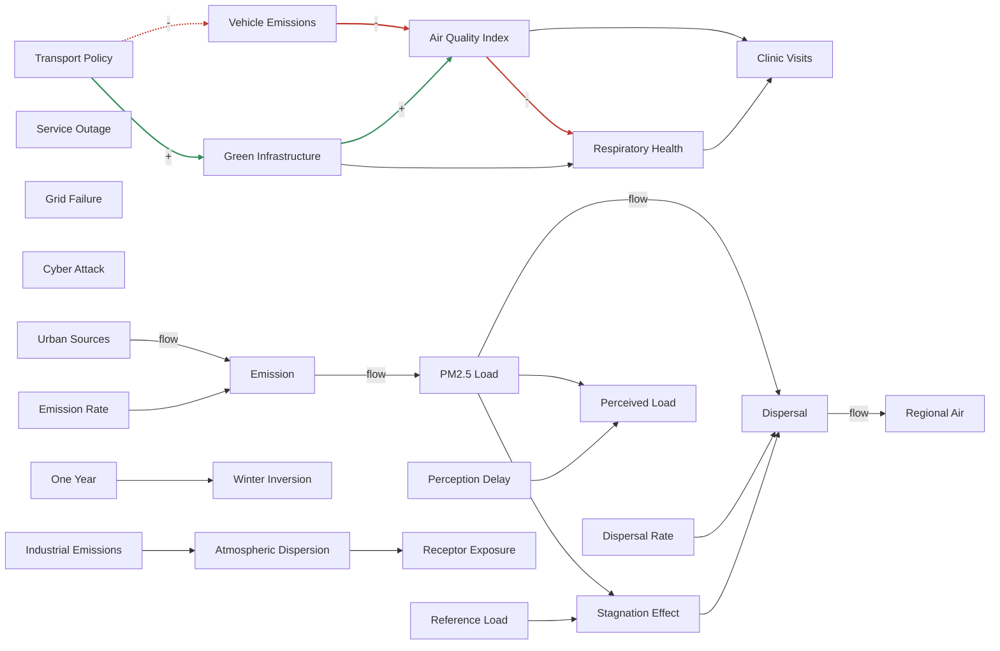
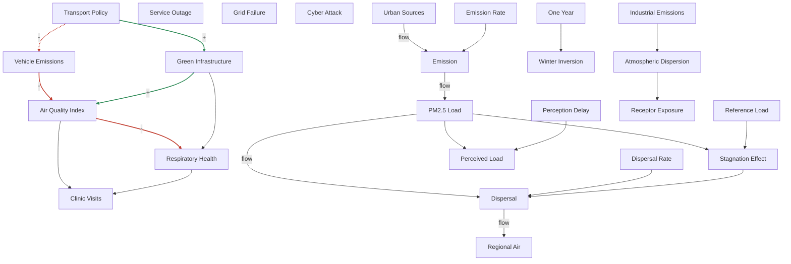
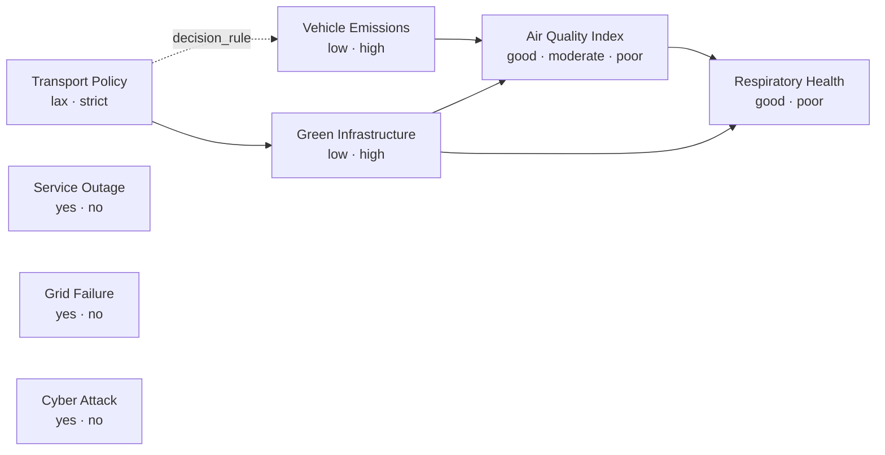
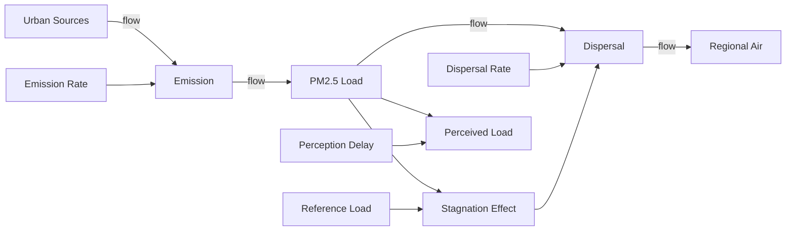

# Worked Example Transcript

Auto-generated by `worked_example/worked_example.py`. Do not edit by hand — rerun the script to regenerate.

This transcript demonstrates every CLI command in the current version of `latris`, exercised against a sample project.

## Capability Check

Before creating a project, an agent can check what Latris can actually do today — registry-only, no project needed.

### `latris capabilities`

```
Latris model-type capabilities                         
┏━━━━━━━━━━━━━━━━━━━┳━━━━━━━━━━━━━━━━━━━━┳━━━━━━━━━━━━━━━━┳━━━━━━━━━━━━━━━━━━━━┓
┃ ID                ┃ Name               ┃ Status         ┃ Description        ┃
┡━━━━━━━━━━━━━━━━━━━╇━━━━━━━━━━━━━━━━━━━━╇━━━━━━━━━━━━━━━━╇━━━━━━━━━━━━━━━━━━━━┩
│ ach               │ Analysis of        │ available      │ Hypotheses against │
│                   │ Competing          │                │ the evidence:      │
│                   │ Hypotheses         │                │ which one the      │
│                   │                    │                │ evidence fails to  │
│                   │                    │                │ rule out, which    │
│                   │                    │                │ items don't        │
│                   │                    │                │ discriminate, and  │
│                   │                    │                │ which linchpins    │
│                   │                    │                │ the conclusion     │
│                   │                    │                │ turns on.          │
│ bn                │ Bayesian Network   │ available      │ DAG with state     │
│                   │                    │                │ spaces and         │
│                   │                    │                │ conditional        │
│                   │                    │                │ probability        │
│                   │                    │                │ tables.            │
│ bow_tie           │ Bow-Tie Diagram    │ available      │ Threats and        │
│                   │                    │                │ consequences of    │
│                   │                    │                │ one top event and  │
│                   │                    │                │ the barriers       │
│                   │                    │                │ between them:      │
│                   │                    │                │ lines that rest on │
│                   │                    │                │ one barrier or     │
│                   │                    │                │ none, shared       │
│                   │                    │                │ barriers,          │
│                   │                    │                │ uncontrolled       │
│                   │                    │                │ escalation         │
│                   │                    │                │ factors, and       │
│                   │                    │                │ layer-of-protecti… │
│                   │                    │                │ frequencies with   │
│                   │                    │                │ each value's       │
│                   │                    │                │ provenance.        │
│ cld               │ Causal Loop        │ available      │ Directed graph     │
│                   │ Diagram            │                │ with polarity      │
│                   │                    │                │ (+/−) on edges;    │
│                   │                    │                │ cycles allowed.    │
│ dag               │ Directed Acyclic   │ available      │ Directed graph     │
│                   │ Graph              │                │ that must be       │
│                   │                    │                │ acyclic;           │
│                   │                    │                │ directionality     │
│                   │                    │                │ mandatory.         │
│ decision_tree     │ Decision Tree      │ available      │ Decision, chance   │
│                   │                    │                │ and terminal       │
│                   │                    │                │ nodes: the optimal │
│                   │                    │                │ strategy by        │
│                   │                    │                │ expected value,    │
│                   │                    │                │ what perfect       │
│                   │                    │                │ information on     │
│                   │                    │                │ each uncertainty   │
│                   │                    │                │ is worth (EVPI),   │
│                   │                    │                │ and the            │
│                   │                    │                │ probabilities at   │
│                   │                    │                │ which the best     │
│                   │                    │                │ choice changes.    │
│ event_tree        │ Event Tree         │ available      │ Forward from one   │
│                   │                    │                │ initiating event   │
│                   │                    │                │ through yes/no     │
│                   │                    │                │ headings to end    │
│                   │                    │                │ states: a          │
│                   │                    │                │ complete-tree      │
│                   │                    │                │ check, sequence    │
│                   │                    │                │ and end-state      │
│                   │                    │                │ probabilities and  │
│                   │                    │                │ frequencies, with  │
│                   │                    │                │ each value's       │
│                   │                    │                │ provenance.        │
│ fault_tree        │ Fault Tree         │ available      │ Top-down failure   │
│                   │                    │                │ decomposition with │
│                   │                    │                │ AND, OR and        │
│                   │                    │                │ k-out-of-n gates:  │
│                   │                    │                │ minimal cut sets,  │
│                   │                    │                │ single points of   │
│                   │                    │                │ failure, exact     │
│                   │                    │                │ top-event          │
│                   │                    │                │ probability and    │
│                   │                    │                │ importance, with   │
│                   │                    │                │ each probability's │
│                   │                    │                │ provenance.        │
│ fcm               │ Fuzzy Cognitive    │ available      │ Weighted directed  │
│                   │ Map                │                │ graph with edge    │
│                   │                    │                │ strengths in [−1,  │
│                   │                    │                │ +1]; cycles        │
│                   │                    │                │ allowed.           │
│ markov            │ Markov Cohort      │ available      │ A cohort moving    │
│                   │ Model              │                │ between states     │
│                   │                    │                │ each cycle: the    │
│                   │                    │                │ trace, discounted  │
│                   │                    │                │ costs and outcomes │
│                   │                    │                │ per strategy, and  │
│                   │                    │                │ incremental        │
│                   │                    │                │ cost-effectiveness │
│                   │                    │                │ (ICERs, dominance, │
│                   │                    │                │ net benefit at a   │
│                   │                    │                │ willingness to     │
│                   │                    │                │ pay).              │
│ mcda              │ Multi-Criteria     │ available      │ Options scored     │
│                   │ Decision Analysis  │                │ against weighted   │
│                   │                    │                │ criteria: the      │
│                   │                    │                │ ranking, each      │
│                   │                    │                │ criterion's        │
│                   │                    │                │ contribution,      │
│                   │                    │                │ dominated options, │
│                   │                    │                │ and how far each   │
│                   │                    │                │ weight would have  │
│                   │                    │                │ to move to change  │
│                   │                    │                │ the choice.        │
│ sd                │ System Dynamics    │ available      │ Stocks, flows, and │
│                   │                    │                │ feedback loops     │
│                   │                    │                │ with unit-checked  │
│                   │                    │                │ equations,         │
│                   │                    │                │ simulated over     │
│                   │                    │                │ time, with         │
│                   │                    │                │ scenarios, Monte   │
│                   │                    │                │ Carlo uncertainty  │
│                   │                    │                │ bands,             │
│                   │                    │                │ sensitivity, and   │
│                   │                    │                │ loop dominance.    │
│ theory_of_change  │ Theory of Change   │ available      │ Results chain from │
│                   │                    │                │ activities through │
│                   │                    │                │ outputs and        │
│                   │                    │                │ outcomes to        │
│                   │                    │                │ impact, with the   │
│                   │                    │                │ evidence and       │
│                   │                    │                │ assumptions behind │
│                   │                    │                │ each step laid out │
│                   │                    │                │ pathway by         │
│                   │                    │                │ pathway.           │
│ argument_map      │ Argument Map       │ on the roadmap │ Toulmin/IBIS-style │
│                   │                    │                │ argumentation:     │
│                   │                    │                │ claims, warrants,  │
│                   │                    │                │ evidence,          │
│                   │                    │                │ rebuttals.         │
│ gsn               │ Goal Structuring   │ on the roadmap │ Safety-case        │
│                   │ Notation           │                │ argumentation:     │
│                   │                    │                │ goals, strategies, │
│                   │                    │                │ solutions,         │
│                   │                    │                │ context.           │
│ influence_diagram │ Influence Diagram  │ on the roadmap │ Extension of       │
│                   │                    │                │ Bayesian network   │
│                   │                    │                │ with decision and  │
│                   │                    │                │ utility nodes for  │
│                   │                    │                │ decision analysis. │
│ causal_dag        │ Causal DAG         │ not planned    │ DAG with           │
│                   │                    │                │ observed/unobserv… │
│                   │                    │                │ classification and │
│                   │                    │                │ adjustment sets.   │
│                   │                    │                │ Being folded into  │
│                   │                    │                │ the DAG view as    │
│                   │                    │                │ identification     │
│                   │                    │                │ analyses rather    │
│                   │                    │                │ than a separate    │
│                   │                    │                │ model type.        │
│ fishbone          │ Ishikawa /         │ not planned    │ Root cause         │
│                   │ Fishbone Diagram   │                │ analysis diagram   │
│                   │                    │                │ with categorised   │
│                   │                    │                │ cause branches     │
│                   │                    │                │ converging on an   │
│                   │                    │                │ effect.            │
│ flowchart         │ Process Map /      │ not planned    │ Activity-decision… │
│                   │ Flowchart          │                │ flow for process   │
│                   │                    │                │ modelling.         │
│ petri_net         │ Petri Net          │ not planned    │ Bipartite graph of │
│                   │                    │                │ places and         │
│                   │                    │                │ transitions for    │
│                   │                    │                │ concurrent         │
│                   │                    │                │ systems.           │
│ regression        │ Regression         │ not planned    │ DAG with           │
│                   │                    │                │ fitted/elicited    │
│                   │                    │                │ edge coefficients  │
│                   │                    │                │ —                  │
│                   │                    │                │ linear/logistic/G… │
│                   │                    │                │ Doubles as the     │
│                   │                    │                │ quantification of  │
│                   │                    │                │ causal/DAG edges.  │
│ state_machine     │ State Machine /    │ not planned    │ States and         │
│                   │ Statechart         │                │ transitions with   │
│                   │                    │                │ guards and actions │
│                   │                    │                │ for reactive       │
│                   │                    │                │ system modelling.  │
└───────────────────┴────────────────────┴────────────────┴────────────────────┘

Excluded by design (not planned — won't be added):
  - Black-box machine learning (random forests, gradient boosting, neural 
networks): Decision logic cannot be inspected cell-by-cell, evidenced, or 
challenged. Out of design intent, not merely 'not yet' — the inspectability 
test: decision logic must be inspectable cell-by-cell, evidenced, and 
challengeable.
  - Opaque structure learning (learning model structure from data without 
inspectable claims): Latris governs claims a human drew and can defend, not 
discovered structure. Fitting legible parameters (e.g. regression coefficients) 
onto a structure a modeller drew is in scope; discovering the structure itself 
from data is not.
  - General-purpose simulation frameworks (SEM, ABM): Not registered as a model 
type; no current plan to add.

Reports — `latris export md --pack <name> [--model-type <type>] -o 
report.md`
  - client: for people outside the modelling work — a client, board or funder — 
answer first: the interpretation, the diagram, results (simulations, 
uncertainty, queries), findings, contested links (sources for and against), then
each link with its reasoning and evidence, and sources — without internal IDs or
the change log.
  - audit: for an auditor or the modelling team — the complete record — every 
section, including decisions, sign-offs, sessions and data.
  - review: for a reviewer checking the model — the model with its evidence, 
open challenges and questions, and findings.
  - workshop: for a working session with stakeholders — structure, assumptions, 
open questions and session notes.
  - publication: for a paper or public write-up — the model, evidence, findings,
interpretation and full references, without internal IDs.
  Board-ready prose: The client and publication packs include an interpretation:
the answer to the modelling question, implications, confidence and open 
questions, each written from claims Latris extracts from the model. `latris 
interpret initialise`, then for each section either `latris interpret 
generate-prose <section>` (needs an AI key) or read its claims with `latris 
interpret show <section>` and write the prose yourself with `latris interpret 
set-prose <section> "..." --by ai`.
  Link for a person: A `latris link` link IS the shareable report: send it as it
is — no wrapper page or separate document needed. Opening it shows the 
interactive report with charts; saving it to a free account gives a short link 
and the editor, Word, review pack and story. latris link — prints a link that 
opens this model in the Latris app. Making it needs no network (the model 
travels inside the link); opening it needs app.latris.app. It opens a hosted 
report with the full Latris figure (loops, polarity, evidence) that the person 
can share, and save to a free account for the editor and Word. The link itself 
never stops working; the short report address it opens lasts 30 days unless 
saved, and saving gives a short link that doesn't expire. `export md` also puts 
this link under the diagram, made fresh on every export. Give the person this 
link alongside (or instead of) the Markdown.
  Ready to hand over? latris check handover — lists what's left before a board 
sees it (links with no source, citations not checked against their source, 
findings waiting for approval, sections without prose, contradictions), each 
with how to fix it. Exits 1 until it's clear.
  In the Latris app (https://app.latris.app): Word report, HTML review pack (and
importing completed reviews), scrollytelling story, hosted report link (no 
sign-in to view).

Building
  - guide: latris docs — the guide for AI agents, from the installed package (no
network needed).
  - whole model in one step: latris build --spec model.yaml (YAML or JSON; '-' 
reads stdin): factors, links with polarity and reasons, sources, citations, 
evidence against, assumptions, questions and the outcome, as one commit. The 
spec is checked in full first; a mistake changes nothing. `latris build --help` 
lists every key and allowed value.
  - evidence for: latris evidence add "<from> -> <to>" polarity <bibkey> 
[--verified-by ai]
  - checking a source: latris evidence check "<from> -> <to>" polarity <bibkey> 
supports|against|off-topic --rationale "..." [--by ai --quote "..."] — records 
whether the source actually supports the claim; until then reports count the 
citation as not yet checked. The quote is looked up in the text Latris holds for
the source (save it with `latris ref snapshot` first); an AI's paraphrase is 
refused.
  - evidence against: latris evidence add <link> polarity <bibkey> --contradicts
— a source that argues against the link; reports show the link's sources for and
against under 'Contested links'. Still unchecked until someone reads it.
  - correcting sources: latris ref edit <key> --doi|--url|--title ... ("" 
clears), latris ref remove <key> [--with-citations], latris evidence remove 
<link> polarity <key> — recorded changes; never hand-edit the YAML. A source 
read in another: --cited-via <key>.
  - outcome: latris view role cld <factor> outcome — marks what the model 
explains so it isn't suggested as an intervention point.
```

_Apps built on latris (the hosted report, chat connectors) read the surface manifest instead of keeping their own lists of model types: per stable type, its build-spec block and schema, its result kinds, the charts each draws and which results need a dataset (a share link can't re-run those). One type shown here; without `-m`, all of them._

### `latris capabilities --surface -m mcda`

```
{
  "manifest_version": 1,
  "latris_version": "0.12.0",
  "model_types": [
    {
      "id": "mcda",
      "display_name": "Multi-Criteria Decision Analysis",
      "short_name": "MCDA",
      "registered": true,
      "outcome_role": null,
      "spec_field": "mcda",
      "spec_schema": {
        "$defs": {
          "SpecMCDACriterion": {
            "additionalProperties": false,
            "properties": {
              "node": {
                "title": "Node",
                "type": "string"
              },
              "weight": {
                "anyOf": [
                  {
                    "exclusiveMinimum": 0,
                    "type": "number"
                  },
                  {
                    "type": "null"
                  }
                ],
                "default": null,
                "title": "Weight"
              },
              "direction": {
                "anyOf": [
                  {
                    "enum": [
                      "higher",
                      "lower"
                    ],
                    "type": "string"
                  },
                  {
                    "type": "null"
                  }
                ],
                "default": null,
                "title": "Direction"
              },
              "worst": {
                "anyOf": [
                  {
                    "type": "number"
                  },
                  {
                    "type": "null"
                  }
                ],
                "default": null,
                "title": "Worst"
              },
              "best": {
                "anyOf": [
                  {
                    "type": "number"
                  },
                  {
                    "type": "null"
                  }
                ],
                "default": null,
                "title": "Best"
              },
              "units": {
                "anyOf": [
                  {
                    "type": "string"
                  },
                  {
                    "type": "null"
                  }
                ],
                "default": null,
                "title": "Units"
              },
              "notes": {
                "anyOf": [
                  {
                    "type": "string"
                  },
                  {
                    "type": "null"
                  }
                ],
                "default": null,
                "title": "Notes"
              },
              "source": {
                "anyOf": [
                  {
                    "type": "string"
                  },
                  {
                    "type": "null"
                  }
                ],
                "default": null,
                "title": "Source"
              },
              "origin": {
                "anyOf": [
                  {
                    "enum": [
                      "human-direct",
                      "human-elicited",
                      "ai-proposed",
                      "data-derived",
                      "imported",
                      "mixed"
                    ],
                    "type": "string"
                  },
                  {
                    "type": "null"
                  }
                ],
                "default": null,
                "title": "Origin"
              },
              "verified": {
                "default": false,
                "title": "Verified",
                "type": "boolean"
              }
            },
            "required": [
              "node"
            ],
            "title": "SpecMCDACriterion",
            "type": "object"
          },
          "SpecMCDAElement": {
            "additionalProperties": false,
            "properties": {
              "node": {
                "title": "Node",
                "type": "string"
              },
              "type": {
                "enum": [
                  "option",
                  "criterion"
                ],
                "title": "Type",
                "type": "string"
              }
            },
            "required": [
              "node",
              "type"
            ],
            "title": "SpecMCDAElement",
            "type": "object"
          },
          "SpecMCDAScore": {
            "additionalProperties": false,
            "properties": {
              "option": {
                "title": "Option",
                "type": "string"
              },
              "criterion": {
                "title": "Criterion",
                "type": "string"
              },
              "value": {
                "title": "Value",
                "type": "number"
              },
              "notes": {
                "anyOf": [
                  {
                    "type": "string"
                  },
                  {
                    "type": "null"
                  }
                ],
                "default": null,
                "title": "Notes"
              },
              "source": {
                "anyOf": [
                  {
                    "type": "string"
                  },
                  {
                    "type": "null"
                  }
                ],
                "default": null,
                "title": "Source"
              },
              "origin": {
                "anyOf": [
                  {
                    "enum": [
                      "human-direct",
                      "human-elicited",
                      "ai-proposed",
                      "data-derived",
                      "imported",
                      "mixed"
                    ],
                    "type": "string"
                  },
                  {
                    "type": "null"
                  }
                ],
                "default": null,
                "title": "Origin"
              },
              "verified": {
                "default": false,
                "title": "Verified",
                "type": "boolean"
              }
            },
            "required": [
              "option",
              "criterion",
              "value"
            ],
            "title": "SpecMCDAScore",
            "type": "object"
          }
        },
        "additionalProperties": false,
        "description": "Multi-criteria decision analysis: options, criteria (weight, direction, scale) and scores.",
        "properties": {
          "elements": {
            "items": {
              "$ref": "#/$defs/SpecMCDAElement"
            },
            "title": "Elements",
            "type": "array"
          },
          "criteria": {
            "items": {
              "$ref": "#/$defs/SpecMCDACriterion"
            },
            "title": "Criteria",
            "type": "array"
          },
          "scores": {
            "items": {
              "$ref": "#/$defs/SpecMCDAScore"
            },
            "title": "Scores",
            "type": "array"
          }
        },
        "title": "SpecMCDA",
        "type": "object"
      },
      "cli": "mcda",
      "results": [
        {
          "kind": "mcda-analysis",
          "title": "Multi-criteria decision analysis",
          "analysis": "mcda_analyse",
          "analysis_schema": {
            "additionalProperties": false,
            "description": "MCDA: ranking and weight sensitivity.",
            "properties": {
              "kind": {
                "const": "mcda_analyse",
                "title": "Kind",
                "type": "string"
              }
            },
            "required": [
              "kind"
            ],
            "title": "McdaAnalyseAnalysis",
            "type": "object"
          },
          "chart_kinds": [
            "mcda-contributions",
            "mcda-swing"
          ],
          "needs_dataset": false
        }
      ]
    }
  ]
}
```

_The documentation ships with the package, for sandboxes that can't reach GitHub: `latris docs` prints the guide for AI agents, `latris docs readme` the whole README, and `latris docs llms` the documentation map below._

### `latris docs llms`

```
# Latris

> Latris is an evidence-native modelling workbench — a Python CLI plus a
> FastAPI/WebSocket server backend — where every project is a git repo,
> evidence and provenance are first-class data, and AI assistance produces
> human-approved structured proposals. This file maps the documentation
> for AI agents; humans start at README.md.

Install: `pip install "latris"` (Python 3.11+, git; the extras add SD integration and Bayesian inference). The guide for AI agents ships with the package — `latris docs` prints it with no network — and `latris capabilities` lists what Latris can do. Source: https://github.com/Shannon-Bengtson/latris (Apache-2.0).

Working in a chat app (Claude, ChatGPT) rather than a shell? Use the Latris connector at https://mcp.latris.app/mcp instead of the CLI — see https://latris.app/ai/.

## Project

- [README.md](README.md): what Latris is, install, quickstart, and an "For AI agents" quickstart section.
- (https://latris.app): the product website. The Latris app (app.latris.app — the GUI, hosted report links, Word / review-pack / story exports) is built on this open library.
- (docs/README.md): documentation index.
- (docs/FOUNDATIONS.md): the methods Latris implements and the literature behind each — a work is cited only where Latris implements it, with limits stated. The report's "Methods and foundations" section, `latris foundations`, and the capability manifest's `foundations` block are generated from the same registry (`src/latris/operations/foundations.py`).
- [CONTRIBUTING.md](CONTRIBUTING.md): how to set up a dev environment and submit changes.
- [LICENSE](LICENSE): Apache-2.0.

## Engineering docs (source of truth for how the system works)

- (docs/engineering/ARCHITECTURE.md): three-layer architecture (substrate → conceptual → formal views), module layout, the five chokepoint files, CLI↔server boundary contract.
- (docs/engineering/SCHEMA_NOTES.md): pydantic models ↔ YAML mapping, provenance axes, the on-disk project format.
- (docs/engineering/GIT_INTEGRATION.md): auto-commit model, identity enforcement, semantic diffs, collaboration model.
- (docs/engineering/AI_LAYER.md): LLM wiring (litellm + instructor + keyring), the closed prompt library, call flow, mock mode (LATRIS_AI_MOCK), delegated invocation for external agents (`ai task emit`/`ai task apply` — no API key).
- (docs/engineering/CLI_REFERENCE.md): the full `latris` command catalogue.
- (docs/engineering/TESTING.md): test layers, hermetic test contract, coverage policy.

## The worked example (acceptance test, always current)

- (worked_example/worked_example_output.md): generated transcript of every CLI command, end to end — the fastest way to learn the tool's actual behaviour.
- (worked_example/worked_example.py): the generator; any new user-facing feature must extend it.

## Building a model with the CLI (start here)

- No network? `latris docs` prints the README's "For AI agents" section from the installed package (`latris docs readme`, `latris docs llms` for this file).

- The README's "For AI agents" section has a complete causal-loop-diagram session: git identity, nodes, links by label, polarity with a rationale (`latris view set cld <edge> polarity + --rationale "..."`), sources and evidence, coherence and loop checks, findings (`latris finding add`), and the client report with a Mermaid diagram (`latris export md --pack client --no-ai`).
- `latris --json <command>` gives machine-readable output for the core commands, analyses (loops, paths, adjustment sets), BN/SD/FCM parameters, inference and simulation.
- Ask before you build: unless the request already says, ask the person (one message, at most three short questions) for the background and the decision it informs, who will read it, and what they expect the answer to be. Record it with `context:` in a build spec (`background`, `audience`, `boundary`, `intuition`) or `latris project set background|audience|boundary|predictions "..."`; the report opens with it. If they'd rather you just build, record each unanswered point with `latris question add` or `latris assumption add`.
- Keep what you read: `extract:` on a source in a build spec (or `latris ref snapshot <key> --url ... --extract "..."`) stores the abstract or passage you read, so a check of that source is grounded in visible text.
- One model, several views: `latris project select-models cld fcm` (or `bn`, `dag`) adds a quantitative view of the same factors and links — set weights or probability tables on the diagram you have instead of starting again.
- Who did what: Latris recognises an AI agent from its shell (Claude Code sets `CLAUDECODE`; other agents set `AI_AGENT`). Then the nodes, links, evidence and findings you create are recorded as AI-proposed, `--by` / `--verified-by` default to `ai`, and every commit carries a `Recorded-by-agent:` line. Commits stay in the person's git name — they're responsible for the project. If your shell doesn't say you're an agent, `export LATRIS_AGENT=<your name>` first.
- Approvals are the person's. `mature approve`, `mature review`, `signoff record`, `mapping approve`, `challenge resolve`, and a check or prose `--by human`, ask an agent for `--confirmed-by-person`. Pass it only when the person has looked at the thing themselves and asked you to record their decision — e.g. they read the model in the chat and said "approve the Workload → Burnout link", or "I checked smith2021 — it supports that". The commit then says you recorded it on their instruction. Don't pass it to approve your own work or to clear `check handover`; tell the person what's waiting for their review instead.
- Build a whole model in one step: `latris build --spec model.yaml` (YAML or JSON; `-` reads stdin) adds factors, links with polarity and reasons, sources, citations, assumptions (with target and rationale), questions, proposed findings, challenges, interpretation prose and the outcome as one commit, after checking the whole spec — `latris build --help` lists every key. Mark the outcome with `outcome:` (or `latris view role cld "<factor>" outcome`) so it isn't suggested as an intervention point.
- Quantify and stress-test: system dynamics scenarios (`latris sd set-scenario NAME --set "Var=value"`, compared by `sd simulate --scenario NAME`), uncertainty ranges (`sd set-uncertainty <node> triangular --min --mode --max`) feeding `sd monte-carlo` (percentile bands, seeded) and `sd sensitivity <variable>` (tornado, unreviewed values flagged), and `sd loops` (which feedback loop dominates, when). Results — and `bn query` posteriors — are recorded; the client report shows the latest of each with charts in the hosted report, and they become interpretation claims. A `latris link` carries the parameters and analyses and recomputes them on opening; `latris build --spec` takes `sd:`, `bn:` and `analyses:` blocks.
- Bayesian networks: soft evidence `latris bn query -s "Node=state:0.8"` (afterwards the node is 80% that state; `--likelihood` for likelihood ratios), the most likely explanation `latris bn explain -e "Node=state"` (MPE; `--over` for MAP), and probabilistic sensitivity — `latris bn set-uncertainty <node> --n 20` ("worth 20 observations") then `latris bn monte-carlo <target>` (point estimate with 50%/95% intervals and which tables drive them). All recorded for the report and carried by `latris link`.
- Links true by definition or accounting (departures reduce active volunteers): `confidence: by-definition` in a build spec, or `latris attr set <link> confidence by-definition`. They need no source, don't count against coverage, and the figure draws them solid, not as unproven.
- Checking a source: `latris evidence check "<from> -> <to>" polarity <bibkey> supports|against|off-topic --rationale "..."` records whether the source supports the claim (`--by ai` when an agent runs it; `--by human --confirmed-by-person` when the person read it and told you what it says). Until then reports say "not yet checked against the source".
- Quotes are looked up, not trusted: an agent's `supports` needs `--quote` copied from text Latris holds for the source (a saved `extract` / `ref snapshot`, `ref fetch`, or the abstract; whitespace, quote marks and case are forgiven, `...` marks a gap). A paraphrase is refused, so save the passage you read first. The report says what each check rests on (an extract of the full text, or the abstract or a summary).
- Before handing over: `latris check handover` lists what's left (unsourced links, unchecked citations, sources with nothing on file showing they were read, quotes not found in the stored text, unapproved findings, sections without prose or out of date, contradictions, broken references between files) with a fix for each; exits 1 until clear. `latris check integrity` lists broken references (a link or citation pointing at something that isn't there, duplicate labels or links); `--fix` removes rows left by deleted nodes and links.
- Evidence against a link: `latris evidence add <link> polarity <bibkey> --contradicts` (or `contradicts: [<bibkey>]` on a link in a build spec). It stays on the same link as the supporting sources; reports show both sides under "Contested links" and it doesn't count toward coverage. It is still unchecked until someone reads it (`evidence check ... against`).
- Correct the record with commands, not by editing YAML: `latris ref edit <key> --doi|--url|--title ...` (`""` clears), `latris ref remove <key> [--with-citations]`, `latris evidence remove <link> <attribute> <key>`. Give only identifiers you have seen; a source read only as described in another takes `--cited-via <key>` (`cited_via:` in a spec) and the report says it was read second-hand.
- Prose goes out of date: when the model changes after a section was written, `interpret list`/`show`, `check handover` and the report flag it; `latris interpret refresh-claims`, then rewrite it.
- With the Latris connector available (mcp.latris.app chat tools: `create_model`, `get_report`, ...), use it instead of the CLI: its `report_url` is a short link to share. `latris link` is for when there is no connector.
- What you get where: the open-source library (`pip install "latris"`) is the engine and CLI — every analysis, a Markdown report with a Mermaid sketch, and `latris link`. The Latris app (app.latris.app — free account, nothing to install) adds the hosted interactive report (typeset figure, result charts, interpretation — what a board reads), the visual editor, Word reports, review packs reviewers fill in, the scrollytelling story, and saved models with short links. A `latris link` link IS the shareable report: send it as it is — don't build a wrapper page or a separate document around it.
- Giving the model to a person: `latris link` prints a link that opens it in the Latris app (app.latris.app) as a hosted report with the full figure, which they can share or save to a free account (editor, Word). Making it needs no network — the model travels inside the link — so it works from sandboxes with no network to latris.app; opening it needs app.latris.app. The link never stops working; the short report address it opens lasts 30 days unless the model is saved, and saving gives a short link that doesn't expire. Known issue: the copy keeps interpretation prose but drops source checks, quotes, extracts and approvals, so don't send a link whose prose says sources were checked or findings approved; see (docs/engineering/SHARE_LINK.md).
- Reports: five packs for different readers (client, publication, review, workshop, audit) — `latris capabilities` describes them. The board-ready version is the `client` pack (answer first, then the diagram, findings and evidence) with its interpretation sections written: `latris interpret initialise`, then `interpret show <section>` and `interpret set-prose <section> "..." --by ai` (no API key needed).

## Choosing a model type (for the person you're helping)

People rarely know which formalism fits their question. Guide the choice by the kind of answer needed, not the drawing:

- "How does this work — what feeds back on what?" → CLD. Start here by default: cheapest honest answer, and every other formalism builds on it.
- "Can this effect actually be estimated, and from what data?" → DAG. Adjustment sets; then, with a dataset (`latris data add file.csv`), `latris analyse estimate <treatment> <outcome> --dataset <name>` picks the smallest valid adjustment set the data measures, fits linear (robust SEs) or logistic regression, shows the unadjusted association beside it, and refuses — naming what to measure — when the DAG says the data can't support it. Causal only under the DAG's assumptions; no counterfactuals.
- "How likely is each outcome, and what would change my mind?" → BN. Discrete states and probabilities; CPTs elicited, learned, or mixed.
- "Which forces dominate, roughly?" → FCM. Signed, weighted links; steady-state tendencies.
- "How will it behave over time if we intervene?" → SD. Stocks, flows, units, scenarios — the most commitment; build the CLD first.
- "How is this programme supposed to work, and which steps are we taking on trust?" → Theory of Change. Levels from activity to impact (`latris toc level <factor> <level>`); `latris toc check` lays out every pathway from an activity to an impact and, link by link, whether it is checked, cited, untested or contested, with its stated assumptions. Process tracing weighs the evidence: `latris toc prior "A -> B" 0.6`, `latris toc test "A -> B" <name> --if-true 0.9 --if-false 0.3 --found` (hoop, smoking gun, doubly decisive, straw in the wind), then `latris toc trace` for each link's posterior, each pathway's confidence and the most informative test still to run. With data over time, `latris toc impact <outcome> --dataset D --time COL --at T` gives an interrupted time series (add `--group COL --treated V` for difference-in-differences), with a caution for each validity check that fails.
- "What combinations of failures cause this, and how likely is it?" → Fault Tree. `latris ft event <factor> top_event|intermediate_event|basic_event|undeveloped_event`, link inputs to the event they feed (`edge add <input> <event> --kind logical`), `ft gate <event> and|or|vote --k K`, `ft probability <event> <p> --source <where>`; `ft analyse` gives minimal cut sets, single points of failure, the exact top-event probability and importance (Fussell–Vesely, Birnbaum, RAW), flagging important values nobody has verified. Assumes independent basic events. How sure: `ft uncertainty <event> --median 1e-3 --error-factor 3` on uncertain probabilities, then `ft monte-carlo` (percentiles, mean vs point estimate, which ranges drive the spread; the same `uncertainty`/`monte-carlo` pair exists for `bowtie` and `et`).
- "What stands between this hazard and harm, and where is it thin?" → Bow-Tie. `latris bowtie element <factor> hazard|top_event|threat|consequence|barrier|escalation_factor`; draw lines with ordinary links (threat → barrier → … → top event → barrier → … → consequence; escalation factor → control → barrier it degrades); `bowtie barrier <b> --type --status --owner --pfd --source`, `bowtie frequency <threat> <per year>`; `bowtie analyse` flags lines with no or one effective barrier, shared barriers, uncontrolled escalation and unowned barriers, and with the numbers gives LOPA frequencies.
- "Once this happens, how does it play out, and how often does it end badly?" → Event Tree. `latris et element <factor> initiating_event|functional_event|end_state`, `et order <heading> …`, `et sequence <end state> "Heading=yes" "Heading=no" …` for each path (the tree must be complete; `et check`), `et probability <heading> <p_yes> [--given "Heading=no"]`, `et frequency <initiator> <per year>`; `et analyse` gives each sequence's probability and frequency, end-state totals and the dominant sequences.
- "Which option should we choose, given what we care about?" → MCDA. `latris mcda element <factor> option|criterion`, `mcda criterion <c> --weight W --direction higher|lower [--worst --best --units --source]`, `mcda score <option> <criterion> <value> --source`; `mcda analyse` ranks the options (each criterion's contribution), names dominated options, and says how far each weight would have to move before the top choice changes, flagging unverified scores the margin rests on.
- "Which explanation does the evidence fail to rule out?" → ACH (analysis of competing hypotheses). `latris ach element <factor> hypothesis|evidence_item`, `ach item <item> --credibility --relevance`, `ach rate <item> <hypothesis> CC|C|N|I|II --rationale`; `ach analyse` ranks hypotheses by weighted evidence against them, flags items that don't discriminate, and names linchpins with whether their sources (ordinary citations on the item) were checked.
- "What should we do, given what we don't know — and is it worth finding out more first?" → Decision tree. `latris dt element <factor> decision|chance|terminal`, link parent → child, `dt branch "Parent -> Child" --label L [-p P] [--value V]`, `dt payoff <terminal> <value>`, `dt uncertainty <chance node> <name>` (same name = same uncertainty under different choices), `dt settings --objective maximise|minimise --units`; `dt analyse` gives the best strategy, the expected value of perfect information per uncertainty, and the probabilities at which the choice flips.
- "What does each option cost and achieve over years, and is the better one worth its price?" → Markov cohort model. `latris markov element <factor> state|strategy`, link states, `markov transition "From -> To" <p> [--strategy S]`, `markov reward <state> --cost C --utility U [--strategy S]`, `markov start <state> 1`, `markov settings --cycles N --discount 0.035 --wtp 20000 --cost-units £ --outcome-units QALY`; `markov analyse` gives discounted costs and outcomes per strategy and the incremental analysis (ICERs, dominance, extended dominance, the strategy to choose at the WTP).

Same substrate throughout: factors and links stay, evidence and challenges stay, and quantifying a CLD as FCM/BN/SD later never means redrawing (`project select-models` records the choice + rationale). Triangulating (CLD + DAG on one substrate) is a strength, not a mistake. Human-facing guide: https://latris.app/formalisms/.

## Delegated AI invocation (no API key in this environment?)

- Any of the 46 closed prompts can be answered by you, the agent, instead of a vendor API: `latris ai task emit <PromptName> --inputs '<json>'` writes a self-contained task package (system + user context + response JSON schema). Answer with JSON matching `response_schema`, then have the human run `latris ai task apply --task task.json --from response.json`. Validation, approval gates, and provenance are identical to API calls; the interaction logs `model_id` as `external-agent[:name]`. See (docs/engineering/AI_LAYER.md) § "Delegated calls (bring your own agent)".

## Working rules for agents in this repo

- Read [CLAUDE.md](CLAUDE.md) and (src/latris/CLAUDE.md) before editing code.
- The per-project state directory is `.graph-tooling` — a frozen data-format constant; never rename it.
- Run tests with `python -m pytest` (parallel by default); regenerate the worked-example transcript with `pytest tests/test_worked_example.py --slow` after changing CLI behaviour.
```


## Project Setup

Initialise a new project with a modelling question.

### `latris init /tmp/latris-demo-xqt4ja5e/air-quality-model --question What factors drive urban air quality and how do they affect health outcomes?`

```
initialised project at /tmp/latris-demo-xqt4ja5e/air-quality-model
```

### `latris project set coverage_dimensions emission sources, atmospheric dispersion, exposure, health outcomes, policy levers`

```
set coverage_dimensions (4b9283cac7)
```

### `latris project set granularity_level each node a specific measurable variable a city air-quality team could track`

```
set granularity_level (29f0c8c431)
```

### `latris project set audience a municipal air-quality and public-health team`

```
set audience (b96a1d073b)
```

### `latris project show`

```
project root: /tmp/latris-demo-xqt4ja5e/air-quality-model
modelling question: What factors drive urban air quality and how do they affect 
health outcomes?
selected models: (none)
schema version: 6
created: 2026-11-18T11:51:11+00:00
updated: 2026-11-18T11:51:11+00:00
```


## Building the Model

Add entities (nodes) and causal relationships (edges).

### `latris node add Vehicle Emissions --kind variable`

```
added variable Vehicle Emissions (node_01M7Q7Y8S505GTGV4MXFXAJ0KG) · commit 
4318d4e3e1
```

### `latris node add Air Quality Index --kind variable`

```
added variable Air Quality Index (node_01M7Q7Y8X5JD8YX0Y8NXNPCTN0) · commit 
22b2c24f69
```

### `latris node add Respiratory Health --kind variable`

```
added variable Respiratory Health (node_01M7Q7Y8ZTP3F53KJTXB977SKX) · commit 
73cbd5e059
```

### `latris node add Green Infrastructure --kind concept`

```
added concept Green Infrastructure (node_01M7Q7Y93F93YDKDKXCG2F8GMZ) · commit 
6562f97e53
```

### `latris node add Transport Policy --kind decision`

```
added decision Transport Policy (node_01M7Q7Y96QABQ4J2S9B0GJQYSP) · commit 
c0fdaf38ce
```

### `latris node list`

```
┏━━━━━━━━━━━━━━━━━━━━━━━━━━━━━━━━━┳━━━━━━━━━━┳━━━━━━━━━━━━━━━━━━━━━━┓
┃ ID                              ┃ Kind     ┃ Label                ┃
┡━━━━━━━━━━━━━━━━━━━━━━━━━━━━━━━━━╇━━━━━━━━━━╇━━━━━━━━━━━━━━━━━━━━━━┩
│ node_01M7Q7Y8S505GTGV4MXFXAJ0KG │ variable │ Vehicle Emissions    │
│ node_01M7Q7Y8X5JD8YX0Y8NXNPCTN0 │ variable │ Air Quality Index    │
│ node_01M7Q7Y8ZTP3F53KJTXB977SKX │ variable │ Respiratory Health   │
│ node_01M7Q7Y93F93YDKDKXCG2F8GMZ │ concept  │ Green Infrastructure │
│ node_01M7Q7Y96QABQ4J2S9B0GJQYSP │ decision │ Transport Policy     │
└─────────────────────────────────┴──────────┴──────────────────────┘
```

### `latris edge add node_01M7Q7Y8S505GTGV4MXFXAJ0KG node_01M7Q7Y8X5JD8YX0Y8NXNPCTN0 --kind causal`

```
added edge edge_01M7Q7Y9B8Z56FJ1F6E2C6YXRY (causal) · commit 9ed28aecc1
```

### `latris edge add node_01M7Q7Y8X5JD8YX0Y8NXNPCTN0 node_01M7Q7Y8ZTP3F53KJTXB977SKX --kind causal`

```
added edge edge_01M7Q7Y9DTJY3MDBT655WG7A2T (causal) · commit 4a8be18fff
```

### `latris edge add node_01M7Q7Y93F93YDKDKXCG2F8GMZ node_01M7Q7Y8X5JD8YX0Y8NXNPCTN0 --kind causal`

```
added edge edge_01M7Q7Y9GRNDM7WR4PGQ0J3QYN (causal) · commit 4976fcf7d1
```

### `latris edge add node_01M7Q7Y96QABQ4J2S9B0GJQYSP node_01M7Q7Y8S505GTGV4MXFXAJ0KG --kind causal`

```
added edge edge_01M7Q7Y9KG8BVZQ7C6JWRHRKP2 (causal) · commit 71395a0f12
```

### `latris edge add node_01M7Q7Y93F93YDKDKXCG2F8GMZ node_01M7Q7Y8ZTP3F53KJTXB977SKX --kind causal`

```
added edge edge_01M7Q7Y9PGZ1P02CGKEAFS994T (causal) · commit 98b75af197
```

### `latris edge list`

```
┏━━━━━━━━━━━━━━━━━━━━━┳━━━━━━━━┳━━━━━━━━━━━━━━━━━━━━━┳━━━┳━━━━━━━━━━━━━━━━━━━━━┓
┃ ID                  ┃ Kind   ┃ From                ┃ → ┃ To                  ┃
┡━━━━━━━━━━━━━━━━━━━━━╇━━━━━━━━╇━━━━━━━━━━━━━━━━━━━━━╇━━━╇━━━━━━━━━━━━━━━━━━━━━┩
│ edge_01M7Q7Y9B8Z56… │ causal │ Vehicle Emissions   │ → │ Air Quality Index   │
│                     │        │ (node_01M7Q7Y…)     │   │ (node_01M7Q7Y…)     │
│ edge_01M7Q7Y9DTJY3… │ causal │ Air Quality Index   │ → │ Respiratory Health  │
│                     │        │ (node_01M7Q7Y…)     │   │ (node_01M7Q7Y…)     │
│ edge_01M7Q7Y9GRNDM… │ causal │ Green               │ → │ Air Quality Index   │
│                     │        │ Infrastructure      │   │ (node_01M7Q7Y…)     │
│                     │        │ (node_01M7Q7Y…)     │   │                     │
│ edge_01M7Q7Y9KG8BV… │ causal │ Transport Policy    │ → │ Vehicle Emissions   │
│                     │        │ (node_01M7Q7Y…)     │   │ (node_01M7Q7Y…)     │
│ edge_01M7Q7Y9PGZ1P… │ causal │ Green               │ → │ Respiratory Health  │
│                     │        │ Infrastructure      │   │ (node_01M7Q7Y…)     │
│                     │        │ (node_01M7Q7Y…)     │   │                     │
└─────────────────────┴────────┴─────────────────────┴───┴─────────────────────┘
```

### `latris node show Vehicle Emissions`

```
id: node_01M7Q7Y8S505GTGV4MXFXAJ0KG
kind: variable
label: Vehicle Emissions
created: 2026-11-18T11:51:11.909000+00:00
```

_Labels address nodes, so each is unique (ignoring case and spacing), and two nodes are joined by at most one link of each kind. Both are refused rather than silently duplicated._

### `latris node add vehicle  emissions`

```
error: a node is already called "Vehicle Emissions" 
(node_01M7Q7Y8S505GTGV4MXFXAJ0KG); labels must be unique
```

### `latris edge add Vehicle Emissions Air Quality Index`

```
error: a causal link "Vehicle Emissions" → "Air Quality Index" already exists 
(edge_01M7Q7Y9B8Z56FJ1F6E2C6YXRY); edit that one instead of adding a second
```


## Model Selection (Formalise)

With the causal structure in place, choose the formalisms to apply. This mirrors the GUI's Build -> Formalise spine: build the substrate first, then select model types (CLD and DAG here) and parameterise each. The model-specific attributes that follow — CLD polarity, FCM weights, BN CPTs — and the formal views all hang off this selection.

_Select target model types — CLD and DAG._

### `latris project select-models cld dag`

```
selected model types: cld, dag (393e002945)
```

### `latris project show`

```
project root: /tmp/latris-demo-xqt4ja5e/air-quality-model
modelling question: What factors drive urban air quality and how do they affect 
health outcomes?
selected models: cld, dag
schema version: 6
created: 2026-11-18T11:51:11+00:00
updated: 2026-11-18T11:51:13+00:00
```


## Setting Attributes

Add descriptions, confidence levels, and polarity to edges.

### `latris attr set node_01M7Q7Y8S505GTGV4MXFXAJ0KG description Total pollutant output from road transport including PM2.5, NOx, and CO.`

```
set description on node_01M7Q7Y8S505GTGV4MXFXAJ0KG · commit daa160fc0d
```

### `latris attr set node_01M7Q7Y8X5JD8YX0Y8NXNPCTN0 description Composite measure of ambient air pollution concentration.`

```
set description on node_01M7Q7Y8X5JD8YX0Y8NXNPCTN0 · commit 0d88a41afa
```

### `latris attr set node_01M7Q7Y8ZTP3F53KJTXB977SKX description Population-level respiratory morbidity and mortality rates.`

```
set description on node_01M7Q7Y8ZTP3F53KJTXB977SKX · commit 3485f38f9b
```

### `latris view set cld edge_01M7Q7Y9B8Z56FJ1F6E2C6YXRY polarity - --rationale More vehicle emissions raise pollutant load, worsening the AQI.`

```
set cld polarity = - on edge_01M7Q7Y9B8Z56FJ1F6E2C6YXRY · commit 9f09353ace
```

### `latris view set cld edge_01M7Q7Y9DTJY3MDBT655WG7A2T polarity -`

```
set cld polarity = - on edge_01M7Q7Y9DTJY3MDBT655WG7A2T · commit ee8f0a3cfa
```

### `latris view set cld edge_01M7Q7Y9GRNDM7WR4PGQ0J3QYN polarity +`

```
set cld polarity = + on edge_01M7Q7Y9GRNDM7WR4PGQ0J3QYN · commit aa71daba62
```

### `latris view set cld edge_01M7Q7Y9KG8BVZQ7C6JWRHRKP2 polarity -`

```
set cld polarity = - on edge_01M7Q7Y9KG8BVZQ7C6JWRHRKP2 · commit afbd32b2aa
```

_Any command that supports it can print JSON instead of text with the global --json flag — the form agents and the hosted MCP server use._

### `latris --json node show Air Quality Index`

```
{"result": {"id": "node_01M7Q7Y8X5JD8YX0Y8NXNPCTN0", "kind": "variable", "label": "Air Quality Index", "maturity": "proposed", "origin": "human-direct", "verification": "unverified", "source_id": null}}
```

### `latris attr set edge_01M7Q7Y9B8Z56FJ1F6E2C6YXRY confidence high`

```
set confidence on edge_01M7Q7Y9B8Z56FJ1F6E2C6YXRY · commit 43329b90d9
```

### `latris mature review edge_01M7Q7Y9B8Z56FJ1F6E2C6YXRY`

```
reviewed edge_01M7Q7Y9B8Z56FJ1F6E2C6YXRY · commit e19975f8b8
```

_Marked the Emissions→AQI edge as reviewed (entity-level maturity)._


## Research Base

Add references and attach evidence to attributes.

### `latris ref add who2021 --title WHO Global Air Quality Guidelines 2021 --author World Health Organization --year 2021 --doi 10.1186/978-92-4-003422-8`

```
added reference who2021 · commit 7451bb085f
```

### `latris ref add defra2023 --title Air Quality Strategy for England --author DEFRA --year 2023`

```
added reference defra2023 · commit db621b108c
```

### `latris ref list`

```
┏━━━━━━━━━━━┳━━━━━━┳━━━━━━━━━━━━━━━━━━━━━━━━━━━━━━━┳━━━━━━━━━━━━━━━━━━━━━━━━━━━┓
┃ Key       ┃ Year ┃ Title                         ┃ Authors                   ┃
┡━━━━━━━━━━━╇━━━━━━╇━━━━━━━━━━━━━━━━━━━━━━━━━━━━━━━╇━━━━━━━━━━━━━━━━━━━━━━━━━━━┩
│ who2021   │ 2021 │ WHO Global Air Quality        │ World Health Organization │
│           │      │ Guidelines 2021               │                           │
│ defra2023 │ 2023 │ Air Quality Strategy for      │ DEFRA                     │
│           │      │ England                       │                           │
└───────────┴──────┴───────────────────────────────┴───────────────────────────┘
```

### `latris ref snapshot who2021 --url https://www.who.int/publications/i/item/9789240034228 --extract WHO global air quality guidelines (2021) tighten recommended PM2.5 and NO2 limits based on 2010-2020 evidence linking long-term exposure to cardiovascular and respiratory mortality. --kind abstract`

```
snapshot set for who2021 (abstract) · commit 86a094cf2f
```

### `latris evidence add node_01M7Q7Y8S505GTGV4MXFXAJ0KG description who2021 --notes WHO identifies transport as primary urban PM2.5 source.`

```
attached who2021 → node_01M7Q7Y8S5…/description · commit 4e01152e13
```

### `latris evidence add edge_01M7Q7Y9B8Z56FJ1F6E2C6YXRY polarity who2021 --notes Dose-response relationship established in WHO guidelines.`

```
attached who2021 → edge_01M7Q7Y9B8…/polarity · commit 1a86f6877b
```

_A source that argues against a link goes on the same link with `--contradicts`; reports list it as evidence against and show the link under 'Contested links'._

### `latris ref add dispersal2024 --title Wind dispersal and local air quality (illustrative source) --year 2024`

```
added reference dispersal2024 · commit 8e7c325d36
```

### `latris evidence add edge_01M7Q7Y9B8Z56FJ1F6E2C6YXRY polarity dispersal2024 --contradicts --notes Strong winds can decouple local emissions from local AQI.`

```
attached dispersal2024 → edge_01M7Q7Y9B8…/polarity · commit a9c2aa556b
```


## Provenance

Record assumptions, decisions, exclusions, questions, predictions, and sessions.

### `latris assumption add Linear dose-response between emissions and AQI --rationale Simplification appropriate for policy-level modelling.`

```
logged assumption assumption_01M7Q7YBYB1T48TPG4RDX80QK8 · commit a5d88ee6e4
```

### `latris assumption add Indoor air quality is out of scope`

```
logged assumption assumption_01M7Q7YC15E28KMSHNXJ4V0Y78 · commit 758418a5a5
```

### `latris decision log Exclude industrial emissions from initial scope --rationale Focus on transport for Phase 1; industrial sources added in Phase 2.`

```
logged decision decision_01M7Q7YC4BRZBDG9TGR8ETCJAH · commit 029168fc35
```

### `latris exclusion add Indoor air quality and workplace exposure --rationale Separate regulatory domain; different exposure pathways.`

```
logged exclusion exclusion_01M7Q7YC71NYZ0FTTSYZF44TME · commit e85931a49e
```

### `latris question add Should we model seasonal variation in AQI?`

```
logged question question_01M7Q7YC9M4EC5T5MQD6K2YE7G · commit 9ea07c4720
```

### `latris question add Is green infrastructure effect direct or mediated?`

```
logged question question_01M7Q7YCD8364MB14XKDZER7Y0 · commit 1c56c10a8d
```

_Per-target provenance — assumptions, questions, and decisions about specific elements._

### `latris assumption add Polarity is uniformly negative at city-annual scale --rationale Simplification; spatial heterogeneity noted as caveat. --target edge_01M7Q7Y9B8Z56FJ1F6E2C6YXRY`

```
logged assumption assumption_01M7Q7YCGPRKVC2Z0VKCHY8KTJ · commit 01ffb24659
```

### `latris question add Should we model non-linear dose-response for this pathway? --target edge_01M7Q7Y9DTJY3MDBT655WG7A2T`

```
logged question question_01M7Q7YCM383WHFJDX6GG4VF8S · commit 670033361a
```

### `latris decision log Keep as single composite index rather than per-pollutant --rationale Per-pollutant split deferred to Phase 2. --target node_01M7Q7Y8X5JD8YX0Y8NXNPCTN0`

```
logged decision decision_01M7Q7YCPQVNMTDWSRQYKYYNNJ · commit 723ccda2d7
```

### `latris prediction add AQI will improve 15% in areas with new green corridors --horizon 3 years`

```
logged prediction prediction_01M7Q7YCSDJCGGNPW2VZR299TG · commit 298ac3e149
```

### `latris session record --date 2026-04-15 --attendee Alice --attendee Bob --notes Kickoff workshop: identified core causal pathways.`

```
recorded session session_01M7Q7YCWCVVW81PBY44VDTKTG · commit aaf4087132
```


## Building from a Spec

Add many factors, links, sources and citations at once from a YAML or JSON spec — checked in full first, applied as one commit. Links name factors by label; shown here on a second, small project so the main model is unchanged.

### `latris init /tmp/latris-demo-xqt4ja5e/volunteers --question Why are volunteers leaving?`

```
initialised project at /tmp/latris-demo-xqt4ja5e/volunteers
```

### `latris project select-models cld`

```
selected model types: cld (54661efd84)
```

```yaml
context:   # asked of the person before building; the report opens with it
  background: The program lost a third of its volunteers since 2023; the board is deciding on a paid coordinator.
  audience: The program's board
  intuition: Rostering changes after the merger pushed people out.
outcome: Volunteer departures
factors:
  - label: Workload per volunteer
    description: Hours each active volunteer covers.
  - label: Volunteer burnout
  - label: Volunteer departures
links:
  - from: Workload per volunteer
    to: Volunteer burnout
    polarity: "+"
    reason: More hours per person, more exhaustion.
    confidence: medium
    sources: [smith2021]
  - from: Volunteer burnout
    to: Volunteer departures
    polarity: "+"
    reason: Exhausted volunteers leave.
  - from: Volunteer departures
    to: Workload per volunteer
    polarity: "+"
    reason: Fewer people share the same work.
    confidence: by-definition   # accounting: needs no source
sources:
  - key: smith2021
    title: Volunteer burnout
    authors: ["Smith, J"]
    year: 2021
    url: https://example.org/smith2021
    extract: "Abstract: hours per volunteer predicted emotional exhaustion (r = 0.41)."   # what was read
assumptions:
  - Service demand stays steady as numbers fall.
decisions:
  - statement: Left out paid staff.
    rationale: The program has none.
```

### `latris build --spec -`

```
built 3 factors, 3 links, 1 sources, 1 citations, 1 assumptions, 0 questions · 
commit 2e7d727b8d
```

### `latris analyse loops`

```
┏━━━┳━━━━━━┳━━━━━━━━┳━━━━━━━━━━━━━━━━━━━━━━━━━━━━━━━━━━━━━━━━━━━━━━━━━━━━━━━━━━┓
┃ # ┃ Type ┃ Length ┃ Variables                                                ┃
┡━━━╇━━━━━━╇━━━━━━━━╇━━━━━━━━━━━━━━━━━━━━━━━━━━━━━━━━━━━━━━━━━━━━━━━━━━━━━━━━━━┩
│ 1 │ R    │ 3      │ Workload per volunteer → Volunteer burnout → Volunteer   │
│   │      │        │ departures                                               │
└───┴──────┴────────┴──────────────────────────────────────────────────────────┘

1 loop(s) found.
```

### `latris --json analyse loops`

```
{"result": [{"type": "R", "length": 3, "variables": ["Workload per volunteer", "Volunteer burnout", "Volunteer departures"], "ids": ["node_01M7Q7YD5DZ1EJJYF5E2PHGRSP", "node_01M7Q7YD5HH8QGHQMGTZZH78NT", "node_01M7Q7YD5M9VX0QY71RK5JR9PJ"], "model_types": ["cld"]}]}
```

_Attaching a citation says only that it was attached. Reading the source and recording what it says is a separate step; links can be named "From -> To"._

### `latris evidence check Workload per volunteer -> Volunteer burnout polarity smith2021 supports --rationale Hours per volunteer predict exhaustion.`

```
checked smith2021 on edge_01M7Q7YD5Q…/polarity: supports · commit a4628ed0d9
```

_An agent's check needs a quote copied from the text Latris holds for the source (here the extract saved by the spec). A paraphrase is refused; the copied passage is found, and the check is recorded as resting on the abstract._

### `latris evidence check Workload per volunteer -> Volunteer burnout polarity smith2021 supports --by ai --rationale Hours per volunteer predict exhaustion. --quote Volunteers who work long hours burn out.`

```
error: the quote isn't in the text Latris holds for 'smith2021' (the text it 
holds doesn't contain it). A quote must be copied from the source, not 
paraphrased (at least 20 characters; '...' may mark a gap). Save the passage you
read first — `latris ref snapshot smith2021 --url <where you read it> --kind 
abstract|full_text_excerpt --extract "..."` — then check again. A verdict other 
than supports can be recorded without --quote.
```

### `latris evidence check Workload per volunteer -> Volunteer burnout polarity smith2021 supports --by ai --rationale Hours per volunteer predict exhaustion. --quote hours per volunteer predicted emotional exhaustion`

```
checked smith2021 on edge_01M7Q7YD5Q…/polarity: supports · commit faaa5e70db
```

_A study read only as described in another source is cited via that source; the report says it was read second-hand. Sources and citations are corrected with commands, so each correction is in the history._

### `latris ref add jones2018 --title Rostering and retention (illustrative) --year 2018 --cited-via smith2021`

```
added reference jones2018 · commit 6fd0947aea
```

### `latris ref edit jones2018 --doi https://doi.org/10.5555/rostering.2018`

```
updated reference jones2018 · commit 473b138878
```

### `latris evidence add Volunteer burnout -> Volunteer departures polarity jones2018 --verified-by ai`

```
attached jones2018 → edge_01M7Q7YD60…/polarity · commit c59a5434a6
```

### `latris evidence remove Volunteer burnout -> Volunteer departures polarity jones2018 --rationale Only read second-hand; not enough on its own.`

```
removed jones2018 from edge_01M7Q7YD60…/polarity · commit a98f816260
```

### `latris ref remove jones2018 --rationale No longer cited.`

```
removed reference jones2018 · commit 4738d423bd
```

_Prose written before the model changes is flagged as out of date._

### `latris interpret initialise`

```
initialised 10 section(s) · commit 2b38d36e58
  · interpret-section_01  structural_summary (cld)  state=claims_only
  · interpret-section_01  key_findings (cld)  state=claims_only
  · interpret-section_01  sensitivity (cld)  state=claims_only
  · interpret-section_01  assumptions_limitations (cld)  state=claims_only
  · interpret-section_01  evidence_gaps (cld)  state=claims_only
  · interpret-section_01  evidence_coverage (cld)  state=claims_only
  · interpret-section_01  answer_to_question (cld)  state=claims_only
  · interpret-section_01  implications (cld)  state=claims_only
  · interpret-section_01  confidence_assessment (cld)  state=claims_only
  · interpret-section_01  open_questions (cld)  state=claims_only
```

### `latris interpret set-prose structural_summary Three factors form one reinforcing loop. --by ai`

```
wrote structural_summary (cld) · commit 47373aa1e9
```

### `latris node add Recognition`

```
added concept Recognition (node_01M7Q7YEGRNF5RS5EMRSBQKBHX) · commit 449cf44285
```

### `latris edge add Recognition Volunteer departures`

```
added edge edge_01M7Q7YEKP42T32K5W42QSHFS3 (causal) · commit 7556d193f4
```

### `latris interpret refresh-claims`

```
refreshed 10 section(s) · commit dd740fe04b
out of date (rewrite the prose): structural_summary
```

_Removing a factor removes its links and everything describing them — description, confidence, polarity, citations, parameters, mappings — in one commit. Challenges, findings and sign-offs about it stay as history._

### `latris node add Seasonal events`

```
added concept Seasonal events (node_01M7Q7YEX0E28ZBGTJBZ4A8K9H) · commit 
cc80f6b7ce
```

### `latris edge add Seasonal events Volunteer burnout`

```
added edge edge_01M7Q7YF2P7H3N1V591X3HB8DC (causal) · commit 266f85e057
```

### `latris attr set Seasonal events description Festivals and emergencies that spike demand.`

```
set description on node_01M7Q7YEX0E28ZBGTJBZ4A8K9H · commit 1c15c1ac94
```

### `latris node remove Seasonal events`

```
removed Seasonal events (node_01M7Q7YEX0E28ZBGTJBZ4A8K9H) + 1 edge(s) · commit 
2c88ed5d8c
```

_Every reference between the project's files should resolve — no link to a missing factor, no citation of a source that isn't in the library, no duplicate labels or links. The handover check includes this; `--fix` clears rows left by older removals or hand edits._

### `latris check integrity`

```
Every reference resolves.
```

_Before handing the model to a board: what's left, and how to fix each (exits 1 until clear)._

### `latris check handover`

```
Ready to hand over: no — 3 things to do

1. 2 of 3 links have no source
     · Volunteer burnout → Volunteer departures
     · Recognition → Volunteer departures
   fix: cite one (`latris evidence add <link> polarity <key>`), mark a link true
by definition (`latris attr set <link> confidence by-definition`), or record it 
as an assumption

2. 9 of 10 report sections have no prose (readers see raw claims)
     · Key Findings
     · Sensitivity & Robustness
     · Assumptions & Limitations
     · Evidence Gaps
     · Evidence Coverage
     · … and 4 more
   fix: `latris interpret show <section>`, then `latris interpret set-prose 
<section> "..." --by ai`

3. 1 report section was written before the model last changed, and the claims 
behind it have changed
     · Structural Summary
   fix: `latris interpret refresh-claims`, then `latris interpret show 
<section>` and rewrite it with `latris interpret set-prose`
```

_The context opens the report — who it's for, the situation, and the person's own expectation to compare with the answer:_

### `latris --json project show`

```
{"result": {"name": "volunteers", "statement": "Why are volunteers leaving?", "background": "The program lost a third of its volunteers since 2023; the board is deciding on a paid coordinator.", "boundary": "", "exclusions": "", "predictions": "Rostering changes after the merger pushed people out.", "coverage_dimensions": "", "granularity_level": "", "audience": "The program's board", "selected_model_types": ["cld"], "schema_version": 6}}
```


## Challenges

Open, discuss, and resolve challenges against model elements.

### `latris challenge open edge_01M7Q7Y9B8Z56FJ1F6E2C6YXRY Polarity may not be uniformly negative — wind dispersal can decouple local emissions from local AQI. --attribute polarity`

```
opened challenge challenge_01M7Q7YFW28B54Z92NQ47JB3XZ · commit a272b3de2c
```

### `latris challenge turn challenge_01M7Q7YFW28B54Z92NQ47JB3XZ Valid point. However, for annual averages at city scale, the negative relationship holds strongly.`

```
added turn to challenge_01M7Q7YFW28B54Z92NQ47JB3XZ (now 1 turn(s)) · commit 
e30dc91f48
```

### `latris challenge resolve challenge_01M7Q7YFW28B54Z92NQ47JB3XZ --state retained-with-caveat --rationale Negative polarity retained for city-annual scale; spatial heterogeneity noted as caveat.`

```
resolved challenge_01M7Q7YFW28B54Z92NQ47JB3XZ → retained-with-caveat · commit 
bb078f9400
```

### `latris challenge list`

```
┏━━━━━━━━━━━━━━━━┳━━━━━━━━━━━━━━━━┳━━━━━━━━━━━━━━━━┳━━━━━━━━━━━┳━━━━━━━━━━━━━━━┓
┃ ID             ┃ State          ┃ Target         ┃ Attribute ┃ Argument      ┃
┡━━━━━━━━━━━━━━━━╇━━━━━━━━━━━━━━━━╇━━━━━━━━━━━━━━━━╇━━━━━━━━━━━╇━━━━━━━━━━━━━━━┩
│ challenge_01M… │ retained-with… │ edge_01M7Q7Y9… │ polarity  │ Polarity may  │
│                │                │                │           │ not be        │
│                │                │                │           │ uniformly     │
│                │                │                │           │ negative —    │
│                │                │                │           │ wind          │
│                │                │                │           │ dispersal can │
│                │                │                │           │ …             │
└────────────────┴────────────────┴────────────────┴───────────┴───────────────┘
```


## Sign-off

Record a formal review sign-off.

### `latris signoff record --role Lead modeller --scope Substrate v0.1: core causal structure --notes Structure approved for stakeholder review.`

```
recorded sign-off signoff_01M7Q7YG7152R87GCWCC3ETD5R · commit edabb3b583
```


## Bayesian Network

Quantify the validated causal core as a discrete Bayesian Network: declare each node's state space, fill in conditional probability tables (CPTs) with per-cell provenance, then run exact inference. BN reads the `causal` substrate directly — no view projection or model selection required.

_The readiness gate first. `bn check` derives the node set from the causal edges and reports what's missing — every node needs a state space and a complete, normalised CPT before inference can run._

### `latris bn check`

```
✓ BN is fully quantified and ready to compute.
```

_Declare discrete state spaces (ordinal ranges are marked --ordered)._

### `latris bn set-state-space Transport Policy lax,strict`

```
set state space on node_01M7Q7Y96Q… = lax, strict · commit a8d15c7223
```

### `latris bn set-state-space Green Infrastructure low,high --ordered`

```
set state space on node_01M7Q7Y93F… = low, high · commit 58a1b0ffec
```

### `latris bn set-state-space Vehicle Emissions low,high --ordered`

```
set state space on node_01M7Q7Y8S5… = low, high · commit 504f2448fd
```

### `latris bn set-state-space Air Quality Index good,moderate,poor --ordered`

```
set state space on node_01M7Q7Y8X5… = good, moderate, poor · commit 9e76c21531
```

### `latris bn set-state-space Respiratory Health good,poor`

```
set state space on node_01M7Q7Y8ZT… = good, poor · commit f351ca3e08
```

_Fill in the CPTs. Probabilities are row-major with the first parent varying slowest; each conditional distribution sums to 1. --origin and --source stamp provenance on every row of that node's table — note how different nodes draw on different sources (a city policy baseline, WHO guidelines, monitoring data, expert judgement). Finer per-row provenance lives in views/parameters/bn-cpt.yaml._

### `latris bn set-cpt Transport Policy --probs 0.6,0.4 --origin human-direct --source defra2023`

```
set CPT on node_01M7Q7Y96Q… (1 row(s), parents: —) · commit e284a34a82
```

### `latris bn set-cpt Green Infrastructure --probs 0.5,0.5 --origin human-direct`

```
set CPT on node_01M7Q7Y93F… (1 row(s), parents: —) · commit 4e5cff10ec
```

### `latris bn set-cpt Vehicle Emissions --parents Transport Policy --probs 0.3,0.7,0.8,0.2 --origin human-elicited --source who2021`

```
set CPT on node_01M7Q7Y8S5… (2 row(s), parents: node_01M7Q7Y) · commit 
86ae33f37c
```

### `latris bn set-cpt Air Quality Index --parents Vehicle Emissions,Green Infrastructure --probs 0.5,0.35,0.15,0.7,0.25,0.05,0.1,0.3,0.6,0.25,0.4,0.35 --origin data-derived --source who2021`

```
set CPT on node_01M7Q7Y8X5… (4 row(s), parents: node_01M7Q7Y, node_01M7Q7Y) · 
commit 14328d764a
```

### `latris bn set-cpt Respiratory Health --parents Air Quality Index,Green Infrastructure --probs 0.9,0.1,0.93,0.07,0.75,0.25,0.8,0.2,0.45,0.55,0.55,0.45 --origin human-elicited`

```
set CPT on node_01M7Q7Y8ZT… (6 row(s), parents: node_01M7Q7Y, node_01M7Q7Y) · 
commit 4f00a13a05
```

_The model is now fully quantified — the gate passes._

### `latris bn check`

```
✓ BN is fully quantified and ready to compute.
```

### `latris bn state-spaces`

```
┏━━━━━━━━━━━━━━━━━━━━━━┳━━━━━━━━━━━━━━━━━━━━━━┳━━━━━━━━━┓
┃ Node                 ┃ States               ┃ Ordered ┃
┡━━━━━━━━━━━━━━━━━━━━━━╇━━━━━━━━━━━━━━━━━━━━━━╇━━━━━━━━━┩
│ Transport Policy     │ lax, strict          │         │
│ Green Infrastructure │ low, high            │ ✓       │
│ Vehicle Emissions    │ low, high            │ ✓       │
│ Air Quality Index    │ good, moderate, poor │ ✓       │
│ Respiratory Health   │ good, poor           │         │
└──────────────────────┴──────────────────────┴─────────┘
```

### `latris bn cpts`

```
┏━━━━━━━━━━━━━━━━━┳━━━━━━━┳━━━━━━━━━━━━━━━━━┳━━━━━━━━━━━━━━━━━┳━━━━━━━━━━━━━━━━┓
┃ Node            ┃ Kind  ┃ Parent states   ┃ P(node)         ┃ Origin         ┃
┡━━━━━━━━━━━━━━━━━╇━━━━━━━╇━━━━━━━━━━━━━━━━━╇━━━━━━━━━━━━━━━━━╇━━━━━━━━━━━━━━━━┩
│ Transport       │ table │ —               │ lax:0.600,      │ human-direct   │
│ Policy          │       │                 │ strict:0.400    │                │
│ Green           │ table │ —               │ low:0.500,      │ human-direct   │
│ Infrastructure  │       │                 │ high:0.500      │                │
│ Vehicle         │ table │ Transport       │ low:0.300,      │ human-elicited │
│ Emissions       │       │ Policy=lax      │ high:0.700      │                │
│ Vehicle         │ table │ Transport       │ low:0.800,      │ human-elicited │
│ Emissions       │       │ Policy=strict   │ high:0.200      │                │
│ Air Quality     │ table │ Vehicle         │ good:0.500,     │ data-derived   │
│ Index           │       │ Emissions=low,  │ moderate:0.350, │                │
│                 │       │ Green           │ poor:0.150      │                │
│                 │       │ Infrastructure… │                 │                │
│ Air Quality     │ table │ Vehicle         │ good:0.700,     │ data-derived   │
│ Index           │       │ Emissions=low,  │ moderate:0.250, │                │
│                 │       │ Green           │ poor:0.050      │                │
│                 │       │ Infrastructure… │                 │                │
│ Air Quality     │ table │ Vehicle         │ good:0.100,     │ data-derived   │
│ Index           │       │ Emissions=high, │ moderate:0.300, │                │
│                 │       │ Green           │ poor:0.600      │                │
│                 │       │ Infrastructure… │                 │                │
│ Air Quality     │ table │ Vehicle         │ good:0.250,     │ data-derived   │
│ Index           │       │ Emissions=high, │ moderate:0.400, │                │
│                 │       │ Green           │ poor:0.350      │                │
│                 │       │ Infrastructure… │                 │                │
│ Respiratory     │ table │ Air Quality     │ good:0.900,     │ human-elicited │
│ Health          │       │ Index=good,     │ poor:0.100      │                │
│                 │       │ Green           │                 │                │
│                 │       │ Infrastructure… │                 │                │
│ Respiratory     │ table │ Air Quality     │ good:0.930,     │ human-elicited │
│ Health          │       │ Index=good,     │ poor:0.070      │                │
│                 │       │ Green           │                 │                │
│                 │       │ Infrastructure… │                 │                │
│ Respiratory     │ table │ Air Quality     │ good:0.750,     │ human-elicited │
│ Health          │       │ Index=moderate, │ poor:0.250      │                │
│                 │       │ Green           │                 │                │
│                 │       │ Infrastructure… │                 │                │
│ Respiratory     │ table │ Air Quality     │ good:0.800,     │ human-elicited │
│ Health          │       │ Index=moderate, │ poor:0.200      │                │
│                 │       │ Green           │                 │                │
│                 │       │ Infrastructure… │                 │                │
│ Respiratory     │ table │ Air Quality     │ good:0.450,     │ human-elicited │
│ Health          │       │ Index=poor,     │ poor:0.550      │                │
│                 │       │ Green           │                 │                │
│                 │       │ Infrastructure… │                 │                │
│ Respiratory     │ table │ Air Quality     │ good:0.550,     │ human-elicited │
│ Health          │       │ Index=poor,     │ poor:0.450      │                │
│                 │       │ Green           │                 │                │
│                 │       │ Infrastructure… │                 │                │
└─────────────────┴───────┴─────────────────┴─────────────────┴────────────────┘
```

_Prior marginals — the network's beliefs before any evidence._

### `latris bn marginals`

```
Prior marginals

┏━━━━━━━━━━━━━━━━━━━━━━┳━━━━━━━━━━━━━━━━━━━━━━━━━━━━━━━━━━━━━━━━━━┓
┃ Node                 ┃ Distribution                             ┃
┡━━━━━━━━━━━━━━━━━━━━━━╇━━━━━━━━━━━━━━━━━━━━━━━━━━━━━━━━━━━━━━━━━━┩
│ Transport Policy     │ lax 0.600   strict 0.400                 │
│ Green Infrastructure │ low 0.500   high 0.500                   │
│ Vehicle Emissions    │ low 0.500   high 0.500                   │
│ Air Quality Index    │ good 0.388   moderate 0.325   poor 0.288 │
│ Respiratory Health   │ good 0.747   poor 0.253                  │
└──────────────────────┴──────────────────────────────────────────┘

recorded · run analysis-run_01M7Q… · commit 5aac51cc07
```

_Predictive inference: condition on a strict transport policy and propagate forward. Air Quality Index and Respiratory Health shift toward their better states._

### `latris bn query --evidence Transport Policy=strict --query Air Quality Index --query Respiratory Health`

```
Posterior marginals  (given Transport Policy=strict)

┏━━━━━━━━━━━━━━━━━━━━┳━━━━━━━━━━━━━━━━━━━━━━━━━━━━━━━━━━━━━━━━━━┓
┃ Node               ┃ Distribution                             ┃
┡━━━━━━━━━━━━━━━━━━━━╇━━━━━━━━━━━━━━━━━━━━━━━━━━━━━━━━━━━━━━━━━━┩
│ Air Quality Index  │ good 0.515   moderate 0.310   poor 0.175 │
│ Respiratory Health │ good 0.796   poor 0.204                  │
└────────────────────┴──────────────────────────────────────────┘

recorded · run analysis-run_01M7Q… · commit 0dff327c19
```

_Diagnostic inference: condition on poor respiratory health and reason backwards. The posteriors for a lax policy and high emissions rise above their priors — BN reasoning runs in both directions along the causal edges._

### `latris bn query --evidence Respiratory Health=poor --query Transport Policy --query Vehicle Emissions`

```
Posterior marginals  (given Respiratory Health=poor)

┏━━━━━━━━━━━━━━━━━━━┳━━━━━━━━━━━━━━━━━━━━━━━━━━┓
┃ Node              ┃ Distribution             ┃
┡━━━━━━━━━━━━━━━━━━━╇━━━━━━━━━━━━━━━━━━━━━━━━━━┩
│ Transport Policy  │ lax 0.678   strict 0.322 │
│ Vehicle Emissions │ low 0.338   high 0.662   │
└───────────────────┴──────────────────────────┘

recorded · run analysis-run_01M7Q… · commit b9d96be725
```

_Analyses also speak --json — one object an agent can read instead of a table. The hosted MCP server's named tools (query_bn, find_loops, simulate_sd, run_fcm, ...) are built on it._

### `latris --json bn query --evidence Transport Policy=strict --query Respiratory Health`

```
{"result": {"given": {"Transport Policy": "strict"}, "soft": {}, "likelihood": {}, "set": {}, "marginals": {"Respiratory Health": {"good": 0.7964, "poor": 0.2036}}, "run_id": "analysis-run_01M7Q7YKC4D9MQX9C0N5MWEPCK"}, "commit_sha": "e29455111cc89b6dcfc9788d170d34578b483a77"}
```


## Bayesian Network — Sensitivity

Rank the CPT parameters by how much they move a target posterior, annotated with each parameter's provenance. Nothing here is human-verified yet, so every influential parameter is flagged weak — the ranking tells you which to verify first. Read-only on the CPTs.

### `latris bn sensitivity Respiratory Health --state poor --top 8 --no-record`

```
Sensitivity of P(Respiratory Health=poor) = 0.253

┏━━━━━━━━━━━━━━━━━━━━━━━━━━━━━━━┳━━━━━━┳━━━━━━━━━━━┳━━━━━━━━━━━━━━━━┳━━━━━━━━━━┓
┃ Parameter                     ┃ Cell ┃ Influence ┃ Origin         ┃ Verified ┃
┡━━━━━━━━━━━━━━━━━━━━━━━━━━━━━━━╇━━━━━━╇━━━━━━━━━━━╇━━━━━━━━━━━━━━━━╇━━━━━━━━━━┩
│ Respiratory Health | Air      │ good │     0.238 │ human-elicited │ ⚠ weak   │
│ Quality Index=good, Green     │      │           │                │          │
│ Infrastructure=high           │      │           │                │          │
│ Respiratory Health | Air      │ good │     0.188 │ human-elicited │ ⚠ weak   │
│ Quality Index=poor, Green     │      │           │                │          │
│ Infrastructure=low            │      │           │                │          │
│ Respiratory Health | Air      │ good │     0.163 │ human-elicited │ ⚠ weak   │
│ Quality Index=moderate, Green │      │           │                │          │
│ Infrastructure=low            │      │           │                │          │
│ Respiratory Health | Air      │ good │     0.163 │ human-elicited │ ⚠ weak   │
│ Quality Index=moderate, Green │      │           │                │          │
│ Infrastructure=high           │      │           │                │          │
│ Respiratory Health | Air      │ good │     0.150 │ human-elicited │ ⚠ weak   │
│ Quality Index=good, Green     │      │           │                │          │
│ Infrastructure=low            │      │           │                │          │
│ Green Infrastructure |        │ low  │     0.129 │ human-direct   │ ⚠ weak   │
│ (prior)                       │      │           │                │          │
│ Respiratory Health | Air      │ good │     0.100 │ human-elicited │ ⚠ weak   │
│ Quality Index=poor, Green     │      │           │                │          │
│ Infrastructure=high           │      │           │                │          │
│ Vehicle Emissions | Transport │ low  │     0.099 │ human-elicited │ ⚠ weak   │
│ Policy=lax                    │      │           │                │          │
└───────────────────────────────┴──────┴───────────┴────────────────┴──────────┘
```


## Bayesian Network — Parameter Learning

Fit CPTs from a dataset, provenance-first: rows a human elicited are protected; data fills only the gaps and low-provenance defaults. The preview shows what's kept vs learned; the run is logged as an AnalysisRun and learned rows are stamped data-derived.

_A monitoring dataset whose columns match the node labels is registered (180 rows). Vehicle Emissions and Respiratory Health were elicited from experts above, so learning preserves them and fills the rest from data._

### `latris bn learn monitoring --estimator mle --yes`

```
Parameter learning preview — dataset dataset_01M7Q7YKHS…, 180 row(s) used, 0 
dropped (NA)

┏━━━━━━━━━━━━━━━━━━━━━━┳━━━━━━━━━━━━━━┳━━━━━━━━━┳━━━━━━┳━━━━━━━━━━━━━━┓
┃ Node                 ┃ Action       ┃ Learned ┃ Kept ┃ Zero-support ┃
┡━━━━━━━━━━━━━━━━━━━━━━╇━━━━━━━━━━━━━━╇━━━━━━━━━╇━━━━━━╇━━━━━━━━━━━━━━┩
│ Vehicle Emissions    │ data-derived │ 0       │ 2    │              │
│ Air Quality Index    │ data-derived │ 4       │ 0    │              │
│ Respiratory Health   │ data-derived │ 0       │ 6    │              │
│ Green Infrastructure │ data-derived │ 1       │ 0    │              │
│ Transport Policy     │ data-derived │ 1       │ 0    │              │
└──────────────────────┴──────────────┴─────────┴──────┴──────────────┘
applied · run analysis-run_01M7Q… · commit ec381f3e6e
```


## Bayesian Network — Canonical Models

For a high-fan-in binary node, a Noisy-OR avoids CPT explosion: each cause contributes independently, so k causes need k probabilities + a leak instead of 2^k rows. Stored as a compact spec (the provenance-bearing object) and expanded to a full CPT at compute time. Shown on a small self-contained fault sub-model.

### `latris node add Service Outage --kind variable`

```
added variable Service Outage (node_01M7Q7YKSZFXTHK7TEDT9MVCN7) · commit 
8b2f800ed5
```

### `latris node add Grid Failure --kind variable`

```
added variable Grid Failure (node_01M7Q7YKX2C8TBTE6AQ56BJYD2) · commit 
3efdcb42aa
```

### `latris node add Cyber Attack --kind variable`

```
added variable Cyber Attack (node_01M7Q7YM1462TBQCBXC23GC3FQ) · commit 
4a85bea19d
```

### `latris bn set-state-space Service Outage yes,no`

```
set state space on node_01M7Q7YKSZ… = yes, no · commit 131d8ecdeb
```

### `latris bn set-state-space Grid Failure yes,no`

```
set state space on node_01M7Q7YKX2… = yes, no · commit 0dd04a6456
```

### `latris bn set-state-space Cyber Attack yes,no`

```
set state space on node_01M7Q7YM14… = yes, no · commit bede1f28e1
```

### `latris bn set-cpt Grid Failure --probs 0.05,0.95`

```
set CPT on node_01M7Q7YKX2… (1 row(s), parents: —) · commit 8bba1bba0b
```

### `latris bn set-cpt Cyber Attack --probs 0.02,0.98`

```
set CPT on node_01M7Q7YM14… (1 row(s), parents: —) · commit 957e79fe9a
```

_Two independent causes + a leak — five numbers instead of a full 2-parent table._

### `latris bn set-noisy-or Service Outage -c Grid Failure=yes:0.8 -c Cyber Attack=yes:0.6 --leak 0.01 --active yes`

```
set Noisy-OR on node_01M7Q7YKSZ… (2 cause(s), leak 0.01, effect = yes) · commit 
70226d060c
```

### `latris bn cpts`

```
┏━━━━━━━━━━━━━━━━┳━━━━━━━━━━┳━━━━━━━━━━━━━━━━┳━━━━━━━━━━━━━━━━┳━━━━━━━━━━━━━━━━┓
┃ Node           ┃ Kind     ┃ Parent states  ┃ P(node)        ┃ Origin         ┃
┡━━━━━━━━━━━━━━━━╇━━━━━━━━━━╇━━━━━━━━━━━━━━━━╇━━━━━━━━━━━━━━━━╇━━━━━━━━━━━━━━━━┩
│ Transport      │ table    │ —              │ lax:0.500,     │ data-derived   │
│ Policy         │          │                │ strict:0.500   │                │
│ Green          │ table    │ —              │ low:0.500,     │ data-derived   │
│ Infrastructure │          │                │ high:0.500     │                │
│ Vehicle        │ table    │ Transport      │ low:0.300,     │ human-elicited │
│ Emissions      │          │ Policy=lax     │ high:0.700     │                │
│ Vehicle        │ table    │ Transport      │ low:0.800,     │ human-elicited │
│ Emissions      │          │ Policy=strict  │ high:0.200     │                │
│ Air Quality    │ table    │ Vehicle        │ good:0.333,    │ data-derived   │
│ Index          │          │ Emissions=low, │ moderate:0.33… │                │
│                │          │ Green          │ poor:0.333     │                │
│                │          │ Infrastructur… │                │                │
│ Air Quality    │ table    │ Vehicle        │ good:0.333,    │ data-derived   │
│ Index          │          │ Emissions=low, │ moderate:0.33… │                │
│                │          │ Green          │ poor:0.333     │                │
│                │          │ Infrastructur… │                │                │
│ Air Quality    │ table    │ Vehicle        │ good:0.333,    │ data-derived   │
│ Index          │          │ Emissions=hig… │ moderate:0.33… │                │
│                │          │ Green          │ poor:0.333     │                │
│                │          │ Infrastructur… │                │                │
│ Air Quality    │ table    │ Vehicle        │ good:0.333,    │ data-derived   │
│ Index          │          │ Emissions=hig… │ moderate:0.33… │                │
│                │          │ Green          │ poor:0.333     │                │
│                │          │ Infrastructur… │                │                │
│ Respiratory    │ table    │ Air Quality    │ good:0.900,    │ human-elicited │
│ Health         │          │ Index=good,    │ poor:0.100     │                │
│                │          │ Green          │                │                │
│                │          │ Infrastructur… │                │                │
│ Respiratory    │ table    │ Air Quality    │ good:0.930,    │ human-elicited │
│ Health         │          │ Index=good,    │ poor:0.070     │                │
│                │          │ Green          │                │                │
│                │          │ Infrastructur… │                │                │
│ Respiratory    │ table    │ Air Quality    │ good:0.750,    │ human-elicited │
│ Health         │          │ Index=moderat… │ poor:0.250     │                │
│                │          │ Green          │                │                │
│                │          │ Infrastructur… │                │                │
│ Respiratory    │ table    │ Air Quality    │ good:0.800,    │ human-elicited │
│ Health         │          │ Index=moderat… │ poor:0.200     │                │
│                │          │ Green          │                │                │
│                │          │ Infrastructur… │                │                │
│ Respiratory    │ table    │ Air Quality    │ good:0.450,    │ human-elicited │
│ Health         │          │ Index=poor,    │ poor:0.550     │                │
│                │          │ Green          │                │                │
│                │          │ Infrastructur… │                │                │
│ Respiratory    │ table    │ Air Quality    │ good:0.550,    │ human-elicited │
│ Health         │          │ Index=poor,    │ poor:0.450     │                │
│                │          │ Green          │                │                │
│                │          │ Infrastructur… │                │                │
│ Grid Failure   │ table    │ —              │ yes:0.050,     │ human-direct   │
│                │          │                │ no:0.950       │                │
│ Cyber Attack   │ table    │ —              │ yes:0.020,     │ human-direct   │
│                │          │                │ no:0.980       │                │
│ Service Outage │ Noisy-OR │ Grid           │ yes:0.921,     │ human-elicited │
│                │          │ Failure=yes,   │ no:0.079       │                │
│                │          │ Cyber          │                │                │
│                │          │ Attack=yes     │                │                │
│ Service Outage │ Noisy-OR │ Grid           │ yes:0.802,     │ human-elicited │
│                │          │ Failure=yes,   │ no:0.198       │                │
│                │          │ Cyber          │                │                │
│                │          │ Attack=no      │                │                │
│ Service Outage │ Noisy-OR │ Grid           │ yes:0.604,     │ human-elicited │
│                │          │ Failure=no,    │ no:0.396       │                │
│                │          │ Cyber          │                │                │
│                │          │ Attack=yes     │                │                │
│ Service Outage │ Noisy-OR │ Grid           │ yes:0.010,     │ human-elicited │
│                │          │ Failure=no,    │ no:0.990       │                │
│                │          │ Cyber          │                │                │
│                │          │ Attack=no      │                │                │
└────────────────┴──────────┴────────────────┴────────────────┴────────────────┘
```


## Bayesian Network — Soft Evidence, Explanation, Uncertainty

Three questions beyond a plain query. Soft evidence: a low-cost sensor suggests poor air, but it isn't certain. The most likely explanation: given poor respiratory health, which combination of causes is likeliest? And how sure is a probability when the tables behind it are estimates?

_Soft evidence sets how sure we are: afterwards P(Air Quality Index = poor) is 70%, and the other states share the rest in proportion to their prior._

### `latris bn query --soft Air Quality Index=poor:0.7 --query Respiratory Health --query Air Quality Index`

```
Posterior marginals

┏━━━━━━━━━━━━━━━━━━━━┳━━━━━━━━━━━━━━━━━━━━━━━━━━━━━━━━━━━━━━━━━━┓
┃ Node               ┃ Distribution                             ┃
┡━━━━━━━━━━━━━━━━━━━━╇━━━━━━━━━━━━━━━━━━━━━━━━━━━━━━━━━━━━━━━━━━┩
│ Respiratory Health │ good 0.604   poor 0.397                  │
│ Air Quality Index  │ good 0.150   moderate 0.150   poor 0.700 │
└────────────────────┴──────────────────────────────────────────┘

recorded · run analysis-run_01M7Q… · commit e625a4f09a
```

_The single most likely combination of states given poor respiratory health — with how decisive each part is, and where a factor's own favourite differs._

### `latris bn explain --evidence Respiratory Health=poor`

```
Given Respiratory Health = poor, the most likely explanation is Transport Policy
= strict, Green Infrastructure = low, Vehicle Emissions = low, Air Quality Index
= poor, Grid Failure = no, Cyber Attack = no, Service Outage = no (P = 13%)

┏━━━━━━━━━━━━━━━━━━━━━┳━━━━━━━━━━━━━┳━━━━━━━━━━━━━━━━━━━━━┳━━━━━━━━━━━━━━━━━━━━┓
┃ Node                ┃ Most likely ┃ Its own probability ┃ vs runner-up       ┃
┡━━━━━━━━━━━━━━━━━━━━━╇━━━━━━━━━━━━━╇━━━━━━━━━━━━━━━━━━━━━╇━━━━━━━━━━━━━━━━━━━━┩
│ Transport Policy    │ strict      │ 50.0%               │ 2.67× likelier     │
│                     │             │                     │ than lax           │
│ Green               │ low         │ 55.6%               │ 1.22× likelier     │
│ Infrastructure      │             │                     │ than high          │
│ Vehicle Emissions   │ low         │ 55.0%               │ 4× likelier than   │
│                     │             │                     │ high               │
│ Air Quality Index   │ poor        │ 61.7%               │ 2.2× likelier than │
│                     │             │                     │ moderate           │
│ Grid Failure        │ no          │ 95.0%               │ 95× likelier than  │
│                     │             │                     │ yes                │
│ Cyber Attack        │ no          │ 98.0%               │ 122× likelier than │
│                     │             │                     │ yes                │
│ Service Outage      │ no          │ 93.9%               │ 99× likelier than  │
│                     │             │                     │ yes                │
└─────────────────────┴─────────────┴─────────────────────┴────────────────────┘

recorded · run analysis-run_01M7Q… · commit 83df9b7179
```

_Say how well each table is known: the respiratory table was elicited from one clinician (worth about 10 observations); the air-quality table was learned from 180 monitoring rows. The other tables stay fixed._

### `latris bn set-uncertainty Respiratory Health --n 10 --reason Elicited from one clinician`

```
uncertainty Respiratory Health: worth 10 observations · commit 8188c590de
```

### `latris bn set-uncertainty Air Quality Index --n 180 --reason Learned from 180 monitoring rows`

```
uncertainty Air Quality Index: worth 180 observations · commit a875c47c78
```

### `latris bn monte-carlo Respiratory Health --state poor --evidence Transport Policy=strict --runs 300`

```
P(Respiratory Health = poor | Transport Policy = strict): 27% (95% of 300 draws 
19%–37%)

┏━━━━━━━┳━━━━━━━┳━━━━━━━━┳━━━━━━━━━━━━━━┳━━━━━━━━━━━━━━┓
┃ State ┃ Point ┃ Median ┃ 50% of draws ┃ 95% of draws ┃
┡━━━━━━━╇━━━━━━━╇━━━━━━━━╇━━━━━━━━━━━━━━╇━━━━━━━━━━━━━━┩
│ good  │ 73.0% │  72.9% │  69.1%–76.6% │  62.7%–81.2% │
│ poor  │ 27.0% │  27.1% │  23.4%–30.9% │  18.8%–37.3% │
└───────┴───────┴────────┴──────────────┴──────────────┘
  Air Quality Index: worth 180 (human-direct, unverified) — Learned from 180 
monitoring rows
  Respiratory Health: worth 10 (human-direct, unverified) — Elicited from one 
clinician
  held fixed: Cyber Attack, Green Infrastructure, Grid Failure, Service Outage, 
Transport Policy, Vehicle Emissions
  driven by: Respiratory Health (ρ=-0.49), Air Quality Index (ρ=-0.15)

recorded · run analysis-run_01M7Q… · commit b1534990a2
```


## Bayesian Network — Interventions and Weighted Tables

Observing a factor and setting it are different questions. Seeing poor respiratory health makes poor air likelier; *making* health poor would say nothing about the air. An intervention (--set, the do-operator) cuts the factor off from its causes. And for a node whose parents have several states, a weighted table needs a weight per parent state instead of a number per row.

### `latris bn query --evidence Respiratory Health=poor --query Air Quality Index --no-record`

```
Posterior marginals  (given Respiratory Health=poor)

┏━━━━━━━━━━━━━━━━━━━┳━━━━━━━━━━━━━━━━━━━━━━━━━━━━━━━━━━━━━━━━━━┓
┃ Node              ┃ Distribution                             ┃
┡━━━━━━━━━━━━━━━━━━━╇━━━━━━━━━━━━━━━━━━━━━━━━━━━━━━━━━━━━━━━━━━┩
│ Air Quality Index │ good 0.105   moderate 0.278   poor 0.617 │
└───────────────────┴──────────────────────────────────────────┘
```

_Setting it instead leaves the air quality at its prior (shown first): the arrow runs from air to health._

### `latris bn query --query Air Quality Index --no-record`

```
Posterior marginals

┏━━━━━━━━━━━━━━━━━━━┳━━━━━━━━━━━━━━━━━━━━━━━━━━━━━━━━━━━━━━━━━━┓
┃ Node              ┃ Distribution                             ┃
┡━━━━━━━━━━━━━━━━━━━╇━━━━━━━━━━━━━━━━━━━━━━━━━━━━━━━━━━━━━━━━━━┩
│ Air Quality Index │ good 0.333   moderate 0.333   poor 0.333 │
└───────────────────┴──────────────────────────────────────────┘
```

### `latris bn query --set Respiratory Health=poor --query Air Quality Index`

```
Posterior marginals

┏━━━━━━━━━━━━━━━━━━━┳━━━━━━━━━━━━━━━━━━━━━━━━━━━━━━━━━━━━━━━━━━┓
┃ Node              ┃ Distribution                             ┃
┡━━━━━━━━━━━━━━━━━━━╇━━━━━━━━━━━━━━━━━━━━━━━━━━━━━━━━━━━━━━━━━━┩
│ Air Quality Index │ good 0.333   moderate 0.333   poor 0.333 │
└───────────────────┴──────────────────────────────────────────┘

recorded · run analysis-run_01M7Q… · commit d3aaab5842
```

### `latris node add Clinic Visits --kind variable`

```
added variable Clinic Visits (node_01M7Q7YP2VGKQF3QG2N54F89E8) · commit 
663a079ddb
```

### `latris edge add Air Quality Index Clinic Visits --kind causal`

```
added edge edge_01M7Q7YP5VMSYFZXBC34XHGQYS (causal) · commit 46eb47d56e
```

### `latris edge add Respiratory Health Clinic Visits --kind causal`

```
added edge edge_01M7Q7YP91QDPJKMQ5T5R1C938 (causal) · commit 9c7ac6bc75
```

### `latris bn set-state-space Clinic Visits low,high --ordered`

```
set state space on node_01M7Q7YP2V… = low, high · commit bd8ede93b6
```

_Base 80/20 when nothing pushes; moderate air adds 1, poor air 2, poor health 2.5 (logits, toward 'high'). Twelve probabilities from four numbers._

### `latris bn set-weighted Clinic Visits --base 0.8,0.2 --toward high -w Air Quality Index=moderate:1 -w Air Quality Index=poor:2 -w Respiratory Health=poor:2.5`

```
set weighted table on node_01M7Q7YP2V… (6 rows) · commit a8ae772a28
```

### `latris bn query --evidence Transport Policy=strict --query Clinic Visits --no-record`

```
Posterior marginals  (given Transport Policy=strict)

┏━━━━━━━━━━━━━━━┳━━━━━━━━━━━━━━━━━━━━━━━━┓
┃ Node          ┃ Distribution           ┃
┡━━━━━━━━━━━━━━━╇━━━━━━━━━━━━━━━━━━━━━━━━┩
│ Clinic Visits │ low 0.479   high 0.521 │
└───────────────┴────────────────────────┘
```

_A factor leaves the network without being deleted: its states and table go; it stays on the map._

### `latris bn remove-states Clinic Visits`

```
removed node_01M7Q7YP2V… from the network (2 row(s)) · commit ffc3b86e7d
```


## Bayesian Network — Scenarios and Comparing Options

A what-if that changes probabilities is a scenario, not an edit to the model: it saves new values for some rows of a table (and any observations or settings that define it), and the model's own tables stay as they are — nothing to revert afterwards. A scenario can build on another (--extends). `bn compare` then asks every option the same question on the same draws of the uncertain tables, so each difference is paired, and names what each option is measured against.

### `latris bn set-scenario Street trees --table Green Infrastructure=0.2,0.8 --reason Canopy programme: most districts reach high green infrastructure`

```
scenario Street trees: P(Green Infrastructure) → 0.2, 0.8 · commit 47812572a5
```

### `latris bn set-scenario Street trees and filters --extends Street trees --table Air Quality Index[Vehicle Emissions=high]=0.5,0.35,0.15 --reason Roadside filters: high-emission streets get the air of low-emission ones`

```
scenario Street trees and filters (extends Street trees): P(Air Quality Index | 
Vehicle Emissions = high) → 0.5, 0.35, 0.15 · commit 96fac78690
```

### `latris bn scenarios`

```
┏━━━━━━━━━━━━━━━━━━━━━━━━┳━━━━━━━━━━━━━━━━━━━━━━━━┳━━━━━━━━━━━━━┳━━━━━━━━━━━━━━┓
┃ Scenario               ┃ Changes                ┃ Description ┃ Origin       ┃
┡━━━━━━━━━━━━━━━━━━━━━━━━╇━━━━━━━━━━━━━━━━━━━━━━━━╇━━━━━━━━━━━━━╇━━━━━━━━━━━━━━┩
│ Street trees           │ P(Green                │             │ human-direct │
│                        │ Infrastructure) → 0.2, │             │              │
│                        │ 0.8                    │             │              │
│ Street trees and       │ Street trees, plus:    │             │ human-direct │
│ filters                │ P(Air Quality Index |  │             │              │
│                        │ Vehicle Emissions =    │             │              │
│                        │ high) → 0.5, 0.35,     │             │              │
│                        │ 0.15                   │             │              │
└────────────────────────┴────────────────────────┴─────────────┴──────────────┘
```

### `latris bn query --scenario Street trees --query Respiratory Health --no-record`

```
Posterior marginals — scenario Street trees

┏━━━━━━━━━━━━━━━━━━━━┳━━━━━━━━━━━━━━━━━━━━━━━━━┓
┃ Node               ┃ Distribution            ┃
┡━━━━━━━━━━━━━━━━━━━━╇━━━━━━━━━━━━━━━━━━━━━━━━━┩
│ Respiratory Health │ good 0.748   poor 0.252 │
└────────────────────┴─────────────────────────┘
```

_Under a lax transport policy (the evidence holds for every option, the baseline included):_

### `latris bn compare Respiratory Health --state poor -S Street trees -S Street trees and filters -e Transport Policy=lax --runs 200`

```
P(Respiratory Health = poor) — 200 paired draws of the tables

  Baseline (no scenario changes) — P(Respiratory Health = poor): 27.0% (95% of 
draws 18.4%–38.0%); given Transport Policy = lax
  Street trees — P(Respiratory Health = poor): 25.2% (95% of draws 15.1%–37.5%);
vs the baseline (no scenario changes): 1.8 points lower (95% of draws: -7.1 to 
+3.55 points), lower in 76% of draws, higher in 24%; given Transport Policy = 
lax
  Street trees and filters — P(Respiratory Health = poor): 20.3% (95% of draws 
11.6%–31.2%); vs Street trees: 4.9 points lower (95% of draws: -8.26 to -2.03 
points), lower in 100% of draws, higher in 0%; vs the baseline: 6.7 points 
lower; given Transport Policy = lax

recorded · run analysis-run_01M7Q… · commit cdfbbe6446
```


## System Dynamics

A stock-and-flow model of the urban PM2.5 load: emissions fill it, dispersal drains it in proportion to its size. SD lives on the same substrate as the CLD above — stocks, flows and constants are ordinary variables with an SD role; `flow` edges carry material, `causal` edges are information links. The rest of the CLD is outside the SD model's boundary and doesn't need classifying.

### `latris sd check`

```
┏━━━━━━━━━┳━━━━━━━━━━━┳━━━━━━━━━━━━━━━━━━━━━━━━━━━━━━━━━━━━━━━━━━━━━━━━━━━━━━━━┓
┃ Element ┃ Gap       ┃ Detail                                                 ┃
┡━━━━━━━━━╇━━━━━━━━━━━╇━━━━━━━━━━━━━━━━━━━━━━━━━━━━━━━━━━━━━━━━━━━━━━━━━━━━━━━━┩
│ (model) │ no_stocks │ The SD model has no stocks yet. Classify at least one  │
│         │           │ with `sd set-role <node> stock`.                       │
└─────────┴───────────┴────────────────────────────────────────────────────────┘
```

### `latris node add PM2.5 Load --kind variable`

```
added variable PM2.5 Load (node_01M7Q7YR0PDHDRE9GD31SWQRX6) · commit 5dc06c2f82
```

### `latris node add Emission --kind variable`

```
added variable Emission (node_01M7Q7YR3T2YJB88VECM1FVZVH) · commit c7668f0f0c
```

### `latris node add Dispersal --kind variable`

```
added variable Dispersal (node_01M7Q7YR6WRET5VZPGM4Z84GC1) · commit 5d10e80ac5
```

### `latris node add Emission Rate --kind variable`

```
added variable Emission Rate (node_01M7Q7YRA7PASNKBK075EMPJ6R) · commit 
fbf9258a2a
```

### `latris node add Dispersal Rate --kind variable`

```
added variable Dispersal Rate (node_01M7Q7YRD8MT10AMFZQ76FRGF4) · commit 
5c51d6a75f
```

### `latris node add Urban Sources --kind variable`

```
added variable Urban Sources (node_01M7Q7YRGEAWV0WXJ3EGXWG99A) · commit 
9395e1256b
```

### `latris node add Regional Air --kind variable`

```
added variable Regional Air (node_01M7Q7YRKT5JZBHZW9T052KD06) · commit 
28efdcf2a7
```

### `latris edge add Urban Sources Emission --kind flow`

```
added edge edge_01M7Q7YRQ81BCQG0M85PEE1M0Q (flow) · commit 505187c47d
```

### `latris edge add Emission PM2.5 Load --kind flow`

```
added edge edge_01M7Q7YRTY8ZPD9JBTV9EJ99F9 (flow) · commit 70c536005c
```

### `latris edge add PM2.5 Load Dispersal --kind flow`

```
added edge edge_01M7Q7YS139224CPKGP1PNB3Z2 (flow) · commit dbcdbb5741
```

### `latris edge add Dispersal Regional Air --kind flow`

```
added edge edge_01M7Q7YS5CQ8PPC02NCAFB4MAB (flow) · commit a67eb210f0
```

### `latris edge add Emission Rate Emission --kind causal`

```
added edge edge_01M7Q7YS9J460A9F13GK7P59WS (causal) · commit 2aadaaac73
```

### `latris edge add Dispersal Rate Dispersal --kind causal`

```
added edge edge_01M7Q7YSDD8EG92RCBWRXZ2JX0 (causal) · commit faf729c8ac
```

_The diagram exists, but nothing is classified yet — the check names every gap._

### `latris sd check`

```
┏━━━━━━━━━━━━━━━┳━━━━━━━━━━━━━━┳━━━━━━━━━━━━━━━━━━━━━━━━━━━━━━━━━━━━━━━━━━━━━━━┓
┃ Element       ┃ Gap          ┃ Detail                                        ┃
┡━━━━━━━━━━━━━━━╇━━━━━━━━━━━━━━╇━━━━━━━━━━━━━━━━━━━━━━━━━━━━━━━━━━━━━━━━━━━━━━━┩
│ Dispersal     │ unclassified │ Not classified for System Dynamics. Set its   │
│               │              │ role: stock, flow, auxiliary, constant, or    │
│               │              │ source_sink.                                  │
│ Emission      │ unclassified │ Not classified for System Dynamics. Set its   │
│               │              │ role: stock, flow, auxiliary, constant, or    │
│               │              │ source_sink.                                  │
│ PM2.5 Load    │ unclassified │ Not classified for System Dynamics. Set its   │
│               │              │ role: stock, flow, auxiliary, constant, or    │
│               │              │ source_sink.                                  │
│ Regional Air  │ unclassified │ Not classified for System Dynamics. Set its   │
│               │              │ role: stock, flow, auxiliary, constant, or    │
│               │              │ source_sink.                                  │
│ Urban Sources │ unclassified │ Not classified for System Dynamics. Set its   │
│               │              │ role: stock, flow, auxiliary, constant, or    │
│               │              │ source_sink.                                  │
│ (model)       │ no_stocks    │ The SD model has no stocks yet. Classify at   │
│               │              │ least one with `sd set-role <node> stock`.    │
└───────────────┴──────────────┴───────────────────────────────────────────────┘
```

### `latris sd set-role PM2.5 Load stock`

```
set PM2.5 Load → stock · commit ea2077f515
```

### `latris sd set-role Emission flow`

```
set Emission → flow · commit d43043134b
```

### `latris sd set-role Dispersal flow`

```
set Dispersal → flow · commit 33444c9fb1
```

### `latris sd set-role Emission Rate constant`

```
set Emission Rate → constant · commit 1e3ab6f156
```

### `latris sd set-role Dispersal Rate constant`

```
set Dispersal Rate → constant · commit c33f5aee1d
```

### `latris sd set-role Urban Sources source_sink`

```
set Urban Sources → source_sink · commit 3fca708185
```

### `latris sd set-role Regional Air source_sink`

```
set Regional Air → source_sink · commit bb6fe7f432
```

### `latris sd set-initial-value PM2.5 Load 20 --units tonne --non-negative --origin data-derived`

```
set PM2.5 Load(0) = 20 tonne · commit e6c9e33988
```

### `latris sd set-constant Emission Rate 120 --units tonne/year --origin data-derived`

```
set Emission Rate = 120 tonne/year · commit b39f9dfe0f
```

### `latris sd set-constant Dispersal Rate 2 --units 1/year --origin human-elicited`

```
set Dispersal Rate = 2 1/year · commit b03bf70ff6
```

### `latris sd set-equation Emission emission_rate --units tonne/year`

```
set Emission = emission_rate  · commit dd62683b8a
```

_Equations name variables by slugified label (PM2.5 Load → pm2_5_load). A deliberate slip: adding a load to a rate. It parses, but every value is a unit-bearing quantity, so the check catches the dimensional error._

### `latris sd set-equation Dispersal pm2_5_load + dispersal_rate --units tonne/year`

```
set Dispersal = pm2_5_load + dispersal_rate  · commit 365ee3bbc5
```

### `latris sd check`

```
┏━━━━━━━━━━━┳━━━━━━━━━━━━━━━━━━┳━━━━━━━━━━━━━━━━━━━━━━━━━━━━━━━━━━━━━━━━━━━━━━━┓
┃ Element   ┃ Gap              ┃ Detail                                        ┃
┡━━━━━━━━━━━╇━━━━━━━━━━━━━━━━━━╇━━━━━━━━━━━━━━━━━━━━━━━━━━━━━━━━━━━━━━━━━━━━━━━┩
│ Dispersal │ evaluation_error │ Dispersal: units don't match in 'pm2_5_load + │
│           │                  │ dispersal_rate': cannot combine metric_ton    │
│           │                  │ with 1 / year                                 │
└───────────┴──────────────────┴───────────────────────────────────────────────┘
```

### `latris sd set-equation Dispersal pm2_5_load * dispersal_rate --units tonne/year`

```
set Dispersal = pm2_5_load * dispersal_rate  · commit 675a7225c9
```

### `latris sd check`

```
✓ SD model is complete, dimensionally consistent, and ready to simulate.
```

### `latris sd roles`

```
┏━━━━━━━━━━━━━━━━┳━━━━━━━━━━━━━┳━━━━━━━━━━━━━━━━━━━┓
┃ Node           ┃ Role        ┃ Name in equations ┃
┡━━━━━━━━━━━━━━━━╇━━━━━━━━━━━━━╇━━━━━━━━━━━━━━━━━━━┩
│ PM2.5 Load     │ stock       │ pm2_5_load        │
│ Dispersal      │ flow        │ dispersal         │
│ Emission       │ flow        │ emission          │
│ Dispersal Rate │ constant    │ dispersal_rate    │
│ Emission Rate  │ constant    │ emission_rate     │
│ Regional Air   │ source_sink │                   │
│ Urban Sources  │ source_sink │                   │
└────────────────┴─────────────┴───────────────────┘
```

### `latris sd equations`

```
┏━━━━━━━━━━━┳━━━━━━┳━━━━━━━━━━━━━━━━━━━━━━━━━━━━━┳━━━━━━━━━━━━┳━━━━━━━━━━━━━━┓
┃ Variable  ┃ Role ┃ Equation                    ┃ Units      ┃ Origin       ┃
┡━━━━━━━━━━━╇━━━━━━╇━━━━━━━━━━━━━━━━━━━━━━━━━━━━━╇━━━━━━━━━━━━╇━━━━━━━━━━━━━━┩
│ Emission  │ flow │ emission_rate               │ tonne/year │ human-direct │
│ Dispersal │ flow │ pm2_5_load * dispersal_rate │ tonne/year │ human-direct │
└───────────┴──────┴─────────────────────────────┴────────────┴──────────────┘
```

_The load approaches equilibrium = emission rate / dispersal rate = 60 tonnes. The run's full series is saved and logged as an AnalysisRun._

### `latris sd simulate --final-time 3 --dt 0.05 --saveper 0.5`

```
Simulation 0–3 years · scipy.integrate.solve_ivp[RK45,max_step=0.05] · 7 report 
point(s)

┏━━━━━━━━━━━━┳━━━━━━━┳━━━━━━━┳━━━━━━━━━┳━━━━━┳━━━━━━━━━┳━━━━━━━━━━━━┓
┃ Variable   ┃ Role  ┃ Start ┃     End ┃ Min ┃     Max ┃ Units      ┃
┡━━━━━━━━━━━━╇━━━━━━━╇━━━━━━━╇━━━━━━━━━╇━━━━━╇━━━━━━━━━╇━━━━━━━━━━━━┩
│ PM2.5 Load │ stock │    20 │ 59.9008 │  20 │ 59.9008 │ tonne      │
│ Dispersal  │ flow  │    40 │ 119.802 │  40 │ 119.802 │ tonne/year │
│ Emission   │ flow  │   120 │     120 │ 120 │     120 │ tonne/year │
└────────────┴───────┴───────┴─────────┴─────┴─────────┴────────────┘

recorded · run analysis-run_01M7Q… · commit c6c7d1ca37
```


## System Dynamics — Table Functions

Heavy pollution tends to coincide with stagnant air, which slows dispersal. That nonlinearity is elicited from experts as a curve (a table function) rather than an equation: the Stagnation Effect auxiliary looks it up with TABLE() from the load relative to a reference load.

### `latris node add Stagnation Effect --kind variable`

```
added variable Stagnation Effect (node_01M7Q7YVARAA0QJ8483YSYNCFC) · commit 
ac052b1541
```

### `latris node add Reference Load --kind variable`

```
added variable Reference Load (node_01M7Q7YVES36K85H3GGBG4C06A) · commit 
ca6f8ecd11
```

### `latris edge add PM2.5 Load Stagnation Effect --kind causal`

```
added edge edge_01M7Q7YVJ9W4CBXVMM5Z63AK8E (causal) · commit 7607313c3c
```

### `latris edge add Reference Load Stagnation Effect --kind causal`

```
added edge edge_01M7Q7YVQ7TVS905BNT7SHCB22 (causal) · commit cbd702be07
```

### `latris edge add Stagnation Effect Dispersal --kind causal`

```
added edge edge_01M7Q7YVV38WA3M3T14A9B6WWF (causal) · commit f4c3f43588
```

### `latris sd set-role Stagnation Effect auxiliary`

```
set Stagnation Effect → auxiliary · commit 14f5309f48
```

### `latris sd set-role Reference Load constant`

```
set Reference Load → constant · commit f7bf82e550
```

### `latris sd set-constant Reference Load 50 --units tonne`

```
set Reference Load = 50 tonne · commit b424acb168
```

### `latris sd set-equation Stagnation Effect TABLE(pm2_5_load / reference_load) --units dimensionless`

```
set Stagnation Effect = TABLE(pm2_5_load / reference_load)  · commit 301e2abba6
```

### `latris sd set-table Stagnation Effect -p 0:1 -p 1:0.8 -p 2:0.5 --x-units dimensionless --y-units dimensionless --origin human-elicited`

```
set table on Stagnation Effect (3 point(s), dimensionless → dimensionless) · 
commit 190856abb7
```

### `latris sd set-equation Dispersal pm2_5_load * dispersal_rate * stagnation_effect --units tonne/year`

```
set Dispersal = pm2_5_load * dispersal_rate * stagnation_effect  · commit 
a3eb0b6826
```

### `latris sd tables`

```
┏━━━━━━━━━━━━━━━┳━━━━━━━━━━━━━━━┳━━━━━━━━━━━━━━━┳━━━━━━━━━━━━━━━┳━━━━━━━━━━━━━━┓
┃               ┃               ┃               ┃               ┃ Outside      ┃
┃ Variable      ┃ Points        ┃ x units       ┃ y units       ┃ range        ┃
┡━━━━━━━━━━━━━━━╇━━━━━━━━━━━━━━━╇━━━━━━━━━━━━━━━╇━━━━━━━━━━━━━━━╇━━━━━━━━━━━━━━┩
│ Stagnation    │ (0, 1), (1,   │ dimensionless │ dimensionless │ clamp        │
│ Effect        │ 0.8), (2,     │               │               │              │
│               │ 0.5)          │               │               │              │
└───────────────┴───────────────┴───────────────┴───────────────┴──────────────┘
```

### `latris sd check`

```
✓ SD model is complete, dimensionally consistent, and ready to simulate.
```

_A tipping point: on the stagnant part of the curve dispersal can never exceed about 101 t/yr, below the 120 t/yr emitted, so the load no longer settles at 60 t — it climbs until the curve flattens out, settling near 120 t._

### `latris sd simulate --final-time 10 --dt 0.05 --saveper 1 --no-record`

```
Simulation 0–10 years · scipy.integrate.solve_ivp[RK45,max_step=0.05] · 11 
report point(s)

┏━━━━━━━━━━━━━━━┳━━━━━━━━━━━┳━━━━━━━┳━━━━━━━━━┳━━━━━━┳━━━━━━━━━┳━━━━━━━━━━━━━━━┓
┃ Variable      ┃ Role      ┃ Start ┃     End ┃  Min ┃     Max ┃ Units         ┃
┡━━━━━━━━━━━━━━━╇━━━━━━━━━━━╇━━━━━━━╇━━━━━━━━━╇━━━━━━╇━━━━━━━━━╇━━━━━━━━━━━━━━━┩
│ PM2.5 Load    │ stock     │    20 │ 119.987 │   20 │ 119.987 │ tonne         │
│ Dispersal     │ flow      │  36.8 │ 119.987 │ 36.8 │ 119.987 │ tonne/year    │
│ Emission      │ flow      │   120 │     120 │  120 │     120 │ tonne/year    │
│ Stagnation    │ auxiliary │  0.92 │     0.5 │  0.5 │    0.92 │ dimensionless │
│ Effect        │           │       │         │      │         │               │
└───────────────┴───────────┴───────┴─────────┴──────┴─────────┴───────────────┘
```


## System Dynamics — Scenarios

A scenario is the baseline with some values changed, saved with the model and its reason. Values are unit-checked against what they replace: a clean-transport policy can set the emission rate in tonnes per month, but not in people.

### `latris sd set-scenario Clean transport --set Emission Rate=6.5 tonne/month --description Electrified buses and freight --reason Policy target: one-third cut`

```
scenario Clean transport: Emission Rate = 6.5 tonne/month · commit 444ab14303
```

### `latris sd set-scenario Wrong units --set Emission Rate=80 person`

```
error: Emission Rate is in tonne/year; a scenario value in person can't replace 
it (give it in tonne/year or a compatible unit)
```

_Simulating with the scenario compares it with the baseline. Cutting emissions keeps the load below the stagnation tipping point, so it settles near 48 t instead of climbing to 120 t. The result is recorded: reports show it._

### `latris sd simulate --scenario Clean transport --final-time 10 --dt 0.05 --method euler --saveper 1`

```
Simulation 0–10 years · forward-euler · 11 report point(s)

┏━━━━━━━━━━━━━━━━━┳━━━━━━━━━━━┳━━━━━━━┳━━━━━━━━┳━━━━━━┳━━━━━━━━┳━━━━━━━━━━━━━━━┓
┃ Variable        ┃ Role      ┃ Start ┃    End ┃  Min ┃    Max ┃ Units         ┃
┡━━━━━━━━━━━━━━━━━╇━━━━━━━━━━━╇━━━━━━━╇━━━━━━━━╇━━━━━━╇━━━━━━━━╇━━━━━━━━━━━━━━━┩
│ PM2.5 Load      │ stock     │    20 │ 119.99 │   20 │ 119.99 │ tonne         │
│ Dispersal       │ flow      │  36.8 │ 119.99 │ 36.8 │ 119.99 │ tonne/year    │
│ Emission        │ flow      │   120 │    120 │  120 │    120 │ tonne/year    │
│ Stagnation      │ auxiliary │  0.92 │    0.5 │  0.5 │   0.92 │ dimensionless │
│ Effect          │           │       │        │      │        │               │
└─────────────────┴───────────┴───────┴────────┴──────┴────────┴───────────────┘

Scenario Clean transport — Electrified buses and freight
  Emission Rate: 120 tonne/year → 6.5 tonne/month
┏━━━━━━━━━━━━━━━┳━━━━━━━━━━━━━━┳━━━━━━━━━━━━━━┳━━━━━━━━━━━━━━━━┳━━━━━━━━━━━━━━━┓
┃ Variable      ┃ Baseline end ┃ Scenario end ┃         Change ┃ Units         ┃
┡━━━━━━━━━━━━━━━╇━━━━━━━━━━━━━━╇━━━━━━━━━━━━━━╇━━━━━━━━━━━━━━━━╇━━━━━━━━━━━━━━━┩
│ PM2.5 Load    │       119.99 │      48.3514 │       -71.6386 │ tonne         │
│               │              │              │       (-59.7%) │               │
│ Dispersal     │       119.99 │      77.9999 │       -41.9901 │ tonne/year    │
│               │              │              │         (-35%) │               │
│ Emission      │          120 │           78 │     -42 (-35%) │ tonne/year    │
│ Stagnation    │          0.5 │     0.806594 │      +0.306594 │ dimensionless │
│ Effect        │              │              │       (+61.3%) │               │
└───────────────┴──────────────┴──────────────┴────────────────┴───────────────┘

recorded · run analysis-run_01M7Q… · commit 47ba626f27
```


## System Dynamics — Uncertainty

Each uncertain value gets a distribution in its own units, with the reason for its range. Monte Carlo samples them (Latin hypercube, seeded, so the run repeats exactly) and reports the spread of outcomes and what drives it.

### `latris sd set-uncertainty Emission Rate triangular --min 90 --mode 120 --max 140 --reason Inventory reports 90–140 t/yr`

```
uncertainty Emission Rate ~ triangular(min=90, mode=120, max=140) · commit 
192a1aedf0
```

### `latris sd set-uncertainty Dispersal Rate lognormal --mean 2 --sd 0.4 --reason Wind-speed variability across years`

```
uncertainty Dispersal Rate ~ lognormal(mean=2, sd=0.4) · commit 0933189635
```

### `latris sd uncertainty`

```
┏━━━━━━━━━━━━━━━━━━━━┳━━━━━━━━━━━━━━━━━━━━━┳━━━━━━━━━━━━━━┳━━━━━━━━━━━━━━━━━━━━┓
┃ Variable           ┃ Distribution        ┃ Origin       ┃ Reason             ┃
┡━━━━━━━━━━━━━━━━━━━━╇━━━━━━━━━━━━━━━━━━━━━╇━━━━━━━━━━━━━━╇━━━━━━━━━━━━━━━━━━━━┩
│ Respiratory Health │ dirichlet(n=10)     │ human-direct │ Elicited from one  │
│                    │                     │              │ clinician          │
│ Air Quality Index  │ dirichlet(n=180)    │ human-direct │ Learned from 180   │
│                    │                     │              │ monitoring rows    │
│ Emission Rate      │ triangular(min=90,  │ human-direct │ Inventory reports  │
│                    │ mode=120, max=140)  │              │ 90–140 t/yr        │
│ Dispersal Rate     │ lognormal(mean=2,   │ human-direct │ Wind-speed         │
│                    │ sd=0.4)             │              │ variability across │
│                    │                     │              │ years              │
└────────────────────┴─────────────────────┴──────────────┴────────────────────┘
```

### `latris sd monte-carlo --runs 100 --final-time 10 --dt 0.05 --method euler --saveper 0.5`

```
Monte Carlo 100/100 runs · lhs · seed 1234
  Dispersal Rate ~ lognormal(mean=2, sd=0.4) 1/year (human-direct, unverified)
  Emission Rate ~ triangular(min=90, mode=120, max=140) tonne/year 
(human-direct, unverified)

PM2.5 Load at 10 years: median 118.1, 95% of runs 48.5–174.2 tonne
  50% of runs 104.3–139.1; baseline 120
  driven by: Dispersal Rate (ρ=-0.90), Emission Rate (ρ=+0.33)

recorded · run analysis-run_01M7Q… · commit d7c63adfb3
```


## System Dynamics — Sensitivity

One value at a time, swung across its range (5th–95th percentile, or ±10% without one), ranked by how far it moves a result. Values nobody has reviewed are flagged: here every one of them.

### `latris sd sensitivity PM2.5 Load --metric final --final-time 10 --dt 0.05 --method euler`

```
Sensitivity of PM2.5 Load — final value, baseline 119.99 tonne

┏━━━━━━━━━━━━┳━━━━━━━━━━━━━┳━━━━━━━━━━━━┳━━━━━━━━━━━━━┳━━━━━━━━━━━┳━━━━━━━━━━━━┓
┃            ┃             ┃            ┃      Result ┃           ┃            ┃
┃ Value      ┃       Range ┃ From       ┃       range ┃     Swing ┃ Grounding  ┃
┡━━━━━━━━━━━━╇━━━━━━━━━━━━━╇━━━━━━━━━━━━╇━━━━━━━━━━━━━╇━━━━━━━━━━━╇━━━━━━━━━━━━┩
│ Dispersal  │     1.416 – │ lognormal  │     169.4 – │     109.9 │ human-eli… │
│ Rate       │       2.716 │ 5th–95th   │       59.42 │           │ unverified │
│            │      1/year │ percentile │             │           │            │
│ Emission   │     98.66 – │ triangular │      77.5 – │     55.42 │ data-deri… │
│ Rate       │       132.9 │ 5th–95th   │       132.9 │           │ unverified │
│            │  tonne/year │ percentile │             │           │            │
│ Reference  │     45 – 55 │ ±10%       │   120 – 120 │   0.04226 │ human-dir… │
│ Load       │       tonne │            │             │           │ unverified │
│ PM2.5 Load │     18 – 22 │ ±10%       │   120 – 120 │ 0.0004727 │ data-deri… │
│            │       tonne │            │             │           │ unverified │
└────────────┴─────────────┴────────────┴─────────────┴───────────┴────────────┘

recorded · run analysis-run_01M7Q… · commit c3d51acc6b
```


## System Dynamics — Loop Dominance

Which feedback loop drives the load, and when (Loops That Matter). The balancing dispersal loop dominates until the stagnation loop briefly takes over at the tipping point — the reinforcing push that carries the load past 60 t.

### `latris sd loops --final-time 10 --dt 0.05 --method euler`

```
Loop dominance 0–10 years

┏━━━━━━┳━━━━━━━━━━━━━━━━━━━━━━━━━━━━━┳━━━━━━━━━━━┳━━━━━━━━━━━━━━━━━━━━━━━━━━━━━┓
┃ Loop ┃ Path                        ┃ Avg share ┃ Weak links                  ┃
┡━━━━━━╇━━━━━━━━━━━━━━━━━━━━━━━━━━━━━╇━━━━━━━━━━━╇━━━━━━━━━━━━━━━━━━━━━━━━━━━━━┩
│ B1   │ PM2.5 Load → Dispersal →    │       90% │ PM2.5 Load → Dispersal (no  │
│      │ PM2.5 Load                  │           │ source)                     │
│ R1   │ PM2.5 Load → Stagnation     │       10% │ PM2.5 Load → Stagnation     │
│      │ Effect → Dispersal → PM2.5  │           │ Effect (no source);         │
│      │ Load                        │           │ Stagnation Effect →         │
│      │                             │           │ Dispersal (no source)       │
└──────┴─────────────────────────────┴───────────┴─────────────────────────────┘

B1 (PM2.5 Load → Dispersal) dominates 0–2.2 years (66%); then R1 (PM2.5 Load → 
Stagnation Effect → Dispersal) dominates 2.2–2.6 years (52%); then B1 (PM2.5 
Load → Dispersal) dominates 2.6–10 years (100%)

recorded · run analysis-run_01M7Q… · commit fc4a3c0a6a
```

_Reports show the latest result of each analysis; `results hide` leaves one out._

### `latris results list`

```
┏━━━━━━━━━━━━┳━━━━━━━━━━━━━━━━┳━━━━━━━━━━━━━━━┳━━━━━━━━━━━━━━━━┳━━━━━━━━━━━━━━━┓
┃ Run        ┃ Kind           ┃ Date          ┃ Status         ┃ Summary       ┃
┡━━━━━━━━━━━━╇━━━━━━━━━━━━━━━━╇━━━━━━━━━━━━━━━╇━━━━━━━━━━━━━━━━╇━━━━━━━━━━━━━━━┩
│ 01M7Q7YXMV │ sd-loops       │ 2026-11-18T1… │ in reports     │ Loop          │
│            │                │               │                │ dominance: B1 │
│            │                │               │                │ (PM2.5 Load → │
│            │                │               │                │ Dispersal)    │
│            │                │               │                │ dominates     │
│            │                │               │                │ 0–2.2 years   │
│            │                │               │                │ (66%); then   │
│            │                │               │                │ R1 (PM2.5     │
│            │                │               │                │ Load →        │
│            │                │               │                │ Stagnation    │
│            │                │               │                │ Effect →      │
│            │                │               │                │ Dispersal)    │
│            │                │               │                │ dominates     │
│            │                │               │                │ 2.2–          │
│ 01M7Q7YXHB │ sd-sensitivity │ 2026-11-18T1… │ in reports     │ Sensitivity   │
│            │                │               │                │ of PM2.5 Load │
│            │                │               │                │ (final value, │
│            │                │               │                │ baseline      │
│            │                │               │                │ 120):         │
│            │                │               │                │ Dispersal     │
│            │                │               │                │ Rate swing    │
│            │                │               │                │ 109.9 (weak); │
│            │                │               │                │ Emission Rate │
│            │                │               │                │ swing 55.42   │
│            │                │               │                │ (weak);       │
│            │                │               │                │ Reference     │
│            │                │               │                │ Load s        │
│ 01M7Q7YXDT │ sd-monte-carlo │ 2026-11-18T1… │ in reports     │ Monte Carlo,  │
│            │                │               │                │ 100/100 runs  │
│            │                │               │                │ (lhs, seed    │
│            │                │               │                │ 1234): PM2.5  │
│            │                │               │                │ Load at 10    │
│            │                │               │                │ years: median │
│            │                │               │                │ 118.1, 95% of │
│            │                │               │                │ runs          │
│            │                │               │                │ 48.5–174.2    │
│            │                │               │                │ tonne         │
│ 01M7Q7YX08 │ sd-simulation  │ 2026-11-18T1… │ in reports     │ Simulated     │
│            │                │               │                │ 0–10 years.   │
│            │                │               │                │ baseline:     │
│            │                │               │                │ PM2.5 Load 20 │
│            │                │               │                │ → 119.99      │
│            │                │               │                │ tonne | Clean │
│            │                │               │                │ transport:    │
│            │                │               │                │ PM2.5 Load 20 │
│            │                │               │                │ → 48.3514     │
│            │                │               │                │ tonne         │
│ 01M7Q7YQVH │ bn-options     │ 2026-11-18T1… │ in reports     │ Options       │
│            │                │               │                │ compared on   │
│            │                │               │                │ P(Respiratory │
│            │                │               │                │ Health =      │
│            │                │               │                │ poor), 200    │
│            │                │               │                │ paired draws  │
│            │                │               │                │ of the        │
│            │                │               │                │ tables:       │
│            │                │               │                │ Baseline (no  │
│            │                │               │                │ scenario      │
│            │                │               │                │ changes) —    │
│            │                │               │                │ P(Respiratory │
│            │                │               │                │ Health = po   │
│ 01M7Q7YNZR │ bn-query       │ 2026-11-18T1… │ in reports     │ P(· | set     │
│            │                │               │                │ Respiratory   │
│            │                │               │                │ Health =      │
│            │                │               │                │ poor): Air    │
│            │                │               │                │ Quality       │
│            │                │               │                │ Index: good   │
│            │                │               │                │ 33%           │
│ 01M7Q7YNQ2 │ bn-monte-carlo │ 2026-11-18T1… │ in reports     │ P(Respiratory │
│            │                │               │                │ Health = poor │
│            │                │               │                │ | Transport   │
│            │                │               │                │ Policy =      │
│            │                │               │                │ strict): 27%  │
│            │                │               │                │ (95% of 300   │
│            │                │               │                │ draws         │
│            │                │               │                │ 19%–37%)      │
│ 01M7Q7YMYE │ bn-explanation │ 2026-11-18T1… │ in reports     │ Given         │
│            │                │               │                │ Respiratory   │
│            │                │               │                │ Health =      │
│            │                │               │                │ poor, the     │
│            │                │               │                │ most likely   │
│            │                │               │                │ explanation   │
│            │                │               │                │ is Transport  │
│            │                │               │                │ Policy =      │
│            │                │               │                │ strict, Green │
│            │                │               │                │ Infrastructu… │
│            │                │               │                │ = low,        │
│            │                │               │                │ Vehicle       │
│            │                │               │                │ Emissions = l │
│ 01M7Q7YMVG │ bn-query       │ 2026-11-18T1… │ in reports     │ P(· | Air     │
│            │                │               │                │ Quality Index │
│            │                │               │                │ = poor (70%   │
│            │                │               │                │ sure)): Air   │
│            │                │               │                │ Quality       │
│            │                │               │                │ Index: poor   │
│            │                │               │                │ 70%;          │
│            │                │               │                │ Respiratory   │
│            │                │               │                │ Health: good  │
│            │                │               │                │ 60%           │
│ 01M7Q7YKC4 │ bn-query       │ 2026-11-18T1… │ in reports,    │ P(· |         │
│            │                │               │ out of date    │ Transport     │
│            │                │               │                │ Policy =      │
│            │                │               │                │ strict):      │
│            │                │               │                │ Respiratory   │
│            │                │               │                │ Health: good  │
│            │                │               │                │ 80%           │
│ 01M7Q7YK93 │ bn-query       │ 2026-11-18T1… │ in reports,    │ P(· |         │
│            │                │               │ out of date    │ Respiratory   │
│            │                │               │                │ Health =      │
│            │                │               │                │ poor):        │
│            │                │               │                │ Vehicle       │
│            │                │               │                │ Emissions:    │
│            │                │               │                │ high 66%;     │
│            │                │               │                │ Transport     │
│            │                │               │                │ Policy: lax   │
│            │                │               │                │ 68%           │
│ 01M7Q7YK5W │ bn-query       │ 2026-11-18T1… │ in reports,    │ P(· |         │
│            │                │               │ out of date    │ Transport     │
│            │                │               │                │ Policy =      │
│            │                │               │                │ strict): Air  │
│            │                │               │                │ Quality       │
│            │                │               │                │ Index: good   │
│            │                │               │                │ 52%;          │
│            │                │               │                │ Respiratory   │
│            │                │               │                │ Health: good  │
│            │                │               │                │ 80%           │
│ 01M7Q7YK2K │ bn-query       │ 2026-11-18T1… │ in reports,    │ P(· | no      │
│            │                │               │ out of date    │ evidence):    │
│            │                │               │                │ Vehicle       │
│            │                │               │                │ Emissions:    │
│            │                │               │                │ low 50%; Air  │
│            │                │               │                │ Quality       │
│            │                │               │                │ Index: good   │
│            │                │               │                │ 39%;          │
│            │                │               │                │ Respiratory   │
│            │                │               │                │ Health: good  │
│            │                │               │                │ 75%; Green    │
│            │                │               │                │ Infrastructu… │
│            │                │               │                │ low 50%; Tr   │
└────────────┴────────────────┴───────────────┴────────────────┴───────────────┘
```


## System Dynamics — The Clock and Delays

The clock is part of the model: stored once, used by every run and by anyone opening a link. And most real SD models need delays: here, people react to perceived pollution, a smoothed version of the real load.

### `latris sd set-settings --time-units year --final-time 10 --dt 0.05`

```
settings time_units=year, final_time=10.0, dt=0.05 · commit a7960e7714
```

### `latris sd settings`

```
Clock: 0–10 year, dt 0.05, rk4
```

### `latris node add Perceived Load --kind variable`

```
added variable Perceived Load (node_01M7Q7YY2714MPYRRN70XBT8SN) · commit 
bc912add1b
```

### `latris node add Perception Delay --kind variable`

```
added variable Perception Delay (node_01M7Q7YY5SGKWPXS1FC5H6MDM0) · commit 
84d12d760e
```

### `latris edge add PM2.5 Load Perceived Load --kind causal`

```
added edge edge_01M7Q7YY9FFCF6451941EK7595 (causal) · commit 6030a75ca4
```

### `latris edge add Perception Delay Perceived Load --kind causal`

```
added edge edge_01M7Q7YYK08T1AEQ9255ASKK7V (causal) · commit b511e504b4
```

### `latris sd set-role Perceived Load auxiliary`

```
set Perceived Load → auxiliary · commit 4a8f640bab
```

### `latris sd set-role Perception Delay constant`

```
set Perception Delay → constant · commit af3cb6594f
```

### `latris sd set-constant Perception Delay 18 --units month`

```
set Perception Delay = 18 month · commit 2339759b40
```

_SMOOTH becomes a hidden stock, so the units are checked: an 18-month delay on a years clock is fine._

### `latris sd set-equation Perceived Load SMOOTH(pm2_5_load, perception_delay) --units tonne`

```
set Perceived Load = SMOOTH(pm2_5_load, perception_delay)  · commit d3a2dcce60
```

### `latris sd check`

```
✓ SD model is complete, dimensionally consistent, and ready to simulate.
```

### `latris sd simulate --saveper 1 --no-record`

```
Simulation 0–10 year · scipy.integrate.solve_ivp[RK45,max_step=0.05] · 11 report
point(s)

┏━━━━━━━━━━━━━━━┳━━━━━━━━━━━┳━━━━━━━┳━━━━━━━━━┳━━━━━━┳━━━━━━━━━┳━━━━━━━━━━━━━━━┓
┃ Variable      ┃ Role      ┃ Start ┃     End ┃  Min ┃     Max ┃ Units         ┃
┡━━━━━━━━━━━━━━━╇━━━━━━━━━━━╇━━━━━━━╇━━━━━━━━━╇━━━━━━╇━━━━━━━━━╇━━━━━━━━━━━━━━━┩
│ PM2.5 Load    │ stock     │    20 │ 119.987 │   20 │ 119.987 │ tonne         │
│ Dispersal     │ flow      │  36.8 │ 119.987 │ 36.8 │ 119.987 │ tonne/year    │
│ Emission      │ flow      │   120 │     120 │  120 │     120 │ tonne/year    │
│ Perceived     │ auxiliary │    20 │ 119.357 │   20 │ 119.357 │ tonne         │
│ Load          │           │       │         │      │         │               │
│ Stagnation    │ auxiliary │  0.92 │     0.5 │  0.5 │    0.92 │ dimensionless │
│ Effect        │           │       │         │      │         │               │
└───────────────┴───────────┴───────┴─────────┴──────┴─────────┴───────────────┘
```

_The diagram's own loop list now includes feedback through the stock._

### `latris analyse loops`

```
┏━━━┳━━━━━━┳━━━━━━━━┳━━━━━━━━━━━━━━━━━━━━━━━━━━━━━━━━━━━━━━━━━━━━┓
┃ # ┃ Type ┃ Length ┃ Variables                                  ┃
┡━━━╇━━━━━━╇━━━━━━━━╇━━━━━━━━━━━━━━━━━━━━━━━━━━━━━━━━━━━━━━━━━━━━┩
│ 1 │ R    │ 3      │ PM2.5 Load → Stagnation Effect → Dispersal │
│ 2 │ B    │ 2      │ PM2.5 Load → Dispersal                     │
└───┴──────┴────────┴────────────────────────────────────────────┘

2 loop(s) found.
```


## System Dynamics — Comparing Options, Worlds and Seasons

Which option cuts the load, and how sure is that? `sd compare` runs the baseline and each option on the same sampled draws, so each difference is measured draw by draw. `--apply-to-all` sets values that hold in every run (here a still-air world, where dispersal is slower). And a yearly model can still have seasons: a short step plus SIN/COS or MODULO.

### `latris sd set-scenario Street trees --set Dispersal Rate=2.4 --reason Canopy target raises dispersal by a fifth`

```
scenario Street trees: Dispersal Rate = 2.4 1/year · commit a991d94b49
```

### `latris sd compare PM2.5 Load -s Clean transport -s Street trees --metric total --runs 60 --final-time 10 --dt 0.05 --method euler`

```
PM2.5 Load — total over the run (summed over year) (tonne × year), 60 paired 
draws

  Baseline (no scenario changes) — PM2.5 Load, total over the run (summed over 
year): 1043 tonne × year (95% of draws 476.4–1491)
  Clean transport — PM2.5 Load, total over the run (summed over year): 475.1 
tonne × year (95% of draws 310.7–931.8); vs the baseline (no scenario changes): 
542.4 tonne × year lower in the median draw (95% of draws: -762.4 to -144.6), 
lower in 100% of draws, higher in 0%
  Street trees — PM2.5 Load, total over the run (summed over year): 691.3 tonne 
× year (95% of draws 489.5–988.3); vs the baseline (no scenario changes): 321.4 
tonne × year lower in the median draw (95% of draws: -776.2 to +175.7), lower in
83% of draws, higher in 17%
```

_Every difference names what it is measured against. A scenario can build on another with `--extends`: its parent's values apply first. Compared together, it is measured against its parent — here, what street trees add on top of clean transport — and its difference from the baseline (no scenario changes) is kept alongside. A delayed option extending the undelayed one gives the cost of waiting the same way; `--reference` sets one reference for all._

### `latris sd set-scenario Clean transport and trees --extends Clean transport --set Dispersal Rate=2.4 --reason Both measures together`

```
scenario Clean transport and trees (extends Clean transport): Dispersal Rate = 
2.4 1/year · commit e1f0eedfc3
```

### `latris sd compare PM2.5 Load -s Clean transport -s Clean transport and trees --metric total --runs 60 --final-time 10 --dt 0.05 --method euler`

```
PM2.5 Load — total over the run (summed over year) (tonne × year), 60 paired 
draws

  Baseline (no scenario changes) — PM2.5 Load, total over the run (summed over 
year): 1043 tonne × year (95% of draws 476.4–1491)
  Clean transport — PM2.5 Load, total over the run (summed over year): 475.1 
tonne × year (95% of draws 310.7–931.8); vs the baseline (no scenario changes): 
542.4 tonne × year lower in the median draw (95% of draws: -762.4 to -144.6), 
lower in 100% of draws, higher in 0%
  Clean transport and trees — PM2.5 Load, total over the run (summed over year):
373.9 tonne × year (95% of draws 373.9–373.9); vs Clean transport: 101.2 tonne ×
year lower in the median draw (95% of draws: -557.9 to +63.25), lower in 83% of 
draws, higher in 17%; vs the baseline: 668.8 tonne × year lower in the median 
draw
```

### `latris sd simulate --scenario Clean transport --apply-to-all Dispersal Rate=1.6 --final-time 10 --dt 0.05 --method euler --saveper 2`

```
Simulation 0–10 year · forward-euler · 6 report point(s)

┏━━━━━━━━━━━━━━━┳━━━━━━━━━━━┳━━━━━━━┳━━━━━━━━━┳━━━━━━━┳━━━━━━━━━┳━━━━━━━━━━━━━━┓
┃ Variable      ┃ Role      ┃ Start ┃     End ┃   Min ┃     Max ┃ Units        ┃
┡━━━━━━━━━━━━━━━╇━━━━━━━━━━━╇━━━━━━━╇━━━━━━━━━╇━━━━━━━╇━━━━━━━━━╇━━━━━━━━━━━━━━┩
│ PM2.5 Load    │ stock     │    20 │ 149.949 │    20 │ 149.949 │ tonne        │
│ Dispersal     │ flow      │ 29.44 │  119.96 │ 29.44 │  119.96 │ tonne/year   │
│ Emission      │ flow      │   120 │     120 │   120 │     120 │ tonne/year   │
│ Perceived     │ auxiliary │    20 │ 149.125 │    20 │ 149.125 │ tonne        │
│ Load          │           │       │         │       │         │              │
│ Stagnation    │ auxiliary │  0.92 │     0.5 │   0.5 │    0.92 │ dimensionle… │
│ Effect        │           │       │         │       │         │              │
└───────────────┴───────────┴───────┴─────────┴───────┴─────────┴──────────────┘

Scenario Clean transport — Electrified buses and freight
  Emission Rate: 120 tonne/year → 6.5 tonne/month
┏━━━━━━━━━━━━━━━┳━━━━━━━━━━━━━━┳━━━━━━━━━━━━━━┳━━━━━━━━━━━━━━━━┳━━━━━━━━━━━━━━━┓
┃ Variable      ┃ Baseline end ┃ Scenario end ┃         Change ┃ Units         ┃
┡━━━━━━━━━━━━━━━╇━━━━━━━━━━━━━━╇━━━━━━━━━━━━━━╇━━━━━━━━━━━━━━━━╇━━━━━━━━━━━━━━━┩
│ PM2.5 Load    │      149.949 │      74.1819 │       -75.7676 │ tonne         │
│               │              │              │       (-50.5%) │               │
│ Dispersal     │       119.96 │      77.7318 │       -42.2278 │ tonne/year    │
│               │              │              │       (-35.2%) │               │
│ Emission      │          120 │           78 │     -42 (-35%) │ tonne/year    │
│ Perceived     │      149.125 │      73.3009 │       -75.8237 │ tonne         │
│ Load          │              │              │       (-50.8%) │               │
│ Stagnation    │          0.5 │     0.654909 │      +0.154909 │ dimensionless │
│ Effect        │              │              │         (+31%) │               │
└───────────────┴──────────────┴──────────────┴────────────────┴───────────────┘

recorded · run analysis-run_01M7Q… · commit d9aadcdd6a
```

### `latris node add Winter Inversion --kind variable`

```
added variable Winter Inversion (node_01M7Q7Z09MDRSAV33SA22N10M4) · commit 
3d4f4a2e45
```

### `latris node add One Year --kind variable`

```
added variable One Year (node_01M7Q7Z0DJNJW190CHA5356ETG) · commit 73a2e3cc9b
```

### `latris edge add One Year Winter Inversion --kind causal`

```
added edge edge_01M7Q7Z0HVWVCVRN1QA3108V3K (causal) · commit 50bcdbb477
```

### `latris sd set-role Winter Inversion auxiliary`

```
set Winter Inversion → auxiliary · commit 37c8642940
```

### `latris sd set-role One Year constant`

```
set One Year → constant · commit 0b1c2a0b95
```

### `latris sd set-constant One Year 1 --units year`

```
set One Year = 1 year · commit 06ca5e665b
```

_Strongest at the turn of each year: a cosine of the time within the year._

### `latris sd set-equation Winter Inversion 1 + 0.3 * COS(2 * PI * MODULO(TIME, one_year) / one_year) --units dimensionless`

```
set Winter Inversion = 1 + 0.3 * COS(2 * PI * MODULO(TIME, one_year) / one_year)
· commit 40401b09db
```

### `latris sd roles`

```
┏━━━━━━━━━━━━━━━━━━━┳━━━━━━━━━━━━━┳━━━━━━━━━━━━━━━━━━━┓
┃ Node              ┃ Role        ┃ Name in equations ┃
┡━━━━━━━━━━━━━━━━━━━╇━━━━━━━━━━━━━╇━━━━━━━━━━━━━━━━━━━┩
│ PM2.5 Load        │ stock       │ pm2_5_load        │
│ Dispersal         │ flow        │ dispersal         │
│ Emission          │ flow        │ emission          │
│ Perceived Load    │ auxiliary   │ perceived_load    │
│ Stagnation Effect │ auxiliary   │ stagnation_effect │
│ Winter Inversion  │ auxiliary   │ winter_inversion  │
│ Dispersal Rate    │ constant    │ dispersal_rate    │
│ Emission Rate     │ constant    │ emission_rate     │
│ One Year          │ constant    │ one_year          │
│ Perception Delay  │ constant    │ perception_delay  │
│ Reference Load    │ constant    │ reference_load    │
│ Regional Air      │ source_sink │                   │
│ Urban Sources     │ source_sink │                   │
└───────────────────┴─────────────┴───────────────────┘
```

_Taken back out of the simulation, it stays on the map with its links._

### `latris sd unset-role Winter Inversion`

```
removed Winter Inversion from the simulation (2 row(s)) · commit 2acd7d0d0a
```

### `latris sd unset-role One Year`

```
removed One Year from the simulation (2 row(s)) · commit f022493eba
```


## AI-Assisted Modelling (mock mode)

Demonstrate all AI prompts. In production these call a real LLM; here they use canned mock responses.

### `latris ai call explain node_01M7Q7Y8S505GTGV4MXFXAJ0KG --yes`

```
Vehicle Emissions is a key driver in the air quality model. It represents the 
total pollutant output from road transport, which directly impacts PM2.5 and NO2
concentrations. The causal chain runs: Emissions -> Air Quality -> Health 
Outcomes.

Referenced: node_01M7Q7Y8S505GTGV4MXFXAJ0KG, node_01M7Q7Y8X5JD8YX0Y8NXNPCTN0, 
node_01M7Q7Y8ZTP3F53KJTXB977SKX

approved · interaction interaction_01M7Q7Z1… · model mock-model · cost $0.0020 ·
tokens {'input_tokens': 120, 'output_tokens': 80}
```

### `latris ai call challenge edge_01M7Q7Y9B8Z56FJ1F6E2C6YXRY -a polarity --yes`

```
approved · interaction interaction_01M7Q7Z1… · model mock-model · cost —
applied: challenge_01M7Q7Z1Q0DX9BVGRSG33B7T6R
```

### `latris ai call suggest-citations node_01M7Q7Y8S505GTGV4MXFXAJ0KG description --yes`

```
approved · interaction interaction_01M7Q7Z1… · model mock-model · cost —
applied: chen2022, node_01M7Q7Y8S505GTGV4MXFXAJ0KG/description@chen2022
```

### `latris ai call draft urban air quality factors --yes`

```
approved · interaction interaction_01M7Q7Z2… · model mock-model · cost —
applied: node_01M7Q7Z21CJPVBH07XNDA3PZHX, node_01M7Q7Z22Y223QFF90VA73200K, 
node_01M7Q7Z24P5W0ZKS6929G43H1E, edge_01M7Q7Z26JP2GW4ZW8TAYYZWWK, 
edge_01M7Q7Z293YP4G6T0WRP54SGT3, assumption_01M7Q7Z2B5TA47EQS05515ESXV
```

### `latris ai call attack --yes`

```
Weakest assumption: Linear dose-response relationship

Argument: The model assumes a linear relationship between emission volumes and 
health outcomes. Epidemiological evidence suggests threshold effects and 
non-linear exposure-response curves, particularly for PM2.5 at low 
concentrations.

Affected nodes: node_01M7Q7Y8S505GTGV4MXFXAJ0KG, node_01M7Q7Y8X5JD8YX0Y8NXNPCTN0

Recommended action: Add a non-linearity node or caveat the assumption.

Proposed records:
  - record assumption: Linear dose-response relationship

approved · interaction interaction_01M7Q7Z2… · model mock-model · cost —
applied: assumption_01M7Q7Z2G9AVYPQ605QT9NVGZR
```

### `latris ai call scope-check --yes`

```
Verdict: too-narrow

Reasoning: The current model focuses on vehicle emissions and direct health 
effects but omits indoor sources, which contribute ~40% of personal PM2.5 
exposure in urban settings.

Suggestions:
  - Consider indoor air quality sources (cooking, heating).
  - Add meteorological factors (wind, temperature inversions).

approved · interaction interaction_01M7Q7Z2… · model mock-model · cost —
```

### `latris ai call peer-review --yes`

```
Reviewer role: domain expert

Scope: The model adequately covers the primary emission-health pathway but lacks
indoor air quality and meteorological confounders.

Rigor: Causal claims are directionally sound but would benefit from explicit 
mediation mechanisms (e.g. atmospheric chemistry).

Evidence: Evidence base is nascent — only one reference attached. Key claims 
about dose-response are currently unsupported.

Major risks:
  - Single-source dependency for the emission-AQ link.
  - No threshold or non-linearity represented.

Questions for the modeller:
  ? What confounders have been explicitly excluded and why?
  ? Is the linear dose-response assumption justified for PM2.5?

approved · interaction interaction_01M7Q7Z2… · model mock-model · cost —
```

### `latris ai call research-gaps --yes`

```
Research gaps:
   No evidence for the emission-to-AQ mechanism.
    affects: node_01M7Q7Y8S505GTGV4MXFXAJ0KG, node_01M7Q7Y8X5JD8YX0Y8NXNPCTN0
    action: Attach epidemiological study on PM2.5 pathways.
   Green Infrastructure effectiveness is assumed, not cited.
    action: Add urban ecology reference.

approved · interaction interaction_01M7Q7Z2… · model mock-model · cost —
applied: question_01M7Q7Z2VFCSTW32NEZVK0JWDF, 
question_01M7Q7Z2W75A5RNVZKVCV87BK2
```

### `latris ai call steelman node_01M7Q7Y8S505GTGV4MXFXAJ0KG --yes`

```
approved · interaction interaction_01M7Q7Z3… · model mock-model · cost —
applied: node_01M7Q7Y8S505GTGV4MXFXAJ0KG
```

### `latris ai call project-view cld --yes`

```
View: cld

Rationale: The substrate maps well to a CLD but polarity must be assigned to all
edges before the projection is valid.

Recommended mappings:
  - entity: Vehicle Emissions; action: include; role: driver
  - entity: Air Quality Index; action: include; role: outcome

Conflicts:
  ! Several edges lack polarity attributes required for CLD.

approved · interaction interaction_01M7Q7Z3… · model mock-model · cost —
```

### `latris ai call find-connections --yes`

```
approved · interaction interaction_01M7Q7Z3… · model mock-model · cost —
applied: edge_01M7Q7Z3A8YF9VQX9VJ9Z7MJGN, assumption_01M7Q7Z3C7SWF9YA5569QJ9GA6
```

_`ai call run <PromptName>` is the generic dispatcher for any prompt in the library — useful for prompts without a dedicated subcommand and for scripted workflows._

### `latris ai call run SuggestVariables --inputs {"focus": "transport interventions"} --yes`

```
{
  "variables": [
    {
      "label": "Public Transport Frequency",
      "kind": "variable",
      "description": "Service frequency on bus and rail networks.",
      "rationale": "Modal shift away from private vehicles is a primary lever on
emissions."
    }
  ]
}

approved · interaction interaction_01M7Q7Z3… · model mock-model · cost —
```


## Adversarial Mutation + Source Verification (Phase 3 / 4)

Phase 3 prompts produce typed edit proposals that demote or remove prior-approved state; Phase 4 verifies evidence against the actual source text with an apply()-time verbatim check. All commands run hermetically via mocked LLM responses; the apply path is the same as production.

_EdgeReclassify is a model-scope adversarial pass — it scans every edge and proposes retags or removals (policy/decision-rule edges currently typed as `causal` were the inflation-bug pattern in the original capability run)._

### `latris ai call run EdgeReclassify --inputs {"model_type": "cld"} --yes`

```
(mock reclassification) One policy-lever edge currently mistyped as causal. 
Retag to decision_rule keeps it on the canvas but out of loop counts.

 edge_01M7Q7Y9KG8BVZQ7C6JWRHRKP2: retag → decision_rule — Transport policy
→ vehicle emissions is a policy lever, not a physical mechanism — counting it as
causal would inflate the feedback-loop story.

approved · interaction interaction_01M7Q7Z3… · model mock-model · cost —
applied: edge_01M7Q7Y9KG8BVZQ7C6JWRHRKP2
```

_ChallengeEdge is element-scope. Given one edge, the AI returns the strongest counter-mechanism plus a single repair action (evidence search, polarity flip, or removal). Here the mock picks evidence_search — recording an OpenQuestion for the human to discharge._

### `latris ai call run ChallengeEdge --inputs {"edge_id": "edge_01M7Q7Y9B8Z56FJ1F6E2C6YXRY", "model_type": "cld"} --yes`

```
(mock challenge) Counter-mechanism: dispersion / atmospheric mixing decouples 
local emissions from local AQI in well-ventilated corridors. Verifying the 
dose-response slope under varying ventilation would settle whether the edge 
holds at the local scale assumed by the model.

 action: evidence_search → query: 'urban air quality emissions 
dispersion ventilation dose-response meta-analysis'
rationale: Need empirical control for ventilation regimes.

approved · interaction interaction_01M7Q7Z4… · model mock-model · cost —
applied: question_01M7Q7Z4148DGM4P4HNE0EYCJT
```

_EvidenceDemote is element-scope on one (target, attribute, bibkey) link. The AI judges whether the source actually supports the specific claim or only topically overlaps; the verdict flips via the new set_evidence_support_verdict op._

### `latris ai call run EvidenceDemote --inputs {"target_id": "node_01M7Q7Y8S505GTGV4MXFXAJ0KG", "attribute": "description", "bibkey": "who2021"} --yes`

```
(mock demote) WHO guidelines establish health limits and acknowledge transport 
as a source, but do not specifically validate the description of Vehicle 
Emissions as a model variable — orthogonal to the claim attached here.

 action: change_verdict → verdict: orthogonal
rationale: Topical overlap, not load-bearing support.

approved · interaction interaction_01M7Q7Z4… · model mock-model · cost —
applied: who2021:node_01M7Q7Y8S505GTGV4MXFXAJ0KG/description
```

_Phase 4a: VerifyClaimAgainstSource. The AI reads the Reference's source_snapshot extract and (on supports) must return a verbatim quote — the apply()-time validator checks the quote appears character-for-character in the stored extract before promoting support_verdict to `supports`. The model cannot self-attest._

### `latris ai call run VerifyClaimAgainstSource --inputs {"target_id": "edge_01M7Q7Y9B8Z56FJ1F6E2C6YXRY", "attribute": "polarity", "bibkey": "who2021", "claim": "Vehicle emissions raise PM2.5 and NO2, which correlate with respiratory and cardiovascular mortality."} --yes`

```
verdict: supports
quote: "linking long-term exposure to cardiovascular and respiratory mortality"
rationale: The cited WHO guideline directly links long-term exposure to the 
mortality outcomes the polarity claim asserts.

(mock verify) WHO guidelines' verbatim language on long-term exposure → 
mortality supports the polarity claim attached to the Vehicle Emissions → AQI 
edge.

approved · interaction interaction_01M7Q7Z4… · model mock-model · cost —
applied: who2021:edge_01M7Q7Y9B8Z56FJ1F6E2C6YXRY/polarity
```

_Tier-1 retrieval (`ref fetch`) hits the network, so the worked example uses `ref snapshot` instead. The fetcher is covered hermetically by tests/operations/test_fetch_reference.py via an http_get injection seam._


## Delegated AI Calls (bring your own agent)

An external terminal agent (Claude Code, Kimi, …) can answer any prompt WITHOUT an API key: `ai task emit` writes a self-contained task package (prompt metadata, assembled context, output JSON schema); the agent answers with schema-matching JSON; `ai task apply` ingests the answer through the same validate → approve → apply → interaction-log pipeline as `ai call` — same human approval gates, interaction attributed to `external-agent`.

_Emit the task package. Nothing is written to the project and no credentials are needed, so this step works in a clean checkout._

### `latris ai task emit ExplainThisElement --inputs {"target_id": "node_01M7Q7Y8S505GTGV4MXFXAJ0KG"} --output delegated-task.json`

```
task written → delegated-task.json
```

_The external agent answers with JSON matching the task package's response_schema. SIMULATED here — the worked example runs with mock AI, so this hand-written file stands in for the agent's reply. The apply path below is the real production pipeline._

### `latris ai task apply --task delegated-task.json --from agent-response.json --actor demo-agent`

```
(simulated external-agent answer) Vehicle Emissions is the primary driver node: 
it is the upstream source of the two pollution-mediated pathways and is itself 
directly levered by Transport Policy.

Referenced: node_01M7Q7Y8S505GTGV4MXFXAJ0KG

approved · interaction interaction_01M7Q7Z4… · model external-agent:demo-agent ·
cost —
```

_Remove the task/response scratch files._

### `latris ai interactions list`

```
┏━━━━━━━━━━━━━┳━━━━━━━━━━━━┳━━━━━━━━━━━━━┳━━━━━━━━━━━━━┳━━━━━━━━━━┳━━━━━━━━━━━━┓
┃ ID          ┃ When       ┃ Prompt      ┃ Model       ┃ Adoption ┃ Summary    ┃
┡━━━━━━━━━━━━━╇━━━━━━━━━━━━╇━━━━━━━━━━━━━╇━━━━━━━━━━━━━╇━━━━━━━━━━╇━━━━━━━━━━━━┩
│ interactio… │ 2026-11-18 │ ExplainThi… │ external-a… │ approved │ (simulated │
│             │            │             │             │          │ external-… │
│             │            │             │             │          │ answer)    │
│             │            │             │             │          │ Vehicle    │
│             │            │             │             │          │ Emiss…     │
│ interactio… │ 2026-11-18 │ VerifyClai… │ mock-model  │ approved │  verdict:  │
│             │            │             │             │          │ supports   │
│ interactio… │ 2026-11-18 │ EvidenceDe… │ mock-model  │ approved │ (mock      │
│             │            │             │             │          │ demote)    │
│             │            │             │             │          │ WHO        │
│             │            │             │             │          │ guidelines │
│             │            │             │             │          │ establish  │
│             │            │             │             │          │ health l…  │
│ interactio… │ 2026-11-18 │ ChallengeE… │ mock-model  │ approved │ (mock      │
│             │            │             │             │          │ challenge) │
│             │            │             │             │          │ Counter-m… │
│             │            │             │             │          │ dispersion │
│             │            │             │             │          │ …          │
│ interactio… │ 2026-11-18 │ EdgeReclas… │ mock-model  │ approved │ (mock      │
│             │            │             │             │          │ reclassif… │
│             │            │             │             │          │ One        │
│             │            │             │             │          │ policy-le… │
│             │            │             │             │          │ edge c…    │
│ interactio… │ 2026-11-18 │ SuggestVar… │ mock-model  │ approved │ {          │
│ interactio… │ 2026-11-18 │ FindNewCon… │ mock-model  │ approved │ Proposed   │
│             │            │             │             │          │ new        │
│             │            │             │             │          │ connectio… │
│ interactio… │ 2026-11-18 │ ProjectToF… │ mock-model  │ approved │ View: cld  │
│ interactio… │ 2026-11-18 │ SteelmanOp… │ mock-model  │ approved │ Steelman   │
│             │            │             │             │          │ opposing   │
│             │            │             │             │          │ view for:  │
│             │            │             │             │          │ node_01M7… │
│ interactio… │ 2026-11-18 │ IdentifyRe… │ mock-model  │ approved │ Research   │
│             │            │             │             │          │ gaps:      │
│ interactio… │ 2026-11-18 │ SyntheticP… │ mock-model  │ approved │ Reviewer   │
│             │            │             │             │          │ role:      │
│             │            │             │             │          │ domain     │
│             │            │             │             │          │ expert     │
│ interactio… │ 2026-11-18 │ ScopeCheck  │ mock-model  │ approved │ Verdict:   │
│             │            │             │             │          │ too-narrow │
│ interactio… │ 2026-11-18 │ AttackThis… │ mock-model  │ approved │ The model  │
│             │            │             │             │          │ assumes a  │
│             │            │             │             │          │ linear     │
│             │            │             │             │          │ relations… │
│             │            │             │             │          │ between…   │
│ interactio… │ 2026-11-18 │ DraftConce… │ mock-model  │ approved │            │
│ interactio… │ 2026-11-18 │ SuggestCit… │ mock-model  │ approved │ New        │
│             │            │             │             │          │ references │
│             │            │             │             │          │ to add:    │
│ interactio… │ 2026-11-18 │ ChallengeT… │ mock-model  │ approved │ The        │
│             │            │             │             │          │ assumed    │
│             │            │             │             │          │ negative   │
│             │            │             │             │          │ polarity   │
│             │            │             │             │          │ (more      │
│             │            │             │             │          │ emissions  │
│             │            │             │             │          │ -…         │
│ interactio… │ 2026-11-18 │ ExplainThi… │ mock-model  │ approved │ Vehicle    │
│             │            │             │             │          │ Emissions  │
│             │            │             │             │          │ is a key   │
│             │            │             │             │          │ driver in  │
│             │            │             │             │          │ the air    │
│             │            │             │             │          │ qu…        │
└─────────────┴────────────┴─────────────┴─────────────┴──────────┴────────────┘
```


## Views and Mappings

Map substrate elements to formal views and project them.

### `latris view auto-project cld`

```
Auto-projected cld view: 47 new mappings created
```

### `latris view auto-project dag`

```
Auto-projected dag view: 47 new mappings created
```

### `latris mapping list --view cld`

```
┏━━━━━━━━━━━━━━━━━━━━━━┳━━━━━━┳━━━━━━━━━━━━━━━━━━━━━━┳━━━━━━━━━━━━━━┳━━━━━━━━━━┓
┃ L2 ID                ┃ View ┃ L3 ID                ┃ Origin       ┃ Maturity ┃
┡━━━━━━━━━━━━━━━━━━━━━━╇━━━━━━╇━━━━━━━━━━━━━━━━━━━━━━╇━━━━━━━━━━━━━━╇━━━━━━━━━━┩
│ node_01M7Q7Y8S505GT… │ cld  │ node_01M7Q7Y8S505GT… │ human-direct │ approved │
│ node_01M7Q7Y8X5JD8Y… │ cld  │ node_01M7Q7Y8X5JD8Y… │ human-direct │ approved │
│ node_01M7Q7Y8ZTP3F5… │ cld  │ node_01M7Q7Y8ZTP3F5… │ human-direct │ approved │
│ node_01M7Q7Y93F93YD… │ cld  │ node_01M7Q7Y93F93YD… │ human-direct │ approved │
│ node_01M7Q7Y96QABQ4… │ cld  │ node_01M7Q7Y96QABQ4… │ human-direct │ approved │
│ node_01M7Q7YKSZFXTH… │ cld  │ node_01M7Q7YKSZFXTH… │ human-direct │ approved │
│ node_01M7Q7YKX2C8TB… │ cld  │ node_01M7Q7YKX2C8TB… │ human-direct │ approved │
│ node_01M7Q7YM1462TB… │ cld  │ node_01M7Q7YM1462TB… │ human-direct │ approved │
│ node_01M7Q7YP2VGKQF… │ cld  │ node_01M7Q7YP2VGKQF… │ human-direct │ approved │
│ node_01M7Q7YR0PDHDR… │ cld  │ node_01M7Q7YR0PDHDR… │ human-direct │ approved │
│ node_01M7Q7YR3T2YJB… │ cld  │ node_01M7Q7YR3T2YJB… │ human-direct │ approved │
│ node_01M7Q7YR6WRET5… │ cld  │ node_01M7Q7YR6WRET5… │ human-direct │ approved │
│ node_01M7Q7YRA7PASN… │ cld  │ node_01M7Q7YRA7PASN… │ human-direct │ approved │
│ node_01M7Q7YRD8MT10… │ cld  │ node_01M7Q7YRD8MT10… │ human-direct │ approved │
│ node_01M7Q7YRGEAWV0… │ cld  │ node_01M7Q7YRGEAWV0… │ human-direct │ approved │
│ node_01M7Q7YRKT5JZB… │ cld  │ node_01M7Q7YRKT5JZB… │ human-direct │ approved │
│ node_01M7Q7YVARAA0Q… │ cld  │ node_01M7Q7YVARAA0Q… │ human-direct │ approved │
│ node_01M7Q7YVES36K8… │ cld  │ node_01M7Q7YVES36K8… │ human-direct │ approved │
│ node_01M7Q7YY2714MP… │ cld  │ node_01M7Q7YY2714MP… │ human-direct │ approved │
│ node_01M7Q7YY5SGKWP… │ cld  │ node_01M7Q7YY5SGKWP… │ human-direct │ approved │
│ node_01M7Q7Z09MDRSA… │ cld  │ node_01M7Q7Z09MDRSA… │ human-direct │ approved │
│ node_01M7Q7Z0DJNJW1… │ cld  │ node_01M7Q7Z0DJNJW1… │ human-direct │ approved │
│ node_01M7Q7Z21CJPVB… │ cld  │ node_01M7Q7Z21CJPVB… │ human-direct │ approved │
│ node_01M7Q7Z22Y223Q… │ cld  │ node_01M7Q7Z22Y223Q… │ human-direct │ approved │
│ node_01M7Q7Z24P5W0Z… │ cld  │ node_01M7Q7Z24P5W0Z… │ human-direct │ approved │
│ edge_01M7Q7Y9B8Z56F… │ cld  │ edge_01M7Q7Y9B8Z56F… │ human-direct │ approved │
│ edge_01M7Q7Y9DTJY3M… │ cld  │ edge_01M7Q7Y9DTJY3M… │ human-direct │ approved │
│ edge_01M7Q7Y9GRNDM7… │ cld  │ edge_01M7Q7Y9GRNDM7… │ human-direct │ approved │
│ edge_01M7Q7Y9KG8BVZ… │ cld  │ edge_01M7Q7Y9KG8BVZ… │ human-direct │ approved │
│ edge_01M7Q7Y9PGZ1P0… │ cld  │ edge_01M7Q7Y9PGZ1P0… │ human-direct │ approved │
│ edge_01M7Q7YP5VMSYF… │ cld  │ edge_01M7Q7YP5VMSYF… │ human-direct │ approved │
│ edge_01M7Q7YP91QDPJ… │ cld  │ edge_01M7Q7YP91QDPJ… │ human-direct │ approved │
│ edge_01M7Q7YRQ81BCQ… │ cld  │ edge_01M7Q7YRQ81BCQ… │ human-direct │ approved │
│ edge_01M7Q7YRTY8ZPD… │ cld  │ edge_01M7Q7YRTY8ZPD… │ human-direct │ approved │
│ edge_01M7Q7YS139224… │ cld  │ edge_01M7Q7YS139224… │ human-direct │ approved │
│ edge_01M7Q7YS5CQ8PP… │ cld  │ edge_01M7Q7YS5CQ8PP… │ human-direct │ approved │
│ edge_01M7Q7YS9J460A… │ cld  │ edge_01M7Q7YS9J460A… │ human-direct │ approved │
│ edge_01M7Q7YSDD8EG9… │ cld  │ edge_01M7Q7YSDD8EG9… │ human-direct │ approved │
│ edge_01M7Q7YVJ9W4CB… │ cld  │ edge_01M7Q7YVJ9W4CB… │ human-direct │ approved │
│ edge_01M7Q7YVQ7TVS9… │ cld  │ edge_01M7Q7YVQ7TVS9… │ human-direct │ approved │
│ edge_01M7Q7YVV38WA3… │ cld  │ edge_01M7Q7YVV38WA3… │ human-direct │ approved │
│ edge_01M7Q7YY9FFCF6… │ cld  │ edge_01M7Q7YY9FFCF6… │ human-direct │ approved │
│ edge_01M7Q7YYK08T1A… │ cld  │ edge_01M7Q7YYK08T1A… │ human-direct │ approved │
│ edge_01M7Q7Z0HVWVCV… │ cld  │ edge_01M7Q7Z0HVWVCV… │ human-direct │ approved │
│ edge_01M7Q7Z26JP2GW… │ cld  │ edge_01M7Q7Z26JP2GW… │ human-direct │ approved │
│ edge_01M7Q7Z293YP4G… │ cld  │ edge_01M7Q7Z293YP4G… │ human-direct │ approved │
│ edge_01M7Q7Z3A8YF9V… │ cld  │ edge_01M7Q7Z3A8YF9V… │ human-direct │ approved │
└──────────────────────┴──────┴──────────────────────┴──────────────┴──────────┘
```


## Graph Analysis

CLD loop analysis and DAG structural analysis — qualitative computation on the existing stable views.

### `latris analyse loops`

```
┏━━━┳━━━━━━┳━━━━━━━━┳━━━━━━━━━━━━━━━━━━━━━━━━━━━━━━━━━━━━━━━━━━━━┓
┃ # ┃ Type ┃ Length ┃ Variables                                  ┃
┡━━━╇━━━━━━╇━━━━━━━━╇━━━━━━━━━━━━━━━━━━━━━━━━━━━━━━━━━━━━━━━━━━━━┩
│ 1 │ R    │ 3      │ PM2.5 Load → Stagnation Effect → Dispersal │
│ 2 │ B    │ 2      │ PM2.5 Load → Dispersal                     │
└───┴──────┴────────┴────────────────────────────────────────────┘

2 loop(s) found.
```

### `latris analyse propagate Vehicle Emissions`

```
Qualitative effects from Vehicle Emissions ↑    
┏━━━━━━━━━━━━━━━━━━━━┳━━━━━━━━┳━━━━━━━━━┳━━━━━━━━━┓
┃ Variable           ┃ Effect ┃ + paths ┃ − paths ┃
┡━━━━━━━━━━━━━━━━━━━━╇━━━━━━━━╇━━━━━━━━━╇━━━━━━━━━┩
│ Air Quality Index  │ −      │ 0       │ 1       │
│ Respiratory Health │ +      │ 1       │ 0       │
└────────────────────┴────────┴─────────┴─────────┘
```

### `latris analyse blanket Air Quality Index`

```
Markov blanket of Air Quality Index:
  • Vehicle Emissions
  • Respiratory Health
  • Green Infrastructure
  • Clinic Visits
```

### `latris analyse d-sep Vehicle Emissions Respiratory Health`

```
NOT d-separated: Vehicle Emissions ⫫̸ Respiratory Health | {(nothing)}
There is an active path between these variables given the conditioning set.
```

### `latris analyse d-sep Vehicle Emissions Respiratory Health --given Air Quality Index`

```
NOT d-separated: Vehicle Emissions ⫫̸ Respiratory Health | {Air Quality Index}
There is an active path between these variables given the conditioning set.
```

### `latris analyse paths Vehicle Emissions Respiratory Health`

```
Paths from Vehicle Emissions to Respiratory Health:

  1. Vehicle Emissions → Air Quality Index (chain) → Respiratory Health 
(directed)
  2. Vehicle Emissions → Air Quality Index (collider) → Green Infrastructure 
(fork) → Respiratory Health
  3. Vehicle Emissions → Air Quality Index (chain) → Clinic Visits (collider) → 
Respiratory Health

3 path(s) found.
```

_Record what an analysis showed as a finding, so it reaches the report._

### `latris finding add Transport policy reaches respiratory health only through emissions and air quality. --category structure --target Transport Policy --detail From `latris analyse paths`: every path runs via Vehicle Emissions.`

```
recorded structure finding finding_01M7Q7Z9S7FJ355NXMPYC4F72M · commit 
ceeffb81d1
```


## Fuzzy Cognitive Map

FCM extends CLD with continuous edge weights and matrix-based inference to steady state.

### `latris view set fcm edge_01M7Q7Y9B8Z56FJ1F6E2C6YXRY weight -- -0.7`

```
set fcm weight = -0.7 on edge_01M7Q7Y9B8Z56FJ1F6E2C6YXRY · commit 4e17bb0298
```

### `latris view set fcm edge_01M7Q7Y9DTJY3MDBT655WG7A2T weight -- -0.6`

```
set fcm weight = -0.6 on edge_01M7Q7Y9DTJY3MDBT655WG7A2T · commit 8265362ebd
```

### `latris view set fcm edge_01M7Q7Y9GRNDM7WR4PGQ0J3QYN weight -- 0.5`

```
set fcm weight = 0.5 on edge_01M7Q7Y9GRNDM7WR4PGQ0J3QYN · commit 185a2dbba9
```

### `latris view set fcm edge_01M7Q7Y9KG8BVZQ7C6JWRHRKP2 weight -- -0.8`

```
set fcm weight = -0.8 on edge_01M7Q7Y9KG8BVZQ7C6JWRHRKP2 · commit 86d467b84d
```

### `latris fcm weights`

```
┏━━━━━━━━━━━━━━━━━━━━━━━━━━━━━━━━━━━━━━━━━━━━━━━┳━━━━━━━━┳━━━━━━━━━━━━━━━┓
┃ Edge                                          ┃ Weight ┃ Edge maturity ┃
┡━━━━━━━━━━━━━━━━━━━━━━━━━━━━━━━━━━━━━━━━━━━━━━━╇━━━━━━━━╇━━━━━━━━━━━━━━━┩
│ Vehicle Emissions → Air Quality Index         │ -0.70  │ reviewed      │
│ Air Quality Index → Respiratory Health        │ -0.60  │ proposed      │
│ Green Infrastructure → Air Quality Index      │ +0.50  │ proposed      │
│ Transport Policy → Vehicle Emissions          │ -0.80  │ proposed      │
│ Green Infrastructure → Respiratory Health     │ —      │ proposed      │
│ Air Quality Index → Clinic Visits             │ —      │ proposed      │
│ Respiratory Health → Clinic Visits            │ —      │ proposed      │
│ Urban Sources → Emission                      │ —      │ proposed      │
│ Emission → PM2.5 Load                         │ —      │ proposed      │
│ PM2.5 Load → Dispersal                        │ —      │ proposed      │
│ Dispersal → Regional Air                      │ —      │ proposed      │
│ Emission Rate → Emission                      │ —      │ proposed      │
│ Dispersal Rate → Dispersal                    │ —      │ proposed      │
│ PM2.5 Load → Stagnation Effect                │ —      │ proposed      │
│ Reference Load → Stagnation Effect            │ —      │ proposed      │
│ Stagnation Effect → Dispersal                 │ —      │ proposed      │
│ PM2.5 Load → Perceived Load                   │ —      │ proposed      │
│ Perception Delay → Perceived Load             │ —      │ proposed      │
│ One Year → Winter Inversion                   │ —      │ proposed      │
│ Industrial Emissions → Atmospheric Dispersion │ —      │ proposed      │
│ Atmospheric Dispersion → Receptor Exposure    │ —      │ proposed      │
│ Transport Policy → Green Infrastructure       │ —      │ proposed      │
└───────────────────────────────────────────────┴────────┴───────────────┘
```

### `latris fcm infer`

```
FCM inference: converged in 4 iteration(s)

┏━━━━━━━━━━━━━━━━━━━━━━━━┳━━━━━━━━━━━━┳━━━━━━━━┓
┃ Variable               ┃ Activation ┃ Status ┃
┡━━━━━━━━━━━━━━━━━━━━━━━━╇━━━━━━━━━━━━╇━━━━━━━━┩
│ Vehicle Emissions      │      0.401 │        │
│ Air Quality Index      │      0.492 │        │
│ Respiratory Health     │      0.427 │        │
│ Green Infrastructure   │      0.500 │        │
│ Transport Policy       │      0.500 │        │
│ Service Outage         │      0.500 │        │
│ Grid Failure           │      0.500 │        │
│ Cyber Attack           │      0.500 │        │
│ Clinic Visits          │      0.500 │        │
│ PM2.5 Load             │      0.500 │        │
│ Emission               │      0.500 │        │
│ Dispersal              │      0.500 │        │
│ Emission Rate          │      0.500 │        │
│ Dispersal Rate         │      0.500 │        │
│ Urban Sources          │      0.500 │        │
│ Regional Air           │      0.500 │        │
│ Stagnation Effect      │      0.500 │        │
│ Reference Load         │      0.500 │        │
│ Perceived Load         │      0.500 │        │
│ Perception Delay       │      0.500 │        │
│ Winter Inversion       │      0.500 │        │
│ One Year               │      0.500 │        │
│ Industrial Emissions   │      0.500 │        │
│ Atmospheric Dispersion │      0.500 │        │
│ Receptor Exposure      │      0.500 │        │
└────────────────────────┴────────────┴────────┘
```

### `latris fcm infer --clamp Transport Policy=1.0`

```
FCM inference: converged in 4 iteration(s)

┏━━━━━━━━━━━━━━━━━━━━━━━━┳━━━━━━━━━━━━┳━━━━━━━━━┓
┃ Variable               ┃ Activation ┃ Status  ┃
┡━━━━━━━━━━━━━━━━━━━━━━━━╇━━━━━━━━━━━━╇━━━━━━━━━┩
│ Vehicle Emissions      │      0.310 │         │
│ Air Quality Index      │      0.508 │         │
│ Respiratory Health     │      0.424 │         │
│ Green Infrastructure   │      0.500 │         │
│ Transport Policy       │      1.000 │ clamped │
│ Service Outage         │      0.500 │         │
│ Grid Failure           │      0.500 │         │
│ Cyber Attack           │      0.500 │         │
│ Clinic Visits          │      0.500 │         │
│ PM2.5 Load             │      0.500 │         │
│ Emission               │      0.500 │         │
│ Dispersal              │      0.500 │         │
│ Emission Rate          │      0.500 │         │
│ Dispersal Rate         │      0.500 │         │
│ Urban Sources          │      0.500 │         │
│ Regional Air           │      0.500 │         │
│ Stagnation Effect      │      0.500 │         │
│ Reference Load         │      0.500 │         │
│ Perceived Load         │      0.500 │         │
│ Perception Delay       │      0.500 │         │
│ Winter Inversion       │      0.500 │         │
│ One Year               │      0.500 │         │
│ Industrial Emissions   │      0.500 │         │
│ Atmospheric Dispersion │      0.500 │         │
│ Receptor Exposure      │      0.500 │         │
└────────────────────────┴────────────┴─────────┘
```


## Theory of Change

A theory of change lays out how an intervention is meant to reach its impact: activities, the outputs they produce, short- and long-term outcomes, and the impact. Each factor gets a level; links are ordinary causal links. `toc check` lays out every pathway from an activity to the impact and says, link by link, what holds it up. Shown on a second, small project.

### `latris init /tmp/latris-demo-xqt4ja5e/mentoring --question Does the mentoring programme raise school completion?`

```
initialised project at /tmp/latris-demo-xqt4ja5e/mentoring
```

### `latris project select-models theory_of_change`

```
selected model types: theory_of_change (ff0721670e)
```

### `latris node add Mentor training`

```
added concept Mentor training (node_01M7Q7ZAR0PZQ08EG2DN4TCT4Y) · commit 
fbdc684451
```

### `latris node add Weekly mentoring sessions`

```
added concept Weekly mentoring sessions (node_01M7Q7ZATR4Z388J526HE6NQXH) · 
commit c912be1ae8
```

### `latris node add Students mentored`

```
added concept Students mentored (node_01M7Q7ZB2ZCBJNCYA36DP259Q7) · commit 
64d92a484e
```

### `latris node add School attendance`

```
added concept School attendance (node_01M7Q7ZB5JB7DEAAV5STH8EXW2) · commit 
717f48fa6e
```

### `latris node add Grades`

```
added concept Grades (node_01M7Q7ZB884EEQCRK121XJ7YNK) · commit aefe7d2209
```

### `latris node add School completion`

```
added concept School completion (node_01M7Q7ZBBRXZNEWCMVMPT1DMBR) · commit 
bda2cc260f
```

### `latris edge add Mentor training Weekly mentoring sessions`

```
added edge edge_01M7Q7ZBETDN0RPVXPRPEX8KB8 (causal) · commit 7f63a87ad2
```

### `latris edge add Weekly mentoring sessions Students mentored`

```
added edge edge_01M7Q7ZBHF3ECSB4D808HF0AM5 (causal) · commit b6f933b829
```

### `latris edge add Students mentored School attendance`

```
added edge edge_01M7Q7ZBM5K2Q87A7NQVAA117J (causal) · commit 79d62b9890
```

### `latris edge add School attendance Grades`

```
added edge edge_01M7Q7ZBPTQ07DPV2NT68KT2EW (causal) · commit d58e16b335
```

### `latris edge add Grades School completion`

```
added edge edge_01M7Q7ZBSW0GPMHMC0N24V1ZE5 (causal) · commit 1289e3af3e
```

### `latris edge add Students mentored School completion`

```
added edge edge_01M7Q7ZBWZRRHF6E2X04WMFFET (causal) · commit 15cb073f99
```

_Before levels are set, the check names what's missing._

### `latris toc check --no-record`

```
8 structure problem(s):
  - Mentor training: No theory-of-change level. Give it one with `latris toc 
level`.
  - Weekly mentoring sessions: No theory-of-change level. Give it one with 
`latris toc level`.
  - Students mentored: No theory-of-change level. Give it one with `latris toc 
level`.
  - School attendance: No theory-of-change level. Give it one with `latris toc 
level`.
  - Grades: No theory-of-change level. Give it one with `latris toc level`.
  - School completion: No theory-of-change level. Give it one with `latris toc 
level`.
  - (model): No activity: a theory of change starts from what the intervention 
does.
  - (model): No impact: say what long-term change the intervention is for.

No pathway runs from an activity to an impact yet.
```

### `latris toc level Mentor training input`

```
set Mentor training → input · commit f9a1811b3c
```

### `latris toc level Weekly mentoring sessions activity`

```
set Weekly mentoring sessions → activity · commit f3ac4d4569
```

### `latris toc level Students mentored output`

```
set Students mentored → output · commit 2ae11f0717
```

### `latris toc level School attendance short_term_outcome`

```
set School attendance → short_term_outcome · commit ae114b00eb
```

### `latris toc level Grades long_term_outcome`

```
set Grades → long_term_outcome · commit b0ff6caaae
```

### `latris toc level School completion impact`

```
set School completion → impact · commit 13d5cbdab6
```

_The impact is the outcome of interest, so there is no separate outcome role; asking for one says so._

### `latris view role theory_of_change School completion outcome`

```
error: A theory of change's outcome of interest is its impact: give the factor 
the level 'impact' (latris toc level <factor> impact). Outcomes along the way 
are short_term_outcome or long_term_outcome.
```

### `latris toc levels`

```
┏━━━━━━━━━━━━━━━━━━━━┳━━━━━━━━━━━━━━━━━━━━━━━━━━━┓
┃ Level              ┃ Factor                    ┃
┡━━━━━━━━━━━━━━━━━━━━╇━━━━━━━━━━━━━━━━━━━━━━━━━━━┩
│ Input              │ Mentor training           │
│ Activity           │ Weekly mentoring sessions │
│ Output             │ Students mentored         │
│ Short-term outcome │ School attendance         │
│ Long-term outcome  │ Grades                    │
│ Impact             │ School completion         │
└────────────────────┴───────────────────────────┘
```

_Say why each step should happen. An assumption can name its link as "From -> To"._

### `latris assumption add Students who feel someone expects them at school turn up more often. --target Students mentored -> School attendance`

```
logged assumption assumption_01M7Q7ZCQF34QB1DDHJ1VFRZ75 · commit dd0f8fc39f
```

### `latris assumption add Better grades keep students enrolled through the final years. --target Grades -> School completion`

```
logged assumption assumption_01M7Q7ZCSXRJR180T7TDEFYBCY · commit 3b15e81748
```

_Cite and check a source for one step, and cite (without checking) another._

### `latris ref add lee2020 --title Mentoring and school attendance (illustrative) --year 2020`

```
added reference lee2020 · commit a5027acf07
```

### `latris evidence add Students mentored -> School attendance description lee2020`

```
attached lee2020 → edge_01M7Q7ZBM5…/description · commit eb9563154f
```

### `latris evidence check Students mentored -> School attendance description lee2020 supports --rationale Mentored youth showed better school attendance.`

```
checked lee2020 on edge_01M7Q7ZBM5…/description: supports · commit 1cf8972454
```

### `latris evidence add Grades -> School completion description lee2020`

```
attached lee2020 → edge_01M7Q7ZBSW…/description · commit eae6b7d59a
```

_Now every pathway is laid out with its weakest link. `Students mentored -> School completion` skips two levels, so it is flagged as a leap. The result is recorded for the report._

### `latris toc check`

```
Levels: 1 input, 1 activity, 1 output, 1 short-term outcome, 1 long-term 
outcome, 1 impact
2 pathway(s) from activity to impact, by their weakest link: 2 untested; 3 of 5 
link(s) on a pathway have no source, 3 have no stated assumption.

                            Pathways (weakest first)                            
┏━━━━━━━━━━━━━━━━━━━━━━━━━━━━━━━┳━━━━━━━━━━━━━━┳━━━━━━━━━━━━━━━━━━━━━━━━━━━━━━━┓
┃ Pathway                       ┃ Weakest link ┃ Links below checked           ┃
┡━━━━━━━━━━━━━━━━━━━━━━━━━━━━━━━╇━━━━━━━━━━━━━━╇━━━━━━━━━━━━━━━━━━━━━━━━━━━━━━━┩
│ Weekly mentoring sessions →   │ untested     │ Weekly mentoring sessions →   │
│ Students mentored → School    │              │ Students mentored, School     │
│ attendance → Grades → School  │              │ attendance → Grades, Grades → │
│ completion                    │              │ School completion             │
│ Weekly mentoring sessions →   │ untested     │ Weekly mentoring sessions →   │
│ Students mentored → School    │              │ Students mentored, Students   │
│ completion                    │              │ mentored → School completion  │
└───────────────────────────────┴──────────────┴───────────────────────────────┘
                               Links on a pathway                               
┏━━━━━━━━━━━━━━━━━┳━━━━━━━━━━┳━━━━━━━━━━━━━━━━━┳━━━━━━━━━━━━━┳━━━━━━━━━━━━━━━━━┓
┃                 ┃          ┃ For / checked / ┃             ┃                 ┃
┃ Link            ┃ Evidence ┃         against ┃ Assumptions ┃ Note            ┃
┡━━━━━━━━━━━━━━━━━╇━━━━━━━━━━╇━━━━━━━━━━━━━━━━━╇━━━━━━━━━━━━━╇━━━━━━━━━━━━━━━━━┩
│ Weekly          │ untested │       0 / 0 / 0 │           0 │                 │
│ mentoring       │          │                 │             │                 │
│ sessions →      │          │                 │             │                 │
│ Students        │          │                 │             │                 │
│ mentored        │          │                 │             │                 │
│ Students        │ checked  │       1 / 1 / 0 │           1 │                 │
│ mentored →      │          │                 │             │                 │
│ School          │          │                 │             │                 │
│ attendance      │          │                 │             │                 │
│ School          │ untested │       0 / 0 / 0 │           0 │                 │
│ attendance →    │          │                 │             │                 │
│ Grades          │          │                 │             │                 │
│ Grades → School │ cited    │       1 / 0 / 0 │           1 │                 │
│ completion      │          │                 │             │                 │
│ Students        │ untested │       0 / 0 / 0 │           0 │ leap: skips     │
│ mentored →      │          │                 │             │ levels — state  │
│ School          │          │                 │             │ the steps       │
│ completion      │          │                 │             │ between         │
└─────────────────┴──────────┴─────────────────┴─────────────┴─────────────────┘

recorded · commit 7eec030dc3
```

### `latris --json toc levels`

```
{"result": {"levels": [{"node": "Mentor training", "level": "input"}, {"node": "Weekly mentoring sessions", "level": "activity"}, {"node": "Students mentored", "level": "output"}, {"node": "School attendance", "level": "short_term_outcome"}, {"node": "Grades", "level": "long_term_outcome"}, {"node": "School completion", "level": "impact"}], "no_level": []}}
```

_The interpretation's claims come from the same check: which pathways hold, and which links to test first._

### `latris interpret initialise`

```
initialised 10 section(s) · commit 1c30baa126
  · interpret-section_01  structural_summary (theory_of_change)  
state=claims_only
  · interpret-section_01  key_findings (theory_of_change)  state=claims_only
  · interpret-section_01  sensitivity (theory_of_change)  state=claims_only
  · interpret-section_01  assumptions_limitations (theory_of_change)  
state=claims_only
  · interpret-section_01  evidence_gaps (theory_of_change)  state=claims_only
  · interpret-section_01  evidence_coverage (theory_of_change)  
state=claims_only
  · interpret-section_01  answer_to_question (theory_of_change)  
state=claims_only
  · interpret-section_01  implications (theory_of_change)  state=claims_only
  · interpret-section_01  confidence_assessment (theory_of_change)  
state=claims_only
  · interpret-section_01  open_questions (theory_of_change)  state=claims_only
```

### `latris interpret show implications --model-type theory_of_change`

```
implications (theory_of_change) · interpret-section_01M7Q7ZDENN6VZCYGDANXA5Y8H ·
state=claims_only

Claims
  1. Links to test first — not yet checked, and on the most pathways:
  2.   - Weekly mentoring sessions → Students mentored (untested; on 2 
pathway(s))
  3.   - School attendance → Grades (untested; on 1 pathway(s))
  4.   - Students mentored → School completion (untested; on 1 pathway(s))

Prose
(empty)
```

_Process tracing weighs how far the evidence supports each link. Set a prior where you have one (0.5 otherwise), then add tests: evidence you'd expect if the link holds, with how likely you'd find it if it holds (--if-true) and if it doesn't (--if-false). The two numbers give the test's type._

### `latris toc prior Students mentored -> School attendance 0.6 --source lee2020 --notes Prior evaluations of school mentoring mostly find small attendance gains.`

```
prior Students mentored -> School attendance = 0.6 · commit c37f11c905
```

### `latris toc test Students mentored -> School attendance attendance up in mentored cohort --if-true 0.9 --if-false 0.5 --found --description Registers show mentored students attending more than before.`

```
test attendance up in mentored cohort on Students mentored -> School attendance:
hoop, found · commit d59bc901a7
```

### `latris toc test Students mentored -> School attendance students credit their mentor --if-true 0.4 --if-false 0.05 --description In exit interviews, students say unprompted that their mentor got them to school.`

```
test students credit their mentor on Students mentored -> School attendance: 
smoking gun, not yet looked for · commit b76e793c87
```

### `latris toc test Grades -> School completion completion rises with grades in the cohort --if-true 0.85 --if-false 0.4 --not-found`

```
test completion rises with grades in the cohort on Grades -> School completion: 
hoop, not found · commit 610a4eae15
```

_A hoop test passed helps a little; a hoop test failed sinks the link. The trace gives each link its posterior and each pathway its confidence, and ranks the tests still to run — here the smoking gun (exit interviews) would move its link most._

### `latris toc trace`

```
2 of 5 link(s) tested; most credible pathway 25% (Weekly mentoring sessions → 
Students mentored → School completion), weakest link Weekly mentoring sessions →
Students mentored (50%); most informative next test: 'students credit their 
mentor' on Students mentored → School attendance (63% if not found, 96% if 
found).

                                     Links                                      
┏━━━━━━━━━━━━━━━━━━━━━━━┳━━━━━━━┳━━━━━━━━━━━━━━━━━━━━━━┳━━━━━━━━━━━┳━━━━━━━━━━━┓
┃ Link                  ┃ Prior ┃ Tests carried out    ┃ Posterior ┃ Verdict   ┃
┡━━━━━━━━━━━━━━━━━━━━━━━╇━━━━━━━╇━━━━━━━━━━━━━━━━━━━━━━╇━━━━━━━━━━━╇━━━━━━━━━━━┩
│ Grades → School       │ 50%   │ completion rises     │ 20%       │ unlikely  │
│ completion            │       │ with grades in the   │           │           │
│                       │       │ cohort (hoop,        │           │           │
│                       │       │ failed)              │           │           │
│ School attendance →   │ 50%   │ none                 │ 50%       │ uncertain │
│ Grades                │       │                      │           │           │
│ Students mentored →   │ 60%   │ attendance up in     │ 73%       │ uncertain │
│ School attendance     │       │ mentored cohort      │           │           │
│                       │       │ (hoop, passed)       │           │           │
│ Students mentored →   │ 50%   │ none                 │ 50%       │ uncertain │
│ School completion     │       │                      │           │           │
│ Weekly mentoring      │ 50%   │ none                 │ 50%       │ uncertain │
│ sessions → Students   │       │                      │           │           │
│ mentored              │       │                      │           │           │
└───────────────────────┴───────┴──────────────────────┴───────────┴───────────┘
                                    Pathways                                    
┏━━━━━━━━━━━━━━━━━━━━━━━━━━━━━━━━┳━━━━━━━━━━━━┳━━━━━━━━━━━━━━━━━━━━━━━━━━━━━━━━┓
┃ Pathway                        ┃ Confidence ┃ Weakest link                   ┃
┡━━━━━━━━━━━━━━━━━━━━━━━━━━━━━━━━╇━━━━━━━━━━━━╇━━━━━━━━━━━━━━━━━━━━━━━━━━━━━━━━┩
│ Weekly mentoring sessions →    │ 25%        │ Weekly mentoring sessions →    │
│ Students mentored → School     │            │ Students mentored (50%)        │
│ completion                     │            │                                │
│ Weekly mentoring sessions →    │ 4%         │ Grades → School completion     │
│ Students mentored → School     │            │ (20%)                          │
│ attendance → Grades → School   │            │                                │
│ completion                     │            │                                │
└────────────────────────────────┴────────────┴────────────────────────────────┘
                     Tests to run (most informative first)                      
┏━━━━━━━━━━━━━━━━━━┳━━━━━━━━━━━━━━━━━━━┳━━━━━━━━━━━━━┳━━━━━━━━━━┳━━━━━━━━━━━━━━┓
┃ Link             ┃ Test              ┃ Type        ┃ If found ┃ If not found ┃
┡━━━━━━━━━━━━━━━━━━╇━━━━━━━━━━━━━━━━━━━╇━━━━━━━━━━━━━╇━━━━━━━━━━╇━━━━━━━━━━━━━━┩
│ Students         │ students credit   │ smoking gun │ 96%      │ 63%          │
│ mentored →       │ their mentor      │             │          │              │
│ School           │                   │             │          │              │
│ attendance       │                   │             │          │              │
└──────────────────┴───────────────────┴─────────────┴──────────┴──────────────┘
Judgements nobody has verified: 'attendance up in mentored cohort' on Students 
mentored → School attendance, 'completion rises with grades in the cohort' on 
Grades → School completion

recorded · commit 8fa9406926
```

_The interpretation's claims pick the trace up: pathway confidence in the answer, each tested link in the confidence assessment, and the test to run next in the open questions._

### `latris interpret refresh-claims`

```
refreshed 10 section(s) · commit 8aeb0496af
```

### `latris interpret show open_questions --model-type theory_of_change`

```
open_questions (theory_of_change) · interpret-section_01M7Q7ZDEVYQ8KRCFSY88B7QH7
· state=claims_only

Claims
  1. Links on a pathway with no process-tracing test carried out: School 
attendance → Grades, Students mentored → School completion, Weekly mentoring 
sessions → Students mentored.
  2. The most informative test still to run is 'students credit their mentor' 
(smoking gun) on Students mentored → School attendance: it would move the link 
to 96% if found, 63% if not.
  3. Process-tracing judgements nobody has verified: 'attendance up in mentored 
cohort' on Students mentored → School attendance, 'completion rises with grades 
in the cohort' on Grades → School completion.

Prose
(empty)
```

_With data, estimate the impact itself. Here, monthly attendance from the school's registers (synthetic), with mentoring starting in January 2024: an interrupted time series compares what happened with the pre-mentoring trend carried forward._

### `latris data add /tmp/latris_demo_attendance.csv --name registers --description Monthly attendance (synthetic).`

```
added dataset registers: 36 rows, 2 columns · commit c15aef7721
```

### `latris toc impact School attendance --dataset registers --time month --at 2024-01-01 --column attendance_pct`

```
Interrupted time series for School attendance (registers, 24 periods before and 
12 after 2024-01-01): by the last period 3.934 against the pre-period trend (95%
CI 3.002 to 4.866, +5% on the projected trend).

┏━━━━━━━━━━━━━━━━━━━━━━━━━━━━━━┳━━━━━━━━━━┳━━━━━━━━━━━━━━━━━━━━┳━━━━━━━━━━━┓
┃                              ┃ Estimate ┃ 95% CI             ┃ p         ┃
┡━━━━━━━━━━━━━━━━━━━━━━━━━━━━━━╇━━━━━━━━━━╇━━━━━━━━━━━━━━━━━━━━╇━━━━━━━━━━━┩
│ Trend before (per period)    │ 0.04376  │ 0.01234 to 0.07518 │ 0.007888  │
│ Step at the start            │ 2.232    │ 1.524 to 2.94      │ 3.618e-07 │
│ Change of slope (per period) │ 0.1548   │ 0.06415 to 0.2454  │ 0.001498  │
│ Effect by the last period    │ 3.934    │ 3.002 to 4.866     │ 1.005e-09 │
└──────────────────────────────┴──────────┴────────────────────┴───────────┘
Standard errors: GLS with AR(1) errors (lag-1 correlation -0.10).
Assumes: Nothing else that affects the outcome changed at the same time as the 
intervention. Without the intervention, the pre-period trend would have 
continued in a straight line. How the outcome is measured, and who it is 
measured on, didn't change at the start. Seasonality, if any, is not confused 
with the change (the model has no seasonal terms).

recorded · commit 30dd3b1d7f
```

_With a comparison group the design is difference-in-differences. Two schools, one mentored, observed for three years before and after: the estimate comes with cautions — two groups are too few to cluster the errors, and the pre-period trends are checked for divergence._

### `latris data add /tmp/latris_demo_schools.csv --name schools --description Yearly attendance in two schools (synthetic).`

```
added dataset schools: 12 rows, 3 columns · commit 595a4811cf
```

### `latris toc impact School attendance --dataset schools --time year --at 2021 --group school --treated Northfield --column attendance_pct`

```
Difference-in-differences for School attendance (schools, from 2021, treated: 
Northfield): 3.667 relative to the comparison group (95% CI 2.852 to 4.481).

┏━━━━━━━━━━━━━━━━━━━━━━━━━━━━━┳━━━━━━━━━━┳━━━━━━━━━━━━━━━━━┳━━━━━━━━━━━┓
┃                             ┃ Estimate ┃ 95% CI          ┃ p         ┃
┡━━━━━━━━━━━━━━━━━━━━━━━━━━━━━╇━━━━━━━━━━╇━━━━━━━━━━━━━━━━━╇━━━━━━━━━━━┩
│ Difference-in-differences   │ 3.667    │ 2.852 to 4.481  │ 1.104e-18 │
│ Pre-period trend difference │ 0.05     │ -1.197 to 1.297 │ 0.9374    │
└─────────────────────────────┴──────────┴─────────────────┴───────────┘
Means — treated 87.37 → 91.82, comparison 85.59 → 86.37.
Standard errors: HC3 robust.
caution: only 2 group(s), too few to cluster the standard errors by group; the 
interval ignores shocks shared within a group and is likely too narrow
Assumes: Without the intervention, the treated and comparison groups would have 
changed in parallel. Nothing else that affects the outcome changed for one group
and not the other at the start. The intervention didn't affect the comparison 
group (no spill-over), and group membership didn't change because of it.

recorded · commit e229c05f44
```


## Fault Tree

A fault tree breaks one undesired top event down through gates to the basic events that cause it. Each event gets a type; each input links to the event it feeds; each top or intermediate event has a gate (and, or, or vote k-of-n). Here both pumps draw on the same power supply, so one event feeds two gates. Shown on a third, small project.

### `latris init /tmp/latris-demo-xqt4ja5e/cooling --question How likely is a loss of cooling, and what drives it?`

```
initialised project at /tmp/latris-demo-xqt4ja5e/cooling
```

### `latris project select-models fault_tree`

```
selected model types: fault_tree (08e8421b4b)
```

### `latris node add Loss of cooling --kind event`

```
added event Loss of cooling (node_01M7Q7ZETS7Q7SN5D234BH3JWV) · commit 
84bb53eb6d
```

### `latris node add Both pumps fail --kind event`

```
added event Both pumps fail (node_01M7Q7ZEX84D5A037WZDX61N1B) · commit 
9a8ee2e111
```

### `latris node add Pump A fails --kind event`

```
added event Pump A fails (node_01M7Q7ZEZQX8KNG5RJEGFDKPY6) · commit 32f9aa2f24
```

### `latris node add Pump B fails --kind event`

```
added event Pump B fails (node_01M7Q7ZF26A9E0YTK95KDP915E) · commit 1a8a759fc0
```

### `latris node add Power lost --kind event`

```
added event Power lost (node_01M7Q7ZF4RDK7Y37RV6V0TD26N) · commit 814c08f31b
```

### `latris node add Pump A mechanical failure --kind event`

```
added event Pump A mechanical failure (node_01M7Q7ZF7B47AF05VWWFC19B4D) · commit
43e0cf8d97
```

### `latris node add Pump B mechanical failure --kind event`

```
added event Pump B mechanical failure (node_01M7Q7ZFA0YPZBZ67VSJPYD558) · commit
ddfd4a74bf
```

### `latris node add Supply 1 fails --kind event`

```
added event Supply 1 fails (node_01M7Q7ZFCYQYQS9V9X2YBRAFJ0) · commit 137d898a9e
```

### `latris node add Supply 2 fails --kind event`

```
added event Supply 2 fails (node_01M7Q7ZFKP0EHDPFNCWCFJHVHM) · commit f28d44b3d4
```

### `latris node add Supply 3 fails --kind event`

```
added event Supply 3 fails (node_01M7Q7ZFPX2EHVMDFA2N9SBS32) · commit 49efe08daf
```

### `latris node add Control fault --kind event`

```
added event Control fault (node_01M7Q7ZFT3W9WNR3M7Z95S1EZV) · commit 1caa6b07e5
```

### `latris edge add Both pumps fail Loss of cooling --kind logical`

```
added edge edge_01M7Q7ZFX9Q4KQ7TW0ZJWD3GTQ (logical) · commit 27f0c700e6
```

### `latris edge add Control fault Loss of cooling --kind logical`

```
added edge edge_01M7Q7ZG03EXHC4QT9JWJ0Q0S6 (logical) · commit e7114762fc
```

### `latris edge add Pump A fails Both pumps fail --kind logical`

```
added edge edge_01M7Q7ZG32NC2X4KQKFJBCAMD2 (logical) · commit 5f9c58dab5
```

### `latris edge add Pump B fails Both pumps fail --kind logical`

```
added edge edge_01M7Q7ZG61YH2DYZCK2G5RDAQA (logical) · commit 457e6922d9
```

### `latris edge add Pump A mechanical failure Pump A fails --kind logical`

```
added edge edge_01M7Q7ZG99Z3RTBEHWG46EF2N0 (logical) · commit 23942e8f39
```

### `latris edge add Power lost Pump A fails --kind logical`

```
added edge edge_01M7Q7ZGCA3XV6YXG99WKTRFG1 (logical) · commit 074e94b5ea
```

### `latris edge add Pump B mechanical failure Pump B fails --kind logical`

```
added edge edge_01M7Q7ZGFF3Z941Z2PM1NP32XC (logical) · commit f4c4678717
```

### `latris edge add Power lost Pump B fails --kind logical`

```
added edge edge_01M7Q7ZGJFNDH70F50SGZQ4KVX (logical) · commit 1131df632f
```

### `latris edge add Supply 1 fails Power lost --kind logical`

```
added edge edge_01M7Q7ZGPJM6CGG0P8T63M2SYA (logical) · commit adab64f8f0
```

### `latris edge add Supply 2 fails Power lost --kind logical`

```
added edge edge_01M7Q7ZGSTFDSN617BZPK7BATV (logical) · commit 38297fe2cd
```

### `latris edge add Supply 3 fails Power lost --kind logical`

```
added edge edge_01M7Q7ZGWYZHP6PZSWA56J12PJ (logical) · commit da58b753a8
```

_Nothing has a fault-tree type yet; the check says what's missing and exits 1._

### `latris ft check`

```
- (tree): No top event: say which undesired event the tree explains.
```

### `latris ft event Loss of cooling top_event`

```
set Loss of cooling → top_event · commit 71127a2843
```

### `latris ft event Both pumps fail intermediate_event`

```
set Both pumps fail → intermediate_event · commit a18c0aa315
```

### `latris ft event Pump A fails intermediate_event`

```
set Pump A fails → intermediate_event · commit 3857aa9d4e
```

### `latris ft event Pump B fails intermediate_event`

```
set Pump B fails → intermediate_event · commit 5c32a54fba
```

### `latris ft event Power lost intermediate_event`

```
set Power lost → intermediate_event · commit e060aeff26
```

### `latris ft event Pump A mechanical failure basic_event`

```
set Pump A mechanical failure → basic_event · commit 4d5a7222c1
```

### `latris ft event Pump B mechanical failure basic_event`

```
set Pump B mechanical failure → basic_event · commit a0bd069393
```

### `latris ft event Supply 1 fails basic_event`

```
set Supply 1 fails → basic_event · commit cbb7a1f170
```

### `latris ft event Supply 2 fails basic_event`

```
set Supply 2 fails → basic_event · commit e3c8676308
```

### `latris ft event Supply 3 fails basic_event`

```
set Supply 3 fails → basic_event · commit 19b272d0bd
```

### `latris ft event Control fault undeveloped_event`

```
set Control fault → undeveloped_event · commit 052a9fe6c9
```

### `latris ft gate Loss of cooling or`

```
set Loss of cooling gate → OR · commit fc6deabf3e
```

### `latris ft gate Both pumps fail and`

```
set Both pumps fail gate → AND · commit e4baf31b1d
```

### `latris ft gate Pump A fails or`

```
set Pump A fails gate → OR · commit 683a0f68a5
```

### `latris ft gate Pump B fails or`

```
set Pump B fails gate → OR · commit b9ea9b589b
```

### `latris ft gate Power lost vote --k 2`

```
set Power lost gate → vote 2-of-n · commit 29dac90ec8
```

### `latris ft check`

```
The fault tree is complete.
```

### `latris ft show`

```
Loss of cooling  (OR)
  └ Both pumps fail  (AND)
    └ Pump A fails  (OR)
      └ Pump A mechanical failure
      └ Power lost  (VOTE 2, shared: feeds more than one gate)
        └ Supply 1 fails
        └ Supply 2 fails
        └ Supply 3 fails
    └ Pump B fails  (OR)
      └ Pump B mechanical failure
      └ Power lost  (VOTE 2, shared: feeds more than one gate)
        └ Supply 1 fails
        └ Supply 2 fails
        └ Supply 3 fails
  └ Control fault  (undeveloped)
```

_Before any probabilities, the cut sets already answer the qualitative question. Power lost feeds both pumps, so two supplies failing defeats the redundant pumps._

### `latris ft analyse --no-record`

```
5 minimal cut set(s) for Loss of cooling (1 of order 1, 4 of order 2); single 
points of failure: Control fault; no probability yet for 6 event(s), so not 
quantified.

                                Minimal cut sets                                
┏━━━━━━━━━━━━━━━━━━━━━━━━━━━━━━━━━━━━━━━━━━━━━━━━━━━━━━━━┳━━━━━━━┳━━━━━━━━━━━━━┓
┃ Events                                                 ┃ Order ┃ Probability ┃
┡━━━━━━━━━━━━━━━━━━━━━━━━━━━━━━━━━━━━━━━━━━━━━━━━━━━━━━━━╇━━━━━━━╇━━━━━━━━━━━━━┩
│ Control fault                                          │     1 │           — │
│ Pump A mechanical failure AND Pump B mechanical        │     2 │           — │
│ failure                                                │       │             │
│ Supply 1 fails AND Supply 2 fails                      │     2 │           — │
│ Supply 1 fails AND Supply 3 fails                      │     2 │           — │
│ Supply 2 fails AND Supply 3 fails                      │     2 │           — │
└────────────────────────────────────────────────────────┴───────┴─────────────┘
No probability yet: Pump A mechanical failure, Supply 1 fails, Supply 2 fails, 
Supply 3 fails, Pump B mechanical failure, Control fault
```

_Probabilities carry where they came from. Only one has been checked by a person._

### `latris ref add pumpdata --title Pump reliability data (illustrative) --year 2015`

```
added reference pumpdata · commit 387bdc5b66
```

### `latris ft probability Pump A mechanical failure 0.02 --source pumpdata --origin data-derived --verified --notes per year of operation`

```
set P(Pump A mechanical failure) = 0.02 · commit 2f5bf39570
```

### `latris ft probability Pump B mechanical failure 0.02 --source pumpdata --origin data-derived`

```
set P(Pump B mechanical failure) = 0.02 · commit 25efd37b2e
```

### `latris ft probability Supply 1 fails 0.01 --origin human-elicited --notes site engineer's estimate`

```
set P(Supply 1 fails) = 0.01 · commit 67f8f15b42
```

### `latris ft probability Supply 2 fails 0.01 --origin human-elicited --notes site engineer's estimate`

```
set P(Supply 2 fails) = 0.01 · commit bd82e1aaf7
```

### `latris ft probability Supply 3 fails 0.01 --origin human-elicited --notes site engineer's estimate`

```
set P(Supply 3 fails) = 0.01 · commit f6c477b69e
```

### `latris ft probability Control fault 0.0005 --origin ai-proposed`

```
set P(Control fault) = 0.0005 · commit 7388a4a5f9
```

_Now the analysis adds the exact top-event probability and each event's importance. The control fault, a single point of failure whose value an AI proposed and nobody has checked, carries the largest share: the first number to verify._

### `latris ft analyse`

```
5 minimal cut set(s) for Loss of cooling (1 of order 1, 4 of order 2); single 
points of failure: Control fault; top-event probability 0.0012; largest 
contributor Control fault (Fussell–Vesely 0.42).

Top-event probability: 0.001198 (exact) · rare-event approximation 0.0012 · 
min-cut upper bound 0.0012

                                Minimal cut sets                                
┏━━━━━━━━━━━━━━━━━━━━━━━━━━━━━━━━━━━━━━━━━━━━━━━━━━━━━━━━┳━━━━━━━┳━━━━━━━━━━━━━┓
┃ Events                                                 ┃ Order ┃ Probability ┃
┡━━━━━━━━━━━━━━━━━━━━━━━━━━━━━━━━━━━━━━━━━━━━━━━━━━━━━━━━╇━━━━━━━╇━━━━━━━━━━━━━┩
│ Control fault                                          │     1 │      0.0005 │
│ Pump A mechanical failure AND Pump B mechanical        │     2 │      0.0004 │
│ failure                                                │       │             │
│ Supply 1 fails AND Supply 2 fails                      │     2 │      0.0001 │
│ Supply 1 fails AND Supply 3 fails                      │     2 │      0.0001 │
│ Supply 2 fails AND Supply 3 fails                      │     2 │      0.0001 │
└────────────────────────────────────────────────────────┴───────┴─────────────┘
                         Importance (by Fussell–Vesely)                         
┏━━━━━━━━━━━━━━━━━┳━━━━━━━━┳━━━━━━━━━━━━━━━━┳━━━━━━━━━━┳━━━━━━┳━━━━━━━━━━━━━━━━┓
┃ Event           ┃      p ┃ Fussell–Vesely ┃ Birnbaum ┃  RAW ┃ Provenance     ┃
┡━━━━━━━━━━━━━━━━━╇━━━━━━━━╇━━━━━━━━━━━━━━━━╇━━━━━━━━━━╇━━━━━━╇━━━━━━━━━━━━━━━━┩
│ Control fault   │ 0.0005 │          0.417 │    0.999 │  835 │ ai-proposed ·  │
│                 │        │                │          │      │ weak           │
│ Pump B          │   0.02 │          0.334 │     0.02 │ 17.4 │ data-derived,  │
│ mechanical      │        │                │          │      │ pumpdata ·     │
│ failure         │        │                │          │      │ weak           │
│ Pump A          │   0.02 │          0.334 │     0.02 │ 17.4 │ data-derived,  │
│ mechanical      │        │                │          │      │ pumpdata ·     │
│ failure         │        │                │          │      │ verified       │
│ Supply 1 fails  │   0.01 │          0.165 │   0.0198 │ 17.4 │ human-elicited │
│                 │        │                │          │      │ · weak         │
│ Supply 2 fails  │   0.01 │          0.165 │   0.0198 │ 17.4 │ human-elicited │
│                 │        │                │          │      │ · weak         │
│ Supply 3 fails  │   0.01 │          0.165 │   0.0198 │ 17.4 │ human-elicited │
│                 │        │                │          │      │ · weak         │
└─────────────────┴────────┴────────────────┴──────────┴──────┴────────────────┘

recorded · commit fd0ec44bc9
```

_How sure is that probability? Give the uncertain values a range. Risk assessments usually state a lognormal by its median and error factor (95th percentile ÷ median): the AI-proposed control fault is known only to within a factor of ten._

### `latris ft uncertainty Control fault --median 0.0005 --error-factor 10 --reason AI-proposed point value; no data yet`

```
uncertainty Control fault ~ lognormal(mean=0.001332, sd=0.003289, max=1) · 
commit c2850f3ebf
```

### `latris ft uncertainty Pump A mechanical failure --median 0.02 --error-factor 3 --source pumpdata --reason generic pump data, site not specific`

```
uncertainty Pump A mechanical failure ~ lognormal(mean=0.025, sd=0.01874, max=1)
· commit 631b5386be
```

### `latris ft uncertainty Pump B mechanical failure --median 0.02 --error-factor 3 --source pumpdata --reason generic pump data, site not specific`

```
uncertainty Pump B mechanical failure ~ lognormal(mean=0.025, sd=0.01874, max=1)
· commit 0ee7b4c9fc
```

_The Monte Carlo reruns the exact calculation for each sample. The mean sits above the point estimate — skewed ranges pull it up — and the control fault's wide range drives most of the spread. The supplies have no range, so they are held fixed and listed._

### `latris ft monte-carlo --runs 5000`

```
Loss of cooling: 90% of 5000 runs between 0.000576 and 0.00623 (median 0.00142, 
mean 0.00225, point estimate 0.0012); most of the spread comes from Control 
fault (rank correlation 0.79); 3 input(s) held at their point value.

                               Results                               
┏━━━━━━━━━━━━━━━━━┳━━━━━━━━┳━━━━━━━━━┳━━━━━━━━━━┳━━━━━━━━━┳━━━━━━━━━┓
┃ Result          ┃  Point ┃    Mean ┃      5th ┃  Median ┃    95th ┃
┡━━━━━━━━━━━━━━━━━╇━━━━━━━━╇━━━━━━━━━╇━━━━━━━━━━╇━━━━━━━━━╇━━━━━━━━━┩
│ Loss of cooling │ 0.0012 │ 0.00225 │ 0.000576 │ 0.00142 │ 0.00623 │
└─────────────────┴────────┴─────────┴──────────┴─────────┴─────────┘
                          What drives Loss of cooling                           
┏━━━━━━━━━━━━━━━━━━━━━━━┳━━━━━━━━━━━━━━┳━━━━━━━━━━━━━━━━┳━━━━━━━━━━━━┳━━━━━━━━━┓
┃ Input                 ┃ Distribution ┃ 5th–95th       ┃ Rank corr. ┃ Checked ┃
┡━━━━━━━━━━━━━━━━━━━━━━━╇━━━━━━━━━━━━━━╇━━━━━━━━━━━━━━━━╇━━━━━━━━━━━━╇━━━━━━━━━┩
│ Control fault         │ lognormal    │ 5e-05 – 0.005  │ +0.79      │ no      │
│ Pump B mechanical     │ lognormal    │ 0.00667 – 0.06 │ +0.35      │ no      │
│ failure               │              │                │            │         │
│ Pump A mechanical     │ lognormal    │ 0.00667 – 0.06 │ +0.35      │ no      │
│ failure               │              │                │            │         │
└───────────────────────┴──────────────┴────────────────┴────────────┴─────────┘
Held at their value (no range): Supply 1 fails, Supply 2 fails, Supply 3 fails

recorded · commit f81e43defe
```

### `latris interpret initialise`

```
initialised 10 section(s) · commit fbf0db78fb
  · interpret-section_01  structural_summary (fault_tree)  state=claims_only
  · interpret-section_01  key_findings (fault_tree)  state=claims_only
  · interpret-section_01  sensitivity (fault_tree)  state=claims_only
  · interpret-section_01  assumptions_limitations (fault_tree)  
state=claims_only
  · interpret-section_01  evidence_gaps (fault_tree)  state=claims_only
  · interpret-section_01  evidence_coverage (fault_tree)  state=claims_only
  · interpret-section_01  answer_to_question (fault_tree)  state=claims_only
  · interpret-section_01  implications (fault_tree)  state=claims_only
  · interpret-section_01  confidence_assessment (fault_tree)  state=claims_only
  · interpret-section_01  open_questions (fault_tree)  state=claims_only
```

### `latris interpret show sensitivity --model-type fault_tree`

```
sensitivity (fault_tree) · interpret-section_01M7Q7ZMFGQEXVS3KEP6462B9K · 
state=claims_only

Claims
  1. Basic events by importance (Fussell–Vesely: the share of the top-event 
probability that needs the event):
  2.   - Control fault: 0.42 (value not verified)
  3.   - Pump B mechanical failure: 0.33 (value not verified)
  4.   - Pump A mechanical failure: 0.33
  5.   - Supply 1 fails: 0.17 (value not verified)
  6.   - Supply 2 fails: 0.17 (value not verified)
  7. The most important values nobody has verified yet: Control fault, Pump B 
mechanical failure — check these first.
  8. Loss of cooling: 90% of 5000 runs between 0.000576 and 0.00623 (median 
0.00142, mean 0.00225, point estimate 0.0012); most of the spread comes from 
Control fault (rank correlation 0.79); 3 input(s) held at their point value.

Prose
(empty)
```


## Bow-Tie

A bow-tie centres on one top event — the moment control of a hazard is lost. Threats on the left lead to it through prevention barriers; consequences on the right follow it through mitigation barriers; an escalation factor degrades a barrier. Each factor gets its element and the lines are ordinary links. Shown on a fourth, small project.

### `latris init /tmp/latris-demo-xqt4ja5e/gas --question How well protected are we against a loss of containment?`

```
initialised project at /tmp/latris-demo-xqt4ja5e/gas
```

### `latris project select-models bow_tie`

```
selected model types: bow_tie (e928deb123)
```

### `latris node add Flammable gas under pressure`

```
added concept Flammable gas under pressure (node_01M7Q7ZMXADQXWEFGSTMGSAS6P) · 
commit 2faed818e0
```

### `latris node add Loss of containment`

```
added concept Loss of containment (node_01M7Q7ZN00GZFEKV14512H94JS) · commit 
b9d512d64c
```

### `latris node add Corrosion`

```
added concept Corrosion (node_01M7Q7ZN2N9J9JGYAZTPV9V86S) · commit 6985c60132
```

### `latris node add Overpressure`

```
added concept Overpressure (node_01M7Q7ZN5ASVJRQ30WWB0HAY9W) · commit 83e471cb2d
```

### `latris node add Impact damage`

```
added concept Impact damage (node_01M7Q7ZN7WX8YFQA585GA9MR9T) · commit 
d8da5fb9f7
```

### `latris node add Inspection programme`

```
added concept Inspection programme (node_01M7Q7ZNAF711BR2ND8C7TB2XH) · commit 
1c596b8e9b
```

### `latris node add Corrosion inhibitor`

```
added concept Corrosion inhibitor (node_01M7Q7ZNDBR7MJJ8HG596DAWHS) · commit 
cc149600fa
```

### `latris node add Pressure relief valve`

```
added concept Pressure relief valve (node_01M7Q7ZNG5V5XCGKS2SAZK9ZY6) · commit 
acc5075e6a
```

### `latris node add Gas detection`

```
added concept Gas detection (node_01M7Q7ZNJXF7FBREAMCGQ3JKV7) · commit 
411b8306f1
```

### `latris node add Emergency shutdown`

```
added concept Emergency shutdown (node_01M7Q7ZNNKX6MCTZ71EDMXKB8S) · commit 
4d87274c2d
```

### `latris node add Bypass permit`

```
added concept Bypass permit (node_01M7Q7ZNRCDM2PGH272N8CS0ZN) · commit 
7eba885552
```

### `latris node add Fire`

```
added concept Fire (node_01M7Q7ZNV98FY42YHB6S4CSND5) · commit 48934af56c
```

### `latris node add Toxic exposure`

```
added concept Toxic exposure (node_01M7Q7ZNY3RJ1WQDTCK18EB5XC) · commit 
01431b54f3
```

### `latris node add Detector bypassed for maintenance`

```
added concept Detector bypassed for maintenance 
(node_01M7Q7ZP0Z9YCW4DS7D2PKRK5F) · commit 77d2baad1e
```

### `latris node add Relief valve not tested`

```
added concept Relief valve not tested (node_01M7Q7ZP3VJY49DX8KQC77KX50) · commit
58723109ee
```

### `latris edge add Flammable gas under pressure Loss of containment`

```
added edge edge_01M7Q7ZP6N1BMWF2MAYJFPZKS8 (causal) · commit 94d037bdef
```

### `latris edge add Corrosion Inspection programme`

```
added edge edge_01M7Q7ZP9G7ARFQHGWJQW69GJB (causal) · commit effbaa6051
```

### `latris edge add Inspection programme Corrosion inhibitor`

```
added edge edge_01M7Q7ZPCXV58BB78HC4QQKF19 (causal) · commit 062621b642
```

### `latris edge add Corrosion inhibitor Loss of containment`

```
added edge edge_01M7Q7ZPFX0Y4M9MA9Y8XNS6M1 (causal) · commit ab022d5eae
```

### `latris edge add Overpressure Pressure relief valve`

```
added edge edge_01M7Q7ZPJVHTQJA5KPJBSWD45X (causal) · commit f6ba11316b
```

### `latris edge add Pressure relief valve Loss of containment`

```
added edge edge_01M7Q7ZPNS3BE96CWXZXMRKR13 (causal) · commit 3a7dadb3e2
```

### `latris edge add Impact damage Loss of containment`

```
added edge edge_01M7Q7ZPRSJMT6D8K8J293XPEH (causal) · commit 7b9e79a37e
```

### `latris edge add Loss of containment Gas detection`

```
added edge edge_01M7Q7ZPVW534PQ2B6VZADHH20 (causal) · commit 3112291ed4
```

### `latris edge add Gas detection Emergency shutdown`

```
added edge edge_01M7Q7ZPZ23KK59YMGAYWXMPAX (causal) · commit f9a48876db
```

### `latris edge add Emergency shutdown Fire`

```
added edge edge_01M7Q7ZQ2GFHRQQMVKFXFX1R6V (causal) · commit 866c574ac7
```

### `latris edge add Gas detection Toxic exposure`

```
added edge edge_01M7Q7ZQ5NXKNX1VC41EF6HDWR (causal) · commit e86144923f
```

### `latris edge add Detector bypassed for maintenance Bypass permit`

```
added edge edge_01M7Q7ZQ8WT7TBG0PY5R90XA04 (causal) · commit 57263e034c
```

### `latris edge add Bypass permit Gas detection`

```
added edge edge_01M7Q7ZQCV8WDWW5Y3R8YNWRYT (causal) · commit bb9f477382
```

### `latris edge add Relief valve not tested Pressure relief valve`

```
added edge edge_01M7Q7ZQGND1PGXYFSYK313YTB (causal) · commit 5a6fc38e81
```

### `latris bowtie check`

```
- (bow-tie): No top event: say what moment of lost control the bow-tie is 
about.
  - (bow-tie): No threat: say what could cause the top event.
  - (bow-tie): No consequence: say what could follow the top event.
```

### `latris bowtie element Flammable gas under pressure hazard`

```
set Flammable gas under pressure → hazard · commit 7e64bffaf7
```

### `latris bowtie element Loss of containment top_event`

```
set Loss of containment → top_event · commit 9ae06af689
```

### `latris bowtie element Corrosion threat`

```
set Corrosion → threat · commit 6097306e96
```

### `latris bowtie element Overpressure threat`

```
set Overpressure → threat · commit 2ba940bbc1
```

### `latris bowtie element Impact damage threat`

```
set Impact damage → threat · commit f66c29ac48
```

### `latris bowtie element Inspection programme barrier`

```
set Inspection programme → barrier · commit 72b293a3bb
```

### `latris bowtie element Corrosion inhibitor barrier`

```
set Corrosion inhibitor → barrier · commit a9361fe4bd
```

### `latris bowtie element Pressure relief valve barrier`

```
set Pressure relief valve → barrier · commit 571aee25ad
```

### `latris bowtie element Gas detection barrier`

```
set Gas detection → barrier · commit 3d6b78134f
```

### `latris bowtie element Emergency shutdown barrier`

```
set Emergency shutdown → barrier · commit 2819dc3443
```

### `latris bowtie element Bypass permit barrier`

```
set Bypass permit → barrier · commit 7bf764f579
```

### `latris bowtie element Fire consequence`

```
set Fire → consequence · commit 0f36c58b55
```

### `latris bowtie element Toxic exposure consequence`

```
set Toxic exposure → consequence · commit 1179e51a14
```

### `latris bowtie element Detector bypassed for maintenance escalation_factor`

```
set Detector bypassed for maintenance → escalation_factor · commit 7e8daf53a9
```

### `latris bowtie element Relief valve not tested escalation_factor`

```
set Relief valve not tested → escalation_factor · commit 7aeb510fce
```

### `latris bowtie check`

```
The bow-tie is complete.
```

_Barriers carry their CCPS type, status and owner. The corrosion inhibitor is degraded, so it no longer counts as an effective barrier._

### `latris bowtie barrier Inspection programme --type human --owner Integrity engineer`

```
set barrier Inspection programme: barrier_type, owner · commit c55f219ccb
```

### `latris bowtie barrier Corrosion inhibitor --type passive_hardware --owner Chemicals supervisor`

```
set barrier Corrosion inhibitor: barrier_type, owner · commit 0f8fd1f306
```

### `latris bowtie barrier Pressure relief valve --type passive_hardware --owner Maintenance lead`

```
set barrier Pressure relief valve: barrier_type, owner · commit 4540edf69c
```

### `latris bowtie barrier Gas detection --type active_hardware --owner Instrument technician`

```
set barrier Gas detection: barrier_type, owner · commit 98887f8a64
```

### `latris bowtie barrier Emergency shutdown --type active_hardware_human`

```
set barrier Emergency shutdown: barrier_type · commit a91b3d86df
```

### `latris bowtie barrier Bypass permit --type human --owner Shift supervisor`

```
set barrier Bypass permit: barrier_type, owner · commit 1bcb3fd317
```

### `latris bowtie barrier Corrosion inhibitor --status degraded --notes Dosing pump out of service since March`

```
set barrier Corrosion inhibitor: status, notes · commit 7b3b7a78a3
```

### `latris bowtie show`

```
Hazard: Flammable gas under pressure
Top event: Loss of containment

Prevention (threat → top event)
  Corrosion → [Inspection programme] → [Corrosion inhibitor — degraded] → Loss 
of containment
  Overpressure → [Pressure relief valve] → Loss of containment
  Impact damage → (no barrier) → Loss of containment

Mitigation (top event → consequence)
  Loss of containment → [Gas detection] → [Emergency shutdown] → Fire
  Loss of containment → [Gas detection] → Toxic exposure

Escalation factors
  Detector bypassed for maintenance → [Bypass permit] → degrades Gas detection
  Relief valve not tested → (no control) → degrades Pressure relief valve
```

_Before any numbers, the analysis already points at the thin places: a threat with no barrier, lines resting on one, a barrier shared by both consequences, an escalation factor with no control, and a barrier nobody owns._

### `latris bowtie analyse --no-record`

```
Loss of containment: 3 threat(s) on 3 prevention line(s), 2 consequence(s) on 2 
mitigation line(s), 6 barrier(s); 1 line(s) with no effective barrier; 3 resting
on one barrier; 1 barrier(s) on more than one line; 1 escalation factor(s) with 
no control; 8 value(s) missing, so not quantified.

No effective barrier: Impact damage → Loss of containment
Resting on one barrier: Corrosion → Loss of containment, Overpressure → Loss of 
containment, Loss of containment → Toxic exposure
Barriers on more than one line (one failure takes them all): Gas detection
Escalation factors with no control: Relief valve not tested → Pressure relief 
valve
Barriers degraded or not in place: Corrosion inhibitor
Barriers with no owner: Emergency shutdown

                           Barriers (most buy first)                            
┏━━━━━━━━━━━━━━━━━━━┳━━━━━━━━━┳━━━━━┳━━━━━━━┳━━━━━┳━━━━━━━━━━━━━━━━━━━━┳━━━━━━━┓
┃ Barrier           ┃ Side    ┃ PFD ┃ Lines ┃ RAW ┃ Owner              ┃ Value ┃
┡━━━━━━━━━━━━━━━━━━━╇━━━━━━━━━╇━━━━━╇━━━━━━━╇━━━━━╇━━━━━━━━━━━━━━━━━━━━╇━━━━━━━┩
│ Bypass permit     │ control │   — │     0 │   — │ Shift supervisor   │ weak  │
│ Corrosion         │ prev    │   — │     1 │   — │ Chemicals          │ weak  │
│ inhibitor         │         │     │       │     │ supervisor         │       │
│ Emergency         │ mitig   │   — │     1 │   — │ —                  │ weak  │
│ shutdown          │         │     │       │     │                    │       │
│ Gas detection     │ mitig   │   — │     2 │   — │ Instrument         │ weak  │
│                   │         │     │       │     │ technician         │       │
│ Inspection        │ prev    │   — │     1 │   — │ Integrity engineer │ weak  │
│ programme         │         │     │       │     │                    │       │
│ Pressure relief   │ prev    │   — │     1 │   — │ Maintenance lead   │ weak  │
│ valve             │         │     │       │     │                    │       │
└───────────────────┴─────────┴─────┴───────┴─────┴────────────────────┴───────┘
Not quantified — missing: Corrosion (frequency), Overpressure (frequency), 
Impact damage (frequency), Inspection programme (failure probability), Corrosion
inhibitor (failure probability), Pressure relief valve (failure probability), 
Gas detection (failure probability), Emergency shutdown (failure probability)
```

_With threat frequencies and barrier failure probabilities (each with its source), the analysis adds a layer-of-protection estimate and how much each barrier buys._

### `latris bowtie frequency Corrosion 0.1 --source site-incident-log --origin data-derived`

```
set Corrosion: 0.1/year · commit 00314c0244
```

### `latris bowtie frequency Overpressure 0.5 --source site-incident-log --origin data-derived`

```
set Overpressure: 0.5/year · commit ee1fea05ea
```

### `latris bowtie frequency Impact damage 0.01 --source site-incident-log --origin data-derived`

```
set Impact damage: 0.01/year · commit 40b5673e73
```

### `latris bowtie barrier Inspection programme --pfd 0.1 --source lopa-generic-values`

```
set barrier Inspection programme: pfd, source_id · commit b5d266c243
```

### `latris bowtie barrier Corrosion inhibitor --pfd 0.5 --source lopa-generic-values`

```
set barrier Corrosion inhibitor: pfd, source_id · commit 4495fa4ed7
```

### `latris bowtie barrier Pressure relief valve --pfd 0.01 --source lopa-generic-values`

```
set barrier Pressure relief valve: pfd, source_id · commit 8be1d6a50f
```

### `latris bowtie barrier Gas detection --pfd 0.1 --source lopa-generic-values`

```
set barrier Gas detection: pfd, source_id · commit be1a52a56f
```

### `latris bowtie barrier Emergency shutdown --pfd 0.05 --source lopa-generic-values`

```
set barrier Emergency shutdown: pfd, source_id · commit 7539c46359
```

### `latris bowtie barrier Bypass permit --pfd 0.5 --source lopa-generic-values`

```
set barrier Bypass permit: pfd, source_id · commit 1aa909f7de
```

### `latris bowtie barrier Pressure relief valve --verified`

```
set barrier Pressure relief valve: verification · commit 49277fa78e
```

### `latris bowtie analyse`

```
Loss of containment: 3 threat(s) on 3 prevention line(s), 2 consequence(s) on 2 
mitigation line(s), 6 barrier(s); 1 line(s) with no effective barrier; 3 resting
on one barrier; 1 barrier(s) on more than one line; 1 escalation factor(s) with 
no control; top-event frequency 0.02/year.

No effective barrier: Impact damage → Loss of containment
Resting on one barrier: Corrosion → Loss of containment, Overpressure → Loss of 
containment, Loss of containment → Toxic exposure
Barriers on more than one line (one failure takes them all): Gas detection
Escalation factors with no control: Relief valve not tested → Pressure relief 
valve
Barriers degraded or not in place: Corrosion inhibitor
Barriers with no owner: Emergency shutdown

Top-event frequency: 0.02 per year
  Fire: 0.0001 per year
  Toxic exposure: 0.002 per year

                           Barriers (most buy first)                            
┏━━━━━━━━━━━━━━━┳━━━━━━━━━┳━━━━━━┳━━━━━━━┳━━━━━━┳━━━━━━━━━━━━━━━┳━━━━━━━━━━━━━━┓
┃ Barrier       ┃ Side    ┃  PFD ┃ Lines ┃  RAW ┃ Owner         ┃ Value        ┃
┡━━━━━━━━━━━━━━━╇━━━━━━━━━╇━━━━━━╇━━━━━━━╇━━━━━━╇━━━━━━━━━━━━━━━╇━━━━━━━━━━━━━━┩
│ Pressure      │ prev    │ 0.01 │     1 │ 25.8 │ Maintenance   │ verified     │
│ relief valve  │         │      │       │      │ lead          │ (lopa-gener… │
│ Gas detection │ mitig   │  0.1 │     2 │   10 │ Instrument    │ weak         │
│               │         │      │       │      │ technician    │ (lopa-gener… │
│ Inspection    │ prev    │  0.1 │     1 │ 3.25 │ Integrity     │ weak         │
│ programme     │         │      │       │      │ engineer      │ (lopa-gener… │
│ Emergency     │ mitig   │ 0.05 │     1 │  1.9 │ —             │ weak         │
│ shutdown      │         │      │       │      │               │ (lopa-gener… │
│ Corrosion     │ prev    │  0.5 │     1 │ 1.25 │ Chemicals     │ weak         │
│ inhibitor     │         │      │       │      │ supervisor    │ (lopa-gener… │
│ Bypass permit │ control │  0.5 │     0 │    — │ Shift         │ weak         │
│               │         │      │       │      │ supervisor    │ (lopa-gener… │
└───────────────┴─────────┴──────┴───────┴──────┴───────────────┴──────────────┘

recorded · commit 592934cb71
```

_Generic LOPA values are order-of-magnitude: give the barriers and threats ranges and see how wide the frequencies really are. The relief valve sits on one line but carries the overpressure threat alone._

### `latris bowtie uncertainty Pressure relief valve --median 0.01 --error-factor 10 --reason generic LOPA value; site test records not reviewed`

```
uncertainty Pressure relief valve ~ lognormal(mean=0.02664, sd=0.06578, max=1) ·
commit e1d71090be
```

### `latris bowtie uncertainty Overpressure triangular --min 0.2 --mode 0.5 --max 1 --source site-incident-log --verified`

```
uncertainty Overpressure ~ triangular(min=0.2, mode=0.5, max=1) · commit 
c05af5605c
```

### `latris bowtie uncertainty Gas detection --median 0.1 --error-factor 3`

```
uncertainty Gas detection ~ lognormal(mean=0.125, sd=0.09372, max=1) · commit 
b04dc93581
```

### `latris bowtie monte-carlo --runs 5000`

```
Loss of containment (per year): 90% of 5000 runs between 0.0155 and 0.0714 
(median 0.0205, mean 0.0298, point estimate 0.02); most of the spread comes from
Pressure relief valve (PFD) (rank correlation 0.97); 5 input(s) held at their 
point value.

                                    Results                                     
┏━━━━━━━━━━━━━━━━━━━━━━━━━┳━━━━━━━━┳━━━━━━━━━━┳━━━━━━━━━━┳━━━━━━━━━━┳━━━━━━━━━━┓
┃ Result                  ┃  Point ┃     Mean ┃      5th ┃   Median ┃     95th ┃
┡━━━━━━━━━━━━━━━━━━━━━━━━━╇━━━━━━━━╇━━━━━━━━━━╇━━━━━━━━━━╇━━━━━━━━━━╇━━━━━━━━━━┩
│ Loss of containment     │   0.02 │   0.0298 │   0.0155 │   0.0205 │   0.0714 │
│ (per year)              │        │          │          │          │          │
│ Fire (per year)         │ 0.0001 │ 0.000187 │ 3.37e-05 │ 0.000114 │ 0.000546 │
│ Toxic exposure (per     │  0.002 │  0.00375 │ 0.000675 │  0.00229 │   0.0109 │
│ year)                   │        │          │          │          │          │
└─────────────────────────┴────────┴──────────┴──────────┴──────────┴──────────┘
                   What drives Loss of containment (per year)                   
┏━━━━━━━━━━━━━━━━━━━━━━━┳━━━━━━━━━━━━━━┳━━━━━━━━━━━━━━━━┳━━━━━━━━━━━━┳━━━━━━━━━┓
┃ Input                 ┃ Distribution ┃ 5th–95th       ┃ Rank corr. ┃ Checked ┃
┡━━━━━━━━━━━━━━━━━━━━━━━╇━━━━━━━━━━━━━━╇━━━━━━━━━━━━━━━━╇━━━━━━━━━━━━╇━━━━━━━━━┩
│ Pressure relief valve │ lognormal    │ 0.001 – 0.0994 │ +0.97      │ no      │
│ (PFD)                 │              │                │            │         │
│ Overpressure          │ triangular   │ 0.31 – 0.859   │ +0.22      │ yes     │
│ (frequency)           │              │                │            │         │
│ Gas detection (PFD)   │ lognormal    │ 0.0333 – 0.299 │ +0.01      │ no      │
└───────────────────────┴──────────────┴────────────────┴────────────┴─────────┘
Held at their value (no range): Corrosion (frequency), Corrosion inhibitor 
(PFD), Emergency shutdown (PFD), Impact damage (frequency), Inspection programme
(PFD)

recorded · commit 61c7fcf091
```

### `latris interpret initialise`

```
initialised 10 section(s) · commit 567e2a7237
  · interpret-section_01  structural_summary (bow_tie)  state=claims_only
  · interpret-section_01  key_findings (bow_tie)  state=claims_only
  · interpret-section_01  sensitivity (bow_tie)  state=claims_only
  · interpret-section_01  assumptions_limitations (bow_tie)  state=claims_only
  · interpret-section_01  evidence_gaps (bow_tie)  state=claims_only
  · interpret-section_01  evidence_coverage (bow_tie)  state=claims_only
  · interpret-section_01  answer_to_question (bow_tie)  state=claims_only
  · interpret-section_01  implications (bow_tie)  state=claims_only
  · interpret-section_01  confidence_assessment (bow_tie)  state=claims_only
  · interpret-section_01  open_questions (bow_tie)  state=claims_only
```

### `latris interpret show implications --model-type bow_tie`

```
implications (bow_tie) · interpret-section_01M7Q7ZWB2CXG0TKCWCJQE45VN · 
state=claims_only

Claims
  1. Where another independent barrier would help most: Impact damage → Loss of 
containment, Corrosion → Loss of containment, Overpressure → Loss of 
containment, Loss of containment → Toxic exposure.
  2. Barriers on more than one line — one failure defeats every line they guard:
Gas detection.
  3. Escalation factors with no control: Relief valve not tested → Pressure 
relief valve.
  4. Barriers degraded or not in place: Corrosion inhibitor.
  5. Barriers nobody owns: Emergency shutdown.

Prose
(empty)
```


## Event Tree

An event tree follows one initiating event forward through yes/no headings to end states. Here it takes the bow-tie's top event and asks, in order: is the gas detected, does isolation succeed, does it ignite? A branch need not ask every heading. The tree is stored as its sequences, not as links, because one heading is asked on many branches.

### `latris node add Isolation succeeds`

```
added concept Isolation succeeds (node_01M7Q7ZWGP80KNJZN4CXZ519H8) · commit 
49f5ac8f6c
```

### `latris node add Ignition`

```
added concept Ignition (node_01M7Q7ZWN18RB0S7E7EJEE9Y5H) · commit f0f00bfed7
```

### `latris node add Contained release`

```
added concept Contained release (node_01M7Q7ZWRQ22T7DXD86EZ4WHHQ) · commit 
48b2b7cbb5
```

### `latris node add Jet fire`

```
added concept Jet fire (node_01M7Q7ZWWB6W353JXENCCJT714) · commit 4f6fa163ee
```

### `latris node add Gas cloud dispersed`

```
added concept Gas cloud dispersed (node_01M7Q7ZX000FZT2XP8HYZ1BRYN) · commit 
9c18d37127
```

### `latris node add Gas detected`

```
added concept Gas detected (node_01M7Q7ZX3P6NJ87KCJSNBM837Q) · commit df671759d1
```

### `latris et element Loss of containment initiating_event`

```
set Loss of containment → initiating_event · commit 4f38bf7792
```

### `latris et element Gas detected functional_event`

```
set Gas detected → functional_event · commit 2bde5efb04
```

### `latris et element Isolation succeeds functional_event`

```
set Isolation succeeds → functional_event · commit 62d5d3c4ac
```

### `latris et element Ignition functional_event`

```
set Ignition → functional_event · commit 2ba9a00549
```

### `latris et element Contained release end_state`

```
set Contained release → end_state · commit 3f71ebabc6
```

### `latris et element Jet fire end_state`

```
set Jet fire → end_state · commit 885be061f4
```

### `latris et element Gas cloud dispersed end_state`

```
set Gas cloud dispersed → end_state · commit 0b88d49dc4
```

### `latris et order Gas detected Isolation succeeds Ignition`

```
set heading order: Gas detected → Isolation succeeds → Ignition · commit 
a68a82a4ea
```

### `latris et sequence Contained release Gas detected=yes Isolation succeeds=yes`

```
set Gas detected=yes, Isolation succeeds=yes → Contained release · commit 
88e136e8a1
```

### `latris et sequence Jet fire Gas detected=yes Isolation succeeds=no Ignition=yes`

```
set Gas detected=yes, Isolation succeeds=no, Ignition=yes → Jet fire · commit 
22b2b25d66
```

### `latris et sequence Gas cloud dispersed Gas detected=yes Isolation succeeds=no Ignition=no`

```
set Gas detected=yes, Isolation succeeds=no, Ignition=no → Gas cloud dispersed ·
commit 78b73758cd
```

### `latris et sequence Jet fire Gas detected=no Ignition=yes`

```
set Gas detected=no, Ignition=yes → Jet fire · commit 5219df8741
```

_One branch is missing; the check names it and exits 1._

### `latris et check`

```
- Ignition: No sequence for Gas detected=no, Ignition=no: say where that 
branch ends.
```

### `latris et sequence Gas cloud dispersed Gas detected=no Ignition=no`

```
set Gas detected=no, Ignition=no → Gas cloud dispersed · commit afb28df2b5
```

### `latris et check`

```
The event tree is complete.
```

_Branch probabilities carry their source. An undetected release grows larger, so ignition is likelier on that branch: a conditional value. The initiating frequency cites the bow-tie analysis above._

### `latris et probability Gas detected 0.9 --source lopa-generic-values --verified`

```
set P(Gas detected=yes) = 0.9 · commit 9802bec462
```

### `latris et probability Isolation succeeds 0.95 --source lopa-generic-values`

```
set P(Isolation succeeds=yes) = 0.95 · commit a9a720ca97
```

### `latris et probability Ignition 0.1 --origin human-elicited`

```
set P(Ignition=yes) = 0.1 · commit 41730811de
```

### `latris et probability Ignition 0.3 --given Gas detected=no --origin human-elicited`

```
set P(Ignition=yes given Gas detected=no) = 0.3 · commit 77ad26da16
```

### `latris et frequency Loss of containment 0.02 --source bow-tie analysis --origin data-derived`

```
set Loss of containment: 0.02/year · commit 69f2c4ebd0
```

### `latris et analyse`

```
Loss of containment: 3 heading(s), 5 sequence(s), 3 end state(s); per year: 
Contained release 0.0171/year, Gas cloud dispersed 0.00221/year, Jet fire 
0.00069/year.

                                   Sequences                                    
┏━━━┳━━━━━━━━━━━━┳━━━━━━━━━━━━┳━━━━━━━━━━┳━━━━━━━━━━━━━┳━━━━━━━━━━━━┳━━━━━━━━━━┓
┃   ┃    Gas     ┃ Isolation  ┃          ┃             ┃            ┃          ┃
┃ # ┃  detected  ┃  succeeds  ┃ Ignition ┃ End state   ┃ Probabili… ┃ Per year ┃
┡━━━╇━━━━━━━━━━━━╇━━━━━━━━━━━━╇━━━━━━━━━━╇━━━━━━━━━━━━━╇━━━━━━━━━━━━╇━━━━━━━━━━┩
│ 1 │    yes     │    yes     │    ·     │ Contained   │      0.855 │   0.0171 │
│   │            │            │          │ release     │            │          │
│ 2 │    yes     │     no     │   yes    │ Jet fire    │     0.0045 │    9e-05 │
│ 3 │    yes     │     no     │    no    │ Gas cloud   │     0.0405 │  0.00081 │
│   │            │            │          │ dispersed   │            │          │
│ 4 │     no     │     ·      │   yes    │ Jet fire    │       0.03 │   0.0006 │
│ 5 │     no     │     ·      │    no    │ Gas cloud   │       0.07 │   0.0014 │
│   │            │            │          │ dispersed   │            │          │
└───┴────────────┴────────────┴──────────┴─────────────┴────────────┴──────────┘
                             End states                             
┏━━━━━━━━━━━━━━━━━━━━━┳━━━━━━━━━━━━━┳━━━━━━━━━━┳━━━━━━━━━━━━━━━━━━━┓
┃ End state           ┃ Probability ┃ Per year ┃ Dominant sequence ┃
┡━━━━━━━━━━━━━━━━━━━━━╇━━━━━━━━━━━━━╇━━━━━━━━━━╇━━━━━━━━━━━━━━━━━━━┩
│ Contained release   │       0.855 │   0.0171 │ #1 (100%)         │
│ Gas cloud dispersed │       0.111 │  0.00221 │ #5 (63%)          │
│ Jet fire            │      0.0345 │  0.00069 │ #4 (87%)          │
└─────────────────────┴─────────────┴──────────┴───────────────────┘
Values nobody has verified: Ignition, Isolation succeeds

recorded · commit 1209db88bf
```

_Uncertainty on a conditional branch and on the initiating frequency; the Monte Carlo headlines the jet fire._

### `latris et uncertainty Ignition beta --alpha 3 --beta 7 --given Gas detected=no --reason elicited: 'about 30%, could be 10–60%'`

```
uncertainty Ignition ~ beta(alpha=3, beta=7) · commit acec453f95
```

### `latris et uncertainty Loss of containment --median 0.02 --error-factor 5`

```
uncertainty Loss of containment ~ lognormal(mean=0.03228, sd=0.04089) · commit 
6c148b7d1d
```

### `latris et monte-carlo --runs 5000 --output Jet fire`

```
Jet fire (per year): 90% of 5000 runs between 0.000108 and 0.00371 (median 
0.000631, mean 0.00112, point estimate 0.00069); most of the spread comes from 
Loss of containment (frequency) (rank correlation 0.91); 3 input(s) held at 
their point value.

                                    Results                                     
┏━━━━━━━━━━━━━━━━━━━━━━━━━━┳━━━━━━━━━┳━━━━━━━━━┳━━━━━━━━━━┳━━━━━━━━━━┳━━━━━━━━━┓
┃ Result                   ┃   Point ┃    Mean ┃      5th ┃   Median ┃    95th ┃
┡━━━━━━━━━━━━━━━━━━━━━━━━━━╇━━━━━━━━━╇━━━━━━━━━╇━━━━━━━━━━╇━━━━━━━━━━╇━━━━━━━━━┩
│ Contained release (per   │  0.0171 │  0.0276 │  0.00342 │   0.0171 │  0.0854 │
│ year)                    │         │         │          │          │         │
│ Jet fire (per year)      │ 0.00069 │ 0.00112 │ 0.000108 │ 0.000631 │ 0.00371 │
│ Gas cloud dispersed (per │ 0.00221 │ 0.00355 │  0.00043 │  0.00219 │  0.0112 │
│ year)                    │         │         │          │          │         │
└──────────────────────────┴─────────┴─────────┴──────────┴──────────┴─────────┘
                        What drives Jet fire (per year)                         
┏━━━━━━━━━━━━━━━━━━━━━━━━┳━━━━━━━━━━━━━━┳━━━━━━━━━━━━━━━┳━━━━━━━━━━━━┳━━━━━━━━━┓
┃ Input                  ┃ Distribution ┃ 5th–95th      ┃ Rank corr. ┃ Checked ┃
┡━━━━━━━━━━━━━━━━━━━━━━━━╇━━━━━━━━━━━━━━╇━━━━━━━━━━━━━━━╇━━━━━━━━━━━━╇━━━━━━━━━┩
│ Loss of containment    │ lognormal    │ 0.004 – 0.1   │ +0.91      │ no      │
│ (frequency)            │              │               │            │         │
│ P(Ignition=yes | Gas   │ beta         │ 0.0977 – 0.55 │ +0.40      │ no      │
│ detected=no)           │              │               │            │         │
└────────────────────────┴──────────────┴───────────────┴────────────┴─────────┘
Held at their value (no range): P(Gas detected=yes), P(Ignition=yes), 
P(Isolation succeeds=yes)

recorded · commit 336a089f6a
```

_The project now uses both views of the same event; selecting both gives each its interpretation._

### `latris project select-models bow_tie event_tree`

```
selected model types: bow_tie, event_tree (894b8ab506)
```

### `latris interpret initialise`

```
initialised 16 section(s) · commit 6364f90ddc
  · interpret-section_01  structural_summary (bow_tie)  state=claims_only
  · interpret-section_01  key_findings (bow_tie)  state=claims_only
  · interpret-section_01  sensitivity (bow_tie)  state=claims_only
  · interpret-section_01  assumptions_limitations (bow_tie)  state=claims_only
  · interpret-section_01  evidence_gaps (bow_tie)  state=claims_only
  · interpret-section_01  evidence_coverage (bow_tie)  state=claims_only
  · interpret-section_01  answer_to_question (model)  state=claims_only
  · interpret-section_01  implications (model)  state=claims_only
  · interpret-section_01  confidence_assessment (model)  state=claims_only
  · interpret-section_01  open_questions (model)  state=claims_only
  · interpret-section_01  structural_summary (event_tree)  state=claims_only
  · interpret-section_01  key_findings (event_tree)  state=claims_only
  · interpret-section_01  sensitivity (event_tree)  state=claims_only
  · interpret-section_01  assumptions_limitations (event_tree)  
state=claims_only
  · interpret-section_01  evidence_gaps (event_tree)  state=claims_only
  · interpret-section_01  evidence_coverage (event_tree)  state=claims_only
```

### `latris interpret show answer_to_question --model-type event_tree`

```
answer_to_question (model) · interpret-section_01M7Q8004BAEGF76JTFXJVS9TY · 
state=claims_only

Claims
  1. BOW_TIE: Modelling question: How well protected are we against a loss of 
containment?
  2. BOW_TIE: Lines with no effective barrier: Impact damage → Loss of 
containment.
  3. BOW_TIE: Lines resting on a single effective barrier: Corrosion → Loss of 
containment, Overpressure → Loss of containment, Loss of containment → Toxic 
exposure.
  4. BOW_TIE: Estimated frequency of Loss of containment: 0.02 per year (layer 
of protection; barriers assumed independent).
  5. BOW_TIE: Consequences per year: Fire 0.0001; Toxic exposure 0.002.
  6. EVENT_TREE: Contained release: 0.0171 per year, mostly through Gas 
detected=yes, Isolation succeeds=yes (100%).
  7. EVENT_TREE: Gas cloud dispersed: 0.00221 per year, mostly through Gas 
detected=no, Ignition=no (63%).
  8. EVENT_TREE: Jet fire: 0.00069 per year, mostly through Gas detected=no, 
Ignition=yes (87%).

Prose
(empty)
```


## Effect Estimation

A DAG says what must be adjusted for; with a dataset, Latris estimates how big the effect is. Here a survey (synthetic, generated so the true effect of an hour of exercise on the heart-health score is +2.0) is confounded by age: older people exercise less and score lower. Shown on a fifth, small project.

### `latris init /tmp/latris-demo-xqt4ja5e/heart --question How much does exercise improve heart health?`

```
initialised project at /tmp/latris-demo-xqt4ja5e/heart
```

### `latris project select-models dag`

```
selected model types: dag (65a845834b)
```

### `latris node add Age --kind variable`

```
added variable Age (node_01M7Q800JXTDQMM92SFFS6HN74) · commit ff18716827
```

### `latris node add Exercise --kind variable`

```
added variable Exercise (node_01M7Q800NHXYRZP5VA61406Z3R) · commit 6be5e0ea36
```

### `latris node add Heart health --kind variable`

```
added variable Heart health (node_01M7Q800R476CD2FPZCTMRN2WH) · commit 
2967d3d1eb
```

### `latris edge add Age Exercise`

```
added edge edge_01M7Q800TTFQGNX099SJ4S3A27 (causal) · commit 717e345934
```

### `latris edge add Age Heart health`

```
added edge edge_01M7Q800XXG7HQ9HWMDRWZ7Y5P (causal) · commit 7e6a6b0bcf
```

### `latris edge add Exercise Heart health`

```
added edge edge_01M7Q80150V59BVK5N8W67DNB7 (causal) · commit ae5489d37f
```

### `latris data add /tmp/latris_demo_survey.csv --name survey --description Synthetic health survey.`

```
added dataset survey: 1000 rows, 3 columns · commit c40bc59f7e
```

### `latris data show survey`

```
survey — 1000 rows · data/files/survey.csv
Synthetic health survey.
┏━━━━━━━━━━━━━━━━┳━━━━━━━━━┓
┃ Column         ┃ Type    ┃
┡━━━━━━━━━━━━━━━━╇━━━━━━━━━┩
│ Age            │ float64 │
│ exercise_hours │ float64 │
│ Heart health   │ float64 │
└────────────────┴─────────┘
```

### `latris analyse adjustment-sets Exercise Heart health`

```
Adjustment sets for Exercise → Heart health:

  1. {Age}
```

_Columns are matched to factors by name; the exercise column has a different name, so it is given. Age is the backdoor set and the dataset measures it, so Latris adjusts for it._

### `latris analyse estimate Exercise Heart health --dataset survey --column Exercise=exercise_hours`

```
Effect of Exercise on Heart health (survey, n=1000, adjusting for Age): +1.952 
in Heart health per unit of Exercise (95% CI 1.832 to 2.071).

Adjusted for: Age (smallest valid set of measured factors)
Minimal valid sets in the DAG: {Age}
┏━━━━━━━━━━━━┳━━━━━━━━━━┳━━━━━━━━━━━━━━━┳━━━━━━━━━━━┓
┃            ┃ Estimate ┃        95% CI ┃         p ┃
┡━━━━━━━━━━━━╇━━━━━━━━━━╇━━━━━━━━━━━━━━━╇━━━━━━━━━━━┩
│ Adjusted   │    1.952 │ 1.832 – 2.071 │ 1.09e-224 │
│ Unadjusted │    5.633 │ 5.505 – 5.761 │         0 │
└────────────┴──────────┴───────────────┴───────────┘
linear regression, HC3 robust standard errors, n = 1000

Causal only if: The DAG is right: no common cause of the treatment and the 
outcome is missing from it. The model's form is right: the outcome depends 
linearly (or, for a yes/no outcome, logistically) and additively on the 
adjustment variables. Positivity: units with every combination of the adjustment
variables could receive every treatment level. Rows with a missing value are 
left out (complete-case analysis), which is unbiased only if they are missing 
for reasons unrelated to the outcome.

recorded · commit c4344fbb7f
```

_Adjusting for nothing would leave the backdoor through Age open, so it is refused rather than estimated._

### `latris analyse estimate Exercise Heart health --dataset survey --column Exercise=exercise_hours --no-adjust --no-record`

```
error: that adjustment set isn't valid for this DAG: it leaves a backdoor path 
from the treatment to the outcome open
```

_The estimate becomes interpretation claims, with its assumptions stated beside it._

### `latris interpret initialise`

```
initialised 10 section(s) · commit fdfdc79591
  · interpret-section_01  structural_summary (dag)  state=claims_only
  · interpret-section_01  key_findings (dag)  state=claims_only
  · interpret-section_01  sensitivity (dag)  state=claims_only
  · interpret-section_01  assumptions_limitations (dag)  state=claims_only
  · interpret-section_01  evidence_gaps (dag)  state=claims_only
  · interpret-section_01  evidence_coverage (dag)  state=claims_only
  · interpret-section_01  answer_to_question (dag)  state=claims_only
  · interpret-section_01  implications (dag)  state=claims_only
  · interpret-section_01  confidence_assessment (dag)  state=claims_only
  · interpret-section_01  open_questions (dag)  state=claims_only
```

### `latris interpret show assumptions_limitations --model-type dag`

```
assumptions_limitations (dag) · interpret-section_01M7Q801P6TJM58S2QGN3JT9XV · 
state=claims_only

Claims
  1. No assumptions recorded.
  2. The estimate of Exercise → Heart health is causal only if the DAG leaves 
out no common cause, the linear model's form is right, and every unit could 
receive every treatment level.

Prose
(empty)
```

_If the DAG says income also drives both, and the survey didn't measure it, no unbiased estimate is possible from this data; Latris says what to measure. (The recorded estimate is now out of date: the DAG it relied on changed.)_

### `latris node add Income --kind variable`

```
added variable Income (node_01M7Q801WTY13QHHE3QK087GYS) · commit e2c21b04ea
```

### `latris edge add Income Exercise`

```
added edge edge_01M7Q8020013RX98G1ZJ88FKYP (causal) · commit ab14291634
```

### `latris edge add Income Heart health`

```
added edge edge_01M7Q8023N66MJJE5XBV160NYA (causal) · commit c760bb783c
```

### `latris analyse estimate Exercise Heart health --dataset survey --column Exercise=exercise_hours`

```
error: no valid adjustment set uses only what the dataset measures, so the 
effect of Exercise on Heart health can't be estimated without bias under this 
DAG. Measure one of: Income.
```


## Multi-Criteria Decision Analysis

Choosing between options judged on several criteria. Each criterion has a swing weight (how much moving from its worst to its best matters, against the other criteria's swings), a direction and a scale; each option a score on each criterion, with its source. Shown on a sixth, small project.

### `latris init /tmp/latris-demo-xqt4ja5e/hospital-site --question Which site should the new hospital go on?`

```
initialised project at /tmp/latris-demo-xqt4ja5e/hospital-site
```

### `latris project select-models mcda`

```
selected model types: mcda (fd214f45bd)
```

### `latris node add Riverside`

```
added concept Riverside (node_01M7Q802ET0V9XD6P90DR2CKSD) · commit 75ae6887bb
```

### `latris mcda element Riverside option`

```
set Riverside → option · commit 7de9487106
```

### `latris node add North Park`

```
added concept North Park (node_01M7Q802MXW8SFDKTSZKVYAK9N) · commit 846400ca8d
```

### `latris mcda element North Park option`

```
set North Park → option · commit aea88be637
```

### `latris node add Old Depot`

```
added concept Old Depot (node_01M7Q802TJPN7ZJVNBB2MS1WYT) · commit 89add1ffc3
```

### `latris mcda element Old Depot option`

```
set Old Depot → option · commit f4b8db0f4e
```

### `latris node add Build cost`

```
added concept Build cost (node_01M7Q8030ZW6T1DTHH0B7299SH) · commit 517ff9def6
```

### `latris mcda element Build cost criterion`

```
set Build cost → criterion · commit 8dd88f42f5
```

### `latris node add Travel time`

```
added concept Travel time (node_01M7Q8036S5XEXGESEWG2RJN3W) · commit b2d097f479
```

### `latris mcda element Travel time criterion`

```
set Travel time → criterion · commit fe3068974c
```

### `latris node add Bed capacity`

```
added concept Bed capacity (node_01M7Q803CH1PBYZS40EADX81CE) · commit b8aa631aaf
```

### `latris mcda element Bed capacity criterion`

```
set Bed capacity → criterion · commit 36e72c9fa3
```

### `latris mcda criterion Build cost --weight 50 --direction lower --worst 80 --best 30 --units $m --source board-workshop-2026-03`

```
set criterion Build cost: weight, direction, worst, best, units, source_id · 
commit 3da6fd9414
```

### `latris mcda criterion Travel time --weight 30 --direction lower --worst 40 --best 10 --units min --source board-workshop-2026-03`

```
set criterion Travel time: weight, direction, worst, best, units, source_id · 
commit 7efceca07c
```

### `latris mcda criterion Bed capacity --weight 20 --direction higher`

```
set criterion Bed capacity: weight, direction · commit 08b2d244cf
```

### `latris mcda score Riverside Build cost 45 --source cost-plan-v2 --verified`

```
set Riverside on Build cost = 45 · commit df0da92c8a
```

### `latris mcda score Riverside Travel time 25 --source transport-model`

```
set Riverside on Travel time = 25 · commit 698172b13e
```

### `latris mcda score Riverside Bed capacity 300`

```
set Riverside on Bed capacity = 300 · commit b2501b209e
```

### `latris mcda score North Park Build cost 55 --source cost-plan-v2 --verified`

```
set North Park on Build cost = 55 · commit 7817c7bd72
```

### `latris mcda score North Park Travel time 15 --source transport-model`

```
set North Park on Travel time = 15 · commit 873fc90538
```

### `latris mcda score North Park Bed capacity 320`

```
set North Park on Bed capacity = 320 · commit 164a2c948d
```

### `latris mcda score Old Depot Build cost 60 --source cost-plan-v2 --verified`

```
set Old Depot on Build cost = 60 · commit c77f1c6a2f
```

### `latris mcda score Old Depot Travel time 30 --source transport-model`

```
set Old Depot on Travel time = 30 · commit 05e99a9e73
```

### `latris mcda score Old Depot Bed capacity 250`

```
set Old Depot on Bed capacity = 250 · commit fea752e6e4
```

### `latris mcda check`

```
The MCDA is complete.
```

### `latris mcda show`

```
┏━━━━━━━━━━━━┳━━━━━━━━━━━━━━┳━━━━━━━━━━━━┳━━━━━━━━━━━━━┓
┃            ┃ Bed capacity ┃ Build cost ┃ Travel time ┃
┃ Option     ┃       w 20 ↑ ┃     w 50 ↓ ┃      w 30 ↓ ┃
┡━━━━━━━━━━━━╇━━━━━━━━━━━━━━╇━━━━━━━━━━━━╇━━━━━━━━━━━━━┩
│ North Park │          320 │         55 │          15 │
│ Old Depot  │          250 │         60 │          30 │
│ Riverside  │          300 │         45 │          25 │
└────────────┴──────────────┴────────────┴─────────────┘
```

_Bed capacity has no stated scale, so the options' own range is used — flagged, because adding a site would shift it. The analysis ranks the sites, names the one no weights could make best, and says how far each weight would have to move before the choice changes._

### `latris mcda analyse`

```
North Park ranks first (70 of 100); Riverside second (64); the top choice 
changes if the weight on Build cost moves from 50% to 61% (Riverside first); 1 
option(s) dominated.

             Ranking (points of 100, by criterion)              
┏━━━━━━━━━━━━┳━━━━━━━┳━━━━━━━━━━━━━━┳━━━━━━━━━━━━┳━━━━━━━━━━━━━┓
┃ Option     ┃ Total ┃ Bed capacity ┃ Build cost ┃ Travel time ┃
┡━━━━━━━━━━━━╇━━━━━━━╇━━━━━━━━━━━━━━╇━━━━━━━━━━━━╇━━━━━━━━━━━━━┩
│ North Park │  70.0 │         20.0 │       25.0 │        25.0 │
│ Riverside  │  64.3 │         14.3 │       35.0 │        15.0 │
│ Old Depot  │  30.0 │          0.0 │       20.0 │        10.0 │
└────────────┴───────┴──────────────┴────────────┴─────────────┘
Weights, and how far each would have to move to change the top choice:
  Bed capacity (weight 20%): ties with Riverside at 0% (the top choice holds to 
the limit)
  Build cost (weight 50%): rises to 61% (Riverside first)
  Travel time (weight 30%): falls to 16% (Riverside first)
Dominated: Old Depot (by North Park)
The margin rests on unverified scores: North Park on Bed capacity, North Park on
Travel time, Riverside on Bed capacity, Riverside on Travel time
Some criteria use the options' own range as their scale; adding an option shifts
it and the weights would need revisiting (set --worst/--best).

recorded · commit 0d8a3a06d1
```

### `latris interpret initialise`

```
initialised 10 section(s) · commit 4533fc90af
  · interpret-section_01  structural_summary (mcda)  state=claims_only
  · interpret-section_01  key_findings (mcda)  state=claims_only
  · interpret-section_01  sensitivity (mcda)  state=claims_only
  · interpret-section_01  assumptions_limitations (mcda)  state=claims_only
  · interpret-section_01  evidence_gaps (mcda)  state=claims_only
  · interpret-section_01  evidence_coverage (mcda)  state=claims_only
  · interpret-section_01  answer_to_question (mcda)  state=claims_only
  · interpret-section_01  implications (mcda)  state=claims_only
  · interpret-section_01  confidence_assessment (mcda)  state=claims_only
  · interpret-section_01  open_questions (mcda)  state=claims_only
```

### `latris interpret show implications --model-type mcda`

```
implications (mcda) · interpret-section_01M7Q8057ERMRQ1NC90J4MB1EX · 
state=claims_only

Claims
  1. The choice holds unless the weight on Build cost moves from 50% to 61%.
  2. Dominated options can be set aside whatever the weights: Old Depot.

Prose
(empty)
```

_The whole model as a build spec — what `latris link` carries and `latris build --spec` reads back (apps and chat connectors write a model type's values through the same blocks)._

### `latris export spec`

```
{
 "model_type": "mcda",
 "factors": [
  {
   "label": "Riverside",
   "kind": "concept"
  },
  {
   "label": "North Park",
   "kind": "concept"
  },
  {
   "label": "Old Depot",
   "kind": "concept"
  },
  {
   "label": "Build cost",
   "kind": "concept"
  },
  {
   "label": "Travel time",
   "kind": "concept"
  },
  {
   "label": "Bed capacity",
   "kind": "concept"
  }
 ],
 "mcda": {
  "elements": [
   {
    "node": "Bed capacity",
    "type": "criterion"
   },
   {
    "node": "Build cost",
    "type": "criterion"
   },
   {
    "node": "Travel time",
    "type": "criterion"
   },
   {
    "node": "North Park",
    "type": "option"
   },
   {
    "node": "Old Depot",
    "type": "option"
   },
   {
    "node": "Riverside",
    "type": "option"
   }
  ],
  "criteria": [
   {
    "node": "Build cost",
    "weight": 50.0,
    "direction": "lower",
    "worst": 80.0,
    "best": 30.0,
    "units": "$m",
    "source": "board-workshop-2026-03",
    "origin": "human-direct"
   },
   {
    "node": "Travel time",
    "weight": 30.0,
    "direction": "lower",
    "worst": 40.0,
    "best": 10.0,
    "units": "min",
    "source": "board-workshop-2026-03",
    "origin": "human-direct"
   },
   {
    "node": "Bed capacity",
    "weight": 20.0,
    "direction": "higher",
    "origin": "human-direct"
   }
  ],
  "scores": [
   {
    "option": "Riverside",
    "criterion": "Build cost",
    "value": 45.0,
    "source": "cost-plan-v2",
    "origin": "human-direct",
    "verified": true
   },
   {
    "option": "Riverside",
    "criterion": "Travel time",
    "value": 25.0,
    "source": "transport-model",
    "origin": "human-direct"
   },
   {
    "option": "Riverside",
    "criterion": "Bed capacity",
    "value": 300.0,
    "origin": "human-direct"
   },
   {
    "option": "North Park",
    "criterion": "Build cost",
    "value": 55.0,
    "source": "cost-plan-v2",
    "origin": "human-direct",
    "verified": true
   },
   {
    "option": "North Park",
    "criterion": "Travel time",
    "value": 15.0,
    "source": "transport-model",
    "origin": "human-direct"
   },
   {
    "option": "North Park",
    "criterion": "Bed capacity",
    "value": 320.0,
    "origin": "human-direct"
   },
   {
    "option": "Old Depot",
    "criterion": "Build cost",
    "value": 60.0,
    "source": "cost-plan-v2",
    "origin": "human-direct",
    "verified": true
   },
   {
    "option": "Old Depot",
    "criterion": "Travel time",
    "value": 30.0,
    "source": "transport-model",
    "origin": "human-direct"
   },
   {
    "option": "Old Depot",
    "criterion": "Bed capacity",
    "value": 250.0,
    "origin": "human-direct"
   }
  ]
 },
 "analyses": [
  {
   "kind": "mcda_analyse"
  }
 ]
}
```


## Analysis of Competing Hypotheses

Weighing competing explanations against all the evidence at once (Heuer). Each piece of evidence is rated against each hypothesis, from CC (very consistent) to II (very inconsistent); the strongest hypothesis is the one the evidence fails to rule out. Shown on a seventh, small project.

### `latris init /tmp/latris-demo-xqt4ja5e/outage --question Why did the payments service go down on Tuesday?`

```
initialised project at /tmp/latris-demo-xqt4ja5e/outage
```

### `latris project select-models ach`

```
selected model types: ach (638fe91fee)
```

### `latris node add Hardware failure`

```
added concept Hardware failure (node_01M7Q805R0SBSXPS34JNBDNQ1S) · commit 
acbbc6abaa
```

### `latris ach element Hardware failure hypothesis`

```
set Hardware failure → hypothesis · commit 8750eb0c43
```

### `latris node add Software bug`

```
added concept Software bug (node_01M7Q805XSGAHREVSZW7ZWJWE3) · commit 1bfd1edffd
```

### `latris ach element Software bug hypothesis`

```
set Software bug → hypothesis · commit e6486a1d9b
```

### `latris node add Cyber attack`

```
added concept Cyber attack (node_01M7Q80636DF1K18VQXGYGAV8Y) · commit 2a348af06b
```

### `latris ach element Cyber attack hypothesis`

```
set Cyber attack → hypothesis · commit 531e686d96
```

### `latris node add Disk errors in the logs`

```
added concept Disk errors in the logs (node_01M7Q8068N4TFE7Y4V778QTWQ9) · commit
85da3351ab
```

### `latris ach element Disk errors in the logs evidence_item`

```
set Disk errors in the logs → evidence_item · commit 3c8c56cdb4
```

### `latris ach item Disk errors in the logs --credibility medium --relevance medium`

```
set Disk errors in the logs: credibility, relevance · commit 3682f64e31
```

### `latris ach rate Disk errors in the logs Hardware failure C`

```
rated Disk errors in the logs vs Hardware failure: C · commit f15e59ade7
```

### `latris ach rate Disk errors in the logs Software bug N`

```
rated Disk errors in the logs vs Software bug: N · commit 6ac37b9aca
```

### `latris ach rate Disk errors in the logs Cyber attack N`

```
rated Disk errors in the logs vs Cyber attack: N · commit f711891694
```

### `latris node add Outage began minutes after a deploy`

```
added concept Outage began minutes after a deploy 
(node_01M7Q806SKRXYVT8B9KK8C8HCY) · commit a1bd482af6
```

### `latris ach element Outage began minutes after a deploy evidence_item`

```
set Outage began minutes after a deploy → evidence_item · commit 2d40f07a15
```

### `latris ach item Outage began minutes after a deploy --credibility high --relevance high`

```
set Outage began minutes after a deploy: credibility, relevance · commit 
983bc6594c
```

### `latris ach rate Outage began minutes after a deploy Hardware failure I`

```
rated Outage began minutes after a deploy vs Hardware failure: I · commit 
f625a8c984
```

### `latris ach rate Outage began minutes after a deploy Software bug CC`

```
rated Outage began minutes after a deploy vs Software bug: CC · commit 
75df7471d1
```

### `latris ach rate Outage began minutes after a deploy Cyber attack C`

```
rated Outage began minutes after a deploy vs Cyber attack: C · commit f7fe56d768
```

### `latris node add No unusual network traffic`

```
added concept No unusual network traffic (node_01M7Q807A7M6YA36EZHS8JAWGR) · 
commit c812809e99
```

### `latris ach element No unusual network traffic evidence_item`

```
set No unusual network traffic → evidence_item · commit 4bd0a175ec
```

### `latris ach item No unusual network traffic --credibility high --relevance high`

```
set No unusual network traffic: credibility, relevance · commit 8a04522bf6
```

### `latris ach rate No unusual network traffic Hardware failure C`

```
rated No unusual network traffic vs Hardware failure: C · commit c8dba74bf3
```

### `latris ach rate No unusual network traffic Software bug C`

```
rated No unusual network traffic vs Software bug: C · commit 0c10528531
```

### `latris ach rate No unusual network traffic Cyber attack II`

```
rated No unusual network traffic vs Cyber attack: II · commit c4740ace96
```

### `latris node add A restart restored service`

```
added concept A restart restored service (node_01M7Q807XNPBX2E4ADDAW8WG1W) · 
commit dd9062e169
```

### `latris ach element A restart restored service evidence_item`

```
set A restart restored service → evidence_item · commit 3e4e137144
```

### `latris ach item A restart restored service --credibility medium --relevance medium`

```
set A restart restored service: credibility, relevance · commit 0b17ba92f1
```

### `latris ach rate A restart restored service Hardware failure C`

```
rated A restart restored service vs Hardware failure: C · commit 25c40dbdf8
```

### `latris ach rate A restart restored service Software bug C`

```
rated A restart restored service vs Software bug: C · commit 356964895b
```

### `latris ach rate A restart restored service Cyber attack C`

```
rated A restart restored service vs Cyber attack: C · commit 9e766e0651
```

_An evidence item carries its sources like any factor; the deploy log is cited and checked._

### `latris ref add deploylog --title Deploy log, Tuesday (illustrative) --year 2026`

```
added reference deploylog · commit 216176420b
```

### `latris evidence add Outage began minutes after a deploy description deploylog`

```
attached deploylog → node_01M7Q806SK…/description · commit 3094bbe6c4
```

### `latris evidence check Outage began minutes after a deploy description deploylog supports --rationale The log shows the deploy finishing four minutes before the first errors.`

```
checked deploylog on node_01M7Q806SK…/description: supports · commit 1d9fcaab2a
```

### `latris ach show`

```
┏━━━━━━━━━━━━━━━━━━━━━━━━━━━━━┳━━━━━━━━━━━━━━┳━━━━━━━━━━━━━━━━━━┳━━━━━━━━━━━━━━┓
┃ Evidence                    ┃ Cyber attack ┃ Hardware failure ┃ Software bug ┃
┡━━━━━━━━━━━━━━━━━━━━━━━━━━━━━╇━━━━━━━━━━━━━━╇━━━━━━━━━━━━━━━━━━╇━━━━━━━━━━━━━━┩
│ A restart restored service  │      C       │        C         │      C       │
│ Disk errors in the logs     │      N       │        C         │      N       │
│ No unusual network traffic  │      II      │        C         │      C       │
│ Outage began minutes after  │      C       │        I         │      CC      │
│ a deploy                    │              │                  │              │
└─────────────────────────────┴──────────────┴──────────────────┴──────────────┘
```

_The software bug has no evidence against it. Two items are linchpins: without either, another hypothesis would tie. One has a checked source, the other none — the place to look next._

### `latris ach analyse`

```
Software bug has the least evidence against it (0.00); then Hardware failure 
(1.00), Cyber attack (2.00); 2 linchpin item(s); 1 item(s) that don't 
discriminate.

                         Least evidence against, first                          
┏━━━━━━━━━━━━━━━━━━┳━━━━━━━━━━━━━━━━━━━━━━━━┳━━━━━━━━━━━━━━━━━━━━━━━━━━━━━━━━━━┓
┃ Hypothesis       ┃ Weighted inconsistency ┃ Evidence against it              ┃
┡━━━━━━━━━━━━━━━━━━╇━━━━━━━━━━━━━━━━━━━━━━━━╇━━━━━━━━━━━━━━━━━━━━━━━━━━━━━━━━━━┩
│ Software bug     │                   0.00 │ —                                │
│ Hardware failure │                   1.00 │ Outage began minutes after a     │
│                  │                        │ deploy                           │
│ Cyber attack     │                   2.00 │ No unusual network traffic       │
└──────────────────┴────────────────────────┴──────────────────────────────────┘
Linchpin: No unusual network traffic — no source
Linchpin: Outage began minutes after a deploy — its source checked
Doesn't discriminate: A restart restored service

recorded · commit ca8482720b
```

### `latris interpret initialise`

```
initialised 10 section(s) · commit fa4d8a27b6
  · interpret-section_01  structural_summary (ach)  state=claims_only
  · interpret-section_01  key_findings (ach)  state=claims_only
  · interpret-section_01  sensitivity (ach)  state=claims_only
  · interpret-section_01  assumptions_limitations (ach)  state=claims_only
  · interpret-section_01  evidence_gaps (ach)  state=claims_only
  · interpret-section_01  evidence_coverage (ach)  state=claims_only
  · interpret-section_01  answer_to_question (ach)  state=claims_only
  · interpret-section_01  implications (ach)  state=claims_only
  · interpret-section_01  confidence_assessment (ach)  state=claims_only
  · interpret-section_01  open_questions (ach)  state=claims_only
```

### `latris interpret show implications --model-type ach`

```
implications (ach) · interpret-section_01M7Q809737XY1R32DW1GX1REG · 
state=claims_only

Claims
  1. Look next for evidence that would be inconsistent with Software bug but not
Hardware failure, or the reverse.
  2. Check the sources behind these linchpins first: No unusual network traffic.
  3. These items don't discriminate and can be set aside: A restart restored 
service.

Prose
(empty)
```


## Decision Tree

A choice whose outcome depends on chance: launch a product ourselves, license it, or do nothing, when demand may be high or low. Decision, chance and terminal nodes are factors; branches are links. The tree rolls back to the best strategy, prices knowing demand before choosing, and finds the probability at which the choice flips. Shown on an eighth, small project.

### `latris init /tmp/latris-demo-xqt4ja5e/launch --question Should we launch the product ourselves, license it, or do nothing?`

```
initialised project at /tmp/latris-demo-xqt4ja5e/launch
```

### `latris project select-models decision_tree`

```
selected model types: decision_tree (3250fa58e0)
```

### `latris node add Strategy`

```
added concept Strategy (node_01M7Q809J7B53AV8MR0H6XQDHQ) · commit 0ae8ef6ef8
```

### `latris dt element Strategy decision`

```
set Strategy → decision · commit 4facd74c49
```

### `latris node add Demand if launched`

```
added concept Demand if launched (node_01M7Q809QGSFWY6A6N8JP5DH70) · commit 
b11ec09ec7
```

### `latris dt element Demand if launched chance`

```
set Demand if launched → chance · commit 5a9a44a599
```

### `latris node add Demand if licensed`

```
added concept Demand if licensed (node_01M7Q809WXZWJD4PHZWR02GEB0) · commit 
c0eece9644
```

### `latris dt element Demand if licensed chance`

```
set Demand if licensed → chance · commit a0be60d5be
```

### `latris node add Launched, high demand`

```
added concept Launched, high demand (node_01M7Q80A2GBB35E1ES37FZZRA3) · commit 
0649b12097
```

### `latris dt element Launched, high demand terminal`

```
set Launched, high demand → terminal · commit 16c0223b94
```

### `latris node add Launched, low demand`

```
added concept Launched, low demand (node_01M7Q80A823RT4A52ZXRD6KK78) · commit 
d0ae1c80dd
```

### `latris dt element Launched, low demand terminal`

```
set Launched, low demand → terminal · commit 1d359f444c
```

### `latris node add Licensed, high demand`

```
added concept Licensed, high demand (node_01M7Q80AEQE90HW5P7A26NF75T) · commit 
2a735d21bf
```

### `latris dt element Licensed, high demand terminal`

```
set Licensed, high demand → terminal · commit b018993bbb
```

### `latris node add Licensed, low demand`

```
added concept Licensed, low demand (node_01M7Q80AMGRHTBTYMYD2JBAXTP) · commit 
496dab2169
```

### `latris dt element Licensed, low demand terminal`

```
set Licensed, low demand → terminal · commit 7f034d6569
```

### `latris node add Do nothing`

```
added concept Do nothing (node_01M7Q80ATTWHPR537R3YZME964) · commit 8abaea4849
```

### `latris dt element Do nothing terminal`

```
set Do nothing → terminal · commit 062f07cf7a
```

### `latris edge add Strategy Demand if launched --kind conditional`

```
added edge edge_01M7Q80B0WMW1G60E0GFN3P04M (conditional) · commit 2ab18fe3ac
```

### `latris dt branch Strategy -> Demand if launched --label Launch`

```
set branch Strategy -> Demand if launched: label · commit 0e0856f580
```

### `latris edge add Strategy Demand if licensed --kind conditional`

```
added edge edge_01M7Q80B8BGFJ1DD11QQ13KBDW (conditional) · commit 06ac0ef190
```

### `latris dt branch Strategy -> Demand if licensed --label License`

```
set branch Strategy -> Demand if licensed: label · commit 3722133f9b
```

### `latris edge add Strategy Do nothing --kind conditional`

```
added edge edge_01M7Q80BFMB4FXDSXSW5GSWJ39 (conditional) · commit 3a819a6546
```

### `latris dt branch Strategy -> Do nothing --label Do nothing`

```
set branch Strategy -> Do nothing: label · commit 2dbb09caf8
```

### `latris edge add Demand if launched Launched, high demand --kind conditional`

```
added edge edge_01M7Q80BN8W6C4W7KJF410KWDV (conditional) · commit b7bcbf1925
```

### `latris dt branch Demand if launched -> Launched, high demand --label High -p 0.4 --source market-survey-2026`

```
set branch Demand if launched -> Launched, high demand: label, probability, 
source_id · commit 371d8a2ead
```

### `latris edge add Demand if launched Launched, low demand --kind conditional`

```
added edge edge_01M7Q80BV25KQH39B1BZ84M4NB (conditional) · commit 4560ae0da7
```

### `latris dt branch Demand if launched -> Launched, low demand --label Low -p 0.6 --source market-survey-2026`

```
set branch Demand if launched -> Launched, low demand: label, probability, 
source_id · commit c683553575
```

### `latris edge add Demand if licensed Licensed, high demand --kind conditional`

```
added edge edge_01M7Q80C15MR1F7D92WZ32RWN3 (conditional) · commit ec77e4efb6
```

### `latris dt branch Demand if licensed -> Licensed, high demand --label High -p 0.4 --source market-survey-2026`

```
set branch Demand if licensed -> Licensed, high demand: label, probability, 
source_id · commit 8d447c9db2
```

### `latris edge add Demand if licensed Licensed, low demand --kind conditional`

```
added edge edge_01M7Q80C75FB4SXDXTR5WEVWN8 (conditional) · commit e9a608deb5
```

### `latris dt branch Demand if licensed -> Licensed, low demand --label Low -p 0.6 --source market-survey-2026`

```
set branch Demand if licensed -> Licensed, low demand: label, probability, 
source_id · commit d801ac7929
```

### `latris dt payoff Launched, high demand --source finance-model -- 500`

```
set payoff Launched, high demand = 500 · commit 5275941d0e
```

### `latris dt payoff Launched, low demand --source finance-model -- -200`

```
set payoff Launched, low demand = -200 · commit 749338eaa0
```

### `latris dt payoff Licensed, high demand --source finance-model -- 150`

```
set payoff Licensed, high demand = 150 · commit c1379bdc6c
```

### `latris dt payoff Licensed, low demand --source finance-model -- 50`

```
set payoff Licensed, low demand = 50 · commit bed2718105
```

### `latris dt payoff Do nothing --source finance-model -- 0`

```
set payoff Do nothing = 0 · commit 432a8bf17f
```

_Demand is the same uncertainty whether we launch or license; naming it once lets the tree price knowing it before choosing._

### `latris dt uncertainty Demand if launched Demand`

```
set Demand if launched resolves Demand · commit 2b6ee92e04
```

### `latris dt uncertainty Demand if licensed Demand`

```
set Demand if licensed resolves Demand · commit 0f90fdfc35
```

### `latris dt settings --objective maximise --units $k`

```
set maximise, $k · commit 2503c43989
```

### `latris dt check`

```
The decision tree is complete.
```

### `latris dt show`

```
□ Strategy  EV 90 $k
    [Launch] ○ Demand if launched  EV 80 $k
      [High, p 0.4] ◁ Launched, high demand  500 $k
      [Low, p 0.6] ◁ Launched, low demand  -200 $k
  → [License] ○ Demand if licensed  EV 90 $k
      [High, p 0.4] ◁ Licensed, high demand  150 $k
      [Low, p 0.6] ◁ Licensed, low demand  50 $k
    [Do nothing] ◁ Do nothing  0 $k
```

_Licensing is the better bet on today's numbers. Knowing demand first would be worth up to 140: research costing more isn't worth it. If high demand is likelier than about 42%, launching wins._

### `latris dt analyse`

```
Best first choice: License (expected 90 $k); next Launch (80 $k); perfect 
information on Demand is worth up to 140 $k.

      Strategy (maximise)      
┏━━━━━━━━━━━━┳━━━━━━━━━━━━━━━━┓
┃ Option     ┃ Expected value ┃
┡━━━━━━━━━━━━╇━━━━━━━━━━━━━━━━┩
│ License    │          90 $k │
│ Launch     │          80 $k │
│ Do nothing │           0 $k │
└────────────┴────────────────┘
            Value of perfect information             
┏━━━━━━━━━━━━━┳━━━━━━━━┳━━━━━━━━━━━━━━━━━━━━━━━━━━━━┓
┃ Uncertainty ┃   EVPI ┃ Best choice if known       ┃
┡━━━━━━━━━━━━━╇━━━━━━━━╇━━━━━━━━━━━━━━━━━━━━━━━━━━━━┩
│ Demand      │ 140 $k │ High: Launch; Low: License │
└─────────────┴────────┴────────────────────────────┘
P(Demand = High) = 0.4: the best choice changes if it rises above 0.417 (Launch 
best)
Unverified on the best path: P(Demand = High), P(Demand = Low), payoff of 
Licensed, high demand, payoff of Licensed, low demand

recorded · commit 56bad7744f
```

### `latris interpret initialise`

```
initialised 10 section(s) · commit d37f1c123a
  · interpret-section_01  structural_summary (decision_tree)  state=claims_only
  · interpret-section_01  key_findings (decision_tree)  state=claims_only
  · interpret-section_01  sensitivity (decision_tree)  state=claims_only
  · interpret-section_01  assumptions_limitations (decision_tree)  
state=claims_only
  · interpret-section_01  evidence_gaps (decision_tree)  state=claims_only
  · interpret-section_01  evidence_coverage (decision_tree)  state=claims_only
  · interpret-section_01  answer_to_question (decision_tree)  state=claims_only
  · interpret-section_01  implications (decision_tree)  state=claims_only
  · interpret-section_01  confidence_assessment (decision_tree)  
state=claims_only
  · interpret-section_01  open_questions (decision_tree)  state=claims_only
```

### `latris interpret show implications --model-type decision_tree`

```
implications (decision_tree) · interpret-section_01M7Q80DMTNC5RDF350NP8Q0H8 · 
state=claims_only

Claims
  1. Finding out Demand before choosing is worth up to 140 $k; research costing 
more than that isn't worth it.

Prose
(empty)
```


## Markov Cohort Model

A cohort moving between states each cycle — healthy, sick, dead — with a cost per cycle and a quality-of-life weight in each state, compared under two strategies. The new drug slows progression but costs more while people are healthy. The analysis gives each strategy's discounted cost and QALYs and the incremental cost-effectiveness. Shown on a ninth, small project.

### `latris init /tmp/latris-demo-xqt4ja5e/new-drug --question Is the new drug worth its cost?`

```
initialised project at /tmp/latris-demo-xqt4ja5e/new-drug
```

### `latris project select-models markov`

```
selected model types: markov (70b269de4c)
```

### `latris node add Healthy`

```
added concept Healthy (node_01M7Q80E168BD5YF81JE6DVG8Q) · commit a49e59fa02
```

### `latris markov element Healthy state`

```
set Healthy → state · commit 8990509ea6
```

### `latris node add Sick`

```
added concept Sick (node_01M7Q80E6EQQ5QN7MAT9J50K8M) · commit c7224a39f3
```

### `latris markov element Sick state`

```
set Sick → state · commit 4f1cc6f407
```

### `latris node add Dead`

```
added concept Dead (node_01M7Q80ECMV6H71AHM7V34GTT2) · commit 985ac54376
```

### `latris markov element Dead state`

```
set Dead → state · commit affc2d9a4f
```

### `latris node add Standard care`

```
added concept Standard care (node_01M7Q80EK0MHQ65HX64F5JDJ2M) · commit 
c414ddf3ab
```

### `latris markov element Standard care strategy`

```
set Standard care → strategy · commit 16d1df15eb
```

### `latris node add New drug`

```
added concept New drug (node_01M7Q80ERY17FGFY2V5BRVZJK1) · commit cd0b98864e
```

### `latris markov element New drug strategy`

```
set New drug → strategy · commit c671ce10fd
```

### `latris edge add Healthy Sick`

```
added edge edge_01M7Q80EYGB7B1A3XR7YTZHNJA (causal) · commit d5667f3b4b
```

### `latris edge add Healthy Dead`

```
added edge edge_01M7Q80F19FWYR497BWS3EJEZG (causal) · commit 4279b5e3d8
```

### `latris edge add Sick Dead`

```
added edge edge_01M7Q80F5645J59YEC95RT1VYY (causal) · commit 8d4323d6a3
```

### `latris markov transition Healthy -> Sick 0.10 --source disease-registry`

```
set Healthy -> Sick = 0.1 · commit 77ab1450e2
```

### `latris markov transition Healthy -> Sick 0.06 --strategy New drug --source phase-3-trial`

```
set Healthy -> Sick = 0.06 under New drug · commit 662faf3650
```

### `latris markov transition Healthy -> Dead 0.01 --source life-tables`

```
set Healthy -> Dead = 0.01 · commit c0f3bbaf44
```

### `latris markov transition Sick -> Dead 0.20 --source disease-registry`

```
set Sick -> Dead = 0.2 · commit 4daf6a84c1
```

### `latris markov reward Healthy --cost 500 --utility 0.95`

```
set Healthy: cost, utility · commit 2c1a19cc0f
```

### `latris markov reward Healthy --cost 1500 --strategy New drug --source price-list`

```
set Healthy: cost, source_id under New drug · commit c7cfc7f494
```

### `latris markov reward Sick --cost 3000 --utility 0.6`

```
set Sick: cost, utility · commit 365d0d7a41
```

### `latris markov reward Dead --cost 0 --utility 0`

```
set Dead: cost, utility · commit 521eb01321
```

### `latris markov start Healthy 1`

```
set 1 of the cohort starts in Healthy · commit 3817a6015c
```

### `latris markov settings --cycles 30 --discount 0.035 --wtp 20000 --cost-units £ --outcome-units QALY`

```
set num_cycles, discount_rate, wtp, cost_units, outcome_units · commit 
502c152d22
```

### `latris markov check`

```
The Markov model is complete.
```

### `latris markov show`

```
Transitions per cycle            
┏━━━━━━━━━━━━━━━━┳━━━━━━━━━━┳━━━━━━━━━━━━━━━┓
┃ From → to      ┃ New drug ┃ Standard care ┃
┡━━━━━━━━━━━━━━━━╇━━━━━━━━━━╇━━━━━━━━━━━━━━━┩
│ Healthy → Sick │     0.06 │           0.1 │
│ Healthy → Dead │     0.01 │          0.01 │
│ Sick → Dead    │      0.2 │           0.2 │
└────────────────┴──────────┴───────────────┘
                                     States                                     
┏━━━━━━━━━┳━━━━━━━━┳━━━━━━━━━━━━━━━━━━━━━━━━━━━┳━━━━━━━━━━━━━━━━━━━━━━━━━━━━━━━┓
┃         ┃        ┃                           ┃ Cost / utility (Standard      ┃
┃ State   ┃ Starts ┃ Cost / utility (New drug) ┃ care)                         ┃
┡━━━━━━━━━╇━━━━━━━━╇━━━━━━━━━━━━━━━━━━━━━━━━━━━╇━━━━━━━━━━━━━━━━━━━━━━━━━━━━━━━┩
│ Dead    │ 0      │ 0 / 0                     │ 0 / 0                         │
│ Healthy │ 1      │ 1500 / 0.95               │ 500 / 0.95                    │
│ Sick    │ 0      │ 3000 / 0.6                │ 3000 / 0.6                    │
└─────────┴────────┴───────────────────────────┴───────────────────────────────┘
```

### `latris markov analyse`

```
3 states over 30 cycles of 1 years; New drug: £20,489, 9.930 QALY; Standard 
care: £12,160, 8.007 QALY; ICER of New drug vs Standard care: £4,332 per QALY; 
at £20,000 per QALY, choose New drug.

                         Discounted per person                          
┏━━━━━━━━━━━━━━━┳━━━━━━━━━┳━━━━━━━┳━━━━━━━━━━┳━━━━━━━━━━━━━━━━━━━━━━━━━┓
┃ Strategy      ┃    Cost ┃  QALY ┃ Status   ┃                    ICER ┃
┡━━━━━━━━━━━━━━━╇━━━━━━━━━╇━━━━━━━╇━━━━━━━━━━╇━━━━━━━━━━━━━━━━━━━━━━━━━┩
│ New drug      │ £20,489 │ 9.930 │ frontier │ £4,332 vs Standard care │
│ Standard care │ £12,160 │ 8.007 │ frontier │                       — │
└───────────────┴─────────┴───────┴──────────┴─────────────────────────┘

recorded · commit c1f229babe
```

### `latris interpret initialise`

```
initialised 10 section(s) · commit 9c10d38bf4
  · interpret-section_01  structural_summary (markov)  state=claims_only
  · interpret-section_01  key_findings (markov)  state=claims_only
  · interpret-section_01  sensitivity (markov)  state=claims_only
  · interpret-section_01  assumptions_limitations (markov)  state=claims_only
  · interpret-section_01  evidence_gaps (markov)  state=claims_only
  · interpret-section_01  evidence_coverage (markov)  state=claims_only
  · interpret-section_01  answer_to_question (markov)  state=claims_only
  · interpret-section_01  implications (markov)  state=claims_only
  · interpret-section_01  confidence_assessment (markov)  state=claims_only
  · interpret-section_01  open_questions (markov)  state=claims_only
```

### `latris interpret show sensitivity --model-type markov`

```
sensitivity (markov) · interpret-section_01M7Q80GGQ1MP9MZ8TKNZPPQWY · 
state=claims_only

Claims
  1. New drug is worth choosing over Standard care only if a unit of QALY is 
worth more than £4,332 — its ICER is the threshold.
  2. Transition probabilities not verified: Healthy → Dead, Healthy → Sick, Sick
→ Dead.

Prose
(empty)
```


## Interpret

Initialise interpretation sections for the selected model types, refresh template claims from analysis state, then have the AI generate prose for one section. The prose persists into interpretation.yaml and is rendered by the report exporter.

_Run the completeness gate to surface variables required by the modelling question that are missing from the substrate. The demo overrides one entry to show the Exclusion link, then lists remaining open entries._

### `latris completeness check cld`

```
┏━━━━━━━━━━━━━━━━━━┳━━━━━━━━━━━━━━━━━━┳━━━━━━━━━━━━━┳━━━━━━━━━━━━┳━━━━━━━━━━━━━┓
┃ ID               ┃ Name             ┃ Severity    ┃ Confidence ┃ Disposition ┃
┡━━━━━━━━━━━━━━━━━━╇━━━━━━━━━━━━━━━━━━╇━━━━━━━━━━━━━╇━━━━━━━━━━━━╇━━━━━━━━━━━━━┩
│ missing-var_01M… │ Meteorological   │ recommended │ medium     │ open        │
│                  │ exposure         │             │            │             │
└──────────────────┴──────────────────┴─────────────┴────────────┴─────────────┘
coverage_ratio=0.05 · 1 entry
```

### `latris completeness override cld missing-var_01M7Q80GWMHPYP4VJ172PFAW4W --rationale Out of scope for Phase 1: weather variables tracked separately.`

```
overrode Meteorological exposure (linked Exclusion 
exclusion_01M7Q80H0J3MKV4PPSPPSDSEVB) · commit d9d066709d
```

### `latris completeness list cld --disposition open`

```
(no records match)
```

_Mark the outcome the model explains, so the interpretation doesn't suggest it as an intervention point._

### `latris view role cld Respiratory Health outcome`

```
set cld role = outcome on node_01M7Q7Y8ZTP3F53KJTXB977SKX · commit ca3558fb97
```

### `latris interpret initialise`

```
initialised 16 section(s) · commit 2503653cde
  · interpret-section_01  structural_summary (cld)  state=claims_only
  · interpret-section_01  structural_summary (dag)  state=claims_only
  · interpret-section_01  key_findings (cld)  state=claims_only
  · interpret-section_01  key_findings (dag)  state=claims_only
  · interpret-section_01  sensitivity (cld)  state=claims_only
  · interpret-section_01  sensitivity (dag)  state=claims_only
  · interpret-section_01  assumptions_limitations (cld)  state=claims_only
  · interpret-section_01  assumptions_limitations (dag)  state=claims_only
  · interpret-section_01  evidence_gaps (cld)  state=claims_only
  · interpret-section_01  evidence_gaps (dag)  state=claims_only
  · interpret-section_01  evidence_coverage (cld)  state=claims_only
  · interpret-section_01  evidence_coverage (dag)  state=claims_only
  · interpret-section_01  answer_to_question (model)  state=claims_only
  · interpret-section_01  implications (model)  state=claims_only
  · interpret-section_01  confidence_assessment (model)  state=claims_only
  · interpret-section_01  open_questions (model)  state=claims_only
```

### `latris interpret refresh-claims`

```
refreshed 16 section(s) · commit aecb06184f
```

### `latris interpret list`

```
interpret-section_01  structural_summary (cld)  state=claims_only  claims=4  
prose=0c
interpret-section_01  structural_summary (dag)  state=claims_only  claims=2  
prose=0c
interpret-section_01  key_findings (cld)  state=claims_only  claims=4  prose=0c
interpret-section_01  key_findings (dag)  state=claims_only  claims=2  prose=0c
interpret-section_01  sensitivity (cld)  state=claims_only  claims=5  prose=0c
interpret-section_01  sensitivity (dag)  state=claims_only  claims=5  prose=0c
interpret-section_01  assumptions_limitations (cld)  state=claims_only  claims=6
prose=0c
interpret-section_01  assumptions_limitations (dag)  state=claims_only  claims=6
prose=0c
interpret-section_01  evidence_gaps (cld)  state=claims_only  claims=2  prose=0c
interpret-section_01  evidence_gaps (dag)  state=claims_only  claims=2  prose=0c
interpret-section_01  evidence_coverage (cld)  state=claims_only  claims=5  
prose=0c
interpret-section_01  evidence_coverage (dag)  state=claims_only  claims=5  
prose=0c
interpret-section_01  answer_to_question (model)  state=claims_only  claims=4  
prose=0c
interpret-section_01  implications (model)  state=claims_only  claims=4  
prose=0c
interpret-section_01  confidence_assessment (model)  state=claims_only  claims=7
prose=0c
interpret-section_01  open_questions (model)  state=claims_only  claims=8  
prose=0c
```

### `latris interpret generate-prose interpret-section_01M7Q80HA67T6GWDTATYR5CSJ7 --yes`

```
generated structural_summary · interaction interaction_01M7Q80H… · cost —
```

_No AI key? An agent (or a person) can write a section from its claims: `interpret show` lists what the model supports, `interpret set-prose` saves the text._

### `latris interpret show answer_to_question --model-type model`

```
answer_to_question (model) · interpret-section_01M7Q80HC11B2FECKTKNMCN5C8 · 
state=claims_only

Claims
  1. Loop map: Modelling question: What factors drive urban air quality and how 
do they affect health outcomes?
  2. Loop map: 1 reinforcing feedback mechanism(s) may drive escalation or 
growth.
  3. Loop map: 1 balancing feedback mechanism(s) provide natural stabilisation.
  4. Loop map: Key factors in the system: Air Quality Index, Green 
Infrastructure, Stagnation Effect.

Prose
(empty)
```

### `latris interpret set-prose answer_to_question Vehicle emissions are the main lever: policy reaches air quality, and through it respiratory health, mainly by changing emissions. --model-type model --by ai`

```
wrote answer_to_question (model) · commit ce316007a2
```


## Expert Elicitation

Run a structured expert elicitation session.

### `latris elicit start --protocol delphi --facilitator Alice --expert Dr. Smith --expert Dr. Jones --target node_01M7Q7Y8X5JD8YX0Y8NXNPCTN0/confidence --date 2026-04-20`

```
Started session elicitation_01M7Q80J… (delphi)
```

### `latris elicit round elicitation_01M7Q80J7QFV7Y7RNN3PFRP7TV --expert Dr. Smith --input high confidence based on WHO data --rationale 15 years of field monitoring --round 1`

```
Added round 1 from Dr. Smith
```

### `latris elicit round elicitation_01M7Q80J7QFV7Y7RNN3PFRP7TV --expert Dr. Jones --input medium — uncertain about rural transferability --round 1`

```
Added round 1 from Dr. Jones
```

### `latris elicit aggregate elicitation_01M7Q80J7QFV7Y7RNN3PFRP7TV --result {"confidence": "high"} --confidence Agreement: both experts support medium-to-high.`

```
Aggregated session elicitation_01M7Q80J…
```

### `latris elicit finalise elicitation_01M7Q80J7QFV7Y7RNN3PFRP7TV`

```
Finalised session elicitation_01M7Q80J…
```

### `latris elicit list`

```
┏━━━━━━━━━━━━━━━━━━━━━━━━━━━━┳━━━━━━━━━━━━━━━━━━━━━━━━━━━━━━━━━━━━━━━━━━━━━━━━━┓
┃ ID                         ┃ File                                            ┃
┡━━━━━━━━━━━━━━━━━━━━━━━━━━━━╇━━━━━━━━━━━━━━━━━━━━━━━━━━━━━━━━━━━━━━━━━━━━━━━━━┩
│ elicitation_01M7Q80J7QFV7… │ provenance/elicitations/2026-04-20-delphi-conf… │
└────────────────────────────┴─────────────────────────────────────────────────┘
```

### `latris elicit show elicitation_01M7Q80J7QFV7Y7RNN3PFRP7TV`

```
id: elicitation_01M7Q80J7QFV7Y7RNN3PFRP7TV
phase: finalised
held_at: 2026-04-20
facilitator: Alice
protocol: delphi
experts: Dr. Smith, Dr. Jones
targets:
  • node_01M7Q7Y8X5JD8YX0Y8NXNPCTN0/confidence
responses: 2
aggregated: {'confidence': 'high'}
confidence: Agreement: both experts support medium-to-high.
```


## Export

Export the project as Markdown and Graphviz DOT. Reports can be scoped to a single formalism with --model-type (substrate, findings, and interpretation are filtered to that formalism's view). The Markdown report opens with a Mermaid sketch of the model, which renders on GitHub and in most chat UIs. Word, review-pack and story HTML exports are part of the Latris app.

### `latris export md --output reports/report.md`

```
wrote /tmp/latris-demo-xqt4ja5e/air-quality-model/reports/report.md
For the person: under the diagram, the report links to this model in the Latris 
app — the full figure (loops, evidence), a report they can share, and Word once 
they save it. The link is made fresh on every export (no network needed); 
`latris link` prints it on its own.
```

### `latris export md --model-type cld --output reports/report-cld.md`

```
wrote /tmp/latris-demo-xqt4ja5e/air-quality-model/reports/report-cld.md
For the person: under the diagram, the report links to this model in the Latris 
app — the full figure (loops, evidence), a report they can share, and Word once 
they save it. The link is made fresh on every export (no network needed); 
`latris link` prints it on its own.
```

_To hand the model to a person, `latris link` prints a link that opens it in the Latris app (hosted report, full figure, save to an account). It works offline: the model is inside the link._

### `latris --json link --model-type cld`

```
{"result": {"url": "https://app.latris.app/open#3VrrctvGFX6VHf6KW5KmZEmWlHE7iiPbmdiRbDnxeBwNswSWxNYAFtkFRLEez-Qd2ifMk_Q7uwtiAYISnbY_2sxYkYjdcz_fuYCfBjnPxOB0wKUe_VrxVJarUaZikQ6Gg18rYUqpcjx-l_CSzXlUKm1YrOWNYJWe8ZzhHvP3GM9jlqglixUrE4G_53MRlSwRPC0TpqoyUpkwfwVly2FargphBqcfBlEa48OYLwbXw4EpRDQ4_RScAX93IlJ5KW5LesqrWIo8sqKzrMplJAueskANK05RzVIZjbwIpeDZ4PNw4EXB3TfCFFJzqLViL-whsPF6QrJPg5TPYIvTwU8ikVEq2HkmjYFNDAksTKRl4U30VpUQoFBpWpU8L0nfooLRtMqYVjxmpea5KZQumcyjFPLnC3b5an98OGQ_XNwOrbxPL8YgbFSlI2eaZaL2J_t7pHwicvy6P7j-PGzkOoP9X3uFv8tjcbsh11OVFcrIUrBMcFNpwdSc8WwG85XWfU5kHGawb4RPYQ_8NR6EfHoN1WZ0qYoqtVdHqbgRKdPBnUzpmYxrt-Cv0smMx8K0WT3XQuRQZq65KXUVlZAZzD7KPKZIIBmLsnXj7dqylwruXjWnYxFJclfr-JXQNzIS7AKOWogObxmzZ1ymxDN88HQ1E5qdlSWPPrYfpBLBx34Cm9K0nljfspdwfevjOoJaH34rEfba8LT3KHsDK_Wf33z0o83LKx9CbR8uQAx3EDRtg8AOufUcO7c527k2F5pybVOXSwEmAIN4yyMbGuxbkfJV6-E7iUTW8PENlOja4iIX7L3gbRER2xWiQUL67Sl42Zt8srlaKDBmPr2CNHQZL_GZBQ21hHBFCkKd0DwrM2WKRGh43LuAOG8E5wY2JIIVWoGpYbMVWwJLkgYqDDOFFoQQiVbVIiH0ZLxmJdiN5GwJBkOGVJhVKfnCwQUwIZMRp1SDBmSTbtaSOEqz81tggMujTclaaU_oEEgmbqGkRdqYJE-qDMFVrDMdBivZAlJDGJv04A8MR058dPhJHtgCn6Xagl9gzzU-wOMR_oRuxsr6SpExPCVRUwKESCMC4E0RikO2BIKLnJxL1jx7_R0B61LIRYL6MZqMH9tyMpexryIJnvRD77UrPJrHMirtk7jOPjw_cHjs9exTx-rZi58dRQPpjgKaW_BwF_P9OaA6GR8GRHsg0xLsc1QHS6caIXin9Mc7St9jlF1suQm5_kavke--0kZLf3oN0Wvd56lahteCE_ZGgPVb77TO2FsN6m-9FB7xNgtA_F75XHnoqtVHv3WyXY62yt9fN9bOaJWNXa5sPvwyeXrKUX22W43uvbGuQv5kb8nyZ7cUJ5eh20pGG4cDEoZ6jADfhGXcqQmE_gBdoReKxWuybKEgXu6wOhOlUFqlamFLBDAM_VdTI-os2yafj7b7CkhzhxW8hKSQOAZnnUlY0JUG3w-26oytHLomn6qIb8q2DaS2YEoH-Np1w1QFUaLJpWnEC0uWGgE6jPK_IMoj2aKMxzcYhDKIPt5Q3-FHhyI1EnMtMD_lZQpHwFlILkccVtBoMmmOIh-W-My1GlSqeKrwM-N_g0loZjCsVCyD1xZ0v2nUhfeGq7ZNzfo0-ChI_WZqKGWZUnl79-KCPU_VzAHHGlefVyiAwEYI7C_wqkzc8DN4p3QaeyBlF3rBc_l36yUqiSvKjVO6BJMoCRZ7k_He3vHRw5PHx6OT_dHBaDJ5dLC_Pzq2LnWCxQKWxaVHgWihPFcUHWKxYnOKuXwBw8Rtob49f_bmrCXAo4B8qzAH2gMl2fqhNTxFXNoaX7-SMK-x4YkgcUZ9MAgYHTSM1sNYw-PHjXnYTrAp-VWLGymWbUWegsSQvaSQesfzxZBdjVtq7ZNruTFVZmPNudeNv4OX8BjXGLSNGNGUhceCzUS5pABrkIP0ROdDuWD9xq2gVzIrUjmXLuMYL9CZFkAeRBhZ3eWET9m1Ci4vPXuAlcLJUFdpqOem5tFEqhDh6UuflnQGgzp4ZEiKXCycoQEDEW0deJ5XhH4Rt91FyfVClH0dCRv9hfX1Btt1_BoNNn4B9YSQSS1ELuhmrkpAJTcs4jeCly0dQ1wMAHaOHFRLw57zCtJQL5xWGdk-4TcSITMORd-KrS1RS4IHTXLUvgbiIGQW1GNTK9MbUy1he-NBC9-jJ7K406BdgSqNecjVEDfwvk2keUWMTxnNC1YGJy5NTCx13EN-G8HIblTqjtOSqL0RGrPzAjCUyXWtQrrYvhyovVgAew2NRsIkCngkbGfgCOW0a3Dca0hs9I8qDdweoiwB9iMYU6cOV1zjwGlSWHaK0rgTuFQdPHyDI2rBnIouxguEDgosVIZ7XNNp7ddyf7d8UeBuKV2h_X_MHZOGseaWEfI0riKqR63yBONSc-BKrasI9ebOAs1VoirYbVk7zti6CCvfcMp6H2_ACdrMfedrYJeJszoyQdP_YMRMxAQZMV3qcgjc0g5Jsn6JYKJWIVnyFV3-QJPXNftBNV53x5oZb1Sq0dlrsIwS1CCTjdnvv_2TXbnYEPGpC9OEiU4YmbKKV2Qf53HP1JCTPpD8VXbd6xCvLdApp4kd8rpg934HXIl4U4Y49jtREZEEKySE74CJ4ea6tMHpAF_AspQujzq2QzvHAZI8XRlpfs5_zt8lq1P2g0CgiAwRWDd5JVo-a8GQFNBEUqZRhZmjGAJAXEFBs1kKam1a8er7ItoqJBR_wVxV526OgKz3Fe2KE-jo-qWSS1pGPKNlzC8QSJNBrSLC-sT8cgrfCxCnv5iuQIh2HhtA1WSXDeyN9vCaYh8xkqYiX_iGCMerWj9qoZ0jm_JTN43sq4zaRBFWGbtDCPV5gJxcAdvQlilmbI1BnkVjZhuMdf9rrRBgfyZvqQuIEAAYolVVQCnXfzTs7KrKfdiFpC8vhmSHelzf9PP5Le29RLgY68iBYdmWS1fL2_D0TEWVsaCzNr8F1QQNNNv7OqRaL9p4THAGkHGH9h3KhiJ9L0RBhdjATiltpOqdtSR9aEuc2BmICq7Qo_WypyPbZfgMRR8mgcWRhRr80Uqv-YdFutd6dtorNGLXNfpkQhH5pr8GCp5OEU0Z1zSZAJ0NyYA4wvjWvs_swwe2ejaXWZ3NDJVt6WocwA8ZPaMJMFWqQPlCNCMBAcdKRxRFjX48iqrML-LIunZEnBkLoW6L54YbSGKxwO70aV6I6Q2KEWXpYAAFD-AwRW9GeeU6UAsT0I-eDE7R2k8QUXaLNDn8DKOr1OdXDsTvDuP01JpJ-WW5PxRsTfyR9d7CnwjXHVuOdFcb_hiSxtiI6KO2w9nuIqjWwX4wRVy2NOlsYe4-3LfW8Dd4dStTSQHUIt7ZnNwhdmeBcTfhni3IBmmKD_Kb867SciEp5NGI8FEs6M0fcenz-g1PK0GjC8VKHUylynNhL-TTGnMHp0gB8dntVS3bnZh1He_57fUwfLiq3x-sadrN9UjQdF6GVDdipFYjJLq3laBriBpyG77z5A57rLIDuR6P1WofhwQz1P3EOk-gVDXz4j3kg4RE_4wybxzA1eVgqp1NdjNul3pf3LfYvD375uX5V0W2Pz2c0taePWx6JvvBg4B3DCTK6SKQx-zCPsSSFtuA4Z-arYDVFR-YtdRTUUv9x_TfyM2WFFevLi7evgi0H1Jp896exuTtB4ONkLmmyjWrwffe6O5zgX0JRvc_UEzujSfXww_4OZyMj_Hbvv3t8BqMbqf9th8OVluekHgVnKfR8uW0iNs9BOv0gz_QPMwqX2qpkchpEiaYxSTHM1uwMqJ4YnMqs3Q8CmT8Fr8f4PfPwQKQlra57V61oIbFsJPJ77_9A-dY-XClvyiYtsiJhj9XOrPBFogpeO6hhIruZHwQikVN4whkESB2FJtJ972FCM2CYRRlzqIG3SCeK19w3Rc2nqYiXDzSqytqZz60DfrkCPjsotZBxHV3gXmeQk8t55IG_sr4CX2u3ducQFo_w7q-6RQNoBhhlNMx5mw6128_W3ycwFe06iztwtM00rbt-mR_fMA82F4HvJ_yXBU1b_fCzwT7vBmMxuZybt_33CtIx3LrNeyuUonbUuSx6fXBWuJvFCYZ_4UL2uJCbnSw28W7RmDMctuXUVvc6q161uDrQ4OU39q_MWeU7lWkv7Vl0xDcVLSRtO89r0kuFFxAh6vNDZm-bdGX0ujb1jU0FkrF_jtBvtwUSum76PW-59sg6KiEfVj7ex_hlZX1fq46Fgy-DHLv6dY3RLac3oLenX7HtZHUxPn5YISReDrZe_X49eP331-eHzx_f3T4_PWb8_evXhyevX_boFRPpGDymDlkkZYtsN3iewvz_mMCbHszs4sQGzVsLUbzOuOOoATqinzbYqBPhEdD-hYAqh7-7f-X7NH7fr4RtE-PXhP2K9D5b_j_9tH1Th18_1crGiP3-WB3I59Arj38OyEBJxQvjyl29w_ryMG_AxvN6x8HvYHd7Sg66LLJeUK0Tnai1cGeHlok5smxRaBcSbOaAht36yC7oBlx6hLsZWfkTV243Z1OLQTahYJpCbWiTsh-R2RNoKPALgSO7BeNBP9olxJ79SV__A90or1xlNfLj3VlP_cmcpsytEEssl8uQZ-6SyPZF43E5LjN5SWajbxmgocM7Zuk76jR20S1vKMx7PRZ63rTG_NPXAAf93VbsPcCjWwmTsHc0O7fdRnG7YUZVf3elwVf2g26jlOmJVquQdhfbVVlw4gfNpD0iX2t8MRVmkf0Y--wpeUber8uY1FzPrUKjdYvrIxlbhh1nHazBp5qTu-MmjPwvrm7p_N7buch2mwPTo9oGhDU1uztPzrA75z2yPmCpojEN6HrzZzfxPo9nI2R7Yu5Ye8iL0PrqehLQqJKBQ07zbcVM0rAQTuQerralh-uaQVB00q6sQECJwSIHVZL_12d_1WVtw8JX6b_v6GY4TcCU4ifH3dTkxdFupqWasrTtGeQ2RsfBYOMt4mRdol8r1FQPD5__hc", "chars": 5031, "factors": 25, "links": 22, "long": false, "note": "A `latris link` link IS the shareable report: send it as it is — no wrapper page or separate document needed. Opening it shows the interactive report with charts; saving it to a free account gives a short link and the editor, Word, review pack and story."}}
```

### `latris export dot --view cld --output reports/cld-view.dot`

```
wrote /tmp/latris-demo-xqt4ja5e/air-quality-model/reports/cld-view.dot
```


## Story (public-facing)

Draft a story that walks a non-technical reader through the model: a plain-language beat skeleton with AI-drafted prose, produced downstream of the report. The Latris app publishes it as a scrollable HTML page.

### `latris story draft --model cld`

```
drafted story for cld · 6 beats · commit 63c3a96539
  · story-beat_01M7Q80KH  hook  “Why this matters”
  · story-beat_01M7Q80KH  system_tour  “How the system works”
  · story-beat_01M7Q80KH  answer  “What we found”
  · story-beat_01M7Q80KH  uncertainty  “What we're less sure about”
  · story-beat_01M7Q80KH  implication  “What this means for you”
  · story-beat_01M7Q80KH  closing  “Where to next”
```

### `latris story generate-all --model cld`

```
· hook: ok (157c)
  · system_tour: ok (157c)
  · answer: ok (157c)
  · uncertainty: ok (157c)
  · implication: ok (157c)
  · closing: ok (157c)
done
```

### `latris story show --model cld`

```
air-quality-model — What factors drive urban air quality and how do they affect 
health outcomes?
  · story-beat_01M7Q80KH hook “Why this matters” prose=157c emphasis=0n/0e
  · story-beat_01M7Q80KH system_tour “How the system works” prose=157c 
emphasis=0n/0e
  · story-beat_01M7Q80KH answer “What we found” prose=157c emphasis=0n/0e
  · story-beat_01M7Q80KH uncertainty “What we're less sure about” prose=157c 
emphasis=0n/0e
  · story-beat_01M7Q80KH implication “What this means for you” prose=157c 
emphasis=0n/0e
  · story-beat_01M7Q80KH closing “Where to next” prose=157c emphasis=0n/0e
```


## Methods and Foundations

The report's Methods and foundations section, the capability manifest's foundations block, and `latris foundations` itself are all generated from one registry — so a report can only cite methods Latris actually implements, with their sources and stated limits. `latris docs foundations` prints the prose companion.

### `latris foundations`

```
Methods and foundations                             
┏━━━━━━━━━━━━━━━━━━━━━━━┳━━━━━━━━━━━━━━━━━━━━━━━━━━┳━━━━━━━━━━━━━━━━━━━━━━━━━━━┓
┃ ID                    ┃ Method                   ┃ Citation                  ┃
┡━━━━━━━━━━━━━━━━━━━━━━━╇━━━━━━━━━━━━━━━━━━━━━━━━━━╇━━━━━━━━━━━━━━━━━━━━━━━━━━━┩
│ cld-loop-analysis     │ Qualitative loop         │ Sterman (2000), *Business │
│                       │ analysis (causal loop    │ Dynamics*, ch. 4; Meadows │
│                       │ diagrams)                │ (2008), *Thinking in      │
│                       │                          │ Systems*                  │
│ dag-identification    │ Causal identification on │ Pearl (2009),             │
│                       │ a DAG                    │ *Causality*; Hernán &     │
│                       │                          │ Robins (2020), *Causal    │
│                       │                          │ Inference: What If*;      │
│                       │                          │ d-separation after        │
│                       │                          │ Shachter (1998)           │
│ dag-estimation        │ Effect estimation by     │ Pearl (2009),             │
│                       │ backdoor adjustment      │ *Causality*, the          │
│                       │                          │ back-door adjustment;     │
│                       │                          │ Hernán & Robins (2020),   │
│                       │                          │ *Causal Inference: What   │
│                       │                          │ If*, ch. 15 (outcome      │
│                       │                          │ regression); MacKinnon &  │
│                       │                          │ White (1985), HC3         │
│                       │                          │ standard errors; Seabold  │
│                       │                          │ & Perktold (2010),        │
│                       │                          │ statsmodels               │
│ bn-exact-inference    │ Exact inference in       │ Pearl (1988),             │
│                       │ discrete Bayesian        │ *Probabilistic Reasoning  │
│                       │ networks                 │ in Intelligent Systems*;  │
│                       │                          │ Fenton & Neil (2018),     │
│                       │                          │ *Risk Assessment and      │
│                       │                          │ Decision Analysis with    │
│                       │                          │ Bayesian Networks* (2nd   │
│                       │                          │ ed.); Jeffrey (1965),     │
│                       │                          │ *The Logic of Decision*   │
│                       │                          │ (soft evidence)           │
│ bn-parameter-learning │ CPT parameter learning   │ Fenton & Neil (2018),     │
│                       │ from data                │ *Risk Assessment and      │
│                       │                          │ Decision Analysis with    │
│                       │                          │ Bayesian Networks* (2nd   │
│                       │                          │ ed.)                      │
│ fcm-steady-state      │ Fuzzy cognitive map      │ Kosko (1986), "Fuzzy      │
│                       │ inference                │ Cognitive Maps", *Int. J. │
│                       │                          │ Man-Machine Studies*      │
│                       │                          │ 24(1)                     │
│ ft-analysis           │ Fault tree analysis      │ Vesely, Goldberg, Roberts │
│                       │                          │ & Haasl (1981), *Fault    │
│                       │                          │ Tree Handbook*            │
│                       │                          │ (NUREG-0492); IEC         │
│                       │                          │ 61025:2006; Rauzy (1993), │
│                       │                          │ "New Algorithms for Fault │
│                       │                          │ Trees Analysis",          │
│                       │                          │ *Reliability Engineering  │
│                       │                          │ & System Safety* 40(3);   │
│                       │                          │ Birnbaum (1969); Fussell  │
│                       │                          │ (1975)                    │
│ bt-barriers           │ Bow-tie barrier analysis │ CCPS & Energy Institute   │
│                       │ with layer-of-protection │ (2018), *Bow Ties in Risk │
│                       │ estimates                │ Management: A Concept     │
│                       │                          │ Book for Process Safety*; │
│                       │                          │ CCPS (2001), *Layer of    │
│                       │                          │ Protection Analysis:      │
│                       │                          │ Simplified Process Risk   │
│                       │                          │ Assessment*               │
│ et-analysis           │ Event tree analysis      │ IEC 62502:2010, *Event    │
│                       │                          │ tree analysis (ETA)*; US  │
│                       │                          │ NRC (1983), *PRA          │
│                       │                          │ Procedures Guide*         │
│                       │                          │ (NUREG/CR-2300); US NRC   │
│                       │                          │ (1975), *Reactor Safety   │
│                       │                          │ Study* (WASH-1400)        │
│ mcda-additive-value   │ Multi-criteria decision  │ Keeney & Raiffa (1976),   │
│                       │ analysis (additive value │ *Decisions with Multiple  │
│                       │ model)                   │ Objectives*; Belton &     │
│                       │                          │ Stewart (2002), *Multiple │
│                       │                          │ Criteria Decision         │
│                       │                          │ Analysis*; UK DCLG        │
│                       │                          │ (2009), *Multi-criteria   │
│                       │                          │ analysis: a manual*       │
│ ach-heuer             │ Analysis of competing    │ Heuer (1999), *Psychology │
│                       │ hypotheses               │ of Intelligence           │
│                       │                          │ Analysis*, ch. 8; Heuer & │
│                       │                          │ Pherson (2015),           │
│                       │                          │ *Structured Analytic      │
│                       │                          │ Techniques for            │
│                       │                          │ Intelligence Analysis*    │
│ dt-expected-value     │ Decision trees and the   │ Raiffa (1968), *Decision  │
│                       │ value of information     │ Analysis*; Clemen &       │
│                       │                          │ Reilly (2014), *Making    │
│                       │                          │ Hard Decisions*, 3rd ed.; │
│                       │                          │ Howard (1966),            │
│                       │                          │ "Information Value        │
│                       │                          │ Theory", *IEEE Trans.     │
│                       │                          │ Systems Science and       │
│                       │                          │ Cybernetics* 2(1)         │
│ markov-cohort         │ Cohort Markov model and  │ Sonnenberg & Beck (1993), │
│                       │ incremental              │ "Markov Models in Medical │
│                       │ cost-effectiveness       │ Decision Making",         │
│                       │ analysis                 │ *Medical Decision Making* │
│                       │                          │ 13(4); Briggs, Claxton &  │
│                       │                          │ Sculpher (2006),          │
│                       │                          │ *Decision Modelling for   │
│                       │                          │ Health Economic           │
│                       │                          │ Evaluation*; Drummond et  │
│                       │                          │ al. (2015), *Methods for  │
│                       │                          │ the Economic Evaluation   │
│                       │                          │ of Health Care            │
│                       │                          │ Programmes*, 4th ed.      │
│ toc-results-chain     │ Theory of change as a    │ Weiss (1995), "Nothing as │
│                       │ results chain            │ Practical as Good         │
│                       │                          │ Theory", in Connell et    │
│                       │                          │ al. (eds), *New           │
│                       │                          │ Approaches to Evaluating  │
│                       │                          │ Community Initiatives*;   │
│                       │                          │ W.K. Kellogg Foundation   │
│                       │                          │ (2004), *Logic Model      │
│                       │                          │ Development Guide*; Mayne │
│                       │                          │ (2012), "Contribution     │
│                       │                          │ Analysis: Coming of       │
│                       │                          │ Age?", *Evaluation* 18(3) │
│ risk-monte-carlo      │ Monte Carlo propagation  │ US Nuclear Regulatory     │
│                       │ of parameter uncertainty │ Commission (1983), *PRA   │
│                       │ in risk models           │ Procedures Guide*         │
│                       │                          │ (NUREG/CR-2300), ch. 12   │
│                       │                          │ (uncertainty, lognormal   │
│                       │                          │ error factors);           │
│                       │                          │ Apostolakis (1990), "The  │
│                       │                          │ Concept of Probability in │
│                       │                          │ Safety Assessments of     │
│                       │                          │ Technological Systems",   │
│                       │                          │ *Science* 250; McKay,     │
│                       │                          │ Beckman & Conover (1979), │
│                       │                          │ Latin hypercube sampling; │
│                       │                          │ Helton & Davis (2003),    │
│                       │                          │ "Latin hypercube sampling │
│                       │                          │ and the propagation of    │
│                       │                          │ uncertainty in analyses   │
│                       │                          │ of complex systems",      │
│                       │                          │ *Reliability Engineering  │
│                       │                          │ & System Safety* 81       │
│ toc-impact            │ Impact estimation:       │ Wagner, Soumerai, Zhang & │
│                       │ interrupted time series  │ Ross-Degnan (2002),       │
│                       │ and                      │ "Segmented regression     │
│                       │ difference-in-differenc… │ analysis of interrupted   │
│                       │                          │ time series studies", *J  │
│                       │                          │ Clin Pharm Ther* 27(4);   │
│                       │                          │ Bernal, Cummins &         │
│                       │                          │ Gasparrini (2017),        │
│                       │                          │ "Interrupted time series  │
│                       │                          │ regression for the        │
│                       │                          │ evaluation of public      │
│                       │                          │ health interventions",    │
│                       │                          │ *Int J Epidemiol* 46(1);  │
│                       │                          │ Angrist & Pischke (2009), │
│                       │                          │ *Mostly Harmless          │
│                       │                          │ Econometrics*, ch. 5;     │
│                       │                          │ Bertrand, Duflo &         │
│                       │                          │ Mullainathan (2004), "How │
│                       │                          │ Much Should We Trust      │
│                       │                          │ Differences-in-Differenc… │
│                       │                          │ Estimates?", *QJE*        │
│                       │                          │ 119(1); Prais & Winsten   │
│                       │                          │ (1954), AR(1) errors;     │
│                       │                          │ Seabold & Perktold        │
│                       │                          │ (2010), statsmodels       │
│ toc-process-tracing   │ Bayesian process tracing │ Van Evera (1997), *Guide  │
│                       │                          │ to Methods for Students   │
│                       │                          │ of Political Science*     │
│                       │                          │ (hoop, smoking-gun,       │
│                       │                          │ doubly-decisive and       │
│                       │                          │ straw-in-the-wind tests); │
│                       │                          │ Bennett (2015),           │
│                       │                          │ "Disciplining Our         │
│                       │                          │ Conjectures", in Bennett  │
│                       │                          │ & Checkel (eds), *Process │
│                       │                          │ Tracing*; Befani & Mayne  │
│                       │                          │ (2014), "Process Tracing  │
│                       │                          │ and Contribution          │
│                       │                          │ Analysis", *IDS Bulletin* │
│                       │                          │ 45(6); Fairfield &        │
│                       │                          │ Charman (2017), "Explicit │
│                       │                          │ Bayesian Analysis for     │
│                       │                          │ Process Tracing",         │
│                       │                          │ *Political Analysis*      │
│                       │                          │ 25(3)                     │
│ sd-simulation         │ Stock-and-flow           │ Forrester (1961),         │
│                       │ simulation with          │ *Industrial Dynamics*;    │
│                       │ dimensional analysis     │ Sterman (2000), *Business │
│                       │                          │ Dynamics*, ch. 11         │
│                       │                          │ (delays)                  │
│ sd-uncertainty        │ Uncertainty by           │ McKay, Beckman & Conover  │
│                       │ Latin-hypercube sampling │ (1979), *Technometrics*   │
│                       │                          │ 21(2)                     │
│ sd-sensitivity        │ One-at-a-time            │ Sterman (2000), *Business │
│                       │ sensitivity              │ Dynamics*                 │
│ sd-loop-dominance     │ Loop dominance over a    │ Schoenberg, Davidsen &    │
│                       │ run (Loops That Matter)  │ Eberlein (2020), *System  │
│                       │                          │ Dynamics Review*; revised │
│                       │                          │ score Schoenberg, Hayward │
│                       │                          │ & Eberlein (2023)         │
│ bn-psa                │ Probabilistic            │ sampling practice after   │
│                       │ sensitivity analysis by  │ McKay, Beckman & Conover  │
│                       │ Monte Carlo              │ (1979), *Technometrics*   │
│                       │                          │ 21(2)                     │
│ evidence-source-check │ Source-vs-claim checking │ practice after Bradford   │
│                       │ with a verification      │ Hill (1965) and GRADE     │
│                       │ audit trail              │ (Guyatt et al. 2008);     │
│                       │                          │ argumentation vocabulary  │
│                       │                          │ from Toulmin (1958) —     │
│                       │                          │ inspiration, not          │
│                       │                          │ implemented criteria      │
└───────────────────────┴──────────────────────────┴───────────────────────────┘

The report's Methods and foundations section and `latris capabilities` are 
generated from this same registry.
```

### `latris docs foundations`

```
# Methods and foundations

Latris implements established methods and cites them. It does not invent a new
causal calculus, a new simulation algorithm, or a new theory of evidence — it
implements well-known ones, records which were used in each project, and states
their limits next to their results. This page is the map: for each formalism,
the literature it stands on, what Latris actually implements (with the command
or module that implements it), and what it deliberately does not do.

**The citation rule.** A work is cited only where Latris implements the method
it describes — not the whole book, and never a method that is only planned.
Where Latris borrows an idea as inspiration rather than implementation, the
text says so. If you find a citation here that overclaims, that is a bug:
please report it.

**One substrate, several formalisms.** Every model type in Latris shares the
same evidentiary substrate: links are claims, claims carry sources, sources
are checked against what they are claimed to support, and disagreement is
recorded rather than resolved silently. The formalisms below differ in what
kind of reasoning they support; the evidence discipline does not.

**Choosing between them.** The guide by question — "how does this work?"
(CLD), "can it be estimated?" (DAG), "how likely?" (BN), "which forces
dominate?" (FCM), "how does it behave over time?" (SD) — lives at
<https://latris.app/formalisms/>, mirrored for agents in the repo's
[`llms.txt`](../llms.txt) and the server help topic `model-types-overview`.

## Causal loop diagrams (qualitative)

- **Lineage.** Sterman (2000), *Business Dynamics*, ch. 4 — the canonical
  treatment of causal loop diagrams and loop polarity. Meadows (2008),
  *Thinking in Systems* — the accessible statement of the same tradition.
- **Implemented.** Loop detection by Johnson's (1975) elementary-circuits
  algorithm (`latris analyse loops`); polarity classification (an odd count of
  `−` edges makes a balancing loop); qualitative effect propagation along
  paths (`operations/graph_analysis.py`).
- **Limits.** A polarity of `~` (ambiguous) is reported as "unknown", not
  guessed. Loop enumeration is capped; beyond the cap Latris raises
  `TooManyLoops` rather than silently sampling. Decision-rule, governance and
  definitional edges are excluded from loop and centrality analysis — they
  are policy or identity links, not feedback mechanisms.

## Causal DAGs — identification, then estimation under stated assumptions

- **Lineage.** Pearl (2009), *Causality*; Pearl & Mackenzie (2018), *The Book
  of Why*; Hernán & Robins (2020), *Causal Inference: What If*. The
  d-separation test follows Shachter (1998), "Bayes-Ball".
- **Implemented.** d-separation queries, Markov blankets, path enumeration
  (with chain/fork/collider classification), and backdoor adjustment sets by
  graph surgery — the exposure's outgoing edges removed, then testing which
  sets d-separate exposure from outcome (`latris analyse`, DAG-scoped).
- **Effect estimation** (`latris analyse estimate`). With a dataset, the
  average effect of one factor on another by back-door adjustment (Pearl
  2009): the smallest valid back-door set made only of measured factors (or
  a set you give, checked against the DAG), then outcome regression
  (Hernán & Robins 2020, ch. 15) — ordinary least squares with HC3 robust
  standard errors (MacKinnon & White 1985) for a numeric outcome, logistic
  regression (odds ratio and average marginal effect) for a two-valued one,
  via statsmodels (Seabold & Perktold 2010). The unadjusted association is
  reported beside it. If every valid set needs a factor the dataset doesn't
  measure, Latris names what to measure and estimates nothing.
- **Limits — read this before citing Pearl.** An estimate is causal only if
  the DAG leaves out no common cause of treatment and outcome, the model's
  form is right (linear or logistic, additive in the adjustment variables,
  no effect modification), and positivity holds; the report states these
  every time. Complete cases only. One numeric or two-valued treatment at a
  time. No g-computation, inverse-probability weighting, instrumental
  variables or front-door estimation, and no counterfactual computation
  anywhere in the package. Minimal adjustment sets are enumerated up to size
  3; the search for a measured set goes to size 6. Analyses run on the
  causal-edge subgraph only.

## Bayesian networks

- **Lineage.** Pearl (1988), *Probabilistic Reasoning in Intelligent Systems*
  — the founding text. Fenton & Neil (2018), *Risk Assessment and Decision
  Analysis with Bayesian Networks* (2nd ed.) — the closest in spirit to
  Latris: expert-elicited structure, defensible numbers, argued cases. Soft
  (likelihood) evidence follows Jeffrey (1965), *The Logic of Decision*.
- **Implemented.** Exact inference by variable elimination (pgmpy), per-node
  posterior marginals; soft (likelihood) evidence per node — weights need not
  sum to one (`--likelihood`); `bn explain` for the most probable joint
  states (MAP, or MPE when all variables are queried) with margins; Noisy-OR
  canonical models (binary nodes); CPT parameter
  learning from data (MLE / Bayesian-Dirichlet estimators) with
  human-elicited rows protected from overwrite and learned rows marked
  `data-derived`; one-way (tornado) sensitivity of a target node over CPT
  cells, with a provenance overlay; probabilistic sensitivity analysis by
  Monte Carlo over uncertain CPT rows (`bn set-uncertainty --n` with
  `bn monte-carlo`) (`latris bn …`).
- **Limits.** Variable elimination only — no junction tree or belief
  propagation. Marginals, not joints. Noisy-OR requires binary nodes and
  parents. Tornado sensitivity is one-way; probabilistic sensitivity analysis
  ships separately by Monte Carlo, as above; EVPI is deferred. Structure
  learning is excluded by design — see `latris capabilities`,
  `excluded_by_design`.

## Fuzzy cognitive maps

- **Lineage.** Kosko (1986), "Fuzzy Cognitive Maps", *International Journal
  of Man-Machine Studies* 24(1) — weighted matrix iteration to a steady state.
- **Implemented.** `A ← f(A·W)` iterated to convergence with sigmoid (default),
  tanh-rescaled, or step transfer functions; clamped scenario nodes; weights
  validated to [−1, +1] (`latris fcm …`).
- **Limits.** Fixed-point analysis only. A run that does not converge is
  flagged `converged=False`; limit cycles are not detected or classified.

## System dynamics

- **Lineage.** Forrester (1961), *Industrial Dynamics*; Sterman (2000),
  *Business Dynamics*; Meadows (2008). Loop dominance follows the Loops That
  Matter method — Schoenberg, Davidsen & Eberlein (2020), *System Dynamics
  Review* — with the revised flow-to-stock link score of Schoenberg, Hayward &
  Eberlein (2023), the approach Stella and pysimlin ship.
- **Implemented.** Stock-and-flow simulation with dimensional analysis (pint;
  custom base dimensions for person, dollar, item): fixed-step forward Euler,
  or adaptive RK23/RK45; STEP, RAMP, PULSE, TABLE and arithmetic builtins;
  SMOOTH/SMOOTH3 information smoothing and DELAY1/DELAY3 material delays,
  expanded into stock-and-flow structure (Sterman 2000, ch. 11);
  unit-checked scenario overrides with provenance (`latris sd …`); uncertainty
  by seeded Latin-hypercube sampling (McKay, Beckman & Conover 1979) with
  percentile bands and Spearman rank correlations; one-at-a-time sensitivity;
  per-step loop dominance scores with dominant loops flagged
  (`latris sd loops`).
- **Limits.** The adaptive RK option is `solve_ivp` RK45 with a step cap — not
  the classical fixed-step RK4 of Vensim/Stella. Loop dominance enumerates
  loops exhaustively (Johnson's algorithm) up to a cap of 500; larger models
  would need the strongest-path search, which is not implemented. Scores are
  zero whenever stocks stop changing — the method explains change, not
  equilibrium. Monte Carlo is capped at 1000 runs and reports rank
  correlations only.

## Fault trees

- **Lineage.** Vesely, Goldberg, Roberts & Haasl (1981), *Fault Tree
  Handbook* (NUREG-0492, US Nuclear Regulatory Commission), and IEC
  61025:2006. Minimal cut sets by MOCUS-style expansion (Fussell & Vesely
  1972); the exact top-event probability from a binary decision diagram
  (Rauzy 1993); importance after Birnbaum (1969) and Fussell (1975).
- **Implemented.** Event types as view roles (top, intermediate, basic,
  undeveloped); AND, OR and k-out-of-n (vote) gates stored on their events.
  Minimal cut sets with superset elimination at every gate, so an event that
  feeds several gates is handled correctly; single points of failure (cut
  sets of one). When every leaf has a probability: the exact top-event
  probability from a reduced ordered BDD, with the rare-event approximation
  and the min-cut upper bound beside it; Birnbaum importance
  (P(top | e) − P(top | not e)), Fussell–Vesely importance
  ((P(top) − P(top | not e)) / P(top)) and risk achievement worth
  (P(top | e) / P(top)), each computed exactly on the diagram. Every
  probability keeps its origin, source and verification, and important
  values nobody has verified are flagged (`latris ft …`).
- **Limits.** Static, coherent trees only: no NOT, priority-AND, sequence or
  other dynamic gates. Basic events are assumed independent — there is no
  common-cause failure model (beta factor, MGL), so redundancy can look
  stronger than it is. Uncertainty is propagated by Monte Carlo (below),
  but there is no conversion from failure rates and exposure times
  (enter the probability for the period the tree is about). Cut sets are
  listed up to 20,000; past that, limit the order.

## Bow-ties

- **Lineage.** CCPS & Energy Institute (2018), *Bow Ties in Risk
  Management: A Concept Book for Process Safety* — the elements, the barrier
  types and the rules for drawing lines; the quantification is layer of
  protection analysis, CCPS (2001).
- **Implemented.** Hazard, top event, threats, consequences, barriers and
  escalation factors as view roles; lines as ordinary links, checked against
  the bow-tie pattern. Per barrier: CCPS type, status (in place, degraded,
  not in place), owner and probability of failure on demand, with
  provenance. The analysis lists every line with its effective barriers
  (degraded or missing ones don't count) and flags lines with none or one,
  barriers on more than one line, escalation factors with no control and
  barriers with no owner. With every threat's frequency and every barrier's
  PFD: the top-event frequency (Σ over threats of frequency × probability
  that some route gets through), each consequence's frequency, and risk
  achievement worth per barrier. A threat's routes are combined exactly with
  the fault-tree decision diagram, so a barrier on two routes counts once.
- **Limits.** Barriers are assumed to fail independently — shared barriers
  are flagged, but common-cause failure isn't modelled; LOPA is an
  order-of-magnitude method; its values are points unless given ranges for
  Monte Carlo (below). Escalation factors
  are drawn and checked but not quantified, and there is no consequence
  severity or risk matrix.

## Event trees

- **Lineage.** IEC 62502:2010, *Event tree analysis*; the US NRC *PRA
  Procedures Guide* (NUREG/CR-2300, 1983), descending from the *Reactor
  Safety Study* (WASH-1400, 1975).
- **Implemented.** Initiating event, headings (functional events) and end
  states as view roles; the heading order and the sequences stored as data.
  A check that the sequences form a complete tree: at every branch point all
  sequences ask the same next heading, both answers are covered, and none
  stops while a sibling continues. P(yes) per heading, in general or given
  earlier answers (the most specific match applies; two equally specific
  values that disagree are reported, not guessed). Each sequence's
  probability is the product of its branch probabilities; with the
  initiating frequency, its frequency per year; totals per end state with
  the dominant sequence behind each. Every value keeps its provenance.
- **Limits.** Binary branches only; dependence between headings exists only
  as the conditional probabilities you state; uncertainty only by Monte
  Carlo over stated ranges (below); heading probabilities are entered (they can cite a fault-tree
  run) rather than computed from linked fault trees.

## Uncertainty in the risk models (Monte Carlo)

- **Lineage.** Probabilistic risk assessment propagates parameter
  uncertainty by sampling (NUREG/CR-2300, ch. 12), with each input's
  state-of-knowledge distribution usually a lognormal stated by its median
  and *error factor* (95th percentile over the median); the epistemic
  reading of those distributions is Apostolakis (1990). Latin hypercube
  sampling follows McKay, Beckman & Conover (1979) and Helton & Davis
  (2003).
- **Implemented.** `latris ft|bowtie|et uncertainty` gives a basic event's
  probability, a barrier's PFD, a threat's or initiator's frequency, or a
  heading's (conditional) P(yes) a distribution — lognormal by median and
  error factor, or uniform, triangular, normal, beta, gamma — kept within
  [0, 1] for probabilities, with provenance and a reason; the range must
  include the current value. `monte-carlo` samples them (seeded Latin
  hypercube by default) through the type's own calculation — the fault
  tree's exact decision diagram, the bow-tie's line combination, the event
  tree's sequence products — and reports each result's 5th, 50th and 95th
  percentiles and mean beside the point estimate, and Spearman rank
  correlations for what drives the spread. Each input takes one value per
  run wherever it appears, so a barrier on two lines or an event under two
  gates is not treated as two independent copies.
- **Limits.** Different inputs are sampled independently: no correlation
  between, say, two pumps' failure probabilities beyond what a shared event
  expresses. Inputs without a range are held exact, so the spread is a lower
  bound. Rank correlation captures monotone influence only; global
  sensitivity indices are not computed.

## Multi-criteria decision analysis

- **Lineage.** The additive value model of multi-attribute value theory
  (Keeney & Raiffa 1976), as set out for practice by Belton & Stewart
  (2002) and for public-sector appraisal in the UK government's
  *Multi-criteria analysis: a manual* (DCLG 2009). Weights are swing
  weights: how much moving from the worst to the best of each criterion's
  scale matters, relative to the other criteria's swings.
- **Implemented.** Options and criteria as view roles. Each score becomes a
  value from 0 to 1 on a linear scale between the criterion's worst and best
  (stated, or the options' range, flagged); values are combined by
  normalised weights into a total out of 100. The analysis gives the
  ranking with each criterion's contribution, dominated options, and for
  each weight the nearest values — the others keeping their proportions —
  at which the top choice changes (exact, since totals are linear in one
  weight). It names the scores the winning margin rests on that nobody has
  verified. Every weight and score keeps its provenance.
- **Limits.** Assumes preferential independence and linear value between
  worst and best; scores outside a stated scale are clipped (and flagged).
  Weights mean nothing apart from their scales, and scales taken from the
  options' range shift when an option is added. One-way weight sensitivity
  only; no probabilistic weights or scores; no AHP, outranking (ELECTRE,
  PROMETHEE) or TOPSIS.

## Analysis of competing hypotheses

- **Lineage.** Heuer (1999), *Psychology of Intelligence Analysis*, ch. 8;
  Heuer & Pherson (2015), *Structured Analytic Techniques for Intelligence
  Analysis*. The method's core: judge hypotheses by the evidence *against*
  them, because evidence consistent with every hypothesis proves nothing.
- **Implemented.** Hypotheses and evidence items as view roles; every item
  rated against every hypothesis (CC very consistent, C, N neutral or not
  applicable, I, II very inconsistent) with its reasoning and provenance;
  each item's credibility and relevance. Hypotheses ranked by weighted
  inconsistency; items rated identically against every hypothesis flagged as
  non-diagnostic; linchpins — items without which the lead changes or ties —
  found by leaving each out in turn, with whether their own sources (the
  item's citations) were checked.
- **Limits.** Ratings and weights are judgements. The weights — high 1.0,
  medium 0.7, low 0.4 (credibility × relevance), an inconsistency 1 and a
  strong one 2 — are Latris's stated convention, not Heuer's. Items are
  treated as independent, and no probabilities are computed: the ranking
  orders hypotheses, it doesn't say how likely each is.

## Decision trees and the value of information

- **Lineage.** Raiffa (1968), *Decision Analysis*; Clemen & Reilly (2014),
  *Making Hard Decisions*; the value of information after Howard (1966).
- **Implemented.** Decision, chance and terminal nodes as view roles;
  branches as links, each with a label, a probability (from chance nodes)
  and an optional value along it; payoffs at terminals; maximise or
  minimise. Rollback by expected value to the optimal strategy and each
  first choice's value. The expected value of perfect information for each
  uncertainty — chance nodes that resolve the same uncertainty under
  different choices are grouped by name and must agree on its states and
  probabilities — and for all of them together (treated as independent).
  For each two-state uncertainty, the probabilities at which the best first
  choice changes, found by scanning and bisection. Every value keeps its
  provenance; unverified values on the best path are named.
- **Limits.** Risk-neutral (no utility function). Point probabilities and
  payoffs; no probabilistic sensitivity analysis yet. EVPI is undefined for
  an uncertainty whose probabilities depend on the choice (it is reported
  as not priced), and is an upper bound — imperfect information (EVSI) is
  not computed. A node has one parent; shared subtrees are repeated.

## Markov cohort models and cost-effectiveness

- **Lineage.** Sonnenberg & Beck (1993), "Markov Models in Medical Decision
  Making"; Briggs, Claxton & Sculpher (2006), *Decision Modelling for Health
  Economic Evaluation*; incremental analysis after Drummond et al. (2015).
- **Implemented.** States and strategies as view roles; per-cycle transition
  probabilities on links (for every strategy, or overridden for one), the
  rest staying; per-state cost per cycle and utility per year (likewise);
  the starting cohort. The cohort trace; discounted costs and outcomes
  (separate rates allowed) with optional half-cycle correction — the
  trapezoid rule, discounting at mid-cycle; expected time in each state.
  Incremental analysis: dominated and extendedly dominated strategies,
  ICERs along the frontier, and net monetary benefit at a willingness to
  pay. Every value keeps its provenance.
- **Limits.** Memoryless — the chance of moving depends only on the current
  state (no tunnel states or time-varying probabilities yet). Point
  estimates only: no probabilistic sensitivity analysis, acceptability
  curves or value of information yet. A cohort expectation, not individual
  simulation; MDPs (choosing actions in each state) are not implemented.

## Theory of change

- **Lineage.** Weiss (1995), "Nothing as Practical as Good Theory" — a theory
  of change states how an intervention is expected to work, step by step,
  with its assumptions made explicit; the logic-model levels follow the W.K.
  Kellogg Foundation (2004), *Logic Model Development Guide*; reading the
  chain link by link against the evidence follows contribution analysis
  (Mayne 2012, *Evaluation* 18(3)).
- **Implemented.** Six levels as view roles — input, activity, output,
  short-term outcome, long-term outcome, impact (the outcome of interest).
  Readiness requires a level on every factor, no link back to an earlier
  level, an activity and an impact, every impact reached from an activity and
  no dead ends. `latris toc check` enumerates every simple pathway from an
  activity to an impact (up to 200) and gives each link an evidence status —
  *checked* (a source read and found to support it), *cited* (a source not yet
  checked), *untested* (none) or *contested* (a source against it) — with its
  count of stated assumptions; a pathway takes its weakest link's status.
  Links that skip two or more levels are flagged as leaps. The result is
  recorded and goes out of date when sources, checks or assumptions change.
- **Process tracing.** Bayesian process tracing (Bennett 2015; Befani &
  Mayne 2014; Fairfield & Charman 2017) weighs how far the evidence supports
  each link. A link has a prior (default 0.5) and evidence *tests*, each with
  P(E | link holds) — its certainty — and P(E | it doesn't), whose complement
  is its uniqueness. `latris toc trace` multiplies the link's odds by
  P(E|H)/P(E|¬H) for each test passed and (1−P(E|H))/(1−P(E|¬H)) for each
  failed, classifies each test by Van Evera's (1997) four types (hoop: certain,
  P(E|H) ≥ 0.8; smoking gun: unique, P(E|¬H) ≤ 0.2; doubly decisive: both;
  straw in the wind: neither), gives each pathway the product of its links'
  posteriors, and ranks tests still to run by how far they could move their
  link. Probabilities are kept open (strictly between 0 and 1), so no single
  test settles a link outright.
- **Impact.** `latris toc impact` estimates the change in an outcome from a
  registered dataset. Without a comparison group it is an interrupted time
  series: segmented regression (Wagner et al. 2002; Bernal, Cummins &
  Gasparrini 2017) with a step and change of slope at the start, AR(1) errors
  by iterated GLS (Prais & Winsten 1954) — in simulation, Newey–West errors
  covered well under 95% on series this short — and the effect by the last period
  against the projected pre-period trend. With one it is
  difference-in-differences (Angrist & Pischke 2009): the interaction of group
  and period, cluster-robust by group when there are 20 or more groups
  (Bertrand, Duflo & Mullainathan 2004), after a test of whether the groups'
  pre-period trends differ. Each check that fails or can't be made — fewer
  than 8 periods a side, strong autocorrelation in a short series, diverging pre-trends, too few groups
  to cluster, uneven spacing — is reported as a caution.
- **Limits.** The check and process tracing are structural and evidential:
  they show where a results chain rests on untested or contested steps, not
  how large an effect is. The impact estimate attributes a change to the
  intervention only under its design's assumptions (no other change at the
  same time; parallel trends), which the data test only in part; it has no
  seasonal terms, covariates, staggered starts or synthetic controls.
  Process tracing is only as good as its probability judgements; it treats
  tests on a link as independent given the link, and links on a pathway as
  independent of each other. Feedback within a programme (a ToC is kept
  acyclic) belongs in a CLD on the same substrate.

## The evidence discipline

- **Lineage.** The substrate's vocabulary — claims, warrants, rebuttals — is
  Toulmin's (1958), *The Uses of Argument*. The wider tradition of marshalling
  evidence for and against a claim includes Wigmore (1937) and Schum (1994).
  The practice of recording *which part of a source was read* and *whether it
  supports the claim* follows the evidence-assessment tradition of Bradford
  Hill (1965) and the grading of evidence quality in GRADE (Guyatt et al.
  2008). These are inspirations for the audit trail, not implemented
  criteria: Latris does not score a link against the Bradford Hill checklist,
  and it does not assign GRADE ratings.
- **Implemented.** Source-vs-claim checks with verdicts
  (`latris evidence check`: supports / contradicts / orthogonal /
  insufficient extract); an AI's check must quote the source and the quote is
  looked up in the text Latris holds (`latris ref snapshot`) — a paraphrase
  is refused; every check records who made it and the source's access tier
  (title, abstract, extract, full text). Contested links keep sources for and
  against on the same link and report both. Challenges are an adversarial
  review log with a conversation and a terminal state.
- **Limits.** A Toulmin/IBIS argument-map model type is registered
  (`latris capabilities` lists it) but not planned; the substrate borrows the
  vocabulary, it does not implement the formalism. Checks are only as good as
  the stored source text — a check against an abstract cannot speak for the
  full text.

## Where each formalism sits on the ladder of causation

Pearl & Mackenzie (2018) order causal questions as association → intervention
→ counterfactual. Honest placement:

| Formalism | Position |
|---|---|
| CLD | Mechanism claims — qualitative structure only; arrows are argued, not estimated |
| FCM | Semi-quantitative simulation of the claimed mechanism |
| SD | Quantitative mechanism simulation; scenario analysis intervenes *on the model* |
| Theory of Change | Mechanism claims laid out as a results chain, each step read against its evidence — with process tracing, weighed by Bayes' rule; with data, an interrupted-time-series or difference-in-differences impact estimate, valid only under that design's assumptions |
| Fault Tree | Logical decomposition of how a failure can occur; probabilities assume independent basic events, optionally with Monte Carlo over their uncertainty — no causal estimation |
| Bow-Tie | Barrier structure around one event; LOPA frequencies are order-of-magnitude, barriers assumed independent |
| Event Tree | Forward sequences from one event; probabilities are as conditional as you state them — no causal estimation |
| MCDA | Not causal: a structured comparison of options under stated weights |
| ACH | Weighs explanations against evidence; orders hypotheses, gives no probabilities |
| Decision tree | Choices under stated probabilities; the value of knowing them first — not causal estimation |
| Markov model | Expected costs and outcomes under stated transition probabilities — not causal estimation |
| DAG / BN | Observational queries and identification — what to measure; with data, an average effect by back-door adjusted regression, valid only under the DAG's assumptions; no counterfactuals |

A CLD arrow is not a structural equation and carries no do-semantics; a
successful scenario run says what the model does under an assumed change, not
what the world would do. Reports should be quoted with that in mind — and
Latris reports say it themselves in the Methods section.

## Deliberately not implemented

Black-box machine learning and opaque structure learning (they fail the
inspectability test — `latris capabilities`, `excluded_by_design`);
counterfactual estimation, and interventional estimation beyond back-door
adjusted regression on a DAG and the two quasi-experimental impact designs on
a theory of change (interrupted time series, difference-in-differences);
XMILE/Vensim import
(off the roadmap). See the capability manifest for the living list.

## Machine-readable source of truth

The report's **Methods and foundations** section and the capability manifest's
`foundations` block are generated from the same registry,
`latris.operations.foundations` (`latris foundations --json` for the raw
list). This page is the prose companion; if the two disagree, the registry and
the code it describes win, and this page is wrong.

## References

- Angrist, J. D., & Pischke, J.-S. (2009). *Mostly Harmless Econometrics:
  An Empiricist's Companion*. Princeton University Press.
- Apostolakis, G. (1990). "The Concept of Probability in Safety Assessments
  of Technological Systems." *Science*, 250(4986), 1359–1364.
- Befani, B., & Mayne, J. (2014). "Process Tracing and Contribution
  Analysis: A Combined Approach to Generative Causal Inference for Impact
  Evaluation." *IDS Bulletin*, 45(6), 17–36.
- Belton, V., & Stewart, T. J. (2002). *Multiple Criteria Decision Analysis:
  An Integrated Approach*. Kluwer.
- Bennett, A. (2015). "Disciplining Our Conjectures: Systematizing Process
  Tracing with Bayesian Analysis." In A. Bennett & J. T. Checkel (Eds.),
  *Process Tracing: From Metaphor to Analytic Tool*. Cambridge University
  Press.
- Bernal, J. L., Cummins, S., & Gasparrini, A. (2017). "Interrupted time
  series regression for the evaluation of public health interventions: a
  tutorial." *International Journal of Epidemiology*, 46(1), 348–355.
- Bertrand, M., Duflo, E., & Mullainathan, S. (2004). "How Much Should We
  Trust Differences-in-Differences Estimates?" *Quarterly Journal of
  Economics*, 119(1), 249–275.
- Birnbaum, Z. W. (1969). "On the Importance of Different Components in a
  Multicomponent System." In P. R. Krishnaiah (Ed.), *Multivariate Analysis
  II*. Academic Press.
- Bradford Hill, A. (1965). "The Environment and Disease: Association or
  Causation?" *Proceedings of the Royal Society of Medicine*, 58(5), 295–300.
- Briggs, A., Claxton, K., & Sculpher, M. (2006). *Decision Modelling for
  Health Economic Evaluation*. Oxford University Press.
- CCPS — Center for Chemical Process Safety (2001). *Layer of Protection
  Analysis: Simplified Process Risk Assessment*. AIChE.
- CCPS & Energy Institute (2018). *Bow Ties in Risk Management: A Concept
  Book for Process Safety*. AIChE / Wiley.
- Clemen, R. T., & Reilly, T. (2014). *Making Hard Decisions with
  DecisionTools* (3rd ed.). Cengage.
- Department for Communities and Local Government (2009). *Multi-criteria
  analysis: a manual*. London: DCLG.
- Drummond, M. F., Sculpher, M. J., Claxton, K., Stoddart, G. L., &
  Torrance, G. W. (2015). *Methods for the Economic Evaluation of Health
  Care Programmes* (4th ed.). Oxford University Press.
- Fairfield, T., & Charman, A. E. (2017). "Explicit Bayesian Analysis for
  Process Tracing: Guidelines, Opportunities, and Caveats." *Political
  Analysis*, 25(3), 363–380.
- Fenton, N., & Neil, M. (2018). *Risk Assessment and Decision Analysis with
  Bayesian Networks* (2nd ed.). CRC Press.
- Forrester, J. W. (1961). *Industrial Dynamics*. MIT Press.
- Fussell, J. B. (1975). "How to Hand-Calculate System Reliability and
  Safety Characteristics." *IEEE Transactions on Reliability*, R-24(3),
  169–174.
- Fussell, J. B., & Vesely, W. E. (1972). "A New Methodology for Obtaining
  Cut Sets for Fault Trees." *Transactions of the American Nuclear
  Society*, 15, 262–263.
- Guyatt, G., et al. (2008). "GRADE: an emerging consensus on rating quality
  of evidence and strength of recommendations." *BMJ*, 336, 924–926.
- Hernán, M., & Robins, J. (2020). *Causal Inference: What If*. Chapman &
  Hall/CRC. <https://hsph.harvard.edu/causalinference/>
- Helton, J. C., & Davis, F. J. (2003). "Latin hypercube sampling and the
  propagation of uncertainty in analyses of complex systems." *Reliability
  Engineering & System Safety*, 81(1), 23–69.
- Heuer, R. J. (1999). *Psychology of Intelligence Analysis*. Center for the
  Study of Intelligence, Central Intelligence Agency.
- Heuer, R. J., & Pherson, R. H. (2015). *Structured Analytic Techniques for
  Intelligence Analysis* (2nd ed.). CQ Press.
- Howard, R. A. (1966). "Information Value Theory." *IEEE Transactions on
  Systems Science and Cybernetics*, 2(1), 22–26.
- IEC 61025:2006. *Fault tree analysis (FTA)*. International
  Electrotechnical Commission.
- IEC 62502:2010. *Analysis techniques for dependability — Event tree
  analysis (ETA)*. International Electrotechnical Commission.
- Jeffrey, R. (1965). *The Logic of Decision*. McGraw-Hill.
- MacKinnon, J. G., & White, H. (1985). "Some heteroskedasticity-consistent
  covariance matrix estimators with improved finite sample properties."
  *Journal of Econometrics*, 29(3), 305–325.
- Johnson, D. B. (1975). "Finding all the elementary circuits of a directed
  graph." *SIAM Journal on Computing*, 4(1), 77–84.
- Keeney, R. L., & Raiffa, H. (1976). *Decisions with Multiple Objectives:
  Preferences and Value Tradeoffs*. Wiley.
- Kellogg Foundation, W.K. (2004). *Logic Model Development Guide*. W.K.
  Kellogg Foundation.
- Kosko, B. (1986). "Fuzzy Cognitive Maps." *International Journal of
  Man-Machine Studies*, 24(1), 65–75.
- Mayne, J. (2012). "Contribution analysis: Coming of age?" *Evaluation*,
  18(3), 270–280.
- McKay, M. D., Beckman, R. J., & Conover, W. J. (1979). "A Comparison of
  Three Methods for Selecting Values of Input Variables in the Analysis of
  Output from a Computer Code." *Technometrics*, 21(2), 239–245.
- Meadows, D. H. (2008). *Thinking in Systems: A Primer*. Chelsea Green.
- Pearl, J. (1988). *Probabilistic Reasoning in Intelligent Systems: Networks
  of Plausible Inference*. Morgan Kaufmann.
- Pearl, J. (2009). *Causality: Models, Reasoning and Inference* (2nd ed.).
  Cambridge University Press.
- Pearl, J., & Mackenzie, D. (2018). *The Book of Why: The New Science of
  Cause and Effect*. Basic Books.
- Prais, S. J., & Winsten, C. B. (1954). *Trend Estimators and Serial
  Correlation*. Cowles Commission Discussion Paper No. 383.
- Raiffa, H. (1968). *Decision Analysis: Introductory Lectures on Choices
  under Uncertainty*. Addison-Wesley.
- Rauzy, A. (1993). "New Algorithms for Fault Trees Analysis."
  *Reliability Engineering & System Safety*, 40(3), 203–211.
- Schum, D. A. (1994). *Evidential Foundations of Probabilistic Reasoning*.
  Wiley.
- Schoenberg, S., Davidsen, P., & Eberlein, R. (2020). "Loops That Matter."
  *System Dynamics Review*.
- Schoenberg, S., Hayward, J., & Eberlein, R. (2023). Revised flow-to-stock
  link score for Loops That Matter. *System Dynamics Review*.
- Seabold, S., & Perktold, J. (2010). "statsmodels: Econometric and
  Statistical Modeling with Python." *Proceedings of the 9th Python in
  Science Conference*.
- Shachter, R. D. (1998). "Bayes-Ball: The Rational Pastime." *Proceedings of
  the 14th Conference on Uncertainty in Artificial Intelligence (UAI)*.
- Sonnenberg, F. A., & Beck, J. R. (1993). "Markov Models in Medical
  Decision Making: A Practical Guide." *Medical Decision Making*, 13(4),
  322–338.
- Sterman, J. D. (2000). *Business Dynamics: Systems Thinking and Modeling
  for a Complex World*. Irwin/McGraw-Hill.
- Toulmin, S. E. (1958). *The Uses of Argument*. Cambridge University Press.
- US Nuclear Regulatory Commission (1975). *Reactor Safety Study*
  (WASH-1400, NUREG-75/014).
- US Nuclear Regulatory Commission (1983). *PRA Procedures Guide*
  (NUREG/CR-2300).
- Van Evera, S. (1997). *Guide to Methods for Students of Political
  Science*. Cornell University Press.
- Vesely, W. E., Goldberg, F. F., Roberts, N. H., & Haasl, D. F. (1981).
  *Fault Tree Handbook* (NUREG-0492). U.S. Nuclear Regulatory Commission.
- Wagner, A. K., Soumerai, S. B., Zhang, F., & Ross-Degnan, D. (2002).
  "Segmented regression analysis of interrupted time series studies in
  medication use research." *Journal of Clinical Pharmacy and Therapeutics*,
  27(4), 299–309.
- Weiss, C. H. (1995). "Nothing as Practical as Good Theory: Exploring
  Theory-Based Evaluation for Comprehensive Community Initiatives for
  Children and Families." In J. P. Connell, A. C. Kubisch, L. B. Schorr & C.
  H. Weiss (Eds.), *New Approaches to Evaluating Community Initiatives*.
  Aspen Institute.
- Wigmore, J. H. (1937). *The Science of Judicial Proof* (3rd ed.). Little,
  Brown.
```

_The section this registry generates, as a reader sees it in a report. `export md` prints the whole report to stdout (above it was written to files); the Methods and foundations section cites only the formalisms this project selected, with their sources and limits._

### `latris export md --pack client --no-ai --no-link`

```
# air-quality-model

This model addresses the modelling question: "What factors drive urban air quality and how do they affect health outcomes?"

**Prepared for:** a municipal air-quality and public-health team

_Last updated 18 Nov 2026, 11:52 UTC_

## Answer to Modelling Question

Vehicle emissions are the main lever: policy reaches air quality, and through it respiratory health, mainly by changing emissions.

_State: AI-generated · last updated 2026-11-18_

## Diagram

### Causal Loop Diagram



Feedback loops:

- **R1** (reinforcing): PM2.5 Load → Stagnation Effect → Dispersal → PM2.5 Load
- **B1** (balancing): PM2.5 Load → Dispersal → PM2.5 Load

### Directed Acyclic Graph



Feedback loops:

- **R1** (reinforcing): PM2.5 Load → Stagnation Effect → Dispersal → PM2.5 Load
- **B1** (balancing): PM2.5 Load → Dispersal → PM2.5 Load

### Bayesian Network



### System Dynamics



Feedback loops:

- **R1** (reinforcing): PM2.5 Load → Stagnation Effect → Dispersal → PM2.5 Load
- **B1** (balancing): PM2.5 Load → Dispersal → PM2.5 Load

## Results

The latest run of each analysis on this model. Every value a run changed or sampled is listed with where it came from.

### Simulation (in every run: Dispersal Rate=1.6 1/year): baseline vs Clean transport

_Run 2026-11-18 11:51 UTC._

Simulated 0–10 year (euler).

- **Clean transport** — Electrified buses and freight: Emission Rate 120 tonne/year → 6.5 tonne/month. _Policy target: one-third cut_ (entered, not yet reviewed)

| Variable | Start → end | Peak (at) | Clean transport: end (change) |
|---|---|---|---|
| PM2.5 Load (tonne) | 20 → 149.9 | 149.9 (t=10) | 74.18 (-75.77, -50.5%) |
| Dispersal (tonne/year) | 29.44 → 120 | 120 (t=10) | 77.73 (-42.23, -35.2%) |
| Emission (tonne/year) | 120 → 120 | 120 (t=0) | 78 (-42, -35%) |
| Perceived Load (tonne) | 20 → 149.1 | 149.1 (t=10) | 73.3 (-75.82, -50.8%) |
| Stagnation Effect (dimensionless) | 0.92 → 0.5 | 0.92 (t=0) | 0.6549 (+0.1549, +31%) |

### Simulation: baseline vs Clean transport

_Run 2026-11-18 11:51 UTC._

> **Out of date** — the model changed after this was computed.

Simulated 0–10 years (euler).

- **Clean transport** — Electrified buses and freight: Emission Rate 120 tonne/year → 6.5 tonne/month. _Policy target: one-third cut_ (entered, not yet reviewed)

| Variable | Start → end | Peak (at) | Clean transport: end (change) |
|---|---|---|---|
| PM2.5 Load (tonne) | 20 → 120 | 120 (t=10) | 48.35 (-71.64, -59.7%) |
| Dispersal (tonne/year) | 36.8 → 120 | 120 (t=10) | 78 (-41.99, -35%) |
| Emission (tonne/year) | 120 → 120 | 120 (t=0) | 78 (-42, -35%) |
| Stagnation Effect (dimensionless) | 0.92 → 0.5 | 0.92 (t=0) | 0.8066 (+0.3066, +61.3%) |

### Options compared under uncertainty: PM2.5 Load, total over the run (summed over year)

_Run 2026-11-18 11:51 UTC._

PM2.5 Load, total over the run (summed over year) (tonne × year). Every option ran on the same 60 sampled draws of the uncertain values (Dispersal Rate, Emission Rate; lhs, seed 1234), so each difference from its reference is measured draw by draw (positive: higher than the reference). The baseline is the model with no scenario changes. 'Central values' is the run with every value at its stated value; with skewed ranges the median draw can sit away from it.

| Option | Median | 95% of draws | Central values | Compared with | Difference (median, 95%) | Draws lower / higher |
|---|---|---|---|---|---|---|
| Baseline (no scenario changes) | 1043 | 476.4–1491 | 1051 | — | — | — |
| Clean transport | 475.1 | 310.7–931.8 | 463.1 | baseline | -542.4 (-762.4 to -144.6) | 100% / 0% |
| Clean transport and trees | 373.9 | 373.9–373.9 | 373.9 | Clean transport | -101.2 (-557.9 to +63.25) | 83% / 17% |

### Options compared under uncertainty: PM2.5 Load, total over the run (summed over year)

_Run 2026-11-18 11:51 UTC._

PM2.5 Load, total over the run (summed over year) (tonne × year). Every option ran on the same 60 sampled draws of the uncertain values (Dispersal Rate, Emission Rate; lhs, seed 1234), so each difference from its reference is measured draw by draw (positive: higher than the reference). The baseline is the model with no scenario changes. 'Central values' is the run with every value at its stated value; with skewed ranges the median draw can sit away from it.

| Option | Median | 95% of draws | Central values | Compared with | Difference (median, 95%) | Draws lower / higher |
|---|---|---|---|---|---|---|
| Baseline (no scenario changes) | 1043 | 476.4–1491 | 1051 | — | — | — |
| Clean transport | 475.1 | 310.7–931.8 | 463.1 | baseline | -542.4 (-762.4 to -144.6) | 100% / 0% |
| Street trees | 691.3 | 489.5–988.3 | 733.3 | baseline | -321.4 (-776.2 to +175.7) | 83% / 17% |

### Uncertainty (Monte Carlo): baseline

_Run 2026-11-18 11:51 UTC._

> **Out of date** — the model changed after this was computed.

100 of 100 runs succeeded (Latin hypercube sampling, seed 1234). Values at 10 years:

| Variable | Baseline | Median | 50% of runs | 95% of runs |
|---|---|---|---|---|
| PM2.5 Load (tonne) | 120 | 118.1 | 104.3–139.1 | 48.5–174.2 |

Uncertain values sampled:

- Dispersal Rate ~ lognormal(mean 2, sd 0.4) 1/year — Wind-speed variability across years (entered, not yet reviewed)
- Emission Rate ~ triangular(min 90, mode 120, max 140) tonne/year — Inventory reports 90–140 t/yr (entered, not yet reviewed)

What drives the spread in PM2.5 Load: Dispersal Rate (rank correlation -0.90), Emission Rate (rank correlation +0.33).

### Sensitivity of PM2.5 Load: baseline

_Run 2026-11-18 11:51 UTC._

> **Out of date** — the model changed after this was computed.

How far each value moves PM2.5 Load's final value (baseline 120 tonne), swinging it across its uncertainty range where one is recorded, else ±10%.

| Value | Range tested | Range from | PM2.5 Load range | Swing | Grounding |
|---|---|---|---|---|---|
| Dispersal Rate | 1.416–2.716 1/year | lognormal 5th–95th percentile | 169.4 → 59.42 | 109.9 | elicited, not yet reviewed |
| Emission Rate | 98.66–132.9 tonne/year | triangular 5th–95th percentile | 77.5 → 132.9 | 55.42 | from data, not yet reviewed |
| Reference Load | 45–55 tonne | ±10% | 120 → 120 | 0.04226 | entered, not yet reviewed |
| PM2.5 Load | 18–22 tonne | ±10% | 120 → 120 | 0.0004727 | from data, not yet reviewed |

The result is most sensitive to Dispersal Rate, which has not been reviewed.

### Feedback loop dominance: baseline

_Run 2026-11-18 11:51 UTC._

> **Out of date** — the model changed after this was computed.

Which feedback loop drives the behaviour, 0–10 years (Loops That Matter):

B1 (PM2.5 Load → Dispersal) dominates 0–2.2 years (66%); then R1 (PM2.5 Load → Stagnation Effect → Dispersal) dominates 2.2–2.6 years (52%); then B1 (PM2.5 Load → Dispersal) dominates 2.6–10 years (100%).

| Loop | Type | Path | Average share | Weak links |
|---|---|---|---|---|
| B1 | balancing | PM2.5 Load → Dispersal → PM2.5 Load | 90% | PM2.5 Load → Dispersal (no source) |
| R1 | reinforcing | PM2.5 Load → Stagnation Effect → Dispersal → PM2.5 Load | 10% | PM2.5 Load → Stagnation Effect (no source); Stagnation Effect → Dispersal (no source) |

### Probabilities: given we set Respiratory Health = poor

_Run 2026-11-18 11:51 UTC._

> **Out of date** — the model changed after this was computed.

Given we set Respiratory Health = poor:

| Node | State | Prior | Posterior |
|---|---|---|---|
| Air Quality Index | good | 33.3% | 33.3% |
| Air Quality Index | moderate | 33.3% | 33.3% |
| Air Quality Index | poor | 33.3% | 33.3% |

### Probabilities: given Air Quality Index = poor (70% sure)

_Run 2026-11-18 11:51 UTC._

> **Out of date** — the model changed after this was computed.

Given Air Quality Index = poor (70% sure):

| Node | State | Prior | Posterior |
|---|---|---|---|
| Air Quality Index | good | 33.3% | 15.0% |
| Air Quality Index | moderate | 33.3% | 15.0% |
| Air Quality Index | poor | 33.3% | 70.0% |
| Respiratory Health | good | 73.0% | 60.4% |
| Respiratory Health | poor | 27.0% | 39.6% |

### Probabilities: given Transport Policy = strict

_Run 2026-11-18 11:51 UTC._

> **Out of date** — the model changed after this was computed.

Given Transport Policy = strict:

| Node | State | Prior | Posterior |
|---|---|---|---|
| Respiratory Health | good | 74.7% | 79.6% |
| Respiratory Health | poor | 25.3% | 20.4% |

### Probabilities: given Respiratory Health = poor

_Run 2026-11-18 11:51 UTC._

> **Out of date** — the model changed after this was computed.

Given Respiratory Health = poor:

| Node | State | Prior | Posterior |
|---|---|---|---|
| Transport Policy | lax | 60.0% | 67.8% |
| Transport Policy | strict | 40.0% | 32.2% |
| Vehicle Emissions | low | 50.0% | 33.8% |
| Vehicle Emissions | high | 50.0% | 66.2% |

### Probabilities: given Transport Policy = strict

_Run 2026-11-18 11:51 UTC._

> **Out of date** — the model changed after this was computed.

Given Transport Policy = strict:

| Node | State | Prior | Posterior |
|---|---|---|---|
| Air Quality Index | good | 38.8% | 51.5% |
| Air Quality Index | moderate | 32.5% | 31.0% |
| Air Quality Index | poor | 28.8% | 17.5% |
| Respiratory Health | good | 74.7% | 79.6% |
| Respiratory Health | poor | 25.3% | 20.4% |

### Probabilities: no evidence (prior)

_Run 2026-11-18 11:51 UTC._

> **Out of date** — the model changed after this was computed.

With no evidence (prior probabilities):

| Node | State |  | Probability |
|---|---|---|---|
| Air Quality Index | good |  | 38.8% |
| Air Quality Index | moderate |  | 32.5% |
| Air Quality Index | poor |  | 28.8% |
| Green Infrastructure | low |  | 50.0% |
| Green Infrastructure | high |  | 50.0% |
| Respiratory Health | good |  | 74.7% |
| Respiratory Health | poor |  | 25.3% |
| Transport Policy | lax |  | 60.0% |
| Transport Policy | strict |  | 40.0% |
| Vehicle Emissions | low |  | 50.0% |
| Vehicle Emissions | high |  | 50.0% |

### Most likely explanation: given Respiratory Health = poor

_Run 2026-11-18 11:51 UTC._

> **Out of date** — the model changed after this was computed.

The single most likely combination of states of every unobserved factor, given Respiratory Health = poor. Its probability given the evidence: 12.5%.

| Factor | Most likely | Its own probability | Against its runner-up |
|---|---|---|---|
| Transport Policy | strict | 50.0% | 2.67× likelier than lax |
| Green Infrastructure | low | 55.6% | 1.22× likelier than high |
| Vehicle Emissions | low | 55.0% | 4× likelier than high |
| Air Quality Index | poor | 61.7% | 2.2× likelier than moderate |
| Grid Failure | no | 95.0% | 95× likelier than yes |
| Cyber Attack | no | 98.0% | 122× likelier than yes |
| Service Outage | no | 93.9% | 99× likelier than yes |

### How sure the probability is (Monte Carlo): P(Respiratory Health = poor) given Transport Policy = strict

_Run 2026-11-18 11:51 UTC._

> **Out of date** — the model changed after this was computed.

P(Respiratory Health = poor | Transport Policy = strict): 27% (95% of 300 draws 19%–37%).

300 draws of the uncertain probability tables (seed 1234); the point estimate uses the tables as they stand.

| State | Point estimate | Median | 50% of draws | 95% of draws |
|---|---|---|---|---|
| good | 73.0% | 72.9% | 69.1%–76.6% | 62.7%–81.2% |
| poor | 27.0% | 27.1% | 23.4%–30.9% | 18.8%–37.3% |

Tables sampled:

- Air Quality Index: worth about 180 observations — Learned from 180 monitoring rows (entered, not yet reviewed)
- Respiratory Health: worth about 10 observations — Elicited from one clinician (entered, not yet reviewed)
- Held fixed: Cyber Attack, Green Infrastructure, Grid Failure, Service Outage, Transport Policy, Vehicle Emissions

What drives the spread: Respiratory Health (rank correlation -0.49), Air Quality Index (rank correlation -0.15).

### Options compared: P(Respiratory Health = poor) given Transport Policy = lax

_Run 2026-11-18 11:51 UTC._

> **Out of date** — the model changed after this was computed.

P(Respiratory Health = poor) given Transport Policy = lax. Every option was asked on the same 200 draws of the uncertain tables (Air Quality Index, Respiratory Health; seed 1234), so each difference from its reference is measured draw by draw. Differences are in percentage points (positive: higher than the reference). The baseline is the network with no scenario changes; a scenario's overridden rows and the factors it sets are held at its values.

| Option | Probability | 95% of draws | Compared with | Difference (points, 95%) | Draws lower / higher | What it changes |
|---|---|---|---|---|---|---|
| Baseline (no scenario changes) | 27.0% | 18.4%–38.0% | — | — | — | — |
| Street trees | 25.2% | 15.1%–37.5% | baseline | -1.8 (-7.1 to +3.55) | 76% / 24% | P(Green Infrastructure) → 0.2, 0.8 |
| Street trees and filters | 20.3% | 11.6%–31.2% | Street trees | -4.9 (-8.26 to -2.03) | 100% / 0% | P(Green Infrastructure) → 0.2, 0.8; P(Air Quality Index \| Vehicle Emissions = high) → 0.5, 0.35, 0.15 |

## Interpretation

### Key Findings (CLD)

_AI prose not generated yet — claims only:_

**Claims (from analysis):**

- Factors the most causal paths run through (outcomes excluded): Air Quality Index (betweenness: 0.01), Green Infrastructure (betweenness: 0.01), Stagnation Effect (betweenness: 0.00).
- Highest connectivity: Air Quality Index (4 connections).
- Nodes in multiple loops: PM2.5 Load (2 loops), Dispersal (2 loops).
- Transport policy reaches respiratory health only through emissions and air quality.

_State: claims only · last updated 2026-11-18_

### Key Findings (DAG)

_AI prose not generated yet — claims only:_

**Claims (from analysis):**

- Factors the most causal paths run through (outcomes excluded): Air Quality Index (betweenness: 0.01), Green Infrastructure (betweenness: 0.01), Stagnation Effect (betweenness: 0.00).
- Highest connectivity: Air Quality Index (4 connections).

_State: claims only · last updated 2026-11-18_

### Implications & Interventions

_AI prose not generated yet — claims only:_

**Claims (from analysis):**

- Loop map: Candidate intervention points — factors many causal paths run through (betweenness; outcomes excluded):
  - Air Quality Index
  - Green Infrastructure
  - Stagnation Effect

_State: claims only · last updated 2026-11-18_

### Confidence Assessment

_AI prose not generated yet — claims only:_

**Claims (from analysis):**

- Loop map: Evidence coverage: 4% of links have a source (4% verified as supporting; 0% unverified or proposed).
- Loop map: Finding maturity: 0/1 findings approved (0%).
- Loop map: Low verified-support coverage — interpretation rests largely on unverified proposed links and should be treated as preliminary.
- Loop map: Most findings are still in draft — peer review recommended before reporting.
- Loop map: Contested — sources disagree on 1 link:
  - Vehicle Emissions → Air Quality Index: 1 source for, 1 against (dispersal2024)
- Causal DAG: Finding maturity: 0/0 findings approved (0%).

_State: claims only · last updated 2026-11-18_

### Open Questions & Next Steps

_AI prose not generated yet — claims only:_

**Claims (from analysis):**

- Loop map: Open question: Should we model seasonal variation in AQI?
- Loop map: Open question: Is green infrastructure effect direct or mediated?
- Loop map: Open question: Should we model non-linear dose-response for this pathway?
- Loop map: Open question:  No evidence for the emission-to-AQ mechanism. — Suggested: Attach epidemiological study on PM2.5 pathways.
- Loop map: Open question:  Green Infrastructure effectiveness is assumed, not cited. — Suggested: Add urban ecology reference.
- Loop map: Open question: urban air quality emissions dispersion ventilation dose-response meta-analysis  Why: Need empirical control for ventilation regimes.
- Loop map: Open challenge (Vehicle Emissions → Air Quality Index): The assumed negative polarity (more emissions -> worse air quality) may be too simplistic. Wind patterns and atmospheric mixing can decouple local emissions from local concentrations.
- Loop map: Sources disagree — Vehicle Emissions → Air Quality Index: 1 source for, 1 against (dispersal2024)

_State: claims only · last updated 2026-11-18_

### Structural Summary (CLD)

(mock interpretation prose) The structural analysis shows three feedback loops, all reinforcing pollutant accumulation in the absence of policy intervention.

_State: AI-generated · last updated 2026-11-18_

### Structural Summary (DAG)

_AI prose not generated yet — claims only:_

**Claims (from analysis):**

- Model contains 25 entities and 22 relationships.
- DAG structure confirmed (acyclic by readiness gate).

_State: claims only · last updated 2026-11-18_

### Sensitivity & Robustness (CLD)

_AI prose not generated yet — claims only:_

**Claims (from analysis):**

- Factors the most causal paths run through (betweenness centrality; structural, not a measured effect size; outcomes excluded):
  - Air Quality Index: 0.005
  - Green Infrastructure: 0.005
  - Stagnation Effect: 0.004
- Structural bottleneck: Air Quality Index has 4 connections (avg: 1.4).

_State: claims only · last updated 2026-11-18_

### Sensitivity & Robustness (DAG)

_AI prose not generated yet — claims only:_

**Claims (from analysis):**

- Factors the most causal paths run through (betweenness centrality; structural, not a measured effect size; outcomes excluded):
  - Air Quality Index: 0.005
  - Green Infrastructure: 0.005
  - Stagnation Effect: 0.004
- Structural bottleneck: Air Quality Index has 4 connections (avg: 1.4).

_State: claims only · last updated 2026-11-18_

### Assumptions & Limitations (CLD)

_AI prose not generated yet — claims only:_

**Claims (from analysis):**

- Linear dose-response between emissions and AQI
- Indoor air quality is out of scope
- Polarity is uniformly negative at city-annual scale
- Atmospheric dispersion follows Gaussian plume behaviour.
- Linear dose-response relationship
- Policy mandates are funded, not merely aspirational.

_State: claims only · last updated 2026-11-18_

### Assumptions & Limitations (DAG)

_AI prose not generated yet — claims only:_

**Claims (from analysis):**

- Linear dose-response between emissions and AQI
- Indoor air quality is out of scope
- Polarity is uniformly negative at city-annual scale
- Atmospheric dispersion follows Gaussian plume behaviour.
- Linear dose-response relationship
- Policy mandates are funded, not merely aspirational.

_State: claims only · last updated 2026-11-18_

### Evidence Gaps (CLD)

_AI prose not generated yet — claims only:_

**Claims (from analysis):**

- Evidence coverage: 1/22 links have at least one source (1/22 verified as supporting).
- Links without a source: Air Quality Index → Respiratory Health, Green Infrastructure → Air Quality Index, Transport Policy → Vehicle Emissions, Green Infrastructure → Respiratory Health, Air Quality Index → Clinic Visits (+16 more)

_State: claims only · last updated 2026-11-18_

### Evidence Gaps (DAG)

_AI prose not generated yet — claims only:_

**Claims (from analysis):**

- Evidence coverage: 1/22 links have at least one source (1/22 verified as supporting).
- Links without a source: Air Quality Index → Respiratory Health, Green Infrastructure → Air Quality Index, Transport Policy → Vehicle Emissions, Green Infrastructure → Respiratory Health, Air Quality Index → Clinic Visits (+16 more)

_State: claims only · last updated 2026-11-18_

### Evidence Coverage (CLD)

_AI prose not generated yet — claims only:_

**Claims (from analysis):**

- Coverage: 1/22 links have a source (1 verified as supporting; 0 unverified).
- Uncited links: Air Quality Index → Respiratory Health, Green Infrastructure → Air Quality Index, Transport Policy → Vehicle Emissions, Green Infrastructure → Respiratory Health, Air Quality Index → Clinic Visits (+16 more)
- Contested (1): Vehicle Emissions → Air Quality Index: 1 source for, 1 against (dispersal2024)
- Reference usage: 3/4 references linked to model elements.
- Unused references: Air Quality Strategy for England

_State: claims only · last updated 2026-11-18_

### Evidence Coverage (DAG)

_AI prose not generated yet — claims only:_

**Claims (from analysis):**

- Coverage: 1/22 links have a source (1 verified as supporting; 0 unverified).
- Uncited links: Air Quality Index → Respiratory Health, Green Infrastructure → Air Quality Index, Transport Policy → Vehicle Emissions, Green Infrastructure → Respiratory Health, Air Quality Index → Clinic Visits (+16 more)
- Contested (1): Vehicle Emissions → Air Quality Index: 1 source for, 1 against (dispersal2024)
- Reference usage: 3/4 references linked to model elements.
- Unused references: Air Quality Strategy for England

_State: claims only · last updated 2026-11-18_

## Model Structure

The model comprises 25 entities and 22 relationships (2 concepts, 1 decision, 22 variables). It is supported by 4 evidence links and 4 references. The model rests on 6 stated assumptions. Challenges raised: 1 open, 1 resolved.

## Findings

_1 draft finding is not shown here until a person approves it._

## Contested links

_Where sources disagree, or someone has challenged the link and it isn't resolved._

- **Vehicle Emissions → Air Quality Index**
  - For: World Health Organization (2021), *WHO Global Air Quality Guidelines 2021*
  - Against: 2024, *Wind dispersal and local air quality (illustrative source)*
  - Open challenge: The assumed negative polarity (more emissions -> worse air quality) may be too simplistic. Wind patterns and atmospheric mixing can decouple local emissions from local concentrations.

## Edges

### Causal substrate

| From → To | Polarity | Why | Confidence | Description |
|---|---|---|---|---|
| Vehicle Emissions → Air Quality Index | - | More vehicle emissions raise pollutant load, worsening the AQI. | high |  |
| Air Quality Index → Respiratory Health | - |  |  |  |
| Green Infrastructure → Air Quality Index | + |  |  |  |
| Green Infrastructure → Respiratory Health |  |  |  |  |
| Air Quality Index → Clinic Visits |  |  |  |  |
| Respiratory Health → Clinic Visits |  |  |  |  |
| Emission Rate → Emission |  |  |  |  |
| Dispersal Rate → Dispersal |  |  |  |  |
| PM2.5 Load → Stagnation Effect |  |  |  |  |
| Reference Load → Stagnation Effect |  |  |  |  |
| Stagnation Effect → Dispersal |  |  |  |  |
| PM2.5 Load → Perceived Load |  |  |  |  |
| Perception Delay → Perceived Load |  |  |  |  |
| One Year → Winter Inversion |  |  |  |  |
| Industrial Emissions → Atmospheric Dispersion |  |  |  | Industrial stack emissions enter the atmosphere and undergo dispersion governed by meteorological conditions. |
| Atmospheric Dispersion → Receptor Exposure |  |  |  | Dispersion patterns determine ground-level concentrations at receptor locations. |
| Transport Policy → Green Infrastructure | + | More supportive transport policy increases green-infrastructure investment. |  | Urban transport policies frequently mandate green corridors and tree planting along major roads to mitigate pollution exposure. |

### Policy regime

_Decision-rule, governance, and definitional edges. These describe how the firm responds to outcomes or how variables are identity-related; they are **excluded from loop and centrality analysis** because they are not feedback-bearing mechanisms._

| From → To | Polarity |
|---|---|
| Transport Policy → Vehicle Emissions | - |

### Other

| From → To |
|---|
| Urban Sources → Emission |
| Emission → PM2.5 Load |
| PM2.5 Load → Dispersal |
| Dispersal → Regional Air |

## Nodes

| Kind | Label | Description |
|---|---|---|
| variable | Vehicle Emissions | Total pollutant output from road transport including PM2.5, NOx, and CO. |
| variable | Air Quality Index | Composite measure of ambient air pollution concentration. |
| variable | Respiratory Health | Population-level respiratory morbidity and mortality rates. |
| concept | Green Infrastructure |  |
| decision | Transport Policy |  |
| variable | Service Outage |  |
| variable | Grid Failure |  |
| variable | Cyber Attack |  |
| variable | Clinic Visits |  |
| variable | PM2.5 Load |  |
| variable | Emission |  |
| variable | Dispersal |  |
| variable | Emission Rate |  |
| variable | Dispersal Rate |  |
| variable | Urban Sources |  |
| variable | Regional Air |  |
| variable | Stagnation Effect |  |
| variable | Reference Load |  |
| variable | Perceived Load |  |
| variable | Perception Delay |  |
| variable | Winter Inversion |  |
| variable | One Year |  |
| variable | Industrial Emissions | Pollutant output from industrial point sources including factories and power plants. |
| concept | Atmospheric Dispersion | The process by which pollutants spread through the atmosphere via wind, turbulence, and chemical reactions. |
| variable | Receptor Exposure | The concentration of pollutants experienced by human populations at ground level. |

## Evidence

_Every citation below: quote found in the stored text._

### Chen & Wang (2022), *Urban air quality modelling review*

- Vehicle Emissions / **description** (attached by an AI · from the source's title · not yet checked against the source) — _Comprehensive review of emission-AQ causal pathways._

### 2024, *Wind dispersal and local air quality (illustrative source)*

- Vehicle Emissions → Air Quality Index / **polarity** — **against** (attached by a person · from the source's title · not yet checked against the source) — _Strong winds can decouple local emissions from local AQI._

### World Health Organization (2021), *WHO Global Air Quality Guidelines 2021*

- Vehicle Emissions / **description** (attached by a person · from the abstract · checked: on topic but doesn't address it) — _WHO identifies transport as primary urban PM2.5 source.
verdict unverified → orthogonal: Topical overlap, not load-bearing support._
- Vehicle Emissions → Air Quality Index / **polarity** (attached by a person · from the abstract · checked: the source supports it) — _Dose-response relationship established in WHO guidelines.
verdict unverified → supports (checked by an AI): The cited WHO guideline directly links long-term exposure to the mortality outcomes the polarity claim asserts._
  > linking long-term exposure to cardiovascular and respiratory mortality

## Assumptions

- **Linear dose-response between emissions and AQI** — _Simplification appropriate for policy-level modelling._  _by Demo Runner, 2026-11-18_
- **Indoor air quality is out of scope**  _by Demo Runner, 2026-11-18_
- **Polarity is uniformly negative at city-annual scale** — _Simplification; spatial heterogeneity noted as caveat._  _by Demo Runner, 2026-11-18_
- **Atmospheric dispersion follows Gaussian plume behaviour.** — _Standard assumption in regulatory air quality modelling._  _by Demo Runner, 2026-11-18_
- **Linear dose-response relationship** — _Surfaced by AttackThisModel: The model assumes a linear relationship between emission volumes and health outcomes. Epidemiological evidence suggests threshold effects and non-linear exposure-response curves, particularly for PM2.5 at low concentrations._  _by Demo Runner, 2026-11-18_
- **Policy mandates are funded, not merely aspirational.** — _Unfunded mandates rarely produce infrastructure on the ground._  _by Demo Runner, 2026-11-18_

## Exclusions

- **Indoor air quality and workplace exposure** — _Separate regulatory domain; different exposure pathways._  _by Demo Runner, 2026-11-18_
- **Variable 'Meteorological exposure' deliberately excluded from model scope** — _Out of scope for Phase 1: weather variables tracked separately._  _by Demo Runner, 2026-11-18_

## Decisions

- **Exclude industrial emissions from initial scope** — _Focus on transport for Phase 1; industrial sources added in Phase 2._  _by Demo Runner, 2026-11-18_
- **Keep as single composite index rather than per-pollutant** — _Per-pollutant split deferred to Phase 2._  _by Demo Runner, 2026-11-18_

## Methods and foundations

_Established methods this model relies on, with their sources and stated limits. Latris cites a method only where it implements it — see the foundations reference for the full account._

- **Qualitative loop analysis (causal loop diagrams)** — detecting feedback loops, classifying them balancing or reinforcing by polarity, and propagating qualitative effects along paths (Sterman (2000), *Business Dynamics*, ch. 4; Meadows (2008), *Thinking in Systems*). Limit: Ambiguous polarity (~) is reported as unknown, not guessed; loop enumeration is capped and raises beyond it.
- **Causal identification on a DAG** — d-separation queries, Markov blankets, path enumeration, and backdoor adjustment sets by graph surgery (Pearl (2009), *Causality*; Hernán & Robins (2020), *Causal Inference: What If*; d-separation after Shachter (1998)). Limit: Identification: says what must be adjusted for, not how big the effect is (that is the separate effect estimate); no counterfactuals; minimal adjustment sets are enumerated only up to size 3.
- **Exact inference in discrete Bayesian networks** — per-node posterior marginals by variable elimination, soft (likelihood) evidence per node, and MAP/MPE explanations (Pearl (1988), *Probabilistic Reasoning in Intelligent Systems*; Fenton & Neil (2018), *Risk Assessment and Decision Analysis with Bayesian Networks* (2nd ed.); Jeffrey (1965), *The Logic of Decision* (soft evidence)). Limit: Variable elimination only — no junction tree or belief propagation; marginals, not joints.
- **CPT parameter learning from data** — MLE and Bayesian-Dirichlet estimators with human-elicited CPT rows protected from overwrite (Fenton & Neil (2018), *Risk Assessment and Decision Analysis with Bayesian Networks* (2nd ed.)). Limit: CPT parameters only — structure learning is excluded by design.
- **Fuzzy cognitive map inference** — weighted matrix iteration to a steady state with sigmoid, tanh, or step transfer functions and clamped scenario nodes (Kosko (1986), "Fuzzy Cognitive Maps", *Int. J. Man-Machine Studies* 24(1)). Limit: Fixed-point only — non-convergence is flagged; limit cycles are not analysed.
- **Stock-and-flow simulation with dimensional analysis** — unit-checked stock-flow integration (fixed-step Euler or adaptive RK23/RK45) with STEP, RAMP, PULSE and TABLE functions, SMOOTH/SMOOTH3 and DELAY1/DELAY3 delay structures, and provenance-carrying scenarios (Forrester (1961), *Industrial Dynamics*; Sterman (2000), *Business Dynamics*, ch. 11 (delays)). Limit: The adaptive RK option is RK45 under a step cap, not the classical fixed-step RK4 of Vensim/Stella.
- **Uncertainty by Latin-hypercube sampling** — seeded sampling of uncertain constants with percentile bands and Spearman rank correlations (McKay, Beckman & Conover (1979), *Technometrics* 21(2)). Limit: Capped at 1000 runs; rank correlations only, no variance decomposition.
- **One-at-a-time sensitivity** — tornado-style swings of each parameter's effect on a chosen metric, with a provenance overlay (Sterman (2000), *Business Dynamics*). Limit: One-at-a-time only — no multi-way or derivative-based analysis.
- **Loop dominance over a run (Loops That Matter)** — scoring every feedback loop at each step and flagging the loop (or fewest loops) holding half the score (Schoenberg, Davidsen & Eberlein (2020), *System Dynamics Review*; revised score Schoenberg, Hayward & Eberlein (2023)). Limit: Enumerated exhaustively up to 500 loops — no strongest-path fallback; scores are zero whenever stocks stop changing, so the method explains change, not equilibrium.
- **Probabilistic sensitivity analysis by Monte Carlo** — propagating uncertainty in CPT rows to the target's posterior — `bn set-uncertainty --n` marks uncertain rows, `bn monte-carlo` samples them (sampling practice after McKay, Beckman & Conover (1979), *Technometrics* 21(2)). Limit: Monte Carlo over declared uncertain rows only; EVPI deferred.
- **Source-vs-claim checking with a verification audit trail** — recording whether a cited source supports the claim, who checked, which part of the source was read, and keeping sources for and against together on contested links (practice after Bradford Hill (1965) and GRADE (Guyatt et al. 2008); argumentation vocabulary from Toulmin (1958) — inspiration, not implemented criteria). Limit: Does not score claims against the Bradford Hill criteria and does not assign GRADE ratings; a check is only as good as the stored source text.

## References

- Chen, L.; Wang, S. (2022). *Urban air quality modelling review*.
- DEFRA. (2023). *Air Quality Strategy for England*.
- (2024). *Wind dispersal and local air quality (illustrative source)*.
- World Health Organization. (2021). *WHO Global Air Quality Guidelines 2021*. DOI: 10.1186/978-92-4-003422-8

---

*Made with Latris — https://latris.app/?utm_source=latris-export&utm_medium=badge*
```


## History

View semantic commit history, status, and diffs.

### `latris log --limit 10`

```
8b7865dfe0 2026-11-18 Demo Runner · Story: update beat prose (closing)
7bbcfa67b1 2026-11-18 Demo Runner · AI interaction interaction_01M7Q80K…: 
approved
48b59c0a61 2026-11-18 Demo Runner · AI interaction: StoryBeatProse (pending)
a9748fef9f 2026-11-18 Demo Runner · Story: update beat prose (implication)
0896e4091f 2026-11-18 Demo Runner · AI interaction interaction_01M7Q80K…: 
approved
ca52503bbf 2026-11-18 Demo Runner · AI interaction: StoryBeatProse (pending)
2a549db794 2026-11-18 Demo Runner · Story: update beat prose (uncertainty)
9c08fde744 2026-11-18 Demo Runner · AI interaction interaction_01M7Q80K…: 
approved
1dc1b26101 2026-11-18 Demo Runner · AI interaction: StoryBeatProse (pending)
3d6116fc34 2026-11-18 Demo Runner · Story: update beat prose (answer)
```

### `latris status`

```
uncommitted changes:
  • ?? reports/cld-view.dot
  • ?? reports/report-cld.md
  • ?? reports/report.md
```


## AI Agents at the Command Line

Commits are always in the person's git name — they are responsible for the project. When an AI agent runs the commands (Latris sees `CLAUDECODE`, `AI_AGENT` or `LATRIS_AGENT` in its shell), what it adds is recorded as AI-proposed and each commit names the agent. Approvals, reviews, sign-offs and resolved challenges are a person's judgement: the agent records one only with `--confirmed-by-person`, meaning the person reviewed it and asked for it to be recorded — the usual path for someone building in a chat. This catches the ordinary case, not an agent hiding itself.

### `latris node add Peer support`

```
added concept Peer support (node_01M7Q80MPQY4S8XSBVFH28SAKA) · commit 05eeb78f33
```

### `latris mature approve Peer support`

```
error: Approving records a person's judgement, and this command is being run by 
an AI agent (demo-agent). If the person reviewed it themselves and asked you to 
record it, re-run with --confirmed-by-person (the commit notes that you recorded
it for them). Otherwise leave it for them to do.
```

_The person looks at it and says "approve Peer support":_

### `latris mature approve Peer support --confirmed-by-person`

```
approved Peer support · commit 6c651bad64
```

The commit message ends:

```
Provenance: human-authored
Recorded-by-agent: demo-agent (on the person's instruction)
```


## Versioning and Lineage

Create milestones, explore alternatives, switch between versions, and view the lineage tree. Git branches are used for isolation but never exposed to the user.

_Mark the current state as a milestone before exploring alternatives._

### `latris version milestone Baseline CLD --notes Core structure complete, pre-workshop.`

```
milestone milestone_01M7Q80N0MQ725HVTR2JJ0X9WM 'Baseline CLD' (proposed) · 
commit eed81cc6fd
```

_Show the version tree — one root version with a milestone._

### `latris version tree`

```
air-quality-model (original, proposed) ← current
    ◆ Baseline CLD (proposed)
```

_Create an alternative to explore a what-if scenario._

### `latris version alternative What-if: add meteorology --notes Exploring weather factors on air quality.`

```
created alternative version_01M7Q80N7GC6709XBXNCYPR7X4 'What-if: add 
meteorology' on branch lineage/01M7Q80N7GC6709XBXNCYPR7X4
```

_We're now on the alternative version. Add a node that only exists here._

### `latris node add Wind Patterns --kind variable`

```
added variable Wind Patterns (node_01M7Q80NB670N39KKGYH7GBZNN) · commit 
ec62b8659f
```

### `latris version milestone With wind patterns`

```
milestone milestone_01M7Q80NFRXZAS1WVGEEYCR93V 'With wind patterns' (proposed) ·
commit d58002dc68
```

_Show the tree from the alternative — it knows about its parent._

### `latris version tree`

```
air-quality-model (original, proposed)
  ├─ What-if: add meteorology (alternative, proposed) ← current
      ◆ With wind patterns (proposed)
```

_Switch back to the original (root) version._

### `latris version switch main`

```
switched to 'air-quality-model'
```

_Create a second alternative from the original baseline milestone._

### `latris version alternative What-if: remove green infra --from Baseline CLD --notes Testing model without green infrastructure.`

```
created alternative version_01M7Q80NV9ZRQP9EJ83PZB84C6 'What-if: remove green 
infra' on branch lineage/01M7Q80NV9ZRQP9EJ83PZB84C6
```

_Show the full tree — root with two alternative branches._

### `latris version tree`

```
air-quality-model (original, proposed)
  ├─ What-if: add meteorology (alternative, proposed)
    ├─ What-if: remove green infra (alternative, proposed) ← current
```

_Switch back to the original and update the version metadata._

### `latris version switch main`

```
switched to 'air-quality-model'
```

### `latris version update --name Air Quality CLD v1 --maturity approved`

```
updated version 'Air Quality CLD v1' (approved) · commit 39c1206118
```

_Tag the original as the preferred (canonical) model._

### `latris version preferred main`

```
preferred → version_01M7Q80N01FHM5VWV5W0E9Q61B · commit db960992de
```

### `latris version tree`

```
Air Quality CLD v1 (original, approved) ← current
    ◆ Baseline CLD (proposed)
  ├─ What-if: add meteorology (alternative, proposed)
    ├─ What-if: remove green infra (alternative, proposed)
```


## Collaboration (Sync)

Latris projects are git repositories, so sharing is an ordinary push/pull to a remote you control. Here a local bare repository stands in for the hosted Latris sync server.

_Point the project at the remote, then push the current version._

### `latris sync remote /tmp/latris-demo-xqt4ja5e/remote.git`

```
remote origin → /tmp/latris-demo-xqt4ja5e/remote.git
```

### `latris sync status`

```
remote origin: /tmp/latris-demo-xqt4ja5e/remote.git
branch: main
no upstream tracking yet — push to establish it
```

### `latris sync push`

```
pushed to origin · HEAD db960992de
```

_After pushing, the branch is up to date with the remote._

### `latris sync status`

```
remote origin: /tmp/latris-demo-xqt4ja5e/remote.git
branch: main
ahead 0 · behind 0 (since last fetch)
```

_Two more `sync` commands exist — `login` and `share` — that bridge a local project to the hosted Latris control plane: `sync login --email you@x.com` emails a one-time code (run again with --code to finish), then `sync share "name"` creates a remote project and pushes it, printing a link to open the project in the hosted app. Not exercised live here: unlike the bare-repo stand-in above, these need a real control-plane server and a real emailed code — neither is something this hermetic transcript can fake deterministically. See tests/cli/test_sync_cmd.py for coverage with a mocked SyncClient._

_Sync state is also tracked per version. Once the project is shared, you publish a single version so collaborators can see it — explorations stay on your machine until you choose to publish them._

### `latris version publish main`

```
published 'main' · commit db960992de
```

_Per-version status: the published version is in sync, while the what-if alternatives remain local until you publish them too._

### `latris version sync-status`

```
Air Quality CLD v1 — in sync
  What-if: add meteorology — local only
  What-if: remove green infra — local only
```

_Publish one of the alternatives, then check status again._

### `latris version publish What-if: add meteorology`

```
published 'lineage/01M7Q80N7GC6709XBXNCYPR7X4' · commit cf57151c32
```

### `latris version sync-status`

```
Air Quality CLD v1 — in sync
  What-if: add meteorology — in sync
  What-if: remove green infra — local only
```

_'Get latest' brings a published version up to date with the shared copy (here it is already current)._

### `latris version get-latest main`

```
up to date on 'main'
```

_If two people change the same version at once, the two lines diverge. Latris shows the difference and lets you keep one line while archiving the other — nothing is lost._

_Meanwhile we make a different change to the same version; the app fetches and detects that 'main' has diverged from the shared copy._

### `latris node add Our local change`

```
added concept Our local change (node_01M7Q80RA44H54YX7ERXE7PX93) · commit 
fcd692b892
```

### `latris version sync-status`

```
Air Quality CLD v1 — diverged — reconcile
  What-if: add meteorology — in sync
  What-if: remove green infra — local only
```

### `latris version reconcile-preview main`

```
Added node "Shared-side change" (concept)
  Removed node "Our local change"
```

_Keep our line; the shared copy is archived (kept, not deleted)._

### `latris version reconcile main --keep mine`

```
reconciled 'main' (kept mine); the other line is archived as 
version_01M7Q80S0HG6DQETE2VBEDR5X7
```

### `latris version sync-status`

```
Air Quality CLD v1 — in sync
  What-if: add meteorology — in sync
  What-if: remove green infra — local only
```

